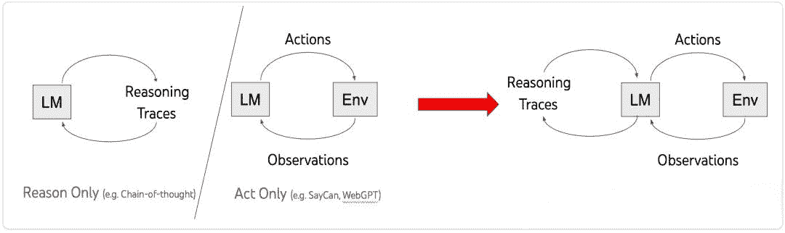
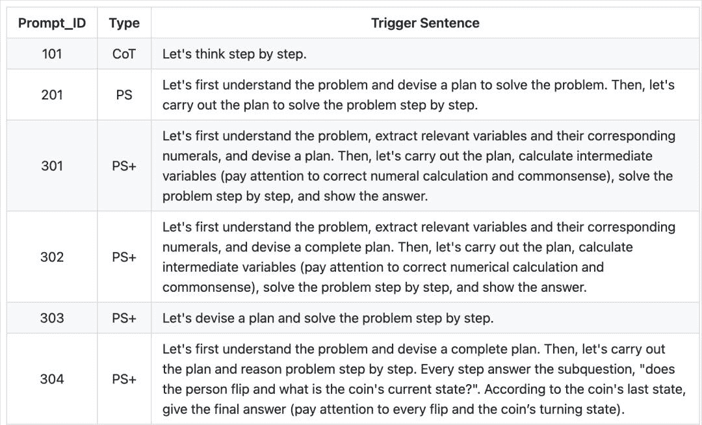
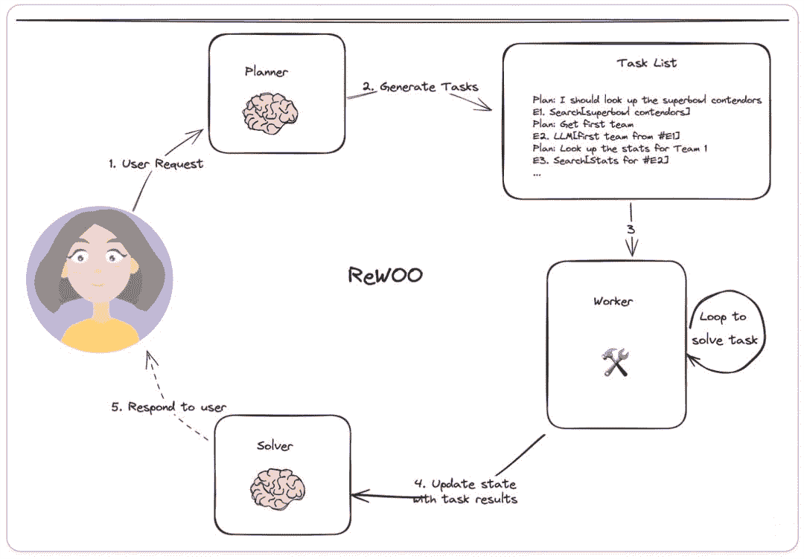
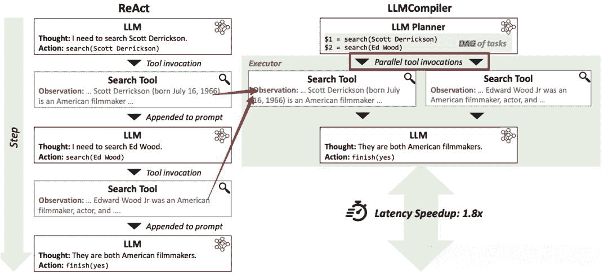
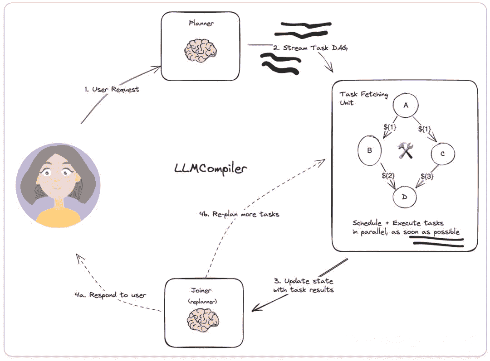
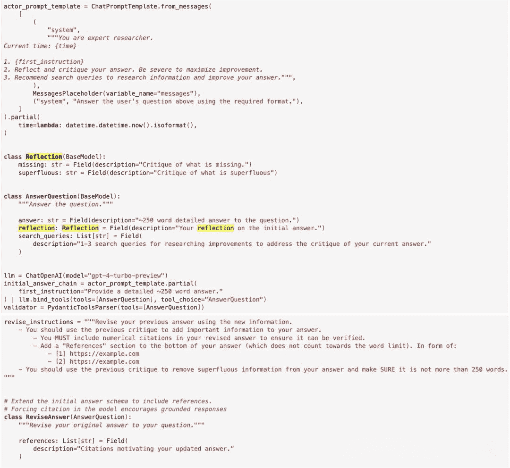
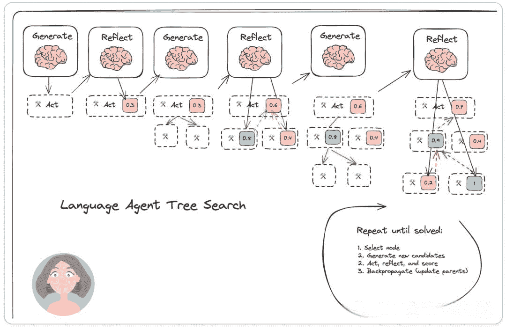
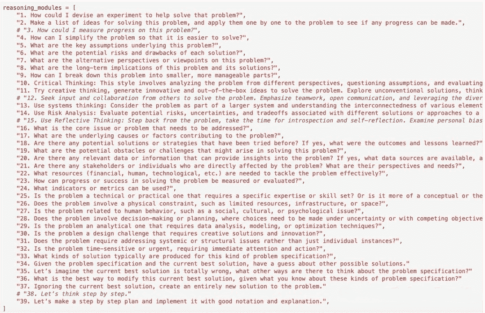
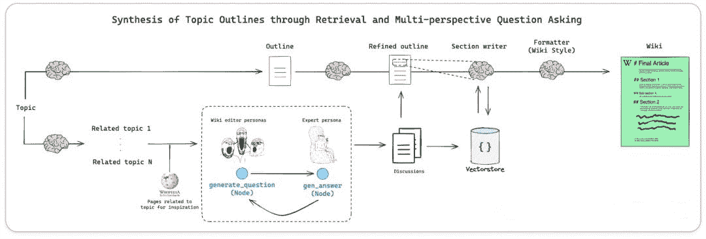

# Agent的8种设计模式拆解（图解+代码）

> 来源：[https://qqs7y1hozd1.feishu.cn/docx/CvSwdCEAcoG5sxx0h2kcfqbgn7c](https://qqs7y1hozd1.feishu.cn/docx/CvSwdCEAcoG5sxx0h2kcfqbgn7c)

## 1 ReAct 模式

这是 LLM Agent 第一文，发表于 2022 年 10 月，现在看起来特别简单，但当时ChatGPT还没有面世，能够提出让 LLM 学会使用工具，具有一定的开创性。

### 1.1 ReAct 原理



ReAct 原理很简单，没有 ReAct 之前，Reasoning 和 Act 是分割开来的。

举个例子，你让孩子帮忙去厨房里拿一个瓶胡椒粉，告诉 ta 一步步来（COT提示词策略）：

> 1.先看看台面上有没有；
> 2.再拉开灶台底下抽屉里看看；
> 3.再打开油烟机左边吊柜里看看。

没有 React 的情况就是：

> 不管在第几步找到胡椒粉，ta 都会把这几个地方都看看（`Action`）。

有 React 的情况是：

> `Action1`：先看看台面上有没有；
> `Observation1`：台面上没有胡椒粉，执行下一步；
> `Action2`：再拉开灶台底下抽屉里看看；
> `Observation2`：抽屉里有胡椒粉；
> `Action3`：把胡椒粉拿出来。

即每次执行行动后都有一个“碎碎念`Observation`”：我现在做了啥，是不是已经达到了目的。这相当于让 Agent 能够维持短期记忆。

### 1.2 ReAct 实现(通过代码理解原理)

在看过几个人的开源代码后，拿出一个最容易被产品经理理解的代码来解读。看完你会发现本质上所有的 Agent 设计模式都是将人类的思维、管理模式以结构化`prompt`的方式告诉大模型来进行规划，并调用工具执行，且不断迭代的方法— 明白这一点非常重要。

【代码附在文末】

将代码逻辑梳理为下图(要仔细看)：

接下来结合代码内容详细解读。

> **1.生成提示词。**首先，将代码中预设好 ReAct 的提示词模板(格式为`Quesion->Thought->Action->Observation`)和用户的问题进行合并。得到的提示词是这样的。


如果需要针对你自己的领域定制，需要将 `fewshot` 里的内容更换为更合适的内容，比如你的 Action 里可能会有`"Send message to someone"`， 这里的 Action `"Send message"` 可能就对应一个外部工具的 API 接口。

> **2.调用大模型生成`Thought+Action`。** 接下来将 `few shot` 提示词发给大模型。如果直接将上述提示词发给大模型，大模型生成将针对用户问题生成一堆 `Thought`，`Action` 和 `Observation`，但显然这里 `Action` 还没有展开，并不希望大模型输出 `Observation`。

在代码里通过 `Stop.Observation` 来控制大模型遇到`Observation`后停止输出，于是大模型仅仅返回 `Thought` 和 `Action`，而不会把 `Observation` 给生成出来。

> **3.调用外部工具。**拿到 `Action` 之后，大模型就可以调用外部工具了。

首先判断这里的 `Action` 是不是 `Finish`，如果不是我们就可以利用大模型把 `Action` 后面的自然语言转换为外部工具能识别的 `API` 接口，这个转换过程就是大模型的 `function calling` 功能，本质上是对大模型进行微调，专门用于语言格式转换的模型，但并非所有的大模型都支持 `function calling`。

> 4.生成`Observation`。`API` 接口返回后，还会将接口返回内容转换为自然语言输出，生成 `Observation`，然后将 `Observation` 的内容。

加上刚刚的 `Thought`，`Action` 内容输入给大模型，重复第 2，3 步，直至 `Action` 为`Finish` 为止。

> **5.完成输出。**将最后一步的 `Observation` 转化为自然语言输出给用户。

由此可以看到 Agent 要落地一个场景，需要定制两项内容：

+ `Prompt` 模板中 `few shot` 中的内容。

+ `function calling` 中的外部工具定义。

而 `Prompt` 模板中 `fewshot` 本质上就是人类思维模式的结构化体现，通过查阅各个设计模式的 `prompt` 模板是很好的学习 Agent 设计模式的方法，习得这个方法，可以用同样的方法理解其他的设计模式，以下模式不再进行代码解读，大家可以④信“pm”获得所有设计模式的代码链接进行学习。

## 2 Plan and solve 模式

这种设计模式是先有计划再来执行。如果说 ReAct更适合 完成“厨房拿胡椒粉”的任务，那么 Plan & solve 更适合完成“西红柿炒鸡蛋”的任务：需要计划，并且过程中计划可能会变化（比如你打开冰箱发现没有西红柿时，你将购买西红柿作为新的步骤加入计划）。

提示词模板方面，论文标题中说得很直白，《Plan-and-Solve Prompting: Improving Zero-Shot Chain-of-Thought Reasoning by Large Language Models》，简言之就是 `Zero shot` 的提升。



架构上它的组成是这样的：


+ `规划器`：负责让 LLM 生成一个多步计划来完成一个大任务。代码中有 `Planner` 和和 `Replanner`，`Planner` 负责第一次生成计划；`Replanner` 是指在完成单个任务后，根据目前任务的完成情况进行 `Replan`，所以 `Replanner` 提示词中除了 `Zeroshot`，还会包含：目标，原有计划，和已完成步骤的情况。

+ `执行器`：接受用户查询和规划中的步骤，并调用一个或多个工具来完成该任务。

## 3 Reason without Observation

REWOO这种方法是相对 ReAct中的`Observation` 来说的，ReAct 提示词结构是 `Thought`→ `Action`→ `Observation`, 而 REWOO 把 `Observation` 去掉了。但实际上，REWOO 只是将 `Observation` 隐式地嵌入到下一步的执行单元中了，即由下一步骤的执行器自动去 observe 上一步执行器的输出。

举个例子，常见的审批流都是环环相扣的，比如目标是完成 `c`，我们的步骤是：

+ 我们需要从部门 `A` 中拿到 `a` 文件，

+ 然后拿着 `a` 文件去部门 `B` 办理 `b` 文件，

+ 然后拿着 `b` 文件去部门 `C` 办理 `c` 文件- 任务完成。

这其中第 2，3 步骤中 `B`，`C` 部门对 `a`，`b` 文件的审查本身就是一类`Observation`。又比如下面提示词模板中给出 `one shot` 内容中定义出每一步的 `plan` 都会依赖上一步的输入。


架构上它由三个组件组成：



+ `Planner`：负责生成一个相互依赖的“链式计划”，定义每一步所依赖的上一步的输出。

+ `Worker`：循环遍历每个任务，并将任务输出分配给相应的变量。当调用后续调用时，它还会用变量的结果替换变量。

+ `Solver`：求解器将所有这些输出整合为最终答案。

## 4 LLMCompiler

Compiler-编译一词在计算机科学的意义就是如何进行任务编排使得计算更有效率，原论文题目是《An LLM Compiler for Parallel Function Calling》，很直白，就是通过并行`Function calling`来提高效率，比如用户提问张译和吴京差几岁，`planner` 搜索张译年龄和搜索吴京年龄同时进行，最后合并即可。



提示词里对 Planner 的要求是这样的，重点是希望生成一个 DAG(Direct Acyclic Graph, 有向无环图。


架构上有一个 `Planner`(规划器)，有一个 `Jointer`(合并器)。



## 5 Basic Reflection

Basic Reflection 可以类比于学生(`Generator`)写作业，老师(`Reflector`)来批改建议，学生根据批改建议来修改，如此反复。

提示词就是复刻师生之间的交互。

架构上有一个 `Generator`，一个 `Reflector`。


## 6 Reflexion

Reflexion 是 Basic reflection 的升级版，相应论文标题是《Reflexion: Language Agents with Verbal Reinforcement Learning》，本质上是强化学习的思路。和 `Basic reflection` 相比，引入了外部数据来评估回答是否准确，并强制生成响应中多余和缺失的方面，这使得反思的内容更具建设性。

> 提示词方面：会让大模型针对问题在回答前进行反思和批判性思考，反思包括有没有漏掉(`missing`)或者重复(`Superfluous`)，然后回答问题，回答之后再有针对性的修改(`Revise`)



架构上，有一个 `Responder`：自带批判式思考的陈述 `Critique`；有一个 `Revisor`：以 `Responder` 中的批判式思考作为上下文参考对初始回答做修改。


## 7 Language Agent Tree Search

LATS 相应论文标题是《Language Agent Tree Search Unifies Reasoning Acting and Planning in Language Models》，很直白：是 Tree search + ReAct+Plan&solve 的融合体。

在原作的图中，我们也看到 LATS 中通过树搜索的方式进行 Reward(强化学习的思路)，同时还会融入 Reflection，从而拿到最佳结果。所以：

LATS = Tree search + ReAct+Plan&solve + Reflection + 强化学习


提示词模板方面和之前的 reflection，plan&solve，ReAct 差别不大，只是上下文中多了对树搜索结果的评估和返回结果。

架构上，就是多轮的 `Basic Reflection`， 多个 `Generator` 和 `Reflector`。



## 8 Self-Discover

Self-discover 的核心是让大模型在更小粒度上 `task` 本身进行反思，比如前文中的 Plan&Slove 是反思 `task` 是不是需要补充，而 Self-discover 是对 `task` 本身进行反思。


提示词方面，Self-discover 列出一系列的反思方式让 agent 来选择：



结构上，Self-Discover 如下图所示：


+ `Selector`：从众多的反省方式中选择合适的反省方式；

+ `Adaptor`：使用选择的反省方式进行反省；

+ `Implementor`：反省后进行重新 Reasoning;

## 9 Storm

Storm 相应论文标题是《 Assisting in Writing Wikipedia-like Articles From Scratch with Large Language Models》，很直白：可以从零生成一篇像维基百科的文章。主要思路是先让 agent 利用外部工具搜索生成大纲，然后再生成大纲里的每部分内容。


提示词模板方面主要围绕如何生成大纲，如何丰富大纲内容来展开。

架构上，就是先有 `topic`， 然后生成大纲，根据大纲丰富内容。这里会有一个大纲生成器，一个内容生成器。



## 10 总结

好了，以上就是目前所总结的 Agent 九大设计模式，其实 Agent 中没有最好的设计模式，只有最适合的设计模式，最终还是要从用户需求出发来选择。

下面是完整代码

【ReAct模式】对应完整代码


# CoT - Chain of Thought Reasoning

```python
!pip -q install langchain huggingface_hub openai google-search-results tiktoken wikipedia
```

```python
import os

os.environ["OPENAI_API_KEY"] = ""
```

```python
!pip show langchain
```

Name: langchain  
Version: 0.0.194  
Summary: Building applications with LLMs through composability  
Home-page: https://www.github.com/hwchase17/langchain  
Author:   
Author-email:   
License: MIT  
Location: /usr/local/lib/python3.10/dist-packages  
Requires: aiohttp, async-timeout, dataclasses-json, langchainplus-sdk, numexpr, numpy, openapi-schema-pydantic, pydantic, PyYAML, requests, SQLAlchemy, tenacity  
Required-by:   

```python
from langchain.llms import OpenAI

llm = OpenAI(model_name='text-davinci-003',
             temperature=0,
             max_tokens = 256)
```

```python
text = "Explain step by step. How old is the president of the United States?"

print(llm(text))
```

1. The current President of the United States is Joe Biden.  

2. Joe Biden was born on November 20, 1942.  

3. To calculate his age, subtract his birth year (1942) from the current year (2021).  

4. Therefore, Joe Biden is 78 years old.

```python
text = "How would I get from Singapore to San Francisco?"

print(llm(text))
```

The most direct route from Singapore to San Francisco is to fly. There are several airlines that offer direct flights from Singapore to San Francisco, including Singapore Airlines, United Airlines, and American Airlines. The flight time is approximately 15 hours.

```python
text = "Explain step by step. How would I get from Singapore to San Francisco?"

print(llm(text))
```

1. Book a flight from Singapore to San Francisco. You can do this online or through a travel agent.

2. Pack your bags and make sure you have all the necessary documents for travel, such as a passport and visa if necessary.

3. Arrive at the airport in Singapore at least two hours before your flight.

4. Check in for your flight and go through security.

5. Board your flight and enjoy the journey.

6. Arrive at San Francisco International Airport.

7. Go through customs and immigration.

8. Collect your luggage and make your way to your destination.

## Manual ReACT

```python
question = "How old is the president of the United States?"

manual_react = f"""Question: What is the elevation range for the area that the eastern sector of the Colorado orogeny extends into?
Thought: I need to search Colorado orogeny, find the area that the eastern sector of the Colorado orogeny extends into, then find the elevation range of the area.
Action: Search[Colorado orogeny]
Observation: The Colorado orogeny was an episode of mountain building (an orogeny) in Colorado and surrounding areas.
Thought: It does not mention the eastern sector. So I need to look up eastern sector.
Action: Lookup[eastern sector]
Observation: (Result 1 / 1) The eastern sector extends into the High Plains and is called the Central Plains orogeny.
Thought: The eastern sector of Colorado orogeny extends into the High Plains. So I need to search High Plains and find its elevation range.
Action: Search[High Plains]
Observation: High Plains refers to one of two distinct land regions
Thought: I need to instead search High Plains (United States).
Action: Search[High Plains (United States)]
Observation: The High Plains are a subregion of the Great Plains. From east to west, the High Plains rise in elevation from around 1,800 to 7,000 ft (550 to 2,130 m).[3]
Thought: High Plains rise in elevation from around 1,800 to 7,000 ft, so the answer is 1,800 to 7,000 ft.
Action: Finish[1,800 to 7,000 ft]

Question: Musician and satirist Allie Goertz wrote a song about the "The Simpsons" character Milhouse, who Matt Groening named after who?
Thought: The question simplifies to "The Simpsons" character Milhouse is named after who. I only need to search Milhouse and find who it is named after.
Action: Search[Milhouse]
Observation: Milhouse Mussolini Van Houten is a recurring character in the Fox animated television series The Simpsons voiced by Pamela Hayden and created by Matt Groening.
Thought: The paragraph does not tell who Milhouse is named after, maybe I can look up "named after".
Action: Lookup[named after]
Observation: (Result 1 / 1) Milhouse was named after U.S. president Richard Nixon, whose middle name was Milhous.
Thought: Milhouse was named after U.S. president Richard Nixon, so the answer is Richard Nixon.
Action: Finish[Richard Nixon]

Question: Which documentary is about Finnish rock groups, Adam Clayton Powell or The Saimaa Gesture?
Thought: I need to search Adam Clayton Powell and The Saimaa Gesture, and find which documentary is about Finnish rock groups.
Action: Search[Adam Clayton Powell]
Observation: Could not find [Adam Clayton Powell]. Similar: [’Adam Clayton Powell III’, ’Seventh Avenue (Manhattan)’, ’Adam Clayton Powell Jr. State Office Building’, ’Isabel Washington Powell’, ’Adam Powell’, ’Adam Clayton Powell (film)’, ’Giancarlo Esposito’].
Thought: To find the documentary, I can search Adam Clayton Powell (film).
Action: Search[Adam Clayton Powell (film)]
Observation: Adam Clayton Powell is a 1989 American documentary film directed by Richard Kilberg. The film is about the rise and fall of influential African-American politician Adam Clayton Powell Jr.[3][4] It was later aired as part of the PBS series The American Experience.
Thought: Adam Clayton Powell (film) is a documentary about an African-American politician, not Finnish rock groups. So the documentary about Finnish rock groups must instead be The Saimaa Gesture.
Action: Finish[The Saimaa Gesture]

Question: What profession does Nicholas Ray and Elia Kazan have in common?
Thought: I need to search Nicholas Ray and Elia Kazan, find their professions, then find the profession they have in common.
Action: Search[Nicholas Ray]
Observation: Nicholas Ray (born Raymond Nicholas Kienzle Jr., August 7, 1911 - June 16, 1979) was an American film director, screenwriter, and actor best known for the 1955 film Rebel Without a Cause.
Thought: Professions of Nicholas Ray are director, screenwriter, and actor. I need to search Elia Kazan next and find his professions.
Action: Search[Elia Kazan]
Observation: Elia Kazan was an American film and theatre director, producer, screenwriter and actor.
Thought: Professions of Elia Kazan are director, producer, screenwriter, and actor. So profession Nicholas Ray and Elia Kazan have in common is director, screenwriter, and actor.
Action: Finish[director, screenwriter, actor]

Question: Which magazine was started first Arthur’s Magazine or First for Women?
Thought: I need to search Arthur’s Magazine and First for Women, and find which was started first.
Action: Search[Arthur’s Magazine]
Observation: Arthur’s Magazine (1844-1846) was an American literary periodical published in Philadelphia in the 19th century.
Thought: Arthur’s Magazine was started in 1844. I need to search First for Women next.
Action: Search[First for Women]
Observation: First for Women is a woman’s magazine published by Bauer Media Group in the USA.[1] The magazine was started in 1989.
Thought: First for Women was started in 1989. 1844 (Arthur’s Magazine) < 1989 (First for Women), so Arthur’s Magazine was started first.
Action: Finish[Arthur’s Magazine]

Question:{question}"""
```

```python
print(llm(manual_react))
```

Thought: I need to search the president of the United States, find their age, and answer the question.  
Action: Search[president of the United States]  
Observation: Joe Biden is the 46th and current president of the United States.  
Thought: Joe Biden is the president of the United States. I need to search Joe Biden and find his age.  
Action: Search[Joe Biden]  
Observation: Joseph Robinette Biden Jr. (born November 20, 1942) is an American politician who is the 46th and current president of the United States.  
Thought: Joe Biden was born in 1942, so he is 78 years old.  
Action: Finish[78 years old]

## ReACT

“REACT: SYNERGIZING REASONING AND ACTING IN LANGUAGE MODELS” (Shunyu et al., 2022)

```python
from langchain import OpenAI, Wikipedia
from langchain.agents import initialize_agent, Tool
from langchain.agents import AgentType
from langchain.agents.react.base import DocstoreExplorer
```

```python
docstore = DocstoreExplorer(Wikipedia())

tools = [
    Tool(
        name="Search",
        func=docstore.search,
        description="useful for when you need to ask with search"
    ),
    Tool(
        name="Lookup",
        func=docstore.lookup,
        description="useful for when you need to ask with lookup"
    )
]

llm = OpenAI(temperature=0, model_name="text-davinci-003")

react = initialize_agent(tools, llm, agent=AgentType.REACT_DOCSTORE, verbose=True)
```

```python
question = "How old is the president of the United States?"
react.run(question)
```

Entering new AgentExecutor chain...

Thought: I need to search the president of the United States, find his age, and then finish.

Action: Search[president of the United States]

Observation: The President of the United States (POTUS) is the head of state and head of government of the United States of America. The president directs the executive branch of the federal government and is the commander-in-chief of the United States Armed Forces.

The power of the presidency has grown substantially since the first president, George Washington, took office in 1789. While presidential power has ebbed and flowed over time, the presidency has played an increasingly significant role in American political life since the beginning of the 20th century, with notable expansion during the presidency of Franklin D. Roosevelt. In modern times, the president is one of the world's most powerful political figures – the leader of the only remaining global superpower. As the leader of the nation with the largest economy by nominal GDP, the president possesses significant domestic and international hard and soft power.

Article II of the Constitution establishes the executive branch of the federal government and vests executive power in the president. The power includes the execution and enforcement of federal law and the responsibility to appoint federal executive, diplomatic, regulatory, and judicial officers.  Based on constitutional provisions empowering the president to appoint and receive ambassadors and conclude treaties with foreign powers, and on subsequent laws enacted by Congress, the modern presidency has primary responsibility for conducting U.S. foreign policy. The role includes responsibility for directing the world's most expensive military, which has the second largest nuclear arsenal.

The president also plays a leading role in federal legislation and domestic policymaking. As part of the system of separation of powers, Article I, Section 7 of the Constitution gives the president the power to sign or veto federal legislation.  Since modern presidents are typically viewed as leaders of their political parties, major policymaking is significantly shaped by the outcome of presidential elections, with presidents taking an active role in promoting their policy priorities to members of Congress who are often electorally dependent on the president. In recent decades, presidents have also made increasing use of executive orders, agency regulations, and judicial appointments to shape domestic policy.

The president is elected indirectly through the Electoral College to a four-year term, along with the vice president. Under the Twenty-second Amendment, ratified in 1951, no person who has been elected to two presidential terms may be elected to a third. In addition, nine vice presidents have become president by virtue of a president's intra-term death or resignation. In all, 45 individuals have served 46 presidencies spanning 58 four-year terms. Joe Biden is the 46th and current president of the United States, having assumed office on January 20, 2021.

Thought: The current president is Joe Biden, and he assumed office on January 20, 2021. So the answer is that the current president is 78 years old.

Action: Finish[78 years old]

Finished chain.

'78 years old'

```python
question = "How old will the president of the United States be in June 2023?"
react.run(question)
```

Entering new AgentExecutor chain...

Thought: I need to search the president of the United States, find their age, then find how old they will be in June 2023.

Action: Search[president of the United States]

Observation: The President of the United States (POTUS) is the head of state and head of government of the United States of America. The president directs the executive branch of the federal government and is the commander-in-chief of the United States Armed Forces.

The power of the presidency has grown substantially since the first president, George Washington, took office in 1789. While presidential power has ebbed and flowed over time, the presidency has played an increasingly significant role in American political life since the beginning of the 20th century, with notable expansion during the presidency of Franklin D. Roosevelt. In modern times, the president is one of the world's most powerful political figures – the leader of the only remaining global superpower. As the leader of the nation with the largest economy by nominal GDP, the president possesses significant domestic and international hard and soft power.

Article II of the Constitution establishes the executive branch of the federal government and vests executive power in the president. The power includes the execution and enforcement of federal law and the responsibility to appoint federal executive, diplomatic, regulatory, and judicial officers.  Based on constitutional provisions empowering the president to appoint and receive ambassadors and conclude treaties with foreign powers, and on subsequent laws enacted by Congress, the modern presidency has primary responsibility for conducting U.S. foreign policy. The role includes responsibility for directing the world's most expensive military, which has the second largest nuclear arsenal.

The president also plays a leading role in federal legislation and domestic policymaking. As part of the system of separation of powers, Article I, Section 7 of the Constitution gives the president the power to sign or veto federal legislation.  Since modern presidents are typically viewed as leaders of their political parties, major policymaking is significantly shaped by the outcome of presidential elections, with presidents taking an active role in promoting their policy priorities to members of Congress who are often electorally dependent on the president. In recent decades, presidents have also made increasing use of executive orders, agency regulations, and judicial appointments to shape domestic policy.

The president is elected indirectly through the Electoral College to a four-year term, along with the vice president. Under the Twenty-second Amendment, ratified in 1951, no person who has been elected to two presidential terms may be elected to a third. In addition, nine vice presidents have become president by virtue of a president's intra-term death or resignation. In all, 45 individuals have served 46 presidencies spanning 58 four-year terms. Joe Biden is the 46th and current president of the United States, having assumed office on January 20, 2021.

Thought: The current president is Joe Biden, who was born on November 20, 1942. So in June 2023, he will be 80 years old.

Action: Finish[80 years old]

Finished chain.

'80 years old'

```python
question = "How old is the president of the United States?"
react.run(question)
```

### Let pull apart the Chain

```python
print(react.agent.llm_chain.prompt.template)
the
```

Question: What is the elevation range for the area that the eastern sector of the Colorado orogeny extends into?
Thought: I need to search Colorado orogeny, find the area that the eastern sector of the Colorado orogeny extends into, then find the elevation range of the area.
Action: Search[Colorado orogeny]
Observation: The Colorado orogeny was an episode of mountain building (an orogeny) in Colorado and surrounding areas.
Thought: It does not mention the eastern sector. So I need to look up eastern sector.
Action: Lookup[eastern sector]
Observation: (Result 1 / 1) The eastern sector extends into the High Plains and is called the Central Plains orogeny.
Thought: The eastern sector of Colorado orogeny extends into the High Plains. So I need to search High Plains and find its elevation range.
Action: Search[High Plains]
Observation: High Plains refers to one of two distinct land regions
Thought: I need to instead search High Plains (United States).
Action: Search[High Plains (United States)]
Observation: The High Plains are a subregion of the Great Plains. From east to west, the High Plains rise in elevation from around 1,800 to 7,000 ft (550 to 2,130 m).[3]
Thought: High Plains rise in elevation from around 1,800 to 7,000 ft, so the answer is 1,800 to 7,000 ft.
Action: Finish[1,800 to 7,000 ft]

Question: Musician and satirist Allie Goertz wrote a song about the "The Simpsons" character Milhouse, who Matt Groening named after who?
Thought: The question simplifies to "The Simpsons" character Milhouse is named after who. I only need to search Milhouse and find who it is named after.
Action: Search[Milhouse]
Observation: Milhouse Mussolini Van Houten is a recurring character in the Fox animated television series The Simpsons voiced by Pamela Hayden and created by Matt Groening.
Thought: The paragraph does not tell who Milhouse is named after, maybe I can look up "named after".
Action: Lookup[named after]
Observation: (Result 1 / 1) Milhouse was named after U.S. president Richard Nixon, whose middle name was Milhous.
Thought: Milhouse was named after U.S. president Richard Nixon, so the answer is Richard Nixon.
Action: Finish[Richard Nixon]

Question: Which documentary is about Finnish rock groups, Adam Clayton Powell or The Saimaa Gesture?
Thought: I need to search Adam Clayton Powell and The Saimaa Gesture, and find which documentary is about Finnish rock groups.
Action: Search[Adam Clayton Powell]
Observation: Could not find [Adam Clayton Powell]. Similar: [’Adam Clayton Powell III’, ’Seventh Avenue (Manhattan)’, ’Adam Clayton Powell Jr. State Office Building’, ’Isabel Washington Powell’, ’Adam Powell’, ’Adam Clayton Powell (film)’, ’Giancarlo Esposito’].
Thought: To find the documentary, I can search Adam Clayton Powell (film).
Action: Search[Adam Clayton Powell (film)]
Observation: Adam Clayton Powell is a 1989 American documentary film directed by Richard Kilberg. The film is about the rise and fall of influential African-American politician Adam Clayton Powell Jr.[3][4] It was later aired as part of the PBS series The American Experience.
Thought: Adam Clayton Powell (film) is a documentary about an African-American politician, not Finnish rock groups. So the documentary about Finnish rock groups must instead be The Saimaa Gesture.
Action: Finish[The Saimaa Gesture]

Question: What profession does Nicholas Ray and Elia Kazan have in common?
Thought: I need to search Nicholas Ray and Elia Kazan, find their professions, then find the profession they have in common.
Action: Search[Nicholas Ray]
Observation: Nicholas Ray (born Raymond Nicholas Kienzle Jr., August 7, 1911 - June 16, 1979) was an American film director, screenwriter, and actor best known for the 1955 film Rebel Without a Cause.
Thought: Professions of Nicholas Ray are director, screenwriter, and actor. I need to search Elia Kazan next and find his professions.
Action: Search[Elia Kazan]
Observation: Elia Kazan was an American film and theatre director, producer, screenwriter and actor.
Thought: Professions of Elia Kazan are director, producer, screenwriter, and actor. So profession Nicholas Ray and Elia Kazan have in common is director, screenwriter, and actor.
Action: Finish[director, screenwriter, actor]

Question: Which magazine was started first Arthur’s Magazine or First for Women?
Thought: I need to search Arthur’s Magazine and First for Women, and find which was started first.
Action: Search[Arthur’s Magazine]
Observation: Arthur’s Magazine (1844-1846) was an American literary periodical published in Philadelphia in the 19th century.
Thought: Arthur’s Magazine was started in 1844. I need to search First for Women next.
Action: Search[First for Women]
Observation: First for Women is a woman’s magazine published by Bauer Media Group in the USA.[1] The magazine was started in 1989.
Thought: First for Women was started in 1989. 1844 (Arthur’s Magazine) < 1989 (First for Women), so Arthur’s Magazine was started first.
Action: Finish[Arthur’s Magazine]

Question: Were Pavel Urysohn and Leonid Levin known for the same type of work?
Thought: I need to search Pavel Urysohn and Leonid Levin, find their types of work, then find if they are the same.
Action: Search[Pavel Urysohn]
Observation: Pavel Samuilovich Urysohn (February 3, 1898 - August 17, 1924) was a Soviet mathematician who is best known for his contributions in dimension theory.
Thought: Pavel Urysohn is a mathematician. I need to search Leonid Levin next and find its type of work.
Action: Search[Leonid Levin]
Observation: Leonid Anatolievich Levin is a Soviet-American mathematician and computer scientist.
Thought: Leonid Levin is a mathematician and computer scientist. So Pavel Urysohn and Leonid Levin have the same type of work.
Action: Finish[yes]

Question: {input}
{agent_scratchpad}

```python
# multi hop example
question = "What is the first film that Russell Crowe won an Oscar for, and who directed that movie?"
react.run(question)
```

Entering new AgentExecutor chain...

Thought: I need to search Russell Crowe and find the first film he won an Oscar for, and who directed that movie.
Action: Search[Russell Crowe]

Observation: Could not find [Russell Crowe]. Similar: ['Russell Crowe', 'Russell Crowe filmography', "The Pope's Exorcist", 'Unhinged (2020 film)', 'Robin Hood (2010 film)', "Russell Crowe's jockstrap", 'Dave Crowe', 'Sleeping Dogs (upcoming film)', 'List of awards and nominations received by Russell Crowe', 'Gladiator (2000 film)']

Thought: To find the first film Russell Crowe won an Oscar for, I can search Gladiator (2000 film).
Action: Search[Gladiator (2000 film)]

Observation: Gladiator is a 2000 epic historical drama film directed by Ridley Scott and written by David Franzoni, John Logan, and William Nicholson. It was produced by Universal Pictures. DreamWorks Pictures distributed the film in North America while Universal Pictures released it internationally through United International Pictures. It stars Russell Crowe, Joaquin Phoenix, Connie Nielsen, Tomas Arana, Ralf Möller, Oliver Reed (in his final role), Djimon Hounsou, Derek Jacobi, John Shrapnel, Richard Harris, and Tommy Flanagan. Crowe portrays Roman general Maximus Decimus Meridius, who is betrayed when Commodus, the ambitious son of Emperor Marcus Aurelius, murders his father and seizes the throne. Reduced to slavery, Maximus becomes a gladiator and rises through the ranks of the arena to avenge the murders of his family and his emperor.

Inspired by Daniel P. Mannix's 1958 book Those About to Die (formerly titled The Way of the Gladiator), the film's script, initially written by Franzoni, was acquired by DreamWorks and Ridley Scott signed on to direct the film. Principal photography, which began in January 1999 and wrapped up in May of that year, was known to have a set of problems due to the script being unfinished. Several of the cast complained about the writing quality throughout the nineteen-week shoot in Fort Ricasoli, Malta, forcing many rewrites. Complications of the film's production were made worse when Reed died of a heart attack before production could be wrapped up. British post-production company The Mill, which constructed the film's computer-generated imagery effects, had to create a digital body double for the remaining scenes involving Reed's character Proximo.

Despite its troubled production, Gladiator was anticipated to be one of the year's most successful films. On its release, the film grossed over $503 million worldwide, becoming the second highest-grossing film of 2000 behind Mission: Impossible 2. Critics praised the acting (particularly Crowe's and Phoenix's performances), Scott's direction, visuals, screenplay, action sequences, musical score, and the production values, although its dark and brooding tone was criticized. Winning numerous accolades, Gladiator won five Academy Awards at the 73rd Academy Awards, including Best Picture and Best Actor for Crowe. Gladiator both revitalized or established the careers of its cast and crew, particularly elevating Crowe to leading man status and turning Phoenix into a celebrity.

Since its release, Gladiator has been critically reevaluated and it has been considered one of the best films of the 2000s and one of the greatest historical epic films ever made. It has been credited with reinventing the sword-and-sandal genre after the genre waned in the public eye during the 1960s and also rekindled interest in entertainment centered around the cultures of ancient Greece, Rome, and other time periods throughout world history. Several films have attempted to emulate Gladiator's visuals, style, and tone with varying degrees of success. The film has been analyzed for its themes of revenge, violence, masculinity, and stoicism. In 2021, Scott officially announced that writing had begun on a sequel to the film, which is scheduled to be released in the United States on November 22, 2024.

Thought: Gladiator is a 2000 epic historical drama film directed by Ridley Scott and written by David Franzoni, John Logan, and William Nicholson. It stars Russell Crowe, Joaquin Phoenix, Connie Nielsen, Tomas Arana, Ralf Möller, Oliver Reed (in his final role), Djimon Hounsou, Derek Jacobi, John Shrapnel, Richard Harris, and Tommy Flanagan. Crowe portrays Roman general Maximus Decimus Meridius, who is betrayed when Commodus, the ambitious son of Emperor Marcus Aurelius, murders his father and seizes the throne. Reduced to slavery, Maximus becomes a gladiator and rises through the ranks of the arena to avenge the murders of his family and his emperor.

Thought: Gladiator won five Academy Awards at the 73rd Academy Awards, including Best Picture and Best Actor for Crowe.
Action: Finish[Gladiator, Ridley Scott]

Finished chain.

'Gladiator, Ridley Scott'

```python
import langchain

langchain.debug = True
```

```python
# multi hop example
question = "What is the first film that Russell Crowe won an Oscar for, and who directed that movie?"
react.run(question)
```

[chain/start] [1:chain:AgentExecutor] Entering Chain run with input:
{
  "input": "What is the first film that Russell Crowe won an Oscar for, and who directed that movie?"
}
[chain/start] [1:chain:AgentExecutor > 2:chain:LLMChain] Entering Chain run with input:
{
  "input": "What is the first film that Russell Crowe won an Oscar for, and who directed that movie?",
  "agent_scratchpad": "",
  "stop": [
    "\nObservation:"
  ]
}
[llm/start] [1:chain:AgentExecutor > 2:chain:LLMChain > 3:llm:OpenAI] Entering LLM run with input:
{
  "prompts": [
    "Question: What is the elevation range for the area that the eastern sector of the Colorado orogeny extends into?\nThought: I need to search Colorado orogeny, find the area that the eastern sector of the Colorado orogeny extends into, then find the elevation range of the area.\nAction: Search[Colorado orogeny]\nObservation: The Colorado orogeny was an episode of mountain building (an orogeny) in Colorado and surrounding areas.\nThought: It does not mention the eastern sector. So I need to look up eastern sector.\nAction: Lookup[eastern sector]\nObservation: (Result 1 / 1) The eastern sector extends into the High Plains and is called the Central Plains orogeny.\nThought: The eastern sector of Colorado orogeny extends into the High Plains. So I need to search High Plains and find its elevation range.\nAction: Search[High Plains]\nObservation: High Plains refers to one of two distinct land regions\nThought: I need to instead search High Plains (United States).\nAction: Search[High Plains (United States)]\nObservation: The High Plains are a subregion of the Great Plains. From east to west, the High Plains rise in elevation from around 1,800 to 7,000 ft (550 to 2,130 m).[3]\nThought: High Plains rise in elevation from around 1,800 to 7,000 ft, so the answer is 1,800 to 7,000 ft.\nAction: Finish[1,800 to 7,000 ft]\n\nQuestion: Musician and satirist Allie Goertz wrote a song about the \"The Simpsons\" character Milhouse, who Matt Groening named after who?\nThought: The question simplifies to \"The Simpsons\" character Milhouse is named after who. I only need to search Milhouse and find who it is named after.\nAction: Search[Milhouse]\nObservation: Milhouse Mussolini Van Houten is a recurring character in the Fox animated television series The Simpsons voiced by Pamela Hayden and created by Matt Groening.\nThought: The paragraph does not tell who Milhouse is named after, maybe I can look up \"named after\".\nAction: Lookup[named after]\nObservation: (Result 1 / 1) Milhouse was named after U.S. president Richard Nixon, whose middle name was Milhous.\nThought: Milhouse was named after U.S. president Richard Nixon, so the answer is Richard Nixon.\nAction: Finish[Richard Nixon]\n\nQuestion: Which documentary is about Finnish rock groups, Adam Clayton Powell or The Saimaa Gesture?\nThought: I need to search Adam Clayton Powell and The Saimaa Gesture, and find which documentary is about Finnish rock groups.\nAction: Search[Adam Clayton Powell]\nObservation: Could not find [Adam Clayton Powell]. Similar: [’Adam Clayton Powell III’, ’Seventh Avenue (Manhattan)’, ’Adam Clayton Powell Jr. State Office Building’, ’Isabel Washington Powell’, ’Adam Powell’, ’Adam Clayton Powell (film)’, ’Giancarlo Esposito’].\nThought: To find the documentary, I can search Adam Clayton Powell (film).\nAction: Search[Adam Clayton Powell (film)]\nObservation: Adam Clayton Powell is a 1989 American documentary film directed by Richard Kilberg. The film is about the rise and fall of influential African-American politician Adam Clayton Powell Jr.[3][4] It was later aired as part of the PBS series The American Experience.\nThought: Adam Clayton Powell (film) is a documentary about an African-American politician, not Finnish rock groups. So the documentary about Finnish rock groups must instead be The Saimaa Gesture.\nAction: Finish[The Saimaa Gesture]\n\nQuestion: What profession does Nicholas Ray and Elia Kazan have in common?\nThought: I need to search Nicholas Ray and Elia Kazan, find their professions, then find the profession they have in common.\nAction: Search[Nicholas Ray]\nObservation: Nicholas Ray (born Raymond Nicholas Kienzle Jr., August 7, 1911 - June 16, 1979) was an American film director, screenwriter, and actor best known for the 1955 film Rebel Without a Cause.\nThought: Professions of Nicholas Ray are director, screenwriter, and actor. I need to search Elia Kazan next and find his professions.\nAction: Search[Elia Kazan]\nObservation: Elia Kazan was an American film and theatre director, producer, screenwriter and actor.\nThought: Professions of Elia Kazan are director, producer, screenwriter, and actor. So profession Nicholas Ray and Elia Kazan have in common is director, screenwriter, and actor.\nAction: Finish[director, screenwriter, actor]\n\nQuestion: Which magazine was started first Arthur’s Magazine or First for Women?\nThought: I need to search Arthur’s Magazine and First for Women, and find which was started first.\nAction: Search[Arthur’s Magazine]\nObservation: Arthur’s Magazine (1844-1846) was an American literary periodical published in Philadelphia in the 19th century.\nThought: Arthur’s Magazine was started in 1844. I need to search First for Women next.\nAction: Search[First for Women]\nObservation: First for Women is a woman’s magazine published by Bauer Media Group in the USA.[1] The magazine was started in 1989.\nThought: First for Women was started in 1989. 1844 (Arthur’s Magazine) < 1989 (First for Women), so Arthur’s Magazine was started first.\nAction: Finish[Arthur’s Magazine]\n\nQuestion: Were Pavel Urysohn and Leonid Levin known for the same type of work?\nThought: I need to search Pavel Urysohn and Leonid Levin, find their types of work, then find if they are the same.\nAction: Search[Pavel Urysohn]\nObservation: Pavel Samuilovich Urysohn (February 3, 1898 - August 17, 1924) was a Soviet mathematician who is best known for his contributions in dimension theory.\nThought: Pavel Urysohn is a mathematician. I need to search Leonid Levin next and find its type of work.\nAction: Search[Leonid Levin]\nObservation: Leonid Anatolievich Levin is a Soviet-American mathematician and computer scientist.\nThought: Leonid Levin is a mathematician and computer scientist. So Pavel Urysohn and Leonid Levin have the same type of work.\nAction: Finish[yes]\n\n\nQuestion: What is the first film that Russell Crowe won an Oscar for, and who directed that movie?"
  ]
}
[llm/end] [1:chain:AgentExecutor > 2:chain:LLMChain > 3:llm:OpenAI] [3.19s] Exiting LLM run with output:
{
  "generations": [
    [
      {
        "text": "Thought: I need to search Russell Crowe, find the first film he won an Oscar for, and find who directed that movie.\nAction: Search[Russell Crowe]",
        "generation_info": {
          "finish_reason": "stop",
          "logprobs": null
        }
      }
    ]
  ],
  "llm_output": {
    "token_usage": {
      "prompt_tokens": 1481,
      "completion_tokens": 37,
      "total_tokens": 1518
    },
    "model_name": "text-davinci-003"
  },
  "run": null
}
[chain/end] [1:chain:AgentExecutor > 2:chain:LLMChain] [3.19s] Exiting Chain run with output:
{
  "text": "Thought: I need to search Russell Crowe, find the first film he won an Oscar for, and find who directed that movie.\nAction: Search[Russell Crowe]"
}
[tool/start] [1:chain:AgentExecutor > 4:tool:Search] Entering Tool run with input:
"Russell Crowe"
[tool/end] [1:chain:AgentExecutor > 4:tool:Search] [218.84ms] Exiting Tool run with output:
"Could not find [Russell Crowe]. Similar: ['Russell Crowe', 'Russell Crowe filmography', \"The Pope's Exorcist\", 'Unhinged (2020 film)', 'Robin Hood (2010 film)', \"Russell Crowe's jockstrap\", 'Dave Crowe', 'Sleeping Dogs (upcoming film)', 'List of awards and nominations received by Russell Crowe', 'Gladiator (2000 film)']"
[chain/start] [1:chain:AgentExecutor > 5:chain:LLMChain] Entering Chain run with input:
{
  "input": "What is the first film that Russell Crowe won an Oscar for, and who directed that movie?",
  "agent_scratchpad": "Thought: I need to search Russell Crowe, find the first film he won an Oscar for, and find who directed that movie.\nAction: Search[Russell Crowe]\nObservation: Could not find [Russell Crowe]. Similar: ['Russell Crowe', 'Russell Crowe filmography', \"The Pope's Exorcist\", 'Unhinged (2020 film)', 'Robin Hood (2010 film)', \"Russell Crowe's jockstrap\", 'Dave Crowe', 'Sleeping Dogs (upcoming film)', 'List of awards and nominations received by Russell Crowe', 'Gladiator (2000 film)']\nThought:",
  "stop": [
    "\nObservation:"
  ]
}
[llm/start] [1:chain:AgentExecutor > 5:chain:LLMChain > 6:llm:OpenAI] Entering LLM run with input:
{
  "prompts": [
    "Question: What is the elevation range for the area that the eastern sector of the Colorado orogeny extends into?\nThought: I need to search Colorado orogeny, find the area that the eastern sector of the Colorado orogeny extends into, then find the elevation range of the area.\nAction: Search[Colorado orogeny]\nObservation: The Colorado orogeny was an episode of mountain building (an orogeny) in Colorado and surrounding areas.\nThought: It does not mention the eastern sector. So I need to look up eastern sector.\nAction: Lookup[eastern sector]\nObservation: (Result 1 / 1) The eastern sector extends into the High Plains and is called the Central Plains orogeny.\nThought: The eastern sector of Colorado orogeny extends into the High Plains. So I need to search High Plains and find its elevation range.\nAction: Search[High Plains]\nObservation: High Plains refers to one of two distinct land regions\nThought: I need to instead search High Plains (United States).\nAction: Search[High Plains (United States)]\nObservation: The High Plains are a subregion of the Great Plains. From east to west, the High Plains rise in elevation from around 1,800 to 7,000 ft (550 to 2,130 m).[3]\nThought: High Plains rise in elevation from around 1,800 to 7,000 ft, so the answer is 1,800 to 7,000 ft.\nAction: Finish[1,800 to 7,000 ft]\n\nQuestion: Musician and satirist Allie Goertz wrote a song about the \"The Simpsons\" character Milhouse, who Matt Groening named after who?\nThought: The question simplifies to \"The Simpsons\" character Milhouse is named after who. I only need to search Milhouse and find who it is named after.\nAction: Search[Milhouse]\nObservation: Milhouse Mussolini Van Houten is a recurring character in the Fox animated television series The Simpsons voiced by Pamela Hayden and created by Matt Groening.\nThought: The paragraph does not tell who Milhouse is named after, maybe I can look up \"named after\".\nAction: Lookup[named after]\nObservation: (Result 1 / 1) Milhouse was named after U.S. president Richard Nixon, whose middle name was Milhous.\nThought: Milhouse was named after U.S. president Richard Nixon, so the answer is Richard Nixon.\nAction: Finish[Richard Nixon]\n\nQuestion: Which documentary is about Finnish rock groups, Adam Clayton Powell or The Saimaa Gesture?\nThought: I need to search Adam Clayton Powell and The Saimaa Gesture, and find which documentary is about Finnish rock groups.\nAction: Search[Adam Clayton Powell]\nObservation: Could not find [Adam Clayton Powell]. Similar: [’Adam Clayton Powell III’, ’Seventh Avenue (Manhattan)’, ’Adam Clayton Powell Jr. State Office Building’, ’Isabel Washington Powell’, ’Adam Powell’, ’Adam Clayton Powell (film)’, ’Giancarlo Esposito’].\nThought: To find the documentary, I can search Adam Clayton Powell (film).\nAction: Search[Adam Clayton Powell (film)]\nObservation: Adam Clayton Powell is a 1989 American documentary film directed by Richard Kilberg. The film is about the rise and fall of influential African-American politician Adam Clayton Powell Jr.[3][4] It was later aired as part of the PBS series The American Experience.\nThought: Adam Clayton Powell (film) is a documentary about an African-American politician, not Finnish rock groups. So the documentary about Finnish rock groups must instead be The Saimaa Gesture.\nAction: Finish[The Saimaa Gesture]\n\nQuestion: What profession does Nicholas Ray and Elia Kazan have in common?\nThought: I need to search Nicholas Ray and Elia Kazan, find their professions, then find the profession they have in common.\nAction: Search[Nicholas Ray]\nObservation: Nicholas Ray (born Raymond Nicholas Kienzle Jr., August 7, 1911 - June 16, 1979) was an American film director, screenwriter, and actor best known for the 1955 film Rebel Without a Cause.\nThought: Professions of Nicholas Ray are director, screenwriter, and actor. I need to search Elia Kazan next and find his professions.\nAction: Search[Elia Kazan]\nObservation: Elia Kazan was an American film and theatre director, producer, screenwriter and actor.\nThought: Professions of Elia Kazan are director, producer, screenwriter, and actor. So profession Nicholas Ray and Elia Kazan have in common is director, screenwriter, and actor.\nAction: Finish[director, screenwriter, actor]\n\nQuestion: Which magazine was started first Arthur’s Magazine or First for Women?\nThought: I need to search Arthur’s Magazine and First for Women, and find which was started first.\nAction: Search[Arthur’s Magazine]\nObservation: Arthur’s Magazine (1844-1846) was an American literary periodical published in Philadelphia in the 19th century.\nThought: Arthur’s Magazine was started in 1844. I need to search First for Women next.\nAction: Search[First for Women]\nObservation: First for Women is a woman’s magazine published by Bauer Media Group in the USA.[1] The magazine was started in 1989.\nThought: First for Women was started in 1989. 1844 (Arthur’s Magazine) < 1989 (First for Women), so Arthur’s Magazine was started first.\nAction: Finish[Arthur’s Magazine]\n\nQuestion: Were Pavel Urysohn and Leonid Levin known for the same type of work?\nThought: I need to search Pavel Urysohn and Leonid Levin, find their types of work, then find if they are the same.\nAction: Search[Pavel Urysohn]\nObservation: Pavel Samuilovich Urysohn (February 3, 1898 - August 17, 1924) was a Soviet mathematician who is best known for his contributions in dimension theory.\nThought: Pavel Urysohn is a mathematician. I need to search Leonid Levin next and find its type of work.\nAction: Search[Leonid Levin]\nObservation: Leonid Anatolievich Levin is a Soviet-American mathematician and computer scientist.\nThought: Leonid Levin is a mathematician and computer scientist. So Pavel Urysohn and Leonid Levin have the same type of work.\nAction: Finish[yes]\n\n\nQuestion: What is the first film that Russell Crowe won an Oscar for, and who directed that movie?\nThought: I need to search Russell Crowe, find the first film he won an Oscar for, and find who directed that movie.\nAction: Search[Russell Crowe]\nObservation: Could not find [Russell Crowe]. Similar: ['Russell Crowe', 'Russell Crowe filmography', \"The Pope's Exorcist\", 'Unhinged (2020 film)', 'Robin Hood (2010 film)', \"Russell Crowe's jockstrap\", 'Dave Crowe', 'Sleeping Dogs (upcoming film)', 'List of awards and nominations received by Russell Crowe', 'Gladiator (2000 film)']\nThought:"
  ]
}
[llm/end] [1:chain:AgentExecutor > 5:chain:LLMChain > 6:llm:OpenAI] [4.69s] Exiting LLM run with output:
{
  "generations": [
    [
      {
        "text": " To find the first film Russell Crowe won an Oscar for, I can search Gladiator (2000 film).\nAction: Search[Gladiator (2000 film)]",
        "generation_info": {
          "finish_reason": "stop",
          "logprobs": null
        }
      }
    ]
  ],
  "llm_output": {
    "token_usage": {
      "prompt_tokens": 1618,
      "completion_tokens": 32,
      "total_tokens": 1650
    },
    "model_name": "text-davinci-003"
  },
  "run": null
}
[chain/end] [1:chain:AgentExecutor > 5:chain:LLMChain] [4.69s] Exiting Chain run with output:
{
  "text": " To find the first film Russell Crowe won an Oscar for, I can search Gladiator (2000 film).\nAction: Search[Gladiator (2000 film)]"
}
[tool/start] [1:chain:AgentExecutor > 7:tool:Search] Entering Tool run with input:
"Gladiator (2000 film)"
[tool/end] [1:chain:AgentExecutor > 7:tool:Search] [670.9159999999999ms] Exiting Tool run with output:
"Gladiator is a 2000 epic historical drama film directed by Ridley Scott and written by David Franzoni, John Logan, and William Nicholson. It was produced by Universal Pictures. DreamWorks Pictures distributed the film in North America while Universal Pictures released it internationally through United International Pictures. It stars Russell Crowe, Joaquin Phoenix, Connie Nielsen, Tomas Arana, Ralf Möller, Oliver Reed (in his final role), Djimon Hounsou, Derek Jacobi, John Shrapnel, Richard Harris, and Tommy Flanagan. Crowe portrays Roman general Maximus Decimus Meridius, who is betrayed when Commodus, the ambitious son of Emperor Marcus Aurelius, murders his father and seizes the throne. Reduced to slavery, Maximus becomes a gladiator and rises through the ranks of the arena to avenge the murders of his family and his emperor.

Inspired by Daniel P. Mannix's 1958 book Those About to Die (formerly titled The Way of the Gladiator), the film's script, initially written by Franzoni, was acquired by DreamWorks and Ridley Scott signed on to direct the film. Principal photography, which began in January 1999 and wrapped up in May of that year, was known to have a set of problems due to the script being unfinished. Several of the cast complained about the writing quality throughout the nineteen-week shoot in Fort Ricasoli, Malta, forcing many rewrites. Complications of the film's production were made worse when Reed died of a heart attack before production could be wrapped up. British post-production company The Mill, which constructed the film's computer-generated imagery effects, had to create a digital body double for the remaining scenes involving Reed's character Proximo.

Despite its troubled production, Gladiator was anticipated to be one of the year's most successful films. On its release, the film grossed over $503 million worldwide, becoming the second highest-grossing film of 2000 behind Mission: Impossible 2. Critics praised the acting (particularly Crowe's and Phoenix's performances), Scott's direction, visuals, screenplay, action sequences, musical score, and the production values, although its dark and brooding tone was criticized. Winning numerous accolades, Gladiator won five Academy Awards at the 73rd Academy Awards, including Best Picture and Best Actor for Crowe. Gladiator both revitalized or established the careers of its cast and crew, particularly elevating Crowe to leading man status and turning Phoenix into a celebrity.

Since its release, Gladiator has been critically reevaluated and it has been considered one of the best films of the 2000s and one of the greatest historical epic films ever made. It has been credited with reinventing the sword-and-sandal genre after the genre waned in the public eye during the 1960s and also rekindled interest in entertainment centered around the cultures of ancient Greece, Rome, and other time periods throughout world history. Several films have attempted to emulate Gladiator's visuals, style, and tone with varying degrees of success. The film has been analyzed for its themes of revenge, violence, masculinity, and stoicism. In 2021, Scott officially announced that writing had begun on a sequel to the film, which is scheduled to be released in the United States on November 22, 2024."
[chain/start] [1:chain:AgentExecutor > 8:chain:LLMChain] Entering Chain run with input:
{
  "input": "What is the first film that Russell Crowe won an Oscar for, and who directed that movie?",
  "agent_scratchpad": "Thought: I need to search Russell Crowe, find the first film he won an Oscar for, and find who directed that movie.\nAction: Search[Russell Crowe]\nObservation: Could not find [Russell Crowe]. Similar: ['Russell Crowe', 'Russell Crowe filmography', \"The Pope's Exorcist\", 'Unhinged (2020 film)', 'Robin Hood (2010 film)', \"Russell Crowe's jockstrap\", 'Dave Crowe', 'Sleeping Dogs (upcoming film)', 'List of awards and nominations received by Russell Crowe', 'Gladiator (2000 film)']\nThought: To find the first film Russell Crowe won an Oscar for, I can search Gladiator (2000 film).\nAction: Search[Gladiator (2000 film)]\nObservation: Gladiator is a 2000 epic historical drama film directed by Ridley Scott and written by David Franzoni, John Logan, and William Nicholson. It was produced by Universal Pictures. DreamWorks Pictures distributed the film in North America while Universal Pictures released it internationally through United International Pictures. It stars Russell Crowe, Joaquin Phoenix, Connie Nielsen, Tomas Arana, Ralf Möller, Oliver Reed (in his final role), Djimon Hounsou, Derek Jacobi, John Shrapnel, Richard Harris, and Tommy Flanagan. Crowe portrays Roman general Maximus Decimus Meridius, who is betrayed when Commodus, the ambitious son of Emperor Marcus Aurelius, murders his father and seizes the throne. Reduced to slavery, Maximus becomes a gladiator and rises through the ranks of the arena to avenge the murders of his family and his emperor.\nInspired by Daniel P. Mannix's 1958 book Those About to Die (formerly titled The Way of the Gladiator), the film's script, initially written by Franzoni, was acquired by DreamWorks and Ridley Scott signed on to direct the film. Principal photography, which began in January 1999 and wrapped up in May of that year, was known to have a set of problems due to the script being unfinished. Several of the cast complained about the writing quality throughout the nineteen-week shoot in Fort Ricasoli, Malta, forcing many rewrites. Complications of the film's production were made worse when Reed died of a heart attack before production could be wrapped up. British post-production company The Mill, which constructed the film's computer-generated imagery effects, had to create a digital body double for the remaining scenes involving Reed's character Proximo.\nDespite its troubled production, Gladiator was anticipated to be one of the year's most successful films. On its release, the film grossed over $503 million worldwide, becoming the second highest-grossing film of 2000 behind Mission: Impossible 2. Critics praised the acting (particularly Crowe's and Phoenix's performances), Scott's direction, visuals, screenplay, action sequences, musical score, and the production values, although its dark and brooding tone was criticized. Winning numerous accolades, Gladiator won five Academy Awards at the 73rd Academy Awards, including Best Picture and Best Actor for Crowe. Gladiator both revitalized or established the careers of its cast and crew, particularly elevating Crowe to leading man status and turning Phoenix into a celebrity.\nSince its release, Gladiator has been critically reevaluated and it has been considered one of the best films of the 2000s and one of the greatest historical epic films ever made. It has been credited with reinventing the sword-and-sandal genre after the genre waned in the public eye during the 1960s and also rekindled interest in entertainment centered around the cultures of ancient Greece, Rome, and other time periods throughout world history. Several films have attempted to emulate Gladiator's visuals, style, and tone with varying degrees of success. The film has been analyzed for its themes of revenge, violence, masculinity, and stoicism. In 2021, Scott officially announced that writing had begun on a sequel to the film, which is scheduled to be released in the United States on November 22, 2024.\nThought:",
  "stop": [
    "\nObservation:"
  ]
}
[llm/start] [1:chain:AgentExecutor > 8:chain:LLMChain > 9:llm:OpenAI] Entering LLM run with input:
{
  "prompts": [
    "Question: What is the elevation range for the area that the eastern sector of the Colorado orogeny extends into?\nThought: I need to search Colorado orogeny, find the area that the eastern sector of the Colorado orogeny extends into, then find the elevation range of the area.\nAction: Search[Colorado orogeny]\nObservation: The Colorado orogeny was an episode of mountain building (an orogeny) in Colorado and surrounding areas.\nThought: It does not mention the eastern sector. So I need to look up eastern sector.\nAction: Lookup[eastern sector]\nObservation: (Result 1 / 1) The eastern sector extends into the High Plains and is called the Central Plains orogeny.\nThought: The eastern sector of Colorado orogeny extends into the High Plains. So I need to search High Plains and find its elevation range.\nAction: Search[High Plains]\nObservation: High Plains refers to one of two distinct land regions\nThought: I need to instead search High Plains (United States).\nAction: Search[High Plains (United States)]\nObservation: The High Plains are a subregion of the Great Plains. From east to west, the High Plains rise in elevation from around 1,800 to 7,000 ft (550 to 2,130 m).[3]\nThought: High Plains rise in elevation from around 1,800 to 7,000 ft, so the answer is 1,800 to 7,000 ft.\nAction: Finish[1,800 to 7,000 ft]\n\nQuestion: Musician and satirist Allie Goertz wrote a song about the \"The Simpsons\" character Milhouse, who Matt Groening named after who?\nThought: The question simplifies to \"The Simpsons\" character Milhouse is named after who. I only need to search Milhouse and find who it is named after.\nAction: Search[Milhouse]\nObservation: Milhouse Mussolini Van Houten is a recurring character in the Fox animated television series The Simpsons voiced by Pamela Hayden and created by Matt Groening.\nThought: The paragraph does not tell who Milhouse is named after, maybe I can look up \"named after\".\nAction: Lookup[named after]\nObservation: (Result 1 / 1) Milhouse was named after U.S. president Richard Nixon, whose middle name was Milhous.\nThought: Milhouse was named after U.S. president Richard Nixon, so the answer is Richard Nixon.\nAction: Finish[Richard Nixon]\n\nQuestion: Which documentary is about Finnish rock groups, Adam Clayton Powell or The Saimaa Gesture?\nThought: I need to search Adam Clayton Powell and The Saimaa Gesture, and find which documentary is about Finnish rock groups.\nAction: Search[Adam Clayton Powell]\nObservation: Could not find [Adam Clayton Powell]. Similar: [’Adam Clayton Powell III’, ’Seventh Avenue (Manhattan)’, ’Adam Clayton Powell Jr. State Office Building’, ’Isabel Washington Powell’, ’Adam Powell’, ’Adam Clayton Powell (film)’, ’Giancarlo Esposito’].\nThought: To find the documentary, I can search Adam Clayton Powell (film).\nAction: Search[Adam Clayton Powell (film)]\nObservation: Adam Clayton Powell is a 1989 American documentary film directed by Richard Kilberg. The film is about the rise and fall of influential African-American politician Adam Clayton Powell Jr.[3][4] It was later aired as part of the PBS series The American Experience.\nThought: Adam Clayton Powell (film) is a documentary about an African-American politician, not Finnish rock groups. So the documentary about Finnish rock groups must instead be The Saimaa Gesture.\nAction: Finish[The Saimaa Gesture]\n\nQuestion: What profession does Nicholas Ray and Elia Kazan have in common?\nThought: I need to search Nicholas Ray and Elia Kazan, find their professions, then find the profession they have in common.\nAction: Search[Nicholas Ray]\nObservation: Nicholas Ray (born Raymond Nicholas Kienzle Jr., August 7, 1911 - June 16, 1979) was an American film director, screenwriter, and actor best known for the 1955 film Rebel Without a Cause.\nThought: Professions of Nicholas Ray are director, screenwriter, and actor. I need to search Elia Kazan next and find his professions.\nAction: Search[Elia Kazan]\nObservation: Elia Kazan was an American film and theatre director, producer, screenwriter and actor.\nThought: Professions of Elia Kazan are director, producer, screenwriter, and actor. So profession Nicholas Ray and Elia Kazan have in common is director, screenwriter, and actor.\nAction: Finish[director, screenwriter, actor]\n\nQuestion: Which magazine was started first Arthur’s Magazine or First for Women?\nThought: I need to search Arthur’s Magazine and First for Women, and find which was started first.\nAction: Search[Arthur’s Magazine]\nObservation: Arthur’s Magazine (1844-1846) was an American literary periodical published in Philadelphia in the 19th century.\nThought: Arthur’s Magazine was started in 1844. I need to search First for Women next.\nAction: Search[First for Women]\nObservation: First for Women is a woman’s magazine published by Bauer Media Group in the USA.[1] The magazine was started in 1989.\nThought: First for Women was started in 1989. 1844 (Arthur’s Magazine) < 1989 (First for Women), so Arthur’s Magazine was started first.\nAction: Finish[Arthur’s Magazine]\n\nQuestion: Were Pavel Urysohn and Leonid Levin known for the same type of work?\nThought: I need to search Pavel Urysohn and Leonid Levin, find their types of work, then find if they are the same.\nAction: Search[Pavel Urysohn]\nObservation: Pavel Samuilovich Urysohn (February 3, 1898 - August 17, 1924) was a Soviet mathematician who is best known for his contributions in dimension theory.\nThought: Pavel Urysohn is a mathematician. I need to search Leonid Levin next and find its type of work.\nAction: Search[Leonid Levin]\nObservation: Leonid Anatolievich Levin is a Soviet-American mathematician and computer scientist.\nThought: Leonid Levin is a mathematician and computer scientist. So Pavel Urysohn and Leonid Levin have the same type of work.\nAction: Finish[yes]\n\n\nQuestion: What is the first film that Russell Crowe won an Oscar for, and who directed that movie?\nThought: I need to search Russell Crowe, find the first film he won an Oscar for, and find who directed that movie.\nAction: Search[Russell Crowe]\nObservation: Could not find [Russell Crowe]. Similar: ['Russell Crowe', 'Russell Crowe filmography', \"The Pope's Exorcist\", 'Unhinged (2020 film)', 'Robin Hood (2010 film)', \"Russell Crowe's jockstrap\", 'Dave Crowe', 'Sleeping Dogs (upcoming film)', 'List of awards and nominations received by Russell Crowe', 'Gladiator (2000 film)']\nThought: To find the first film Russell Crowe won an Oscar for, I can search Gladiator (2000 film).\nAction: Search[Gladiator (2000 film)]\nObservation: Gladiator is a 2000 epic historical drama film directed by Ridley Scott and written by David Franzoni, John Logan, and William Nicholson. It was produced by Universal Pictures. DreamWorks Pictures distributed the film in North America while Universal Pictures released it internationally through United International Pictures. It stars Russell Crowe, Joaquin Phoenix, Connie Nielsen, Tomas Arana, Ralf Möller, Oliver Reed (in his final role), Djimon Hounsou, Derek Jacobi, John Shrapnel, Richard Harris, and Tommy Flanagan. Crowe portrays Roman general Maximus Decimus Meridius, who is betrayed when Commodus, the ambitious son of Emperor Marcus Aurelius, murders his father and seizes the throne. Reduced to slavery, Maximus becomes a gladiator and rises through the ranks of the arena to avenge the murders of his family and his emperor.\nInspired by Daniel P. Mannix's 1958 book Those About to Die (formerly titled The Way of the Gladiator), the film's script, initially written by Franzoni, was acquired by DreamWorks and Ridley Scott signed on to direct the film. Principal photography, which began in January 1999 and wrapped up in May of that year, was known to have a set of problems due to the script being unfinished. Several of the cast complained about the writing quality throughout the nineteen-week shoot in Fort Ricasoli, Malta, forcing many rewrites. Complications of the film's production were made worse when Reed died of a heart attack before production could be wrapped up. British post-production company The Mill, which constructed the film's computer-generated imagery effects, had to create a digital body double for the remaining scenes involving Reed's character Proximo.\nDespite its troubled production, Gladiator was anticipated to be one of the year's most successful films. On its release, the film grossed over $503 million worldwide, becoming the second highest-grossing film of 2000 behind Mission: Impossible 2. Critics praised the acting (particularly Crowe's and Phoenix's performances), Scott's direction, visuals, screenplay, action sequences, musical score, and the production values, although its dark and brooding tone was criticized. Winning numerous accolades, Gladiator won five Academy Awards at the 73rd Academy Awards, including Best Picture and Best Actor for Crowe. Gladiator both revitalized or established the careers of its cast and crew, particularly elevating Crowe to leading man status and turning Phoenix into a celebrity.\nSince its release, Gladiator has been critically reevaluated and it has been considered one of the best films of the 2000s and one of the greatest historical epic films ever made. It has been credited with reinventing the sword-and-sandal genre after the genre waned in the public eye during the 1960s and also rekindled interest in entertainment centered around the cultures of ancient Greece, Rome, and other time periods throughout world history. Several films have attempted to emulate Gladiator's visuals, style, and tone with varying degrees of success. The film has been analyzed for its themes of revenge, violence, masculinity, and stoicism. In 2021, Scott officially announced that writing had begun on a sequel to the film, which is scheduled to be released in the United States on November 22, 2024.\nThought:"
  ]
}
[llm/end] [1:chain:AgentExecutor > 8:chain:LLMChain > 9:llm:OpenAI] [2.76s] Exiting LLM run with output:
{
  "generations": [
    [
      {
        "text": " Russell Crowe won an Oscar for Gladiator (2000 film), which was directed by Ridley Scott.\nAction: Finish[Gladiator (2000 film), Ridley Scott]",
        "generation_info": {
          "finish_reason": "stop",
          "logprobs": null
        }
      }
    ]
  ],
  "llm_output": {
    "token_usage": {
      "prompt_tokens": 2321,
      "completion_tokens": 33,
      "total_tokens": 2354
    },
    "model_name": "text-davinci-003"
  },
  "run": null
}
[chain/end] [1:chain:AgentExecutor > 8:chain:LLMChain] [2.76s] Exiting Chain run with output:
{
  "text": " Russell Crowe won an Oscar for Gladiator (2000 film), which was directed by Ridley Scott.\nAction: Finish[Gladiator (2000 film), Ridley Scott]"
}
[chain/end] [1:chain:AgentExecutor] [11.54s] Exiting Chain run with output:
{
  "output": "Gladiator (2000 film), Ridley Scott"
}

'Gladiator (2000 film), Ridley Scott'

```python
langchain.debug = False
```
