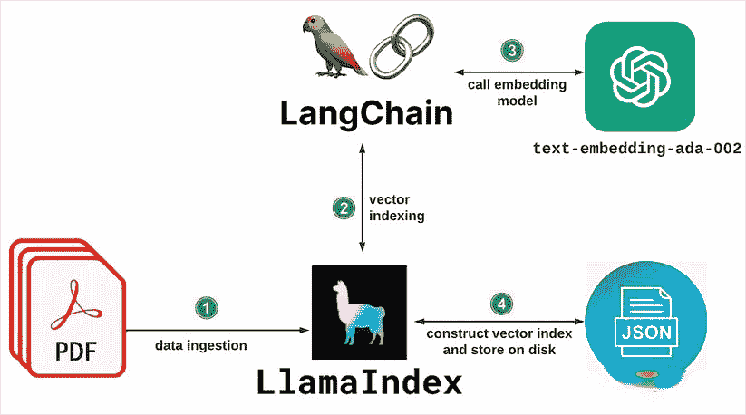
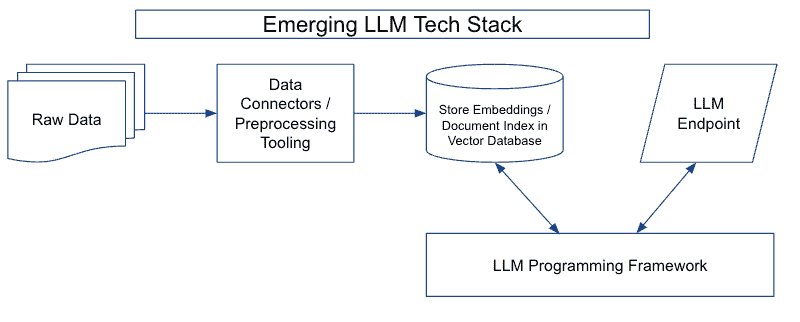
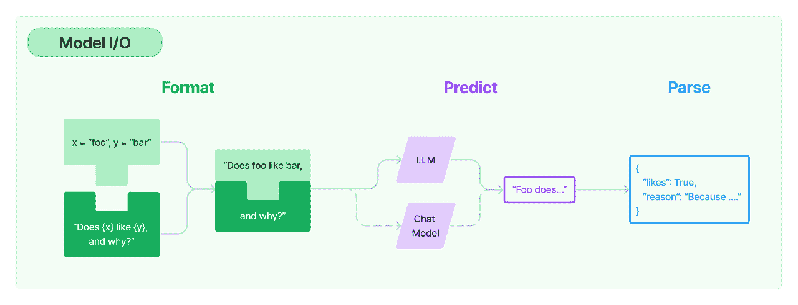
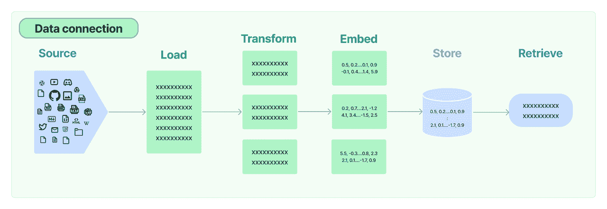
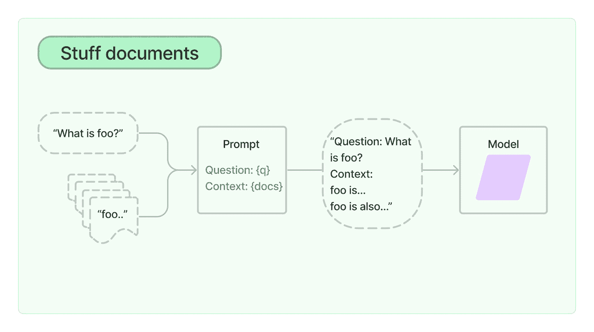
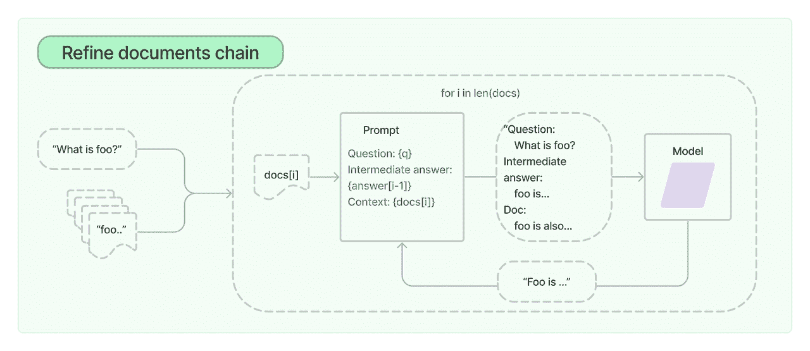
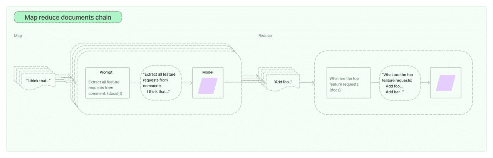
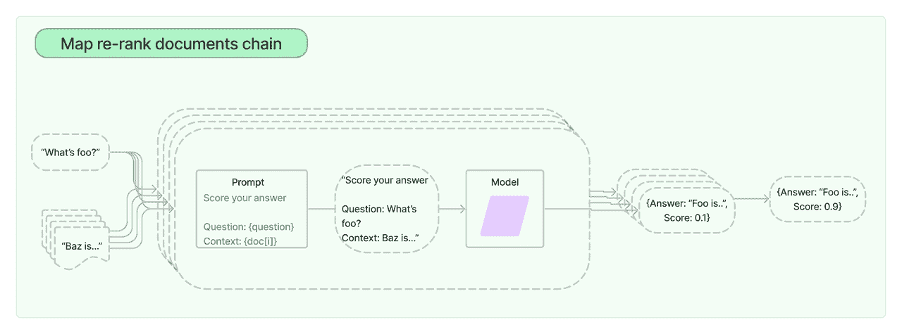

# AI产品总结：基于`langchain`的`rag`大模型构建

> 来源：[https://qqs7y1hozd1.feishu.cn/docx/EfcSdmEojoY4hbx6Lfec2kxOnAf](https://qqs7y1hozd1.feishu.cn/docx/EfcSdmEojoY4hbx6Lfec2kxOnAf)

## 1、LangChain介绍

> `LangChain` 就是一个 LLM 编程框架。想开发一个基于 LLM 应用，需要什么组件它都有，直接使用就行。下面从新兴的大语言模型（LLM）技术栈的角度来介绍。

**官方定义：**

`LangChain`是一个基于语言模型开发应用程序的框架。

**它可以实现以下应用程序：**

+ **数据感知：**将语言模型连接到其他数据源

+ **自主性：**允许语言模型与其环境进行交互

`LangChain`的主要价值在于：

+ **组件化：**为使用语言模型提供抽象层，以及每个抽象层的一组实现。

+ **现成的链：**结构化的组件集合，用于完成特定的高级任务

现成的链使得入门变得容易。组件化使得定制现有链或构建新链变得更容易。

大语言模型技术栈由四个主要部分组成：

+ 数据预处理流程（data preprocessing pipeline）

+ 嵌入端点（embeddings endpoint ）+向量存储（vector store）

+ LLM 终端（LLM endpoints）

+ LLM 编程框架（LLM programming framework）

### 数据预处理流程

> 该步骤包括与数据源连接的连接器（例如S3存储桶或CRM）、数据转换层以及下游连接器（例如向矢量数据库）。

> 通常，输入到LLM中的最有价值的信息也是最难处理的（如PDF、PPTX、HTML等），但同时，易于访问文本的文档（例如.DOCX）中也包含用户不希望发送到推理终端的信息（例如广告、法律条款等）。

### 嵌入端点和向量存储

> 使用嵌入端点（用于生成和返回诸如词向量、文档向量等嵌入向量的 API 端点）和向量存储（用于存储和检索向量的数据库或数据存储系统）代表了数据存储和访问方式的重大演变。

> 直接存储原始嵌入，意味着数据可以以其自然格式存储，从而实现更快的处理时间和更高效的数据检索。此外，这种方法可以更容易地处理大型数据集，因为它可以减少训练和推理过程中需要处理的数据量。

### LLM终端

> LLM终端是接收输入数据并生成LLM输出的终端。LLM终端负责管理模型的资源，包括内存和计算资源，并提供可扩展和容错的接口，用于向下游应用程序提供LLM输出。

### LLM编程框架

LLM编程框架提供了一套工具和抽象，用于使用语言模型构建应用程序。

> 在现代技术栈中出现了各种类型的组件，包括：LLM提供商、嵌入模型、向量存储、文档加载器、其他外部工具（谷歌搜索等），这些框架的一个重要功能是协调各种组件。

### 关键组件解释

### `Prompts`

Prompts用来管理 LLM 输入的工具，在从 LLM 获得所需的输出之前需要对提示进行相当多的调整，最终的Promps可以是单个句子或多个句子的组合，它们可以包含变量和条件语句。

### `Chains`

> 是一种将LLM和其他多个组件连接在一起的工具，以实现复杂的任务。

### `Agents`

> 是一种使用LLM做出决策的工具，它们可以执行特定的任务并生成文本输出。

> Agents通常由三个部分组成：Action、Observation和Decision。Action是代理执行的操作，Observation是代理接收到的信息，Decision是代理基于Action和Observation做出的决策。

### `Memory`

> 是一种用于存储数据的工具，由于LLM 没有任何长期记忆，它有助于在多次调用之间保持状态。

### 典型应用场景

+ **特定文档的问答：**从Notion数据库中提取信息并回答用户的问题。

+ **聊天机器人：**使用Chat-LangChain模块创建一个与用户交流的机器人。

+ **代理：**使用GPT和WolframAlpha结合，创建一个能够执行数学计算和其他任务的代理。

+ **文本摘要：**使用外部数据源来生成特定文档的摘要。

### Langchain 竞品

> 在商业化上，基于大模型业务分为三个层次：

+ 基础设施层：通用的大模型底座

+ 垂直领域层：基于大模型底座+领域场景数据微调形成更强垂直能力

+ 应用层：基于前两者，瘦前端的方式提供多样化应用体验

类似 `LangChain` 这种工具框架可以做到整合各个层能力，具备加速应用开发和落地验证的优势，因此也出现了很多竞争者。

| 名称 | 语言 | 特点 |

| --- | --- | --- |

| `LangChain` | Python/JS | 优点：提供了标准的内存接口和内存实现，支持自定义大模型的封装。 |

| `Dust.tt` | Rust/TS | 优点：提供了简单易用的API，可以让开发者快速构建自己的LLM应用程序。 |

| `Semantic-kernel` | TypeScript | 优点：轻量级SDK，可将AI大型语言模型（LLMs）与传统编程语言集成在一起。 |

| `Fixie.ai` | Python | 优点：开放、免费、简单，多模态（images, audio, video...） |

| `Brancher AI` | Python/JS | 优点：链接所有大模型，无代码快速生成应用, Langchain产品） |

> `LangChain` 主体分为 6 个模块，分别是对（大语言）模型输入输出的管理、外部数据接入、链的概念、（上下文记忆）存储管理、智能代理以及回调系统，通过文档的组织结构，可以清晰了解到 `LangChain`的侧重点，以及在大语言模型开发生态中对自己的定位。

## 2、LLM输入输出管理

### Model I/O

+ 这部分包括对大语言模型输入输出的管理，输入环节的提示词管理（包含模板化提示词和提示词动态选择等），处理环节的语言模型（包括所有LLMs的通用接口，以及常用的LLMs工具；`Chat`模型是一种与LLMs不同的API，用来处理消息），输出环节包括从模型输出中提取信息。

### 提示词管理

提示模板 动态提示词=提示模板+变量。

> 通过引入给提示词引入变量的方式，一方面保证了灵活性，一方面又能保证Prompt内容结构达到最佳

> `SystemMessage`对应系统预设。

> `HumanMessage`用户输入，`AIMessage`表示模型输出，使用 `ChatMessagePromptTemplate` 可以使用任意角色接收聊天消息。

> 基于 `StringPromptTemplate` 自定义提示模板 `StringPromptTemplate`

+ 将Prompt输入与特征存储关联起来(`FeaturePromptTemplate`)

+ 少样本提示模板（`FewShotPromptTemplate`）

+ 从示例中动态提取提示词✍️

### LLMs

> LLMs 将文本字符串作为输入并返回文本字符串的模型（纯文本补全模型）。

> 这里重点说下做项目尽量用异步的方式，体验会更好，下面的例子连续10个请求，时间相差接近5s。

> 缓存 如果多次请求的返回一样，就可以考虑使用缓存。

> 一方面可以减少对API调用次节省token消耗，一方面可以加快应用程序的速度。

### 输出解析器

输出解析器用于构造大语言模型的响应格式，具体通过格式化指令和自定义方法两种方式。

### Data Connection

> 打通外部数据的管道，包含文档加载，文档转换，文本嵌入，向量存储几个环节。

文档加载

> 重点包括了csv（`CSVLoader`），html（`UnstructuredHTMLLoader`），json（`JSONLoader`），markdown（`UnstructuredMarkdownLoader`）以及pdf（因为pdf的格式比较复杂，提供了`PyPDFLoader`、`MathpixPDFLoader`、`UnstructuredPDFLoader`，`PyMuPDF`等多种形式的加载引擎）几种常用格式的内容解析。

> 但在实际的项目中，数据来源一般比较多样，格式也比较复杂，如Discord、Notion、Joplin，Word等数据源。

### 文档拆分

> 重点关注按照字符递归拆分的方式 `RecursiveCharacterTextSplitter` ，这种方式会将语义最相关的文本片段放在一起。

### 文本嵌入

> 嵌入包含两个方法，一个用于嵌入文档，接受多个文本作为输入；

> 文档中示例使用了OpenAI的嵌入模型`text-embedding-ada-002`，但提供了很多第三方嵌入模型集成可以按需查看。

### 向量存储

这个就是对常用矢量数据库（`FAISS`，`Milvus`，`Pinecone`，`PGVector`等）封装接口的说明。

> 大概流程都一样：初始化数据库连接信息——>建立索引——>存储矢量——>相似性查询。

### 数据查询

> 这节重点关注数据压缩，目的是获得相关性最高的文本带入prompt上下文。

针对基础检索得到的文档再做一次向量相似性搜索进行过滤，也可以取得不错的效果。

> 最后一点就是自查询（`SelfQueryRetriever`）的概念，其实就是结构化查询元数据，因为对文档的元信息查询和文档内容的概要描述部分查询效率肯定是高于全部文档的。

### Memory

`Chain`和`Agent`是无状态的，只能独立地处理每个传入的查询，`Memory` 可以管理和操作历史消息。

## 3、数据接入层

### Data Connection

> 打通外部数据的管道，包含文档加载，文档转换，文本嵌入，向量存储几个环节。

### 文档加载

> 重点包括了csv（`CSVLoader`），html（`UnstructuredHTMLLoader`），json（`JSONLoader`），markdown（`UnstructuredMarkdownLoader`）以及pdf（因为pdf的格式比较复杂，提供了`PyPDFLoader`、`MathpixPDFLoader`、`UnstructuredPDFLoader`，`PyMuPDF`等多种形式的加载引擎）几种常用格式的内容解析。

> 但在实际的项目中，数据来源一般比较多样，格式也比较复杂，Discord、Notion、Joplin，Word等数据源。

### 文档拆分

> 重点关注按照字符递归拆分的方式 `RecursiveCharacterTextSplitter` ，这种方式会将语义最相关的文本片段放在一起。

### 文本嵌入

> 嵌入包含两个方法，一个用于嵌入文档，接受多个文本作为输入；一个用于嵌入查询，接受单个文本。文档中示例使用了OpenAI的嵌入模型`text-embedding-ada-002`，但提供了很多第三方嵌入模型集成可以按需查看。

## 4、Embedding专题

### 文本嵌入

> 向量是一个有方向和长度的量，可以用数学中的坐标来表示。在机器学习中，向量通常用于表示数据的特征。

而文本嵌入是一种将文本这种离散数据映射到连续向量空间的方法，嵌入技术可以将高维的离散数据降维到低维的连续空间中，并保留数据之间的语义关系，从而方便进行机器学习和深度学习的任务。

**例如：**

“机器学习”与“深度学习”的距离：

"机器学习”与“英雄联盟“的距离"：

“机器学习”与“深度学习”两个文本之间的余弦相似度更高，表示它们在语义上更相似。

### 文本嵌入算法

文本嵌入算法是指将文本数据转化为向量表示的具体算法。

**通常包括以下几个步骤：**

+ 分词：将文本划分成一个个单词或短语。

+ 构建词汇表：将分词后的单词或短语建立词汇表，并为每个单词或短语赋予一个唯一的编号。

+ 计算词嵌入：使用预训练的模型或自行训练的模型，将每个单词或短语映射到向量空间中。

+ 计算文本嵌入：将文本中每个单词或短语的向量表示取平均或加权平均，得到整个文本的向量表示。

> 常见的文本嵌入算法包括 `Word2Vec`、`GloVe`、`FastText` 等。这些算法通过预训练或自行训练的方式，将单词或短语映射到低维向量空间中，从而能够在计算机中方便地处理文本数据。

### 文本嵌入用途

文本嵌入用于测量文本字符串的相关性，通常用于：

+ 搜索（结果按与查询字符串的相关性排序）

+ 聚类（其中文本字符串按相似性分组）

+ 推荐（推荐具有相关文本字符串的项目）

+ 异常检测（识别出相关性很小的异常值）

+ 多样性测量（分析相似性分布）

+ 分类（其中文本字符串按其最相似的标签分类）

### 使用文本嵌入模型

+ 可以使用 `HuggingFace`上能够处理文本嵌入的开源模型

使用 OpenAI 文本嵌入API [可以将](https://link.zhihu.com/?target=https%3A//openai.com/blog/new-and-improved-embedding-mode)文本转换为向量，OpenAI API提供了多个文本嵌入模型，这篇博客对它们的性能进行了比较，这里是性能最好的`text-embedding-ada-002`说明：

| 模型名称 | 价格 | 分词器 | 最大输入token | 输出 |

| --- | --- | --- | --- | --- |

| `text-embedding-ada-002` | $0.000/1k tokens | `cl100k_base` | 8191 | 1536 |

### 性能优化：

和传统数据库一样，可以使用工程手段优化矢量数据库搜索性能。

**平面索引（`FLAT`）：**将向量简单地存储在一个平面结构中，最基本的向量索引方法。

+ 欧式距离（Euclidean Distance）

+ 余弦相似度（Cosine Similarity）

**分区索引（`IVF`）：**将向量分配到不同的分区中，每个分区建立一个倒排索引结构，最终通过倒排索引实现相似度搜索。

+ 欧式距离（Euclidean Distance）

+ 余弦相似度（Cosine Similarity）

**量化索引（`PQ`）：**将高维向量划分成若干子向量，将每个子向量量化为一个编码。

+ 欧式距离（Euclidean Distance）

+ 汉明距离（Hamming Distance）

**HNSW (Hierarchical Navigable Small World)：**通过构建层次化图结构，实现高效相似度搜索。

+ 内积（Inner Product）

+ 欧式距离（Euclidean Distance）

**NSG (Navigating Spreading-out Graph)：**通过构建一个分层的无向图来实现快速的相似度搜索。

+ 欧式距离（Euclidean Distance）

**Annoy (Approximate Nearest Neighbors Oh Yeah)：**通过将高维空间的向量映射到低维空间，并构建一棵二叉树来实现高效的近似最近邻搜索。

+ 欧式距离（Euclidean Distance）

+ 曼哈顿距离（Manhattan Distance）

LSH (Locality-Sensitive Hashing)：通过使用哈希函数将高维的向量映射到低维空间，并在低维空间中比较哈希桶之间的相似度，实现高效的相似度搜索。

+ 内积（Inner Product）

+ 欧式距离（Euclidean Distance）

## 5、Chain模块

### `Chain`链定义

> 链定义为对组件的一系列调用，也可以包括其他链，这种在链中将组件组合在一起的想法很简单但功能强大，极大地简化了复杂应用程序的实现并使其更加模块化。

> `Chain`基类是所有chain对象的基本入口，与用户程序交互，处理用户的输入，准备其他模块的输入，提供内存能力，chain的回调能力，其他所有的 `Chain` 类都继承自这个基类。

继承`Chain`的子类主要有两种类型：

> 通用工具 chain: 控制chain的调用顺序， 是否调用，他们可以用来合并构造其他的chain。

> 专门用途 chain: 和通用chain比较来说，他们承担了具体的某项任务，可以和通用的chain组合起来使用，也可以直接使用。

### 从 `LangChainHub` 加载链

`LangChainHub` 托管了一些高质量Prompt、Agent和Chain，可以直接在langchain中使用。

### 运行 LLM 链的五种方式

运行LLM链的主要作用：

> `LangChainHub`提供了量大质精的Prompt、Agent和Chain模板,可以直接在langchain中使用。

> LLM链可以通过5种方式运行:

> 1.调用对象 ；2. `run`方法 ；3. `apply`方法；4. `generate`方法；5. `predict`方法

它们接受格式不同的输入参数,但都可以输出响应结果。

这大大简化了开发流程 - 直接使用高质量模板,只需少量代码即可构建应用。运行LLM链也提供便利的接口。

### 通用工具chain

以下概述几种通用工具链的主要功能:

+ `MultiPromptChain`通过Embedding匹配选择最相关提示回答问题。

+ `EmbeddingRouterChain`使用嵌入判断选择下一链。

+ `LLMRouterChain`使用LLM判断选择下一链。

## 链模块

+ `SimpleSequentialChain`/`SequentialChain`将多个链组成流水线传递上下文。

+ `TransformChain`通过自定义函数转换输入,动态改变数据流向。

### 合并文档的链（专门用途chain）

以下概括合并文档链的主要功能:

> 该链专门用于问答场景下从多篇文档中提取答案。

它提供四种模式来合并多个文档:

> `stuff`模式：直接将所有文档合成一段文字

> `map_reduce`模式：每个文档提取答案候选,最后整合答案

> `map_rerank`模式：每个文档提取答案候选,通过LLM进行重新排序

> `refine`模式：首先用LLM优化每个文档,然后进行上述处理

### `StuffDocumentsChain`

获取一个文档列表，带入提示上下文，传递给LLM

### `RefineDocumentsChain`

> 在Studff方式上进一步优化，循环输入文档并迭代更新其答案，以获得最好的最终结果。具体做法是将所有非文档输入、当前文档和最新的中间答案组合传递给LLM。（适合LLM上下文大小不能容纳的小文档）

### `Map Reduce Documents Chain`

> 将LLM链应用于每个单独的文档（`Map`步骤），将链的输出视为新文档。然后，将所有新文档传递给单独的合并文档链以获得单一输出（`Reduce`步骤）。

> 执行`Map`步骤前对每个单独文档进行压缩或合并映射，以确保它们适合合并文档链；

> 可以将这个步骤递归执行直到满足要求。（适合大规模文档的情况）

### `MapRerankDocumentsChain`

每个文档上运行一个初始提示，再给对应输出给一个分数，返回得分最高的回答。

### 获取领域知识的链（专门用途chain）

`APIChain`使得可以使用LLMs与`API`进行交互，以检索相关信息。

### 对话场景（最广泛）

`ConversationalRetrievalChain` 对话式检索链的工作原理：

+ 将聊天历史记录（显式传入或从提供的内存中检索）和问题合并到一个独立的问题中，然后从检索器查找相关文档，最后将这些文档和问题传递给问答链以返回响应。

## 6、代理模块

> 某些应用程序需要基于用户输入的对LLM和其他工具的灵活调用链。`Agents`为此类应用程序提供了灵活性。代理可以访问单一工具，并根据用户输入确定要使用的工具。代理可以使用多个工具，并使用一个工具的输出作为下一个工具的输入。

主要有两种类型的代理：`Plan-and-Execute Agents` 用于制定动作计划；`Action Agents` 决定实施何种动作。

> Agents模块还包含配合代理执行的工具（代理可以执行的操作。为代理提供哪些工具在很大程度上取决于希望代理做什么）和工具包（一套工具集合，这些工具可以与特定用例一起使用。例如，为了使代理与`SQL`数据库进行交互，它可能需要一个工具来执行查询，另一个工具来检查表）。

下面对不同的`Agent`类型进行说明

### 计划和执行代理

> 计划和执行代理通过首先计划要做什么，然后执行子任务来实现目标。这个想法很大程度上受到`BabyAGI`的启发。

计划与执行代理通过分步实现:

> 首先使用聊天规划器对问题进行解析分解,得到执行计划

计划内容可能包括调用不同工具函数获取子结果:

+ `Search`接口查询美国GDP

+ `Calculator`计算日本GDP

+ `Calculator`计算两国GDP差值

> 然后执行器依次调用相关函数运行计划任务将子结果整合返回给用户

通过这种分层设计:

+ 规划器可以针对不同类型问题制定个性化计划

+ 执行器负责统一调用运行子任务

+ 用户问题可以一步到位高效解决

## 7、`Callback`模块

> 回调模块允许接到LLM应用程序的各个阶段，鉴于LLM的幻觉问题，这对于日志记录、监视、流式处理和其他任务非常有用，现在也有专用的工具`Helicone`，`Arize AI`等产品可用。

### 自定义回调对象

所有的回调对象都是基于这个基类来声明的

### 使用回调的两种方式

+ 构造函数时定义回调：在构造函数中定义，例如`LLMChain(callbacks=[handler], tags=['a-tag'])`，它将被用于对该对象的所有调用，并且将只针对该对象，例如，如果向`LLMChain`构造函数传递一个`handler`，它将不会被附属于该链的`Model`使用。

+ 请求函数时传入回调：定义在用于发出请求的`call()`/`run()`/`apply()`方法中，例如`chain.call(inputs, callbacks=[handler])`，它将仅用于该特定请求，以及它所包含的所有子请求（例如，对`LLMChain`的调用会触发对`Model`的调用，`Model`会使用`call()`方法中传递的相同`handler`）。

两种方式的区别在于:

+ 构造函数回调作用于对象所有调用

+ 请求函数回调只针对单次调用

+ 两者都可以实现回调功能,选择时就看追求统一还是 `situational` 了。
