# 大模型主流应用——基于RAG的LLM应用

> 来源：[https://qqs7y1hozd1.feishu.cn/docx/IzNhdnLwSobF7Px7upjcfVePnag](https://qqs7y1hozd1.feishu.cn/docx/IzNhdnLwSobF7Px7upjcfVePnag)

# 大模型主流应用——基于RAG的LLM应用全解

大型语**言**模型（LLM）无疑改变了我们与信息交互的方式。 然而，对于我们可以向他们提出的要求，它们也有相当多的限制。 LLM（例如 Llama-2-70b、gpt-4 等）仅了解他们接受过训练的信息，当我们要求他们了解除此之外的信息时，他们将无法做到这一点。 基于检索增强生成（RAG：Retrieval Augmented Generation）的LLM应用程序解决了这个确切的问题，并将LLM的实用性扩展到我们的特定数据源。

在本文中，我们将构建一个基于 RAG 的 LLM 应用程序，其中我们将合并外部数据源以增强 LLM 的功能。 具体来说，我们将构建一个可以回答有关 Ray 的问题的助手——Ray 是一个用于生产和扩展 ML 工作负载的 Python 框架。 这里的目标是让开发人员更容易采用 Ray，而且，正如我们将在本文中看到的，帮助改进 Ray 文档本身并为其他 LLM 应用程序提供基础。

## **1、整体流程**

> 注意：我们对整个内容进行了概括，以便可以轻松扩展以在你自己的数据之上构建基于 RAG 的 LLM 应用程序。

1.  将查询传递给嵌入模型，以在语义上将其表示为嵌入查询向量。

1.  将嵌入的查询向量传递到我们的向量数据库。

1.  检索前 k 个相关上下文——通过查询嵌入与我们知识库中所有嵌入块之间的距离来衡量。

1.  将查询文本和检索到的上下文文本传递给我们的LLM。

1.  LLM将使用提供的内容生成回复。

> 除了构建 LLM 应用程序之外，还将专注于在生产中扩展和服务它。 与传统的机器学习，甚至监督式深度学习不同，规模从一开始就是LLM应用的瓶颈。 大型数据集、模型、计算密集型工作负载、服务需求等。随着周围世界的不断发展，能够处理任何规模的应用程序将被开发。

> 我们还将关注评估和性能。 我们的应用程序涉及许多移动部分：嵌入模型、分块逻辑、LLM 本身等，因此我们尝试不同的配置以优化最佳质量的响应非常重要。 然而，评估和定量比较生成任务的不同配置并非易事。 我们将分解对应用程序各个部分的评估（给定查询的检索、给定源的生成），还评估整体性能（端到端生成）并分享针对优化配置的发现。

> 注意：我们将在本文中尝试不同的LLM（OpenAI、Llama 等）。 你将需要 OpenAI 凭据来访问 ChatGPT 模型和 Anyscale 端点（可用公共和私有端点）来服务 + 微调 OSS LLM。

## **2、数据**

在开始构建 RAG 应用程序之前，我们需要首先创建包含已处理数据源的向量数据库。

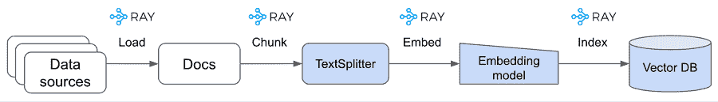

### **2.1 加载数据**

首先将 Ray 文档从网站加载到本地目录：

```
export EFS_DIR=/desired/output/directory
wget -e robots=off --recursive --no-clobber --page-requisites \
  --html-extension --convert-links --restrict-file-names=windows \
  --domains docs.ray.io --no-parent --accept=html \
  -P $EFS_DIR https://docs.ray.io/en/master/
```

然后，将把文档内容加载到 Ray 数据集中，以便可以对其进行大规模操作（例如嵌入、索引等）。 对于大型数据源、模型和应用程序服务需求，规模是LLM应用程序的第一天优先事项。 以这样的方式构建应用程序，即它们可以随着我们的需求增长而扩展，而无需稍后更改代码。

```
Ray dataset
DOCS_DIR = Path(EFS_DIR, &quot;docs.ray.io/en/master/&quot;)
ds = ray.data.from_items([{&quot;path&quot;: path} for path in DOCS_DIR.rglob(&quot;*.html&quot;) 
if not path.is_dir()])
print(f&quot;{ds.count()} documents&quot;)
```

### **2.2 部分提取**

现在我们有了 html 文件的所有路径的数据集，我们将开发一些可以适当地从这些文件中提取内容的函数。 我们希望以通用的方式执行此操作，以便我们可以在所有文档页面上执行此提取（这样就可以将其用于您自己的数据源）。 我们的过程是首先识别 html 页面中的部分，然后提取它们之间的文本。 我们将所有这些保存到一个字典列表中，该列表将某个部分中的文本映射到带有部分锚点 id 的特定 url。

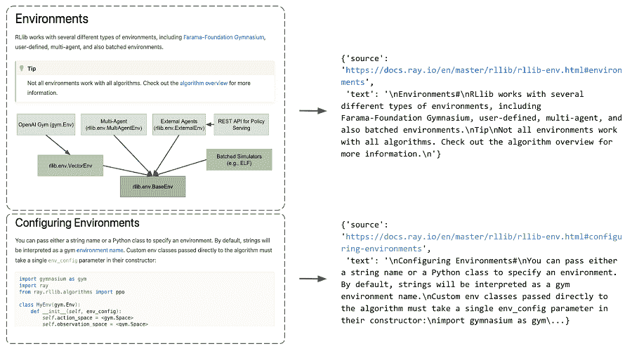

```
sample_html_fp = Path(EFS_DIR, &quot;docs.ray.io/en/master/rllib/rllib-env.html&quot;)
extract_sections({&quot;path&quot;: sample_html_fp})[0]
```

示例内容如下：

```
{&#x27;source&#x27;: &#x27;https://docs.ray.io/en/master/rllib/rllib-env.html#environments&#x27;, &#x27;text&#x27;: &#x27;\nEnvironments#\nRLlib works with several different types of environments, including Farama-Foundation Gymnasium, user-defined, multi-agent, and also batched environments.\nTip\nNot all environments work with all algorithms. Check out the algorithm overview for more information.\n&#x27;}
```

我们可以使用 Ray Data 的 flat_map 只需一行即可将此提取过程 (extract_section) 并行应用于数据集中的所有文件路径。

```
Extract sections
sections_ds = ds.flat_map(extract_sections)
sections = sections_ds.take_all()
print (len(sections))
```

### **2.3 文本分块**

我们现在有一个部分列表（包含每个部分的文本和源代码），但我们还不应该直接将其用作 RAG 应用程序的上下文。 每个部分的文本长度各不相同，并且许多都是相当大的块。

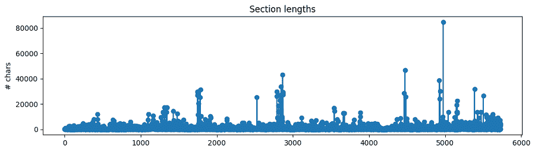

如果我们要使用这些大的部分，那么将插入大量嘈杂/不需要的上下文，并且因为所有LLM都有最大上下文长度，所以我们将无法容纳太多其他相关上下文。 因此，我们将把每个部分中的文本分成更小的块。 直观上，较小的块将封装单个/几个概念，并且与较大的块相比噪音较小。 我们现在将选择一些典型的文本分割值（例如 chunk_size=300）来创建我们的块，但稍后我们将尝试使用更广泛的值。

```
from langchain.document_loaders import ReadTheDocsLoader
from langchain.text_splitter import RecursiveCharacterTextSplitter
Text splitter
chunk_size = 300
chunk_overlap = 50
text_splitter = RecursiveCharacterTextSplitter(
    separators=[&quot;\n\n&quot;, &quot;\n&quot;, &quot; &quot;, &quot;&quot;],
    chunk_size=chunk_size,
    chunk_overlap=chunk_overlap,
    length_function=len,
)
Chunk a sample section
sample_section = sections_ds.take(1)[0]
chunks = text_splitter.create_documents(
    texts=[sample_section[&quot;text&quot;]],
    metadatas=[{&quot;source&quot;: sample_section[&quot;source&quot;]}])
print (chunks[0])
```

示例如下：

```
page_content=&#x27;ray.tune.TuneConfig.search_alg#\nTuneConfig.search_alg: Optional[Union[ray.tune.search.searcher.Searcher, ray.tune.search.search_algorithm.SearchAlgorithm]] = None#&#x27; metadata={&#x27;source&#x27;: &#x27;https://docs.ray.io/en/master/tune/api/doc/ray.tune.TuneConfig.search_alg.html#ray-tune-tuneconfig-search-alg&#x27;}
```

虽然我们的数据集分块相对较快，但让我们将分块逻辑包装到一个函数中，以便我们可以大规模应用工作负载，从而使分块保持与数据源增长一样快：

```
def chunk_section(section, chunk_size, chunk_overlap):
    text_splitter = RecursiveCharacterTextSplitter(
        separators=[&quot;\n\n&quot;, &quot;\n&quot;, &quot; &quot;, &quot;&quot;],
        chunk_size=chunk_size,
        chunk_overlap=chunk_overlap,
        length_function=len)
    chunks = text_splitter.create_documents(
        texts=[sample_section[&quot;text&quot;]],
        metadatas=[{&quot;source&quot;: sample_section[&quot;source&quot;]}])
    return [{&quot;text&quot;: chunk.page_content, &quot;source&quot;: chunk.metadata[&quot;source&quot;]} for chunk in chunks]
Scale chunking
chunks_ds = sections_ds.flat_map(partial(
    chunk_section,
    chunk_size=chunk_size,
    chunk_overlap=chunk_overlap))
print(f&quot;{chunks_ds.count()} chunks&quot;)
chunks_ds.show(1)
```

示例内容如下：

```
5727 chunks
{&#x27;text&#x27;: &#x27;ray.tune.TuneConfig.search_alg#\nTuneConfig.search_alg: Optional[Union[ray.tune.search.searcher.Searcher, ray.tune.search.search_algorithm.SearchAlgorithm]] = None#&#x27;, &#x27;source&#x27;: &#x27;https://docs.ray.io/en/master/tune/api/doc/ray.tune.TuneConfig.search_alg.html#ray-tune-tuneconfig-search-alg&#x27;}
```

### **2.4 嵌入数据**

现在我们已经从我们的部分中创建了小块，我们需要一种方法来识别与给定查询最相关的部分。 一种非常有效且快速的方法是使用预训练模型嵌入我们的数据并使用相同的模型来嵌入查询。 然后，我们可以计算所有块嵌入和查询嵌入之间的距离，以确定前 k 个块。

有许多不同的预训练模型可供选择来嵌入我们的数据，但最流行的模型可以通过 HuggingFace 的大规模文本嵌入基准 (MTEB) 排行榜发现。 这些模型通过诸如下一个/屏蔽标记预测之类的任务在非常大的文本语料库上进行预训练，这使它们能够学习在 N 维中表示子标记并捕获语义关系。 我们可以利用它来表示我们的数据并确定用于回答给定查询的最相关的上下文。 我们使用 Langchain 的 Embedding 包装器（HuggingFaceEmbeddings 和 OpenAIEmbeddings）来轻松加载模型并嵌入我们的文档块。

> 注意：嵌入并不是确定更相关的块的唯一方法。 也可以使用LLM来决定。然而，由于 LLM 比这些嵌入模型大得多，并且具有最大上下文长度，因此最好使用嵌入来检索前 k 个块。 然后我们可以在较少的 k 个块上使用 LLM 来确定用作回答查询的上下文的 <k 个块。 还可以使用重新排名（例如 Cohere Rerank）来进一步识别要使用的最相关的块。 还可以将嵌入与传统的信息检索方法（例如关键字匹配）结合起来，这对于匹配嵌入子令牌时可能会丢失的唯一令牌非常有用。

```
from langchain.embeddings import OpenAIEmbeddings
from langchain.embeddings.huggingface import HuggingFaceEmbeddings
import numpy as np
from ray.data import ActorPoolStrategy
class EmbedChunks:
    def 
__init__
(self, model_name):
        if model_name == &quot;text-embedding-ada-002&quot;:
            self.embedding_model = OpenAIEmbeddings(
                model=model_name,
                openai_api_base=os.environ[&quot;OPENAI_API_BASE&quot;],
                openai_api_key=os.environ[&quot;OPENAI_API_KEY&quot;])
        else:
            self.embedding_model = HuggingFaceEmbeddings(
                model_name=model_name,
                model_kwargs={&quot;device&quot;: &quot;cuda&quot;},
                encode_kwargs={&quot;device&quot;: &quot;cuda&quot;, &quot;batch_size&quot;: 100})
    def 
__call__
(self, batch):
        embeddings = self.embedding_model.embed_documents(batch[&quot;text&quot;])
        return {&quot;text&quot;: batch[&quot;text&quot;], &quot;source&quot;: batch[&quot;source&quot;], &quot;embeddings&quot;: 
embeddings}
```

在这里，我们可以使用map_batches大规模嵌入我们的块。 我们所要做的就是定义batch_size 和计算（我们使用两个worker，每个有1 个GPU）。

```
Embed chunks
embedding_model_name = &quot;thenlper/gte-base&quot;
embedded_chunks = chunks_ds.map_batches(
    EmbedChunks,
    fn_constructor_kwargs={&quot;model_name&quot;: embedding_model_name},
    batch_size=100,
    num_gpus=1,
    compute=ActorPoolStrategy(size=2))
```

示例内容如下：

```
Sample (text, source, embedding) triplet
[{&#x27;text&#x27;: &#x27;External library integrations for Ray Tune#&#x27;,
  &#x27;source&#x27;: &#x27;https://docs.ray.io/en/master/tune/api/integration.html#external-library-integrations-for-ray-tune&#x27;,
  &#x27;embeddings&#x27;: [
0.012108353897929192,
0.009078810922801495,
0.030281754210591316,
-0.0029687234200537205,
…]
}
```

### **2.5 索引数据**

现在我们有了嵌入的块，需要将它们索引（存储）在某个地方，以便我们可以快速检索它们以进行推理。 虽然有许多流行的矢量数据库选项，但我们将使用带有 pgvector 的 Postgres，因为它的简单性和性能。 我们将创建一个表（文档）并为我们拥有的每个嵌入块编写（文本、源、嵌入）三元组。

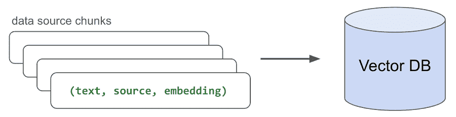

```
class StoreResults:
    def 
__call__
(self, batch):
        with psycopg.connect(os.environ[&quot;DB_CONNECTION_STRING&quot;]) as conn:
            register_vector(conn)
            with conn.cursor() as cur:
                for text, source, embedding in zip
                (batch[&quot;text&quot;], batch[&quot;source&quot;], batch[&quot;embeddings&quot;]):
                    cur.execute(&quot;INSERT INTO document (text, source, embedding)
                    VALUES (%s, %s, %s)&quot;, (text, source, embedding,),)
        return {}
```

再次，我们可以使用 Ray Data 的 map_batches 并行执行此索引：

```
Index data
embedded_chunks.map_batches(
    StoreResults,
    batch_size=128,
    num_cpus=1,
    compute=ActorPoolStrategy(size=28),
).count()
```

## **3、查询提取**

通过在矢量数据库中索引嵌入的块，我们准备好对给定的查询执行检索。 我们将首先使用用于嵌入文本块的相同嵌入模型来嵌入传入的查询。

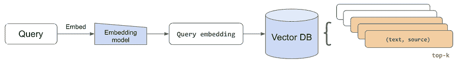

```
Embed query
embedding_model = HuggingFaceEmbeddings(model_name=embedding_model_name)
query = &quot;What is the default batch size for map_batches?&quot;
embedding = np.array(embedding_model.embed_query(query))
len(embedding)
```

示例输出如下：

```
768
```

然后，我们将通过提取与嵌入查询最接近的嵌入块来检索前 k 个最相关的块。 我们使用余弦距离 (<=>)，但有很多选项可供选择。 一旦我们检索到顶部的 num_chunks，我们就可以收集每个块的文本并将其用作上下文来生成响应：

```
Get context
num_chunks = 5
with psycopg.connect(os.environ[&quot;DB_CONNECTION_STRING&quot;]) as conn:
    register_vector(conn)
    with conn.cursor() as cur:
        cur.execute(&quot;SELECT * FROM document ORDER BY embedding &lt;-&gt; %s LIMIT %s&quot;, (embedding, num_chunks))
        rows = cur.fetchall()
        context = [{&quot;text&quot;: row[1]} for row in rows]
        sources = [row[2] for row in rows]
```

示例输出如下：

```
https://docs.ray.io/en/master/data/api/doc/ray.data.Dataset.map_batches.html#ray-data-dataset-map-batchesentire blocks as batches (blocks may contain different numbers of rows).
The actual size of the batch provided to fn may be smaller than
batch_size if batch_size doesn’t evenly divide the block(s) sent
to a given map task. Default batch_size is 4096 with “default”.
```

## **4、响应生成**

现在，我们可以使用上下文来生成LLM的响应。 如果没有我们检索到的相关背景，LLM可能无法准确回答我们的问题。 随着数据的增长，我们可以轻松地嵌入和索引任何新数据，并能够检索它来回答问题。

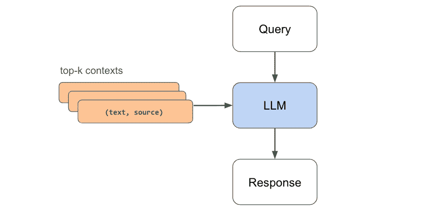

```
from rag.generate import prepare_response
from rag.utils import get_credentials
def generate_response(
    llm, temperature=0.0, stream=True,
    system_content=&quot;&quot;, assistant_content=&quot;&quot;, user_content=&quot;&quot;,
    max_retries=3, retry_interval=60):
    &quot;&quot;&quot;Generate response from an LLM.&quot;&quot;&quot;
    retry_count = 0
    api_base, api_key = get_credentials(llm=llm)
    while retry_count &lt; max_retries:
        try:
            response = openai.ChatCompletion.create(
                model=llm,
                temperature=temperature,
                stream=stream,
                api_base=api_base,
                api_key=api_key,
                messages=[
                    {&quot;role&quot;: &quot;system&quot;, &quot;content&quot;: system_content},
                    {&quot;role&quot;: &quot;assistant&quot;, &quot;content&quot;: assistant_content},
                    {&quot;role&quot;: &quot;user&quot;, &quot;content&quot;: user_content},
                ],
            )
            return prepare_response(response=response, stream=stream)
        except Exception as e:
            print(f&quot;Exception: {e}&quot;)
            time.sleep(retry_interval)  # default is per-minute rate limits
            retry_count += 1
    return &quot;&quot;
```

> 注意：我们使用 0.0 的温度来实现可重复的实验，但应该根据用例进行调整。 对于需要始终以事实为基础的用例，我们建议非常低的温度值，而更具创造性的任务可以从更高的温度中受益。

```
Generate response
query = &quot;What is the default batch size for map_batches?&quot;
response = generate_response(
    llm=&quot;meta-llama/Llama-2-70b-chat-hf&quot;,
    temperature=0.0,
    stream=True,
    system_content=&quot;Answer the query using the context provided. Be succinct.&quot;,
    user_content=f&quot;query: {query}, context: {context}&quot;)
```

示例输出如下：

```
The default batch size for map_batches is 4096.
```

### **4.1 代理**

让我们将上下文检索和响应生成结合到一个方便的查询代理中，可以使用它轻松生成响应。 这将负责设置代理（嵌入和 LLM 模型）以及上下文检索，并将其传递给 LLM 以生成响应。

```
class QueryAgent:
    def 
__init__
(self, embedding_model_name=&quot;thenlper/gte-base&quot;,
                 llm=&quot;meta-llama/Llama-2-70b-chat-hf&quot;, temperature=0.0,
                 max_context_length=4096, system_content=&quot;&quot;, assistant_content=&quot;&quot;):
        # Embedding model
        self.embedding_model = get_embedding_model(
            embedding_model_name=embedding_model_name,
            model_kwargs={&quot;device&quot;: &quot;cuda&quot;},
            encode_kwargs={&quot;device&quot;: &quot;cuda&quot;, &quot;batch_size&quot;: 100})
         # Context length (restrict input length to 50% of total length)
        max_context_length = int(0.5*max_context_length)
        # LLM
        self.llm = llm
        self.temperature = temperature
        self.context_length =  max_context_length - get_num_tokens(system_content + assistant_content)
        self.system_content = system_content
        self.assistant_content = assistant_content
    def 
__call__
(self, query, num_chunks=5, stream=True):
        # Get sources and context
        context_results = semantic_search(
            query=query,
            embedding_model=self.embedding_model,
            k=num_chunks)
        # Generate response
        context = [item[&quot;text&quot;] for item in context_results]
        sources = [item[&quot;source&quot;] for item in context_results]
        user_content = f&quot;query: {query}, context: {context}&quot;
        answer = generate_response(
            llm=self.llm,
            temperature=self.temperature,
            stream=stream,
            system_content=self.system_content,
            assistant_content=self.assistant_content,
            user_content=trim(user_content, self.context_length))
        # Result
        result = {
            &quot;question&quot;: query,
            &quot;sources&quot;: sources,
            &quot;answer&quot;: answer,
            &quot;llm&quot;: self.llm,
        }
        return result
```

这样，我们只需几行就可以使用我们的 RAG 应用程序：

```
llm = &quot;meta-llama/Llama-2-7b-chat-hf&quot;
agent = QueryAgent(
    embedding_model_name=&quot;thenlper/gte-base&quot;,
    llm=llm,
    max_context_length=MAX_CONTEXT_LENGTHS[llm],
    system_content=&quot;Answer the query using the context provided. Be succinct.&quot;)
result = agent(query=&quot;What is the default batch size for map_batches?&quot;)
print(&quot;\n\n&quot;, json.dumps(result, indent=2))
```

示例输出如下：

```
The default batch size for 
map_batches
 is 4096
{
  &quot;question&quot;: &quot;What is the default batch size for map_batches?&quot;,
  &quot;sources&quot;: [
&quot;https://docs.ray.io/en/master/data/api/doc/ray.data.Dataset.map_batches.html#ray-data-dataset-map-batches&quot;,
&quot;https://docs.ray.io/en/master/data/transforming-data.html#configuring-batch-size&quot;,
&quot;https://docs.ray.io/en/master/data/data-internals.html#execution-memory&quot;,
&quot;https://docs.ray.io/en/master/serve/advanced-guides/dyn-req-batch.html#tips-for-fine-tuning-batching-parameters&quot;, &quot;https://docs.ray.io/en/master/data/examples/pytorch_resnet_batch_prediction.html#model-inference&quot;
  ],
  &quot;answer&quot;: &quot;The default batch size for 
map_batches
 is 4096&quot;,
  &quot;llm&quot;: &quot;meta-llama/Llama-2-7b-chat-hf&quot;
}
```

## **5、评估**

到目前为止，我们已经为 RAG 应用程序的各个部分选择了典型/任意值。 但如果我们要改变一些东西，比如我们的分块逻辑、嵌入模型、LLM 等，我们怎么知道我们的配置比以前更好呢？ 像这样的生成任务很难定量评估，因此我们需要开发可靠的方法来做到这一点。

因为我们的应用程序中有许多移动部件，所以我们需要执行单元/组件和端到端评估。 逐个组件的评估可以涉及单独评估我们的检索（是我们检索到的块集中的最佳来源）和评估我们的LLM响应（给定最佳来源，LLM是否能够产生高质量的答案）。 对于端到端评估，我们可以评估整个系统的质量（给定数据源，响应的质量如何）。

我们将要求我们的评估员 LLM 使用上下文对响应的质量进行评分 1-5 之间，但是，我们也可以让它为其他维度（例如幻觉）生成分数（是仅使用所提供上下文中的信息生成的答案） ）、毒性等。

> 注意：我们可以将分数限制为二进制 (0/1)，这可能更容易解释（例如，响应要么正确，要么不正确）。 然而，我们在分数中引入了更高的方差，以便更深入、更细致地理解LLM如何对回答进行评分（例如LLM对回答的偏见）。

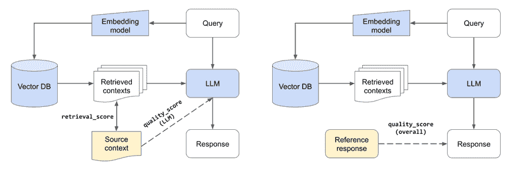

检索系统和法学硕士的组件评估（左）。 总体评价（右）。

### **5.1 评估器**

我们首先要确定评估器。 给定对查询和相关上下文的响应，评估器应该是对响应质量进行评分/评估的可信方式。 但在我们确定评估者之前，我们需要一个问题数据集和答案的来源。 我们可以使用此数据集要求不同的评估者提供答案，然后对他们的答案进行评分（例如 1-5 之间的分数）。 然后，我们可以检查该数据集，以确定我们的评估者是否公正，并且对分配的分数是否有合理的推理。

注意：我们正在评估LLM在给定相关背景的情况下生成回复的能力。 这是组件级评估（quality_score (LLM)），因为我们没有使用检索来获取相关上下文。

我们将从手动创建数据集开始（如果无法手动创建数据集，请继续阅读）。 有一个用户查询列表和回答查询 datasets/eval-dataset-v1.jsonl 的理想来源。 我们将使用上面的 LLM 应用程序，使用 gpt-4 为每个查询/源对生成参考答案。

```
with open(Path(ROOT_DIR, &quot;datasets/eval-dataset-v1.jsonl&quot;), &quot;r&quot;) as f:
    data = [json.loads(item) for item in list(f)]
```

示例输出如下：

```
[{&#x27;question&#x27;: &#x27;I’m struggling a bit with Ray Data type conversions when I do map_batches. Any advice?&#x27;,
&#x27;source&#x27;: &#x27;https://docs.ray.io/en/master/data/transforming-data.html&#x27;},
…
{&#x27;question&#x27;: &#x27;Is Ray integrated with DeepSpeed?&#x27;,
&#x27;source&#x27;: &#x27;https://docs.ray.io/en/master/ray-air/examples/gptj_deepspeed_fine_tuning.html#fine-tuning-the-model-with-ray-air-a-name-train-a&#x27;}]
```

每个数据点都有一个问题和带标签的源，该源具有精确的上下文和问题的答案：

```
Sample
uri = &quot;https://docs.ray.io/en/master/data/transforming-data.html#configuring-batch-format&quot;
fetch_text(uri=uri)
```

示例输出如下：

```
&#x27;\nConfiguring batch format#\nRay Data represents batches as dicts of NumPy ndarrays or pandas DataFrames. …&#x27;
```

我们可以从此上下文中提取文本并将其传递给我们的LLM以生成对问题的答复。 我们还将要求它对查询响应的质量进行评分。 为此，我们定义了一个继承自 QueryAgent 的 QueryAgentWithContext，更改是我们提供上下文并且不需要检索它。

```
class QueryAgentWithContext(QueryAgent):
    def 
__call__
(self, query, context):
      user_content = f&quot;query: {query}, context: {context}&quot;
      response = generate_response(
        llm=self.llm,
        temperature=self.temperature,
        stream=True,
        system_content=self.system_content,
        assistant_content=self.assistant_content,
        user_content=user_content[: self.context_length])
      return response
```

我们现在可以创建一个包含问题、来源、答案、分数和推理的数据集。 我们可以检查这一点以确定我们的评估器是否具有高质量。

+   问题： 当我进行map_batches时，我在光线数据类型转换方面遇到了一些困难。有什么建议吗？

+   答案： 你可以通过在‘map_batches()’函数中指定‘batch_format’来配置Ray Data中的批处理类型。如果正在使用NumPy ndarrays，你的函数应该返回ndarrays的字典。如果正在使用 使用 pandas DataFrames，你的函数应该返回一个 DataFrame。确保函数根据指定的“batch_format”返回正确的类型。

+   得分： 5

+   推理： 上下文提供了关于如何在 Ray Data 中配置批处理类型以及如何使用‘map_batches()’函数的明确说明。它还提供了 NumPy 和 pandas 的示例，它们直接回答查询。

根据它提供的分数和推理，我们发现 gpt-4 是一个高质量的评估器。 我们对其他LLM（例如 Llama-2-70b）进行了相同的评估，我们发现他们缺乏适当的推理，并且对自己的回答非常慷慨。

```
EVALUATOR = &quot;gpt-4&quot;
```

> 注意：更彻底的评估还将通过要求评估者比较不同LLM在以下方面的回答来测试以下内容：

+   位置（我们首先显示哪些回复）

+   详细程度（较长的回复更受欢迎）

+   关系（例如 GPT4 更喜欢 GPT 3.5 等）

### **5.2 冷启动**

我们可能并不总是有准备好的问题数据集和随时可用的回答该问题的最佳来源。 为了解决这个冷启动问题，我们可以使用LLM来查看我们的文本块并生成特定块将回答的问题。 这为我们提供了质量问题以及答案的确切来源。但是，这种数据集生成方法可能有点嘈杂。 生成的问题可能并不总是与我们的用户可能提出的问题高度一致。 我们所说的最佳来源的特定块也可能在其他块中具有确切的信息。 尽管如此，当我们收集+手动标记高质量数据集时，这是开始我们的开发过程的好方法。

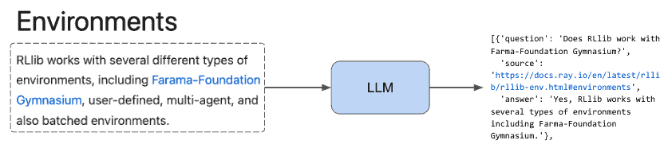

```
Prompt
num_questions = 3
system_content = f&quot;&quot;&quot;
Create {num_questions} questions using only the context provided.
End each question with a &#x27;?&#x27; character and then in a newline write the answer to that question using only the context provided.
Separate each question/answer pair by a newline.
&quot;&quot;&quot;
Generate questions
synthetic_data = []
for chunk in chunks[:1]:  # small samples
    response = generate_response(
        llm=&quot;gpt-4&quot;,
        temperature=0.0,
        system_content=system_content,
        user_content=f&quot;context: {chunk.page_content}&quot;)
    entries = response.split(&quot;\n\n&quot;)
    for entry in entries:
        question, answer = entry.split(&quot;\n&quot;)
        synthetic_data.append({&quot;question&quot;: question, &quot;source&quot;: chunk.metadata[&quot;source&quot;], &quot;answer&quot;: answer})
synthetic_data[:3]
```

输出示例如下：

```
[{&#x27;question&#x27;: &#x27;What can you use to monitor and debug your Ray applications and clusters?&#x27;,
&#x27;source&#x27;: &#x27;https://docs.ray.io/en/master/ray-observability/reference/index.html#reference&#x27;,
&#x27;answer&#x27;: &#x27;You can use the API and CLI documented in the references to monitor and debug your Ray applications and clusters.&#x27;},
{&#x27;question&#x27;: &#x27;What are the guides included in the references?&#x27;,
&#x27;source&#x27;: &#x27;https://docs.ray.io/en/master/ray-observability/reference/index.html#reference&#x27;,
&#x27;answer&#x27;: &#x27;The guides included in the references are State API, State CLI, and System Metrics.&#x27;},
{&#x27;question&#x27;: &#x27;What are the two types of interfaces mentioned for monitoring and debugging Ray applications and clusters?&#x27;,
&#x27;source&#x27;: &#x27;https://docs.ray.io/en/master/ray-observability/reference/index.html#reference&#x27;,
&#x27;answer&#x27;: &#x27;The two types of interfaces mentioned for monitoring and debugging Ray applications and clusters are API and CLI.&#x27;}]
```

### **5.3 实验**

> 有了评估器集，我们就可以开始试验 LLM 申请中的各个组件了。 虽然我们可以将其作为大型超参数调整实验来执行，我们可以在其中搜索有希望的值/决策组合，但我们将一次评估一个决策，并为下一个实验设置最佳值。

> 注意：这种方法有点不完美，因为我们的许多决策都不是独立的（例如 chunk_size 和 num_chunks 理想情况下应该在许多值组合中进行评估）。

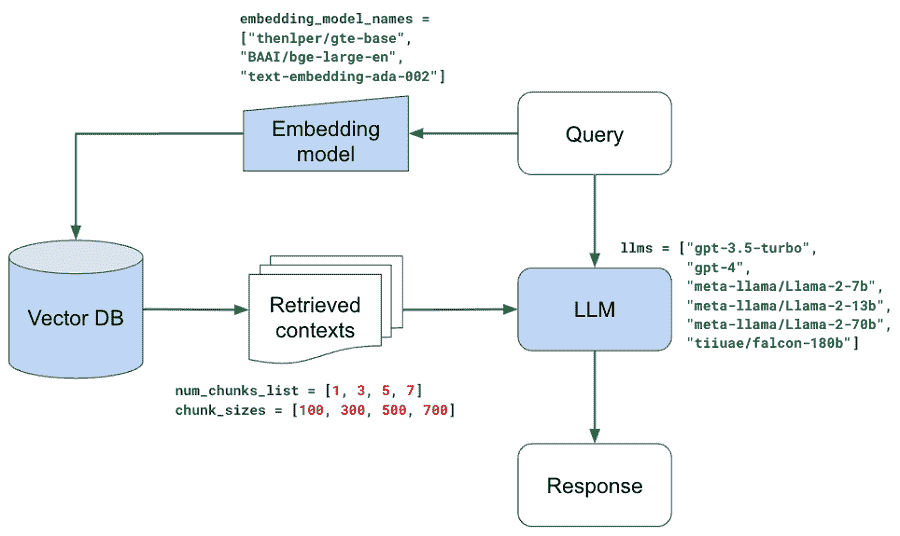

### **5.4 工具**

在开始实验之前，我们将定义更多实用函数。 我们的评估工作流程将使用我们的评估器来评估我们应用程序的端到端质量（quality_score），因为响应取决于检索到的上下文和LLM。 但我们还将包含一个retrieval_score来衡量检索过程的质量（分块+嵌入）。 如果最佳源位于我们检索到的 num_chunks 源中的任何位置，则我们用于确定retrieve_score 的逻辑就注册成功。 我们不考虑顺序、确切的页面部分等，但我们可以添加这些约束以获得更保守的检索分数。

```
def get_retrieval_score(references, generated):
    matches = np.zeros(len(references))
    for i in range(len(references)):
        reference_source = references[i][&quot;source&quot;].split(&quot;#&quot;)[0]
        if not reference_source:
            matches[i] = 1
            continue
        for source in generated[i][&quot;sources&quot;]:
            # sections don&#x27;t have to perfectly match
            if reference_source == source.split(&quot;#&quot;)[0]:
                matches[i] = 1
                continue
    retrieval_score = np.mean(matches)
    return retrieval_score
```

无论我们想要评估什么配置，都需要首先使用该配置生成响应，然后使用我们的评估器评估这些响应：

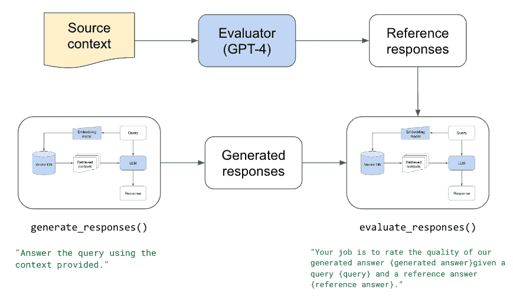

```
Generate responses
generation_system_content = &quot;Answer the query using the context provided. Be succinct.&quot;
generate_responses(
    experiment_name=experiment_name,
    chunk_size=chunk_size,
    chunk_overlap=chunk_overlap,
    num_chunks=num_chunks,
    embedding_model_name=embedding_model_name,
    use_lexical_search=use_lexical_search,
    lexical_search_k=lexical_search_k,
    use_reranking=use_reranking,
    rerank_threshold=rerank_threshold,
    rerank_k=rerank_k,
    llm=llm,
    temperature=0.0,
    max_context_length=MAX_CONTEXT_LENGTHS[llm],
    system_content=generation_system_content,
    assistant_content=&quot;&quot;,
    docs_dir=docs_dir,
    experiments_dir=experiments_dir,
    references_fp=references_fp,
    num_samples=num_samples,
    sql_dump_fp=sql_dump_fp)
```

```
Evaluate responses
evaluation_system_content = &quot;&quot;&quot;
    Your job is to rate the quality of our generated answer {generated_answer}
    given a query {query} and a reference answer {reference_answer}.
    Your score has to be between 1 and 5.
    You must return your response in a line with only the score.
    Do not return answers in any other format.
    On a separate line provide your reasoning for the score as well.
    &quot;&quot;&quot;
evaluate_responses(
    experiment_name=experiment_name,
    evaluator=evaluator,
    temperature=0.0,
    max_context_length=MAX_CONTEXT_LENGTHS[evaluator],
    system_content=evaluation_system_content,
    assistant_content=&quot;&quot;,
    experiments_dir=experiments_dir,
    references_fp=references_fp,
    responses_fp=str(Path(experiments_dir, &quot;responses&quot;, f&quot;{experiment_name}.json&quot;)),
    num_samples=num_samples)
```

我们将这两个步骤组合成一个方便的 run_experiment 函数：

```
Run experiment
run_experiment(
    experiment_name=experiment_name,
    chunk_size=CHUNK_SIZE,
    chunk_overlap=CHUNK_OVERLAP,
    num_chunks=NUM_CHUNKS,
    embedding_model_name=EMBEDDING_MODEL_NAME,
    llm=LLM,
    evaluator=EVALUATOR,
    docs_dir=DOCS_DIR,
    experiments_dir=EXPERIMENTS_DIR,
    references_fp=REFERENCES_FILE_PATH,
    num_samples=NUM_SAMPLES)
```

### **5.5 上下文**

我们现在准备开始我们的实验了！ 我们将首先测试我们提供的附加上下文是否有帮助。 这是为了验证 RAG 系统确实值得付出努力。 我们可以通过设置 num_chunks=0（无上下文）并将其与 num_chunks=5 进行比较来做到这一点。

```
Without context
num_chunks = 0
experiment_name = f&quot;without-context&quot;
run_experiment()
With context
num_chunks = 5
experiment_name = f&quot;with-context&quot;
run_experiment()
```

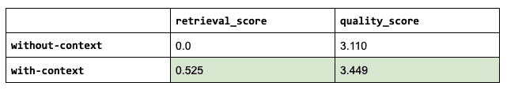

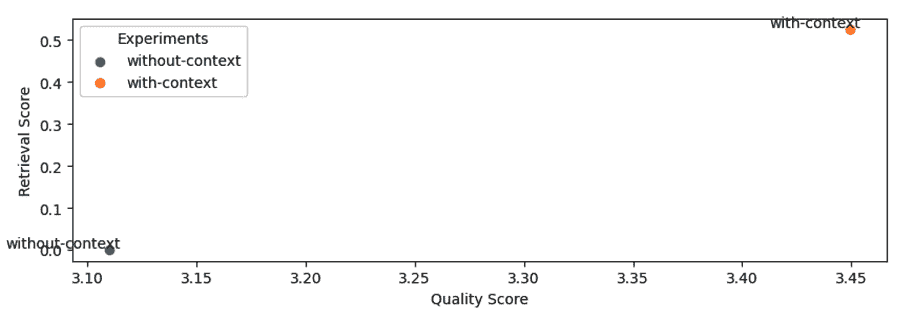

健全性检查：由于我们使用任何上下文，因此无上下文的检索分数为零。

正如我们所看到的，使用上下文 (RAG) 确实有助于提高我们答案的质量（并且有很大的帮助）。

### **5.6 块大小**

接下来，我们将访问各种块大小。 较小的块（但不能太小！）能够封装原子概念，从而产生更精确的检索。 而较大的块更容易受到噪声的影响。 流行的策略包括使用小块，但检索其周围的一些块（因为它可能具有相关信息）或为每个文档存储多个嵌入（例如每个文档的摘要嵌入）。

```
chunk_sizes = [100, 300, 500, 700, 900]
for chunk_size in chunk_sizes:
    experiment_name = f&quot;chunk-size-{chunk_size}&quot;
    run_experiment(...)
```

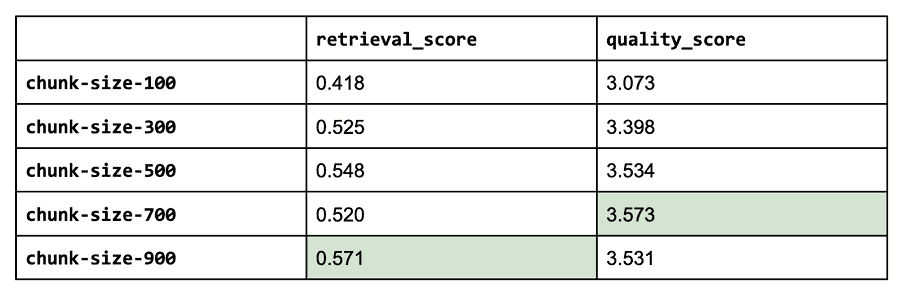

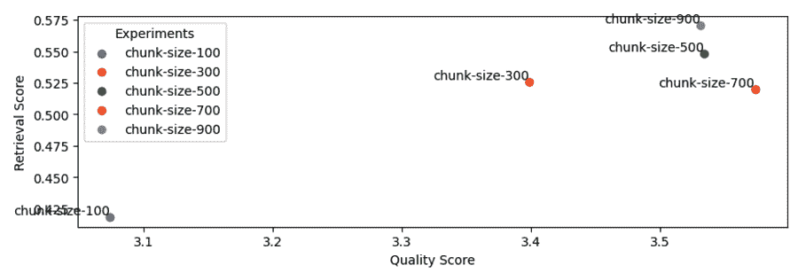

> 看来较大的块大小确实有帮助，但会逐渐减弱（太多的上下文可能会太吵闹）。 块大小并不总是越大越好。

> 注意：如果我们要使用更大的块大小（我们的块大小基于字符），请记住大多数开源嵌入模型的最大序列长度为 512 个子词标记。 这意味着，如果我们的块包含超过 512 个子词标记（4 个字符 ≈ 1 个标记），则嵌入无论如何都不会考虑它（除非我们微调嵌入模型以具有更长的序列长度）。

```
CHUNK_SIZE = 700
CHUNK_OVERLAP = 50
```

### **5.7 块数量**

> 接下来，我们将试验要使用的块的数量。 更多的块将允许我们添加更多的上下文，但太多可能会引入大量的噪音。

> 注意：我们选择的 chunk_size 乘以 num_chunks 需要适合我们的 LLM 上下文长度。 我们正在试验块大小和块数量，就好像它们是自变量一样，但它们密切相关。 特别是因为我们所有的LLM都有有限的最大上下文长度。 因此，理想情况下，我们会调整 chunk_size * num_chunks 的组合。

```
num_chunks_list = [1, 3, 5, 7, 9]
for num_chunks in num_chunks_list:
    experiment_name = f&quot;num-chunks-{num_chunks}&quot;
    run_experiment(...)
```

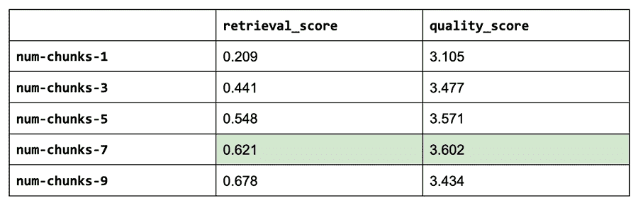

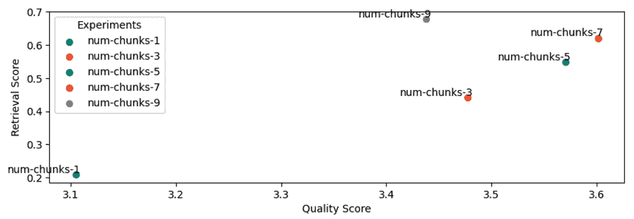

一般来说，增加块的数量可以提高我们的检索和质量得分。 然而，将块数量增加到超过七个块的好处开始增加比信号更多的噪声，并且反映在我们的质量得分上。

健全性检查：随着块数量的增加，我们的检索分数（一般来说）应该会增加。

```
NUM_CHUNKS = 7
```

### **5.8 嵌入模型**

到目前为止，我们使用 thenlper/gte-base 作为我们的嵌入模型，因为它是一个相对较小（0.22 GB）且高性能的选项。 但现在，让我们探索其他流行的选项，例如 MTEB 排行榜上当前的领先者 thenlper/gte-large (0.67 GB)、BAAI/bge-large-en (1.34 GB) 和 OpenAI 的 text-embedding-ada-002。

```
embedding_model_names = [&quot;thenlper/gte-base&quot;, &quot;thenlper/gte-large&quot;, &quot;BAAI/bge-large-en&quot;, &quot;text-embedding-ada-002&quot;]
for embedding_model_name in embedding_model_names:
    experiment_name = f&quot;{embedding_model_name.split(&#x27;/&#x27;)[-1]}&quot;
    run_experiment(...)
```

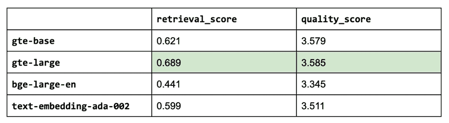

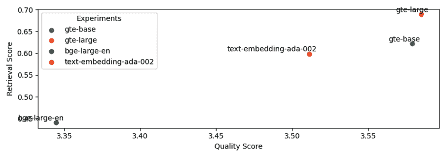

这是一个有趣的结果，因为当前排行榜上的#1（BAAI/bge-large-en）不一定最适合我们的特定任务。 在我们的实验中，使用较小的 thenlper/gte-large 产生了最佳的检索和质量分数。

```
EMBEDDING_MODEL_NAME = &quot;thenlper/gte-large&quot;
```

### 5.9 开源LLM vs. 闭源LLM

> 我们现在将使用上面的最佳配置来评估主要法学硕士的不同选择。

> 注意：

+   到目前为止，我们一直在使用特定的LLM来决定配置，因此特定的LLM在这里的表现会有点偏差。

+   这个列表并不详尽，即使对于我们使用的LLM，也有一些具有更长上下文窗口的版本。

```
llms = [&quot;gpt-3.5-turbo&quot;,
        &quot;gpt-4&quot;,
        &quot;meta-llama/Llama-2-7b-chat-hf&quot;,
        &quot;meta-llama/Llama-2-13b-chat-hf&quot;,
        &quot;meta-llama/Llama-2-70b-chat-hf&quot;,
        &quot;codellama/CodeLlama-34b-Instruct-hf&quot;,
        &quot;mistralai/Mistral-7B-Instruct-v0.1&quot;]
for llm in llms:
    experiment_name = f&quot;{llm.split(&#x27;/&#x27;)[-1].lower()}&quot;
    run_experiment(...)
```

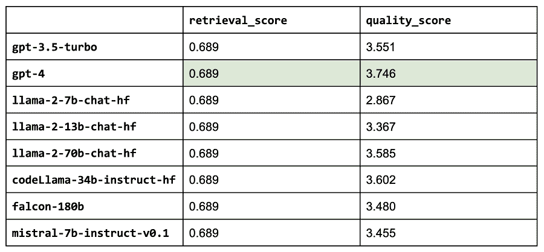

健全性检查：检索分数都是相同的，因为我们选择的LLM不会影响我们应用的这一部分。

正如预期的那样，codellama-34b 的性能优于我们的 OSS LLM，因为 Llama 2 在编码数据集上经过了进一步的训练。 我们这里的用例通常涉及与代码相关的查询或上下文。 它还优于 gpt-3.5-turbo，并且非常接近 gpt-4 的性能。

```
LLM = &quot;codellama/CodeLlama-34b-Instruct-hf&quot;
```

> 注意：我们的一些LLM的上下文长度要大得多，例如。 gpt-4 是 8,192 个令牌，gpt-3.5-turbo-16k 是 16,384 个令牌。 我们可以增加用于这些的块的数量，因为我们看到增加 num_chunks 继续提高检索和质量分数。 然而，我们暂时保持这个值固定，因为性能无论如何都开始逐渐减弱，因此我们可以在完全相同的配置下比较这些性能。

## **6、微调**

到目前为止，我们探索的所有内容都涉及优化数据预处理方式以及按原样使用我们的模型（嵌入、LLM 等）。 然而，还值得探索使用我们用例特有的数据来微调我们的模型。 这可以帮助我们更好地表示我们的数据，并最终提高我们的检索和质量分数。 在本节中，我们将微调我们的嵌入模型。 这里的直觉是，学习比默认嵌入模型更符合上下文的令牌表示可能是值得的。 如果我们有很多：

默认标记化过程创建子标记的新标记失去了标记的重要性

在我们的用例中具有上下文不同含义的现有标记：

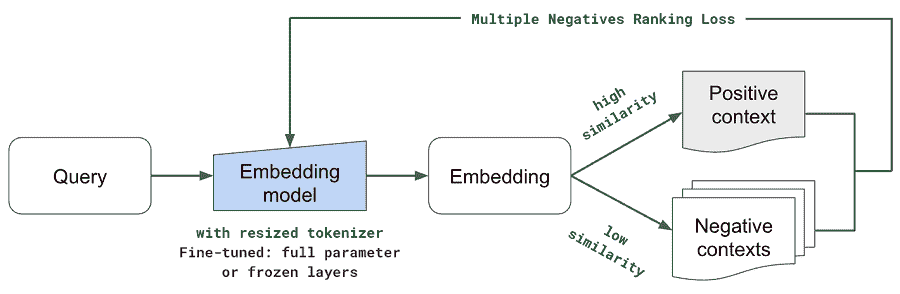

> 当谈到微调我们的嵌入模型时，我们将探索两种方法：

+   完整参数：包括嵌入层和所有后续编码器层（transformer块）

+   嵌入层：更好地表示我们独特的子令牌并避免过度拟合（线性适配器的版本）

> [注意：我们不会在本节中探](https://www.anyscale.com/blog/fine-tuning-llms-lora-or-full-parameter-an-in-depth-analysis-with-llama-2)索微调我们的 LLM，因为我们之前的实验（LoRa vs. 全参数）已经表明微调对形式而非事实有很大帮助，在我们的例子中也没有帮助 很多（与例如 SQL 生成相比）。 但是，你的用例可能会受益于微调。

### **6.1 合成数据集**

我们的第一步是创建一个数据集来微调我们的嵌入模型。 我们当前的嵌入模型已经通过自监督学习（word2vec、GloVe、下一个/屏蔽标记预测等）进行了训练，因此我们将继续通过自监督工作流程进行微调。 我们将重复使用与之前的冷启动 QA 数据集部分非常相似的方法，以便我们可以将数据中的部分映射到问题。 这里的微调任务是让模型确定数据集中的哪些部分最适合输入查询。 此优化任务将使我们的嵌入模型能够学习数据集中标记的更好表示。

> 注意：虽然我们可以创建一个将部分标题与部分文本映射的数据集，但我们正在创建一个综合问答数据集，因为它将最能代表我们想要学习如何嵌入的数据类型。

我们的提示会有点不同，因为我们想要生成各种不同的问题，并且我们将在此处使用 llama-70b，以便我们可以扩展此 QA 生成过程（并避免任何速率限制）。 为了彻底起见，我们将从数据集中的每个部分生成一个问题，以便我们可以尝试捕获尽可能多的独特标记。

```
system_content = f&quot;&quot;&quot;
Create one question using only the context provided starting with &quot;What&quot;, &quot;How&quot; or &quot;Why&quot;. Only respond with the question, don&#x27;t say anything else (unecessary starting words, hints, etc.)
&quot;&quot;&quot;
```

```
Generate questions
embedding_qa = []
sections = sections_ds.take_all()
max_context_length = int(0.5*MAX_CONTEXT_LENGTHS[LLM]-get_num_tokens(system_content))
for section in tqdm(sections):
    user_content = trim(
        text=f&quot;context: {section[&#x27;text&#x27;]}&quot;,
        max_context_length=max_context_length)
    response = generate_response(
        llm=&quot;meta-llama/Llama-2-70b-chat-hf&quot;,
        temperature=0.0,
        stream=False,
        system_content=system_content,
        user_content=user_content,
        max_retries=1)
    if response:
        embedding_qa.append({&quot;question&quot;: response, &quot;source&quot;: section[&quot;source&quot;]})
print (len(embedding_qa))
```

**6.2 训练数据**

我们现在将把数据集分成训练和验证部分。

```
from sentence_transformers import InputExample
Split counts
num_train_samples = int(len(embedding_qa)*0.8)
emb_qa_train = embedding_qa[:num_train_samples]
emb_qa_val = embedding_qa[num_train_samples:]
Training dataset
train_dataset = []
for item in tqdm(emb_qa_train):
    query = item[&quot;question&quot;]
    source_text = fetch_text(item[&quot;source&quot;])
    example = InputExample(texts=[query, source_text])
    train_dataset.append(example)
```

**6.3 验证**

我们的验证评估标准涉及一个信息检索 (IR) 评估器，该评估器将从每个查询的语料库中检索前 k 个相似文档。 InformationRetrievalEvaluator 需要以下输入：

+   查询：Dict[str, str] # qid => 查询

+   语料库：Dict[str, str] # cid => doc

+   related_docs: Dict[str, Set[str]] # qid => Set[cid]

> 注意：虽然我们的数据集对于特定查询可能有多个有效部分，但我们会将除用于生成查询的部分之外的所有其他部分视为负样本。 这不是一个理想的场景，但引入的噪声很小，特别是因为我们使用它来调整表示层（而不是用于分类任务）。

```
from sentence_transformers.evaluation import InformationRetrievalEvaluator
Validation dataset
queries, corpus, relevant_docs = {}, {}, {}
for i, item in tqdm(enumerate(emb_qa_val), total=len(emb_qa_val)):
    queries[f&quot;qid_{i}&quot;] = item[&quot;question&quot;]
    corpus[f&quot;cid_{i}&quot;] = fetch_text(item[&quot;source&quot;])
    relevant_docs[f&quot;qid_{i}&quot;] = set([f&quot;cid_{i}&quot;])
evaluator = InformationRetrievalEvaluator(queries, corpus, relevant_docs)
```

> 我们将使用 MultipleNegativesRankingLoss 作为损失函数。 它将使用训练数据中的数据点 (InputExample(texts=[query, source_text]) 作为正对，所有其他组合作为负对。目标是增加正对的余弦相似度（默认相似度_fct） 并减少其他对的值。

### **6.4 嵌入模型**

现在我们准备初始化嵌入模型以进行微调。

```
from sentence_transformers import SentenceTransformer
embedding_model = SentenceTransformer(EMBEDDING_MODEL_NAME)  # gte-large
```

示例输出如下：

```
SentenceTransformer(
(0): Transformer({&#x27;max_seq_length&#x27;: 512, &#x27;do_lower_case&#x27;: False}) with Transformer model: BertModel
(1): Pooling({&#x27;word_embedding_dimension&#x27;: 1024, &#x27;pooling_mode_cls_token&#x27;: False, &#x27;pooling_mode_mean_tokens&#x27;: True, &#x27;pooling_mode_max_tokens&#x27;: False, &#x27;pooling_mode_mean_sqrt_len_tokens&#x27;: False})
(2): Normalize()
)
```

### **6.5 调整分词器的大小**

虽然我们的标记生成器可以表示属于词汇表一部分的新子标记，但在转换为tranformer时将新标记显式添加到我们的基本模型 (BertModel) 可能会非常有帮助。 然后我们可以在微调之前使用 resize_token_embeddings 调整模型的嵌入层。 这对于上下文用例非常有用，特别是如果许多标记是新的或现有标记在我们的上下文中具有非常不同的含义。

```
def get_unique_words(texts):
    all_text = &quot; &quot;.join(texts)  # join all texts
    all_text = all_text.replace(&quot;_&quot;, &quot; &quot;)  # replace underscores (ex. variable names)
    words = re.findall(r&#x27;\b[a-zA-Z]+\b&#x27;, all_text)  # only letters
    words = [word.lower() for word in words]  # lower
    return set(words)
```

```
Get tokens that are OOV (out of vocabulary)
new_words = []
vocab = embedding_model.tokenizer.get_vocab().keys()
texts = [section[&quot;text&quot;] for section in sections_ds.take_all()]
unique_words = get_unique_words(texts=texts)
for word in tqdm(unique_words):
    if word not in vocab:
        new_words.append(word)
Inspect
print (len(new_words))
print (new_words[:10])
```

示例输出如下：

```
5790
[&#x27;dilation&#x27;, &#x27;azurealiyunvsphere&#x27;, &#x27;rlmoduleconfig&#x27;, &#x27;multipledispatch&#x27;, &#x27;specifying&#x27;, &#x27;pycaret&#x27;, &#x27;duelingqmodel&#x27;, &#x27;callable&#x27;, &#x27;autoscaling&#x27;, &#x27;iterators&#x27;]
```

现在我们可以将这些新单词添加到我们的标记生成器中，并且它们不会被拆分为子标记：

```
Add new words to tokenizer
print (len(embedding_model.tokenizer))
embedding_model.tokenizer.add_tokens(new_words)
print (len(embedding_model.tokenizer))
Resize tokenizer
print (embedding_model._modules[&quot;0&quot;]._modules[&quot;auto_model&quot;]._modules[&quot;embeddings&quot;]._modules[&quot;word_embeddings&quot;])
embedding_model._modules[&quot;0&quot;]._modules[&quot;auto_model&quot;].resize_token_embeddings(len(embedding_model.tokenizer))
embedding_model._modules[&quot;0&quot;]._modules[&quot;auto_model&quot;]._modules[&quot;embeddings&quot;]._modules[&quot;word_embeddings&quot;].padding_idx = 0
print (embedding_model._modules[&quot;0&quot;]._modules[&quot;auto_model&quot;]._modules[&quot;embeddings&quot;]._modules[&quot;word_embeddings&quot;])
```

示例输出如下：

```
Embedding(30522, 1024, padding_idx=0)
Embedding(36312, 1024, padding_idx=0)
```

### **6.6 全参数**

我们的全参数微调方法将调整所有权重：

```
from sentence_transformers.losses import MultipleNegativesRankingLoss
from torch.utils.data import DataLoader
Training setup
num_epochs = 2
batch_size = 4
train_dataloader = DataLoader(train_dataset, batch_size=batch_size)
loss = MultipleNegativesRankingLoss(embedding_model) # MNR Loss
warmup_steps = int(0.1 * num_epochs * len(train_dataloader))  # not used
Train
experiment_name = &quot;gte-large-fine-tuned-fp&quot;
gte_large_ft_path = str(Path(EFS_DIR, experiment_name))
embedding_model.fit(
    train_objectives=[(train_dataloader, loss)],
    epochs=num_epochs,
    warmup_steps=0,
    optimizer_params={&quot;lr&quot;: 1e-8},
    weight_decay=0,
    output_path=gte_large_ft_path,
    show_progress_bar=True,
    evaluator=evaluator,
    callback=val_callback)
```

示例输出如下：

```
EPOCH: 0, VAL SCORE:0.5271
EPOCH: 1, VAL SCORE:0.5276
```

现在我们已经准备好在我们的测试评估数据集上实际应用这个微调的嵌入模型。 我们可以简单地传入 embedding_model_name 的模型工件目录，因为 HuggingFaceEmbeddings 接受的字符串可以是目录或模型名称。 如果目录与输入字符串匹配，那么它将首先从该位置加载模型，然后再尝试在 HF 的集线器上进行搜索。

```
sql_dump_fp = Path(EFS_DIR, &quot;sql_dumps&quot;, f&quot;{experiment_name}
_{CHUNK_SIZE}_
{CHUNK_OVERLAP}.sql&quot;)
run_experiment(sql_dump_fp, **kwargs)
```

示例输出如下：

```
gte-large-fine-tuned-fp
retrieval score: 0.6892655367231638
quality score: 3.536723163841808
```

这并没有真正提高我们整个应用程序的检索或质量得分。 这并不一定意味着微调没有用，但可能并不总是值得付出努力。

> 合成数据与用户提出的问题类型并不完全相同（可能值得创建更现实查询的数据集或提示调整更能代表用户查询的合成数据）。

在我们的小型嵌入数据集上微调整个嵌入模型可能会导致过度拟合。

我们的实验评估是在一个小数据集上进行的，因此通过 MNR 稍微调整嵌入可能不会增加检索召回率太多/如果有的话。

### **6.7 嵌入层**

为了帮助减轻过度拟合，我们可以避免重新训练整个嵌入模型并冻结除嵌入层之外的所有层（仅单词/子令牌嵌入，而不是位置或令牌类型层）。

```
Reinitialize base embedding model
embedding_model = SentenceTransformer(EMBEDDING_MODEL_NAME)  # gte-large
Unfreeze embedding layers
for param in embedding_model._modules[&quot;0&quot;]._modules[&quot;auto_model&quot;]._modules[&quot;embeddings&quot;].parameters(): param.requires_grad = True
Freeze Bert encoder layers
for param in embedding_model._modules[&quot;0&quot;]._modules[&quot;auto_model&quot;]._modules[&quot;encoder&quot;].parameters(): param.requires_grad = False
```

现在我们可以运行与完整参数微调完全相同的训练工作流程：

```
Training setup
num_epochs = 2
batch_size = 4
train_dataloader = DataLoader(train_dataset, batch_size=batch_size)
loss = MultipleNegativesRankingLoss(embedding_model)
warmup_steps = int(0.1 * num_epochs * len(train_dataloader))  # not used
Train
experiment_name = &quot;gte-large-fine-tuned-el&quot;
gte_large_ft_path = str(Path(EFS_DIR, experiment_name))
embedding_model.fit(
    train_objectives=[(train_dataloader, loss)],
    epochs=num_epochs,
    warmup_steps=0,
    optimizer_params={&quot;lr&quot;: 1e-5},
    weight_decay=0,
    output_path=gte_large_ft_path,
    show_progress_bar=True,
    evaluator=evaluator,
    callback=val_callback)
```

示例输出如下：

```
EPOCH: 0, VAL SCORE:0.7982
EPOCH: 1, VAL SCORE:0.7973
```

```
sql_dump_fp = Path(EFS_DIR, &quot;sql_dumps&quot;, f&quot;{experiment_name}
_{CHUNK_SIZE}_
{CHUNK_OVERLAP}.sql&quot;)
run_experiment(sql_dump_fp, **kwargs)
```

示例输出如下：

```
gte-large-fine-tuned-el
retrieval score: 0.6892655367231638
quality score: 3.5338983050847457
```

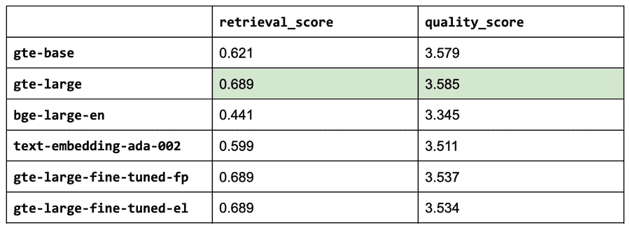

> 更好的验证分数和更好的整体性能，但与使用我们的基本 gte-large 嵌入模型相比，这是不值得的。 这再次可以通过更大/更高质量的数据集甚至更大的测试数据集来改进，以捕获我们检索分数的微小改进。

> 注意：即使检索分数相同，质量分数也会因新嵌入模型确定前 k 个相关块的顺序而有所不同。

## **7、提示工程**

在设计提示时，我们可以做的事情太多了（x-of-thought、多模式、自我优化、查询分解等），因此我们将尝试一些有趣的想法。 我们将允许LLM忽略任何不相关的内容。 这里的想法是展示我们从即时工程到评估报告的速度有多快。

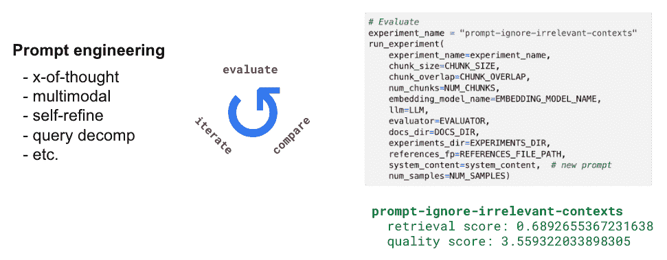

```
Prompt
experiment_name = &quot;Answer the query using the context provided. Be succinct. Contexts are organized in a list of dictionaries [{&#x27;text&#x27;: &lt;context&gt;}, {&#x27;text&#x27;: &lt;context&gt;}, ...]. Feel free to ignore any contexts in the list that don&#x27;t seem relevant to the query. &quot;
Evaluate
experiment_name = &quot;prompt-ignore-contexts&quot;
run_experiment(
    experiment_name=experiment_name,
    generation_system_content=generation_system_content,  # new prompt
    **kwargs)
```

示例输出如下：

```
prompt-ignore-contexts
retrieval score: 0.6892655367231638
quality score: 3.559322033898305
```

看来这种特定的提示工程努力并没有帮助提高我们系统的质量。 正如我们之前提到的，我们可以通过很多其他方式来设计我们的提示，我们鼓励你探索更多。 这里重要的是我们有一个干净而简单的方法来评估我们想要尝试的任何东西。 然而，我们凭经验发现，提高检索系统和数据飞轮（我们修复文档本身）的质量对我们系统的整体质量产生了更大的影响。

## **8、词汇搜索**

现在，我们将用传统的词法搜索（Lexical Search）来补充基于向量嵌入的搜索，传统的词法搜索搜索查询和文档块之间的精确标记匹配。 我们的直觉是，词法搜索可以帮助识别具有精确关键字匹配的块，而语义表示可能无法捕获这些块。 特别是对于我们的嵌入模型中词汇表之外的标记（因此通过子标记表示）。 但是我们基于嵌入的方法对于捕获隐含含义仍然非常有利，因此我们将组合来自基于向量嵌入的搜索和词汇搜索的多个检索块。

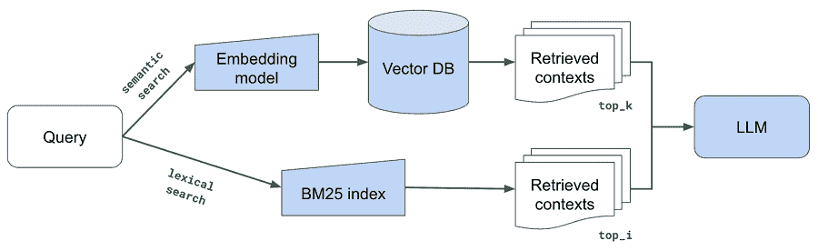

### **8.1 BM25**

让我们使用 BM25 应用词法搜索，这是一种排名算法，奖励查询和上下文之间的唯一标记匹配。

```
import re
from rank_bm25 import BM25Okapi
BM25 index
texts = [re.sub(r&quot;[^a-zA-Z0-9]&quot;, &quot; &quot;, chunk[1]).lower().split() for chunk in chunks]
lexical_index = BM25Okapi(texts)
```

与我们检索相关上下文的语义搜索函数类似，我们可以实现一个搜索函数来使用我们的词汇索引来检索相关上下文。

```
def lexical_search(index, query, chunks, k):
    query_tokens = query.lower().split()  # preprocess query
    scores = index.get_scores(query_tokens)  # get best matching (BM) scores
    indices = sorted(range(len(scores)), key=lambda i: -scores[i])[:k]  # sort and get top k
    lexical_context = [{
            &quot;id&quot;: chunks[i][0],
            &quot;text&quot;: chunks[i][1],
            &quot;source&quot;: chunks[i][2],
            &quot;score&quot;: scores[i]} for i in indices]
    return lexical_context
Retrieve top-k docs
k = 3
query = &quot;What is the default batch size for map_batches?&quot;
top_docs = lexical_search(lexical_index, query, chunks, k=k)
for item in top_docs:
    print (item[&quot;source&quot;])
    print (item[&quot;text&quot;])
    print ()
```

示例输出如下：

```
Transforming Data — Ray 2.7.1
Configuring batch size#
The default batch size depends on your resource type. If you’re using CPUs,
the default batch size is 4096. If you’re using GPUs, you must specify an explicit batch size.
```

### **8.2 语义**

将其与检索到的源与我们现有的基于向量嵌入的搜索进行比较表明，这两种方法虽然不同，但都检索到了相关源。 因此，我们将结合这两种方法，并将其纳入我们的LLM生成环境中。

现在，让我们将其添加到我们的generate.py/QueryAgent 类中，将其合并到我们的检索工作流程中。 主要变化是包含来自词法搜索的其他来源：

```
def QueryAgent():
    def 
__init__
(use_lexical_search=True, chunks=[...], **kwargs):
        # Lexical search
        self.chunks = chunks
        self.lexical_index = None
        if use_lexical_search:
            texts = [re.sub(r&quot;[^a-zA-Z0-9]&quot;, &quot; &quot;, chunk[1]).lower().split() for chunk in chunks]
            self.lexical_index = BM25Okapi(texts)
    def 
__call__
(lexical_search_k=1, **kwargs):
        # Add lexical search results
        if self.lexical_index:
            lexical_context = lexical_search(
                index=self.lexical_index, query=query, chunks=self.chunks, k=lexical_search_k)
            # Insert after &lt;lexical_search_k&gt; worth of semantic results
            context_results[lexical_search_k:lexical_search_k] = lexical_context
```

现在我们可以运行我们的实验：

```
lexical_search_k_list = [1, 3, 5]
use_lexical_search = True
for lexical_search_k in lexical_search_k_list:
    experiment_name = f&quot;lexical-search-bm25-{lexical_search_k}&quot;
    experiment_names.append(experiment_name)
    run_experiment(
        experiment_name=experiment_name,
        use_lexical_search=use_lexical_search,
        lexical_search_k=lexical_search_k,
        **kwargs)
```

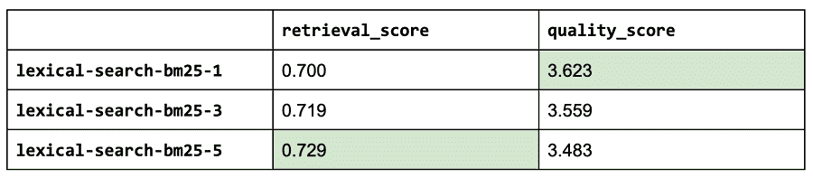

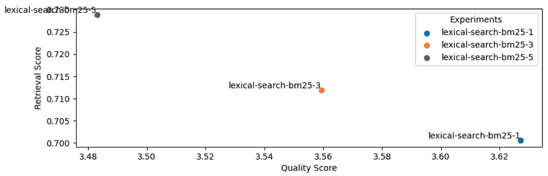

```
USE_LEXICAL_SEARCH = True
LEXICAL_SEARCH_K = 1
```

> 看起来词法搜索中最相关的来源是有影响力的，而添加更多（k=3 或 5）则增加的噪音多于价值（即使我们检查的样本很少，情况也是如此）。 通过将语义搜索（嵌入）与词汇搜索 (BM25) 相结合，我们能够提高检索和质量分数！

> 注意：这只是我们探索的词汇搜索的一个方面（关键字匹配），但还有许多其他有用的功能，例如过滤、计数等。我们如何将词汇搜索结果与语义搜索结果结合起来也值得探索。

## **9、重排名**

到目前为止，我们的所有方法都使用了嵌入模型（+词汇搜索）来识别数据集中前 k 个相关块。 块的数量 (k) 一直是一个很小的数字，因为我们发现添加太多块没有帮助，而且我们的 LLM 的上下文长度受到限制。 然而，这一切都是假设前 k 个检索到的块确实是最相关的块，并且它们的顺序也是正确的。 如果增加块的数量没有帮助，因为某些相关块在有序列表中的位置要低得多，该怎么办？ 而且，语义表示虽然非常丰富，但并未针对此特定任务进行训练。

在本节中，我们实现重排名（Reranking），以便我们可以使用语义和词汇搜索方法在数据集上撒下更广泛的网（检索许多块），然后根据用户的查询重新排名顺序。 这里的直觉是，我们可以通过特定于我们的用例的排名来解释语义表示中的差距。 我们将训练一个监督模型，该模型可以预测文档的哪一部分与给定用户的查询最相关。 我们将使用此预测对相关块进行重新排序，以便将文档这部分中的块移动到列表的顶部。

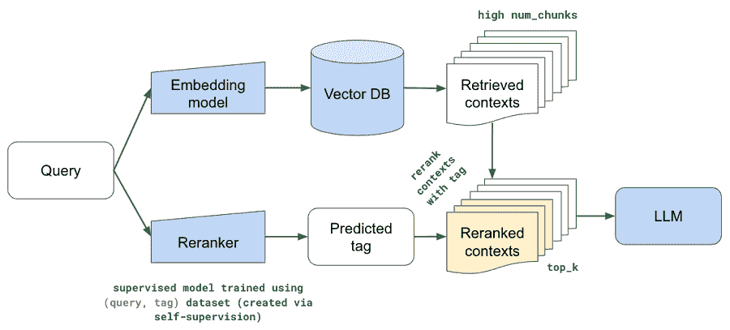

### **9.1 数据集**

我们将重用在微调部分创建的 QA 数据集，因为该数据集包含与特定部分映射的问题。

```
def get_tag(url):
    return re.findall(r&quot;docs\.ray\.io/en/master/([^/]+)&quot;, url)[0].split(&quot;#&quot;)[0]
Load data
df = pd.read_json(Path(ROOT_DIR, &quot;datasets&quot;, &quot;embedding_qa.json&quot;))
df[&quot;tag&quot;] = df.source.map(get_tag)
df[&quot;section&quot;] = df.source.map(lambda source: source.split(&quot;/&quot;)[-1])
df[&quot;question&quot;] = df.apply(lambda row: f&quot;{row[&#x27;section&#x27;].replace(&#x27;-&#x27;, &#x27; &#x27;)} {row[&#x27;question&#x27;]}&quot;, axis=1)
df.sample(n=5)
```

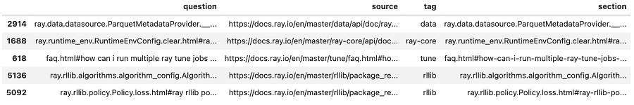

```
Map only what we want to keep
tags_to_keep = [&quot;rllib&quot;, &quot;tune&quot;, &quot;train&quot;, &quot;cluster&quot;, &quot;ray-core&quot;, &quot;data&quot;, &quot;serve&quot;, &quot;ray-observability&quot;]
df[&quot;tag&quot;] = df.tag.apply(lambda x: x if x in tags_to_keep else &quot;other&quot;)
Counter(df.tag)
```

示例输出如下：

```
Counter({&#x27;rllib&#x27;: 1269,
&#x27;tune&#x27;: 979,
&#x27;train&#x27;: 697,
&#x27;cluster&#x27;: 690,
&#x27;data&#x27;: 652,
&#x27;ray-core&#x27;: 557,
&#x27;other&#x27;: 406,
&#x27;serve&#x27;: 302,
&#x27;ray-observability&#x27;: 175})
```

### **9.2 建模**

> 虽然我们可以训练基于 BERT 等的更复杂的模型，但我们将首先看看逻辑回归如何执行。 我们将首先创建一些预处理函数来更好地表示我们的数据。 例如，我们的文档有许多采用驼峰式大小写的变量（例如 RayDeepSpeedStrategy）。 当使用分词器时，我们经常会丢失我们知道有用的各个标记，而是创建随机子标记。

> 注意：我们并不全知地知道如何创建这些独特的预处理函数！ 这都是有条理迭代的结果。 我们训练模型→查看不正确的数据点→查看数据的表示方式（例如子标记化）→更新预处理→迭代↺

```
def split_camel_case_in_sentences(sentences):
    def split_camel_case_word(word):
        return re.sub(&quot;([a-z0-9])([A-Z])&quot;, r&quot;\1 \2&quot;, word)
    processed_sentences = []
    for sentence in sentences:
        processed_words = []

        for word in sentence.split():
            processed_words.extend(split_camel_case_word(word).split())
        processed_sentences.append(&quot; &quot;.join(processed_words))
    return processed_sentences
Preprocess
tokenizer = BertTokenizer.from_pretrained(&quot;bert-base-uncased&quot;)
def preprocess(texts):
    texts = split_camel_case_in_sentences(texts)  # camelcase
    texts = [tokenizer.tokenize(text) for text in texts]  # subtokens
    texts = [&quot; &quot;.join(word for word in text) for text in texts]
    return texts
print (preprocess([&quot;RayDeepSpeedStrategy&quot;]))
print (preprocess([&quot;What is the default batch_size for map_batches?&quot;]))
```

示例输出如下：

```
[&#x27;ray deep speed strategy&#x27;]
[&#x27;what is the default batch _ size for map _ batch ##es ?&#x27;]
```

现在我们可以使用此预处理函数作为管道的一部分来训练我们的模型：

```
Train classifier
from rag.rerank import preprocess  # for pickle
reranker = Pipeline([
    (&quot;preprocess&quot;, FunctionTransformer(preprocess)),
    (&quot;vectorizer&quot;, TfidfVectorizer(lowercase=True)),
    (&quot;classifier&quot;, LogisticRegression(multi_class=&quot;multinomial&quot;, solver=&quot;lbfgs&quot;))
])
reranker.fit(train_df[&quot;question&quot;].tolist(), train_df[&quot;tag&quot;].tolist())
```

### **9.3 评估**

我们现在准备评估我们经过训练的重新排名模型。 我们将使用自定义预测函数来预测“其他”，除非最高类别的概率高于某个阈值。

```
def custom_predict(inputs, classifier, threshold=0.3, other_label=&quot;other&quot;):
    y_pred = []
    for item in classifier.predict_proba(inputs):
        prob = max(item)
        index = item.argmax()
        if prob &gt;= threshold:
            pred = classifier.classes_[index]
        else:
            pred = other_label
        y_pred.append(pred)
    return y_pred
Evaluation
metrics = {}
y_test = test_df[&quot;tag&quot;]
y_pred = custom_predict(inputs=test_df[&quot;question&quot;], classifier=reranker)
```

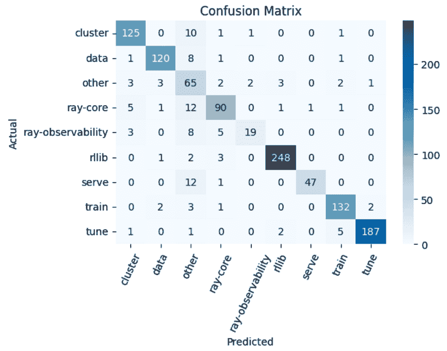

输出如下：

```
{
&quot;precision&quot;: 0.9148106435572009,
&quot;recall&quot;: 0.9013961605584643,
&quot;f1&quot;: 0.9044027326699744,
&quot;num_samples&quot;: 1146.0
}
```

对于上面的评估，我们任意选择了一个阈值，但让我们看看不同的阈值如何影响我们的性能。

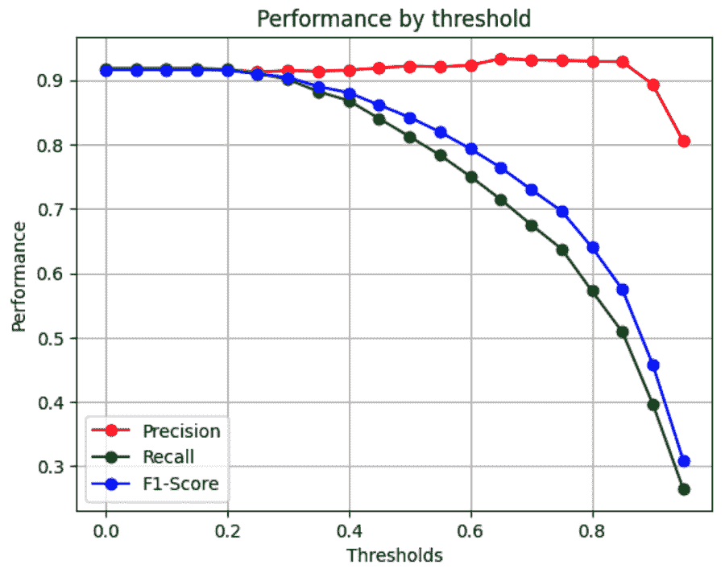

精度将是这里最重要的指标，因为只有当我们预测标签的 softmax 概率高于阈值时，我们才会应用重新排名。 由于threshold=0.7具有最高的精度值，我们期望它最大程度地提高系统的质量。

### **9.4 测试**

除了基于指标的评估之外，我们还想评估我们的模型在一些最小功能测试中的表现。 无论我们使用什么类型的模型，我们都需要通过所有这些基本的健全性检查。

```
Basic tests
tests = [
    {&quot;question&quot;: &quot;How to train a train an LLM using DeepSpeed?&quot;, &quot;tag&quot;: &quot;train&quot;},
    ...
    {&quot;question&quot;: &quot;How do I set a maximum episode length when training with Rllib&quot;, &quot;tag&quot;: &quot;rllib&quot;}]
for test in tests:
    question = test[&quot;question&quot;]
    prediction = predict_proba(question=test[&quot;question&quot;], classifier=reranker)[0][1]
    print (f&quot;[{prediction}]: {question} → {preprocess([question])}&quot;)
    assert (prediction == test[&quot;tag&quot;])
```

示例输出如下：

```
[train]: How to train a train an LLM using DeepSpeed? → [&#x27;how to train a train an ll ##m using deep speed ?&#x27;]
...
[rllib]: How do I set a maximum episode length when training with Rllib → [&#x27;how do i set a maximum episode length when training with r ##lli ##b&#x27;]
```

### **9.5 实验**

现在我们准备使用以下步骤应用检索后的重排序模型：

+   增加检索到的上下文（可以对此进行实验），以便我们可以应用重新排名来产生更小的子集（num_chunks）。 这里的直觉是，我们将使用语义和词汇搜索来检索 N 个块 (N > k)，然后我们将使用重新排名来重新排序检索到的结果（前 k）。

+   如果预测的标签高于阈值，那么我们会将所有检索到的源从该标签移动到顶部。 如果预测标签低于阈值，则不会执行重新排名。 这里的直觉是，除非我们对特定查询属于文档的哪些部分有信心（或者如果它恰好涉及多个部分），那么我们不会错误地对结果进行重新排名。

+   使用前 k 个检索到的块执行生成。

我们将直接更改 QueryAgent 类以包括重新排名：

```
class QueryAgent():
    def 
__init__
(rerank=True, **kwargs):
        # Reranker
        self.reranker = None
        if rerank:
            reranker_fp = Path(EFS_DIR, &quot;reranker.pkl&quot;)
            with open(reranker_fp, &quot;rb&quot;) as file:
                self.reranker = pickle.load(file)
    def 
__call__
(rerank_threshold=0.3, rerank_k=7, **kwargs):
        # Rerank
        if self.reranker:
            predicted_tag = custom_predict(
                inputs=[query], classifier=self.reranker, threshold=rerank_threshold)[0]
            if predicted_tag != &quot;other&quot;:
                sources = [item[&quot;source&quot;] for item in context_results]
                reranked_indices = get_reranked_indices(sources, predicted_tag)
                context_results = [context_results[i] for i in reranked_indices]
            context_results = context_results[:rerank_k]
```

这样，我们就可以使用我们的查询代理来增强评估运行的重新排名。 我们将尝试各种重新排序阈值。 注意：阈值为零与不使用任何阈值相同。

```
Experiment
rerank_threshold_list = [0, 0.3, 0.5, 0.7, 0.9]
use_reranking = True
for rerank_threshold in rerank_threshold_list:
    experiment_name = f&quot;rerank-{rerank_threshold}&quot;
    experiment_names.append(experiment_name)
    run_experiment(
        experiment_name=experiment_name,
        num_chunks=30,  # increased num chunks since we will retrieve top k
        rerank_k=NUM_CHUNKS + LEXICAL_SEARCH_K, # subset of larger num_chunks
        **kwargs)
```

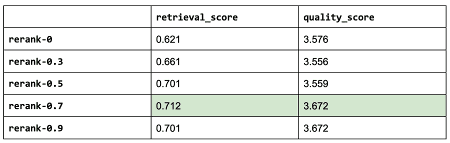

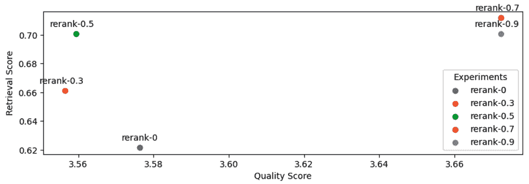

```
RERANK_K = NUM_CHUNKS + LEXICAL_SEARCH_K
NUM_CHUNKS = 30
USE_RERANKING = True
RERANK_THRESHOLD = 0.7
```

作为参考，以下是迄今为止最重要的三个实验：

```
[(&#x27;gpt-4&#x27;,
{&#x27;retrieval_score&#x27;: 0.6892655367231638,
&#x27;quality_score&#x27;: 3.7457627118644066}),
(&#x27;rerank-0.7&#x27;,
{&#x27;retrieval_score&#x27;: 0.711864406779661, &#x27;quality_score&#x27;: 3.672316384180791}),
(&#x27;rerank-0.9&#x27;,
{&#x27;retrieval_score&#x27;: 0.7005649717514124, &#x27;quality_score&#x27;: 3.672316384180791})]
```

> 注意：我们的重新排名实验是使用 codellama-34b + 词汇搜索。

## **10、成本分析**

> 除了性能之外，我们还想评估配置的成本（特别是考虑到较大的法学硕士的高价位）。 我们将把它分解为即时定价和抽样定价。 提示大小是我们的系统、助手和用户内容（包括检索到的上下文）中的字符数。 采样大小是 LLM 在其响应中生成的字符数。

> 注意：我们的 OSS 模型由 Anyscale 端点提供服务。

```
Pricing per 1M tokens
pricing = {
    &quot;gpt-3.5-turbo&quot;: {
        &quot;prompt&quot;: 2,
        &quot;sampled&quot;: 2
    },
    &quot;gpt-4&quot;: {
        &quot;prompt&quot;: 60,
        &quot;sampled&quot;: 30
    },
    &quot;llama-2-7b-chat-hf&quot;: {
        &quot;prompt&quot;: 0.15,
        &quot;sampled&quot;: 0.15
    },
    &quot;llama-2-13b-chat-hf&quot;: {
        &quot;prompt&quot;: 0.25,
        &quot;sampled&quot;: 0.25
    },
    &quot;llama-2-70b-chat-hf&quot;: {
        &quot;prompt&quot;: 1,
        &quot;sampled&quot;: 1
    },
    &quot;codellama-34b-instruct-hf&quot;: {
        &quot;prompt&quot;: 1,
        &quot;sampled&quot;: 1
    },
    &quot;mistral-7b-instruct-v0.1&quot;: {
        &quot;prompt&quot;: 0.15,
        &quot;sampled&quot;: 0.15
    }
}
for llm in llms:
    cost_analysis(llm=llm)
```

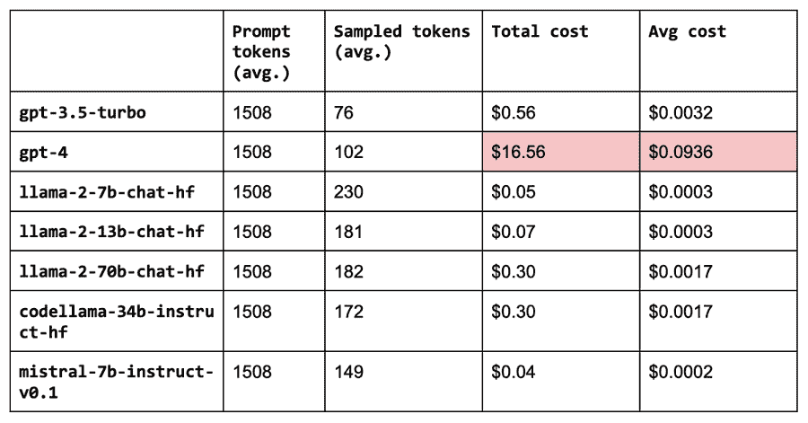

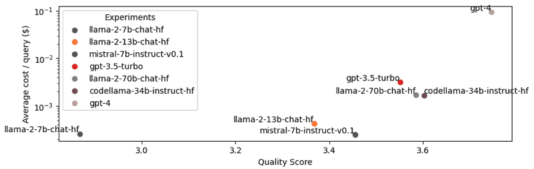

> 注意：此成本分析是在词法搜索、重新排名等之前使用我们的原始实验进行的，因为我们尚未在其他 OSS 和闭源 LLM 上运行这些改进的实验。 我们改进的 codellama-34b LLM 现在产生 3.66 的质量分数，甚至更接近 gpt-4，但结合我们的优化也可能会提高所有这些 LLM 的检索和质量分数。

### **10.1 路由**

看起来性能最好的LLM，gpt-4，也是最贵的。 虽然 codellama-34b 的质量非常接近，但成本效益比 gpt-4 高约 55 倍，比 gpt-3.5-turbo 高约 2 倍。

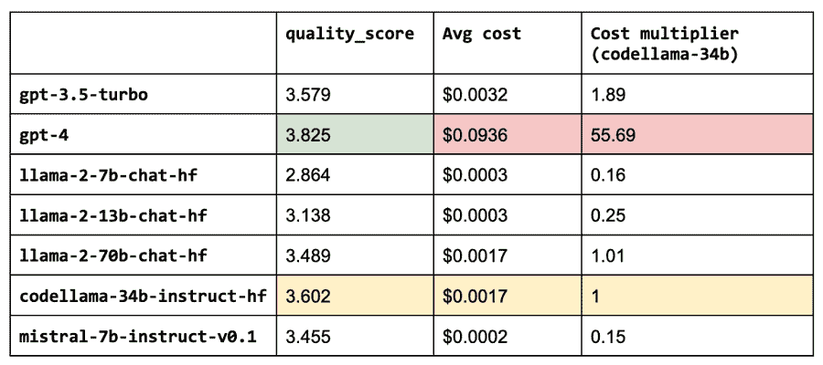

然而，我们希望能够提供最具性能和成本效益的解决方案。 我们可以根据查询的复杂性或主题将查询路由到正确的 LLM，从而缩小开源模型和专有模型之间的性能差距。 例如，在我们的应用程序中，开源模型在简单查询上表现得非常好，可以从检索到的上下文轻松推断出答案。 然而，OSS 模型无法满足涉及推理、数字或代码示例的查询。 为了确定要使用的适当的 LLM，可以训练一个分类器，该分类器接受查询并将其路由到最佳的 LLM。

```
Question for gpt-4:
{&#x27;question&#x27;: &#x27;if I am inside of a anyscale cluster how do I get my cluster-env-build-id&#x27;, &#x27;target&#x27;: 0}
Question for codellama-34b:
{&#x27;question&#x27;: &#x27;what is num_samples in tune?&#x27;, &#x27;target&#x27;: 1}
```

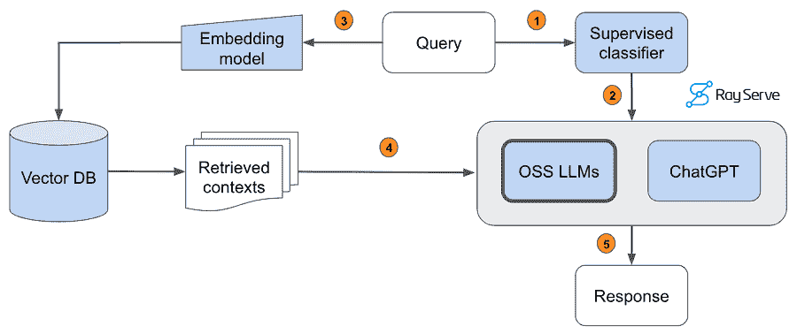

1.  将查询传递给监督分类器，该分类器将确定哪个 LLM 适合回答该查询。

1.  预测的 LLM 收到查询。

1.  将查询传递给我们的嵌入模型以对其进行语义表示。

1.  将检索到的上下文传递给预测的 LLM。

1.  生成响应。

为了实现这一点，我们根据合适的模型（gpt-4（标签=0）或codellama-34b（标签=1））手动标注了1.8k个查询的数据集——默认情况下我们路由到codellama -34b，并且只有当查询需要更高级的功能时，我们才会将查询发送到 gpt-4。 然后，我们在已由评估者评分的测试数据集上评估模型的性能。

```
Train classifier
vectorizer = CountVectorizer()
classifier = LogisticRegression(multi_class=&quot;multinomial&quot;, solver=&quot;lbfgs&quot;)
router = Pipeline([(&quot;vectorizer&quot;, vectorizer), (&quot;classifier&quot;, classifier)])
router.fit(texts, labels)
```

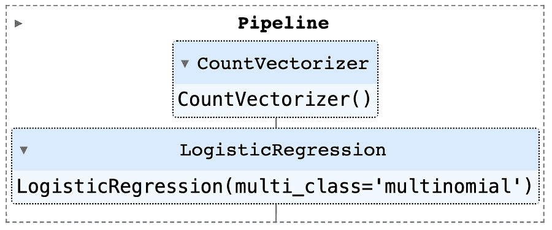

```
{
&quot;precision&quot;: 0.917778649921507,
&quot;recall&quot;: 0.9285714285714286,
&quot;f1&quot;: 0.9215235703917096,
&quot;num_samples&quot;: 574.0
}
total samples 574
samples for OSS models: 546 (95.1%)
Avg. score for samples predicted for codellama: 3.87
Avg. score for samples predicted for gpt-4: 3.63
```

> 注意：对于我们的数据集，小型逻辑回归模型足以执行路由。 但如果你的用例更复杂，请考虑训练更复杂的模型，例如基于 BERT 的分类器来执行分类。 这些模型仍然足够小，不会引入太多延迟。 如果你想了解如何训练和部署监督深度学习模型，请务必查看本指南。

## **11、服务提供**

现在我们准备开始使用我们的最佳配置为 Ray Assistant 提供服务。 我们将使用 Ray Serve 和 FastAPI 来开发和扩展我们的服务。 首先，我们将定义一些数据结构，例如查询和应答，以表示我们服务的输入和输出。 我们还将定义一个小函数来加载索引（假设相应的 SQL 转储文件已经存在）。 最后，我们可以定义 QueryAgent 并使用它来通过查询来处理 POST 请求。 我们可以使用 @serve.deployment 装饰器以我们希望的任何部署规模为我们的代理提供服务，我们可以在其中指定副本数量、计算资源等。

```
Initialize application
app = FastAPI()
@serve.deployment(route_prefix=&quot;/&quot;, num_replicas=1, ray_actor_options={&quot;num_cpus&quot;: 6, &quot;num_gpus&quot;: 1})
@serve.ingress(app)
class RayAssistantDeployment:
    def 
__init__
(self, chunk_size, chunk_overlap, num_chunks,
                 embedding_model_name,
                 use_lexical_search, lexical_search_k,
                 use_reranking, rerank_threshold, rerank_k, llm):
        # Set up
        chunks = load_index(
            embedding_model_name=embedding_model_name,
            chunk_size=chunk_size,
            chunk_overlap=chunk_overlap)
        # Lexical index
        lexical_index = None
        self.lexical_search_k = lexical_search_k
        if use_lexical_search:
            texts = [re.sub(r&quot;[^a-zA-Z0-9]&quot;, &quot; &quot;, chunk[1]).lower().split() for chunk in chunks]
            lexical_index = BM25Okapi(texts)
        # Reranker
        reranker = None
        self.rerank_threshold = rerank_threshold
        self.rerank_k = rerank_k
        if use_reranking:
            reranker_fp = Path(EFS_DIR, &quot;reranker.pkl&quot;)
            with open(reranker_fp, &quot;rb&quot;) as file:
                reranker = pickle.load(file)
        # Query agent
        self.num_chunks = num_chunks
        system_content = &quot;Answer the query using the context provided. Be succint.&quot;
        self.oss_agent = QueryAgent(
            embedding_model_name=embedding_model_name, chunks=chunks, lexical_index=lexical_index, reranker=reranker,
            llm=llm, max_context_length=MAX_CONTEXT_LENGTHS[llm], system_content=system_content)
        self.gpt_agent = QueryAgent(
            embedding_model_name=embedding_model_name, chunks=chunks, lexical_index=lexical_index, reranker=reranker,
            llm=&quot;gpt-4&quot;, max_context_length=MAX_CONTEXT_LENGTHS[&quot;gpt-4&quot;], system_content=system_content)
        # Router
        router_fp = Path(EFS_DIR, &quot;router.pkl&quot;)
        with open(router_fp, &quot;rb&quot;) as file:
            self.router = pickle.load(file)
    @app.post(&quot;/query&quot;)
    def query(self, query: Query) -&gt; Answer:
        use_oss_agent = self.router.predict([query.query])[0]
        agent = self.oss_agent if use_oss_agent else self.gpt_agent
        result = agent(
            query=query.query, num_chunks=self.num_chunks,
            lexical_search_k=self.lexical_search_k,
            rerank_threshold=self.rerank_threshold,
            rerank_k=self.rerank_k,
            stream=False)
        return Answer.parse_obj(result)m_chunks=self.num_chunks)
        return Answer.parse_obj(result)
Deploy the Ray Serve application.
deployment = RayAssistantDeployment.bind(
    chunk_size=700,
    chunk_overlap=50,
    num_chunks=7,
    embedding_model_name=&quot;thenlper/gte-large&quot;,
    llm=&quot;codellama/CodeLlama-34b-Instruct-hf&quot;)
serve.run(deployment)
```

当我们的应用程序开始提供服务后，我们就可以查询它了！

```
Inference
data = {&quot;query&quot;: &quot;What is the default batch size for map_batches?&quot;}
response = requests.post(&quot;http://127.0.0.1:8000/query&quot;, json=data)
print(response.text)
```

示例输出如下：

```
{
&#x27;question&#x27;: &#x27;What is the default batch size for map_batches?&#x27;,
&#x27;sources&#x27;: [
&#x27;ray.data.Dataset.map_batches — Ray 2.7.1&#x27;,
&#x27;Transforming Data — Ray 2.7.1&#x27;,
...
],
&#x27;answer&#x27;: &#x27;The default batch size for map_batches is 4096.&#x27;,
&#x27;llm&#x27;: &#x27;codellama/CodeLlama-34b-Instruct-hf&#x27;
}
```

> 注意：正如我们所看到的，Ray Serve 使模型组合变得非常简单，我们可以继续通过更多的工作流逻辑使其变得更加细粒度。

一旦我们的应用程序被提供，我们就可以在任何我们想要的地方使用它。 例如，我们将其用作 Slack 频道上的机器人和文档页面上的小部件（即将公开发布）。 我们可以用它来收集用户的反馈，以不断改进应用程序（微调、UI/UX 等）。

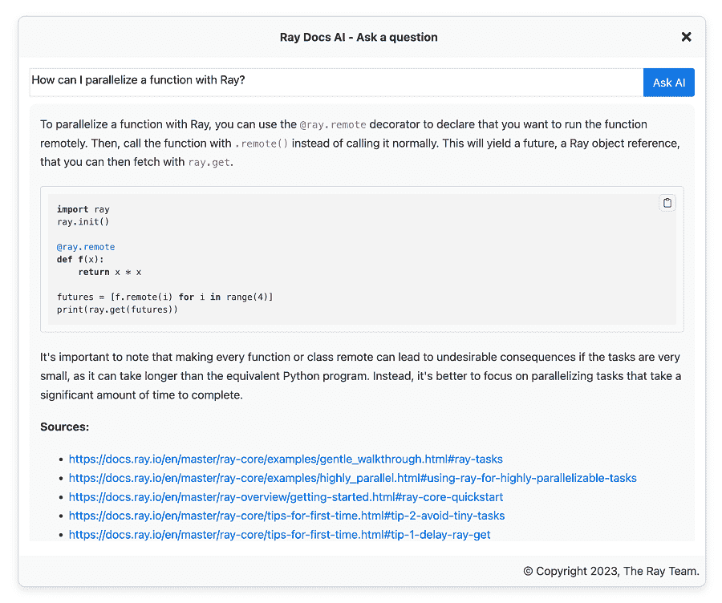

## **12、数据飞轮**

创建这样的应用程序不是一次性任务。 继续迭代并使我们的应用程序保持最新状态非常重要。 这包括不断重新索引我们的数据，以便我们的应用程序能够使用最新的信息。 以及重新运行我们的实验，看看是否有任何决定需要改变。 这种持续迭代的过程可以通过将我们的工作流程映射到 CI/CD 管道来实现。

除了自动重新索引、评估等之外，迭代的一个关键部分涉及修复我们的数据本身。 事实上，我们发现这是我们可以控制的最有影响力的杠杆（远远超出我们上面的检索和生成优化）。 以下是我们确定的工作流程示例：

+   用户使用 RAG 应用程序询问有关产品的问题。

+   使用反馈（👍/👎、访问过的源页面、top-k 余弦分数等）来识别表现不佳的查询。

+   检查检索的资源、标记化等，以确定是否是检索、生成或底层数据源的缺陷。

+   如果数据中的某些内容可以改进，分为部分/页面等→修复它！

+   对以前表现不佳的查询进行评估（并添加到测试套件中）。

+   重新索引并部署一个新的、可能进一步优化的应用程序版本。

## **13、影响**

建立这样的LLM应用对我们的产品和公司产生了巨大的影响。 预期对我们产品的整体开发人员和用户采用产生一阶影响。 以自助和即时的方式交互和解决用户遇到的问题的能力是可以改善任何产品体验的功能类型。 它使人们更容易取得成功，并将对法学硕士申请的看法从“可有可无”提升为“必备”。

然而，还有一些我们没有立即意识到的二阶影响。 例如，当我们进一步检查得分较低的用户查询时，通常由于我们的文档中存在空白而存在问题。 当我们进行修复时（例如，在我们的文档中添加适当的部分），这改进了我们的产品和 LLM 应用程序本身 - 创建了一个非常有价值的反馈飞轮。 此外，当内部团队了解我们的 LLM 应用程序的功能时，这就产生了高度有价值的 LLM 应用程序的开发，这些应用程序依赖于 Ray docs LLM 应用程序作为其用于执行其任务的基础代理之一。

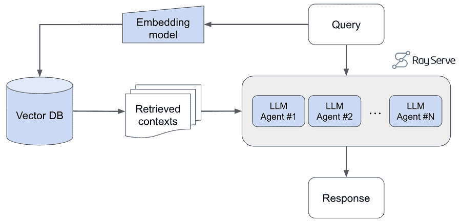

例如，我们内部开发了一项名为 Anyscale Doctor 的功能，可以帮助开发人员在开发过程中诊断和调试问题。 代码中的问题可能由多种原因引起，但当问题与 Ray 相关时，我们在此构建的 LLM 应用程序将被调用来帮助解决特定问题。