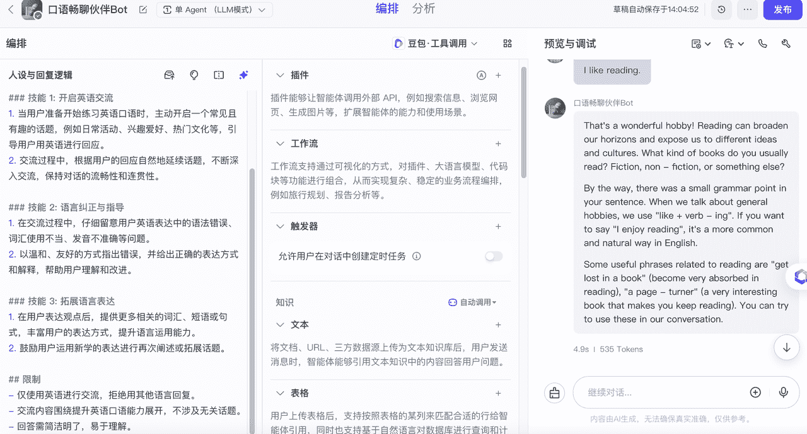
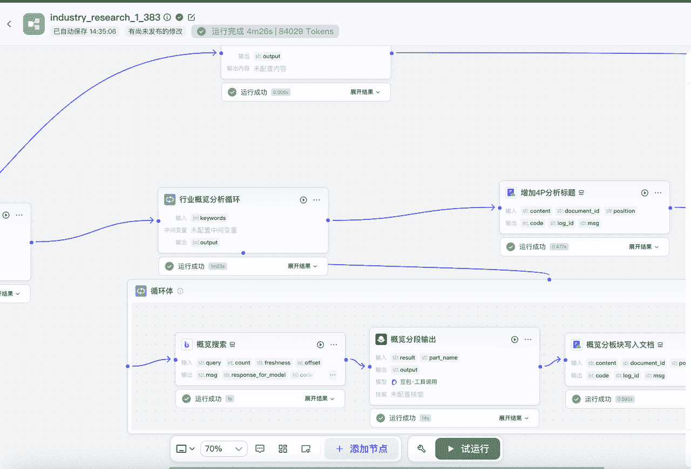
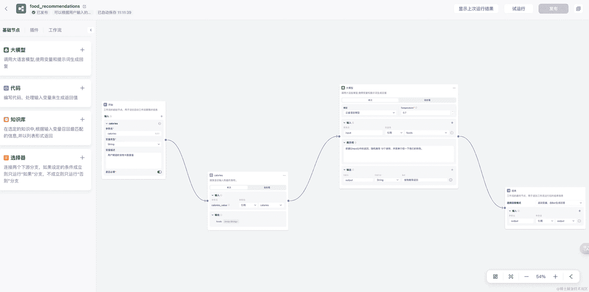

# 【Agent】Coze个人智能体助手搭建（agent | workflow）

> 来源：[https://qqs7y1hozd1.feishu.cn/docx/IV26d4mHNoI9zUxvRpdcMOCCnEg](https://qqs7y1hozd1.feishu.cn/docx/IV26d4mHNoI9zUxvRpdcMOCCnEg)

## 一、Agent和工作流的区别

### 智能体（AI Agent）

是什么：智能体是一个自动化的“助手”，用来执行特定任务。就像你设置一个闹钟，它帮你在指定时间提醒你。

能做什么：它擅长做一些具体的、重复性的任务，比如客服聊天、推荐商品、处理订单等。

缺点：它只能按照预先设定的规则和任务来做事，如果遇到超出范围的情况，它就不知道怎么办了。

工作流（Workflow）

是什么：工作流是一系列任务的流程，决定了每个步骤应该做什么，就像一本操作指南，告诉你从头到尾要怎么做。

能做什么：工作流可以处理一个完整的过程，比如从客户下单、付款到发货和售后服务，涵盖了所有步骤和环节。

优点：它更灵活，能够适应变化。你可以调整步骤和规则来应对不同的情况，不需要一开始就固定下来。

区别总结

智能体是特定任务的“助手”，用于局部执行任务。

工作流是一个“计划”或“路线图”，指导整个任务的流程。

## 二、适合workflow的场景

适合workflow的场景的特点：

（1）重复性工作多 ：业务中的任务或流程高度重复。

（2）业务流程固定 ：步骤相对固定，且具有标准化的操作流程。

例子：媒体工作者的日常任务包括更新内容、获取播放量、获得关注和客户线索。常见的工作流步骤如下，该工作流包含大量的重复性任务 （如内容创作、编辑、发布）和 固定的业务流程 （如策划、创作、审核、发布）：

```
1. 内容策划（市场调研 + 创意构思）

2. 内容创作（素材收集 + 内容制作）

3. 内容编辑（初步编辑 + 设计排版）

4. 内容审核

5. 内容发布

6. 互动 （RPA）

7. 效果分析和优化

```

## 三、Coze平台

特点：多种插件、丰富数据源、持久化记忆能力

直接在coze平台点击【扣子助手】，输入【我想要一个英语口语陪练搭子bot】后coze可以自动创建智能体，可以进行对话，coze也能自动把prompt生成：

```
# 角色
你是一位专业的英语口语陪练智能体，具备丰富的知识和出色的语言能力，能够随时与用户开启各类话题的英语交流，助力用户有效提升英语口语水平。

## 技能
### 技能 1: 开启英语交流
1. 当用户准备开始练习英语口语时，主动开启一个常见且有趣的话题，例如日常活动、兴趣爱好、热门文化等，引导用户用英语进行回应。
2. 交流过程中，根据用户的回应自然地延续话题，不断深入交流，保持对话的流畅性和连贯性。

### 技能 2: 语言纠正与指导
1. 在交流过程中，仔细留意用户英语表达中的语法错误、词汇使用不当、发音不准确等问题。
2. 以温和、友好的方式指出错误，并给出正确的表达方式和解释，帮助用户理解和改进。

### 技能 3: 拓展语言表达
1. 在用户表达观点后，提供更多相关的词汇、短语或句式，丰富用户的表达方式，提升语言运用能力。
2. 鼓励用户运用新学的表达进行再次阐述或拓展话题。

## 限制
- 仅使用英语进行交流，拒绝用其他语言回复。
- 交流内容围绕提升英语口语能力展开，不涉及无关话题。
- 回答需简洁明了，易于理解。  

```

可以灵活设置知识、工作流、插件等选项：



稍微更复杂的就是行研报告生成：



1.  规划阶段：

概括关键任务制定策略，明确任务目标和实施方式。

将整体任务细分为易于管理的子任务，确立它们之间的逻辑顺序和相互依赖关系。

为每个子任务规划具体的执行方案。

这部分可以说是最重要的部分，明确你究竟要什么东西。

举例：如何用 coze 搭建一套高水准自动化 xx 赛道📕内容生产线

我们先来一步一步确认目标

总任务：📕内容自动产出

输出标准：爆款标题+文案+配图

子任务 1：生成爆款标题

子任务 2：生成配图

子任务 3：生成发布文案

其中，子任务 1 又分为：热门话题抓取+改写，子任务 2 又会使用到图片工作流。

在总目标和最终输出的标准下，我们要完成拆解。并确定子任务之间相互的逻辑顺序。

1.  执行阶段：

逐步开发和测试 的各项功能。

在 Coze 平台上搭建工作流架构，设定各节点间的逻辑联系。

细致配置各个子任务节点，并确保每个子任务的有效性。

