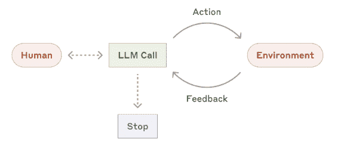
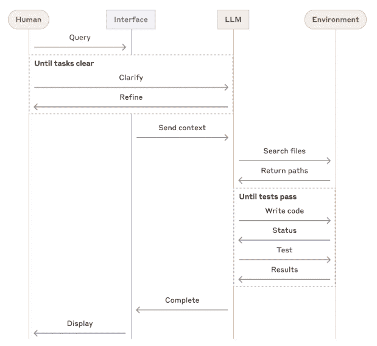
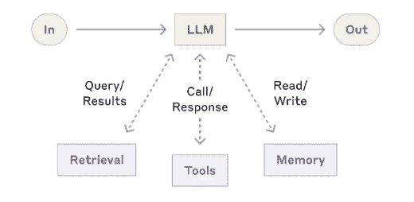
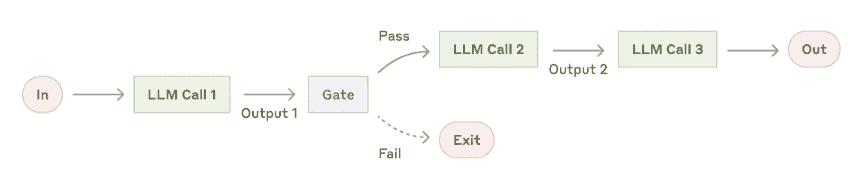
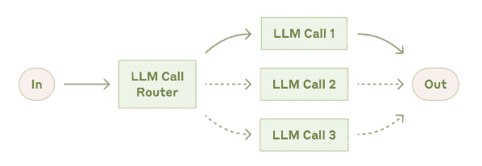
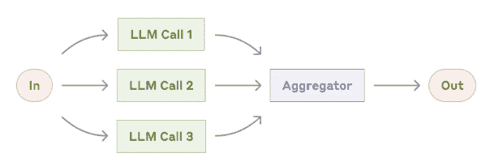
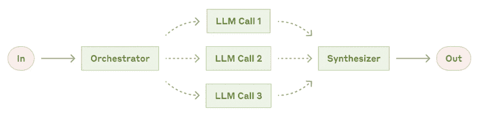
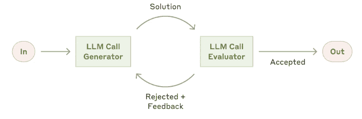

# 典型workflows和Building effective agents

> 来源：[https://qqs7y1hozd1.feishu.cn/docx/JQBJdT1Spos1a3xTBYac5ot1nre](https://qqs7y1hozd1.feishu.cn/docx/JQBJdT1Spos1a3xTBYac5ot1nre)

## 一、构建块、工作流和Agent

workflows是人来定义明确的规则和流程，然后中间步骤由LLM来执行；但是 agents 是为了更加灵活地处理某些任务，且决策是由模型决定的，而不是预定义的规则。

> 当需要更多复杂性时，工作流可以为明确定义的任务提供可预测性和一致性，而当需要大规模灵活性和模型驱动的决策时，Agent是更好的选择。

# 一些典型 workflows

## Agent系统

真正的 agents 系统是为了解决：

+   复杂的开放性问题

+   难以对问题进行明确的分解、分步，难以规划

例如一个经典场景：编程助手（不是单单代码补全，或者简单的代码问答，而是能直接操作一个工程）的内部流程可能是这样的：

目前 Agents 落地最成功的两个场景就是：

+   客服系统：

+   常规的QA功能

+   对接数据库，查询功能

+   修改用户数据

+   自动化票据生成

+   编程IDE

+   著名的Cursor编程IDE

+   例如 Anthropic自己对SWE-bench做的工具

### Building block: The augmented LLM

无论是 workflows 还是 agents，基础组件都是增强版的LLM：

### Workflow: Prompt chaining

Prompt-Chaining: 当任务可以被清晰地划分成多个steps。一般用于用更高的延迟，来换取更高的准确率。

### Workflow: Routing

**Routing：**当需要考虑针对不同场景要采用不同模型时，可使用这种导航的workflow。

### Workflow: Parallelization

Parallelization：并行处理，当需要同时得到多个结果，最后集成在一起时使用。

### Workflow: Orchestrator-workers

Orchestrator-workers：这个跟上面的区别在于，使用一个模型来判断任务要怎么划分，你事先可能没有一个明确的子任务划分。

### Workflow: Evaluator-optimizer

Evaluator-optimizer：迭代优化工作流。让LLM的结果不断自我优化。使用这种工作流，一般需要满足两点：1.LLM的输出，确实可能有很大的提升空间；2.LLM有能力对输出提供有价值的评价

## 三、Agent系统

真正的 agents 系统是为了解决：

+   复杂的开放性问题

+   难以对问题进行明确的分解、分步，难以规划

例如一个经典场景：编程助手（不是单单代码补全，或者简单的代码问答，而是能直接操作一个工程）的内部流程可能是这样的：

目前 Agents 落地最成功的两个场景就是：

+   客服系统：

+   常规的QA功能

+   对接数据库，查询功能

+   修改用户数据

+   自动化票据生成

+   编程IDE

+   著名的Cursor编程IDE

+   例如 Anthropic自己对SWE-bench做的工具