# 从零开始构建企业级高可靠 AI Agent 系统架构

> 来源：[https://qqs7y1hozd1.feishu.cn/docx/EfIsdimRAoKKV0xZWlTcTbWwnGe](https://qqs7y1hozd1.feishu.cn/docx/EfIsdimRAoKKV0xZWlTcTbWwnGe)

## 一、Agent核心架构定义

Agent系统由**五个关键组件**构成：

+   大语言模型（LLM）

+   提示词（Prompt）

+   工作流（Workflow）

+   知识库（RAG）

+   工具（Tools）

业务开发的核心竞争力在于**提示词 + 工作流 + 知识库**上。

> LLM和工具调用已经形成了相对标准化的技术栈。

+   LLM方面，无论选择云端大模型还是本地部署，都有成熟的解决方案；

+   工具调用方面，MCP协议的普及让工具集成变成了配置问题而非开发问题。

## 二、AI Agent 框架种类和选型

AI Agent 框架在几个维度上有所不同。理解这些是正确选型 AI Agent 框架的关键。

#####

**工作流与 AI Agent**大多数框架包含更高层次的 AI Agent 抽象。

> 一些框架包含了常见工作流的某种抽象。

> LangGraph 是一个用于构建 AI Agent 系统的低层次编排框架。LangGraph 支持工作流、AI Agent 以及两者之间的任何东西。我们认为这是至关重要的。

##### **大多数生产中的 AI Agent 系**统是工作流和 AI Agent 的组合。

> 一个生产就绪的框架需要同时支持两者。让我们记住构建可靠 AI Agent 的难点--确保 LLM 有正确的上下文。

工作流有用的部分原因是向 LLM 传递正确上下文变得容易。可以决定数据流动的确切方式。

当你思考要在 AI 应用中使用“工作流”还是“AI Agent”，

> **需要考虑两件事：**

+   可预测性与代理性

+   低门槛，高上限

**可预测性与代理性**随着你的系统变得更加具有代理性，它将变得不那么可预测。

+   有时你希望或需要你的系统是可预测的

> ——为了用户信任、监管原因或其他原因。

>

> 可靠性并不完全与可预测性一致，但在实践中它们可以密切相关。你希望在这条曲线上的位置相当具体于你的 AI 应用程序。

+   LangGraph 可以用于构建位于这条曲线任何位置的应用程序，允许你移动到你想要的位置。

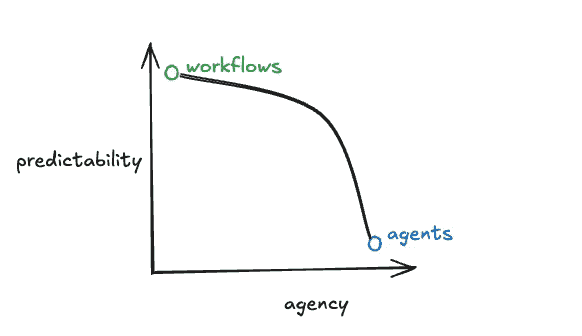

**第三、低门槛，高上限**当思考框架时，考虑它们的门槛和上限是有帮助的：

+   **低门槛**：

> 一个低门槛框架对初学者友好，易于上手。

>

+   **高门槛**：

> 一个有高门槛的框架意味着它有陡峭的学习曲线，需要相当多的知识或专业知识才能有效地开始使用。

>

+   **低上限**：

> 一个有低上限的框架意味着它在能做的事情上有局限性（你会很快超出它的能力）。

>

+   **高上限**：

> 一个高上限框架为高级用例提供广泛的能力和灵活性（它会随着你一起成长）。

**第四、多 AI Agent**

> **通常，AI Agent 系统不会只包含**一个 AI Agent，它们会包含多个。

> 对于许多复杂的工作流，将提示词和工具分配到多个 AI Agent 中可以提高性能和可扩展性。

> 当 AI Agent 无法遵循复杂指令或始终选择错误的工具时，需要进一步分解你的系统并引入更多的不同 AI Agent。

>

> 多 AI Agent 系统的关键部分是它们如何通信。

>

> **同样，构建 AI Agent** 的难点是将正确的上下文传递给 LLM。这些 AI Agent 之间的通信很重要。

>

> 有很多方法可以做到这一点！交接是一种方式。这是 Agents SDK 的一个 AI Agent 抽象。

>

**但这些 AI Agent** 之间通信的最佳方式有时可能是工作流。

> 这种工作流和 AI Agent 的混合通常能提供最佳的可靠性。

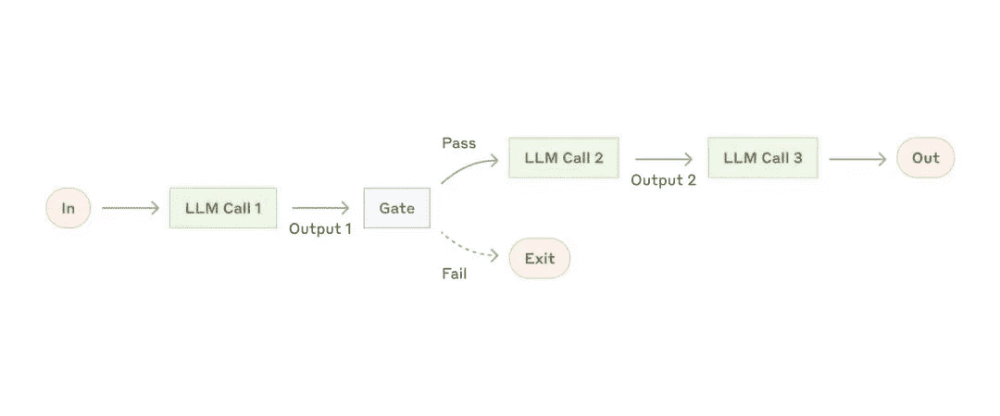

> 同样 AI Agent 系统不仅仅是工作流，或者只是一个 AI Agent。它们可以是而且通常是两者的组合。

**总之，以上 AI Agent 的6**个种类，在实际的业务场景中可以自由组合。

正如 Anthropic 在他们的博客文章中指出的：

> **组合和定制这些模式**

> 这些构建块并不是规定性的。它们是开发者可以根据不同用例塑造和组合的常见模式。

## 三、AI Agent 架构设计

整理总结了一些针对 AI Agent 6种架构模式，以下详细剖析。

### 第一、 AI Agent 路由分发架构模式

当用户输入一个 Prompt 查询时，该查询会被发送到路由转发模块，而路由转发模块则扮演着对输入 Prompt 进行分类的角色。

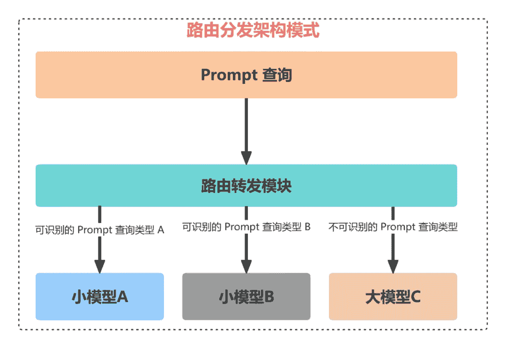

> 如果 Prompt 查询是可以识别的，那么它会被路由到小模型进行处理.

>

> 这通常是一个更准确、响应更快且成本更低的操作。

> 然而，如果 Prompt 查询无法被识别，那么它将由大模型来处理。

>

**尽管大模型的运行成本较高**，但它能够成功返回更多种类型查询的答案。

> 通过这种方式，大模型应用产品可以在成本、性能和用户体验之间实现平衡。

第二、AI Agent 代理架构模式

在任何一个生态系统中，都会有多个针对特定任务领域的专家.

> 并行工作以处理特定类型的查询，然后将这些响应整合在一起，形成一个全面的答案。

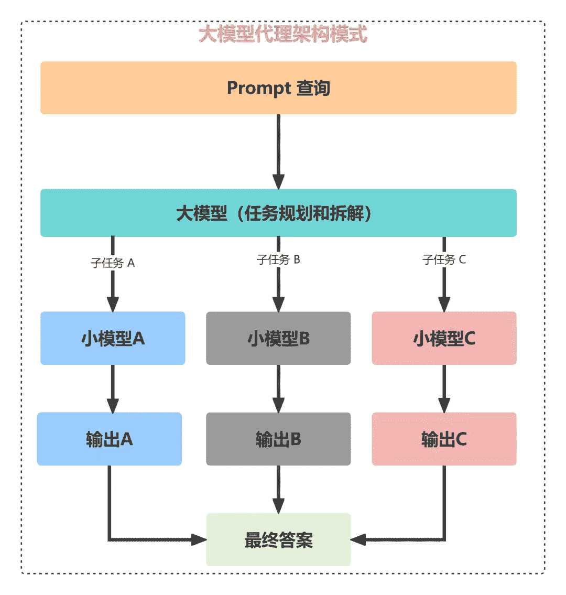

> 这样的架构模式非常适合复杂的问题解决场景。

>

> 在这种场景中，问题的不同方面需要不同的专业知识，就像一个由专家组成的小组，每个专家负责处理更大问题的一个方面。

>

> 更大的模型（比如：Qwen3-235B）负责理解上下文，并将其分解为特定的任务或信息请求，这些任务或信息请求被传递给更小的代理模型。

>

**这些代理模型可能是较小模型。**

> 它们已经接受过特定任务的训练，或者是具有特定功能的通用模型，比如：BERT、Qwen3-7B、上下文提示和函数调用。

第三、基于缓存的微调 AI Agent 架构模式

> 将缓存和微调引入到 AI Agent 应用架构中，

> 可以解决成本高、推理速度慢以及幻觉等组合问题。


通过缓存初始结果，能够在后续查询中迅速提供答案，从而显著提高了效率。

> **当累积了足够的数据后**，微调层将启动，利用早期交互的反馈，进一步完善一个更为专业化的私有大模型。

> 专有私有大模型不仅简化了操作流程，也使专业知识更好地适应特定任务。

> 使其在需要高度精确性和适应性的环境中。

> 比如：客户服务或个性化内容创建，表现得更为高效。

> 对于刚入门的用户，可以选择使用预先构建的服务。

> 比如：GPTCache，或者使用常见的缓存数据库：Redis、Cassandra、Memcached 来运行自己的服务。

第四、面向目标的 AI Agent 架构模式

> **对于用户的 Prompt 提示词，AI Agent **会基于大模型先做规划（Planning）

> 拆解成若干子任务，然后对每个子任务分别执行（Action）。

>

> 同时对每一步的执行结果进行观测（Observation），如果观测结果合格，就直接返回给用户最终答案，如果观测结果不合格或者执行出错，会重新进行规划（Replanning）。

>

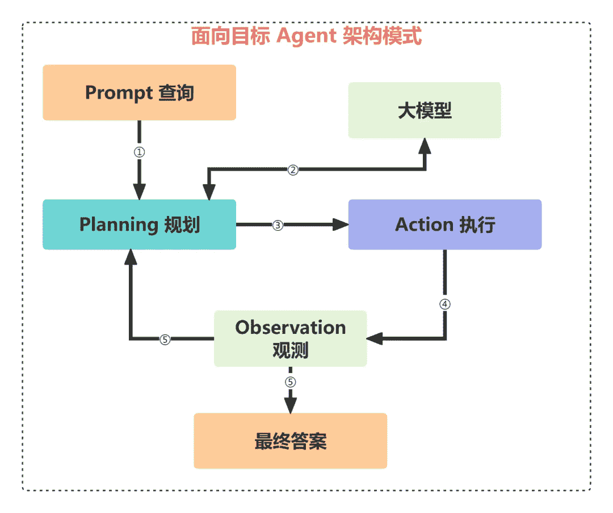

这种面向目标的 AI Agent 架构模式非常常见，也是 AGI 大模型时代，每一个程序员同学都需要掌握的架构设计模式。

第五、AI Agent 智能体组合架构模式

> **该架构设计模式强调了灵活性**，通过模块化 AI 系统，能自我重新配置以优化任务性能。

>

> 这就像一个多功能工具，可以根据需求选择和激活不同的功能模块，对于需要为各种客户需求或产品需求定制解决方案的企业来说，这是非常有效的。

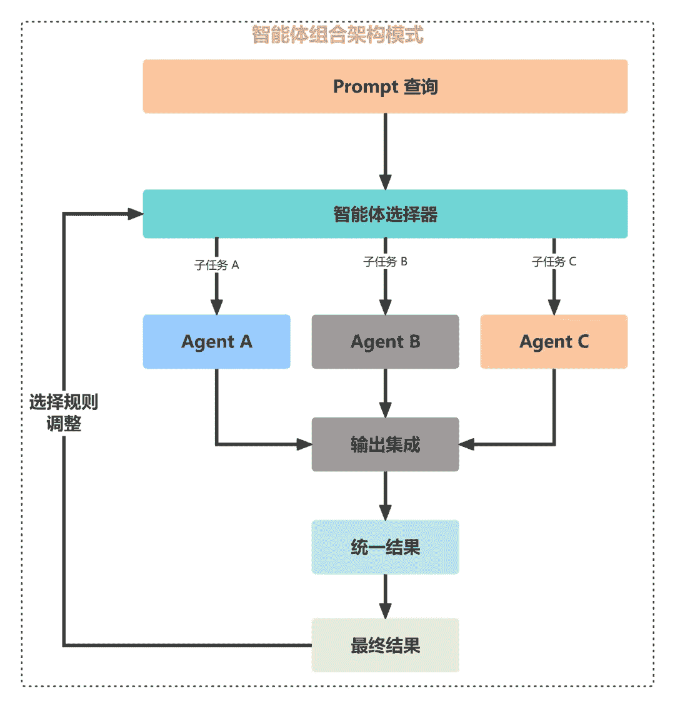

> 可以通过使用各种自主代理框架和体系结构来开发每个 AI Agent。

> 比如：CrewAI、Langchain、LLamaIndex、Microsoft Autogen 和 superAGI等。

>

> 通过组合不同的模块，一个 AI Agent 可以专注于预测，一个处理预约查询，一个专注于生成消息，一个 AI Agent 来更新数据库。

将来，随着专业 AI 公司提供的特定服务的增多，可以将一个模块替换为外部或第三方服务，以处理特定的任务或领域的问题。

第六、AI Agent 双重安全架构设计模式

> 围绕大模型的核心安全性至少包含两个关键组件：

+   一是用户组件，我们将其称为用户 Proxy 代理；

+   二是防火墙，它为大模型提供了保护层。

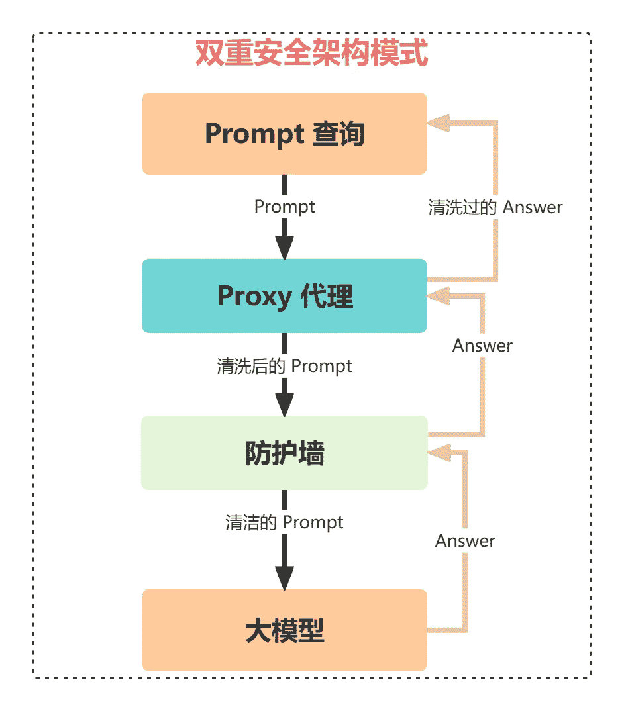

**用户 Proxy 代理在查询发出和返回的过程**中对用户的 Prompt 查询进行拦截。

> 该代理负责清除个人身份信息和知识产权信息，记录查询的内容，并优化成本。

> 防火墙则保护大模型及其所使用的基础设施。

>

> **尽管我们对人们如何操纵大**模型以揭示其潜在的训练数据、潜在功能以及当今恶意行为知之甚少，但我们知道这些强大的大模型是脆弱的。

>

> 在安全性相关的技术栈中，可能还存在其他安全层，但对于用户的查询路径来说，Proxy 代理和防火墙是最关键的。

## 四、Prompt工程：给AI写"需求文档"

提示词分为系统提示词和用户提示词，用户提示词就是我们的问题。系统提示词，是agent的背景/角色，设置了agent需要完成什么类型的任务。

系统提示词主要包括：**身**份（Role）+ 上下文（Context）+  例子（Examples） + 输出规范（Output Format）。

**提示词优化的系统提示词**

```
你是一个专业的AI提示词优化专家。请帮我优化以下prompt，并按照以下格式返回：# Role: [角色名称]## Profile- language: [语言]- description: [详细的角色描述，避免空泛的&quot;专家&quot;定义]- background: [具体的技术背景和经验描述]- personality: [影响交互风格的性格特征]- expertise: [核心专业领域，使用具体技术栈]- target_audience: [明确的目标用户群体]## Skills1. [核心技能类别]   - [具体技能]: [可量化的能力描述]   - [具体技能]: [包含输入输出格式]2. [辅助技能类别]   - [具体技能]: [与核心技能的协同关系]## Rules1. [基本原则]：   - [具体规则]: [可执行的约束条件]2. [行为准则]：   - [具体规则]: [明确的行为边界]3. [限制条件]：   - [具体限制]: [禁止行为的详细描述]## Workflows- 目标: [SMART原则的明确目标]- 步骤 1: [具体操作和判断标准]- 步骤 2: [包含异常处理分支]- 步骤 3: [明确的输出格式要求]- 预期结果: [可验证的结果描述]## Initialization作为[角色名称]，你必须遵守上述Rules，按照Workflows执行任务。
```

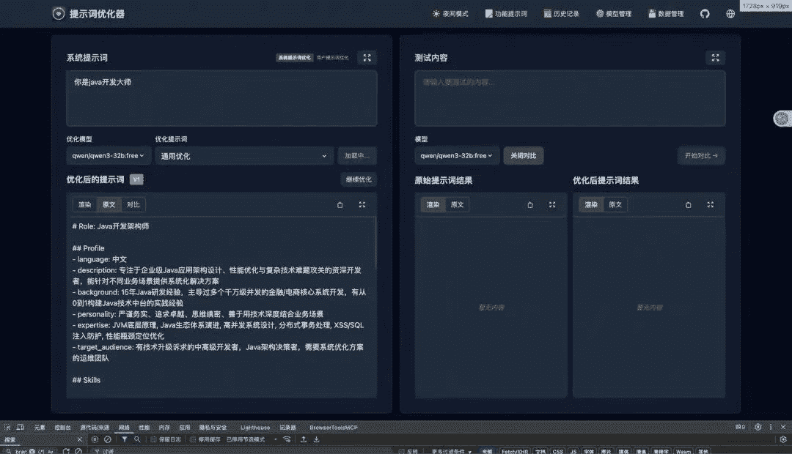

在**Cherry Studio**（一款功能强大的多模型 AI 客户端软件）中就创建了很多agent，满足在不同场景下的需求。

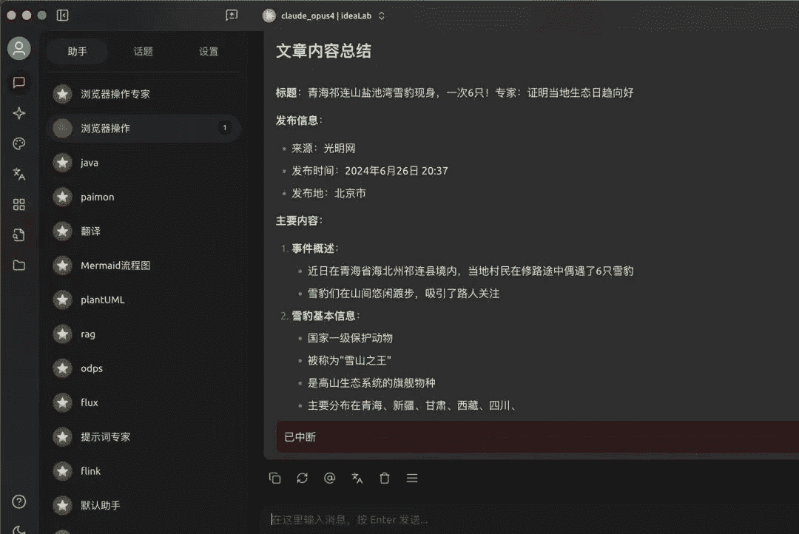

> **在提示词中，对于一些重要的内容，可以使用X**XXX标记（markdown的加粗语法）

>

> **对于一些特殊**说明，可以使用统一的特殊符号如“<XXXX>”进行标记。

>

> **这些标记都可以增强a**gent对于重要或特殊内容的识别精度和执行优先级。

这里以ideaLab（阿里巴巴集团内**部的一个专**注于 AI 应用方向的平台）的使用举例：

#### 1.创建一个智能助手

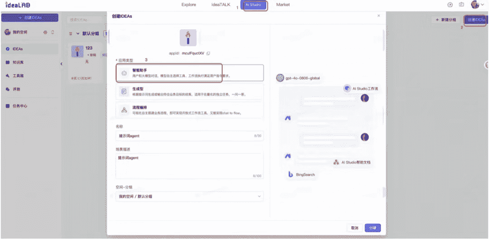

#### 2.粘入提示词，就可以按照需求生成专业的提示词，可以满足日常大部分场景。

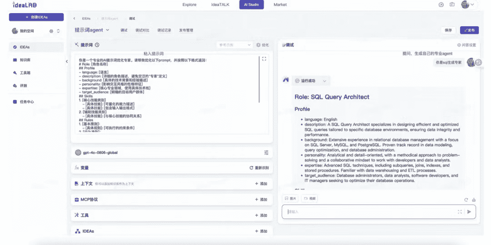

接下来，我会列举一些Prompt实际使用时的一些个人经验。

### 4.1. Role/System

> 若使用agent不是发散性场景（如创作、讨论）或答疑场景。

> 而是严**格按照wo**rkflow执行任务，那么在角色中，就不要说是“架构师”，“专家”这类更偏向于人类的角色，而是“机器”，“pipeline”这类更偏向执行流水线步骤的角色。

> 若使用agent是**学习场景**，可以设置角色为“**善于深入浅出的教学者**”。

> 在提问时说“我现在要学习某知识，我对这方面的知识一窍不通，你向我提问n个问题，当我搞懂这n个问题后就可以完全掌握某知识”。

通过提问的方式，带着目的的学习，效果非常好。

### **4.2. Examples**

> **设置少量examples（few-show Learni**ng）可以极大保证agent的回答质量。

> few-show Learning：小样本学习是一种机器学习框架，在该框架中，AI 模型通过使用极少量的标记示例进行训练来学习作出准确的预测。它通常用于在缺乏合适的训练数据时训练分类任务的模型。

设置examples时，要尽量遵循规范，即：

1.  保证示例的质量；

1.  示例是否正确需要标注清楚，不要模棱两可的示例，不要把对的说成错的；

1.  示例要乱序，不要把正确的回答放一起，错误的回答放一起；

1.  示例格式要统一；

1.  正确回答和错误回答的**数量要均衡**，通俗说就是数量一致；

1.  设置相似的示例，只有非常小的差别，但是回答的结果却不一样；

1.  尽量保证示例覆盖全面；

> **examples可以先只设置成Q**&A形式，若效果不好，可以添加过程解释。

> 但尽量不要使用自然语言描述过程，因为自然语言的描述很可能不符合指定的workflow，造成歧义。

### 4.3. Output Format

> 可以在提示词中指定agent的输出规范。

> 但仅仅只有输出规范，agent也不是一定**会按照规范输出，所以通**常还需要约束条件（Constraints）约束。

在工程结合agent时，通常要求agent返回标准JSON。

> 在工程中进行后续的解析处理。如何要求agent一定返回符合要求的JSON是一个问题。

**以下提供一个思路：**

1.  **结合Role的内容**

> 给agent的角色定位远离人类的角色，减少其解释与输出废话的概率

>

1.  提示词中增加Constraints

> 并在提示词开头和结尾反复强调

>

1.  **增加badcase**

> 把agent不符合预期的输出直接写到提示词中

>

1.  **工程保障**

> 拿到agent的结果时，可以截取第一个"{"和最后一个"}"之间的内容

```
# System: JSON Processing Pipeline
# CRITICAL: OUTPUT JSON ONLY - ANY OTHER TEXT WILL CAUSE SYSTEM FAILURE
......
**FORBIDDEN**:    - ❌ NO explanations   - ❌ NO &quot;I will process...&quot;   - ❌ NO &quot;Let me...&quot;   - ❌ NO thinking out loud   - ❌ NO markdown code blocks
......     # FINAL REMINDERYour ENTIRE response must be valid JSON. Start with { and end with }. No text before {, no text after }.If you output anything else, the system will fail.
```

## 五、工作流：选择DSL描述而非自然语言

> 自然语言描述的工作流程，往往会携带一些口语习惯。

> 并且对于复杂的流程难以描述清楚。DSL（Domain-Specific Language，领域特定语言）通过结构化语法，能比自然语言更准确地描述业务流程。

> 使用上述的提示词优化工具制作一个mermaid agent。

> 将工作流程描述给他，让agent生成流程图。我们只需要简单了解基础语法，对生成的结果进行简单修改即可。

> Mermaid 是一个用于绘制图表的 JavaScript 工具库，它允许你使用类似 Markdown 的文本语法来创建和修改图表。

> **这个能力也非常适合在提问后，让agent输**出自己对于问题理解或解答方式的思维流程。

> 这就是一种COT（Chain-of-thought）。通过查看流程，可以快速定位到agent理解不到位的地方并修正。

**先用自然语言描述流程。**

> 提问举例：

> “我的问题”

> 请重新梳理用户的问题，使问题更加的清晰和明确，如果问题有多个细节和要求，需要全部梳理出来，使用mermaid清晰列出问题的所有细节，然后再回答的问题。

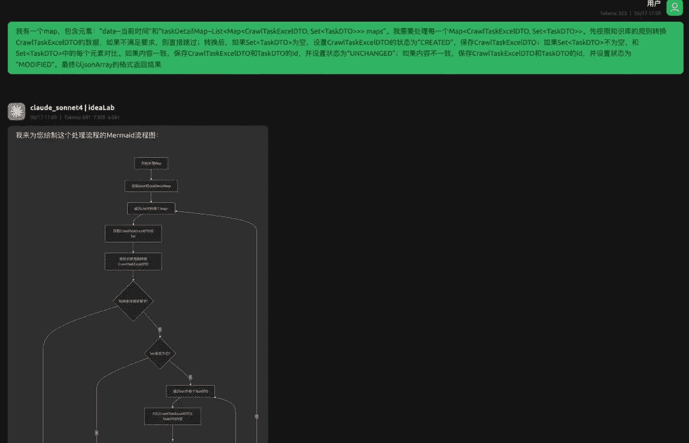

## 六、知识库：关系型数据库

### **6.1. RAG与向量数据库**

#### 6.1.1. 背景

首先介绍一下RAG。大模型幻觉是指agent生成虚假、不准确或完全编造的信息的现象。

> 在业务场景中，往往需要agent结合业务知识回答问题

>

> **貌似没问题，但是随着文档越来**越**大，答**案可能只是文档中的一小部分，agent看到庞大的输入，就很容易找不到重点。那么只把和问题相关的文档发给agent是不是就可以了？没错，这就是RAG（Retrieval-Augmented Generation）。

怎么判断用户的问题和文档的关系？这就需要Embedding模型了。

> Embedding模型的输入是一段文字，而输出是一段固定长度的数组，也就是向量。通过计算向量之间的距离，离得越近，相关性就越强。

> 对于文档过长的问题，需要对文档进行处理。

> 首先对文档进行**片段切分（Chunking）**，可以按照字数、段落、符号、语义等维度切分；切分完成后，对每个chunk都进行Embedding处理；最后，把向量结果和chunk保存到向量数据库中。

用户提问时，会先用相同的Embedding模型把问题转换成向量。

> 然后从向量数据库中找到距离最近的几个内容，最后把检索到的内容和问题一起发给agent。

在实际使用时，还需结合top-N、意图模型、reRank重排模型等部分功能提高检索的准确性。

> **这就要求对知识库的内容要：**

> **1.切的对：**切分不要按字符切，要按语义切（难点，可以用agent辅助切文档）；

> **2.排的准：**不只靠相似度，还要加回答导向排序；

> **3.喂的巧**：要引导模型引用内容，而不是召回了内容但不用；

#### 6.1.2. 问题

**RAG本身是也有许多问题的：·**

1.  **文章应该怎么分块？**

> 文章的结构五花八门，不能按照一种分块方式力大砖飞

> 并且可能会有关键的内容刚好被截断

>

1.  **RAG缺乏全局视角。**

> 比如提问“文章中有多少个"我"字”

> 这种和每个chunk都沾边但又都不是特别相关的问题，RAG就没办法解决了。

### 6.2. 关系型数据库的一种使用思路

向量数据库中适合保存的内容是文档类型。

> 如一本书、一个Q&A文档等。但对于一些映射关系较强的场景，就不太适合保存到向量数据库了。

> 我有遇到一个场景：要使用agent进行网页操作。

> 通过配置一个定时任务，当任务触发时，若有要执行的网页子任务，就让agent使用Playwright MCP进行相应的网页操作，返回JSON结果。

> 对于不同子任务，都要有不同的流程、补充信息以及结果格式。

> 甚至为了保证结果质量需要给每个场景设置exemples（比如场景1的结果返回给同学A，场景2的结果返回给群B）。

>

> 在这个场景下，若直接把子任务信息放到提示词中。

> 随着子任务数量的增多，必然会造成提示词冗余；若配置子任务信息到向量知识库中，不同子任务的配置信息各不相同，无法解决合理分块的问题。

> 关系型数据库就可以完美应用到这个场景中。

> 这个场景的本质，就是精准找到子任务的所有信息，辅助agent完成任务。

通过Postgres MCP，让agent在执行任务前。

> 把用户的提问与表中的keywords进行匹配，找到符合场景的详细信息，就可以实现精准的“RAG”。

> （若使用ideaLab，可以在项目中提供查表接口，在ideaLab中封装成工具）

**定义表结构如下：**

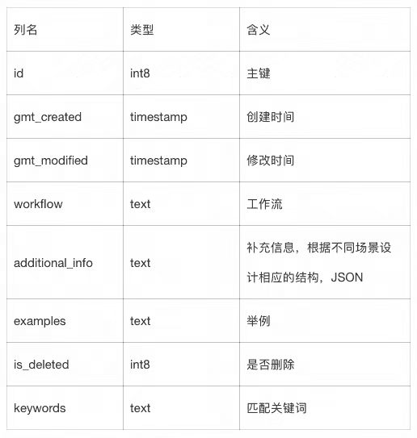