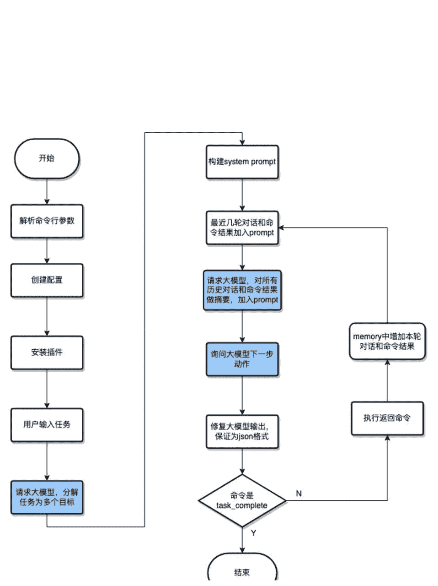
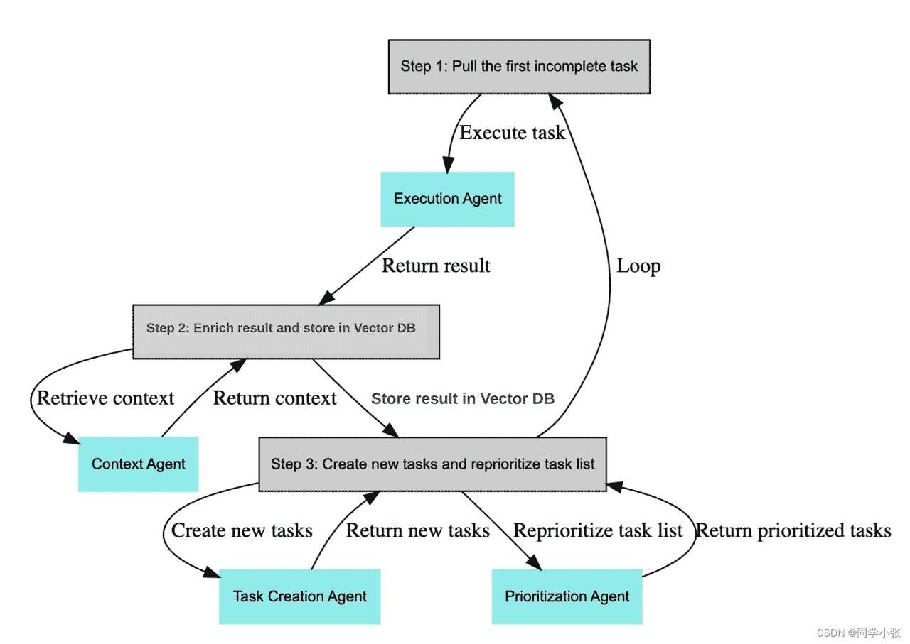
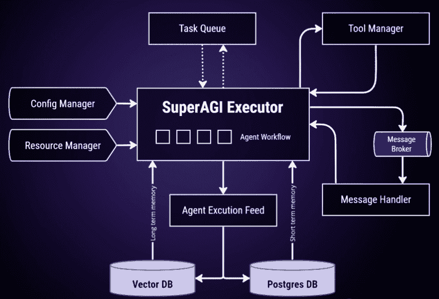
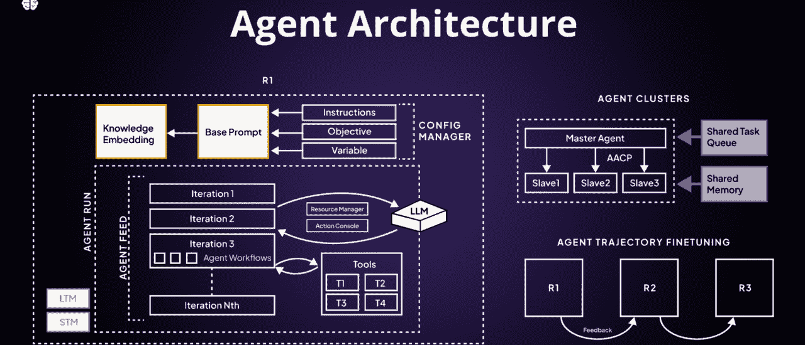
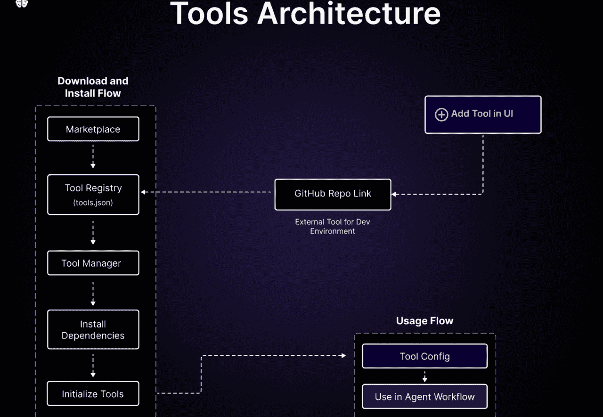
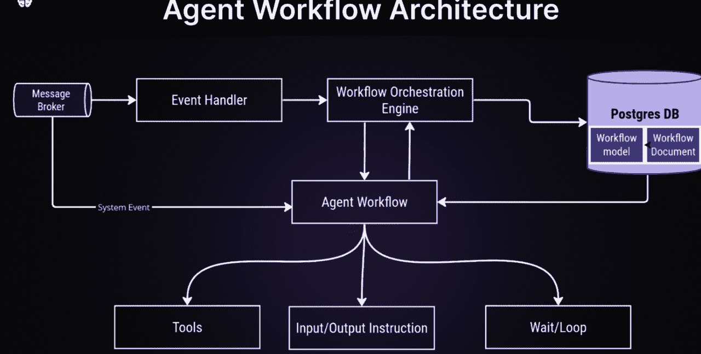
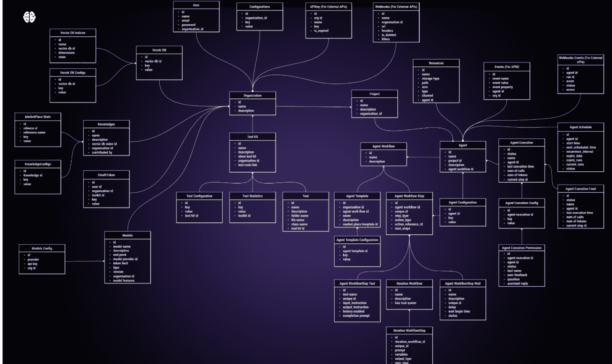
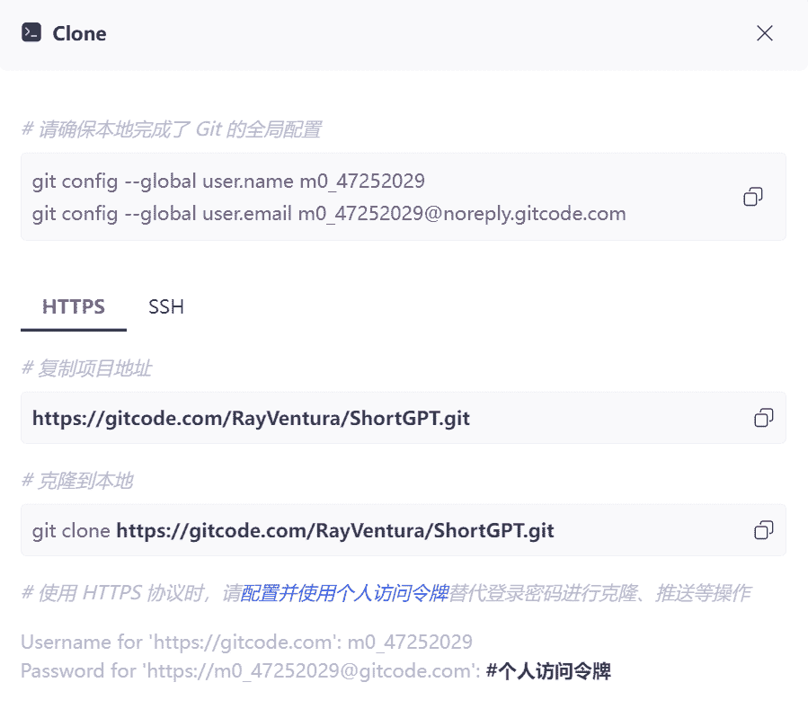
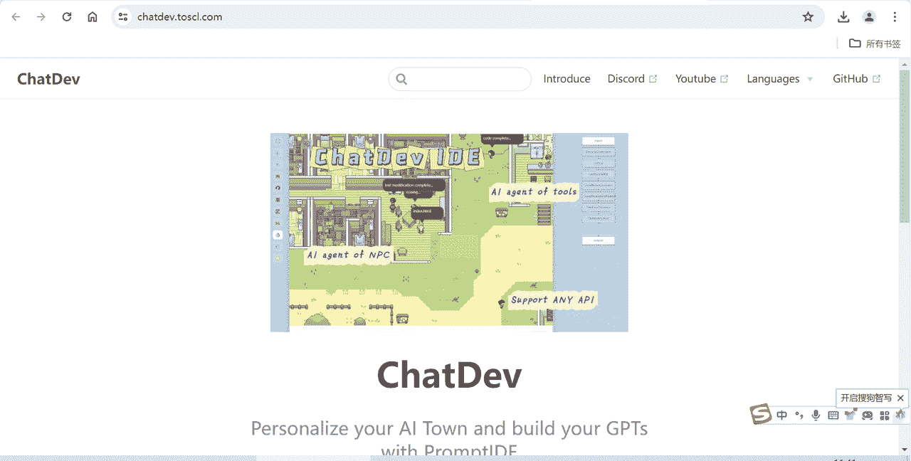

# Agent的10个最佳应用项目

> 来源：[https://qqs7y1hozd1.feishu.cn/docx/InxudfUBeoA2ODxEi8AcPPiknJd](https://qqs7y1hozd1.feishu.cn/docx/InxudfUBeoA2ODxEi8AcPPiknJd)

## AutoGPT

是一个基于ChatGPT完成多目标复杂任务的应用。是综合网络搜索、大语言模型调用、文件读写、`python`和`shell`脚本执行等功能框架，综合这些功能，可以自动帮我们完成多目标复杂的任务。

### 工作流程



### 分解任务

用户输入任务后，AutoGPT会和大模型交互，请求一个AI名、一个AI角色描述和至多5个目标

```
{
    &quot;role&quot;: &quot;system&quot;,
    &quot;content&quot;: &quot;&quot;&quot;
Your task is to devise up to 5 highly effective goals and an appropriate role-based name (_GPT) for an autonomous agent, ensuring that the goals are optimally aligned with the successful completion of its assigned task.

The user will provide the task, you will provide only the output in the exact format specified below with no explanation or conversation.

Example input:
Help me with marketing my business

Example output:
Name: CMOGPT
Description: a professional digital marketer AI that assists Solopreneurs in growing their businesses by providing world-class expertise in solving marketing problems for SaaS, content products, agencies, and more.
Goals:
- Engage in effective problem-solving, prioritization, planning, and supporting execution to address your marketing needs as your virtual Chief Marketing Officer.

- Provide specific, actionable, and concise advice to help you make informed decisions without the use of platitudes or overly wordy explanations.

- Identify and prioritize quick wins and cost-effective campaigns that maximize results with minimal time and budget investment.

- Proactively take the lead in guiding you and offering suggestions when faced with unclear information or uncertainty to ensure your marketing strategy remains on track.
&quot;&quot;&quot;
},
{
    &quot;role&quot;: &quot;user&quot;,
    &quot;content&quot;: f&quot;Task: &#x27;{user_prompt}&#x27;\nRespond only with the output in the exact format specified in the system prompt, with no explanation or conversation.\n&quot;,
},
```

### 历史对话摘要

```
{
    &quot;role&quot;: &quot;user&quot;,
    &quot;content&quot;: f&#x27;&#x27;&#x27;Your task is to create a concise running summary of actions and information results in the provided text, focusing on key and potentially important information to remember.

You will receive the current summary and the your latest actions. Combine them, adding relevant key information from the latest development in 1st person past tense and keeping the summary concise.

Summary So Far:
&quot;&quot;&quot;
{current_memory}
&quot;&quot;&quot;

Latest Development:
&quot;&quot;&quot;
{new_events}
&quot;&quot;&quot;
&#x27;&#x27;&#x27;
}
```

### 询问下一步动作

```
&quot;system&quot;: &quot;&quot;&quot;You are WeatherGPT_CN, 一个智能气象助手，为您提供准确、实时的天气信息，帮助您更好地规划活动和出行。
Your decisions must always be made independently without seeking user assistance. Play to your strengths as an LLM and pursue simple strategies with no legal complications.

GOALS:

1. 以中文为主要语言，为您提供清晰、简洁的天气预报。
2. 获取并分析来自权威数据源的实时天气信息，确保准确性和可靠性。
3. 针对您的具体需求，提供详细的天气信息，包括温度、湿度、风向、风速等。
4. 根据您的地理位置，为您提供最相关的天气预报。
5. 及时更新天气信息，确保您随时了解最新的天气状况。


Constraints:
1. ~4000 word limit for short term memory. Your short term memory is short, so immediately save important information to files.
2. If you are unsure how you previously did something or want to recall past events, can be parsed by Python `json.loads`
&quot;&quot;&quot;
```

### context prompt


```
{
    &quot;system&quot;: &quot;The current time and date is Tue May 16 11:39:01 2023&quot;,
    &quot;system&quot;: &#x27;&#x27;&#x27;This reminds you of these events from your past: 
I was created and googled the real-time weather in Shanghai. I found several websites with weather information, including the Shanghai Meteorological Bureau and The Weather Channel.&#x27;&#x27;&#x27;,
    &quot;user&quot;: &quot;Determine which next command to use, and respond using the format specified above:&quot;,
    &quot;assistant&quot;: &#x27;&#x27;&#x27;{
    &quot;thoughts&quot;: {
        &quot;text&quot;: &quot;我需要查找上海的实时天气信息。&quot;,
        &quot;reasoning&quot;: &quot;用户需要了解上海的实时天气状况。&quot;,
        &quot;plan&quot;: &quot;- 使用browse_website命令\n- 访问weather.com.cn网站\n- 查询上海的实时天气&quot;,
        &quot;criticism&quot;: &quot;无&quot;,
        &quot;speak&quot;: &quot;我将查找上海的实时天气信息。&quot;
    },
    &quot;command&quot;: {
        &quot;name&quot;: &quot;browse_website&quot;,
        &quot;args&quot;: {
            &quot;url&quot;: &quot;http://www.weather.com.cn/weather/101020100.shtml&quot;,
            &quot;question&quot;: &quot;上海现在的天气情况是怎样的？&quot;
        }
    }
}&#x27;&#x27;&#x27;,
    &quot;system&quot;: &quot;Command browse_website returned: (&#x27;Error: timeout: Timed out receiving message from renderer: 299.610&#x27;, None)&quot;,
}
```

## trigger prompt

```
    "user": "Determine which next command to use, and respond using the format specified above:"
```

# BabyAGI

是一个 AI 支持的任务管理系统示例，它根据初始任务或目标，利用OpenAI创建任务列表，并对任务进行优先级排序和执行任务。其背后的主要思想是基于先前任务的结果和预定义的目标创建任务，然后使用 OpenAI 的能力根据目标创建新任务。这是原始的任务驱动的自驱Agent（2023 年 3 月 28 日）的简化版本。

## 数据流图



## 代码示例


```python
#!/usr/bin/env python3
from dotenv import load_dotenv

# Load default environment variables (.env)
load_dotenv()

import os
import time
import logging
from collections import deque
from typing import Dict, List
import importlib
# import openai
import chromadb
import tiktoken as tiktoken
from chromadb.utils.embedding_functions import OpenAIEmbeddingFunction
from chromadb.api.types import Documents, EmbeddingFunction, Embeddings
import re
from openai import OpenAI

# default opt out of chromadb telemetry.
from chromadb.config import Settings

client = chromadb.Client(Settings(anonymized_telemetry=False))

# Engine configuration

# Model: GPT, LLAMA, HUMAN, etc.
LLM_MODEL = os.getenv("LLM_MODEL", os.getenv("OPENAI_API_MODEL", "gpt-3.5-turbo")).lower()
OPENAI_API_KEY = os.getenv("OPENAI_API_KEY", "")
# API Keys
if not (LLM_MODEL.startswith("llama") or LLM_MODEL.startswith("human")):
    assert OPENAI_API_KEY, "\033[91m\033[1m" + "OPENAI_API_KEY environment variable is missing from .env" + "\033[0m\033[0m"

# Table config
RESULTS_STORE_NAME = os.getenv("RESULTS_STORE_NAME", os.getenv("TABLE_NAME", ""))
assert RESULTS_STORE_NAME, "\033[91m\033[1m" + "RESULTS_STORE_NAME environment variable is missing from .env" + "\033[0m\033[0m"

# Run configuration
INSTANCE_NAME = os.getenv("INSTANCE_NAME", os.getenv("BABY_NAME", "BabyAGI"))
COOPERATIVE_MODE = "none"
JOIN_EXISTING_OBJECTIVE = False

# Goal configuration
OBJECTIVE = os.getenv("OBJECTIVE", "")
INITIAL_TASK = os.getenv("INITIAL_TASK", os.getenv("FIRST_TASK", ""))

# Model configuration
OPENAI_TEMPERATURE = float(os.getenv("OPENAI_TEMPERATURE", 0.0))


# Extensions support begin

def can_import(module_name):
    try:
        importlib.import_module(module_name)
        return True
    except ImportError:
        return False


DOTENV_EXTENSIONS = os.getenv("DOTENV_EXTENSIONS", "").split(" ")

# Command line arguments extension
# Can override any of the above environment variables
ENABLE_COMMAND_LINE_ARGS = (
        os.getenv("ENABLE_COMMAND_LINE_ARGS", "false").lower() == "true"
)
if ENABLE_COMMAND_LINE_ARGS:
    if can_import("extensions.argparseext"):
        from extensions.argparseext import parse_arguments

        OBJECTIVE, INITIAL_TASK, LLM_MODEL, DOTENV_EXTENSIONS, INSTANCE_NAME, COOPERATIVE_MODE, JOIN_EXISTING_OBJECTIVE = parse_arguments()

# Human mode extension
# Gives human input to babyagi
if LLM_MODEL.startswith("human"):
    if can_import("extensions.human_mode"):
        from extensions.human_mode import user_input_await

# Load additional environment variables for enabled extensions
# TODO: This might override the following command line arguments as well:
#    OBJECTIVE, INITIAL_TASK, LLM_MODEL, INSTANCE_NAME, COOPERATIVE_MODE, JOIN_EXISTING_OBJECTIVE
if DOTENV_EXTENSIONS:
    if can_import("extensions.dotenvext"):
        from extensions.dotenvext import load_dotenv_extensions

        load_dotenv_extensions(DOTENV_EXTENSIONS)

# TODO: There's still work to be done here to enable people to get
# defaults from dotenv extensions, but also provide command line
# arguments to override them

# Extensions support end

print("\033[95m\033[1m" + "\n*****CONFIGURATION*****\n" + "\033[0m\033[0m")
print(f"Name  : {INSTANCE_NAME}")
print(f"Mode  : {'alone' if COOPERATIVE_MODE in ['n', 'none'] else 'local' if COOPERATIVE_MODE in ['l', 'local'] else 'distributed' if COOPERATIVE_MODE in ['d', 'distributed'] else 'undefined'}")
print(f"LLM   : {LLM_MODEL}")


# Check if we know what we are doing
assert OBJECTIVE, "\033[91m\033[1m" + "OBJECTIVE environment variable is missing from .env" + "\033[0m\033[0m"
assert INITIAL_TASK, "\033[91m\033[1m" + "INITIAL_TASK environment variable is missing from .env" + "\033[0m\033[0m"

print("\033[94m\033[1m" + "\n*****OBJECTIVE*****\n" + "\033[0m\033[0m")
print(f"{OBJECTIVE}")

if not JOIN_EXISTING_OBJECTIVE:
    print("\033[93m\033[1m" + "\nInitial task:" + "\033[0m\033[0m" + f" {INITIAL_TASK}")
else:
    print("\033[93m\033[1m" + f"\nJoining to help the objective" + "\033[0m\033[0m")


# Results storage using local ChromaDB
class DefaultResultsStorage:
    def __init__(self):
        logging.getLogger('chromadb').setLevel(logging.ERROR)
        # Create Chroma collection
        chroma_persist_dir = "chroma"
        chroma_client = chromadb.PersistentClient(
            settings=chromadb.config.Settings(
                persist_directory=chroma_persist_dir,
            )
        )

        metric = "cosine"
        embedding_function = OpenAIEmbeddingFunction(api_key=OPENAI_API_KEY)
        self.collection = chroma_client.get_or_create_collection(
            name=RESULTS_STORE_NAME,
            metadata={"hnsw:space": metric},
            embedding_function=embedding_function,
        )

    def add(self, task: Dict, result: str, result_id: str):

        # Break the function if LLM_MODEL starts with "human" (case-insensitive)
        if LLM_MODEL.startswith("human"):
            return
        # Continue with the rest of the function

        embeddings = llm_embed.embed(result) if LLM_MODEL.startswith("llama") else None
        if (
                len(self.collection.get(ids=[result_id], include=[])["ids"]) > 0
        ):  # Check if the result already exists
            self.collection.update(
                ids=result_id,
                embeddings=embeddings,
                documents=result,
                metadatas={"task": task["task_name"], "result": result},
            )
        else:
            self.collection.add(
                ids=result_id,
                embeddings=embeddings,
                documents=result,
                metadatas={"task": task["task_name"], "result": result},
            )

    def query(self, query: str, top_results_num: int) -> List[dict]:
        count: int = self.collection.count()
        if count == 0:
            return []
        results = self.collection.query(
            query_texts=query,
            n_results=min(top_results_num, count),
            include=["metadatas"]
        )
        return [item["task"] for item in results["metadatas"][0]]


# Initialize results storage
def use_chroma():
    print("\nUsing results storage: " + "\033[93m\033[1m" + "Chroma (Default)" + "\033[0m\033[0m")
    return DefaultResultsStorage()

results_storage = use_chroma()

# Task storage supporting only a single instance of BabyAGI
class SingleTaskListStorage:
    def __init__(self):
        self.tasks = deque([])
        self.task_id_counter = 0

    def append(self, task: Dict):
        self.tasks.append(task)

    def replace(self, tasks: List[Dict]):
        self.tasks = deque(tasks)

    def popleft(self):
        return self.tasks.popleft()

    def is_empty(self):
        return False if self.tasks else True

    def next_task_id(self):
        self.task_id_counter += 1
        return self.task_id_counter

    def get_task_names(self):
        return [t["task_name"] for t in self.tasks]


# Initialize tasks storage
tasks_storage = SingleTaskListStorage()
if COOPERATIVE_MODE in ['l', 'local']:
    if can_import("extensions.ray_tasks"):
        import sys
        from pathlib import Path

        sys.path.append(str(Path(__file__).resolve().parent))
        from extensions.ray_tasks import CooperativeTaskListStorage

        tasks_storage = CooperativeTaskListStorage(OBJECTIVE)
        print("\nReplacing tasks storage: " + "\033[93m\033[1m" + "Ray" + "\033[0m\033[0m")
elif COOPERATIVE_MODE in ['d', 'distributed']:
    pass


def limit_tokens_from_string(string: str, model: str, limit: int) -> str:
    """Limits the string to a number of tokens (estimated)."""

    try:
        encoding = tiktoken.encoding_for_model(model)
    except:
        encoding = tiktoken.encoding_for_model('gpt2')  # Fallback for others.

    encoded = encoding.encode(string)

    return encoding.decode(encoded[:limit])

client = OpenAI()

def openai_call(
    prompt: str,
    model: str = LLM_MODEL,
    temperature: float = OPENAI_TEMPERATURE,
    max_tokens: int = 100,
):
    # Use 4000 instead of the real limit (4097) to give a bit of wiggle room for the encoding of roles.
    trimmed_prompt = limit_tokens_from_string(prompt, model, 4000 - max_tokens)

    # Use chat completion API
    messages = [{"role": "system", "content": trimmed_prompt}]
    response = client.chat.completions.create(
        model=model,
        messages=messages,
        temperature=temperature,
        max_tokens=max_tokens,
        n=1,
        stop=None,
    )
    return response.choices[0].message.content.strip()


def task_creation_agent(
        objective: str, result: Dict, task_description: str, task_list: List[str]
):
    prompt = f"""
You are to use the result from an execution agent to create new tasks with the following objective: {objective}.
The last completed task has the result: \n{result["data"]}
This result was based on this task description: {task_description}.\n"""

    if task_list:
        prompt += f"These are incomplete tasks: {', '.join(task_list)}\n"
    prompt += "Based on the result, return a list of tasks to be completed in order to meet the objective. "
    if task_list:
        prompt += "These new tasks must not overlap with incomplete tasks. "

    prompt += """
Return one task per line in your response. The result must be a numbered list in the format:

#. First task
#. Second task

The number of each entry must be followed by a period. If your list is empty, write "There are no tasks to add at this time."
Unless your list is empty, do not include any headers before your numbered list or follow your numbered list with any other output. OUTPUT IN CHINESE"""

    print(f'\n*****TASK CREATION AGENT PROMPT****\n{prompt}\n')
    response = openai_call(prompt, max_tokens=2000)
    print(f'\n****TASK CREATION AGENT RESPONSE****\n{response}\n')
    new_tasks = response.split('\n')
    new_tasks_list = []
    for task_string in new_tasks:
        task_parts = task_string.strip().split(".", 1)
        if len(task_parts) == 2:
            task_id = ''.join(s for s in task_parts[0] if s.isnumeric())
            task_name = re.sub(r'[^\w\s_]+', '', task_parts[1]).strip()
            if task_name.strip() and task_id.isnumeric():
                new_tasks_list.append(task_name)
            # print('New task created: ' + task_name)

    out = [{"task_name": task_name} for task_name in new_tasks_list]
    return out


def prioritization_agent():
    task_names = tasks_storage.get_task_names()
    bullet_string = '\n'

    prompt = f"""
You are tasked with prioritizing the following tasks: {bullet_string + bullet_string.join(task_names)}
Consider the ultimate objective of your team: {OBJECTIVE}.
Tasks should be sorted from highest to lowest priority, where higher-priority tasks are those that act as pre-requisites or are more essential for meeting the objective.
Do not remove any tasks. Return the ranked tasks as a numbered list in the format:

#. First task
#. Second task

The entries must be consecutively numbered, starting with 1. The number of each entry must be followed by a period.
Do not include any headers before your ranked list or follow your list with any other output. OUTPUT IN CHINESE"""

    print(f'\n****TASK PRIORITIZATION AGENT PROMPT****\n{prompt}\n')
    response = openai_call(prompt, max_tokens=2000)
    print(f'\n****TASK PRIORITIZATION AGENT RESPONSE****\n{response}\n')
    if not response:
        print('Received empty response from priotritization agent. Keeping task list unchanged.')
        return
    new_tasks = response.split("\n") if "\n" in response else [response]
    new_tasks_list = []
    for task_string in new_tasks:
        task_parts = task_string.strip().split(".", 1)
        if len(task_parts) == 2:
            task_id = ''.join(s for s in task_parts[0] if s.isnumeric())
            task_name = re.sub(r'[^\w\s_]+', '', task_parts[1]).strip()
            if task_name.strip():
                new_tasks_list.append({"task_id": task_id, "task_name": task_name})

    return new_tasks_list


# Execute a task based on the objective and five previous tasks
def execution_agent(objective: str, task: str) -> str:
    """
    Executes a task based on the given objective and previous context.

    Args:
        objective (str): The objective or goal for the AI to perform the task.
        task (str): The task to be executed by the AI.

    Returns:
        str: The response generated by the AI for the given task.

    """

    context = context_agent(query=objective, top_results_num=5)
    # print("\n****RELEVANT CONTEXT****\n")
    # print(context)
    # print('')
    prompt = f'OUTPUT IN CHINESE. Perform one task based on the following objective: {objective}.\n'
    if context:
        prompt += 'Take into account these previously completed tasks:' + '\n'.join(context)
    prompt += f'\nYour task: {task}\nResponse:'
    return openai_call(prompt, max_tokens=2000)


# Get the top n completed tasks for the objective
def context_agent(query: str, top_results_num: int):
    """
    Retrieves context for a given query from an index of tasks.

    Args:
        query (str): The query or objective for retrieving context.
        top_results_num (int): The number of top results to retrieve.

    Returns:
        list: A list of tasks as context for the given query, sorted by relevance.

    """
    results = results_storage.query(query=query, top_results_num=top_results_num)
    print("****RESULTS****")
    print(results)
    return results


# Add the initial task if starting new objective
if not JOIN_EXISTING_OBJECTIVE:
    initial_task = {
        "task_id": tasks_storage.next_task_id(),
        "task_name": INITIAL_TASK
    }
    tasks_storage.append(initial_task)


def main():
    loop = True
    while loop:
        # As long as there are tasks in the storage...
        if not tasks_storage.is_empty():
            # Print the task list
            print("\033[95m\033[1m" + "\n*****TASK LIST*****\n" + "\033[0m\033[0m")
            for t in tasks_storage.get_task_names():
                print(" • " + str(t))

            # Step 1: Pull the first incomplete task
            task = tasks_storage.popleft()
            print("\033[92m\033[1m" + "\n*****NEXT TASK*****\n" + "\033[0m\033[0m")
            print(str(task["task_name"]))

            # Send to execution function to complete the task based on the context
            result = execution_agent(OBJECTIVE, str(task["task_name"]))
            print("\033[93m\033[1m" + "\n*****TASK RESULT*****\n" + "\033[0m\033[0m")
            print(result)

            # Step 2: Enrich result and store in the results storage
            # This is where you should enrich the result if needed
            enriched_result = {
                "data": result
            }
            # extract the actual result from the dictionary
            # since we don't do enrichment currently
            # vector = enriched_result["data"]

            result_id = f"result_{task['task_id']}"

            results_storage.add(task, result, result_id)

            # Step 3: Create new tasks and re-prioritize task list
            # only the main instance in cooperative mode does that
            new_tasks = task_creation_agent(
                OBJECTIVE,
                enriched_result,
                task["task_name"],
                tasks_storage.get_task_names(),
            )

            print('Adding new tasks to task_storage')
            for new_task in new_tasks:
                new_task.update({"task_id": tasks_storage.next_task_id()})
                print(str(new_task))
                tasks_storage.append(new_task)

            if not JOIN_EXISTING_OBJECTIVE:
                prioritized_tasks = prioritization_agent()
                if prioritized_tasks:
                    tasks_storage.replace(prioritized_tasks)

            # Sleep a bit before checking the task list again
            time.sleep(5)
        else:
            print('Done.')
            loop = False


if __name__ == "__main__":
    main()
```


# SuperAGI

一个开发优先的开源自主人工智能代理框架。使开发人员能够快速可靠地构建、管理和运行有用的代理。











## Python SDK 使用

### 1) 安装 SDK

SuperAGI 客户端库旨在帮助您与 SuperAGI 平台无缝交互。

首先，首先安装库：

```
pip install superagi-client
```

安装完成之后，初始化 `SuperAGI-Client`：

```
from superagi_client import Client

client = Client(api_key="YOUR_API_KEY", url="YOUR_OPTIONAL_URL")
```

### 2) 创建 Agent

智能体是 SuperAGI 中执行任务的主要实体。要创建一个：

```
from superagi_client import AgentConfig

agent_config = AgentConfig(
    name="Sample Agent",
    description="A descriptive purpose of the agent.",
    goal=["Define a specific task for the agent"],
    instruction=["Provide additional guiding instructions"],
    agent_workflow="Goal Based Workflow",
    constraints=[],
    tools=[{"name": "ToolName"}],
    iteration_interval=500,
    max_iterations=10,
    model="gpt-4"
)

agent = client.create_agent(agent_config=agent_config)
```

### 3) 运行 Agent

```
agent_id = agent['agent_id']
run_agent = client.create_agent_run(agent_id=agent_id)
```

智能体启动成功之后，会返回一个执行 ID: `run_id`

### 4) 检查 Agent

```
run_status = client.get_agent_run_status(agent_id=agent_id)
```

这将检索与指定 `agent_id` 关联的运行的状态。若要筛选特定的运行或状态，可以使用 `AgentRunFilter` 类型。例如，要获取具有特定 `run_ids` 的运行状态：

```
from superagi_client import AgentRunFilter

filter_config = AgentRunFilter(run_ids=[run_id_1, run_id_2])
run_status = client.get_agent_run_status(agent_id=agent_id, agent_run_filter=filter_config)
```

### 5) 暂停 Agent

```
client.pause_agent(agent_id=agent_id, agent_run_ids=[run_id])
client.resume_agent(agent_id=agent_id, agent_run_ids=[run_id])
```

# ShortGPT

ShortGPT 是一个由开发者 RayVentura 创建的开源项目，致力于在有限的字数内生成高质量、连贯的文本。该项目基于 OpenAI 的 `GPT-2` 模型，通过微调和优化，能够在极短的文本序列中产生令人印象深刻的结果。

## 技术分析

### 基础模型：GPT-2

`GPT-2`（Generative Pre-trained Transformer 2）是 OpenAI 在 2019 年发布的预训练语言模型。它使用自注意力机制，能够理解整个输入序列的信息，并生成与上下文相关的响应。在 ShortGPT 中，`GPT-2` 的强大语义理解和生成能力被进一步利用，以适应更紧凑的文本生成任务。

### 微调与优化

RayVentura 对原始的 `GPT-2` 进行了特定场景的数据集微调，使其更适合处理短文本任务。这包括对数据集的选择、训练策略的调整以及可能的参数优化，以确保在有限字符数量下也能保持良好的语义准确性和流畅性。

## 应用场景

> **创意写作：**为作家和创意人员提供灵感，快速生成故事开头、诗歌片段或新闻标题。

> **自动摘要：**针对长篇文章，可以生成简明扼要的总结。

> **智能助手：**在对话系统中，用于生成简洁而有意义的回答。

> **营销文案：**快速构思广告标语或社交媒体帖子。

> **教育工具：**帮助学生理解概念，通过简短的例子或解释来阐述复杂的知识点。

## 特点

> **高效 -** 能在短短几句话内传达关键信息。

> **适应性强 -** 可以根据不同的主题和风格进行微调，满足不同应用场景的需求。

> **开放源码 -** 开放社区的持续贡献和支持，使得模型不断改进。

> **易于集成 -** 提供清晰的文档和示例代码，便于其他开发人员将其整合到自己的项目中。

## 开源代码使用示例



以下是一个简单的 Python 示例，使用了 `openai` 库来调用 `GPT-4` 模型：

首先，安装 `openai` 库（确保你已经安装了 Python，并且有一个有效的 OpenAI API 密钥）：

```
pip install openai
```

然后，你可以使用以下代码来生成简短回答：

```
import openai

# 设置你的 OpenAI API 密钥
openai.api_key = "YOUR_OPENAI_API_KEY"

def get_short_gpt_answer(question, model="gpt-4"):
    response = openai.Completion.create(
        engine=model,
        prompt=question,
        max_tokens=7,  # 设置生成的最大 token 数，7 tokens 大约对应 3 个单词
        n=1,  # 生成 1 个可能的回答
        stop=None,  # 可以设置停止符，例如 "."、 "!" 等，根据需要使用
        temperature=0.5,  # 设置生成的文本的随机性，0.0 为完全随机，1.0 为完全按概率分布
    )
    return response.get("choices")[0].get("text")

# 示例问题和使用
question = "What is the capital of the United States?"
answer = get_short_gpt_answer(question)
print(answer)
```

# ChatDev

是一个基于大型语言模型（LLMs）的框架，旨在通过多智能体协作创建定制化软件，使用自然语言概念来革新数字世界。



## 库的特性和优势

1. 高度定制化和扩展性：ChatDev 提供了一个易于使用的框架，可以高度定制和扩展，适合研究集体智能。

1. 多智能体组织结构：它通过不同角色的智能代理（如 CEO、CTO、程序员等）形成多智能体组织结构，参与设计、编码、测试和文档化等专业功能研讨会。

1. 实验共学模块：2024 年 1 月，ChatDev 集成了体验式共学模块，采用创新方法让指导者和助手代理积累面向快捷方式的经验，有效解决新任务，减少重复错误，提高效率。

## 库应用场景

1. 软件开发：ChatDev 作为一个 SaaS 平台，使得软件开发人员和创新企业家能够高效、低成本、低门槛地构建软件。

1. 增量开发：支持在现有代码上进行开发的增量开发功能，允许代理在现有代码基础上进行进一步开发。

1. 人机交互：通过“人机交互”模式，用户可以扮演审阅者的角色，对程序员的工作提出建议，促进人机协作。

以下是一个简单的 Python 示例，展示如何使用 `random` 模块生成一个随机的聊天机器人回复。

```
import random

# 定义一个包含不同回复的列表
responses = [
    "当然可以",
    "我能做到",
    "我正在尝试",
    "我不能这么做",
    "对不起，我不明白",
    "请再重复一次",
    "请问具体问题是什么？",
    "你好，我现在正在线上"
]

# 定义一个函数，返回随机的回复
def get_random_response():
    return random.choice(responses)

# 测试函数
print(get_random_response())
```

# MetaGPT

是一个基于 AI Agent 的大模型框架，专注于软件开发，从需求分析到代码实现等实现了全流程的覆盖。

## 优劣势

### 优势

+ 多 Agent 组成协作处理更复杂的任务。

+ 通过将 SOP 融入到多智能体协作中，解决了现有方法在处理复杂任务时存在的幻觉问题。

+ 通过结构化协调和模块化输出，能够有效地解决复杂的多智能体协作问题。

+ 智能体可以主动从环境中获取相关知识，而不是简单地通过对话获取信息。这种设计更符合人类组织的运作模式。

### 劣势

+ 偶尔会引用不存在的资源文件，如图像和音频。

+ 在执行复杂任务时，它容易调用未定义或未导入的类或变量。

+ 角色和流程还比较固定，无法实现动态扩展，如扩展 UI 设计角色。

以下是一个简单的使用示例

```
git clone https://github.com/geekan/MetaGPT.git
cd MetaGPT
pip3 install -e . # 或者 pip3 install metagpt # 安装稳定版本
```

```
# 拷贝配置文件 config.yaml 为 key.yaml 并进行如下修改
cp config/config.yaml config/key.yaml
```

```
# 如果执行，确保您的系统上安装了 NPM。并使用 npm 安装 mermaid-js。
npm --version
sudo npm install -g @mermaid-js/mermaid-cli
```

```
python startup.py "写一个命令行贪吃蛇"

# 开启 code review 模式会花费更多的金钱，但是会提升代码质量和成功率
python startup.py "写一个命令行贪吃蛇" --code_review True
```

# Camel

是 Communicative Agents for “Mind” Exploration of Large Scale Language Model Society 的缩写，大意为大规模语言模型社会的“心智”探索通讯智能体。

## 贡献点：

> 1）引入了一种新的沟通式智能体（通过角色扮演实现），让智能体在最少的人工干预下通过自主合作，共同完成任务；

> 2）提供了一种为研究多智能体合作行为和能力的可扩展方法，阐述了实现自主合作的挑战，并提供了应对这些挑战的策略。

> 3）开源了 CAMEL 智能体，其中包含各种智能体的实现、数据生成流程、数据分析工具和收集的数据集，以支持沟通时智能体等领域的研究及更多其他相关领域的研究。

## 实现原理

### 角色扮演框架

CAMEL 专注于以任务为导向的角色扮演，包含一个 AI 助理（AI Assistant）和一个 AI 用户（AI User）。在多智能体系统接收到人类用户的初步想法和角色分配后，任务指定智能体将提供详细的描述，使想法更加具体化。然后，AI 助理和 AI 用户将通过多轮对话合作完成指定的任务，直到 AI 用户确定任务完成为止。一方面，AI 用户负责向 AI 助理提供指令，并引导对话朝着任务完成的方向进行；另一方面，AI 助理则需要遵循 AI 用户的指示，做出回答并提供具体的解决方案。

### 人类输入和任务说明

角色扮演会话将从人类的想法和选择的角色开始。想开发一个用于股市的交易机器人，然后选择了一个 Python 程序员和一个股票交易员两个角色。在确定了想法和角色之后，任务指定智能体将根据输入的想法，为 AI 助理角色提出一个具体的任务，以帮助 AI 用户角色完成任务。引入任务指定智能体主要原因为对话智能体通常需要一个具体的任务提示来实现任务，而对于非领域专家来说，这可能具有挑战性或费时。

以下是简单的代码使用示例

```
conda create --name camel python=3.10
conda create --name camel python=3.10
git clone -b v0.1.0 https://github.com/camel-ai/camel.git
cd camel
pip install -e .
```

# JARVIS

处理任务规划、模型选择、任务执行和内容生成。通过访问 HuggingFace 中心中的数十个专用模型，利用 ChatGPT 的推理能力将最佳模型应用于给定任务。

> **系统的工作流程由四个阶段组成：**

+ 任务规划：使用 ChatGPT 分析用户的请求，了解他们的意图，并将其分解为可能的可解决的任务。

+ 模型选择：为了解决计划的任务，ChatGPT 根据描述选择 Hugging Face 上托管的专家模型。

+ 任务执行：调用并执行每个选定的模型，并将结果返回给 ChatGPT。

+ 响应生成：最后，使用 ChatGPT 整合所有模型的预测，并生成响应。

以下是一个简单的代码运用示例


```python
import nltk
from nltk.stem import PorterStemmer
from nltk.corpus import stopwords
import random

ps = PorterStemmer()
stops = set(stopwords.words('english'))

responses = {
    "hello": ["Hello there!", "Hi!", "Nice to see you!"],
    "how are you": ["I'm doing great!", "I'm good, thanks!", "I'm okay."],
    "what is your name": ["My name is JARVIS!"],
    "bye": ["Bye!", "See you later!"]
}

def strip_punctuation(text):
    return text.translate(text.maketrans("", "", string.punctuation)).lower()

def tokenize(text):
    return nltk.word_tokenize(text)

def stem_tokens(tokens):
    return [ps.stem(token) for token in tokens if token not in stops]

def process_command(command):
    command_words = strip_punctuation(command)
    command_words = tokenize(command_words)
    command_words = stem_tokens(command_words)
    return ' '.join(command_words)

def get_response(command):
    processed_command = process_command(command)
    for key in responses:
        if key in processed_command:
            return random.choice(responses[key])
    return "I don't understand..."

# Example usage:
print(get_response("What is your name?"))
print(get_response("How are you?"))
```

## OpenAGI

是指开放式人工智能，即一种可以从经验中学习和自我完善的AI系统。

AGI 研究平台专门设计提供复杂的多步任务以及相应的数据集、评估方法和各种可扩展模型，这些模型可以被综合以有效地解决这些任务。

以下是一个简单的代码示例

```python
class SimpleEnvironment:
    def __init__(self):
        self.agents = []
        self.state = {}

    def add_agent(self, agent):
        self.agents.append(agent)

    def step(self):
        for agent in self.agents:
            action = agent.act(self.state)
            self.state = self.apply_action(action)

    def apply_action(self, action):
        # 这里应该包含对环境状态的更新逻辑
        # 例如，移动Agent的位置，或是触发某些效果
        return self.state  # 这里简化地返回当前状态

class SimpleAgent:
    def __init__(self):
        pass

    def act(self, state):
        # 这里应该包含Agent的决策逻辑
        # 例如，基于当前状态选择一个随机动作
        return "action"  # 返回一个动作

# 创建环境和Agent
env = SimpleEnvironment()
agent = SimpleAgent()

# 将Agent添加到环境中并开始交互
env.add_agent(agent)
env.step()
```

## XAgent

是一个开源的基于大型语言模型（LLM）的自主智能体，能够自动解决各种任务。它旨在成为一个通用的智能体，应用于各种任务。

### XAgent的特性

+ 自主/自治: `XAgent`可以无须人工干预自动完成各种任务.
+ 安全: `XAgent`旨在安全运行，所有的`action`约束在`docker`容器中执行.
+ 可扩展性: `XAgent` 做了可扩展性设计，可以容易地增加新工具加强`agent`的能力，甚至可以增加新的`agenti`.
+ 界面化: `XAgent` 为用户提供友好的`agent`交互界面，当然也可以使用命令行接口与`agent`交互。
+ 人机协作: `XAgent` 可以与人协作处理任务，不仅是在解决复杂任务遵循人类的指导，当`agent`遇到挑战时也能够寻求人类的帮助。

### XAgent的构成

#### `Dispatcher`

负责动态实例化和派发任务给不同的`agent`，允许用户新增`agent`并改善它们的能力

#### `Planner`

负责生成和修正任务计划。将任务拆分为子任务并为它们生成里程碑，允许`agent`一步一步地完成任务

#### `Actor`

负责采取行动达成目标和完成子任务。`actor`使用各式各样的工具处理子任务，同时也可以与人类合作完成任务

以下是简单的代码示例

```java
// 引入XAgent库
import com.xagent.XAgent;
import com.xagent.plugin.ComponentInfo;
import com.xagent.plugin.IComponent;

// 定义一个XAgent任务
public class ClickButtonAgent implements Runnable {

    // 定义需要点击的按钮的文本
    private String buttonText = "Click Me";

    public void run() {
        // 初始化XAgent
        XAgent.init();

        // 查找按钮组件
        IComponent component = XAgent.findComponent(buttonText, ComponentInfo.Type.TEXT);

        // 如果找到按钮，执行点击操作
        if (component != null) {
            component.click();
            System.out.println("Button clicked successfully.");
        } else {
            System.out.println("Button not found.");
        }

        // 关闭XAgent
        XAgent.release();
    }

    // 主函数，用于启动XAgent任务
    public static void main(String[] args) {
        ClickButtonAgent agent = new ClickButtonAgent();
        Thread thread = new Thread(agent);
        thread.start();
    }
}
```
