# 从Agent到通用智能体Manus

> 来源：https://qqs7y1hozd1.feishu.cn/docx/HkS1dkL2ToMTL7xIvdhcaNEenaf

所谓 AI Agent（智能代理）是一种能够自主感知环境、执行任务并实现目标的人工智能系统。

其核心特性包括：

+ 自主性，无需持续人工干预，可独立完成端到端任务（如OpenAI的Operator智能体）。

+ 学习与适应，通过强化学习和持续数据反馈优化决策（如微软的`Phi`模型系列）。

+ 多模态交互，支持文本、语音、图像等多形式交互（如谷歌`Gemini 2.0`）。

+ 协作能力，与其他系统或Agent协同工作（如微软项目中的多Agent协作）。

## 1. Agent应用领域与落地案例

### 1.1 企业服务与流程自动化

> **微软Dynamics 365：**集成10个自主Agent，优化客服、销售流程，节省企业成本（如美国Lumen电信年省5000万美元）。

> **ServiceNow：**AI Agent实现85%客户自助服务，工单处理时间从4天缩短至8秒。

> **UiPath：**将`Agentic`技术融入`RPA`（机器人流程自动化），提升供应链管理效率。

### 1.2 消费级硬件与智能家居

> **Figure AI：**工业级人形机器人`Figure 02`，应用于汽车制造，提升生产线效率。

> 1X Technologies：家庭服务机器人，通过端侧小模型实现日常任务自动化。

> **百度小度AI眼镜：**集成端侧模型，支持实时翻译与个性化服务。

### 1.3 金融与风险管理

> **Upstart：**利用AI模型革新信贷决策，降低欺诈风险。

> **普华永道预测：**AI Agent可将企业劳动力效率提升1倍，例如在财务审计中自动化数据核对。

### 1.4 医疗与健康管理

> **虚拟健康助手：**提供个性化医疗建议（如IBM Watson Health的应用）。

> **药物研发：**AI Agent生成合成数据加速新疗法开发（如微软`AI2BMD`系统）。

### 1.5 内容创作与教育

> Adobe Acrobat AI Assistant：文档处理效率提升4倍。

> **教育领域：**AI Agent实现个性化辅导与自动评分（如`Notion AI`笔记工具）。

## 2. 代表性企业案例

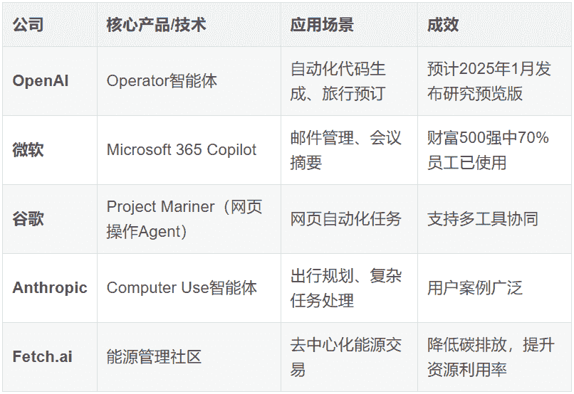

## 3. 通用智能体Manus

> 与传统的AI助手不同，Manus不仅能提供建议，还能通过自主调用工具完成端到端任务，实现从“思考”到“执行”的全流程闭环，标志着AI应用从“文本交互”向“任务交付”的质变。

Manus擅长处理工作和生活中的各种任务，可以完成很大一部分执行工作。

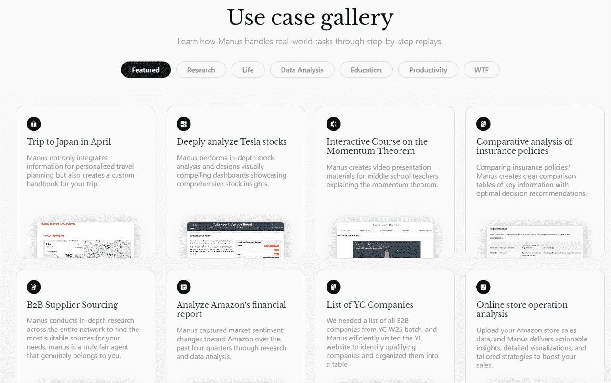

### 3.1 技术亮点

> **全链路自主执行：**支持复杂任务拆解（如“爬取财报→编写`Python`→部署网站”），决策颗粒度细化至0.1秒级。

> **多智能体协作架构：**通过多代理分工提升效率，结合自主学习功能优化流程。

> **云端异步运行：**用户无需实时监控，任务完成后自动反馈结果。

> **跨领域通用性：**覆盖金融分析、教育内容生成、简历筛选、旅行规划等场景。

> **GAIA基准测试`SOTA`成绩：**性能超越OpenAI同类模型，验证其技术领先性。

### 3.2 基准测试情况

Manus 在全部三个难度等级上都达到了新的最先进（`SOTA`）表现。

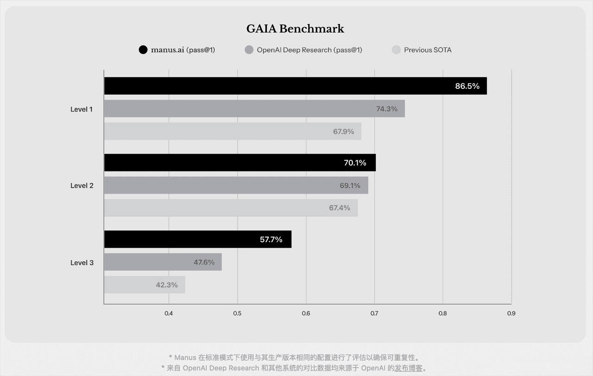

### 3.3 核心功能

> **认知控制中枢：**智能体控制中枢融合神经符号系统(`Neuro-symbolic AI`)，将`LLM`的语义理解与知识图谱的逻辑推理相结合，在医疗诊断等专业领域的决策准确率可达89.7%，较纯`LLM`方案提升34个百分点。

> **多模态感知系统：**感知系统已突破传统文本交互边界，视觉模块采用`ViT-22B`模型实现每秒60帧的实时场景解析，听觉模块集成`WaveNet`变体实现98.2%的语音指令识别率。更革命性的突破在于跨模态对齐技术，通过对比学习算法建立文本-图像-声音的联合嵌入空间，使得智能体在未知环境中的对象识别准确率提升。

> **任务规划与执行机制：**智能体的规划系统采用分层强化学习框架(`HRL`)，将复杂任务分解为可执行的子目标序列。通过蒙特卡洛树搜索(`MCTS`)与神经规划器结合，Manus在`GAIA`基准测试中达到91.4%的任务完成率，远超OpenAI同类产品23个百分点。其执行系统创新性地采用沙盒虚拟机架构，支持`Python`脚本自动生成与调试，在数据分析类任务中实现完全自动化处理。

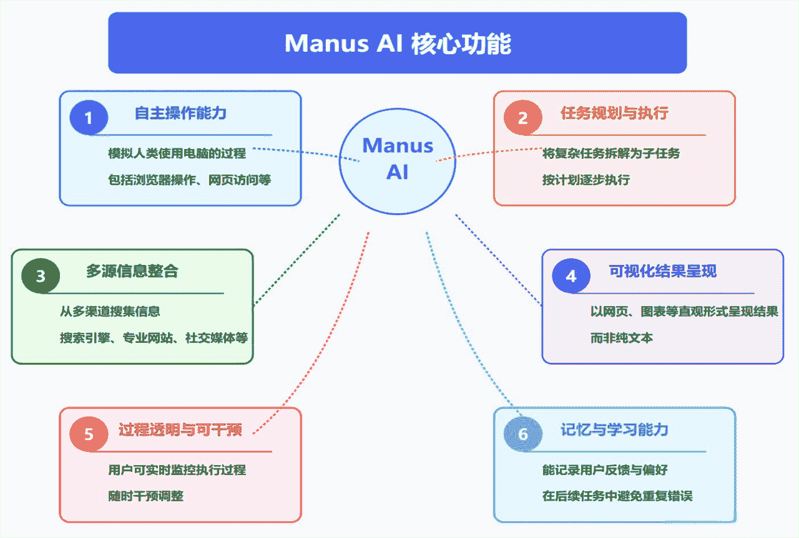

#### 自主操作能力

Manus AI能够模拟人类使用电脑的方式，执行各种操作任务，就像一位虚拟助手在云端计算机上做执行工作。

**具体表现：**

> **网页浏览操作：**能够打开`Chrome`浏览器，在地址栏输入`URL`，点击导航栏，使用前进后退按钮；

> **内容交互：**滚动页面，点击链接，填写表单，上传文件，拖放元素；

> **应用程序控制：**使用快捷键控制视频播放（如使用空格键暂停/播放`YouTube`视频）；

> **多标签管理：**同时打开多个标签页并在其间切换，保持多线程工作流；

例：当用户要求Manus比较不同平台上小米AI眼镜的价格时，它会像真人一样依次打开各电商平台，在搜索框输入“小米AI眼镜”，滚动浏览搜索结果，点击相关产品链接，记录价格信息，并在遇到验证码时提示用户协助。整个过程就像远程观看一位助手在电脑上操作一样直观。

#### 任务规划与执行

Manus AI擅长将复杂任务系统化分解并有序执行，确保高效完成用户需求。

**具体表现：**

> **任务分析与拆解：**自动将大型任务拆分成逻辑子任务

> **步骤优先级安排：**确定最佳执行顺序，提高效率

> **适应性调整：**根据执行过程中的发现动态调整计划

> **进度跟踪与报告：**实时更新任务完成状态

例：当用户请求Manus进行特斯拉股票分析时，它会自动拆解任务为：

> (1) 收集特斯拉基本财务数据；

> (2) 分析行业竞争格局；

> (3) 评估市场趋势；

> (4) 研究政策影响；

> (5) 查找分析师观点；

> (6) 总结投资建议。

它会有序执行这些步骤，在`Google Finance`查询基本数据，访问特斯拉官网获取财报，浏览行业新闻分析竞争对手，最后将所有信息整合形成完整分析。

#### 多源信息整合

Manus AI能够从各种渠道收集信息，并将其整合为连贯有用的内容。

**具体表现：**

> **跨平台搜索：**同时访问搜索引擎、垂直网站、学术资源、社交媒体等

> **内容筛选：**根据相关性和可靠性评估信息价值

> **信息解析：**从复杂网页中提取关键数据和洞见

> **冲突处理：**识别和解决不同来源之间的信息矛盾

例：当用户要求分析恐怖电影的叙事技巧时，Manus会访问多个信息源：

> 在B站搜索相关视频教程，浏览知乎上的专业讨论，查看搜狐娱乐的影评文章，甚至访问`IMDb`等国际电影数据库。它能够从各种来源提取关键见解，比如从专业影评中获取叙事结构分析，从观众评论中了解恐怖元素效果，从学术文章中提取类型电影理论，最终整合出全面而深入的分析报告。

#### 可视化结果呈现

Manus AI注重以用户友好的方式呈现结果，而非简单的文字堆砌。

**具体表现：**

+ **交互式网页生成：**创建带有动态元素的完整网页

+ **数据可视化：**将数字信息转化为图表、热图等视觉元素

+ **多媒体整合：**结合文本、图表和简单应用于一体

+ **响应式设计：**生成适合不同设备查看的内容

例：在金融分析任务中，Manus不会仅提供一堆数字和文字，而是会创建一个完整的分析仪表板：

> 包含特斯拉股价走势折线图，与竞争对手的市场份额对比饼图，季度收入增长柱状图，以关键财务指标的卡片式展示。用户可以浏览各个部分，查看详细解释，获得直观清晰的分析结果，就像使用专业金融分析工具一样。

#### 过程透明与可干预

Manus AI将AI决策和执行过程完全透明化，让用户随时了解和控制。

**具体表现：**

> **实时操作展示：**用户可以观看AI操作的完整过程

> **决策解释：**解释为什么选择特定行动路径

> **中途干预：**用户可随时暂停、调整或重定向任务

> **协作功能：**在困难点（如验证码）请求用户协助

例：在研究某行业市场时，用户可以看到Manus在搜索过程中使用的具体关键词（如“2025年电动汽车市场预测”）。

> 如果用户发现这些关键词不够精确，可以立即发消息：“换用‘中国电动车市场渗透率预测’”，Manus会立即调整搜索策略。

> 当Manus访问需要登录的网站时，会请求用户接管控制权完成验证，然后继续任务。这种透明和协作模式让用户始终掌握主导权。

#### 记忆与学习能力

Manus AI能够从交互中学习，记住用户偏好，并在后续任务中应用这些经验。

**具体表现：**

+ **用户偏好记录：**记住用户对信息源和呈现方式的偏好

+ **错误规避：**避免重复之前已被纠正的错误

+ **效率优化：**根据历史任务改进执行路径

+ **个性化适应：**逐渐调整工作方式以匹配用户习惯

例：如果用户曾指出“在财务分析中优先考虑现金流而非收入增长”，Manus会在后续所有财务分析任务中突出现金流指标。

> 当用户纠正过Manus使用某网站的方式（如“不要使用某财经网站的观点，它们缺乏可靠性”），它会在未来任务中避免或谨慎使用该来源。

> 如果用户偏好以特定格式呈现结果（如“我喜欢带有总结卡片的分析报告”），Manus会在后续任务中自动采用这种格式，无需重复说明。

#### 与现有AI工具的对比

+ **从回答问题到完成任务：**不仅提供信息，更能执行完整任务流程。

+ **独立云端环境：**在云端电脑中运行，避免占用用户本地资源。

+ **结果导向设计：**注重最终交付物的实用性与可视化，而非中间过程。

+ **持续学习机制：**通过用户反馈不断优化，逐步提升智能程度。

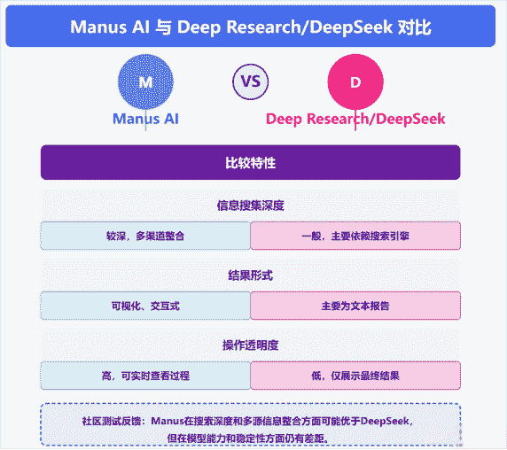

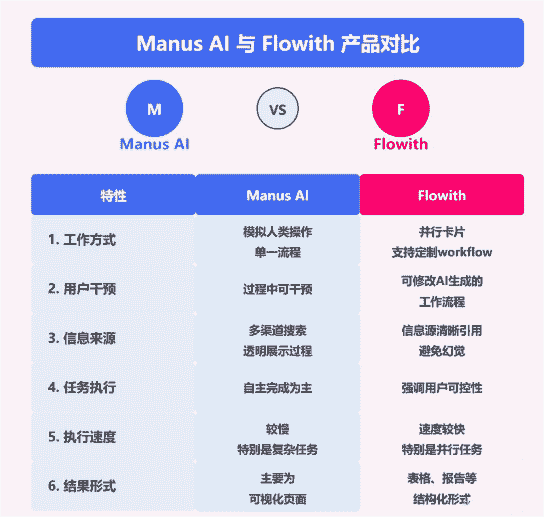

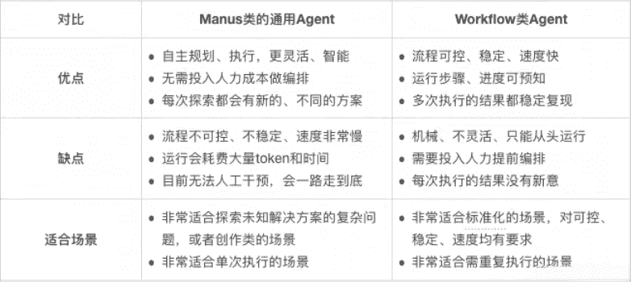

### 3.4 技术原理剖析

Manus AI通过高级自动化技术实现对网页浏览器和其他应用程序的控制。

这种模拟技术使Manus能够像人类一样“使用”各种在线服务和工具，而不仅限于`API`接入的服务。

> 由于Manus是非开源的项目，所以没法直接看到其实际的技术设计，但可以从显性的自主执行过程、`OpenManus`等开源项目、网传的Manus Prompt等多方面

> 参考`OpenManus`的代码设计，结合前面显性的执行过程，大致上可以推测出Manus的设计如下：

在实例化的这台虚拟机沙箱里面，有几个基础动作，就可以覆盖绝大部分要做的事情：

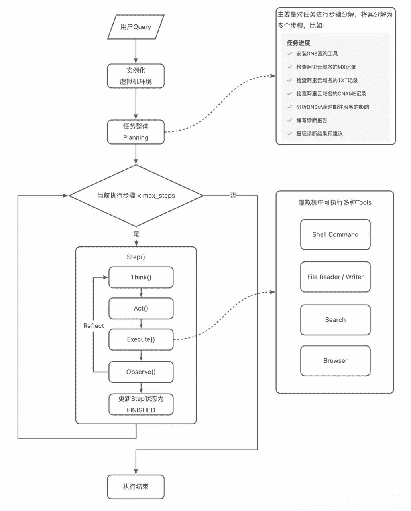

> **命令执行：**可以执行`mkdir`、`ps`、`dig`、`apt`等各种`linux`命令，也可以运行`python`解释器、开启web服务；

> **文件读写：**包含很多种格式，如`txt`、`md`、`py`、`csv`、`tsv`、`pdf`、`ppt`、`xlsx`、`docs`等；

> **搜索：**根据用户输入，去网上搜索各种数据源；

> **浏览器：**阅读搜索出来的各个网页`url`内容，爬取关键信息，也可以读取本地文件，如`pdf`、`ppt`、`excel`；还包含很多子动作，比如浏览、翻页、刷新、点击、输入、移动等等操作；

#### 模拟人类操作的技术实现

例如，它可以直接在电商平台上搜索商品，填写表单或比较价格，扩展了其应用场景。

**其核心技术包括：**

> **界面元素识别：**能够识别网页和应用程序中的按钮、输入框、链接等交互元素。通过计算机视觉和自然语言处理技术，ManusAI能准确定位界面上的可操作元素，例如识别“提交”按钮或搜索栏。这种能力使其能够像人类一样理解界面布局，适应不同网站的设计差异。

> **操作序列规划：**将任务分解为点击、输入、滚动等基本操作序列。例如，为完成旅行规划任务，Manus可能首先点击搜索航班的按钮，然后输入日期和目的地，再滚动页面查看选项。这种规划基于任务分解算法，确保操作逻辑清晰，符合人类操作习惯。

> **自适应操作：**根据界面变化动态调整操作策略，应对不同网站的交互差异。例如，当网站更新布局或弹出广告时，Manus能实时调整点击位置或忽略干扰元素。这种自适应性依赖于实时反馈机制和机器学习模型的持续优化。

> **快捷键操作：**能识别并使用应用程序的快捷键，提高操作效率。例如，在文本编辑器中，Manus可能使用“Ctrl+C”和“Ctrl+V”。

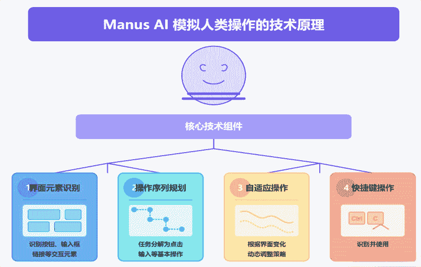

#### 多源信息整合机制

Manus采用多级信息处理机制，以确保信息全面性和可靠性，特别适用于需要多维度分析的任务。

> **信息源多元化：**同时从搜索引擎（如Google、Bing）、专业网站（如金融新闻平台）、社交媒体（如X、🛰️）、视频平台（如YouTube、Bilibili）等获取信息。例如，在分析特斯拉股票时，Manus可能从财经网站获取财务报告，从X获取市场情绪，从视频平台获取分析师评论。

> **内容提取与结构化：**自动从网页中提取关键信息，并转化为结构化数据。例如，从新闻文章中提取公司收益数据，转化为表格格式。这种过程依赖于自然语言处理（`NLP`）和信息抽取技术，如命名实体识别（`NER`）和关系抽取。

> **信息可信度评估：**通过交叉验证比对不同来源的信息，提高信息可靠性。例如，若一个来源称特斯拉收益增长20%，而另一个来源称25%，Manus会分析来源的可信度（如权威性、更新时间）并给出加权平均值。这种评估基于机器学习模型训练的数据集，结合来源评分系统。

> **知识图谱构建：**将收集的信息整合为知识图谱，便于后续分析利用。例如，在旅行规划中，知识图谱可能包括目的地天气、航班信息、酒店价格等节点，方便查询和推理。这种技术基于图计算和语义网络，增强了信息关联性。

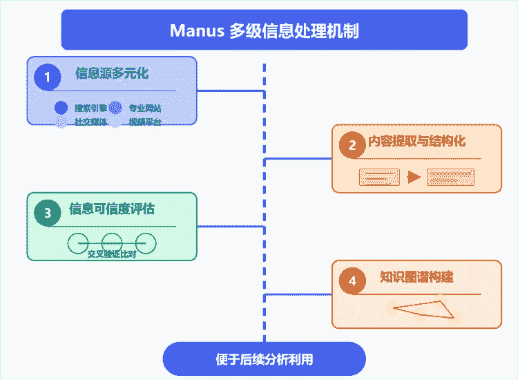

#### 记忆与学习能力实现

Manus的记忆与学习能力体现在以下方面，增强其智能化水平，使Manus能够逐步适应用户需求，提升任务执行效率，接近人类智能的灵活性。

> **用户偏好记录：**记录用户对特定类型任务的处理偏好。例如，若用户偏好经济型酒店，Manus会在未来旅行规划中优先推荐此类选项。这种功能通过长期记忆模块实现，基于用户历史交互数据。

> **错误模式识别：**识别导致任务失败的常见模式，并在后续避免。例如，若某次股票分析因数据源错误导致结果偏差，Manus会记录该错误模式，未来优先选择更可靠的数据源。这种能力依赖于异常检测算法和反馈学习。

> **任务执行优化：**基于历史执行经验优化任务流程，提高成功率。例如，通过分析过去旅行规划的耗时，Manus可能调整信息收集顺序，先获取航班信息再查酒店。这种优化基于强化学习，结合奖励函数（如任务完成时间、用户满意度）。

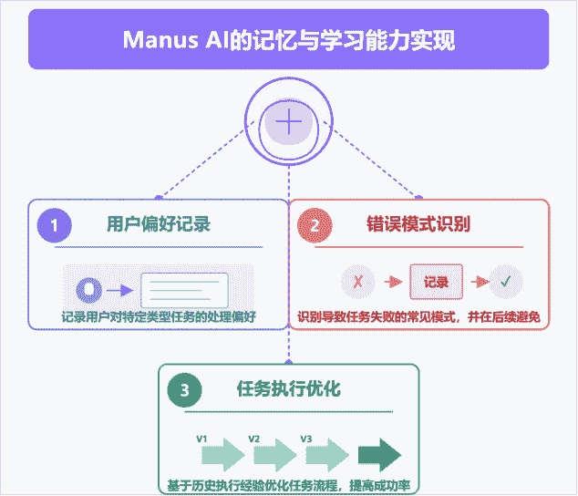

#### 可视化结果生成机制

Manus能将收集的信息转化为可视化结果，提升用户体验，使复杂信息更易于理解，特别适用于数据密集型任务，如金融分析或市场研究。

> **模板匹配：**根据任务类型选择合适的结果呈现模板。例如，股票分析可能使用折线图模板，保险比较使用表格模板。这种匹配基于任务分类模型，结合用户偏好。

> **数据可视化：**将数据转化为图表、表格等直观形式。例如，将特斯拉股票数据转化为趋势图，突出收益增长点。这种功能依赖于数据可视化库（如`Matplotlib`、`D3.js`），结合AI生成设计。

> **交互式页面生成：**创建包含多种交互元素的网页，提升用户体验。例如，旅行手册可能包括可点击的酒店链接、动态天气预报。这种生成基于前端开发框架（如`React`），结合AI驱动的交互设计。

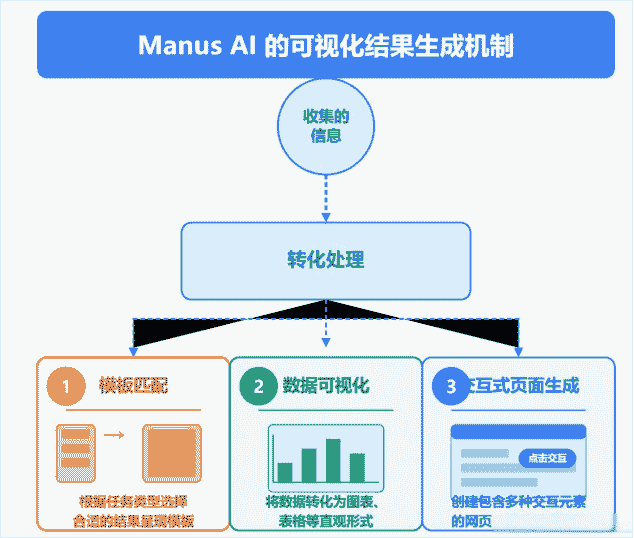

### 3.5 交互使用原则与技巧

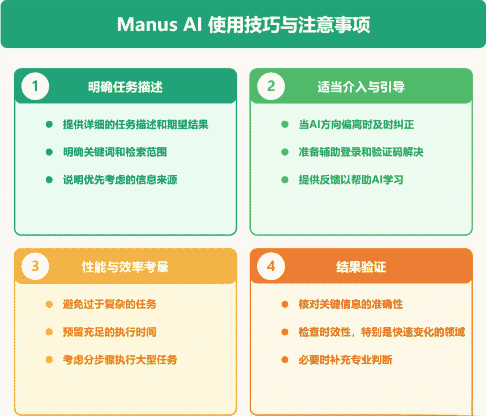

#### 结果驱动

**1、明确想要什么**

> Manus的核心优势在于它能够自主完成复杂任务，因此在使用时，应该聚焦于“想要什么”，而非“怎么做”。

+ **明确目标，而非步骤：**告诉Manus你需要的最终成果，而不是详细的操作指南。

> o ✓ 正确示例：「制作一份分析中国手机市场2024年前景的报告，包含销量预测和政策影响」

> o ✗ 错误示例：「搜索中国手机销量数据，然后创建一个表格，再根据数据制作图表...」

+ **具体描述成果形式：**明确说明你期望的输出形式，如报告、演示文稿、数据表格、可视化图表等。

> o ✓ 正确示例：「分析小米苏7与蔚来的用户增长情况，以`PowerPoint`形式呈现」

> o ✓ 更好示例：「分析小米苏7与蔚来的用户增长情况，生成10页内的`PowerPoint`，包含趋势图表和关键发现总结」

+ **避免过度限制：**不要用过多的流程细节束缚Manus的创造力和问题解决能力。

**2、场景与角色定位**

通过明确应用场景和专业角色，可以显著提高Manus的输出质量。

# 提示词工程指南

## 基础原则

### 领域明确化
先指明任务所属领域（金融、医疗、教育、市场营销等）。

> 示例：「在教育领域,帮我...」、「从医学角度,分析...」

### 角色赋能
指定 Manus 应扮演的专业角色，引导其调用相关知识和能力。

> 示例：「作为一名资深数据分析师,请评估这组销售数据...」
> 示例：「以SEO专家的身份,审查我的网站内容并提出优化建议...」

### 双重锚定效果加成
同时指定领域和角色，可获得更精准的专业输出。

> 示例：「在新能源投资领域,作为一名具有5年经验的财务分析师，评估一个新项目的投资回报潜力...」

## GRPS 框架：构建完美提示词

### Goal（目标）
清晰定义你期望获得的最终成果。

- 明确交付物类型：报告、代码、图表、演示文稿、网页等。
- 指明用途：「用于内部决策参考」、「用于客户展示」、「用于公开发表」等。
- 设定完成标准：什么样的结果才算成功完成任务？

> 示例：「目标:创建一个交互式数据仪表板,展示过去12个月的销售趋势,用于月度管理层会议」

### Role（角色）
为 Manus 赋予适合任务的专业身份。

- 职业角色：分析师、工程师、作家、营销专家、教师等。
- 经验水平：初级、资深、专家、权威等。
- 特定专长：「精通大数据分析的工程师」、「专注于新能源汽车营销的策略专家」。

> 示例：「角色:作为一名精通讲故事技巧的高级内容营销专家」

### Process（流程）- 可选
在特定情况下，你可能需要指定关键流程步骤。

- 关键节点：只列出必须经过的重要环节，而非详细步骤。
- 决策点：在哪些环节需要做出重要判断。
- 质量检查：在流程中需要特别关注质量的部分。

> 示例：「流程：1.收集并分析竞争对手的社交媒体数据 2.识别其内容策略模式 3.评估其受众反响 4.提出我们可借鉴的策略」

### Specification（规范）
设定明确的质量和格式要求。

- 格式要求：文件类型、结构、布局等。
- 长度限制：字数、页数、时长等。
- 风格规范：正式、轻松、技术性、通俗易懂等。
- 必备内容：必须包含的关键部分或信息。
- 排除内容：明确禁止出现的内容或风格。

> 示例：「规范：-PDF格式 -不超过20页 -包含执行摘要、方法论、发现和建议四个部分 -使用简明专业的语言 -避免过于技术性的术语 -包含至少 5个数据可视化图表」

### 完整示例

> **目标：**开发一个个人财务健康评估工具，帮助初入职场的年轻人了解自己的财务状况和提升建议
> **角色：**作为拥有10年经验的个人理财顾问，专注于年轻专业人士的财务规划

**流程：**

1. 设计评估用户收入、支出、债务和储蓄情况的问卷
2. 创建评分系统，对不同财务指标进行权重分配
3. 开发针对不同得分范围的个性化建议库
4. 设计直观的结果展示界面

**规范：**

- 终端产品为可交互的网页应用
- 问卷不超过15个问题
- 结果页面需包含总体健康评分、各维度得分及彩色仪表盘 - 建议须具体可行，避免泛泛而谈
- 语言风格亲切、鼓励，适合25-35岁年龄段
- 包含资源链接和后续行动计划

## 高级提示词技巧

### 工具链显式调用
Manus 具备使用多种工具和数据源的能力，明确指定可提高效率：

- 数据源指定：「使用Bloomberg终端获取最新市场数据」、「通过Google Trends分析搜索趋势」
- 分析工具指定：「使用Python的pandas和matplotlib进行数据处理和可视化」
- 输出工具指定：「使用Tableau创建交互式仪表板」、「使用LaTeX排版学术论文」

> 示例：「调用Yahoo Finance API获取过去5年的苹果和微软股价数据,使用Python的pandas进行相关性分析，并通过 matplotlib生成对比图表」

### 动态记忆激活技巧
通过巧妙引用历史任务和标记个人偏好，提高 Manus 的连续工作效率。

### 历史关联法

- 直接引用：明确引用之前任务的结果。
  > 示例：「基于你昨天为我生成的市场调研问卷，现在帮我分析收集到的数据」
- 隐性提醒：提醒 Manus 回顾之前的相关工作。
  > 示例：「像上次一样，我需要一份周报，但这次请加入销售漏斗分析」

### 偏好标记法

- 使用标签：用 # 号标记你的常用偏好。
  > 示例：「分析这篇新闻稿 #简洁 #图表优先 #避免行业术语」
- 创建个人风格：为个人偏好创建一致的命名。
  > 示例：「撰写一篇博客文章，主题是人工智能在医疗中的应用 #我的风格」（其中“我的风格”已经在之前的交互中定义）

### 多模态输出控制

> 精确控制 Manus 的输出形式和风格：输出格式指令。

- 使用格式符号：通过特定符号指定输出格式。
  > 示例：「分析这份调查数据 → 交互式热图」
  > 示例：「总结这个研究报告 → 3分钟演讲稿」
- 多重输出：请求多种格式的并行输出。
  > 示例：「评估这个商业计划 → 1.一页纸摘要 2.SWOT分析表格 3.风险评估矩阵」

### 风格与参考指令

- 参考模仿：提供风格参考对象。
  > 示例：「以《哈佛商业评论》的风格撰写一篇关于远程工作趋势的文章」
- 风格描述：用形容词描述期望的风格。
  > 示例：「用简洁、幽默但专业的语调解释量子计算的基本原理」

## 针对不同场景的特定策略

### 数据分析场景

- 明确分析目的：「分析这些数据以识别销售下滑的原因」而非简单的「分析这些数据」
- 指明分析深度：「进行探索性分析」vs「进行预测性分析」vs「进行因果关系分析」
- 数据处理指示：说明是否需要数据清洗、标准化或特征工程

> **角色：**作为一名精通市场分析的数据科学家
> **目标：**分析过去12个月的电子商务数据,识别影响转化率的关键因素
> **规范：**
> - 重点关注季节性波动和营销活动影响
> - 对异常值进行处理并说明理由
> - 生成包含相关性热图和决策树分析的报告

- 提供3-5个可操作的提升转化率建议

### 内容创作场景

- 目标受众：明确写作对象（「针对高中生」、「面向技术专业人士」）
- 情感基调：指明文章应传达的情感（鼓舞人心、引人深思、警示性等）
- 核心信息：明确必须传达的关键信息点

> **目标：**创作一篇关于气候变化的科普文章,同时激发青少年采取行动
> **角色：**环保科普作家,擅长平衡科学严谨性和易读性

**规范：**

- 1500字左右
- 使用引人入胜的开头和有力的结尾
- 包含5个令人惊讶但科学准确的气候事实
- 穿插实际例子和比喻,使抽象概念具体化
- 提供青少年可以立即开始的3个简单环保行动

### 商业分析场景

- 商业背景：提供公司规模、行业、竞争态势等背景信息
- 决策重点：明确分析将支持的决策类型
- 关键指标：指明最关注的业务指标（ROI、市场份额、客户满意度等）

> **角色：**资深管理咨询顾问
> **目标：**评估我们进入印度市场的可行性和策略
> **背景：**我们是一家北美中型健康科技公司,专注于远程医疗解决方案

**规范：**

- 包括市场规模分析、竞争格局、监管环境和潜在挑战
- 使用PESTEL框架和波特五力模型进行分析
- 提供分阶段市场进入策略,包括风险缓解计划
- 明确投资回报预期和关键成功指标

## 常见问题解决技巧

### 当结果不符合预期时

- 重新明确目标：更清晰地重述你的目标和期望。
- 提供反馈：具体指出哪些部分不符合要求，为什么不符合。
- 渐进式引导：将大任务分解为较小步骤，逐步引导 Manus。

> 示例：「这份报告不够详细。请特别深入分析第二部分的竞争对手情况，增加他们的市场策略和我们可能的应对措施。」

### 当 Manus 能力受限时

- 简化任务：降低任务复杂度，专注于 Manus 擅长的部分。
- 辅助验证：对于关键数据或结论，考虑人工验证或补充。
- 替代方案：探索其他可能的解决路径。

> 示例：「我注意到你在处理这个复杂的数据集时遇到困难。让我们先专注于数据的三个关键指标，其他可以 稍后处理。」

### 当需要人工干预时

- 预判干预点：提前了解可能需要人工干预的环节（如验证码、登录等）。
- 准备替代信息：准备可能需要的账号信息或替代数据源。
- 明确协作流程：设定清晰的人机协作方式。

> 示例：「我知道访问这个网站需要登录。我已经准备好了替代数据源，你可以从[提供替代链接]获取类似信息。」
