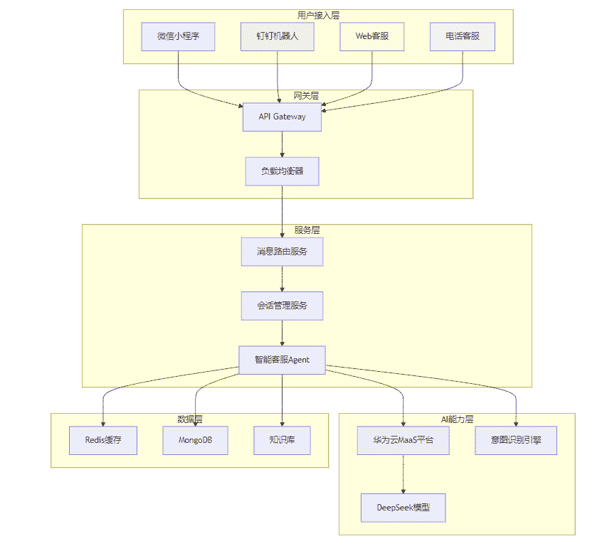
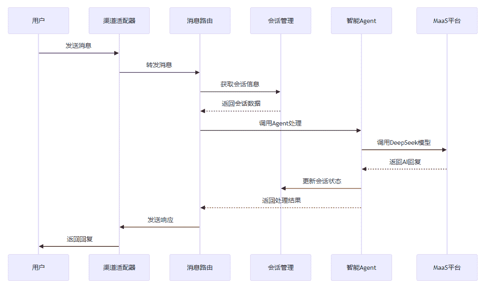
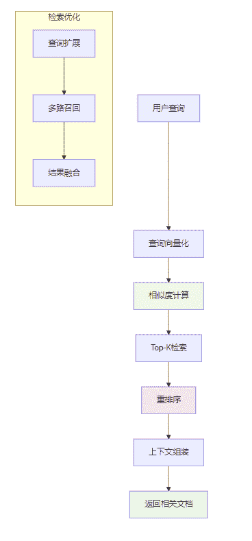
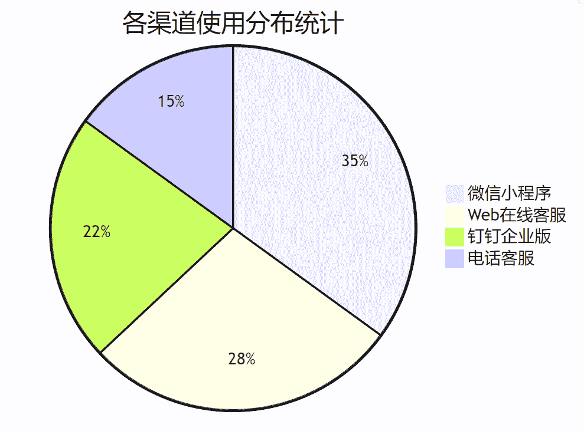
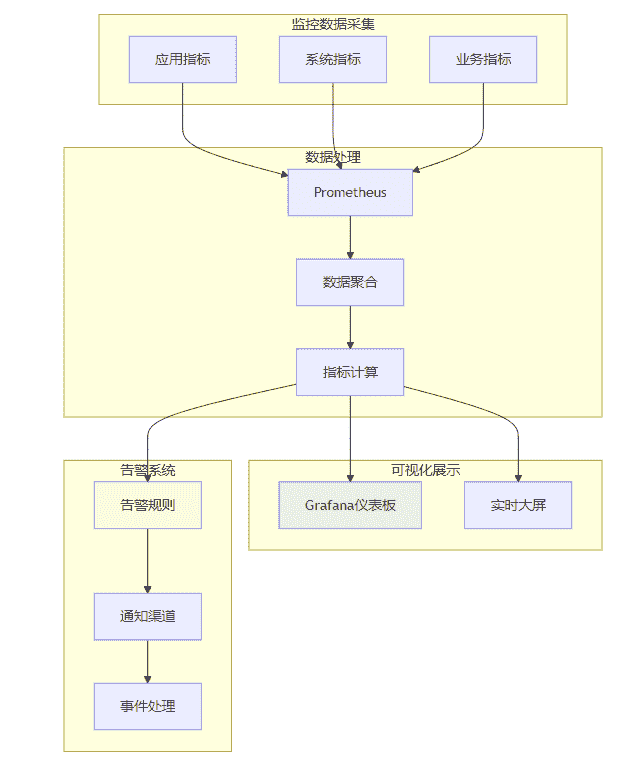

# RAG技术栈打造企业级知识问答Agent

> 来源：[https://qqs7y1hozd1.feishu.cn/docx/WRCudBvc9oL69ExUXPsc4Ofhn3d](https://qqs7y1hozd1.feishu.cn/docx/WRCudBvc9oL69ExUXPsc4Ofhn3d)

## 智能客服Agent架构设计

### 2.1 整体系统架构



### 2.2 核心组件设计

```
from abc import ABC, abstractmethod
from dataclasses import dataclass
from typing import Any, Dict, List, Optional
from enum import Enum
import asyncio
import uuid
 
class ChannelType(Enum):
    &quot;&quot;&quot;渠道类型枚举&quot;&quot;&quot;
    WECHAT = &quot;wechat&quot;
    DINGTALK = &quot;dingtalk&quot;
    WEB = &quot;web&quot;
    PHONE = &quot;phone&quot;
 
@dataclass
class UserMessage:
    &quot;&quot;&quot;用户消息数据结构&quot;&quot;&quot;
    message_id: str
    user_id: str
    channel: ChannelType
    content: str
    message_type: str  # text, image, voice等
    timestamp: float
    session_id: str
    metadata: Dict[str, Any] = None
 
@dataclass
class AgentResponse:
    &quot;&quot;&quot;Agent响应数据结构&quot;&quot;&quot;
    response_id: str
    content: str
    message_type: str
    suggested_actions: List[str] = None
    confidence_score: float = 0.0
    processing_time: float = 0.0
 
class ChannelAdapter(ABC):
    &quot;&quot;&quot;渠道适配器抽象基类&quot;&quot;&quot;
    
    @abstractmethod
    async def receive_message(self) -&gt; UserMessage:
        &quot;&quot;&quot;接收消息&quot;&quot;&quot;
        pass
    
    @abstractmethod
    async def send_response(self, response: AgentResponse) -&gt; bool:
        &quot;&quot;&quot;发送响应&quot;&quot;&quot;
        pass
    
    @abstractmethod
    def get_channel_type(self) -&gt; ChannelType:
        &quot;&quot;&quot;获取渠道类型&quot;&quot;&quot;
        pass
 
class SessionManager:
    &quot;&quot;&quot;会话管理器&quot;&quot;&quot;
    
    def __init__(self, redis_client):
        self.redis_client = redis_client
        self.session_timeout = 3600  # 1小时超时
    
    async def get_session(self, user_id: str, channel: ChannelType) -&gt; Dict:
        &quot;&quot;&quot;获取用户会话&quot;&quot;&quot;
        session_key = f&quot;session:{user_id}:{channel.value}&quot;
        session_data = await self.redis_client.get(session_key)
        
        if session_data:
            return json.loads(session_data)
        else:
            # 创建新会话
            new_session = {
                &quot;session_id&quot;: str(uuid.uuid4()),
                &quot;user_id&quot;: user_id,
                &quot;channel&quot;: channel.value,
                &quot;created_at&quot;: time.time(),
                &quot;last_activity&quot;: time.time(),
                &quot;context&quot;: {},
                &quot;conversation_history&quot;: []
            }
            
            await self.redis_client.setex(
                session_key, 
                self.session_timeout, 
                json.dumps(new_session)
            )
            return new_session
    
    async def update_session(self, session: Dict, message: UserMessage, response: AgentResponse):
        &quot;&quot;&quot;更新会话状态&quot;&quot;&quot;
        session[&quot;last_activity&quot;] = time.time()
        session[&quot;conversation_history&quot;].append({
            &quot;user_message&quot;: message.content,
            &quot;agent_response&quot;: response.content,
            &quot;timestamp&quot;: time.time()
        })
        
        # 保持最近10轮对话
        if len(session[&quot;conversation_history&quot;]) &gt; 10:
            session[&quot;conversation_history&quot;] = session[&quot;conversation_history&quot;][-10:]
        
        session_key = f&quot;session:{message.user_id}:{message.channel.value}&quot;
        await self.redis_client.setex(
            session_key,
            self.session_timeout,
            json.dumps(session)
        )
```

## 多渠道融合实现

### 3.1 微信小程序接入

```
from flask import Flask, request, jsonify
import hashlib
import xml.etree.ElementTree as ET
 
class WeChatAdapter(ChannelAdapter):
    &quot;&quot;&quot;微信渠道适配器&quot;&quot;&quot;
    
    def __init__(self, app_id: str, app_secret: str, token: str):
        self.app_id = app_id
        self.app_secret = app_secret
        self.token = token
        self.app = Flask(__name__)
        self._setup_routes()
    
    def _setup_routes(self):
        &quot;&quot;&quot;设置路由&quot;&quot;&quot;
        @self.app.route(&#x27;/wechat&#x27;, methods=[&#x27;GET&#x27;, &#x27;POST&#x27;])
        async def wechat_handler():
            if request.method == &#x27;GET&#x27;:
                return self._verify_signature()
            else:
                return await self._handle_message()
    
    def _verify_signature(self):
        &quot;&quot;&quot;验证微信签名&quot;&quot;&quot;
        signature = request.args.get(&#x27;signature&#x27;)
        timestamp = request.args.get(&#x27;timestamp&#x27;)
        nonce = request.args.get(&#x27;nonce&#x27;)
        echostr = request.args.get(&#x27;echostr&#x27;)
        
        # 验证签名
        tmp_arr = [self.token, timestamp, nonce]
        tmp_arr.sort()
        tmp_str = &#x27;&#x27;.join(tmp_arr)
        tmp_str = hashlib.sha1(tmp_str.encode()).hexdigest()
        
        if tmp_str == signature:
            return echostr
        return &#x27;Invalid signature&#x27;
    
    async def _handle_message(self):
        &quot;&quot;&quot;处理微信消息&quot;&quot;&quot;
        xml_data = request.get_data()
        root = ET.fromstring(xml_data)
        
        # 解析消息
        msg_type = root.find(&#x27;MsgType&#x27;).text
        from_user = root.find(&#x27;FromUserName&#x27;).text
        content = root.find(&#x27;Content&#x27;).text if root.find(&#x27;Content&#x27;) is not None else &#x27;&#x27;
        
        # 构建UserMessage对象
        user_message = UserMessage(
            message_id=root.find(&#x27;MsgId&#x27;).text,
            user_id=from_user,
            channel=ChannelType.WECHAT,
            content=content,
            message_type=msg_type,
            timestamp=time.time(),
            session_id=&quot;&quot;  # 由SessionManager生成
        )
        
        return user_message
    
    async def send_response(self, response: AgentResponse) -&gt; bool:
        &quot;&quot;&quot;发送微信响应&quot;&quot;&quot;
        # 构建微信XML响应格式
        xml_response = f&quot;&quot;&quot;
        &lt;xml&gt;
            &lt;ToUserName&gt;&lt;![CDATA[{response.user_id}]]&gt;&lt;/ToUserName&gt;
            &lt;FromUserName&gt;&lt;![CDATA[{self.app_id}]]&gt;&lt;/FromUserName&gt;
            &lt;CreateTime&gt;{int(time.time())}&lt;/CreateTime&gt;
            &lt;MsgType&gt;&lt;![CDATA[text]]&gt;&lt;/MsgType&gt;
            &lt;Content&gt;&lt;![CDATA[{response.content}]]&gt;&lt;/Content&gt;
        &lt;/xml&gt;
        &quot;&quot;&quot;
        return xml_response
    
    def get_channel_type(self) -&gt; ChannelType:
        return ChannelType.WECHAT
```

### 3.2 钉钉机器人集成

```
import hmac
import base64
import urllib.parse
from dingtalk_stream import AckMessage
import dingtalk_stream
 
class DingTalkAdapter(ChannelAdapter):
    &quot;&quot;&quot;钉钉渠道适配器&quot;&quot;&quot;
    
    def __init__(self, app_key: str, app_secret: str, robot_code: str):
        self.app_key = app_key
        self.app_secret = app_secret
        self.robot_code = robot_code
        self.client = dingtalk_stream.DingTalkStreamClient(app_key, app_secret)
        self._setup_handlers()
    
    def _setup_handlers(self):
        &quot;&quot;&quot;设置消息处理器&quot;&quot;&quot;
        @self.client.register_callback_handler(dingtalk_stream.ChatbotMessage.TOPIC)
        async def process_message(message: dingtalk_stream.ChatbotMessage):
            &quot;&quot;&quot;处理钉钉消息&quot;&quot;&quot;
            
            # 解析消息内容
            content = message.text.content if message.text else &quot;&quot;
            
            user_message = UserMessage(
                message_id=message.msg_id,
                user_id=message.sender_id,
                channel=ChannelType.DINGTALK,
                content=content,
                message_type=&quot;text&quot;,
                timestamp=message.create_at / 1000,  # 转换为秒
                session_id=&quot;&quot;
            )
            
            # 调用智能客服处理
            agent_response = await self._process_with_agent(user_message)
            
            # 发送响应
            await self.send_response(agent_response, message.conversation_id)
            
            return AckMessage.STATUS_OK, &#x27;OK&#x27;
    
    async def _process_with_agent(self, user_message: UserMessage) -&gt; AgentResponse:
        &quot;&quot;&quot;使用智能客服处理消息&quot;&quot;&quot;
        # 这里会调用主要的Agent处理逻辑
        # 暂时返回模拟响应
        return AgentResponse(
            response_id=str(uuid.uuid4()),
            content=&quot;正在为您处理，请稍候...&quot;,
            message_type=&quot;text&quot;
        )
    
    async def send_response(self, response: AgentResponse, conversation_id: str) -&gt; bool:
        &quot;&quot;&quot;发送钉钉响应&quot;&quot;&quot;
        try:
            await self.client.send_message(
                conversation_id=conversation_id,
                content=response.content
            )
            return True
        except Exception as e:
            print(f&quot;❌ 发送钉钉消息失败: {e}&quot;)
            return False
    
    def get_channel_type(self) -&gt; ChannelType:
        return ChannelType.DINGTALK
    
    def start_listening(self):
        &quot;&quot;&quot;开始监听消息&quot;&quot;&quot;
        self.client.start_forever()
```

### 3.3 渠道统一管理



```
class ChannelManager:
    &quot;&quot;&quot;渠道管理器&quot;&quot;&quot;
    
    def __init__(self):
        self.adapters: Dict[ChannelType, ChannelAdapter] = {}
        self.message_queue = asyncio.Queue()
        self.session_manager = SessionManager(redis_client)
        self.agent = IntelligentCustomerServiceAgent()
    
    def register_adapter(self, adapter: ChannelAdapter):
        &quot;&quot;&quot;注册渠道适配器&quot;&quot;&quot;
        channel_type = adapter.get_channel_type()
        self.adapters[channel_type] = adapter
        print(f&quot;✅ 注册渠道适配器: {channel_type.value}&quot;)
    
    async def route_message(self, message: UserMessage) -&gt; AgentResponse:
        &quot;&quot;&quot;路由消息到对应处理器&quot;&quot;&quot;
        try:
            # 获取或创建会话
            session = await self.session_manager.get_session(
                message.user_id, 
                message.channel
            )
            message.session_id = session[&quot;session_id&quot;]
            
            # 调用智能客服Agent处理
            response = await self.agent.process_message(message, session)
            
            # 更新会话状态
            await self.session_manager.update_session(session, message, response)
            
            return response
            
        except Exception as e:
            print(f&quot;❌ 消息路由处理失败: {e}&quot;)
            return AgentResponse(
                response_id=str(uuid.uuid4()),
                content=&quot;抱歉，系统暂时出现问题，请稍后再试。&quot;,
                message_type=&quot;text&quot;
            )
    
    async def start_all_adapters(self):
        &quot;&quot;&quot;启动所有渠道适配器&quot;&quot;&quot;
        tasks = []
        for adapter in self.adapters.values():
            if hasattr(adapter, &#x27;start_listening&#x27;):
                tasks.append(asyncio.create_task(adapter.start_listening()))
        
        if tasks:
            await asyncio.gather(*tasks)
```

## 智能客服Agent核心实现

### 4.1 意图识别与分类

```
from sklearn.feature_extraction.text import TfidfVectorizer
from sklearn.naive_bayes import MultinomialNB
import jieba
import re
 
class IntentClassifier:
    &quot;&quot;&quot;意图识别分类器&quot;&quot;&quot;
    
    def __init__(self):
        self.vectorizer = TfidfVectorizer(max_features=5000)
        self.classifier = MultinomialNB()
        self.intent_mapping = {
            &#x27;product_inquiry&#x27;: &#x27;产品咨询&#x27;,
            &#x27;order_status&#x27;: &#x27;订单状态查询&#x27;,
            &#x27;refund_request&#x27;: &#x27;退款申请&#x27;,
            &#x27;complaint&#x27;: &#x27;投诉建议&#x27;,
            &#x27;technical_support&#x27;: &#x27;技术支持&#x27;,
            &#x27;general_question&#x27;: &#x27;一般问题&#x27;
        }
        self.is_trained = False
    
    def preprocess_text(self, text: str) -&gt; str:
        &quot;&quot;&quot;文本预处理&quot;&quot;&quot;
        # 去除特殊字符
        text = re.sub(r&#x27;[^\w\s]&#x27;, &#x27;&#x27;, text)
        # 分词
        words = jieba.cut(text)
        return &#x27; &#x27;.join(words)
    
    def train(self, training_data: List[Dict]):
        &quot;&quot;&quot;训练意图分类器&quot;&quot;&quot;
        texts = []
        labels = []
        
        for item in training_data:
            processed_text = self.preprocess_text(item[&#x27;text&#x27;])
            texts.append(processed_text)
            labels.append(item[&#x27;intent&#x27;])
        
        # 特征提取
        X = self.vectorizer.fit_transform(texts)
        
        # 训练分类器
        self.classifier.fit(X, labels)
        self.is_trained = True
        
        print(f&quot;✅ 意图分类器训练完成，样本数: {len(texts)}&quot;)
    
    def predict_intent(self, text: str) -&gt; Dict[str, Any]:
        &quot;&quot;&quot;预测用户意图&quot;&quot;&quot;
        if not self.is_trained:
            return {
                &#x27;intent&#x27;: &#x27;general_question&#x27;,
                &#x27;confidence&#x27;: 0.5,
                &#x27;description&#x27;: &#x27;一般问题&#x27;
            }
        
        processed_text = self.preprocess_text(text)
        X = self.vectorizer.transform([processed_text])
        
        # 预测意图
        predicted_intent = self.classifier.predict(X)[0]
        confidence_scores = self.classifier.predict_proba(X)[0]
        max_confidence = max(confidence_scores)
        
        return {
            &#x27;intent&#x27;: predicted_intent,
            &#x27;confidence&#x27;: float(max_confidence),
            &#x27;description&#x27;: self.intent_mapping.get(predicted_intent, &#x27;未知意图&#x27;)
        }
 
class IntelligentCustomerServiceAgent:
    &quot;&quot;&quot;智能客服Agent主类&quot;&quot;&quot;
    
    def __init__(self):
        self.maas_client = HuaweiMaaSClient(
            api_key=os.getenv(&#x27;HUAWEI_MAAS_API_KEY&#x27;),
            endpoint=os.getenv(&#x27;HUAWEI_MAAS_ENDPOINT&#x27;)
        )
        self.intent_classifier = IntentClassifier()
        self.knowledge_base = KnowledgeBase()
        self._initialize_training_data()
    
    def _initialize_training_data(self):
        &quot;&quot;&quot;初始化训练数据&quot;&quot;&quot;
        training_data = [
            {&#x27;text&#x27;: &#x27;我想了解你们的产品功能&#x27;, &#x27;intent&#x27;: &#x27;product_inquiry&#x27;},
            {&#x27;text&#x27;: &#x27;我的订单什么时候能到&#x27;, &#x27;intent&#x27;: &#x27;order_status&#x27;},
            {&#x27;text&#x27;: &#x27;我要申请退款&#x27;, &#x27;intent&#x27;: &#x27;refund_request&#x27;},
            {&#x27;text&#x27;: &#x27;产品有问题我要投诉&#x27;, &#x27;intent&#x27;: &#x27;complaint&#x27;},
            {&#x27;text&#x27;: &#x27;软件安装不了怎么办&#x27;, &#x27;intent&#x27;: &#x27;technical_support&#x27;},
            # 更多训练数据...
        ]
        self.intent_classifier.train(training_data)
    
    async def process_message(self, message: UserMessage, session: Dict) -&gt; AgentResponse:
        &quot;&quot;&quot;处理用户消息的主要方法&quot;&quot;&quot;
        start_time = time.time()
        
        try:
            # 1. 意图识别
            intent_result = self.intent_classifier.predict_intent(message.content)
            
            # 2. 构建上下文
            context = self._build_context(message, session, intent_result)
            
            # 3. 调用DeepSeek模型生成回复
            response_content = await self._generate_response(context)
            
            # 4. 后处理和优化
            final_response = self._post_process_response(response_content, intent_result)
            
            processing_time = time.time() - start_time
            
            return AgentResponse(
                response_id=str(uuid.uuid4()),
                content=final_response,
                message_type=&quot;text&quot;,
                confidence_score=intent_result[&#x27;confidence&#x27;],
                processing_time=processing_time
            )
            
        except Exception as e:
            print(f&quot;❌ 消息处理失败: {e}&quot;)
            return AgentResponse(
                response_id=str(uuid.uuid4()),
                content=&quot;抱歉，我现在无法处理您的问题，请稍后再试或联系人工客服。&quot;,
                message_type=&quot;text&quot;,
                processing_time=time.time() - start_time
            )
    
    def _build_context(self, message: UserMessage, session: Dict, intent_result: Dict) -&gt; str:
        &quot;&quot;&quot;构建对话上下文&quot;&quot;&quot;
        # 获取历史对话
        history = session.get(&#x27;conversation_history&#x27;, [])
        history_text = &quot;&quot;
        
        if history:
            recent_history = history[-3:]  # 最近3轮对话
            for h in recent_history:
                history_text += f&quot;用户: {h[&#x27;user_message&#x27;]}\n客服: {h[&#x27;agent_response&#x27;]}\n&quot;
        
        # 获取相关知识库内容
        kb_content = self.knowledge_base.search_relevant_content(
            message.content, 
            intent_result[&#x27;intent&#x27;]
        )
        
        # 构建完整提示词
        context = f&quot;&quot;&quot;你是一个专业的智能客服助手，请根据以下信息回答用户问题：
渠道信息: {message.channel.value}
用户意图: {intent_result[&#x27;description&#x27;]} (置信度: {intent_result[&#x27;confidence&#x27;]:.2f})
历史对话:
{history_text}
相关知识:
{kb_content}
当前用户问题: {message.content}
回答要求:
1. 语言亲切友好，符合客服规范
2. 回答准确专业，基于知识库内容
3. 如果无法解决问题，引导用户联系人工客服
4. 根据不同渠道调整回复风格
请回复:&quot;&quot;&quot;
        
        return context
    
    async def _generate_response(self, context: str) -&gt; str:
        &quot;&quot;&quot;使用DeepSeek模型生成回复&quot;&quot;&quot;
        messages = [
            {&quot;role&quot;: &quot;system&quot;, &quot;content&quot;: &quot;你是一个专业的客服助手，擅长解答各种客户问题。&quot;},
            {&quot;role&quot;: &quot;user&quot;, &quot;content&quot;: context}
        ]
        
        result = self.maas_client.call_deepseek_model(
            messages=messages,
            temperature=0.3,  # 较低的温度保证回复稳定性
            max_tokens=512
        )
        
        if &quot;error&quot; in result:
            raise Exception(f&quot;MaaS API调用失败: {result[&#x27;error&#x27;]}&quot;)
        
        return result[&quot;choices&quot;][0][&quot;message&quot;][&quot;content&quot;]
    
    def _post_process_response(self, response: str, intent_result: Dict) -&gt; str:
        &quot;&quot;&quot;后处理响应内容&quot;&quot;&quot;
        # 根据意图类型添加特定的后缀或建议
        if intent_result[&#x27;intent&#x27;] == &#x27;technical_support&#x27;:
            response += &quot;\n\n如果问题仍未解决，建议您联系技术支持热线：400-xxx-xxxx&quot;
        elif intent_result[&#x27;intent&#x27;] == &#x27;refund_request&#x27;:
            response += &quot;\n\n具体退款流程可能需要人工客服协助，您可以转接人工服务。&quot;
        
        return response.strip()
```

### 4.2 知识库管理

```
import faiss
import numpy as np
from sentence_transformers import SentenceTransformer
 
class KnowledgeBase:
    &quot;&quot;&quot;知识库管理器&quot;&quot;&quot;
    
    def __init__(self):
        self.encoder = SentenceTransformer(&#x27;paraphrase-multilingual-MiniLM-L12-v2&#x27;)
        self.knowledge_data = []
        self.index = None
        self._load_knowledge_base()
    
    def _load_knowledge_base(self):
        &quot;&quot;&quot;加载知识库数据&quot;&quot;&quot;
        # 示例知识库数据
        knowledge_items = [
            {
                &quot;id&quot;: &quot;kb_001&quot;,
                &quot;category&quot;: &quot;product_inquiry&quot;,
                &quot;question&quot;: &quot;产品有哪些主要功能？&quot;,
                &quot;answer&quot;: &quot;我们的产品主要包含以下功能：1. 智能分析 2. 数据可视化 3. 自动化报告 4. 多平台集成&quot;,
                &quot;keywords&quot;: [&quot;功能&quot;, &quot;特性&quot;, &quot;产品介绍&quot;]
            },
            {
                &quot;id&quot;: &quot;kb_002&quot;, 
                &quot;category&quot;: &quot;technical_support&quot;,
                &quot;question&quot;: &quot;如何解决登录问题？&quot;,
                &quot;answer&quot;: &quot;登录问题解决步骤：1. 确认用户名密码正确 2. 清除浏览器缓存 3. 检查网络连接 4. 联系技术支持&quot;,
                &quot;keywords&quot;: [&quot;登录&quot;, &quot;密码&quot;, &quot;账号&quot;]
            }
            # 更多知识条目...
        ]
        
        # 构建向量索引
        texts = [item[&#x27;question&#x27;] + &#x27; &#x27; + item[&#x27;answer&#x27;] for item in knowledge_items]
        embeddings = self.encoder.encode(texts)
        
        # 创建FAISS索引
        dimension = embeddings.shape[1]
        self.index = faiss.IndexFlatIP(dimension)
        self.index.add(embeddings.astype(&#x27;float32&#x27;))
        
        self.knowledge_data = knowledge_items
        print(f&quot;✅ 知识库加载完成，共 {len(knowledge_items)} 条记录&quot;)
    
    def search_relevant_content(self, query: str, intent: str, top_k: int = 3) -&gt; str:
        &quot;&quot;&quot;搜索相关知识内容&quot;&quot;&quot;
        if not self.index or not self.knowledge_data:
            return &quot;暂无相关知识库内容&quot;
        
        # 查询向量化
        query_embedding = self.encoder.encode([query])
        
        # 执行搜索
        scores, indices = self.index.search(query_embedding.astype(&#x27;float32&#x27;), top_k)
        
        relevant_content = []
        for i, idx in enumerate(indices[0]):
            if idx != -1:  # 有效索引
                item = self.knowledge_data[idx]
                # 优先返回相同意图类别的内容
                if item[&#x27;category&#x27;] == intent:
                    relevant_content.insert(0, item[&#x27;answer&#x27;])
                else:
                    relevant_content.append(item[&#x27;answer&#x27;])
        
        return &#x27;\n&#x27;.join(relevant_content[:2])  # 返回最相关的2条内容
```

## RAG核心组件实现

### 5.1 文档处理与向量化

```
import chromadb
from sentence_transformers import SentenceTransformer
from langchain.text_splitter import RecursiveCharacterTextSplitter
from langchain.document_loaders import PyPDFLoader, TextLoader
import uuid
 
class DocumentProcessor:
    &quot;&quot;&quot;文档处理器&quot;&quot;&quot;
    
    def __init__(self):
        self.embedding_model = SentenceTransformer(&#x27;all-MiniLM-L6-v2&#x27;)
        self.text_splitter = RecursiveCharacterTextSplitter(
            chunk_size=1000,
            chunk_overlap=200,
            length_function=len
        )
        
        # 初始化Chroma向量数据库
        self.chroma_client = chromadb.PersistentClient(path=&quot;./chroma_db&quot;)
        self.collection = self.chroma_client.get_or_create_collection(
            name=&quot;knowledge_base&quot;,
            metadata={&quot;hnsw:space&quot;: &quot;cosine&quot;}
        )
    
    def load_documents(self, file_paths):
        &quot;&quot;&quot;加载文档&quot;&quot;&quot;
        documents = []
        
        for file_path in file_paths:
            try:
                if file_path.endswith(&#x27;.pdf&#x27;):
                    loader = PyPDFLoader(file_path)
                elif file_path.endswith(&#x27;.txt&#x27;):
                    loader = TextLoader(file_path, encoding=&#x27;utf-8&#x27;)
                else:
                    print(f&quot;⚠️ 不支持的文件格式: {file_path}&quot;)
                    continue
                    
                docs = loader.load()
                documents.extend(docs)
                print(f&quot;✅ 已加载文档: {file_path}&quot;)
                
            except Exception as e:
                print(f&quot;❌ 加载文档失败 {file_path}: {e}&quot;)
                
        return documents
    
    def split_documents(self, documents):
        &quot;&quot;&quot;分割文档&quot;&quot;&quot;
        chunks = []
        for doc in documents:
            # 分割文本
            splits = self.text_splitter.split_text(doc.page_content)
            
            for split in splits:
                chunks.append({
                    &#x27;id&#x27;: str(uuid.uuid4()),
                    &#x27;text&#x27;: split,
                    &#x27;metadata&#x27;: doc.metadata
                })
        
        print(f&quot;📝 文档分割完成，共 {len(chunks)} 个片段&quot;)
        return chunks
    
    def embed_and_store(self, chunks):
        &quot;&quot;&quot;向量化并存储&quot;&quot;&quot;
        texts = [chunk[&#x27;text&#x27;] for chunk in chunks]
        ids = [chunk[&#x27;id&#x27;] for chunk in chunks]
        metadatas = [chunk[&#x27;metadata&#x27;] for chunk in chunks]
        
        # 批量生成嵌入向量
        print(&quot;🔄 正在生成嵌入向量...&quot;)
        embeddings = self.embedding_model.encode(texts, show_progress_bar=True)
        
        # 存储到向量数据库
        self.collection.add(
            embeddings=embeddings.tolist(),
            documents=texts,
            metadatas=metadatas,
            ids=ids
        )
        
        print(f&quot;💾 已存储 {len(chunks)} 个向量&quot;)
```

### 5.2 检索系统设计



```
class RAGRetriever:
    &quot;&quot;&quot;RAG检索器&quot;&quot;&quot;
    
    def __init__(self, collection, embedding_model):
        self.collection = collection
        self.embedding_model = embedding_model
        
    def retrieve_documents(self, query, top_k=5):
        &quot;&quot;&quot;检索相关文档&quot;&quot;&quot;
        # 查询向量化
        query_embedding = self.embedding_model.encode([query])
        
        # 执行相似度检索
        results = self.collection.query(
            query_embeddings=query_embedding.tolist(),
            n_results=top_k,
            include=[&#x27;documents&#x27;, &#x27;metadatas&#x27;, &#x27;distances&#x27;]
        )
        
        # 组织结果
        retrieved_docs = []
        for i, (doc, metadata, distance) in enumerate(zip(
            results[&#x27;documents&#x27;][0], 
            results[&#x27;metadatas&#x27;][0], 
            results[&#x27;distances&#x27;][0]
        )):
            retrieved_docs.append({
                &#x27;rank&#x27;: i + 1,
                &#x27;content&#x27;: doc,
                &#x27;metadata&#x27;: metadata,
                &#x27;similarity_score&#x27;: 1 - distance,  # 转换为相似度分数
                &#x27;source&#x27;: metadata.get(&#x27;source&#x27;, &#x27;unknown&#x27;)
            })
        
        return retrieved_docs
    
    def rerank_documents(self, query, documents):
        &quot;&quot;&quot;重排序文档&quot;&quot;&quot;
        # 基于多个维度进行重排序
        for doc in documents:
            # 计算查询词覆盖度
            query_words = set(query.lower().split())
            doc_words = set(doc[&#x27;content&#x27;].lower().split())
            coverage = len(query_words &amp; doc_words) / len(query_words)
            
            # 综合评分
            doc[&#x27;final_score&#x27;] = (
                doc[&#x27;similarity_score&#x27;] * 0.7 + 
                coverage * 0.3
            )
        
        # 按综合评分排序
        return sorted(documents, key=lambda x: x[&#x27;final_score&#x27;], reverse=True)
```

## 企业级知识问答Agent实现

### 6.1 Agent核心类设计

```
from typing import List, Dict, Any
import json
import time
 
class KnowledgeQAAgent:
    &quot;&quot;&quot;企业级知识问答Agent&quot;&quot;&quot;
    
    def __init__(self, model_manager: DeepSeekModelManager, 
                 retriever: RAGRetriever):
        self.model_manager = model_manager
        self.retriever = retriever
        self.conversation_history = []
        
    def build_prompt(self, query: str, retrieved_docs: List[Dict]) -&gt; str:
        &quot;&quot;&quot;构建提示词&quot;&quot;&quot;
        # 提取相关文档内容
        context_parts = []
        for i, doc in enumerate(retrieved_docs[:3]):  # 使用前3个最相关的文档
            context_parts.append(f&quot;参考资料{i+1}：{doc[&#x27;content&#x27;]}&quot;)
        
        context = &quot;\n\n&quot;.join(context_parts)
        
        # 构建完整提示词
        prompt = f&quot;&quot;&quot;你是一个专业的企业知识助手，请根据以下参考资料回答用户问题。
参考资料：
{context}
用户问题：{query}
请注意：
1. 优先基于参考资料中的信息进行回答
2. 如果参考资料不足以回答问题，请明确说明
3. 回答要准确、专业、有条理
4. 可以结合你的专业知识进行适当补充
回答：&quot;&quot;&quot;
        
        return prompt
    
    def answer_question(self, query: str) -&gt; Dict[str, Any]:
        &quot;&quot;&quot;回答问题的主方法&quot;&quot;&quot;
        start_time = time.time()
        
        try:
            # 1. 检索相关文档
            print(&quot;🔍 检索相关文档...&quot;)
            retrieved_docs = self.retriever.retrieve_documents(query, top_k=5)
            reranked_docs = self.retriever.rerank_documents(query, retrieved_docs)
            
            # 2. 构建提示词
            prompt = self.build_prompt(query, reranked_docs)
            
            # 3. 生成回答
            print(&quot;🤖 生成回答...&quot;)
            response = self.model_manager.generate_response(prompt, max_length=1024)
            
            # 4. 记录对话历史
            self.conversation_history.append({
                &#x27;query&#x27;: query,
                &#x27;response&#x27;: response,
                &#x27;retrieved_docs&#x27;: reranked_docs[:3],
                &#x27;timestamp&#x27;: time.time()
            })
            
            end_time = time.time()
            
            return {
                &#x27;success&#x27;: True,
                &#x27;answer&#x27;: response,
                &#x27;sources&#x27;: [doc[&#x27;source&#x27;] for doc in reranked_docs[:3]],
                &#x27;retrieved_docs&#x27;: reranked_docs,
                &#x27;response_time&#x27;: end_time - start_time
            }
            
        except Exception as e:
            return {
                &#x27;success&#x27;: False,
                &#x27;error&#x27;: str(e),
                &#x27;answer&#x27;: &quot;抱歉，处理您的问题时出现了错误。&quot;,
                &#x27;response_time&#x27;: time.time() - start_time
            }
    
    def get_conversation_summary(self) -&gt; str:
        &quot;&quot;&quot;获取对话摘要&quot;&quot;&quot;
        if not self.conversation_history:
            return &quot;暂无对话记录&quot;
            
        summary = f&quot;对话轮次: {len(self.conversation_history)}\n&quot;
        summary += f&quot;最近问题: {self.conversation_history[-1][&#x27;query&#x27;]}\n&quot;
        return summary
```

### 6.2 Web API接口实现

```
from fastapi import FastAPI, HTTPException
from pydantic import BaseModel
import uvicorn
 
app = FastAPI(title=&quot;企业知识问答API&quot;, version=&quot;1.0.0&quot;)
 
# 全局变量存储Agent实例
qa_agent = None
 
class QuestionRequest(BaseModel):
    question: str
    conversation_id: str = None
 
class QuestionResponse(BaseModel):
    answer: str
    sources: List[str]
    response_time: float
    success: bool
 
@app.on_event(&quot;startup&quot;)
async def startup_event():
    &quot;&quot;&quot;启动时初始化模型&quot;&quot;&quot;
    global qa_agent
    
    print(&quot;🚀 正在初始化知识问答系统...&quot;)
    
    # 初始化模型管理器
    model_manager = DeepSeekModelManager()
    if not model_manager.load_model():
        raise Exception(&quot;模型加载失败&quot;)
    
    # 初始化文档处理器
    doc_processor = DocumentProcessor()
    
    # 初始化检索器
    retriever = RAGRetriever(
        collection=doc_processor.collection,
        embedding_model=doc_processor.embedding_model
    )
    
    # 初始化Agent
    qa_agent = KnowledgeQAAgent(model_manager, retriever)
    
    print(&quot;✅ 系统初始化完成&quot;)
 
@app.post(&quot;/api/question&quot;, response_model=QuestionResponse)
async def ask_question(request: QuestionRequest):
    &quot;&quot;&quot;问答接口&quot;&quot;&quot;
    if not qa_agent:
        raise HTTPException(status_code=500, detail=&quot;系统未初始化&quot;)
    
    if not request.question.strip():
        raise HTTPException(status_code=400, detail=&quot;问题不能为空&quot;)
    
    # 调用Agent处理问题
    result = qa_agent.answer_question(request.question)
    
    return QuestionResponse(
        answer=result[&#x27;answer&#x27;],
        sources=result.get(&#x27;sources&#x27;, []),
        response_time=result[&#x27;response_time&#x27;],
        success=result[&#x27;success&#x27;]
    )
 
@app.get(&quot;/api/health&quot;)
async def health_check():
    &quot;&quot;&quot;健康检查&quot;&quot;&quot;
    return {&quot;status&quot;: &quot;healthy&quot;, &quot;timestamp&quot;: time.time()}
 
if __name__ == &quot;__main__&quot;:
    uvicorn.run(
        &quot;main:app&quot;, 
        host=&quot;0.0.0.0&quot;, 
        port=8000, 
        reload=False,
        workers=1
    )
```

## 应用效果与案例分析

### 7.1 性能监控指标


### 7.2 多渠道使用分布



### 7.3 典型应用场景

```
class ScenarioAnalyzer:
    &quot;&quot;&quot;场景分析器&quot;&quot;&quot;
    
    def __init__(self):
        self.scenarios = {
            &quot;产品咨询&quot;: {
                &quot;description&quot;: &quot;用户询问产品功能、价格、使用方法等&quot;,
                &quot;success_rate&quot;: 0.92,
                &quot;avg_resolution_time&quot;: 25,
                &quot;sample_questions&quot;: [
                    &quot;这个产品有什么功能？&quot;,
                    &quot;价格是多少？&quot;,
                    &quot;如何开始使用？&quot;
                ]
            },
            &quot;技术支持&quot;: {
                &quot;description&quot;: &quot;用户遇到技术问题需要解决方案&quot;,
                &quot;success_rate&quot;: 0.87,
                &quot;avg_resolution_time&quot;: 45,
                &quot;sample_questions&quot;: [
                    &quot;软件安装失败怎么办？&quot;,
                    &quot;登录不了怎么解决？&quot;,
                    &quot;数据同步有问题&quot;
                ]
            },
            &quot;订单查询&quot;: {
                &quot;description&quot;: &quot;用户查询订单状态、物流信息等&quot;,
                &quot;success_rate&quot;: 0.95,
                &quot;avg_resolution_time&quot;: 20,
                &quot;sample_questions&quot;: [
                    &quot;我的订单什么时候发货？&quot;,
                    &quot;快递单号是多少？&quot;,
                    &quot;可以修改收货地址吗？&quot;
                ]
            }
        }
    
    def generate_scenario_report(self) -&gt; str:
        &quot;&quot;&quot;生成场景分析报告&quot;&quot;&quot;
        report = &quot;## 智能客服应用场景分析报告\n\n&quot;
        
        for scenario, data in self.scenarios.items():
            report += f&quot;### {scenario}\n&quot;
            report += f&quot;- **描述**: {data[&#x27;description&#x27;]}\n&quot;
            report += f&quot;- **成功解决率**: {data[&#x27;success_rate&#x27;]*100:.1f}%\n&quot;
            report += f&quot;- **平均解决时间**: {data[&#x27;avg_resolution_time&#x27;]}秒\n&quot;
            report += f&quot;- **典型问题**:\n&quot;
            for question in data[&#x27;sample_questions&#x27;]:
                report += f&quot;  - {question}\n&quot;
            report += &quot;\n&quot;
        
        return report
 
# 实际使用统计
def analyze_real_usage():
    &quot;&quot;&quot;分析实际使用情况&quot;&quot;&quot;
    usage_stats = {
        &quot;daily_messages&quot;: 1250,
        &quot;peak_hour_messages&quot;: 180,
        &quot;channel_distribution&quot;: {
            &quot;wechat&quot;: 0.35,
            &quot;web&quot;: 0.28, 
            &quot;dingtalk&quot;: 0.22,
            &quot;phone&quot;: 0.15
        },
        &quot;intent_distribution&quot;: {
            &quot;product_inquiry&quot;: 0.40,
            &quot;technical_support&quot;: 0.25,
            &quot;order_status&quot;: 0.20,
            &quot;refund_request&quot;: 0.10,
            &quot;complaint&quot;: 0.05
        }
    }
    
    print(&quot;📊 系统使用统计:&quot;)
    print(f&quot;日均消息量: {usage_stats[&#x27;daily_messages&#x27;]}&quot;)
    print(f&quot;高峰期消息量: {usage_stats[&#x27;peak_hour_messages&#x27;]}/小时&quot;)
    
    return usage_stats
```

## 部署运维与监控

### 8.1 华为云Flexus部署配置

```
# 部署配置文件 deployment.yaml
deployment_config = {
    &quot;version&quot;: &quot;1.0&quot;,
    &quot;infrastructure&quot;: {
        &quot;cloud_provider&quot;: &quot;huawei_cloud&quot;,
        &quot;instance_type&quot;: &quot;flexus.c6.large&quot;,
        &quot;cpu_cores&quot;: 4,
        &quot;memory_gb&quot;: 8,
        &quot;storage_gb&quot;: 100,
        &quot;auto_scaling&quot;: {
            &quot;min_instances&quot;: 2,
            &quot;max_instances&quot;: 10,
            &quot;target_cpu_utilization&quot;: 70
        }
    },
    &quot;services&quot;: {
        &quot;customer_service_agent&quot;: {
            &quot;image&quot;: &quot;customer-service-agent:latest&quot;,
            &quot;port&quot;: 8000,
            &quot;replicas&quot;: 3,
            &quot;resources&quot;: {
                &quot;cpu&quot;: &quot;500m&quot;,
                &quot;memory&quot;: &quot;1Gi&quot;
            }
        },
        &quot;redis_cache&quot;: {
            &quot;image&quot;: &quot;redis:6.2&quot;,
            &quot;port&quot;: 6379,
            &quot;persistence&quot;: True
        },
        &quot;mongodb&quot;: {
            &quot;image&quot;: &quot;mongo:4.4&quot;,
            &quot;port&quot;: 27017,
            &quot;storage&quot;: &quot;50Gi&quot;
        }
    }
}
 
def deploy_to_flexus():
    &quot;&quot;&quot;部署到华为云Flexus&quot;&quot;&quot;
    import subprocess
    
    # 构建Docker镜像
    subprocess.run([
        &quot;docker&quot;, &quot;build&quot;, &quot;-t&quot;, &quot;customer-service-agent:latest&quot;, &quot;.&quot;
    ], check=True)
    
    # 推送到华为云容器镜像服务
    subprocess.run([
        &quot;docker&quot;, &quot;tag&quot;, &quot;customer-service-agent:latest&quot;,
        &quot;swr.ap-southeast-1.myhuaweicloud.com/namespace/customer-service-agent:latest&quot;
    ], check=True)
    
    subprocess.run([
        &quot;docker&quot;, &quot;push&quot;, 
        &quot;swr.ap-southeast-1.myhuaweicloud.com/namespace/customer-service-agent:latest&quot;
    ], check=True)
    
    print(&quot;✅ 镜像推送完成&quot;)
    
    # 部署到Kubernetes集群
    subprocess.run([
        &quot;kubectl&quot;, &quot;apply&quot;, &quot;-f&quot;, &quot;k8s-deployment.yaml&quot;
    ], check=True)
    
    print(&quot;✅ 服务部署完成&quot;)
```

### 8.2 监控告警系统



```
from prometheus_client import Counter, Histogram, Gauge, start_http_server
import time
import threading
 
class MetricsCollector:
    &quot;&quot;&quot;指标收集器&quot;&quot;&quot;
    
    def __init__(self):
        # 定义监控指标
        self.message_counter = Counter(
            &#x27;customer_service_messages_total&#x27;,
            &#x27;Total number of customer service messages&#x27;,
            [&#x27;channel&#x27;, &#x27;intent&#x27;]
        )
        
        self.response_time_histogram = Histogram(
            &#x27;customer_service_response_time_seconds&#x27;,
            &#x27;Response time of customer service agent&#x27;,
            [&#x27;channel&#x27;]
        )
        
        self.active_sessions_gauge = Gauge(
            &#x27;customer_service_active_sessions&#x27;,
            &#x27;Number of active customer sessions&#x27;
        )
        
        self.success_rate_gauge = Gauge(
            &#x27;customer_service_success_rate&#x27;,
            &#x27;Success rate of problem resolution&#x27;,
            [&#x27;channel&#x27;]
        )
    
    def record_message(self, channel: str, intent: str):
        &quot;&quot;&quot;记录消息指标&quot;&quot;&quot;
        self.message_counter.labels(channel=channel, intent=intent).inc()
    
    def record_response_time(self, channel: str, response_time: float):
        &quot;&quot;&quot;记录响应时间&quot;&quot;&quot;
        self.response_time_histogram.labels(channel=channel).observe(response_time)
    
    def update_active_sessions(self, count: int):
        &quot;&quot;&quot;更新活跃会话数&quot;&quot;&quot;
        self.active_sessions_gauge.set(count)
    
    def update_success_rate(self, channel: str, rate: float):
        &quot;&quot;&quot;更新成功率&quot;&quot;&quot;
        self.success_rate_gauge.labels(channel=channel).set(rate)
 
class HealthChecker:
    &quot;&quot;&quot;健康检查器&quot;&quot;&quot;
    
    def __init__(self, maas_client: HuaweiMaaSClient):
        self.maas_client = maas_client
        self.health_status = {
            &quot;overall&quot;: &quot;healthy&quot;,
            &quot;components&quot;: {
                &quot;maas_api&quot;: &quot;unknown&quot;,
                &quot;database&quot;: &quot;unknown&quot;, 
                &quot;cache&quot;: &quot;unknown&quot;
            },
            &quot;last_check&quot;: time.time()
        }
    
    async def check_maas_api(self) -&gt; bool:
        &quot;&quot;&quot;检查MaaS API健康状态&quot;&quot;&quot;
        try:
            result = self.maas_client.get_model_info()
            if &quot;error&quot; not in result:
                self.health_status[&quot;components&quot;][&quot;maas_api&quot;] = &quot;healthy&quot;
                return True
            else:
                self.health_status[&quot;components&quot;][&quot;maas_api&quot;] = &quot;unhealthy&quot;
                return False
        except Exception:
            self.health_status[&quot;components&quot;][&quot;maas_api&quot;] = &quot;unhealthy&quot;
            return False
    
    async def check_database(self) -&gt; bool:
        &quot;&quot;&quot;检查数据库连接&quot;&quot;&quot;
        try:
            # 模拟数据库检查
            # 实际实现中应该执行简单的数据库查询
            self.health_status[&quot;components&quot;][&quot;database&quot;] = &quot;healthy&quot;
            return True
        except Exception:
            self.health_status[&quot;components&quot;][&quot;database&quot;] = &quot;unhealthy&quot;
            return False
    
    async def check_cache(self) -&gt; bool:
        &quot;&quot;&quot;检查缓存系统&quot;&quot;&quot;
        try:
            # 模拟Redis检查
            self.health_status[&quot;components&quot;][&quot;cache&quot;] = &quot;healthy&quot;
            return True
        except Exception:
            self.health_status[&quot;components&quot;][&quot;cache&quot;] = &quot;unhealthy&quot;
            return False
    
    async def perform_health_check(self) -&gt; Dict[str, Any]:
        &quot;&quot;&quot;执行全面健康检查&quot;&quot;&quot;
        checks = [
            self.check_maas_api(),
            self.check_database(),
            self.check_cache()
        ]
        
        results = await asyncio.gather(*checks, return_exceptions=True)
        
        # 更新整体健康状态
        if all(results):
            self.health_status[&quot;overall&quot;] = &quot;healthy&quot;
        elif any(results):
            self.health_status[&quot;overall&quot;] = &quot;degraded&quot;
        else:
            self.health_status[&quot;overall&quot;] = &quot;unhealthy&quot;
        
        self.health_status[&quot;last_check&quot;] = time.time()
        return self.health_status
 
# 启动监控服务
def start_monitoring():
    &quot;&quot;&quot;启动监控服务&quot;&quot;&quot;
    # 启动Prometheus指标服务器
    start_http_server(8001)
    print(&quot;✅ Prometheus指标服务器已启动，端口: 8001&quot;)
    
    # 定期健康检查
    def periodic_health_check():
        health_checker = HealthChecker(maas_client)
        while True:
            asyncio.run(health_checker.perform_health_check())
            time.sleep(60)  # 每分钟检查一次
    
    health_thread = threading.Thread(target=periodic_health_check)
    health_thread.daemon = True
    health_thread.start()
    
    print(&quot;✅ 健康检查服务已启动&quot;)
```

## 技术难点与解决方案

### 9.1 长文本处理优化

**在处理超长企**业文档时，我们采用了分层检索策略：

```
class HierarchicalRetriever:
    &quot;&quot;&quot;分层检索器&quot;&quot;&quot;
    
    def __init__(self, chunk_sizes=[500, 1000, 2000]):
        self.chunk_sizes = chunk_sizes
        self.retrievers = {}
        
        for size in chunk_sizes:
            # 为不同粒度创建独立的检索器
            self.retrievers[size] = self._create_retriever(size)
    
    def retrieve_multi_granularity(self, query: str) -&gt; List[Dict]:
        &quot;&quot;&quot;多粒度检索&quot;&quot;&quot;
        all_results = []
        
        for chunk_size in self.chunk_sizes:
            results = self.retrievers[chunk_size].retrieve_documents(query, top_k=3)
            
            # 添加粒度标识
            for result in results:
                result[&#x27;chunk_size&#x27;] = chunk_size
                result[&#x27;granularity&#x27;] = self._get_granularity_level(chunk_size)
            
            all_results.extend(results)
        
        # 融合和去重
        return self._merge_and_deduplicate(all_results)
    
    def _get_granularity_level(self, chunk_size: int) -&gt; str:
        &quot;&quot;&quot;获取粒度级别&quot;&quot;&quot;
        if chunk_size &lt;= 500:
            return &quot;细粒度&quot;
        elif chunk_size &lt;= 1000:
            return &quot;中粒度&quot;
        else:
            return &quot;粗粒度&quot;
```

### 9.2 多模态内容处理

