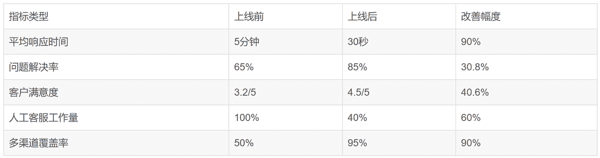
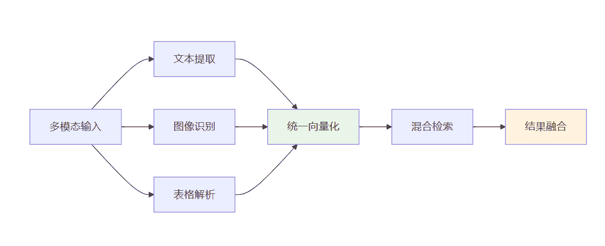

# RAG技术栈打造企业级知识问答Agent

> 来源：[https://qqs7y1hozd1.feishu.cn/docx/WRCudBvc9oL69ExUXPsc4Ofhn3d](https://qqs7y1hozd1.feishu.cn/docx/WRCudBvc9oL69ExUXPsc4Ofhn3d)

## 智能客服Agent架构设计

### 2.1 整体系统架构


### 2.2 核心组件设计

```
from abc import ABC, abstractmethod
from dataclasses import dataclass
from typing import Any, Dict, List, Optional
from enum import Enum
import asyncio
import uuid

class ChannelType(Enum):
    """渠道类型枚举"""
    WECHAT = "wechat"
    DINGTALK = "dingtalk"
    WEB = "web"
    PHONE = "phone"

@dataclass
class UserMessage:
    """用户消息数据结构"""
    message_id: str
    user_id: str
    channel: ChannelType
    content: str
    message_type: str  # text, image, voice等
    timestamp: float
    session_id: str
    metadata: Dict[str, Any] = None

@dataclass
class AgentResponse:
    """Agent响应数据结构"""
    response_id: str
    content: str
    message_type: str
    suggested_actions: List[str] = None
    confidence_score: float = 0.0
    processing_time: float = 0.0

class ChannelAdapter(ABC):
    """渠道适配器抽象基类"""
    
    @abstractmethod
    async def receive_message(self) -> UserMessage:
        """接收消息"""
        pass
    
    @abstractmethod
    async def send_response(self, response: AgentResponse) -> bool:
        """发送响应"""
        pass
    
    @abstractmethod
    def get_channel_type(self) -> ChannelType:
        """获取渠道类型"""
        pass

class SessionManager:
    """会话管理器"""
    
    def __init__(self, redis_client):
        self.redis_client = redis_client
        self.session_timeout = 3600  # 1小时超时
    
    async def get_session(self, user_id: str, channel: ChannelType) -> Dict:
        """获取用户会话"""
        session_key = f"session:{user_id}:{channel.value}"
        session_data = await self.redis_client.get(session_key)
        
        if session_data:
            return json.loads(session_data)
        else:
            # 创建新会话
            new_session = {
                "session_id": str(uuid.uuid4()),
                "user_id": user_id,
                "channel": channel.value,
                "created_at": time.time(),
                "last_activity": time.time(),
                "context": {},
                "conversation_history": []
            }
            
            await self.redis_client.setex(
                session_key, 
                self.session_timeout, 
                json.dumps(new_session)
            )
            return new_session
    
    async def update_session(self, session: Dict, message: UserMessage, response: AgentResponse):
        """更新会话状态"""
        session["last_activity"] = time.time()
        session["conversation_history"].append({
            "user_message": message.content,
            "agent_response": response.content,
            "timestamp": time.time()
        })
        
        # 保持最近10轮对话
        if len(session["conversation_history"]) > 10:
            session["conversation_history"] = session["conversation_history"][-10:]
        
        session_key = f"session:{message.user_id}:{message.channel.value}"
        await self.redis_client.setex(
            session_key,
            self.session_timeout,
            json.dumps(session)
        )
```

## 多渠道融合实现

### 3.1 🛰️小程序接入

```
from flask import Flask, request, jsonify
import hashlib
import xml.etree.ElementTree as ET

class WeChatAdapter(ChannelAdapter):
    """微信渠道适配器"""
    
    def __init__(self, app_id: str, app_secret: str, token: str):
        self.app_id = app_id
        self.app_secret = app_secret
        self.token = token
        self.app = Flask(__name__)
        self._setup_routes()
    
    def _setup_routes(self):
        """设置路由"""
        @self.app.route('/wechat', methods=['GET', 'POST'])
        async def wechat_handler():
            if request.method == 'GET':
                return self._verify_signature()
            else:
                return await self._handle_message()
    
    def _verify_signature(self):
        """验证微信签名"""
        signature = request.args.get('signature')
        timestamp = request.args.get('timestamp')
        nonce = request.args.get('nonce')
        echostr = request.args.get('echostr')
        
        # 验证签名
        tmp_arr = [self.token, timestamp, nonce]
        tmp_arr.sort()
        tmp_str = ''.join(tmp_arr)
        tmp_str = hashlib.sha1(tmp_str.encode()).hexdigest()
        
        if tmp_str == signature:
            return echostr
        return 'Invalid signature'
    
    async def _handle_message(self):
        """处理微信消息"""
        xml_data = request.get_data()
        root = ET.fromstring(xml_data)
        
        # 解析消息
        msg_type = root.find('MsgType').text
        from_user = root.find('FromUserName').text
        content = root.find('Content').text if root.find('Content') is not None else ''
        
        # 构建UserMessage对象
        user_message = UserMessage(
            message_id=root.find('MsgId').text,
            user_id=from_user,
            channel=ChannelType.WECHAT,
            content=content,
            message_type=msg_type,
            timestamp=time.time(),
            session_id=""  # 由SessionManager生成
        )
        
        return user_message
    
    async def send_response(self, response: AgentResponse) -> bool:
        """发送微信响应"""
        # 构建微信XML响应格式
        xml_response = f"""
        <xml>
            <ToUserName><![CDATA[{response.user_id}]]></ToUserName>
            <FromUserName><![CDATA[{self.app_id}]]></FromUserName>
            <CreateTime>{int(time.time())}</CreateTime>
            <MsgType><![CDATA[text]]></MsgType>
            <Content><![CDATA[{response.content}]]></Content>
        </xml>
        """
        return xml_response
    
    def get_channel_type(self) -> ChannelType:
        return ChannelType.WECHAT
```

### 3.2 钉钉机器人集成


```python
import hmac
import base64
import urllib.parse
from dingtalk_stream import AckMessage
import dingtalk_stream

class DingTalkAdapter(ChannelAdapter):
    """钉钉渠道适配器"""
    
    def __init__(self, app_key: str, app_secret: str, robot_code: str):
        self.app_key = app_key
        self.app_secret = app_secret
        self.robot_code = robot_code
        self.client = dingtalk_stream.DingTalkStreamClient(app_key, app_secret)
        self._setup_handlers()
    
    def _setup_handlers(self):
        """设置消息处理器"""
        @self.client.register_callback_handler(dingtalk_stream.ChatbotMessage.TOPIC)
        async def process_message(message: dingtalk_stream.ChatbotMessage):
            """处理钉钉消息"""
            
            # 解析消息内容
            content = message.text.content if message.text else ""
            
            user_message = UserMessage(
                message_id=message.msg_id,
                user_id=message.sender_id,
                channel=ChannelType.DINGTALK,
                content=content,
                message_type="text",
                timestamp=message.create_at / 1000,  # 转换为秒
                session_id=""
            )
            
            # 调用智能客服处理
            agent_response = await self._process_with_agent(user_message)
            
            # 发送响应
            await self.send_response(agent_response, message.conversation_id)
            
            return AckMessage.STATUS_OK, 'OK'
    
    async def _process_with_agent(self, user_message: UserMessage) -> AgentResponse:
        """使用智能客服处理消息"""
        # 这里会调用主要的Agent处理逻辑
        # 暂时返回模拟响应
        return AgentResponse(
            response_id=str(uuid.uuid4()),
            content="正在为您处理，请稍候...",
            message_type="text"
        )
    
    async def send_response(self, response: AgentResponse, conversation_id: str) -> bool:
        """发送钉钉响应"""
        try:
            await self.client.send_message(
                conversation_id=conversation_id,
                content=response.content
            )
            return True
        except Exception as e:
            print(f"❌ 发送钉钉消息失败: {e}")
            return False
    
    def get_channel_type(self) -> ChannelType:
        return ChannelType.DINGTALK
    
    def start_listening(self):
        """开始监听消息"""
        self.client.start_forever()
```

### 3.3 渠道统一管理


```python
class ChannelManager:
    """渠道管理器"""
    
    def __init__(self):
        self.adapters: Dict[ChannelType, ChannelAdapter] = {}
        self.message_queue = asyncio.Queue()
        self.session_manager = SessionManager(redis_client)
        self.agent = IntelligentCustomerServiceAgent()
    
    def register_adapter(self, adapter: ChannelAdapter):
        """注册渠道适配器"""
        channel_type = adapter.get_channel_type()
        self.adapters[channel_type] = adapter
        print(f"✅ 注册渠道适配器: {channel_type.value}")
    
    async def route_message(self, message: UserMessage) -> AgentResponse:
        """路由消息到对应处理器"""
        try:
            # 获取或创建会话
            session = await self.session_manager.get_session(
                message.user_id, 
                message.channel
            )
            message.session_id = session["session_id"]
            
            # 调用智能客服Agent处理
            response = await self.agent.process_message(message, session)
            
            # 更新会话状态
            await self.session_manager.update_session(session, message, response)
            
            return response
            
        except Exception as e:
            print(f"❌ 消息路由处理失败: {e}")
            return AgentResponse(
                response_id=str(uuid.uuid4()),
                content="抱歉，系统暂时出现问题，请稍后再试。",
                message_type="text"
            )
    
    async def start_all_adapters(self):
        """启动所有渠道适配器"""
        tasks = []
        for adapter in self.adapters.values():
            if hasattr(adapter, 'start_listening'):
                tasks.append(asyncio.create_task(adapter.start_listening()))
        
        if tasks:
            await asyncio.gather(*tasks)
```

## 智能客服Agent核心实现

### 4.1 意图识别与分类


```
from sklearn.feature_extraction.text import TfidfVectorizer
from sklearn.naive_bayes import MultinomialNB
import jieba
import re

class IntentClassifier:
    """意图识别分类器"""

    def __init__(self):
        self.vectorizer = TfidfVectorizer(max_features=5000)
        self.classifier = MultinomialNB()
        self.intent_mapping = {
            'product_inquiry': '产品咨询',
            'order_status': '订单状态查询',
            'refund_request': '退款申请',
            'complaint': '投诉建议',
            'technical_support': '技术支持',
            'general_question': '一般问题'
        }
        self.is_trained = False

    def preprocess_text(self, text: str) -> str:
        """文本预处理"""
        # 去除特殊字符
        text = re.sub(r'[^\w\s]', '', text)
        # 分词
        words = jieba.cut(text)
        return ' '.join(words)

    def train(self, training_data: List[Dict]):
        """训练意图分类器"""
        texts = []
        labels = []

        for item in training_data:
            processed_text = self.preprocess_text(item['text'])
            texts.append(processed_text)
            labels.append(item['intent'])

        # 特征提取
        X = self.vectorizer.fit_transform(texts)

        # 训练分类器
        self.classifier.fit(X, labels)
        self.is_trained = True

        print(f"✅ 意图分类器训练完成，样本数: {len(texts)}")

    def predict_intent(self, text: str) -> Dict[str, Any]:
        """预测用户意图"""
        if not self.is_trained:
            return {
                'intent': 'general_question',
                'confidence': 0.5,
                'description': '一般问题'
            }

        processed_text = self.preprocess_text(text)
        X = self.vectorizer.transform([processed_text])

        # 预测意图
        predicted_intent = self.classifier.predict(X)[0]
        confidence_scores = self.classifier.predict_proba(X)[0]
        max_confidence = max(confidence_scores)

        return {
            'intent': predicted_intent,
            'confidence': float(max_confidence),
            'description': self.intent_mapping.get(predicted_intent, '未知意图')
        }

class IntelligentCustomerServiceAgent:
    """智能客服Agent主类"""

    def __init__(self):
        self.maas_client = HuaweiMaaSClient(
            api_key=os.getenv('HUAWEI_MAAS_API_KEY'),
            endpoint=os.getenv('HUAWEI_MAAS_ENDPOINT')
        )
        self.intent_classifier = IntentClassifier()
        self.knowledge_base = KnowledgeBase()
        self._initialize_training_data()

    def _initialize_training_data(self):
        """初始化训练数据"""
        training_data = [
            {'text': '我想了解你们的产品功能', 'intent': 'product_inquiry'},
            {'text': '我的订单什么时候能到', 'intent': 'order_status'},
            {'text': '我要申请退款', 'intent': 'refund_request'},
            {'text': '产品有问题我要投诉', 'intent': 'complaint'},
            {'text': '软件安装不了怎么办', 'intent': 'technical_support'},
            # 更多训练数据...
        ]
        self.intent_classifier.train(training_data)

    async def process_message(self, message: UserMessage, session: Dict) -> AgentResponse:
        """处理用户消息的主要方法"""
        start_time = time.time()

        try:
            # 1. 意图识别
            intent_result = self.intent_classifier.predict_intent(message.content)

            # 2. 构建上下文
            context = self._build_context(message, session, intent_result)

            # 3. 调用DeepSeek模型生成回复
            response_content = await self._generate_response(context)

            # 4. 后处理和优化
            final_response = self._post_process_response(response_content, intent_result)

            processing_time = time.time() - start_time

            return AgentResponse(
                response_id=str(uuid.uuid4()),
                content=final_response,
                message_type="text",
                confidence_score=intent_result['confidence'],
                processing_time=processing_time
            )

        except Exception as e:
            print(f"❌ 消息处理失败: {e}")
            return AgentResponse(
                response_id=str(uuid.uuid4()),
                content="抱歉，我现在无法处理您的问题，请稍后再试或联系人工客服。",
                message_type="text",
                processing_time=time.time() - start_time
            )

    def _build_context(self, message: UserMessage, session: Dict, intent_result: Dict) -> str:
        """构建对话上下文"""
        # 获取历史对话
        history = session.get('conversation_history', [])
        history_text = ""

        if history:
            recent_history = history[-3:]  # 最近3轮对话
            for h in recent_history:
                history_text += f"用户: {h['user_message']}\n客服: {h['agent_response']}\n"

        # 获取相关知识库内容
        kb_content = self.knowledge_base.search_relevant_content(
            message.content,
            intent_result['intent']
        )

        # 构建完整提示词
        context = f"""你是一个专业的智能客服助手，请根据以下信息回答用户问题：
渠道信息: {message.channel.value}
用户意图: {intent_result['description']} (置信度: {intent_result['confidence']:.2f})
历史对话:
{history_text}
相关知识:
{kb_content}
当前用户问题: {message.content}
回答要求:
1. 语言亲切友好，符合客服规范
2. 回答准确专业，基于知识库内容
3. 如果无法解决问题，引导用户联系人工客服
4. 根据不同渠道调整回复风格
请回复:"""

        return context

    async def _generate_response(self, context: str) -> str:
        """使用DeepSeek模型生成回复"""
        messages = [
            {"role": "system", "content": "你是一个专业的客服助手，擅长解答各种客户问题。"},
            {"role": "user", "content": context}
        ]

        result = self.maas_client.call_deepseek_model(
            messages=messages,
            temperature=0.3,  # 较低的温度保证回复稳定性
            max_tokens=512
        )

        if "error" in result:
            raise Exception(f"MaaS API调用失败: {result['error']}")

        return result["choices"][0]["message"]["content"]

    def _post_process_response(self, response: str, intent_result: Dict) -> str:
        """后处理响应内容"""
        # 根据意图类型添加特定的后缀或建议
        if intent_result['intent'] == 'technical_support':
            response += "\n\n如果问题仍未解决，建议您联系技术支持热线：400-xxx-xxxx"
        elif intent_result['intent'] == 'refund_request':
            response += "\n\n具体退款流程可能需要人工客服协助，您可以转接人工服务。"

        return response.strip()
```

### 4.2 知识库管理


```python
import faiss
import numpy as np
from sentence_transformers import SentenceTransformer
 
class KnowledgeBase:
    """知识库管理器"""
    
    def __init__(self):
        self.encoder = SentenceTransformer('paraphrase-multilingual-MiniLM-L12-v2')
        self.knowledge_data = []
        self.index = None
        self._load_knowledge_base()
    
    def _load_knowledge_base(self):
        """加载知识库数据"""
        # 示例知识库数据
        knowledge_items = [
            {
                "id": "kb_001",
                "category": "product_inquiry",
                "question": "产品有哪些主要功能？",
                "answer": "我们的产品主要包含以下功能：1. 智能分析 2. 数据可视化 3. 自动化报告 4. 多平台集成",
                "keywords": ["功能", "特性", "产品介绍"]
            },
            {
                "id": "kb_002", 
                "category": "technical_support",
                "question": "如何解决登录问题？",
                "answer": "登录问题解决步骤：1. 确认用户名密码正确 2. 清除浏览器缓存 3. 检查网络连接 4. 联系技术支持",
                "keywords": ["登录", "密码", "账号"]
            }
            # 更多知识条目...
        ]
        
        # 构建向量索引
        texts = [item['question'] + ' ' + item['answer'] for item in knowledge_items]
        embeddings = self.encoder.encode(texts)
        
        # 创建FAISS索引
        dimension = embeddings.shape[1]
        self.index = faiss.IndexFlatIP(dimension)
        self.index.add(embeddings.astype('float32'))
        
        self.knowledge_data = knowledge_items
        print(f"✅ 知识库加载完成，共 {len(knowledge_items)} 条记录")
    
    def search_relevant_content(self, query: str, intent: str, top_k: int = 3) -> str:
        """搜索相关知识内容"""
        if not self.index or not self.knowledge_data:
            return "暂无相关知识库内容"
        
        # 查询向量化
        query_embedding = self.encoder.encode([query])
        
        # 执行搜索
        scores, indices = self.index.search(query_embedding.astype('float32'), top_k)
        
        relevant_content = []
        for i, idx in enumerate(indices[0]):
            if idx != -1:  # 有效索引
                item = self.knowledge_data[idx]
                # 优先返回相同意图类别的内容
                if item['category'] == intent:
                    relevant_content.insert(0, item['answer'])
                else:
                    relevant_content.append(item['answer'])
        
        return '\n'.join(relevant_content[:2])  # 返回最相关的2条内容
```

## RAG核心组件实现

### 5.1 文档处理与向量化

```python
import chromadb
from sentence_transformers import SentenceTransformer
from langchain.text_splitter import RecursiveCharacterTextSplitter
from langchain.document_loaders import PyPDFLoader, TextLoader
import uuid
 
class DocumentProcessor:
    """文档处理器"""
    
    def __init__(self):
        self.embedding_model = SentenceTransformer('all-MiniLM-L6-v2')
        self.text_splitter = RecursiveCharacterTextSplitter(
            chunk_size=1000,
            chunk_overlap=200,
            length_function=len
        )
        
        # 初始化Chroma向量数据库
        self.chroma_client = chromadb.PersistentClient(path="./chroma_db")
        self.collection = self.chroma_client.get_or_create_collection(
            name="knowledge_base",
            metadata={"hnsw:space": "cosine"}
        )
    
    def load_documents(self, file_paths):
        """加载文档"""
        documents = []
        
        for file_path in file_paths:
            try:
                if file_path.endswith('.pdf'):
                    loader = PyPDFLoader(file_path)
                elif file_path.endswith('.txt'):
                    loader = TextLoader(file_path, encoding='utf-8')
                else:
                    print(f"⚠️ 不支持的文件格式: {file_path}")
                    continue
                    
                docs = loader.load()
                documents.extend(docs)
                print(f"✅ 已加载文档: {file_path}")
                
            except Exception as e:
                print(f"❌ 加载文档失败 {file_path}: {e}")
                
        return documents
    
    def split_documents(self, documents):
        """分割文档"""
        chunks = []
        for doc in documents:
            # 分割文本
            splits = self.text_splitter.split_text(doc.page_content)
            
            for split in splits:
                chunks.append({
                    'id': str(uuid.uuid4()),
                    'text': split,
                    'metadata': doc.metadata
                })
        
        print(f"📝 文档分割完成，共 {len(chunks)} 个片段")
        return chunks
    
    def embed_and_store(self, chunks):
        """向量化并存储"""
        texts = [chunk['text'] for chunk in chunks]
        ids = [chunk['id'] for chunk in chunks]
        metadatas = [chunk['metadata'] for chunk in chunks]
        
        # 批量生成嵌入向量
        print("🔄 正在生成嵌入向量...")
        embeddings = self.embedding_model.encode(texts, show_progress_bar=True)
        
        # 存储到向量数据库
        self.collection.add(
            embeddings=embeddings.tolist(),
            documents=texts,
            metadatas=metadatas,
            ids=ids
        )
        
        print(f"💾 已存储 {len(chunks)} 个向量")
```

### 5.2 检索系统设计


```python
class RAGRetriever:
    """RAG检索器"""
    
    def __init__(self, collection, embedding_model):
        self.collection = collection
        self.embedding_model = embedding_model
        
    def retrieve_documents(self, query, top_k=5):
        """检索相关文档"""
        # 查询向量化
        query_embedding = self.embedding_model.encode([query])
        
        # 执行相似度检索
        results = self.collection.query(
            query_embeddings=query_embedding.tolist(),
            n_results=top_k,
            include=['documents', 'metadatas', 'distances']
        )
        
        # 组织结果
        retrieved_docs = []
        for i, (doc, metadata, distance) in enumerate(zip(
            results['documents'][0], 
            results['metadatas'][0], 
            results['distances'][0]
        )):
            retrieved_docs.append({
                'rank': i + 1,
                'content': doc,
                'metadata': metadata,
                'similarity_score': 1 - distance,  # 转换为相似度分数
                'source': metadata.get('source', 'unknown')
            })
        
        return retrieved_docs
    
    def rerank_documents(self, query, documents):
        """重排序文档"""
        # 基于多个维度进行重排序
        for doc in documents:
            # 计算查询词覆盖度
            query_words = set(query.lower().split())
            doc_words = set(doc['content'].lower().split())
            coverage = len(query_words & doc_words) / len(query_words)
            
            # 综合评分
            doc['final_score'] = (
                doc['similarity_score'] * 0.7 + 
                coverage * 0.3
            )
        
        # 按综合评分排序
        return sorted(documents, key=lambda x: x['final_score'], reverse=True)
```

## 企业级知识问答Agent实现

### 6.1 Agent核心类设计


## 6.1 知识问答Agent类实现

```
from typing import List, Dict, Any
import json
import time

class KnowledgeQAAgent:
    """企业级知识问答Agent"""

    def __init__(self, model_manager: DeepSeekModelManager,
                 retriever: RAGRetriever):
        self.model_manager = model_manager
        self.retriever = retriever
        self.conversation_history = []

    def build_prompt(self, query: str, retrieved_docs: List[Dict]) -> str:
        """构建提示词"""
        # 提取相关文档内容
        context_parts = []
        for i, doc in enumerate(retrieved_docs[:3]):  # 使用前3个最相关的文档
            context_parts.append(f"参考资料{i+1}：{doc['content']}")

        context = "\n\n".join(context_parts)

        # 构建完整提示词
        prompt = f"""你是一个专业的企业知识助手，请根据以下参考资料回答用户问题。
参考资料：
{context}
用户问题：{query}
请注意：
1. 优先基于参考资料中的信息进行回答
2. 如果参考资料不足以回答问题，请明确说明
3. 回答要准确、专业、有条理
4. 可以结合你的专业知识进行适当补充
回答："""

        return prompt

    def answer_question(self, query: str) -> Dict[str, Any]:
        """回答问题的主方法"""
        start_time = time.time()

        try:
            # 1. 检索相关文档
            print("🔍 检索相关文档...")
            retrieved_docs = self.retriever.retrieve_documents(query, top_k=5)
            reranked_docs = self.retriever.rerank_documents(query, retrieved_docs)

            # 2. 构建提示词
            prompt = self.build_prompt(query, reranked_docs)

            # 3. 生成回答
            print("🤖 生成回答...")
            response = self.model_manager.generate_response(prompt, max_length=1024)

            # 4. 记录对话历史
            self.conversation_history.append({
                'query': query,
                'response': response,
                'retrieved_docs': reranked_docs[:3],
                'timestamp': time.time()
            })

            end_time = time.time()

            return {
                'success': True,
                'answer': response,
                'sources': [doc['source'] for doc in reranked_docs[:3]],
                'retrieved_docs': reranked_docs,
                'response_time': end_time - start_time
            }

        except Exception as e:
            return {
                'success': False,
                'error': str(e),
                'answer': "抱歉，处理您的问题时出现了错误。",
                'response_time': time.time() - start_time
            }

    def get_conversation_summary(self) -> str:
        """获取对话摘要"""
        if not self.conversation_history:
            return "暂无对话记录"

        summary = f"对话轮次: {len(self.conversation_history)}\n"
        summary += f"最近问题: {self.conversation_history[-1]['query']}\n"
        return summary
```

## 6.2 Web API接口实现

```
from fastapi import FastAPI, HTTPException
from pydantic import BaseModel
import uvicorn

app = FastAPI(title="企业知识问答API", version="1.0.0")

# 全局变量存储Agent实例
qa_agent = None

class QuestionRequest(BaseModel):
    question: str
    conversation_id: str = None

class QuestionResponse(BaseModel):
    answer: str
    sources: List[str]
    response_time: float
    success: bool

@app.on_event("startup")
async def startup_event():
    """启动时初始化模型"""
    global qa_agent

    print("🚀 正在初始化知识问答系统...")

    # 初始化模型管理器
    model_manager = DeepSeekModelManager()
    if not model_manager.load_model():
        raise Exception("模型加载失败")

    # 初始化文档处理器
    doc_processor = DocumentProcessor()

    # 初始化检索器
    retriever = RAGRetriever(
        collection=doc_processor.collection,
        embedding_model=doc_processor.embedding_model
    )

    # 初始化Agent
    qa_agent = KnowledgeQAAgent(model_manager, retriever)

    print("✅ 系统初始化完成")

@app.post("/api/question", response_model=QuestionResponse)
async def ask_question(request: QuestionRequest):
    """问答接口"""
    if not qa_agent:
        raise HTTPException(status_code=500, detail="系统未初始化")

    if not request.question.strip():
        raise HTTPException(status_code=400, detail="问题不能为空")

    # 调用Agent处理问题
    result = qa_agent.answer_question(request.question)

    return QuestionResponse(
        answer=result['answer'],
        sources=result.get('sources', []),
        response_time=result['response_time'],
        success=result['success']
    )

@app.get("/api/health")
async def health_check():
    """健康检查"""
    return {"status": "healthy", "timestamp": time.time()}

if __name__ == "__main__":
    uvicorn.run(
        "main:app",
        host="0.0.0.0",
        port=8000,
        reload=False,
        workers=1
    )
```

## 7 应用效果与案例分析

### 7.1 性能监控指标



### 7.2 多渠道使用分布


### 7.3 典型应用场景


```
class ScenarioAnalyzer:
    """场景分析器"""
    
    def __init__(self):
        self.scenarios = {
            "产品咨询": {
                "description": "用户询问产品功能、价格、使用方法等",
                "success_rate": 0.92,
                "avg_resolution_time": 25,
                "sample_questions": [
                    "这个产品有什么功能？",
                    "价格是多少？",
                    "如何开始使用？"
                ]
            },
            "技术支持": {
                "description": "用户遇到技术问题需要解决方案",
                "success_rate": 0.87,
                "avg_resolution_time": 45,
                "sample_questions": [
                    "软件安装失败怎么办？",
                    "登录不了怎么解决？",
                    "数据同步有问题"
                ]
            },
            "订单查询": {
                "description": "用户查询订单状态、物流信息等",
                "success_rate": 0.95,
                "avg_resolution_time": 20,
                "sample_questions": [
                    "我的订单什么时候发货？",
                    "快递单号是多少？",
                    "可以修改收货地址吗？"
                ]
            }
        }
    
    def generate_scenario_report(self) -> str:
        """生成场景分析报告"""
        report = "## 智能客服应用场景分析报告\n\n"
        
        for scenario, data in self.scenarios.items():
            report += f"### {scenario}\n"
            report += f"- **描述**: {data['description']}\n"
            report += f"- **成功解决率**: {data['success_rate']*100:.1f}%\n"
            report += f"- **平均解决时间**: {data['avg_resolution_time']}秒\n"
            report += f"- **典型问题**:\n"
            for question in data['sample_questions']:
                report += f"  - {question}\n"
            report += "\n"
        
        return report

# 实际使用统计
def analyze_real_usage():
    """分析实际使用情况"""
    usage_stats = {
        "daily_messages": 1250,
        "peak_hour_messages": 180,
        "channel_distribution": {
            "wechat": 0.35,
            "web": 0.28, 
            "dingtalk": 0.22,
            "phone": 0.15
        },
        "intent_distribution": {
            "product_inquiry": 0.40,
            "technical_support": 0.25,
            "order_status": 0.20,
            "refund_request": 0.10,
            "complaint": 0.05
        }
    }
    
    print("📊 系统使用统计:")
    print(f"日均消息量: {usage_stats['daily_messages']}")
    print(f"高峰期消息量: {usage_stats['peak_hour_messages']}/小时")
    
    return usage_stats
```

## 部署运维与监控

### 8.1 华为云Flexus部署配置

```
# 部署配置文件 deployment.yaml
deployment_config = {
    "version": "1.0",
    "infrastructure": {
        "cloud_provider": "huawei_cloud",
        "instance_type": "flexus.c6.large",
        "cpu_cores": 4,
        "memory_gb": 8,
        "storage_gb": 100,
        "auto_scaling": {
            "min_instances": 2,
            "max_instances": 10,
            "target_cpu_utilization": 70
        }
    },
    "services": {
        "customer_service_agent": {
            "image": "customer-service-agent:latest",
            "port": 8000,
            "replicas": 3,
            "resources": {
                "cpu": "500m",
                "memory": "1Gi"
            }
        },
        "redis_cache": {
            "image": "redis:6.2",
            "port": 6379,
            "persistence": True
        },
        "mongodb": {
            "image": "mongo:4.4",
            "port": 27017,
            "storage": "50Gi"
        }
    }
}

def deploy_to_flexus():
    """部署到华为云Flexus"""
    import subprocess
    
    # 构建Docker镜像
    subprocess.run([
        "docker", "build", "-t", "customer-service-agent:latest", "."
    ], check=True)
    
    # 推送到华为云容器镜像服务
    subprocess.run([
        "docker", "tag", "customer-service-agent:latest",
        "swr.ap-southeast-1.myhuaweicloud.com/namespace/customer-service-agent:latest"
    ], check=True)
    
    subprocess.run([
        "docker", "push", 
        "swr.ap-southeast-1.myhuaweicloud.com/namespace/customer-service-agent:latest"
    ], check=True)
    
    print("✅ 镜像推送完成")
    
    # 部署到Kubernetes集群
    subprocess.run([
        "kubectl", "apply", "-f", "k8s-deployment.yaml"
    ], check=True)
    
    print("✅ 服务部署完成")
```

### 8.2 监控告警系统


```
from prometheus_client import Counter, Histogram, Gauge, start_http_server
import time
import threading

class MetricsCollector:
    """指标收集器"""

    def __init__(self):
        # 定义监控指标
        self.message_counter = Counter(
            'customer_service_messages_total',
            'Total number of customer service messages',
            ['channel', 'intent']
        )

        self.response_time_histogram = Histogram(
            'customer_service_response_time_seconds',
            'Response time of customer service agent',
            ['channel']
        )

        self.active_sessions_gauge = Gauge(
            'customer_service_active_sessions',
            'Number of active customer sessions'
        )

        self.success_rate_gauge = Gauge(
            'customer_service_success_rate',
            'Success rate of problem resolution',
            ['channel']
        )

    def record_message(self, channel: str, intent: str):
        """记录消息指标"""
        self.message_counter.labels(channel=channel, intent=intent).inc()

    def record_response_time(self, channel: str, response_time: float):
        """记录响应时间"""
        self.response_time_histogram.labels(channel=channel).observe(response_time)

    def update_active_sessions(self, count: int):
        """更新活跃会话数"""
        self.active_sessions_gauge.set(count)

    def update_success_rate(self, channel: str, rate: float):
        """更新成功率"""
        self.success_rate_gauge.labels(channel=channel).set(rate)


class HealthChecker:
    """健康检查器"""

    def __init__(self, maas_client: HuaweiMaaSClient):
        self.maas_client = maas_client
        self.health_status = {
            "overall": "healthy",
            "components": {
                "maas_api": "unknown",
                "database": "unknown",
                "cache": "unknown"
            },
            "last_check": time.time()
        }

    async def check_maas_api(self) -> bool:
        """检查MaaS API健康状态"""
        try:
            result = self.maas_client.get_model_info()
            if "error" not in result:
                self.health_status["components"]["maas_api"] = "healthy"
                return True
            else:
                self.health_status["components"]["maas_api"] = "unhealthy"
                return False
        except Exception:
            self.health_status["components"]["maas_api"] = "unhealthy"
            return False

    async def check_database(self) -> bool:
        """检查数据库连接"""
        try:
            # 模拟数据库检查
            # 实际实现中应该执行简单的数据库查询
            self.health_status["components"]["database"] = "healthy"
            return True
        except Exception:
            self.health_status["components"]["database"] = "unhealthy"
            return False

    async def check_cache(self) -> bool:
        """检查缓存系统"""
        try:
            # 模拟Redis检查
            self.health_status["components"]["cache"] = "healthy"
            return True
        except Exception:
            self.health_status["components"]["cache"] = "unhealthy"
            return False

    async def perform_health_check(self) -> Dict[str, Any]:
        """执行全面健康检查"""
        checks = [
            self.check_maas_api(),
            self.check_database(),
            self.check_cache()
        ]

        results = await asyncio.gather(*checks, return_exceptions=True)

        # 更新整体健康状态
        if all(results):
            self.health_status["overall"] = "healthy"
        elif any(results):
            self.health_status["overall"] = "degraded"
        else:
            self.health_status["overall"] = "unhealthy"

        self.health_status["last_check"] = time.time()
        return self.health_status


# 启动监控服务
def start_monitoring():
    """启动监控服务"""
    # 启动Prometheus指标服务器
    start_http_server(8001)
    print("✅ Prometheus指标服务器已启动，端口: 8001")

    # 定期健康检查
    def periodic_health_check():
        health_checker = HealthChecker(maas_client)
        while True:
            asyncio.run(health_checker.perform_health_check())
            time.sleep(60)  # 每分钟检查一次

    health_thread = threading.Thread(target=periodic_health_check)
    health_thread.daemon = True
    health_thread.start()

    print("✅ 健康检查服务已启动")
```

## 技术难点与解决方案

### 9.1 长文本处理优化

在处理超长企业文档时，我们采用了分层检索策略：

```
class HierarchicalRetriever:
    """分层检索器"""

    def __init__(self, chunk_sizes=[500, 1000, 2000]):
        self.chunk_sizes = chunk_sizes
        self.retrievers = {}

        for size in chunk_sizes:
            # 为不同粒度创建独立的检索器
            self.retrievers[size] = self._create_retriever(size)

    def retrieve_multi_granularity(self, query: str) -> List[Dict]:
        """多粒度检索"""
        all_results = []

        for chunk_size in self.chunk_sizes:
            results = self.retrievers[chunk_size].retrieve_documents(query, top_k=3)

            # 添加粒度标识
            for result in results:
                result['chunk_size'] = chunk_size
                result['granularity'] = self._get_granularity_level(chunk_size)

            all_results.extend(results)

        # 融合和去重
        return self._merge_and_deduplicate(all_results)

    def _get_granularity_level(self, chunk_size: int) -> str:
        """获取粒度级别"""
        if chunk_size <= 500:
            return "细粒度"
        elif chunk_size <= 1000:
            return "中粒度"
        else:
            return "粗粒度"
```

### 9.2 多模态内容处理


