# Agent、RAG主流开发技术和未来应用

> 来源：https://qqs7y1hozd1.feishu.cn/docx/Br8Ndy8cWoERlYxWUhDcs3fAn3b

## Agent 论文&开源项目

### Chain of Thought

### Reflexion
推理场景下的训练语料与 prompt 方法
让 LLM 自我反思
https://arxiv.org/abs/2201.11903
https://arxiv.org/abs/2303.11366

### ReAct

### Tree of Thought
让 LLM 观察当前环境做思考后再做行动
在特定场景下的 agent 路径规划和设计范式
https://arxiv.org/abs/2210.03629
https://arxiv.org/abs/2305.10601

### [开源项目] Auto-GPT

### Camel
最火爆的 LLM-based agent 开源项目
基于 Role-Playing chatting 的 multi-agent 设计范式
https://github.com/Significant-Gravitas/AutoGPT
https://arxiv.org/abs/2303.17760
https://github.com/camel-ai/camel

### Voyager

### ToolLLM
LLM-based agent 玩《我的世界》的 demo
探索 finetune 在 tool use 场景下的提升
https://arxiv.org/abs/2305.16291
https://arxiv.org/abs/2307.16789

### ChatDev

### MetaGPT
在程序开发场景下的 multi-agent 协作 demo（基于 Camel）
在代码场景的 multi-agent 协作 demo
https://arxiv.org/abs/2307.07924
https://arxiv.org/abs/2308.00352
https://github.com/OpenBMB/ChatDev
https://github.com/geekan/MetaGPT

### AutoGen

### TaskWeaver
Role-Playing chatting 的 multi-agent 框架
code-first 的 agent 框架，在数据处理场景下的 demo
https://arxiv.org/abs/2308.08155
https://arxiv.org/abs/2311.17541
https://github.com/microsoft/autogen
https://github.com/microsoft/TaskWeaver

### [开源项目] XAgent

### [开源项目] LangGraph
比 Auto-GPT 的 benchmark 更高的 agent project
LangChain 团队在 agent 领域的尝试
https://github.com/OpenBMB/XAgent
https://github.com/langchain-ai/langgraph

### CogAgent
LLM-based agent 控制手机屏幕完成任务
https://arxiv.org/abs/2312.08914

> Continual pretrain
> DeepSeekMath: Pushing the Limits of Mathematical Reasoning in Open Language Models
> https://arxiv.org/pdf/2402.03300
> DeepSeekMath 7B, which continues pretraining DeepSeek-Coder-Base-v1.5 7B with 120B math-related tokens sourced from Common Crawl, together with natural language and code data

> InternLM-Math: Open Math Large Language Models Toward Verifiable Reasoning
> https://arxiv.org/pdf/2402.06332
> Math reasoning LLMs InternLM-Math which is continue pre-trained from InternLM2. We unify chain-of-thought reasoning, reward modeling, formal reasoning, data augmentation, and code interpreter in a unified seq2seq format and supervise our model to be a versatile math reasoner, verifier, prover, and augmenter

> LLEMMA: AN OPEN LANGUAGE MODEL FOR MATHEMATICS
> https://arxiv.org/pdf/2310.10631
> Continue pretraining Code Llama on Proof-Pile-2, a mixture of scientific papers, web data containing mathematics, and mathematical code, yielding LLEMMA

> SFT
> Scaling Instruction-Finetuned Language Models
> https://arxiv.org/pdf/2210.11416
> (1) scaling the number of tasks, (2) scaling the model size, and (3) finetuning on chain-of-thought data. We find that instruction finetuning with the above aspects dramatically improves performance on a variety of model classes (PaLM, T5, U-PaLM), prompting setups (zero-shot, few-shot, CoT), and evaluation benchmarks (MMLU, BBH, TyDiQA, MGSM, open-ended generation, RealToxicityPrompts)

> MAmmoTH2: Scaling Instructions from the Web
> https://arxiv.org/pdf/2405.03548
> We propose a paradigm to efficiently harvest 10 million naturally existing instruction data from the pre-training web corpus to enhance LLM reasoning

> 发展路径：
> 提升 plan、m 金能力
> Prompt
> ReAct, CoT
> Post training
> 泛化的 scaling law，agent 的下半战场
> Data
> 人工标注 vs 蒸馏 vs 筛选
> Architecture
> Recipe
> Aligment

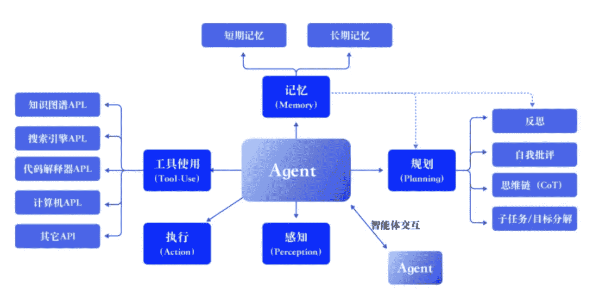

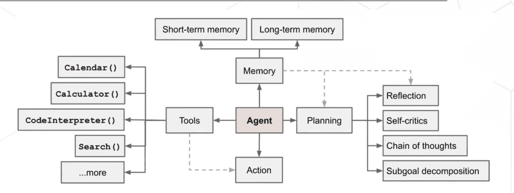

## Agent 目前的商业化实践

### C 端

#### ChatGPT（ChatBot 产品）

##### Plugin store
Agent 最早的商业化实践来自 OpenAI 在 2023 年 4 月推出的 plugin store：用户可以自定义 agent 可以调用的 tools，并且在多轮对话中通过指定最多 3 个 plugins 来辅助进行对话

在 2023 年 4 月初发布的时候被寄予厚望，被认为是下一代的 app store。但是后续用户量和反响平平，最终在 2023 年 11 月下线，被 GPTs 和 All-tools agent 取代

##### GPTs
于 2023 年 11 月 Dev day，作为 agent store 发布，主打可以通过自然对话快速开发出自己的 agent 并发布，切入 ToC 的场景，刚发布时同样被寄予厚望。但是被后续证明无法做深入开发，导致复杂场景无法实现，而简单的场景使用 all-tools agent 完全可以解决，后续彻底沦为了各家 start up 给自己的产品引流的工具，并没有形成生态

##### All-tools agent
All tools agent 于 2023 年 11 月 Dev day 发布，集成了 web searching, code interpreter, DALLE-3 这三个 tools，除此之外还隐式地集成了 web browsing，本地 RAG 这两个功能。使得用户在使用时不用再手动配置自己的 tools，配置 tools 和选择 tools 的成本转嫁到模型，客观上确实提升了体验。

但是 2024 年中，OpenAI 悄悄地把 web searching 这个 tools 从 all-tools agent 中摘除了，这一细节非常微妙，以至于很多人都没有察觉到。可能是因为某些时候本不应该用 search 的场景 agent 用了 search 会导致回答质量下降，而且在“是否应当用 search 来回答问题”这一点上的用户意图识别很难做，所以 OpenAI 索性摘除了这一 tool，这可能意味着“每次回答都用 search”（AI 搜索引擎）的产品形态和“每次回答都不用 search”（ChatBot）的产品形态的定位确实存在差异化的空间

##### code interpreter（data analysis）
于 2023 年 7 月初发布，主打 ChatGPT 写完代码后可以自动运行，如果代码报错，那么可以自动根据错误来生成新的代码，再尝试运行。如果 ChatGPT 尝试次数达到 3 次或以上，那么会输出“无法完成任务”的回复。好处在于可以在一定程度上自动 debug，确实具有一定实用性

后续 code interpreter 改名为 data analysis，并且围绕着数据分析场景做了很多用户体验上的优化，比如数据处理时生成的图片可以进行放大居中，聊天栏变为侧边栏，使得用户可以 chat with figure 等

**总结：**

OpenAI 在 agent 场景的尝试比较多，plugin,GPTs store 等，但这两个平台都反响平平，很难称得上是成功。反而是围绕着代码和数据处理的 code interpreter，和 all-tools agent 具有一定的实用性。

比较最早的 plugin store 和 all-tools agent，可以大致预判出，一个在使用工具时 work 的 agent，必然要在模型层有足够多的关于这个 tool 的语料才行，像 plugin store 那样仅仅靠简单的 prompt 作为 tool 的 description，以目前的模型能力，是很难 work 的

比较之前的 all-tools agent 和现在摘除 web search 的 all-tools agent，可以判断出，目前即使强如 OpenAI，也处理不好通用场景下的“要不要使用搜索引擎做辅助生成”这个问题，目前 OpenAI 索性把这个问题抛给了用户，这可能也意味着一些初创公司的空间

比较 code interpreter 和 GPTs，可以大致判断出，一个实用的 agent，开发必然不能仅仅限于 prompt 层面的开发，要做很多判断的机制，而且很多机制是用 code 来硬编码的，而不是用自然语言 prompt 来表达的。很讽刺的一点是：用 OpenAI 提供的 agent 开发平台（Assistant）来做写 prompt 层面的开发，那么无论如何也做不出来 code interpreter 这样的 agent

### B 端

B 端 agent 落地形态目前还是集中在 RPA 和 Flow 这两种产品形态上，而更自主的 agent 产品形态目前还没有好的落地案例

每一个为 agent 能力买单的老板都要思考一个问题：如果 agent 犯错并造成了不可挽回损失，那么谁应该为此负责？

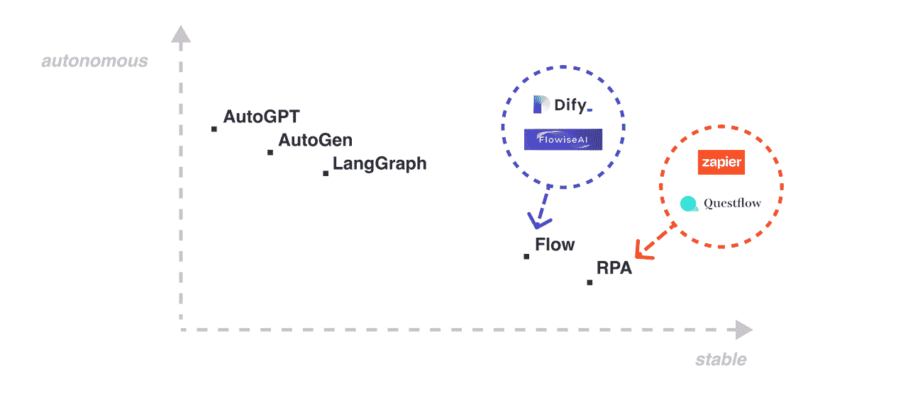

目前通常认为，在企业生产中，agent 的自主性和稳定性这两点是无法兼得的，那么如何在 agent 的自主性和稳定性之间取一个平衡就是个重要的问题。而从目前落地情景和案例来看，企业可能更倾向于稳定性而不是自主性

> 算一笔账：如果一个 agent 可以帮一个员工每天节省 5 分钟，但是代价是：有 5% 的概率造成企业内 500 万人民币的损失，那么你是否会为这个 agent 买单？

**考虑两个关键问题：**

1. 什么场景 agent 犯错的代价低？
2. 什么场景验证 agent 是否犯错的成本低？

基于对这两个问题的回答来迭代 agent 可能落地的场景，RPA 和 Flow 的产品形态天然就适合落地，因为保证了稳定性，或者通过硬规则把 agent 的能力边界限制住，那么这样一方面可以尽可能把 agent 犯错的代价尽可能降为 O，另一方面可以提升流程中的可解释性，这样无论是对流程做迭代，还是追责到具体环节都变成了可能。这同时也解释了为什么 agent 应用落地场景的 50% 以上都是 RAG 问答，以及 CRUD 的简单任务（因为这些场景老板不会遇到上面那个致命问题）

#### Zapier（RPA 产品）

Zapier 是个典型的 RPA 产品，同时也在尝试往 agent 方向切入。Zapier 的 agent 最早亮相于 OpenAI 2023 年 4 月的 plugin store。当时作为一个 plugin 出现，主打一句话生成固定的 workflow（text to workflow），并且在 OpenAI 2023 年 11 月的 Dev day 上亮相

LLM 在其中扮演的角色更像是一个 RPA workflow generating copilot，而不是一个 agent。LLM 提供的价值在于让人更方便地生成一个 RPA workflow，而不在于让 LLM 在运行时根据实时环境做决策。为此买单的用户大多都是为了解决 RPA 能够解决的问题，如 Zapier 早期投放时的定位：“如何把一个软件的信息同步到另一个软件”

类似的产品有很多，如 Make, QuestFlow 等，定位更像是 RPA 在 LLM 时代的延续。特点是完全稳定，完全不会出错，但是自主性不强

#### Dify（flow 产品）

Dify 最早亮相于 2023 年中，当时提供的是 ChatBot 的无代码编辑框架（with or without plugins），后续在 2024 年 4 月推出了 workflow 编辑器。主打的是低代码编辑 workflow，并且在 RAG 方面做了大量的优化。截止六月已经有 30k+ Github Star

类似的产品有很多，比如 FastGPT, LangFlow, Flowise, Retool AI 等。特点是可以拖拉拽快速编辑一个 agent，不像 RPA 一样限制死 agent 的行为，有 LLM 参与其中少数环节，逻辑判断等则大多都是交给硬逻辑来判断的，淡化 tool use 这些设计，从框架层保证 agent 输出的稳定性

flow 这种设计天然就适合解决企业内的 corner case，并且也适合和企业内的流程打通，目前来看，最为广泛的 B 端 agent 落地场景的产品形态属于这种产品形态，比如 RAG chatbot 等

## 总结

### agent 设计范式

agent 设计范式一定是和应用场景是深度绑定的，论文中的几种 agent 设计范式，在实际落地中可以借鉴，但不仅限于此。目前不存在通用的设计范式。需要针对场景 case by case 地设计 agent。如单次 Q&A 任务：用 AutoGPT 式的 agent planning 不如 LLM+RAG 单次召回。再比如路径和判定规则清晰的场景（如 24 点游戏），用 Tree of Thought 要比单次召回要有效。故当我们谈论 agent 的时候，一定不能把它和场景分开

### 落地的关键

目前 B 端落地场景内的企业普遍更关注稳定性，而不是自主性。让 agent 在可控的范围内运行，还能达成降本增效的目的，这是符合 B 端喜好的产品。合理的产品形态就是 RAG（Agent 场景 50% 以上的场景都是 RAG，见 LangChain 2023 年末的开发者报告），比如客服，企业内问答等

B 端的我更看好的是 Agent 对于传统 SaaS 场景的补充，即 Agent powered SaaS，而不是 Agent as a Service。其中传统的 SaaS 可能占 90%，AI 只占 10%。使得企业在特定场景下给予 agent 一定程度的自主能力以赋能现有工作流，而不是让 agent 接管企业内的多数的 API。产品形态和场景强绑定，和传统 SaaS 的形态类似

### 壁垒

C 端的壁垒和 B 端是不同的。 C 端生产力工具的壁垒可能更多集中在模型侧，或者网络效应（但我目前没看到 AI 时代具有网络效应壁垒的产品），而 B 端产品的壁垒更多是以 SaaS 形式体现的，即行业认知行业地位等，和场景和行业强绑定。这意味着可能初创公司在 AI / agent这一波浪潮中，如果要做生产力场景的产品，可能还是 B 端机会更多一些

## 预判

C 端生产力向的 agent产品可能会越来越向头部模型商集中，B 端机会更广泛，对初创公司更友好

或许以后的 agent 在 B 端的落地产品形态可能会更向 Agent powered SaaS 演化，逐步在有限的范围内接管更多流程化的 pipeline，可能会在更多的 CRUD垂类高价值场景落地。但离学术界预想的自主的 agent 的落地其实还有很远

# Code Agent

+ 讨论**Code**和**Agent**要考虑这两者的相互关系

## Agent for Code

代码是高价值的媒介，因为代码能够驱动软件，而软件能够提升组织和个体的工作效率。如果能用 Agent 驱动代码的生成，那么效率的杠杆非常高。但是代码的编写门槛很高，导致很多任务价值不够，无法被写成代码，如果 Agent 能够高速编写很多能派上用场的代码，组织和个体的效率会有 10x 的效率提升

同时 Code 场景很适合 Agent。代码可以使用编译器验证对错，即使 Agent 有幻觉也可以获得反馈；代码以文字为主（除了`design2code`），不需要太多多模态交互。由此可见，Agent for Code 会是 Agent 的一大主流变现方式

具体而言，Agent for Code（后称Coding Agent）可能会服务已有的软件项目，比如修复 Github 代码库的 issue，或者能够编写一个全新的项目。目前来说关注点集中在前者，因为业界需求往往是维护已有代码库，同时修复代码库任务也比较容易

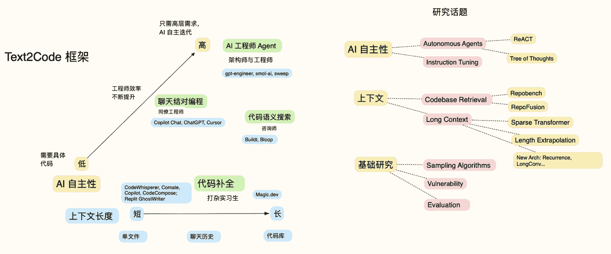

这里列举主要的 Agents for Code 以及相应的 Benchmark

Agent for Code有以下几个维度：

1. **工程职能：**是维护一个代码库修复 bug，还是重写一个代码，前者的需求更大

1. **代码领域：**负责什么领域，是负责前后端，还是负责数据库，不同公司有不同领域的代码需求

1. **Agent 个数：**由单个 Agent完成整套流程，还是多个 Agent 合作完成流程。目前来主要聚焦在 single agent 怎么做好

### 典型产品

1. **Github Copilot**

**Github Copilot 虽然叫 Copilot，但其实**是非常成功的初级 Code Agent。它的工作非常精细：

**它的工作非常精细：**

• **推理：**使用逻辑回归判断是否单行还是多行推断以及预测采纳率

• **召回：**使用 Jaccard 相似度和滑动窗口筛选 snippet；使用 `wasm` 运行 `treesitter` 解析语法树辅助召回

• **闭环：**获取 copilot 使用数据，根据反馈继续调整模型

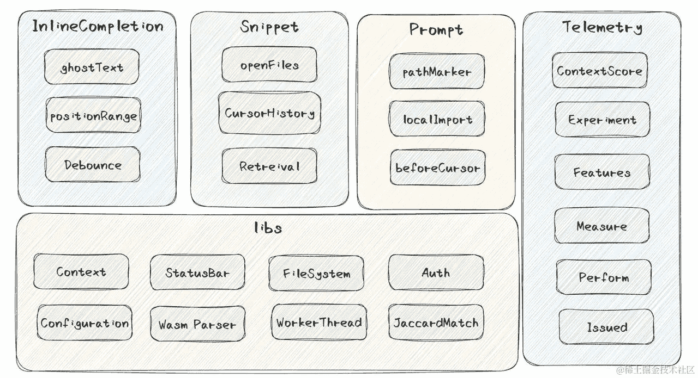

1. OpenDevin

**代码：**`https://github.com/OpenDevin/OpenDevin` Milo 699

Qwen 的 Junyang Lin 带头的复刻 Devin 的开源项目，目前已经在 SWEBench Lite 上达到了 Devin 的成绩

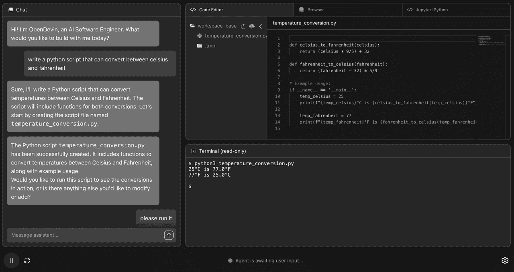

1. Sweep

**代码：**`https://github.com/sweepai/sweep`

YC 23 年投的代码助手项目。主要推理方式是 ReACT

在召回上的工作比较精细，使用了语法树解析和匹配

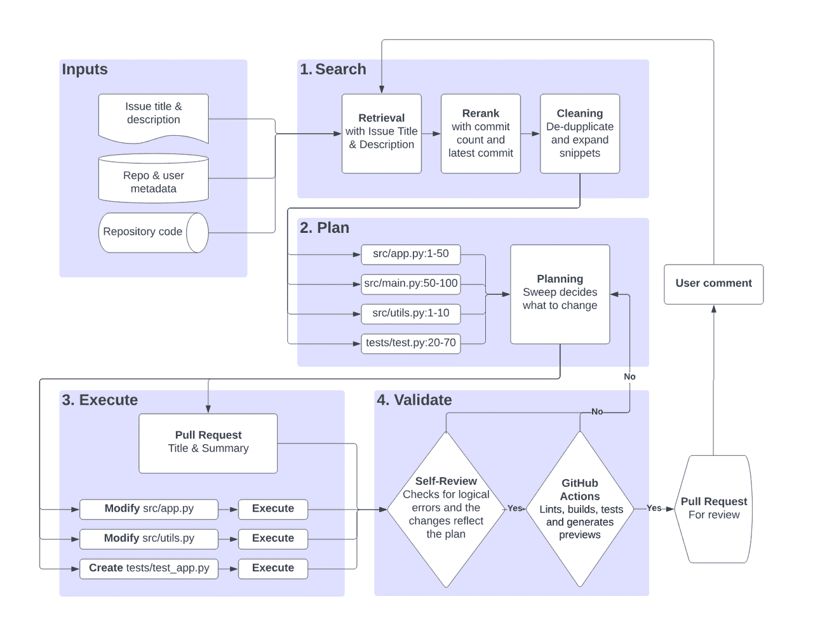

1. DB-GPT

**论文：**`https://arxiv.org/pdf/2312.01454.pdf`

**代码：**`https://github.com/TsinghuaDatabaseGroup/DB-GPT`

清华大学李国梁组 Xuanhe Zhou 开发的数据库运维 Agent，可以自动进行数据库异常诊断和索引效率调优。这些工作有较高的价值，同时门槛也比较高

值得注意的是 DB-GPT 使用了基于树搜索的推理方式

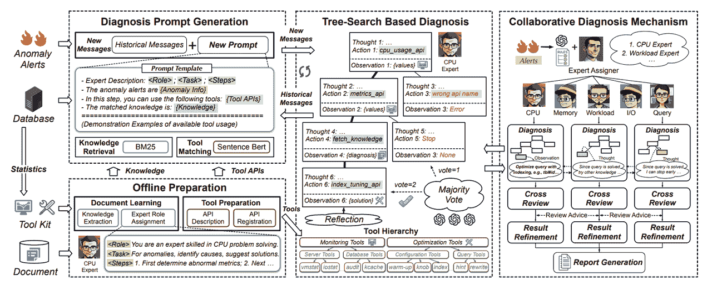

1. SWE-Agent

论文：`https://swe-agent.com/paper.pdf`

代码：`https://github.com/princeton-nlp/SWE-agent`

SWEAgent 是 SWEBench 原班人马编写的 Agent，强调构建清晰的反馈环境的重要性

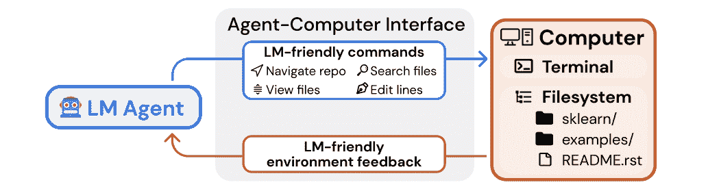

1. ChatDev

论文：`https://arxiv.org/pdf/2307.07924`

代码：`https://github.com/OpenBMB/ChatDev`

一个多智能体系统，模拟了人类编写软件的流程

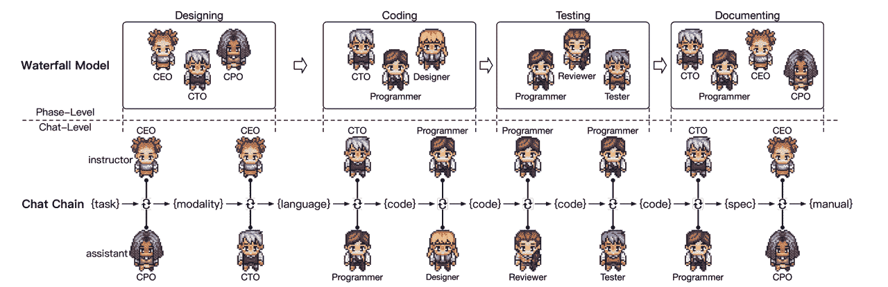

1. MetaGPT

代码：`https://github.com/geekan/MetaGPT`

同样是一个多智能体系统。用 Prompt 构建了若干个软件公司的常见职能，比如产品经理，架构师，项目管理，工程师等等。让 Agent 之间互动来逐步将软件产品从一句话需求带到一个成品

只能做简单的应用，很可能存在于训练数据中

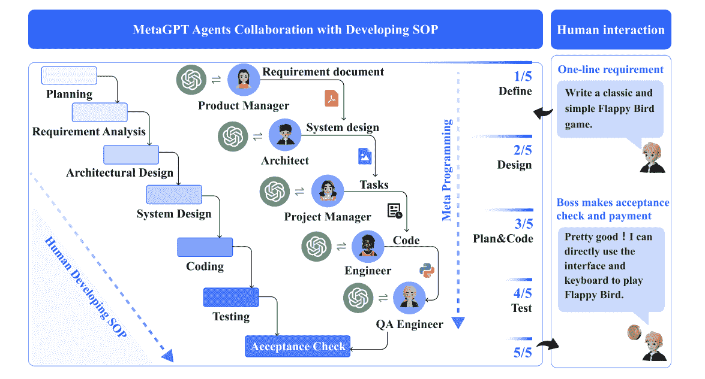

1. OpenCodeInterpreter

论文：`https://arxiv.org/abs/2402.14658`

OpenCodeInterpreter 比较偏数据科学和代码服务领域，写代码分析数据，写代码

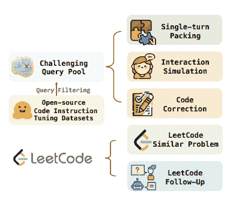

## SWEBench

网站：`https://www.swebench.com/`

主要思想是从 Github Repo 的 Issue 和相应的 Pull Request 中构建真实的 Benchmark，选材是 `Python` 的主流 repo

SWEBench 在23年12月推出，Devin 带着超越 GPT-4 结果的横空出世让大家高度关注这一 Benchmark，很多人开始在创建项目试图达到更高的分数。有一种 ImageNet 的味道

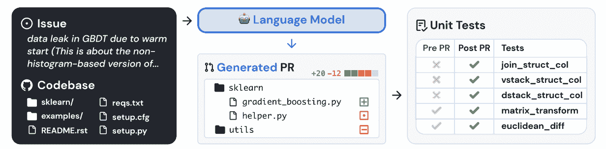

## Code Agent 分析

1. **处于搭基建阶段**：大部分工程的大部分工作是构建 ACI，怎么让 Agent 能够顺利阅览代码，搜索代码，编辑代码，查文档。每套框架都在重复做这件事，但是一些共享的基建也在浮现

1. **自主性和推理不够强**：主要的推理实现比较简单，以 Prompt 为主；缺乏融入更加主动的推理方式，比如构建小 demo 尝试项目，或者自主构建单元测试；竞赛里的对拍也是一种很有自主性的方式，构建一个暴力方法输出答案的程序，写程序逐渐输出标准答案

1. **非常需要标准化评估**：SWEBench 的出现刺激了一大批 Agent，只有标准化的评估才能激发人们的动力，刷榜促进进步。但是 SWEBench 衡量的能力也非常窄，只是 `Python` 机器学习领域

1. **非常需要合成数据**：Agent 需要的大部分数据不存在于互联网数据中，大部分互联网数据是短而缺乏推理的，导致模型做不好 Agent 所需的长距离推理。需要合成这种 Agent 专用的推理数据来补足模型的能力

## Code for Agent

具体而言，Code for Agent （后称Code-first Agent）指的是利用代码作为工具来完成其他任务的 Agent，比如完成数据分析，数学计算等。一般的 Agent 则会使用 `JSON` 来表示工具调用，然后还需要解析 `json` 来调用真正的函数。所以 Code-first Agent 是一步到位的做法：​

1. **训练数据充足：**OpenAI 的 `Codex` 模型证明了代码能提升语言模型的推理能力，因此语言模型预训练大量使用代码。

1. **Agent 工作流表示自然：**Code 的很多概念非常契合 Agent，比如 Code 中的函数就是 Agent 的工具调用，控制流就是推理步骤，函数就是可复用的记忆

Code for Agent 和 Agent for Code 能否结合起来？当然可以，比如 OpenDevin 就使用了 `CodeAct` 来表述各种动作。

这里列举主要的 Code for Agent 以及相应的 Benchmark

+ **CodeAct**

论文：`https://arxiv.org/abs/2402.01030`

代码：`https://github.com/xingyaoww/code-act`

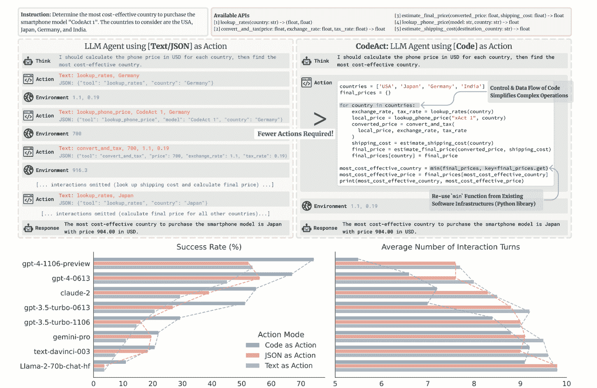

+ **TaskWeaver**

论文：`https://arxiv.org/abs/2311.17541`

代码：`https://github.com/microsoft/TaskWeaver`

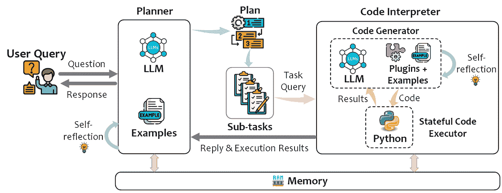

+ **Voyager**

论文：`https://arxiv.org/abs/2305.16291`

Voyager 算是比较广泛意义的 Code first Agent，或者说是无奈之举，因为23年多模态还不成熟，所以只能使用一系列接口表示 Minecraft 里面的动作。他们让 `GPT-4` 编写函数来表示技能，这些技能后续能够被复用

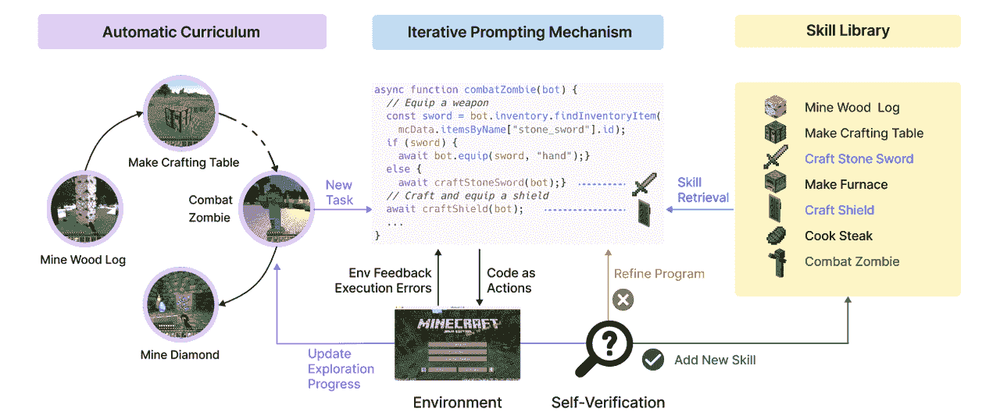

# RAG 开发技术与未来预测

## Manifesto

在2020年 Facebook AI Research(FAIR)团队发表一篇名为《Retrieval-Augmented Generation for Knowledge-Intensive NLP Tasks》的论文。这篇论文首次提出了 RAG 概念。RAG（Retrieval-Augmented Generation）意为“检索增强的生成”。这是一种结合了检索（Retrieval）和生成（Generation）的自然语言处理技术，当前已经成为一个热门技术方向，我们对其进行调研

> 调研的最后，我们希望可以回答如下几个问题：​

+ **RAG 是什么**

+ **RAG 可以使用场景有哪些？​**

+ **RAG 需要关注哪些问题**

+ **长文和RAG的相互关系**

+ **RAG 未来应用的趋势如何**

## RAG 的基本概念

RAG，即检索增强生成，其基本工作流如下：​

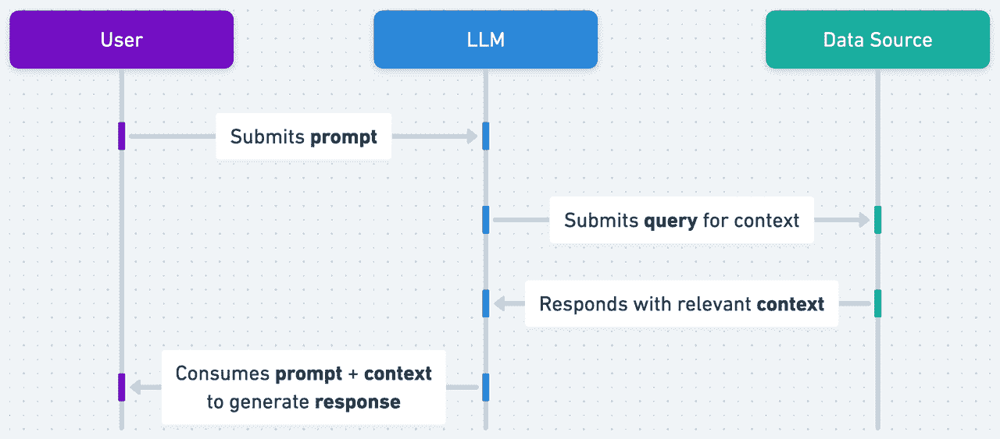

用户给一个提示，大模型将提示作为查询向数据库查出相关上下文（like docs），结合提示作为`LLM`的输入，最后`LLM` 输出response

RAG 某种程度上也属于语义搜索的延伸。如下是openai对语义搜索的解释，实际上就是通过关键字查询最相关的上下文，目前主流`datasource` 包括向量数据库，文档管理系统和常规关系型数据库

`https://help.openai.com/en/articles/8868588-retrieval-augmented-generation-rag-and-semantic-search-for-gpts`

注意目前RAG的工作主要是后模型训练的场景，也就是模型已经训练完毕，被用于推理和应用二次开发的时候，RAG的主要优点在干。可以提供训练数据之外的上下文作为信息源，并月可以及时异步更新数据到`data source`

### RAG 技术的过去和现在

#### Naive RAG->advanced RAG->modular RAG

RAG 目前经历了Naive RAG，正处在advanced RAG，在向modular RAG过渡。如下是naive RAG的基本流程，可见关键流程是`indexing`和`retrieval`，以及`combine`

数据以某种粒度，比如`doc`、`chunk`的方式放在`data source`中，`indexing` 即从中进行相关度搜索获得`chunks`、`docs`

对搜索得到的`chunks` 基于相似性进行`topK`排序，即`retrieval`

将提示与按`retrieval` 获得`chunks` 排序组合，即`combine`

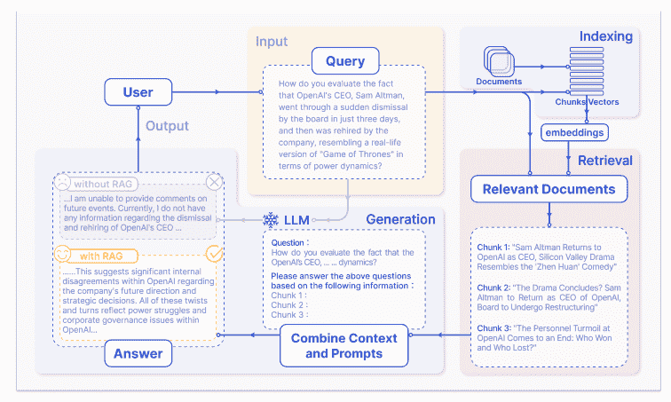

RAG的本义是通过语义搜索获得与提示最相关的上下文作为额外知识给到`LLM`，以处理`LLM`现有知识不足的情况。但是naive RAG的问题也很明显：

1. 检索精度（`doc`，or `chunk`）

1. 当从多个来源检索类似信息时，该过程也可能遇到冗余，导致重复响应

1. 确定不同段落的意义和相关性，并确保风格和音调的一致性

1. 面对复杂的问题，基于原始查询的单一检索可能不足以获取足够的上下文信息

1. 有可能生成与检索到的上下文无关的输出，或者输出不连贯

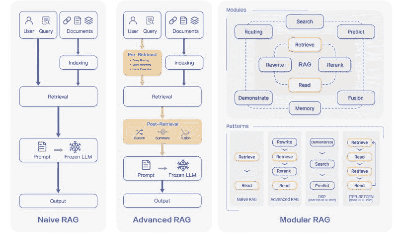

为了克服上述问题，最近业界采用的主要是advanced RAG，包括`pre-retrieval`和`post-retrieval`，提高检索的质量

**pre-retrieval**

前检索主要关注的是优化索引结构和原始查询。优化索引的目标是提高被索引内容的质量。这涉及到以下策略：增强数据粒度、优化索引结构、添加元数据、对齐优化和混合检索。而查询优化的目标是使用户的原始问题更清晰，更适合检索任务。常见的方法包括查询重写、查询转换、查询扩展和其他技术

**post-retrieval**

检索到相关上下文后，将其与查询有效集成至关重要。后检索过程中的主要方法包括`rerank chunk`和`contextcompression`。`rerank chunk`将最相关的内容重新定位到提示附近，这已在`Llamalndex2`、`LangChain3`和`HayStack`等框架中实现。将所有相关文档直接输入`LLM`可能会导致信息过载，不相关的内容可能会淡化对关键细节的关注。为了缓解这种情况，检索后的工作集中在选择必要信息，强调关键的部分，缩短要处理的上下文。Modular RAG则是一种更综合使用各种优化技术的框架，也是目前的趋势，但当前主流还是使用类似advanced RAG的架构，比如`rerank` 在许多相关公司已经得到了比较广泛的应用

#### RAG优化技术

RAG 目前优化技术已经比较全面，包括：

1. `Data source` 选择并根据其数据结构进行索引的构建（`indexing`）

`Data source`的数据结构本身是可能多样的，比如文本、pdf、excel，也可能是website，数据库，website，code，单一`data source`类型往往一致，具体查询 附录-数据源；单一应用也可能使用多个`data source`，需要应用综合处理；根据不同的数据结构，为了避免检索时信息的缺失，需要定制化的索引策略，包括确定检索粒度，具体请看附录检索粒度与 索引优化

1. 查询的优化，对查询进行补充、扩展、拆解、转换

用户的查询可能存在信息不明确或者信息过于简单的情况，需要对其进行意图理解，并补充必要的信息到查询中（查询扩展）甚至重写，必要的情况下，为了检索更深入的信息需要拆分成多个子查询进行检索，如果涉及多个RAG 系统，需要路由到多个路径。具体参看附录-查询优化

1. 检索的优化，比如选择合适的`embedding`策略

检索的本质是比较查询和`chunk`的相似性，相似性依赖`embedding`实现，`embedding`的方式有多种；另外可以选择多种`embedding` 配合的方式；具体参考附录-embedding & mix retrieval

1. **对检索的结果进行过滤，包括**`rerank`**、context compression**

检索后的结果，可能存在信息冗余或者相关性不足的问题，因此需要提高`rerank` 将相关性较高的排在前面，通过压缩和裁剪信息使信息长度适合传递给模型，也可能将格式转换为适合`LLM`的形式；具体参考附录-`contextcuration`

1. 流程优化，比如迭代检索、递归检索等等

单步检索的准确性和信息完整度可能不足，因此可以通过多步查询的方式进行信息深度和广度的挖掘；具体参考附录-RAG的过程增强

1. **与微调结合的策略优化**

RAG 与 微调结合使用已经成为一种可能的做法。例如利用`LLM` 的结果作为检索器的一种微调信号

## RAG VS 长文

RAG和长文的争论已久，但是从我们现在调研的结果看，二者可能依|存在长期共存的可能性，具体选择什么样的策略取决于具体的场景。我们在下面列举一些优劣势的比较：

1. **成本：**RAG的成本总体比较低，一方面体现在向量数据库等存储成本上，目前大部分反馈相对推理训练计算成本不高，另一方面体现在检索成本上，目前表示尚可；长文的成本体现在随着序列增加，推理的成本增加比较剧烈（目前尚未达到完全线性增长的水平），但是随着推理技术的发展，有望下降

# RAG 与长文本微调对比

## 知识更新的方便程度

RAG只需要更新向量数据库，无须额外的训练；长文需要持续训练/微调

## 准确率

长文虽然可以支持足够上下文长度，但是知识过于泛化，通用能力强，准确率较高，但是目前垂类落地实用的准确率可能还不够；RAG通过外部专用的垂直知识库可以提高回答命中准确率

## 定制化

不同的场景会遇到不同类型的数据结构，超过了大模型预训练的知识范畴，导致无法完备地抓取输入的信息，需要根据输入数据进行适配，RAG 可以允许不具备预训练能力的公司完成功能场景的定制化

# RAG & Finetune

RAG 和微调本身并不冲突，是可以结合使用的，从示意图中可知，甚至我们提到某些 RAG 上的优化技术就是依赖微调的

总体而言，RAG 正在和 agent workflow、微调进行更加深入的融合

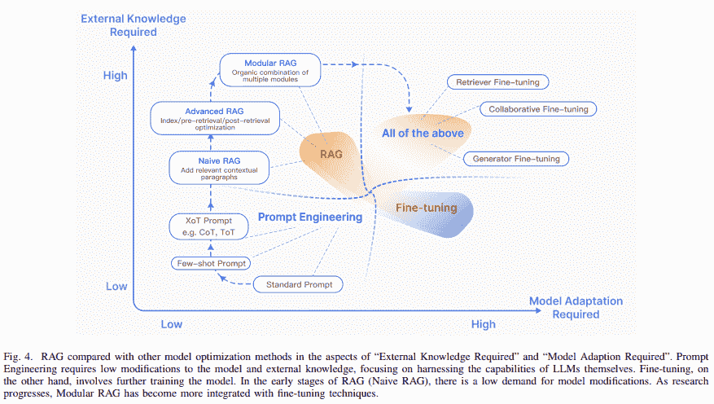

## RAG 和微调的场景比较

+ **知识更新：**RAG 通过更新数据库来更新知识，微调则是通过重新训练来吸收新知识

+ **效果稳定性：**RAG 通常在生成回答时更稳定，而微调可能达到更高的性能上限

+ **资源消耗：**微调在训练时消耗资源较多，RAG 在推理时增加额外的检索成本

## RAG+微调

RAG 和微调各自有优势，在某些场景下结合使用可以发挥各自的长处，提高整体的效果和效率

1. **复杂且知识密集的任务：**对于需要深入领域知识和广泛背景信息的问题，单独使用 RAG 可能无法覆盖所有细节，而微调可以帮助模型更好地理解这些细节

1. **数据更新频繁的场景：**在数据经常变化的情况下，使用 RAG 可以快速更新知识库，而微调可以帮助模型适应新的数据分布

1. **对实时性要求高的场景：**如果单独使用 RAG，检索步骤可能会增加延迟。通过微调优化模型，可以减少对检索系统的依赖，提高响应速度

1. **资源受限的场景：**在资源有限的情况下，可以先使用 RAG 来减少需要微调的数据量，然后对关键或难以检索的信息进行微调

> RAG 和微调相有如下的集中结合方式：

+ **分阶段训练**

> **初步使用 RAG：**首先使用 RAG 来处理任务，利用其检索能力快速获取相关信息

> **识别不足：**分析 RAG 在处理任务时的不足，识别模型难以处理或经常出错的情况

> **针对性微调：**对识别出的问题进行数据收集，然后使用这些数据对模型进行微调，以改进模型在这些特定情况下的表现

+ **联合训练**

> **同时训练检索和生成：**在微调过程中，可以同时训练检索组件和语言模型，使得两者能够更好地协同工作

> **使用伪标签：**可以使用生成模型生成的伪标签来训练检索组件，反之亦然

+ **迭代优化**

> **循环迭代：**先使用 RAG 生成回答，然后使用这些回答进行微调，接着用微调后的模型来优化检索组件，形成一个迭代优化的闭环

+ **领域适应**

> **先微调后 RAG：**对于领域适应性要求高的场景，可以先对模型进行微调以适应特定领域，然后使用 RAG 来补充微调未覆盖的知识

# 一些典型的应用 case

目前我们发现，RAG 的主要应用场景以两类为典型，搜索和企业服务

## AI 搜索

### AI 搜索包括两大类：

1. **垂类细分的领域搜索**

比如 `devv.ai` 的开发者搜索引擎，其 RAG 方案成立是由于垂类的数据结构复杂（pdf，website, code）大模型处理能力不足，且 RAG 知识库大小有限

1. **通用领域的搜索**

比如 perlexity 和秘塔科技，但是个人使用观感，不觉得能力比国内头部大模型强，公域 AI 搜索概念可能相比大模型/传统搜索没有直接的技术护城河。公共搜索最大的问题在于数据，包括存储和检索成本，RAG 模式简单，传统大搜索引擎转型会比较方便，RAG 所需要的基础技术搜索架构是相似的，所以迁移比较容易，而创业公司无法直接负担这种存储和检索成本，存在数据劣势，而处理依赖大模型，也没有优势，可能会生存艰难

## 企业服务

+ 企业服务是典型的私域数据场景，私域数据有实时的数据更新，天然适合 RAG 参与

+ 比如智能客服、企业知识库等等，其处理的数据均为企业内部私域数据，数据类型复杂，无力承担大量训练成本

# 关于商业化落地的思考

### RAG 是有前途的！普通 RAG 只是开始

1. 第一代：早期产品存在于对于一些 pdf 文档的的问答总结：`Chatpdf` 这类产品

+ PDF 比较长，召回率比较低，搜索知识点没有召回来

+ 减少资源，并不是全文进行检索，有可能只是读了其中一个部分，如摘要里面再去提取

1. 第二代：后面开始演变为 RAG+Agent 一些封装，比如 `OAI` 的 `GPTS`，字节的 `Coze`，用户可以上传自己的资料，构建自己的知识库，回答问题，整个 workflow 是需要 agent 来做，商业模式是一个平台化产品

### 需要解决哪些痛点？

1. **减少幻觉，追求准确的结果**

很多大模型训完以后结果它是有比较高随机性，准确度其实很一般。实践发现，进一步讲，在 RAG 工程化上，即便是用 `GPT4` 基座接入 RAG，他的准确率也难以产品化满意；所以大部分的企业，其实不太能直接应用；还有采用主流开发工具基础上简单的 RAG 调用，依旧面临返回不够理想的情况：

因此 RAG 落地首先要针对它的垂直场景和数据去做工程化（这一点后面展开）

+ 如智能客服：20%-80% 准确率的提升，原来可能十个问题，八个转人工。可以做到十个里面只做两个转人工

1. 不规则数据的有序处理并训练

**数据难点：文档种类多**

比较基本的数据：有 doc、ppt、excel、pdf，pdf 也有扫描版和文字版。ppt 难点在于，如何对 PPT 中大量的流程图，架构图进行提取。如果光提取文字，大量潜藏图片的信息就完全丢失了。于是这里只能先将 PPT 转换成 PDF 形式，然后用上述处理 PDF 的方式来进行解析。但大量的文档使用了图文混排的形式，仅仅是能够识别出这一块是一幅图片，对于图片，直接转换成向量，不利于后续的检索

垂直类别数据，如问答对（企业问答）

数据难点：不同文档，需要不同的切片方式

数据以某种粒度，比如 doc、`chunk` 的方式放在 `data source` 中，`indexing` 即从中进行相关度搜索获得 `chunks`、`docs`；

如果切片太大，查询精准度会低

一段完整的话可能被切成好几块，每一段文本包含的语义信息实际上也是不够完整的

一些鸡肋切片，其实可以删掉

数据难点：数据库数据过多带来的干扰

如，有道升学问答产品发布的技术文档，分批往 RAG 知识库中灌入数据，每加一批数据都做一次评测，观察随着数据量变大，问答效果的变化情况：

`baseline`：第一批数据加入后问答正确率有 42.6%，此时有一些问题没回答上来是因为确实缺少相关资料

**迎来上涨：**第二批加了更多数据，覆盖知识范围更广。准确率提升到了 60.2%，提升非常明显，看来加数据确实还是挺有用的

**坏消息：**当加入第三批数据的时候，最担心的事情还是发生了。正确率急剧下降，跌了将近 8 个百分点

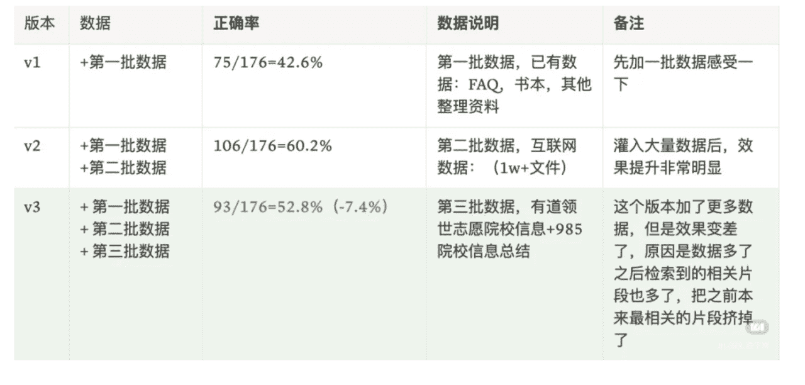

不是所有的 RAG 系统都能保证：数据越多，效果越好。随着数据的增多，数据之间可能会有相互干扰，导致检索退化的问题，影响问答的质量

**这个现象在最近的一篇论文：**Paper: The Power of Noise: Redefining Retrieval for RAG System（`arxiv:2401.14887v2`） 对于 RAG 系统，如果喂给大模型的输入是相近容易混淆的话，对正确性的影响是最大的

**用户提问的随意性**

大部分用户在提问时，写下的 `query` 是较为模糊笼统的，其实际的意图埋藏在了心里，而没有完整体现在 `query` 中。使得检索出来的文本段落并不能完全命中用户想要的内容，大模型根据这些文本段落也不能输出合适的答案

### 工程化的问题是重点，要考虑与成本之间的平衡

1. 模型底座的选择是需要和成本/效果平衡的：特别是 `tob`，不同公司接到的数据源是差异的，搜索的逻辑不一样，数据结构也不一样，搜索的目标也不一样——因此需要场景对按场景让数据源去搭建基座模型；不能选单一的 `gpt4`，因为一次 `query` 访问可能会几十次，成本太高；因此需要定制化基座，一般需要搭建一个混合模型基座（如 `GPT4`，，针对垂直任务场景的 `query` 类型，数据类型，返回目标类型调用

1. **数据处理是重要的工程环节：**从程序的数据的预处理，到数据结构的治理，再加上后端的整个检索生成，做的好的还要附带数据抓取。从数据源到抓取成一个数据库，已经开始产生信息损失了。然后检索还有信息损失，生产还有信息损失，这几个叠程序就是几乎不可用

1. RAG 和 workflow 在产品里面的大概的比重？多数认为：workflow 的占比更大一些，因为这一部分更加通用

# RAG 的未来趋势与预测

**我们对 RAG 进行两方面的预测：**

1. **一方面是探讨技术的走向**

1. **另一方面讨论应用的场景**

## 技术趋势

+ RAG 与微调（后训练）结合更多，并与 workflow 协同演进

+ 支持更多元的数据类型

+ 长期看 RAG 本身是基于大模型无法在长文、准确率和成本上无法达到一个好的市场预期为前提，中短期无法彻底被长文取代

## 应用趋势

主要集中在垂直领域落地，应用公司与模型公司差异化竞争（私域数据，专用数据结构），通用领域落地主要来自于传统厂商转型（抖音，百度，阿里，Google 等），传统厂商有大数据的存量优势，短期创业公司难以超越

长期上去讲，我们认为 RAG 是以后重要的技术手段，不同的主体参与程度不同，但是一定会用到 RAG，作为外部知识、数据的获取手段，可能我们不需要自己搭 RAG，但是我们会调用三方提供的 RAG 服务（比如搜索引擎、数据库等等）。RAG 可能以后有专门的技术提供商，类似今天的 `hadoop`，`mysal`，`postsql` 这些数据库产品

而 agent 与更加广义的 RAG 可能产生更深层次的结合，如我们讲到的 RAG 的多轮查询、扩展查询、路由等等本身是 agent 的设计，但是也为 RAG 服务。RAG 本身代表检索能力，检索的主体是模型、agent，检索的客体可以是远端的搜索引擎，本端的数据库等等。如下是一种多 agent 和多 rag 组合的模式，也是现有存在的。

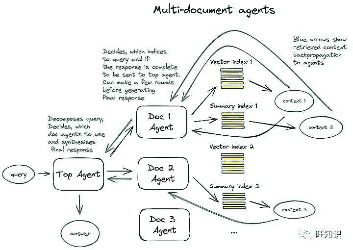

# 几个开放性的问题

1. 未来大模型的训练是否会加入 RAG？

1. **RAG 的终局会是 agent 吗？**

1. **大模型可能自己学会 RAG 么**

# 具体的 RAG 优化技术

## 数据源

+ `RAG` 需要查询外部的知识数据库（`data source`），所以 `data source` 的数据结构是一个基本问题

`Data source` 的数据结构包括以下几种：

1. 非结构数据，最常见的是文本（`text`）类型，比如 `wikipedia`，除了百科全书式的数据外，常见的非结构化数据还包括跨语言文本和特定领域的数据

1. 结构化数据，如 `knowledge-graph`（`KG`），已通过验证，可以提供更精确的信息。`KnowledGPT` 生成 `KB` 搜索查询，并将知识存储在个性化的库中，增强了 RAG 模型的知识丰富度。针对 `LLM` 在理解和回答有关文本图的问题方面的局限性，`G-Retriever` 集成了图神经网络、`LLM` 和 `RAG`，通过 `LLM` 的软提示增强了图的理解和问答能力，并将 `Prize Collective Steiner Tree`（`PCST`）优化问题用于有针对性的图检索。相反，它需要额外的努力来构建、验证和维护结构化数据库

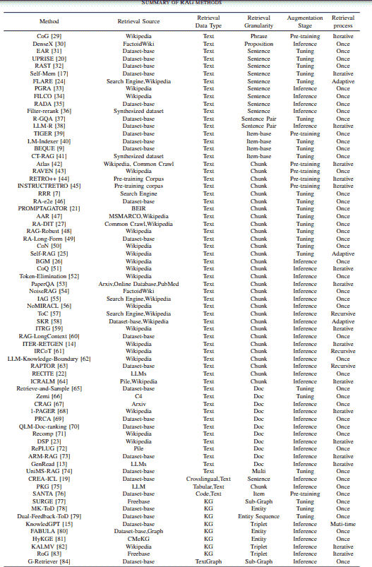

## 检索粒度

理论上，粗粒度检索单元可以为问题提供更多相关信息，但它们也可能包含冗余内容，这可能会分散检索器和语言模型在下游任务中的注意力。另一方面，细粒度的检索单元粒度增加了检索的负担，不能保证语义的完整性和所需知识的满足。在推理过程中选择适当的检索粒度是提高密集检索器的检索和下游任务性能的一种简单有效的策略

在文本中，检索粒度从细到粗不等，包括标记、短语、句子、命题、块、文档。其中，`DenseX` 提出了以命题为检索单元的概念。命题被定义为文本中的原子表达式，每个命题都封装了一个独特的事实片段，并以简洁、自包含的自然语言格式呈现。这种方法旨在提高检索精度和相关性

在知识图上，检索粒度包括实体、三元组和子图

## 索引优化

在索引阶段，文档将被处理、分割并转换为 `embedding`，存储在向量数据库中。索引构建的质量决定了能否在检索阶段获得正确的上下文

+ `Chunk` 策略：最常见的方法是在固定数量的 `token`（例如，100、256、512）上将文档分割成 `chunk`。较大的 `chunk` 可以捕获更多的上下文，但它们也会产生更多的噪声，需要更长的处理时间和更高的成本。虽然较小的 `chunk` 可能无法完全传达必要的上下文，但它们确实具有较少的噪声。然而，`chunk` 会导致句子中的截断，导致了递归拆分和滑动窗口等优化方法的出现，通过在多个检索过程中合并全局相关信息来实现分层检索。然而，这些方法仍然无法在语义完整性和上下文长度之间取得平衡

+ 附加元数据：可以用元数据信息丰富 `chunk`，如页码、文件名、作者、类别时间戳。随后，可以基于该元数据过滤检索，从而限制检索的范围。在检索过程中为文档时间戳分配不同的权重可以实现时间感知 RAG，确保知识的新鲜性，避免过时的信息。除了从原始文档中提取元数据外，还可以人工构建元数据。例如，添加段落摘要，以及引入假设性问题。这种方法也被称为反向 `HyDE`。具体来说，使用 `LLM` 生成可以回答的问题，然后在检索过程中计算原始问题和假设问题之间的相似性，以减少问题和答案之间的语义差距

+ 结构索引：增强信息检索的一种有效方法是为文档建立层次结构。通过在结构上的构建，RAG 系统可以加快相关数据的检索和处理

+ 分层索引结构：文件按父子关系排列，`chunk` 链接到它们。数据摘要存储在每个节点，有助于数据的快速遍历，并有助于 RAG 系统确定要提取的 `chunk`。这种方法还可以减轻由 `chunk` 提取问题引起的错觉

+ 知识图谱索引：利用 `KG` 构建文档的层次结构有助于保持一致性。它描绘了不同概念和实体之间的联系，显著减少了产生幻觉的可能性。另一个优点是将信息检索过程转换为 `LLM` 可以理解的指令，从而提高知识检索的准确性，并使 `LLM` 能够生成上下文一致的响应，从而提高 RAG 系统的整体效率。为了捕捉文档内容和结构之间的逻辑关系，`KGP` 提出了一种使用 `KG` 在多个文档之间建立索引的方法。该 `KG` 由节点（表示文档中的段落或结构，如页面和表格）和边（表示文档结构中段落或关系之间的语义/词汇相似性）组成，有效地解决了多文档环境中的知识检索和推理问题

## 查询优化

`Naive RAG` 的主要挑战之一是它直接依赖用户的原始查询作为检索的基础。制定一个精确而清晰的问题是困难的，轻率的查询会导致检索效率低下。有时，问题本身很复杂，语言也没有很好的组织。另一个困难在于语言的复杂性和歧义性。语言模型在处理具有多种含义的专业词汇或歧义缩写时往往会遇到困难。例如，他们可能无法辨别 `LLM` 指的是大型语言模型还是法律背景下的法学硕士

## 查询扩展

1. 多查询。通过使用提示工程在 `LLM` 下扩展查询，这些查询可以并行执行。查询的扩展不是随机的，而是经过精心设计的。

1. 子查询。子问题规划的过程代表了必要的子问题的生成，以在组合时将原始问题情境化并完全回答。原则上，添加相关上下文的过程类似于查询扩展。具体来说，使用最少到最多提示的方法，可以将复杂的问题分解为一系列更简单的子问题。

1. 验证链（`CoVe`）。扩展后的查询经过 `LLM` 验证，达到减少幻觉的效果。经过验证的扩展查询通常表现出更高的可靠性。

## 查询转换

核心概念是基于转换后的查询而不是用户的原始查询来检索块

1. 查询重写。对于 `LLM` 检索，原始查询并不总是最优的，尤其是在真实世界的场景中。因此，我们可以提示 `LLM` 重写查询。除了使用 `LLM` 进行查询重写外，还专门使用较小的语言模型，如 `RRR`（重写-检索-读取）。在淘宝上实施查询重写方法，即 `BEQUE`，显著提高了长尾查询的召回效率，导致 `GMV` 上升

1. 生成查询。使用提示工程，让 `LLM` 在原始查询的基础上生成查询，用于后续检索。`HyDE` 构建假设文档（假设原始查询的答案）。它专注于从答案到答案的嵌入相似性，而不是为问题或查询寻求嵌入相似性。使用后退提示方法，对原始查询进行抽象，生成一个高级概念问题（后退问题）。在 RAG 系统中使用问题和原始查询进行检索，并将这两个结果作为生成语言模型答案的基础

## 查询路由

基于不同的查询，路由到不同的 RAG 管道，适用于设计用于适应不同场景的通用 RAG 系统

1. 元数据路由器/筛选器。第一步包括从查询中提取关键词（实体），然后根据块中的关键词和元数据进行过滤，以缩小搜索范围

1. 语义路由器。涉及利用查询的语义信息。具体方法见语义路由器。当然，也可以采用混合路由方法，将基于语义和元数据的方法相结合，以增强查询路由

## Embedding

在 RAG 中，检索是通过计算问题和文档 `chunk` 的 `embedding` 之间的相似性（例如余弦相似性）来实现的，其中 `embedding` 模型的语义表示能力起着关键作用。这主要包括稀疏编码器（`BM25`）和密集检索器（`BERT` 架构预训练语言模型）。最近的研究引入了显著嵌入模型，如 `AngIE`、`Voyage`、`BGE` 等，这些模型受益于多任务指令调整。`Hugging Face` 的 `MTEB` 排行榜评估了 8 项任务中的嵌入模型，涵盖 58 个数据测试。此外，`C-MTEB` 专注于中国能力，涵盖 6 项任务和 35 个数据集

## Mix retrieval

稀疏和密集 `embedding` 方法捕获不同的相关性特征，并可以通过利用互补的相关性信息相互受益。例如，稀疏检索模型可以用于提供用于训练密集检索模型的初始搜索结果。此外，预训练语言模型（`PLM`）可以用于学习术语权重，以增强稀疏检索。具体来说，它还证明了稀疏检索模型可以增强密集检索模型的零样本检索能力，并帮助密集检索器处理包含稀有实体的查询，从而提高鲁棒性

# Fine-tuning embedding model

在上下文明显偏离预训练语料库的情况下，特别是在高度专业化的学科中，如医疗保健、法律实践和其他充满专有术语的行业，在您自己的领域数据集上微调嵌入模型对于缓解这种差异至关重要。除了补充领域知识外，微调的另一个目的是对齐检索器和生成器，例如，使用LLM的结果作为微调的监督信号，称为`LSR`（LM监督检索器）

`PROMPTAGATOR`利用LLM作为少量查询生成器来创建特定任务的检索器，解决监督微调中的挑战，特别是在数据稀缺的领域。另一种方法`LLM Embedder`利用LLM在多个下游任务中生成奖励信号。检索器使用两种类型的监督信号进行微调：数据集的硬标签和LLM的软奖励。这种双信号方法促进了更有效的微调过程，使嵌入模型适应不同的下游应用

## Adapter

微调模型可能会带来挑战，例如通过`API`集成功能或解决由有限的本地计算资源引起的限制。因此，一些方法选择结合外部适配器来帮助对齐。为了优化LLM的多任务功能，`UPRISE`训练了一种轻量级提示检索器，该检索器可以自动从预先构建的提示池中检索提示，该提示池适用于给定的零样本任务输入。`AAR`（Augmentation Adapted Retriver）引入了一种通用适配器，旨在适应多个下游任务。而`PRCA`添加了一个可插入的奖励驱动上下文适配器，以提高特定任务的性能。`BGM`使检索器和LLM保持固定，并在两者之间训练桥接`Seq2Seq`模型。桥接模型旨在将检索到的信息转换为LLM可以有效使用的格式，使其不仅可以重新排列，还可以为每个查询动态选择段落，并可能使用更高级的策略，如重复。此外，`PKG`引入了一种创新方法，通过指令微调将知识集成到白盒模型中。在这种方法中，直接替换检索器模块来根据查询生成相关文档。这种方法有助于解决微调过程中遇到的困难，并提高模型性能

## context curation

冗余信息可能会干扰LLM的最终生成，而过长的上下文也可能导致LLM出现“中间丢失”问题。和人类一样，LLM倾向于只关注长文本的开头和结尾，而忘记中间部分。因此，在RAG系统中，我们通常需要进一步处理检索到的内容。

### 重新排序

重新排序从根本上重新排序文档块，以首先突出最相关的结果，有效地减少了整个文档池，既是增强器又是过滤器，为更精确的语言模型处理提供精细的输入。可以使用基于规则的方法来执行重新排序，这些方法依赖于预定义的度量，如多样性、相关性和`MRR`。或者基于模型的方法，如`BERT`系列的编码器-解码器模型（例如，`SpanBERT`），专门的重新排序模型，如相干重新排序或`bge-raranker-large`，以及通用大型语言模型，如`GPT`。

### 上下文选择/压缩

RAG过程中的一个常见误解是认为检索尽可能多的相关文档并将它们连接起来以形成冗长的检索提示是有益的。然而，过多的上下文会引入更多的噪声，削弱LLM对关键信息的感知

LLM利用小语言模型（`SLM`），如`GPT-2 small`或`LLaMA-7B`，来检测和删除不重要的`token`，将其转化为一种对人类来说很难理解但LLM很好理解的形式。这种方法提供了一种直接实用的即时压缩方法，消除了对LLM的额外训练，同时平衡了语言完整性和压缩率。`PRCA`通过训练一个信息提取器来解决这个问

除了压缩上下文之外，减少文档数量也有助于提高模型答案的准确性。马等人提出了“过滤器重新排序”范式，该范式结合了LLM和`SLM`的优势。在这个范例中，`SLM`充当过滤器，而LLM充当重新排序代理。研究表明，指示LLM重新排列`SLM`识别的具有挑战性的样本可以显著改进各种信息提取（`IE`）任务。另一种直接有效的方法是让LLM在生成最终答案之前评估检索到的内容。这允许LLM通过LLM评论过滤出相关性较差的文档。例如，在`Chatlaw`中，LLM会被提示对所引用的法律条款进行自我建议，以评估其相关性

## RAG的过程增强

在RAG领域，标准实践通常涉及单一的（一次）检索步骤，然后生成，这可能导致效率低下，有时通常不足以解决需要多步骤推理的复杂问题，因为它提供的信息范围有限

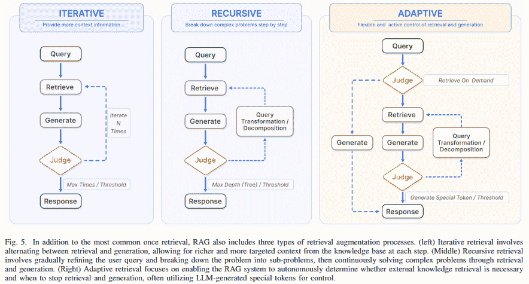

目前存在三种增强方式：

### Iterative Retrieval

比较naive，通过将上一次生成的内容作为`query` 丢入循环进一步检索和生成，直到达到迭代次数或者生成结果达到阈值要求

### Recursive Retrieval

递归检索经常用于信息检索和NLP，以提高搜索结果的深度和相关性。该过程包括基于从先前搜索中获得的结果迭代地细化搜索查询。递归检索旨在通过反馈循环逐渐汇聚到最相关的信息，从而增强搜索体验.

`IRCoT`使用思维链来指导检索过程，并根据获得的检索结果对`CoT`进行细化。`ToC`（tree of clarify）创建一个澄清树，系统地优化查询中不明确的部分。它在复杂的搜索场景中尤其有用，在这些场景中，用户的需求从一开始就不完全清楚，或者所寻求的信息非常专业或微妙。该过程的递归性质允许不断学习和适应用户的需求，通常会提高对搜索结果的满意度。

### Adaptive Retrieval

以`Flare`和`Self-RAG`为例的自适应检索方法通过使LLM能够主动确定检索的最佳时刻和内容来完善RAG框架，从而提高信息来源的效率和相关性。这些方法是LLM在其操作中使用主动判断的更广泛趋势的一部分，如在`AutoGPT`、`Toolformer`和`GraphToolformer`等模型代理中所见。例如，`Graph Toolformer`将其检索过程分为不同的步骤，LLM主动使用检索器，应用`Self Ask`技术，并使用少量提示来启动搜索查询。这种主动的立场允许LLM决定何时搜索必要的信息，类似于代理如何使用工具。

`WebGPT`集成了一个强化学习框架，在文本生成过程中自主使用搜索引擎来训练`GPT-3`模型。它使用特殊的标记来导航这个过程，这些标记有助于诸如搜索引擎查询、浏览结果和引用引用之类的操作，从而通过使用外部搜索引擎扩展`GPT-3`的功能
