# 从零开始搞懂AI Agent

> 来源：[https://qqs7y1hozd1.feishu.cn/docx/NUNcdybIJoZGPOxGQ1jc3wN7n2y](https://qqs7y1hozd1.feishu.cn/docx/NUNcdybIJoZGPOxGQ1jc3wN7n2y)

## 1.**AI Agent是什么？**

<https://player.bilibili.com/player.html?bvid=1aaxyz8ELY&share_source=copy_web&vd_source=a702789e17302e9bbf7af05b4e38e57c>

> AI Agent（也称人工智能代理）是一种能够感知环境、进行决策和执行动作的智能实体。智能体像人一样，它有记忆、有逻辑分析能力、有任务的拆解能力、问题的拆解能力和最后综合回来统一解决问题的能力。

> **AI Agent**也可以称为“智能体”，也可理解为“智能业务助理”，旨在大模型技术驱动下，让人们以自然语言为交互方式高自动化地执行和处理专业或繁复的工作任务，从而极大程度释放人员精力。

> **Agent **其实基本就等于 "大模型 + 插件 + 执行流程 / 思维链"，分别会对应控制端 (Brain / 大脑)、感知端 (Preception)、执行端 (Action) 环节。

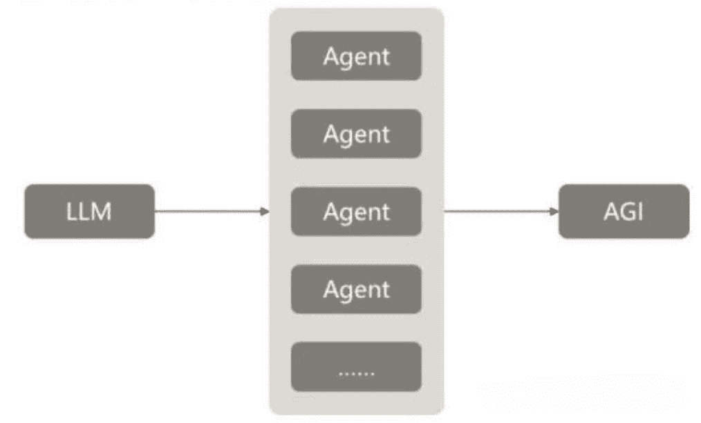

## 2.Agent的构建

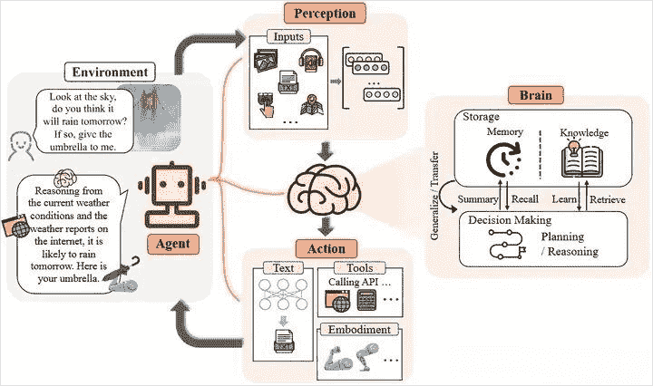

> 一个基于大模型的** ****AI Agent 系统**可以拆分为大模型、规划、记忆与工具使用四个组件部分。

> AI Agent 可能会成为新时代的开端，其基础架构可以简单划分为 Agent = LLM + 规划技能 + 记忆 + 工具使用， LLM 扮演了 Agent 的“大脑”，在系统中提供推理、规划等能力。

### 2.1 大脑模块

> 大脑主要由一个大型语言模型组成，不仅存储知识和记忆，还承担着信息处理和决策等功能，并可以呈现推理和规划的过程，能很好地应对未知任务。

> **运行机制：**为确保有效交流，自然语言交互能力 至关重要。在接收感知模块处理的信息后，大脑模块首先转向存储，在知识中检索 并从记忆中回忆 。

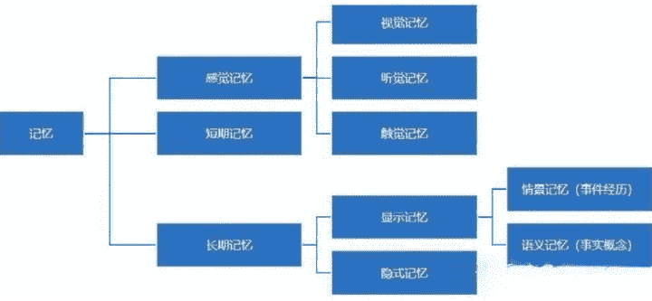

**自然语言交互**

> 作为一种交流媒介，语言包含着丰富的信息。除了直观表达的内容，背后还可能隐藏着说话者的信念、愿望和意图。

> 由于 LLM 本身具有强大的自然语言理解和生成能力，Agent不仅可以熟练地使用多种语言进行基本的交互式对话，还能有深入理解能力，使人类能够轻松地理解Agent并互动。

**多轮交互对话**

> 多轮对话能力是有效和一致交流的基础。作为大脑模块的核心，LLM能够理解自然语言并生成连贯且与上下文相关的回复，从而帮助Agent更好地理解和处理各种问题。然而，即使是人类也很难在一次交流中不出现混乱，因此需要多轮对话。

> **与 SQuAD 等传统的纯文本阅读**理解任务相比，多轮对话具有以下几个特点：

1.  具有交互性，涉及多个说话者，缺乏连续性；

1.  可能涉及多个话题，对话信息也可能是冗余的，使得文本结构更加复杂。

一般来说，多轮对话主要分为三个步骤：

> (1) 了解自然语言对话的历史；

> (2) 决定采取什么行动；

> (3) 生成自然语言回应。

LLM-based Agent能够利用现有信息不断完善输出，进行多轮对话并有效实现最终目标。

> **高质量的自然语言生成：**最新的 LLM 展示了卓越的自然语言生成能力，可持续生成多种语言的高质量文本。

+   **这**些语言模型可以“适应调节文本的风格和内容”，而像ChatGPT这样的模型在语法错误检测方面表现出色，凸显了其强大的语言能力。

> **意图和含义理解：**尽管在大规模语料库中训练出来的模型已经具有足够的智能来理解指令，但它们中的大多数仍无法模拟人类对话或充分利用语言所传达的信息。

要想与其他智能机器人进行有效的交流与合作，理解其隐含的意思至关重要，并使人们能够解释他人的反馈。

+   LLMs 的出现凸显了基础模型在理解人类意图方面的潜力，但当涉及到模糊指令或其他含义时，就会给Agent带来巨大挑战。

**知识**

在大规模数据集上训练的语言模型可以将各种知识编码到其参数中，并对各种类型的查询做出正确的反应。

所有这些知识可大致分为以下几类：

+   **语言知识：**语言知识表现为一个约束系统，即语法，定义了语言的所有和句子。

+   **常识知识：**常识性知识指的是大多数人在幼年时就已掌握的世界常识。

+   **专业领域知识：**专业领域知识是指与特定领域相关的知识。

**记忆**

**在**本文的框架中，“记忆”存储了Agent过去的观察、思考和行动序列，这与 Nuxoll 等人提出的定义类似。

> 在面对复杂问题时，记忆机制能帮助行为主体有效地重新审视和应用先前的策略。此外，这些记忆机制还能使个体借鉴过去的经验，适应陌生的环境。

随着LLM-based Agent互动周期的扩大，出现了两个主要挑战。

+   第一个挑战与历史记录的长度有关。LLM-based Agent以自然语言格式处理先前的交互，并将历史记录附加到每个后续输入中。

+   第二个挑战是提取相关记忆的难度。当Agent积累了大量的历史观察和行动序列时，它们就会面临不断升级的记忆负担。

**提高记忆能力的方法**

下面介绍几种增强LLM-based Agent记忆能力的方法。

+   提高Trransformer的输入长度限制：第一种方法试图解决或减轻固有的序列长度限制。由于这些固有限制，Transformer架构很难处理长序列。

+   **总结记忆：**提高记忆效率的第二种策略取决于记忆总结的概念。这能确保Agent毫不费力地从历史互动中提取关键细节。

+   **用向量或数据结构压缩记忆：**通过采用合适的数据结构，智能Agent可提高记忆检索效率，促进对交互做出迅速反应。

**记忆检索方法**

当Agent与其环境或用户交互时，必须从其内存中检索最合适的内容。这可确保Agent访问相关的准确信息，以执行特定操作。

> **这就产生了一个重要问题：**Agent如何选择最合适的存储器？通常情况下，Agent要求存储器具有自动检索记忆的能力。

自**动检索的一个重要方法是考****虑****三个指标： 最近性（Rece**n**cy）、相关性（Relevan**ce）和重要性（Importance）。

记忆得分由这些指标加权组合而成，得分最高的记忆在模型的上下文中被优先考虑。

**推理和规划**

**推理（Reasoning）：**推理以证据和逻辑为基础，是人类智力活动的根本，是解决问题、决策和批判性分析的基石。演绎、归纳和归纳是智力活动中常见的主要推理形式。

**规划（Planning）：**规划是人类在面对复杂挑战时采用的一种关键策略。对人类来说，规划有助于组织思维、设定目标和确定实现这些目标的步骤。

+   **计划制定：**在制定计划的过程中，Agent通常会将总体任务分解成许多子任务，在这一阶段，人们提出了各种方法。

+   **计划反思：**制定计划后，必须对其优点进行反思和评估。LLM-based Agent可利用内部反馈机制（通常是从已有模型中汲取灵感）来完善和改进其战略和规划方法。

**可迁移性和通用性**

> **在大规模语料库上预先训练的模型可以学习通用语言表征。**利用预训练模型的强大功能，只需少量数据进行微调，LLMs 就能在下游任务中表现出卓越的性能。

**看不见的任务泛化：**LLMs 可以根据自己的理解，按照指令完成在训练阶段没有遇到过的新任务。

> **情境学习：**大量研究表明，LLM 可以通过上下文学习（ICL）完成各种复杂任务，上下文学习指的是模型从上下文中的几个例子中学习的能力。

> **持续学习：**最近的研究强调了 LLM 的规划能力在促进Agent持续学习方面的潜力，这涉及技能的持续获取和更新。

### 2.2 感知模块

> **感知模块的核心目的是将Agent的感知空间从纯文字领域扩展到包**括文字、听觉和视觉模式在内的多模态领域。

**文本输入**

> **LLM-based Agent已经具备了**通过文本输入和输出与人类交流的基本能力。在用户的文本输入中，除了明确的内容外，还隐藏着信念、愿望和意图。

**视觉输入**

> **视觉输入通常包含大量有关世界的信息，包括Agent周围环境中物**体的属性、空间关系、场景布局等。因此，将视觉信息与其他模式的数据整合在一起，可以为Agent提供更广泛的背景和更精确的理解，加深Agent对环境的感知。

**听觉输入**

> 一个非常直观的想法是，Agent可以将 LLMs 用作控制中心，以级联方式调用现有工具集或模型库来感知音频信息。

**其他输入**

> 如前所述，许多研究都对文本、视觉和音频的感知单元进行了研究。然而，LLM-based Agent可能会配备更丰富的感知模块。未来，它们可以像人类一样感知和理解现实世界中的各种模式。

### 2.3 行动模块

> 人类在感知环境后，大脑会对感知到的信息进行整合、分析和推理，并做出决策。随后，他们利用神经系统控制自己的身体，做出适应环境或创造性的行动，如交谈、躲避障碍或生火。

**文本输出**

> 基于Transformer的大型语言生成模型的兴起和发展，赋予了LLM-based Agent以固有的语言生成能力。它们生成的文本质量在流畅性、相关性、多样性和可控性等各个方面都出色。

**工具使用**

> 工具是工具使用者能力的延伸。在面对复杂任务时，人类会使用工具来简化任务的解决过程并提高效率，从而节省时间和资源。

**LLM-based Agent决策过程缺乏透明度，使其在**医疗保健和金融等高风险领域的可信度较低。

> LLM 容易受到对抗性攻击，**对轻微输入修改的鲁棒性不足。**相比之下，借助工具完成任务的Agent则表现出更强的可解释性和鲁棒性。

> **理解工具：**Agent有效使用工具的前提是全面了解工具的应用场景和调用方法。没有这种理解，Agent使用工具的过程将变得不可信，也无法真正提高Agent的能力。

> **使用工具：**Agent学习使用工具的方法主要包括从demonstartion中学习和从reward中学习（清华有一篇从训练数据中学习的文章）。

> **制作自给自足的工具：**现有的工具往往是为方便人类而设计的，这对Agent来说可能不是最佳选择。为了让Agent更好地使用工具，需要专门为Agent设计工具。

> 工具可以拓展LLM-based Agent的行动空间：在工具的帮助下，Agent可以在推理和规划阶段利用各种外部资源，如外部数据库和网络应用程序。

**最近的研究表明，利用在 LLM 预训练期间**获得的丰富内部知识可以有效缓解这些问题：

+   **成本效益：**一些基于策略的算法在样本效率方面存在困难。

+   **具身动作泛化：**面对错综复杂、未知的真实世界环境，Agent必须具备动态学习和泛化能力。

+   **嵌入式行动规划：**规划是人类和LLM-based Agent在应对复杂问题时采用的关键策略。

具身action for LLM-based Agent：根据Agent在任务中的自主程度或行动的复杂程度，有几种基于 LLM 的基本具身行动，主要包括观察、操纵和导航。

+   **观察：**观察是Agent获取环境信息和更新状态的主要方式，对提高后续体现行动的效率起着至关重要的作用。

+   **操纵：**一般情况下，具身Agent的操纵任务包括物体重新排列、桌面操纵和移动操纵。典型的情况是，Agent在厨房执行一系列任务，包括从抽屉中取出物品并递给用户，以及清洁桌面。

+   **导航：**导航允许Agent动态地改变其在环境中的位置，这通常涉及多角度和多目标观测，以及基于当前探索的远距离操作。

> 通过整合这些功能，Agent可以完成更复杂的任务，如体现式问题解答，其主要目标是自主探索环境并回答预先定义的多模态问题。

## 3.Agent实践

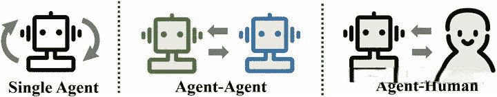

作**为一个LLM-based Ag**ent，其设计目标应始终对人类有益，也就是说，人类可以利用人工智能造福人类。具体来说，希望Agent能实现以下目标：

1.  帮助用户从日常任务和重复劳动中解脱出来，从而减轻人类的工作压力，提高任务解决效率。

1.  不再需要用户提供明确的低级指令。相反，Agent可以独立分析、规划和解决问题。

1.  在解放用户双手的同时，Agent也解放了他们的大脑，使其能够从事探索性和创新性工作。

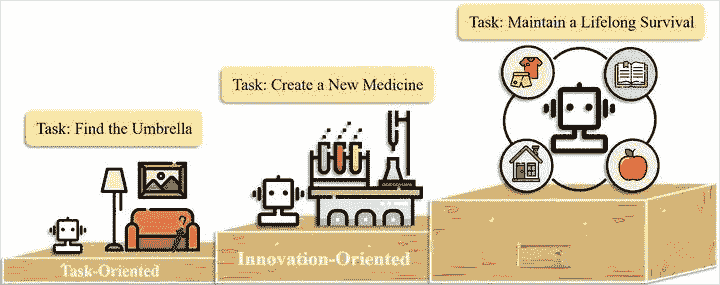

### 3.1 单个Agent的一般能力

> 目前，LLM-based Agent应用实例的发展十分活跃。AutoGPT 是目前流行的开源项目之一，旨在实现完全自主的系统。

**面向任务的部署**

LLM-based Agent 可以理解人类的自然语言指令并执行日常任务，是目前最受用户青睐、最具实用价值的Agent之一。这是因为它们具有提高任务效率、减轻用户工作量和促进更广泛用户访问的潜力。

**在网络场景中：**

> 在网络场景中代表用户执行特定任务被称为网络导航问题。Agent解释用户指令，将其分解为多个基本操作，并与计算机进行交互。

**生活场景中：**

> 在生活场景中的许多日常家务劳动中，Agent必须理解隐含指令并应用常识性知识。对于完全基于海量文本训练的 LLM-based Agent 来说，人类认为理所当然的任务可能需要多次试错尝试。更现实的场景往往会产生更模糊、更微妙的任务。

**面向创新的部署**

> LLM-based Agent 在执行任务和提高**重复性工作的效率方面表现出了**强大的能力。然而，在智力要求更高的领域，如前沿科学领域，Agent 的潜力尚未得到充分发挥。

这种局限性主要来自两个方面的挑战：

> **一方面，**科学本身的复杂性构成了重大障碍，许多特定领域的术语和多维结构难以用单一文本表示。

> **另一方面，**科学领域严重缺乏合适的训练数据，使得Agent难以理解整个领域的知识。

**面向生命周期的部署**

在一个开放、未知的世界中，建立一个能够不断探索、发展新技能并保持长期生命周期的、具有普遍能力的Agent是一项巨大的挑战。

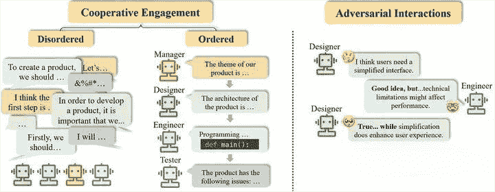

### 3.2 Multi-Agent的协调潜力

**潜在优势：**

> 具体来说，LLM-based multi-Agent系统可以提供几种优势。根据分工原则，具备专业技能和领域知识的单个Agent可以从事特定的任务。

**互补性合作交互**

在当前基于 LLM 的多Agent系统中，Agent之间的交流主要使用自然语言，这被认为是最自然、最易为人类理解的交互形式。将现有的多Agent合作应用分为两类：无序合作和有序合作。

**无序合作：**

> 当系统中有三个或三个以上的Agent时，每个Agent都可以自由地公开表达自己的观点和意见。他们可以提供反馈和建议，以修改与当前任务相关的反应。

**有序合作：**

> 当系统中的Agent遵守特定规则时，例如按顺序逐一发表意见，下游Agent只需关注上游的产出。这样，任务完成效率就会大大提高，整个讨论过程也会变得井然有序。

**对抗性互动促进进步**

在竞争环境中，Agent可以通过动态互动迅速调整策略，努力选择最有利或最合理的行动来应对其他Agent引起的变化。在基于非 LLM 的竞争领域，已经有成功的应用。

**然而，该系统基本上依赖**于 LLM 的力量，并面临着一些基本挑战：

+   在长时间的辩论中，LLM 有限的语境无法处理整个输入。

+   在多Agent环境中，计算开销大大增加。

+   多Agent协商可能会收敛到不正确的共识，而所有Agent都坚信其准确性。

### 3.3 人类与Agent之间的互动参与

随着Agent能力的增强，人类的参与变得越来越重要，以便有效地指导和监督Agent的行动，确保它们符合人类的要求和目标。

人类与Agent之间的互动可分为两种模式：

> (1) 不平等互动（即指导者-执行者范式）：人类是指令的发布者，而Agent则是执行者，基本上是作为人类的助手参与协作。

> (2) 平等互动（即平等伙伴关系范式）：Agent达到人类的水平，与人类平等地参与互动。

**指导者-执行者范式**

**最简单的方法是人类全程指导：**人类直接提供明确而具体的指令，而Agent的作用是理解人类的自然语言指令，并将其转化为相应的行动。

在此，将反馈大致分为两种类型：定量反馈和定性反馈。

**平等伙伴关系范式**

**富有同情心的交流者：**

对话式Agent以个性化定制角色和虚拟聊天机器人等各种形式在研究领域引起了广泛关注。

**人类层面的参与者：**

Agent能够参与人类的正常生活，从人类层面的角度与人类合作完成任务。

## 4.Agent典型应用项目

### AutoG-T

是一个基于ChatG-T完成多目标复杂任务的应用。是综合网络搜索、大语言模型调用、文件读写、python和shell脚本执行等功能框架，综合这些功能，可以自动帮我们完成多目标复杂的任务。

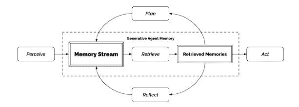

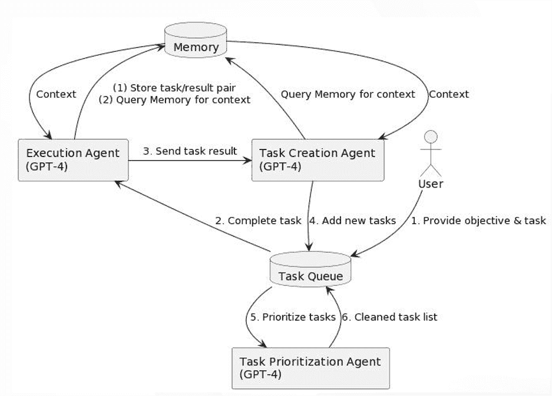

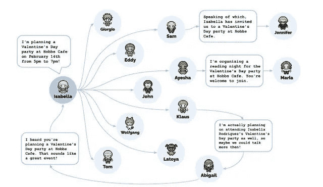

### **trigger prompt**

```
    &quot;user&quot;: &quot;Determine which next command to use, and respond using the format specified above:&quot;
```

### BabyAGI

> 是一个 AI 支持的任务管理系统示例，它根据初始任务或目标，利用OpenAI创建任务列表，并对任务进行优先级排序和执行任务。其背后的主要思想是基于先前任务的结果和预定义的目标创建任务，然后使用 OpenAI 的能力根据目标创建新任务。这是原始的任务驱动的自驱Agent（2023 年 3 月 28 日）的简化版本。

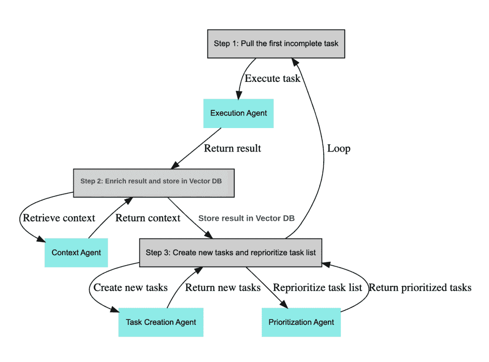

### SuperAGI

一个开发优先的开源自主人工智能代理框架。使开发人员能够快速可靠地构建、管理和运行有用的代理。

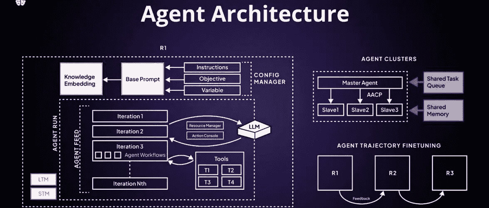

创建Agent

智能体是SuperAGI中执行任务的主要实体。要创建一个：

```
from superagi_client import AgentConfig

agent_config = AgentConfig(
    name=&quot;Sample Agent&quot;,
    description=&quot;A descriptive purpose of the agent.&quot;,
    goal=[&quot;Define a specific task for the agent&quot;],
    instruction=[&quot;Provide additional guiding instructions&quot;],
    agent_workflow=&quot;Goal Based Workflow&quot;,
    constraints=[],
    tools=[{&quot;name&quot;: &quot;ToolName&quot;}],
    iteration_interval=500,
    max_iterations=10,
    model=&quot;G-T-4&quot;
)

agent = client.create_agent(agent_config=agent_config)
```

运行Agent

```
agent_id = agent[&#x27;agent_id&#x27;]
run_agent = client.create_agent_run(agent_id=agent_id)
```

智能体启动成功之后，会返回一个执行ID:run_id

这将检索与指定agent_id关联的运行的状态。若要筛选特定的运行或状态，可以使用 AgentRunFilter 类型。

### ShortG-T

ShortG-T 是一个由开发者 RayVentura 创建的开源项目，致力于在有限的字数内生成高质量、连贯的文本。该项目基于 OpenAI 的 G-T-2 模型，通过微调和优化，能够在极短的文本序列中产生令人印象深刻的结果。

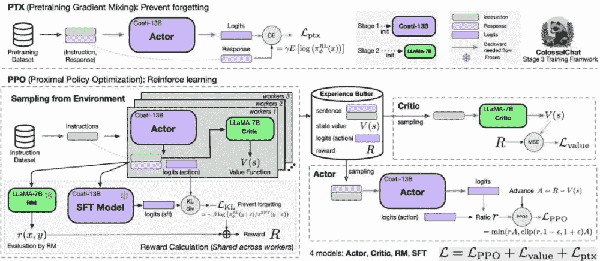

技术分析

基础模型：G-T-2

> **G**-T-2（Generative Pre-trained Transformer 2）是 OpenAI 在2019年发布的预训练语言模型。它使用自注意力机制，能够理解整个输入序列的信息，并生成与上下文相关的响应。在 ShortG-T 中，G-T-2 的强大语义理解和生成能力被进一步利用，以适应更紧凑的文本生成任务。

微调与优化

RayVentura 对原始的 G-T-2 进行了特定场景的数据集微调，使其更适合处理短文本任务。这包括对数据集的选择、训练策略的调整以及可能的参数优化，以确保在有限字符数量下也能保持良好的语义准确性和流畅性。

应用场景

> **创意写作：****为作家和创意人员提供灵感，**快速生成故事开头、诗歌片段或新闻标题。

> **自动摘要：**针对长篇文章，可以生成简明扼要的总结。

> **智能助手：**在对话系统中，**用于生成简洁而有意义的回答。**

> **营销文案：**快速构思广告标语或社交媒体帖子。

> **教育工具：****帮助学生理解概念，**通过简短的例子或解释来阐述复杂的知识点。

特点

> **高      效 -** **能在短短几句话内传达关键信息。**

> **适应性强 - ****可以根据不同的主题和风格**进行微调，满足不同应用场景的需求。

> **开放源码 - **开放社区的持续贡献和支持，使得模型不断改进。

> **易于集成 - ****提供清晰的文档和示例代码，**便于其他开发人员将其整合到自己的项目中。

可以使用以下代码来生成简短回答：

```
import openai
 
# 设置你的OpenAI API密钥
openai.api_key = &quot;YOUR_OPENAI_API_KEY&quot;
 
def get_short_G-T_answer(question, model=&quot;G-T-4&quot;):
    response = openai.Completion.create(
        engine=model,
        prompt=question,
        max_tokens=7,  # 设置生成的最大token数，7 tokens大约对应3个单词
        n=1,  # 生成1个可能的回答
        stop=None,  # 可以设置停止符，例如&quot;.&quot;, &quot;!&quot;等，根据需要使用
        temperature=0.5,  # 设置生成的文本的随机性，0.0为完全随机，1.0为完全按概率分布
    )
    return response.get(&quot;choices&quot;)[0].get(&quot;text&quot;)
 
# 示例问题和使用
question = &quot;What is the capital of the United States?&quot;
answer = get_short_G-T_answer(question)
print(answer)
```

### ChatDev

是一个基于大型语言模型（LLMs）的框架，旨在通过多智能体协作创建定制化软件，使用自然语言概念来革新数字世界。

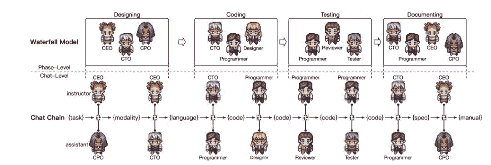

库的特性和优势

1.  **高度定制化和扩展性：**ChatDev 提供了一个易于使用的框架，可以高度定制和扩展，适合研究集体智能。

1.  **多智能体组织结构：**它通过不同角色的智能代理（如 CEO、CTO、程序员等）形成多智能体组织结构，参与设计、编码、测试和文档化等专业功能研讨会。

1.  **实验共学模块：**2024年1月，ChatDev集成了体验式共学模块，采用创新方法让指导者和助手代理积累面向快捷方式的经验，有效解决新任务，减少重复错误，提高效率。

库应用场景

1.  **软件开发：**ChatDev 作为一个 SaaS 平台，使得软件开发人员和创新企业家能够高效、低成本、低门槛地构建软件。

1.  **增量开发：**支持在现有代码上进行开发的增量开发功能，允许代理在现有代码基础上进行进一步开发。

1.  **人机交互：**通过“人机交互”模式，用户可以扮演审阅者的角色，对程序员的工作提出建议，促进人机协作。

**以下是一个简**单的Python示例，展示如何使用random模块生成一个随机的聊天机器人回复。

```
import random
 
# 定义一个包含不同回复的列表
responses = [
    &quot;当然可以&quot;,
    &quot;我能做到&quot;,
    &quot;我正在尝试&quot;,
    &quot;我不能这么做&quot;,
    &quot;对不起，我不明白&quot;,
    &quot;请再重复一次&quot;,
    &quot;请问具体问题是什么？&quot;,
    &quot;你好，我现在正在线上&quot;
]
 
# 定义一个函数，返回随机的回复
def get_random_response():
    return random.choice(responses)
 
# 测试函数
print(get_random_response())
```

### MetaG-T

是一个基于AI Agent的大模型框架，专注于软件开发，从需求分析到代码实现等实现了全流程的覆盖。

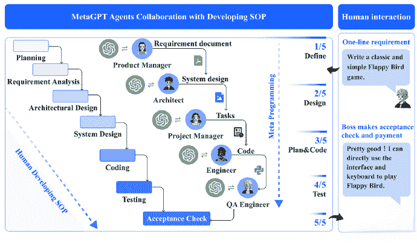

优势

+   多Agent组成协作处理更复杂的任务。

+   通过将SOP融入到多智能体协作中，解决了现有方法在处理复杂任务时存在的幻觉问题。

+   **通过结构化协调和模块化输出，**能够有效地解决复杂的多智能体协作问题。

+   智能体可以主动从环境中获取相关知识，而不是简单地通过对话获取信息。这种设计更符合人类组织的运作模式。

劣势

+   **偶尔会引用不存在的资源文件，**如图像和音频。

+   **在执行复杂任务时，**它容易调用未定义或未导入的类或变量。

+   **角色和流程还比较固定，**无法实现动态扩展，如扩展UI设计角色。

### Camel

是Communicative Agents for “Mind” Exploration of Large Scale Language Model Society的缩写，大意为大规模语言模型社会的“心智”探索通讯智能体。

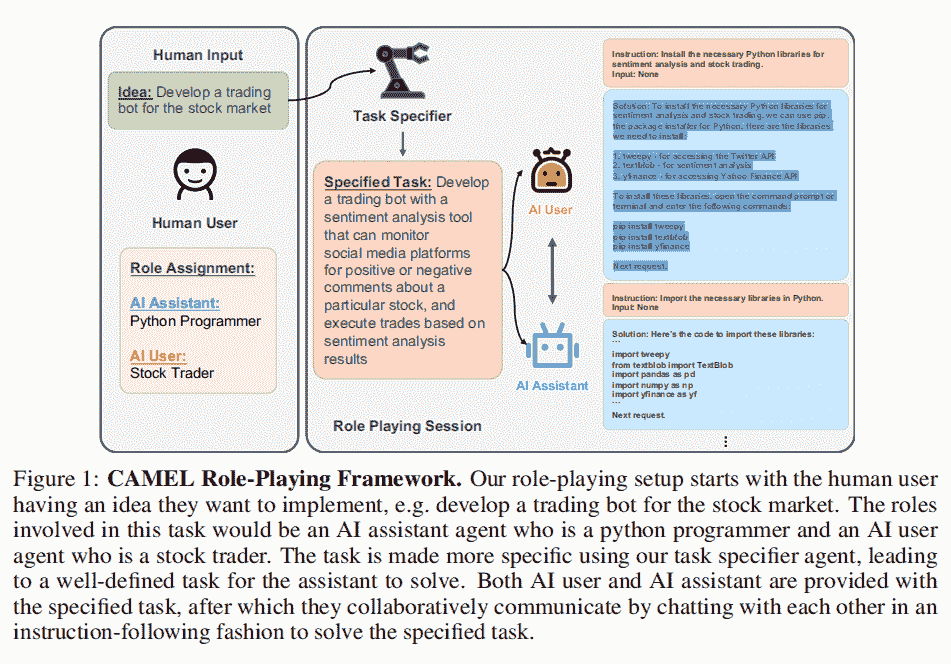

贡献点：

> 1）引入了一种新的沟通式智能体（通过角色扮演实现），让智能体在最少的人工干预下通过自主合作，共同完成任务；

> 2）提供了一种为研究多智能体合作行为和能力的可扩展方法，阐述了实现自主合作的挑战，并提供了应对这些挑战的策略。

> 3）开源了CAMEL智能体，其中包含各种智能体的实现、数据生成流程、数据分析工具和收集的数据集，以支持沟通时智能体等领域的研究及更多其他相关领域的研究。

实现原理

角色扮演框架

> CAMEL专注于以任务为导向的角色扮演，包含一个AI助理（AI Assistant）和一个AI用户（AI User）。在多智能体系统接收到人类用户的初步想法和角色分配后，任务指定智能体将提供详细的描述，使想法更加具体化。

> 然后，AI助理和AI用户将通过多轮对话合作完成指定的任务，直到AI用户确定任务完成为止。一方面，AI用户负责向AI助理提供指令，并引导对话朝着任务完成的方向进行；另一方面，AI助理则需要遵循AI用户的指示，做出回答并提供具体的解决方案。

人类输入和任务说明

> 角色扮演会话将从人类的想法和选择的角色开始。想开发一个用于股市的交易机器人，然后选择了一个Python程序员和一个股票交易员两个角色。

> **在确定了想法和角色之后，任务指定智能体将根据输入的**想法，为AI助理角色提出一个具体的任务，以帮助AI用户角色完成任务。引入任务指定智能体主要原因为对话智能体通常需要一个具体的任务提示来实现任务，而对于非领域专家来说，这可能具有挑战性或费时。

以下是简单的代码使用示例

```
conda create --name camel python=3.10
conda create --name camel python=3.10
git clone -b v0.1.0 https://github.com/camel-ai/camel.git
cd camel
pip install -e .
```

### JARVIS

处理任务规划、模型选择、任务执行和内容生成。通过访问HuggingFace中心中的数十个专用模型，利用ChatG-T的推理能力将最佳模型应用于给定任务。

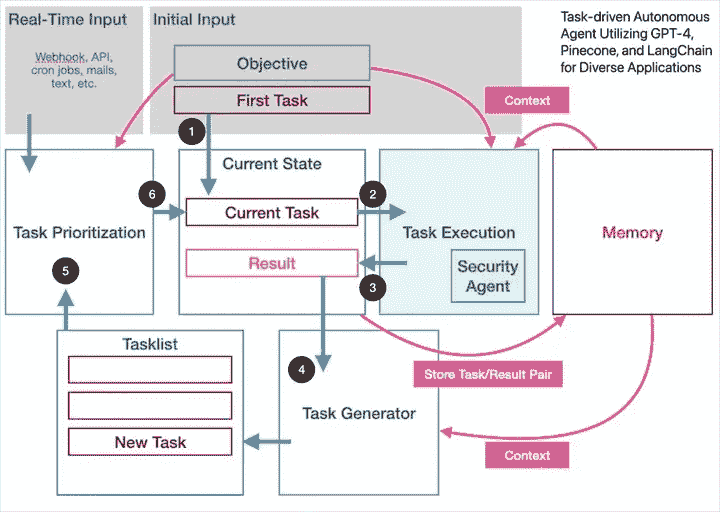

> **系统的工作流程由四个阶段组成：**

+   **任务规划：**使用ChatG-T分析用户的请求，了解他们的意图，并将其分解为可能的可解决的任务。

+   **模型选择：**为了解决计划的任务，ChatG-T根据描述选择Hugging Face上托管的专家模型。

+   **任务执行：**调用并执行每个选定的模型，并将结果返回给ChatG-T。

+   **响应生成：**最后，使用ChatG-T整合所有模型的预测，并生成响应。

### OpenAGI

是指开放式人工智能，即一种可以从经验中学习和自我完善的AI系统。

AGI 研究平台专门设计提供复杂的多步任务以及相应的数据集、评估方法和各种可扩展模型，这些模型可以被综合以有效地解决这些任务。

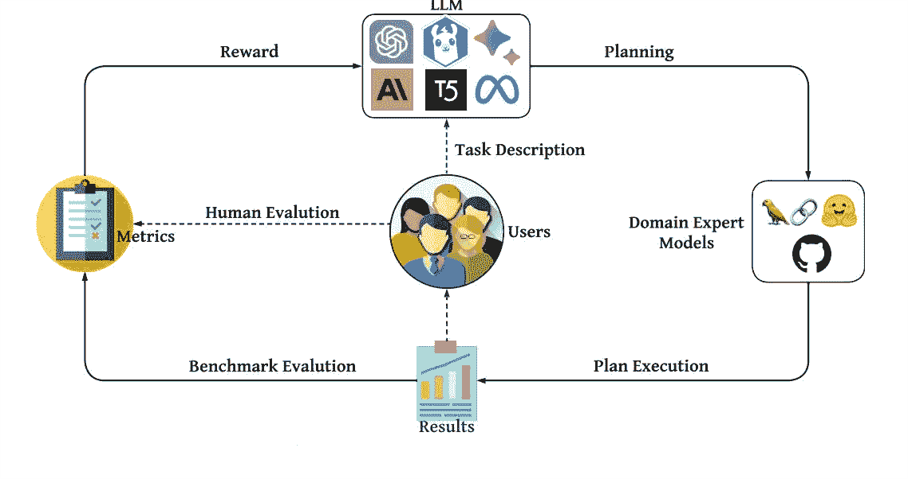

以下是一个简单的代码示例

```
class SimpleEnvironment:
    def __init__(self):
        self.agents = []
        self.state = {}
 
    def add_agent(self, agent):
        self.agents.append(agent)
 
    def step(self):
        for agent in self.agents:
            action = agent.act(self.state)
            self.state = self.apply_action(action)
 
    def apply_action(self, action):
        # 这里应该包含对环境状态的更新逻辑
        # 例如，移动Agent的位置，或是触发某些效果
        return self.state  # 这里简化地返回当前状态
 
class SimpleAgent:
    def __init__(self):
        pass
 
    def act(self, state):
        # 这里应该包含Agent的决策逻辑
        # 例如，基于当前状态选择一个随机动作
        return &quot;action&quot;  # 返回一个动作
 
# 创建环境和Agent
env = SimpleEnvironment()
agent = SimpleAgent()
 
# 将Agent添加到环境中并开始交互
env.add_agent(agent)
env.step()
```

### XAgent

是一个开源的基于大型语言模型（LLM）的自主智能体，能够自动解决各种任务。它旨在成为一个通用的智能体，应用于各种任务。

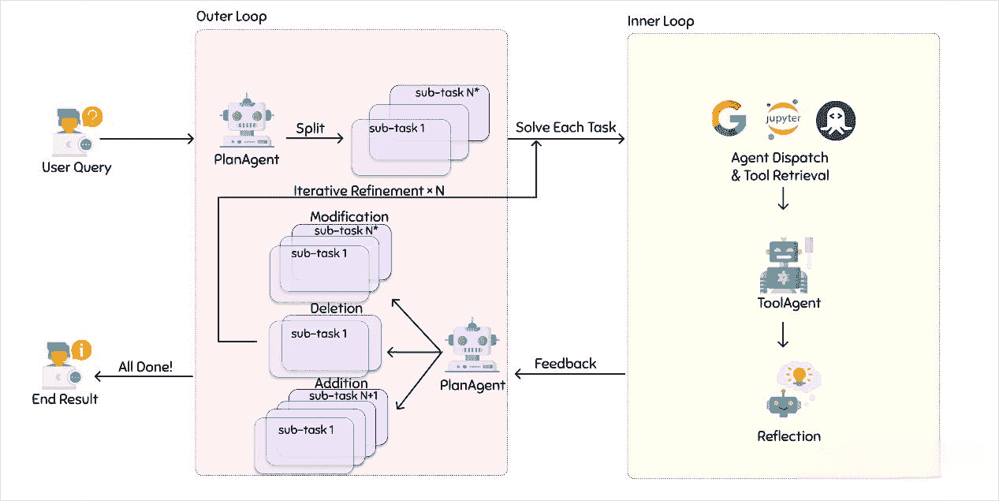

> **XAgent的特性:**

+   **自主/自治: **XAgent可以无须人工干预自动完成各种任务.

+   **安全: **XAgent旨在安全运行，所有的action约束在docker容器中执行.

+   **可扩展性: **XAgent 做了可扩展性设计，可以容易地增加新工具加强agent的能力，甚至可以增加新的agenti.

+   **界面化: **XAgent 为用户提供友好的agent交互界面，当然也可以使用命令行接口与agent交互。

+   **人机协作:** XAgent 可以与人协作处理任务，不仅是在解决复杂任务遵循人类的指导，当agent遇到挑战时也能够寻求人类的帮助。

> **XAgent的构成：**

+   **Dispatcher**

> 负责动态实例化和派发任务给不同的agent，允许用户新增agent并改善它们的能力

+   **Planner**

> **负责生成和修正任务计划。**将任务拆分为子任务并为它们生成里程碑，允许agent一步一步地完成任务

+   **Actor**

> 负责采取行动达成目标和完成子任务。actor使用各式各样的工具处理子任务，同时也可以与人类合作完成任务