# [译] AI Agent（智能体）技术白皮书（Google）

> 来源：[https://qqs7y1hozd1.feishu.cn/docx/Xfh5dBiXeoHTxVx16agcTr3knKd](https://qqs7y1hozd1.feishu.cn/docx/Xfh5dBiXeoHTxVx16agcTr3knKd)

# 1 引言

## 1.1 人类的先验知识与工具的使用

人类能很好地处理复杂和微妙的模式识别任务。 能做到这一点是因为，我们会通过书籍、搜索或计算器之类的工具来补充我们头脑中的先验知识， 然后才会给出一个结论（例如，“图片中描述的是 XX”）。

## 1.2 人类的模仿者

与以上类似，我们可以对生成式 AI 模型进行训练， 让它们能使用工具来在现实世界中获取实时信息或给出行动建议。 例如，

+   利用数据库查询工具获取客户的购物历史，然后给出购物建议。

+   根据用户的查询，调用相应 API，替用户回复电子邮件或完成金融交易。

为此，模型不仅需要访问外部工具，还要能够自主规划和执行任务。 这种具备了推理、逻辑和访问外部信息的生成式 AI 模型，就是 Agent 的概念； 换句话说，Agent 是一个扩展了生成式 AI 模型出厂能力的程序。

# 2 什么是 Agent？

## 2.1 概念：应用程序

宽泛地来说，生成式 AI Agent 可以被定义为一个应用程序， 通过观察周围世界并使用可用的工具来实现其目标。

+   Agent 是有自主能力的（autonomous），只要提供了合适的目标，它们就能独立行动，无需人类干预；

+   即使是模糊的人类指令，Agent 也可以推理出它接下来应该做什么，并采取行动，最终实现其目标。

在 AI 领域，Agent 是一个非常通用的概念。本文接下来要讨论的 Agent 会更具体， 指的是本文写作时，基于生成式 AI 模型能够实现的 Agents。

## 2.2 架构：cognitive architecture

为了理解 Agent 的内部工作原理，我们需要看看驱动 Agent 行为、行动和决策（behavior, actions, and decision making）的基础组件。

这些组件的组合实现了一种所谓的认知架构（cognitive architecture）， 通过这些组件可以实现许多这样的架构。我们后面还会就这一点展开讨论。

## 2.3 组件

Agent 架构中有三个核心组件，如图所示，

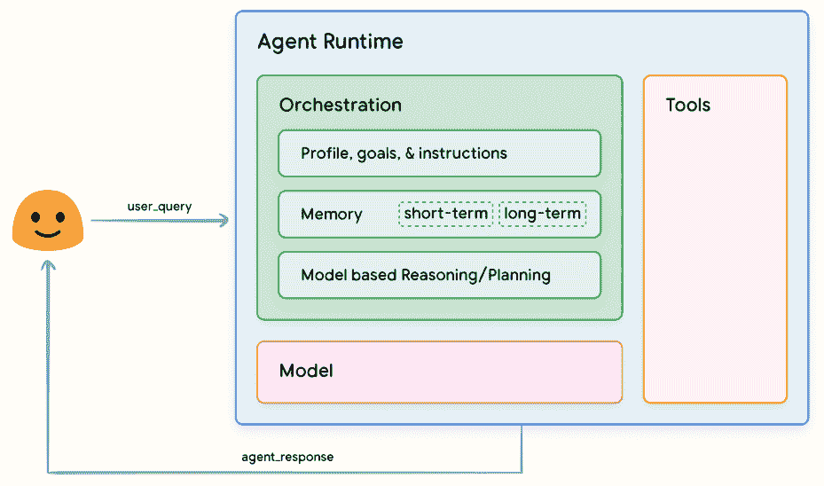

### 2.3.1 模型（model）

这里指的是用作 Agent 中用来做核心决策的语言模型（LM）。

+   可以是一个或多个任何大小的模型，能够遵循基于指令的推理和逻辑框架，如 ReAct、Chain-of-Thought、Tree-of-Thoughts。

+   可以是通用的、多模态的，或根据特定 Agent 架构的需求微调得到的模型。

+   可以通过“能展示 Agent 能力的例子或数据集”来进一步微调模型，例如 Agent 在什么上下文中使用什么工具，或者执行什么推理步骤。

### 2.3.2 工具（tool）

基础模型在文本和图像生成方面非常强大，但无法与外部世界联动极大限制了它们的能力。 工具的出现解决了这一问题。有了工具，Agent 便能够与外部数据和服务互动，大大扩展了它们的行动范围。

工具可以有多种形式，常见是 Web API 方式，即 GET、POST、PATCH 和 DELETE 方法。 例如，结合用户信息和获取天气数据的 tool，Agent 可以为用户提供旅行建议。

有了工具，Agent 可以访问和处理现实世界的信息，这使它们能够支撑更专业的系统，如检索增强生成（RAG），显著扩展了 Agent 的能力。

### 2.3.3 编排层（orchestration）

编排层描述了一个循环过程：Agent 如何接收信息，如何进行内部推理，如何使用推理来结果来指导其下一步行动或决策。

+   一般来说，这个循环会持续进行，直到 Agent 达到其目标或触发停止条件。

+   编排层的复杂性跟 Agent 及其执行的任务直接相关，可能差异很大。 例如，一些编排就是简单的计算和决策规则，而其他的可能包含链式逻辑、额外的机器学习算法或其他概率推理技术。

我们将在认知架构部分更详细地讨论 Agent 编排层的详细实现。

## 2.4 Agent 与 model 的区别

为了更清楚地理解 Agent 和模型之间的区别，这里整理个表格，

# 3 认知架构：Agent 是如何工作的

## 3.1 类比：厨师做菜

想象厨房中一群忙碌的厨师。他们的职责是根据顾客的菜单，为顾客烹制相应的菜品。 这就涉及到我们前面提到的“规划 —— 执行 —— 调整”循环。具体来说， 厨师们需要执行以下步骤，

1.  收集信息（输入）：顾客点的菜，后厨现有的食材等等；

1.  推理（思考）：根据收集到的信息，判断可以做哪些菜；

1.  做菜（行动）：包括切菜、加调料、烹炒等等。

在以上每个阶段，厨师都根据需要进行调整 —— 例如某些食材不够用了，或者顾客反馈好吃或难吃了 —— 进而不断完善他们的计划。 这个信息接收、规划、执行和调整（information intake, planning, executing, and adjusting）的循环描述的就是一个厨师用来实现其目标的特定认知架构。

## 3.2 Agent 推理框架

跟以上厨师类似，Agent 也可以使用认知架构处理信息、做出决策，并根据前一轮的输出调整下一个行动，如此循环迭代来实现其最终目标。

+   在 Agent 中，认知架构的核心是编排层，负责维护记忆、状态、推理和规划（memory, state, reasoning and planning）。

+   它使用快速发展的提示词工程及相关框架（prompt engineering and associated frameworks）来指导推理和规划，使 Agent 能够更有效地与环境互动并完成任务。

在写作本文时，有下面几种流行的推理框架和推理技术。

### 3.2.1 ReAct

为语言模型提供了一个思考过程策略。

已经证明 ReAct 优于几个 SOTA 基线，提高了 LLM 的人机交互性和可信度。

### 3.2.2 Chain-of-Thought (CoT)

通过中间步骤实现推理能力。CoT 有各种子技术，包括自我一致性、主动提示和多模态 CoT，适合不同的场景。

### 3.2.3 Tree-of-Thoughts (ToT)

非常适合探索或战略前瞻任务。概括了链式思考提示，并允许模型探索各种思考链，作为使用语言模型解决问题的中间步骤。

## 3.3 ReAct 例子

Agent 可以使用以上一种或多种推理技术，给特定的用户请求确定下一个最佳行动。 例如，使用 ReAct 的例子，

1.  用户向 Agent 发送查询。

1.  Agent 开始 ReAct sequence。

1.  Agent 提示模型，要求其生成下一个 ReAct 步骤及其相应的输出：

1.  问题：提示词 + 用户输入的问题

1.  思考：模型的想法：下一步应该做什么

1.  行动：模型的决策：下一步要采取什么行动。这里就是可以引入工具的地方， 例如，行动可以是 [Flights, Search, Code, None] 中的一个，前三个代表模型可以选择的已知工具，最后一个代表“无工具选择”。

1.  行动的输入：模型决定是否要向工具提供输入，如果要提供，还要确定提供哪些输入

1.  观察：行动/行动输入序列的结果。根据需要，这个思考/行动/行动输入/观察（thought / action / action input / observation）可能会重复 N 次。

1.  最终答案：模型返回对原始用户查询的最终答案。

1.  ReAct 循环结束，并将最终答案返回给用户。

Figure 2. Example Agent with ReAct reasoning in the orchestration layer

如图 2 所示，模型、工具和 Agent 配置共同工作，根据用户的输入返回了一个有根据的、简洁的响应。 虽然模型第一轮根据其先前知识猜了一个答案（幻觉），但它接下来使用了一个工具（航班）来搜索实时外部信息， 从而能根据真实数据做出更明智的决策，并将这些信息总结回给用户。

总结起来，Agent 的响应质量与模型的推理能力和执行任务的能力直接相关， 包括选择正确工具的能力，以及工具自身的定义的好坏（how well that tools has been defined）。 就像厨师精选食材、精心做菜，并关注顾客的反馈一样，Agent 依赖于合理的推理和可靠的信息来提供最佳结果。

在下一节中，我们将深入探讨 Agent 与“新鲜”数据的各种连接方式。

# 4 工具：模型通往现实世界的关键

语言模型很擅长处理信息，但它们缺乏直接感知和影响现实世界的能力。 在需要与外部系统或数据联动的情况下，这些模型的实用性就很低了。某种意义上说， 语言模型的能力受限于它们的训练数据中覆盖到的信息。

那么，如何赋予模型与外部系统进行实时、上下文感知的互动能力呢？ 目前有几种方式：

+   Functions

+   Extensions

+   Data Stores

+   Plugins

虽然名称各异，但它们都统称为工具（tools）。 工具是将基础模型与外部世界连接起来的桥梁。

能够连接到外部系统和数据之后，Agent 便能够执行更广泛的任务，并且结果更加准确和可靠。 例如，工具使 Agent 能够调整智能家居设置、更新日程、从数据库中获取用户信息或根据特定指令发送电子邮件。

写作本文时，Google 模型能够与三种主要工具类型互动：Functions、Extensions、Data Stores。

配备了工具之后，Agent 不仅解锁了理解真实世界和在真实世界中做出行动的超能力， 而且打开了各种新应用场景和可能性的大门。

## 4.1 工具类型一：extensions

在最简单的概念上： extension 是一种以标准化方式连接 API 与 Agent 的组件， 使 Agent 能够调用外部 API，而不用管这些 API 背后是怎么实现的。

### 4.1.1 需求：预定航班的 Agent

假设你想创建一个帮用户预订航班的 Agent，并使用 Google Flights API 来搜索航班信息， 但不确定如何让你的 Agent 调用这个 API。

Figure 3. How do Agents interact with External APIs?

### 4.1.2 实现方式一：传统方式，写代码解析参数

传统解决方式是写代码，从用户输入中解析城市等相关信息，然后调用 API。 例如，

+   用户输入 “I want to book a flight from Austin to Zurich”（“我想从奥斯汀飞往苏黎世”）； 我们的代码需要从中提取“Austin”和“Zurich”作为相关信息，然后才能进行 API 调用。

+   但如果用户输入“I want to book a flight to Zurich”，我们就无法获得出发城市信息，进而无法成功调用 API，所以需要写很多代码来处理边界 case。

显然，这种方法维护性和扩展性都很差。有没有更好的解决方式呢？ 这就轮到 exntension 出场了。

### 4.1.3 实现方式二：使用 Extension

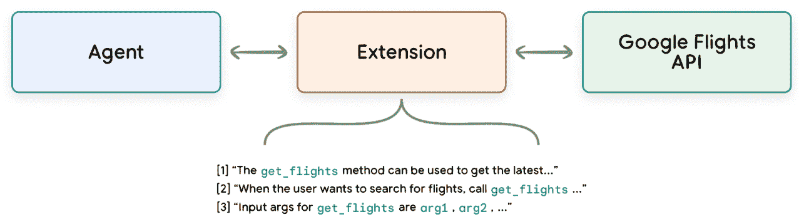

如上图所示，Extension 通过以下方式将 Agent 与 API 串起来：

1.  提供示例信息教 Agent 如何使用 API。

1.  告诉 Agent 调用 API 所需的具体参数。

Extension 可以独立于 Agent 开发，但应作为 Agent 配置的一部分。 Agent 在运行时，根据提供的示例和模型来决定使用哪个 extension 来处理用户的查询， 这突出了 extension 的一个核心优势：built-in example types， 允许 Agent 动态选择最适合所执行任务的 extension，如下图所示，

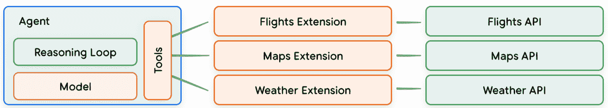

### 4.1.4 Extension 示例

以 Google 的 Code Interpreter extension 作为例子，从自然语言描述生成和运行 Python 代码。

```
import vertexai
import pprint

PROJECT_ID = &quot;YOUR_PROJECT_ID&quot;
REGION = &quot;us-central1&quot;

vertexai.init(project=PROJECT_ID, location=REGION)

from vertexai.preview.extensions import Extension

extension_code_interpreter = Extension.from_hub(&quot;code_interpreter&quot;)

CODE_QUERY = &quot;&quot;&quot;Write a python method to invert a binary tree in O(n) time.&quot;&quot;&quot;
response = extension_code_interpreter.execute(
    operation_id=&quot;generate_and_execute&quot;,
    operation_params={&quot;query&quot;: CODE_QUERY}
)

print(&quot;Generated Code:&quot;)
pprint.pprint(response[&#x27;generated_code&#x27;])
```

输出如下：

```
class TreeNode:
    def __init__(self, val=0, left=None, right=None):
        self.val = val
        self.left = left
        self.right = right

def invert_binary_tree(root):
    &quot;&quot;&quot;Inverts a binary tree.&quot;&quot;&quot;
    if not root:
        return None
    # Swap the left and right children recursively
    root.left, root.right = invert_binary_tree(root.right), invert_binary_tree(root.left)
    return root

# Example usage:
# Construct a sample binary tree
root = TreeNode(4)
root.left = TreeNode(2)
root.right = TreeNode(7)
root.left.left = TreeNode(1)
root.left.right = TreeNode(3)
root.right.left = TreeNode(6)
root.right.right = TreeNode(9)

# Invert the binary tree
inverted_root = invert_binary_tree(root)
```

## 4.2 工具类型二：functions

在软件工程中，也就是我们日常写代码时，“函数”指的是自包含的代码模块，用于完成特定任务，并可以复用（被不同地方的代码调用）。 软件工程师写程序时，通常会创建许多函数来执行各种任务，还会定义函数的预期输入和输出。

在 Agent 的世界中，函数的工作方式非常相似 —— 只是将“软件开发者”替换为“模型”。 模型可以设置一组已知的函数，然后就可以根据规范决定何时使用哪个函数，以及函数需要哪些参数。

### 4.2.1 Function vs. Extension

还是以前面的 Google Flights 为例，可以看出 Function 与 Extension 的不同：

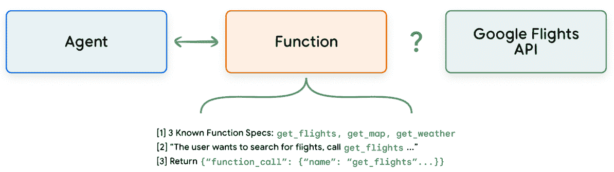

1.  模型只输出函数名及其参数信息，但不会执行函数；

1.  函数在客户端执行。作为对比，Extension 在 Agent 端执行。见下图，

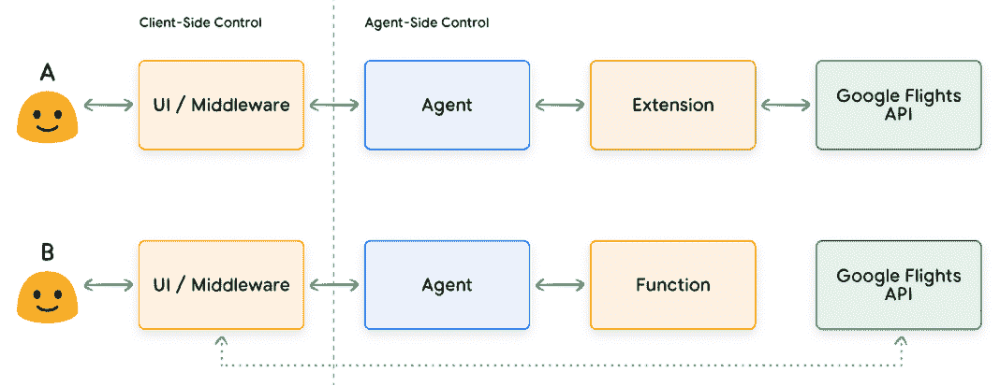

### 4.2.2 例子：教模型结构化输出信息

考虑以下例子，实现一个 AI Traval Agent，它会与想要旅行的用户互动。 我们的目标是让 Agent 生成一个城市列表，然后就可以下载相应城市的图片、数据等，以供用户旅行规划使用。

+   用户可能会说：

```
  I’d like to take a ski trip with my family but I’m not sure where to go.
```

+   典型的模型输出可能如下：

```
  Sure, here’s a list of cities that you can consider for family ski trips:
  - Crested Butte, Colorado, USA
  - Whistler, BC, Canada
  - Zermatt, Switzerland
```

+   虽然以上输出包含了我们需要的数据（城市名称），但格式不适合解析。 通过 Function，我们可以教模型以结构化风格（如 JSON）输出，以便其他系统解析。 例如，输出可能是下面这样，

```
  {
**    &quot;n**ame&quot;**: &quot;dis**play_c**ities&quot;,
**    &quot;a**rgs&quot;: {
     ** &quot;cities&quot;: [&quot;Crested Butte&quot;, &quot;Whistler&quot;, &quot;Zermatt&quot;],
      &quot;preferences&quot;: &quot;skiing&quot;
    }
  }
```

这个 Agent 应用的整体流程图如图 9 所示，

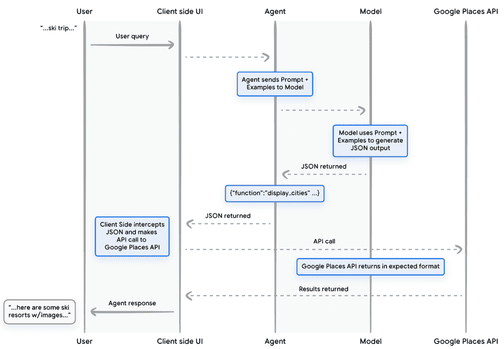

### 4.2.3 示例代码

Function 定义：

```
def display_cities(cities: list[str], preferences: Optional[str] = None):
    &quot;&quot;&quot;Provides a list of cities based on the user&#x27;s search query and preferences.

    Args:
        preferences (str): The user&#x27;s preferences for the search, like skiing, beach, restaurants, bbq, etc.
        cities (list[str]): The list of cities being recommended to the user.

    Returns:
        list[str]: The list of cities being recommended to the user.
    &quot;&quot;&quot;
    return cities
```

接下来，初始化模型和工具，然后将用户的查询和工具传递给模型。

```
from vertexai.generative_models import GenerativeModel, Tool, FunctionDeclaration

model = GenerativeModel(&quot;gemini-1.5-flash-001&quot;)
display_cities_function = FunctionDeclaration.from_func(display_cities)
tool = Tool(function_declarations=[display_cities_function])

message = &quot;I’d like to take a ski trip with my family but I’m not sure where to go. &quot;
res = model.generate_content(message, tools=[tool])

print(f&quot;Function Name: {res.candidates[0].content.parts[0].function_call.name}&quot;)
print(f&quot;Function Args: {res.candidates[0].content.parts[0].function_call.args}&quot;)
```

效果：

```
&gt; Function Name: display_cities
&gt; Function Args: {&#x27;preferences&#x27;: &#x27;skiing&#x27;, &#x27;cities&#x27;: [&#x27;Aspen&#x27;, &#x27;Vail&#x27;, &#x27;Park City&#x27;]}
```

总结起来，Function 提供了一个简单的框架，使应用程序开发人员能够

+   对数据流和系统执行进行细粒度的控制，

+   利用 Agent 和模型生成结构化的信息，方便作为下一步的输入。

## 4.3 工具类型三：data storage

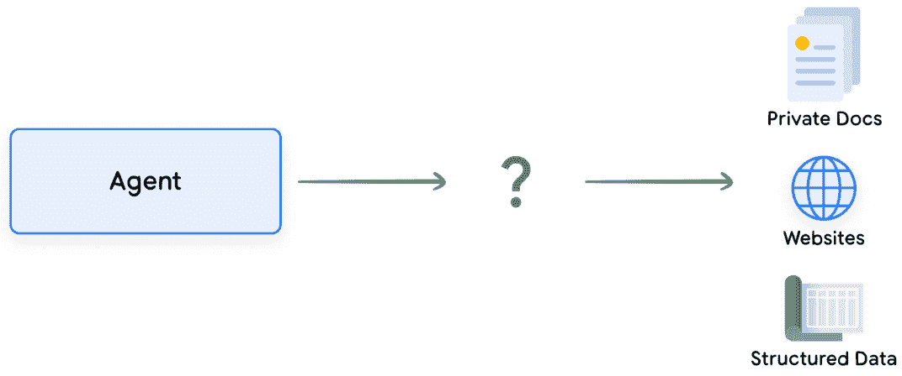

语言模型就像一个大图书馆，其中包含了其训练数据（信息）。但与真实世界的图书馆不同的是， 这个图书馆是静态的 —— 不会更新，只包含其最初训练时的知识。 而现实世界的知识是不断在演变的，所以静态模型在解决现实世界问题时就遇到了挑战。

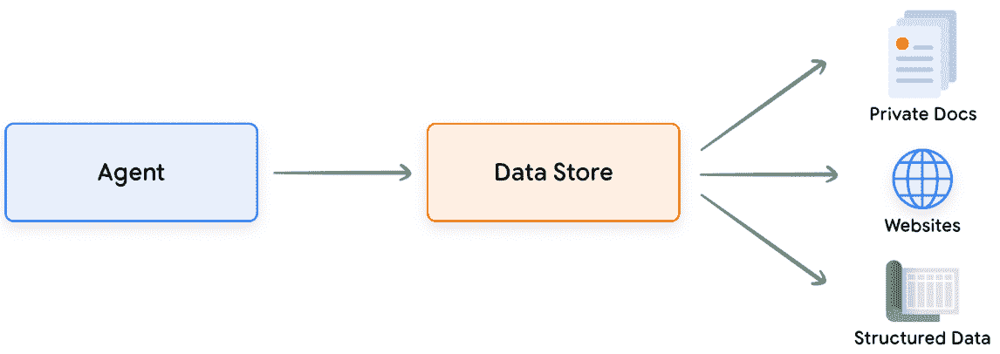

Data Storage 通过提供动态更新的信息来解决这一问题，

+   允许开发人员以原始格式向 Agent 提供增量数据，将传入的文档将被转换为一组向量数据库嵌入（embedding），Agent 可以使用这些 embedding 来提取信息。

+   使模型的返回更相关，更具实效性。

+   避免了微调甚至重新训练模型等重量级操作。

### 4.3.1 实现与应用

在生成式 AI 场景，Agent 使用的数据库一般是向量数据库 —— 它们以向量 embedding 的形式存储数据，这是一种高维向量或数学表示。

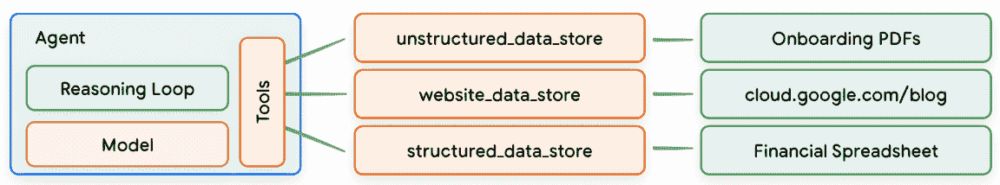

使用语言模型与 Data Storage 的最典型例子是检索增强生成（RAG）。 RAG 应用程序通过让模型访问各种格式的数据来扩展模型知识的广度和深度，如：

+   网站内容

+   结构化数据，如 PDF、Word 文档、CSV、电子表格等

+   非结构化数据，如 HTML、PDF、TXT 等

每个用户请求和 Agent 响应循环的基本过程通常如图 13 所示，

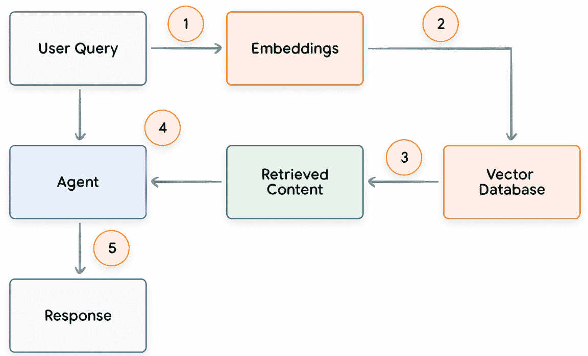

1.  用户 query 送到 embedding 模型，生成 query 的 embedding 表示。

1.  将 query embedding 与向量数据库的内容进行匹配，本质上就是在计算相似度。

1.  将相似度最高的内容以文本格式发送回 Agent。

1.  Agent 决定响应或行动。

1.  最终响应发送给用户。

> 更多 RAG 信息：[大模型 RAG 基础：信息检索、文本向量化及](https://arthurchiao.art/blog/rag-basis-bge-zh/)[ BGE-M](https://arthurchiao.art/blog/rag-basis-bge-zh/)3 embedding 实践（2024）。译注。

### 4.3.2 例子

图 14 是一个 RAG 与 ReAct 推理/规划的 Agent 示例，

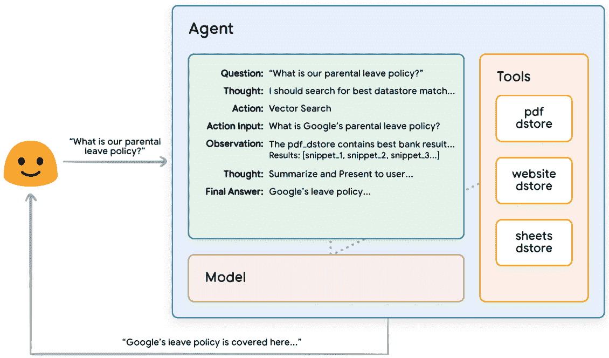

## 4.4 工具小结

总结来说，Extension、Function 和 Data Storage 是 Agent 在运行时可以使用的几种不同工具类型。 每种工具都有其特定的用途，可以根据 Agent 开发人员的判断单独或一起使用。

# 5 通过针对性学习提升模型性能

有效使用模型的一个关键是，让模型具备在生成输出时选择正确工具的能力。 虽然一般训练有助于模型获得这种技能，但现实世界的场景通常需要超出训练数据的知识。 这就像是掌握基本做菜技能和精通特定菜系之间的区别， 两者都需要基础烹饪知识，但后者需要针对性学习以获得更好的垂类结果。

帮模型获得这种特定技能，有几种方法：

+   In-context learning

+   Retrieval-based in-context learning

+   Fine-tuning based learning

## 5.1 In-context learning, e.g. ReAct

基于上下文学习：

+   原理：还是使用通用模型，但在推理时为模型提供提示词、工具和示例，使模型其能够“即时学习”如何以及何时为特定任务使用这些工具。

+   例子：ReAct 框架。

## 5.2 Retrieval-based in-context learning, e.g. RAG

基于检索的上下文学习：

+   原理：这种技术通过从外部存储中检索相关信息、工具和示例来动态填充模型提示词。

+   例子：RAG 架构。

## 5.3 Fine-tuning based learning

基于微调的学习：

+   原理：用大量的特定示例对模型进行训练（微调/精调），然后用微调过的模型进行推理。

+   好处：微调之后的模型在处理请求之前，已经具备了何时以及如何使用某些工具的先验知识。

## 5.4 再次与“厨师做饭”做类比

最后与厨师做饭再做个类比，加深理解：

每种方法在速度、成本和延迟方面都各有优缺点，需要看实际需求组合使用。

# 6 基于 LangChain 快速创建 Agent

本节来看下如何基于 LangChain 和 LangGraph 构建一个 Agent 快速原型。 这些开源库允许用户通过“串联”逻辑、推理和工具调用序列来构建客户 Agent。

## 6.1 代码

```
from langgraph.prebuilt import create_react_agent
from langchain_core.tools import tool
from langchain_community.utilities import SerpAPIWrapper
from langchain_community.tools import GooglePlacesTool

os.environ[&quot;SERPAPI_API_KEY&quot;] = &quot;XXXXX&quot;
os.environ[&quot;GPLACES_API_KEY&quot;] = &quot;XXXXX&quot;

@tool
def search(query: str):
    &quot;&quot;&quot;Use the SerpAPI to run a Google Search.&quot;&quot;&quot;
    search = SerpAPIWrapper()
    return search.run(query)

@tool
def places(query: str):
    &quot;&quot;&quot;Use the Google Places API to run a Google Places Query.&quot;&quot;&quot;
    places = GooglePlacesTool()
    return places.run(query)

model = ChatVertexAI(model=&quot;gemini-1.5-flash-001&quot;)
tools = [search, places]

query = &quot;Who did the Texas Longhorns play in football last week? What is the address of the other team&#x27;s stadium?&quot;
Agent = create_react_agent(model, tools)
input = {&quot;messages&quot;: [(&quot;human&quot;, query)]}

for s in Agent.stream(input, stream_mode=&quot;values&quot;):
    message = s[&quot;messages&quot;][-1]
    if isinstance(message, tuple):
        print(message)
    else:
        message.pretty_print()
```

其中用到的工具包括：

+   SerpAPI（用于 Google 搜索）

+   Google Places API。

## 6.2 运行效果

```
=============================== Human Message ================================
Who did the Texas Longhorns play in football last week? What is the address of the other team&#x27;s stadium?
================================= Ai Message =================================
Tool Calls: search
Args:
query: Texas Longhorns football schedule
================================ Tool Message ================================
Name: search
{...Results: &quot;NCAA Division I Football, Georgia, Date...&quot;}
================================= Ai Message =================================
The Texas Longhorns played the Georgia Bulldogs last week.
Tool Calls: places
Args:
query: Georgia Bulldogs stadium
================================ Tool Message ================================
Name: places
{...Sanford Stadium Address: 100 Sanford...}
================================= Ai Message =================================
The address of the Georgia Bulldogs stadium is 100 Sanford Dr, Athens, GA 30602, USA
```

虽然这是一个很简单的 Agent，但它展示了模型、编排和工具等基础组件如何协同工作以实现特定目标。

## 6.3 使用 Google Vertex AI Agent 创建生产应用

最后，我们来看看这些组件如何在像 Vertex AI Agent 和生成式剧本这样的 Google 规模的托管产品中结合在一起。

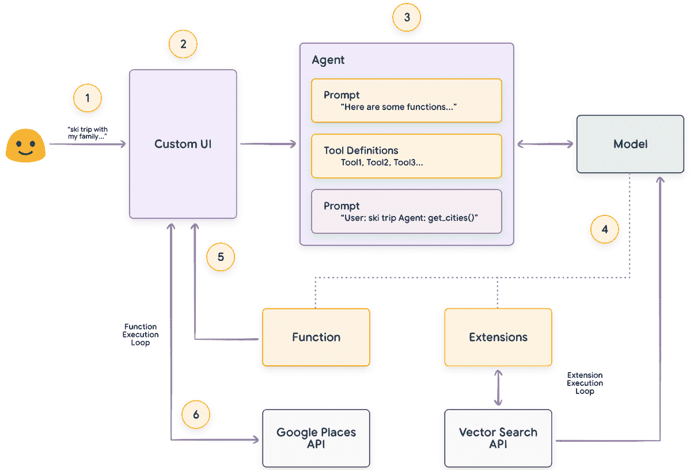

# 7 总结

本文讨论了生成式 AI Agent 的基础构建模块及工作原理。一些关键信息：

1.  Agent 可以利用工具来扩展语言模型的能力，

+   扩展的能力包括：访问实时信息、建议现实世界的行动以及自主规划和执行复杂任务。

+   Agent 可以利用语言模型来决定何时以及如何转换状态，并使用外部工具完成任意数量的复杂任务，这些任务对于模型单独完成来说是困难甚至不可能的。

1.  Agent 的核心是编排层，

+   这是一个认知架构，它结构化了推理、规划、决策并指导其行动。

+   各种推理技术，如 ReAct、Chain-of-Thought 和 Tree-of-Thoughts，为编排层提供了一个框架，以接收信息、进行内部推理并生成决策或响应。

1.  工具作为 Agent 通往外部世界的关键，使 Agent 能够与外部系统互动，以及让模型获取在它的训练数据之外的知识。

+   Extensions 为 Agent 与外部 API 之间提供了一个桥梁，使 Agent 能完成实时 API 调用和实时信息检索。

+   Functions 使 Agent 能够生成可以在客户端执行的函数代码，为开发人员提供了更精细的控制。

+   Data Stores 为 Agent 提供了访问结构化或非结构化数据的能力，使数据驱动的应用程序成为可能。

本文对 Agent 的探索还非常浅显和初级，Agent 的未来将非常激动人心。 随着工具变得更加复杂，推理能力得到增强，Agent 将被赋予解决现实生活中越来越复杂的问题的能力。

此外，“Agent chaining” 也将是一个战略性方向， 通过结合 specialized Agents —— 每个 Agent 在其特定领域或任务中表现出色 —— 可以创建一种 “mixture of Agent experts”（混合智能体专家）的方法，能够在各个行业和问题领域中提供卓越的性能。

最后需要说明，复杂的 Agent 架构并不是一蹴而就的，需要持续迭代（iterative approach）。 给定业务场景和需求之后，不断的实验和改进是找到解决方案的关键。

Agents 底层都是基于基座大模型，而后者的生成式性质决定了没有两个 Agent 是相同的。 但是，只要利用好这些基座模型，我们可以创建出真正有影响力的应用程序， 这种应用程序极大扩展了语言模型的能力，带来了真实的现实世界价值。