# 用 Cursor 重写微软开源的70K项目--Markitdown

> 来源：[https://qqs7y1hozd1.feishu.cn/docx/M744d47AQoyWXUxPM1sco273nZe](https://qqs7y1hozd1.feishu.cn/docx/M744d47AQoyWXUxPM1sco273nZe)

## 1. 定义 Cursor 空间的需求

> 决定 Cursor 需要提供哪些功能，比如高亮当前编辑位置、显示光标位置信息等。

在 Cursor 中使用 `markitdown-mcp`，使用这个 `mcp` 可以将常见的不同格式的文档转成 Markdown，比如：pdf、word、excel、html、zip，甚至图像和视频也可以转成 Markdown。


## 2. 创建 Cursor 组件

> 创建一个新的组件或修改现有组件以实现 Cursor 功能。

### 2.1 安装 `markitdown-mcp` 服务

在 `MCP` 市场找到 `MarkitDown MCP` 服务


点击内容 `tab` 的第一个进入到 `GitHub` 中

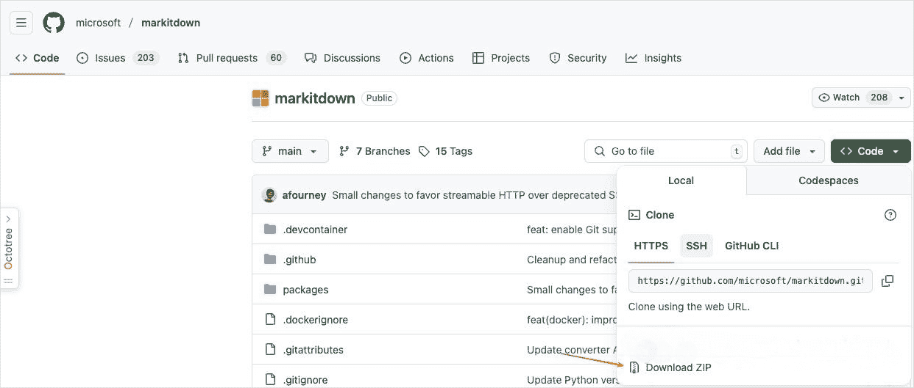

点击 `Download ZIP` 下载源代码。

**解压缩刚才下载的压缩包，使用 `Cursor` 打开刚才的 `markitdown` 文件，输入提示词：**

> 按照 `readme` 说明安装 `markitdown-mcp` 服务。

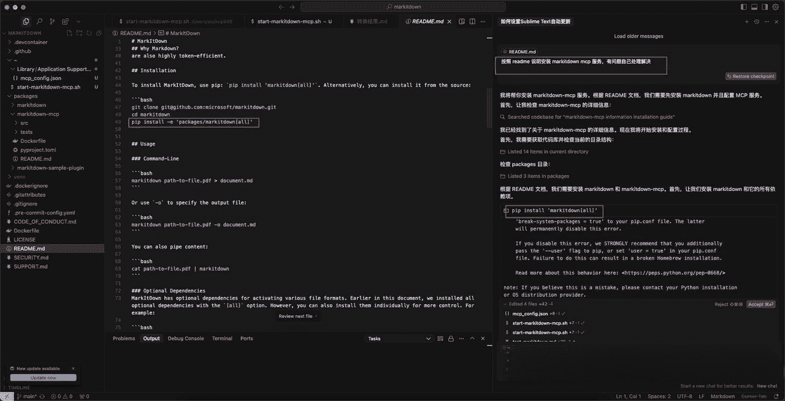

可以看到 `Cursor` 开始按照 `readme` 说明文档开始执行

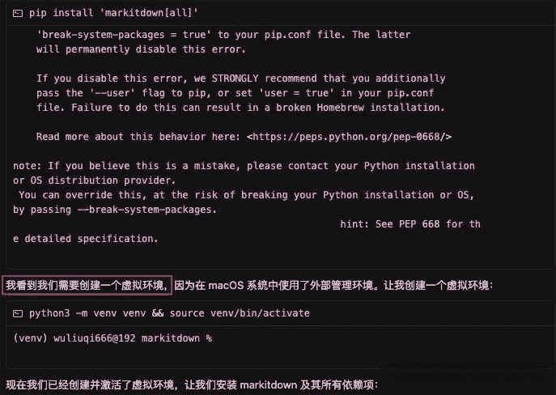

第一个命令执行失败，原因是需要创建一个虚拟环境，`Cursor` 开始自行创建，之后开始安装所需依赖。

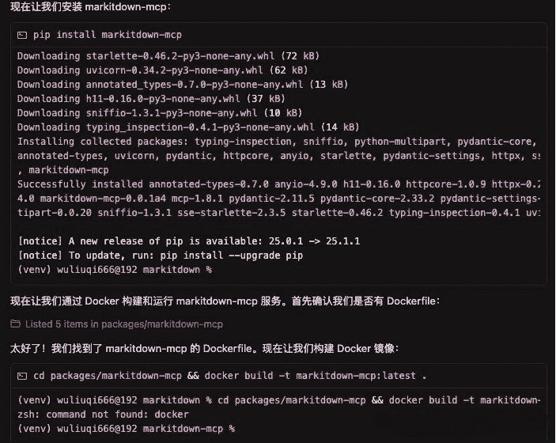

**之后开始安装** `markitdown-mcp`，发现需要安装 `Docker` 来运行 `markitdown` 服务。

> 开始查找项目中是否有需要的 `Dockerfile` 文件。找到 `Dockerfile` 文件之后开始按照 `Dockerfile` 文件安装 `Docker` 服务。

下载 `Docker` 失败之后，尝试使用其他方案启动 `markitdown-mcp` 服务，最后成功启动。

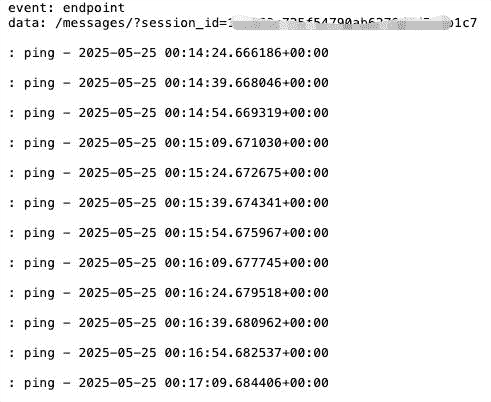

确认启动成功。

### 2.2 Cursor 集成 `markitdown-mcp` 服务

> **在 `Cursor` 中输入提示词：**

> 使用 `Cursor` 集成刚才创建的 `markitdown-mcp` 服务

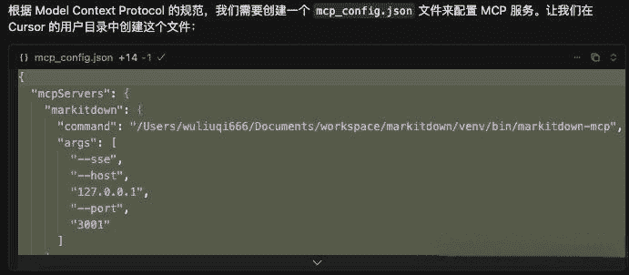

**创建** `mcp_config.json` **文件**，这一步就不需要自己去查找文档配置了。

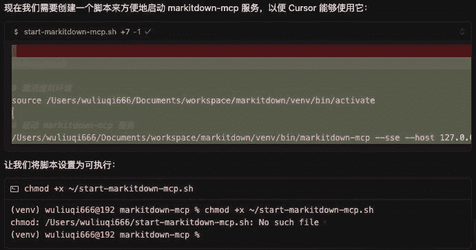

创建脚本启动 `markitdown-mcp` 服务，并设置执行权限。

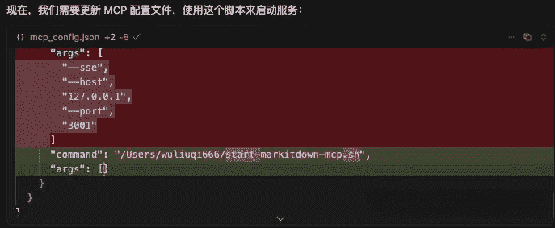

更新 `mcp_config.json` 中的执行脚本为刚才创建的脚本。

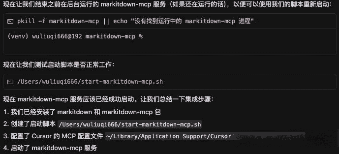

最后成功安装 `markitdown-mcp` 服务。

### 2.3 使用 `markitdown-mcp` 服务转换文档

> **在 `Cursor` 中输入提示词：**

> 查看原文件目录中已经有转换好的 `Markdown` 格式的文档了。

> 尝试了几个不同大小的文件，几 M 和几十 M 的文档都可以很好的转换。


再看一个图片转 `Markdown` 的案例

> 使用 `markitdown` 将下载目录中的“🛰️图片_2025-05-25_133959_147.jpg”转成 `Markdown` 格式


```
# 图片描述：微信图片_2025-05-25_133959_147.jpg

这张图片显示了一个户外自然场景，主要是一个绿树环绕的公园或自然区域。图片中可以看到：

- 蓝色的天空作为背景
- 大量绿色的树木和植被
- 一条木制栈道或小路
- 右侧似乎有一只鸵鸟或类似的长颈鸟类（从图片名称推测）
- 树木和围栏形成的区域可能是某种动物园或野生动物园区

## 图片元数据

- **文件名**：微信图片_2025-05-25_133959_147.jpg
- **日期**：2025-05-25（从文件名推测）
- **时间**：13:39:59（从文件名推测）
- **来源**：微信（从文件名推测）
```

## 3. 集成到 Markdown 编辑器中

> `Cursor` 控件集成到 `Markdown` 编辑器的现有代码中。

### 3.1 定位插入点

安装 `v-md-editor`

> 在项目中安装该依赖及其所需的主题和 `PrismJS`（用于代码高亮）

```
# 安装 v-md-editor 和 PrismJS
npm install @kangc/v-md-editor prismjs
```

此外，还需要安装一个主题包（例如 `GitHub` 主题）：

```
npm install @kangc/v-md-editor/lib/theme/github.js
```

### 3.2 事件监听

在 `Vue` 项目的入口文件（如 `main.js` 或 `main.ts`）中进行全局配置。

````
// main.js
import { createApp } from 'vue';
import App from './App.vue';

// 引入 v-md-editor 与主题
import VMdEditor from '@kangc/v-md-editor';
import githubTheme from '@kangc/v-md-editor/lib/theme/github.js';

// 引入基本样式和主题样式
import '@kangc/v-md-editor/lib/style/base-editor.css';
import '@kangc/v-md-editor/lib/theme/style/github.css';

// 引入 PrismJS 用于代码高亮
import Prism from 'prismjs';

// 使用主题和 PrismJS 进行初始化配置
VMdEditor.use(githubTheme, {
  Prism,
});

const app = createApp(App);
app.use(VMdEditor); // 全局注册 v-md-editor
app.mount('#app');
````

### 3.3 样式调整

在 Vue 组件中，使用 `v-md-editor` 非常简单。只需通过 `v-model` 双向绑定数据，即可实现编辑和预览功能。

```
<template>
  <div>
    <h2>Markdown 编辑器示例</h2>
    <!-- v-md-editor 组件支持设置编辑器高度、主题等属性 -->
    <v-md-editor v-model="text" height="500px" />
  </div>
</template>

<script setup>
import { ref } from 'vue';

// 初始化编辑器内容
const text = ref(`# 欢迎使用 Markdown 编辑器

这是一个基于 Vue 3 的 Markdown 编辑器示例，支持实时预览与代码高亮功能。`);
</script>

<style scoped>
h2 {
  margin-bottom: 16px;
}
</style>
```

> **在上述代码中：**

+   通过 `v-model` 将编辑器的内容绑定到 `text` 变量，实时更新数据；

+   通过 `height` 属性设置编辑器的显示高度，可以根据需求自定义其他配置项。

## 4. 第一个 Markdown 文件: Hello World!

### 4.1 新建笔记工作区

**例如，在 `D:` 盘创建了一个文件夹 `D:\Notes`，那么工作区就是这个 `D:\Notes` 文件夹**

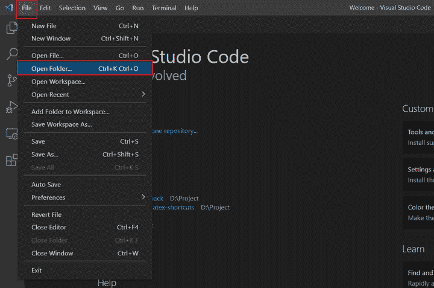

### 4.2 在工作区子笔记文件夹

**将笔记按照不同的课程放在不同的文件夹下，比如在 `Markdown` 学习中，可以先新建一个文件夹叫 `Learn`**

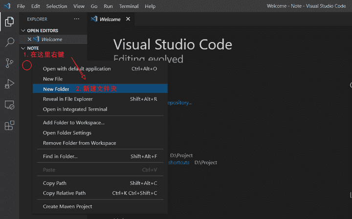

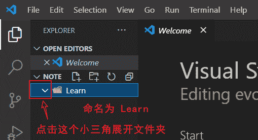

**新建一个文件，命名为 `test.md`，注意后缀一定要是 `.md`**

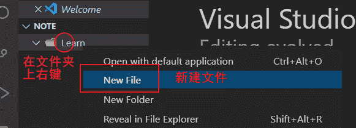

### 4.3 写下第一行 Markdown 笔记

**输入笔记内容：**

```
# Hello, World!
```

（注意，`#` 和文本之间要加入空格！）

**然后按照先后顺序按下快捷键 `Ctrl + K, V`，然后在右边就会出现预览窗口。**

> （注意，快捷键按下时要连贯，并且按下 `V` 的同时不用按 `Ctrl` 键！）

如果正常地显示出了标题 "Hello, World!"，那么恭喜你，第一个 Markdown 笔记写成功了！

## 5. 修改预览窗口背景

> **按下快捷键 `Ctrl + ,`，就会打开设置窗口。**

> 在搜索框输入 `Preview Theme`，看见标题为 `Preview Theme` 的选项，在下拉框中选择 `atom-dark.css`，就能让预览窗口的颜色改变了。

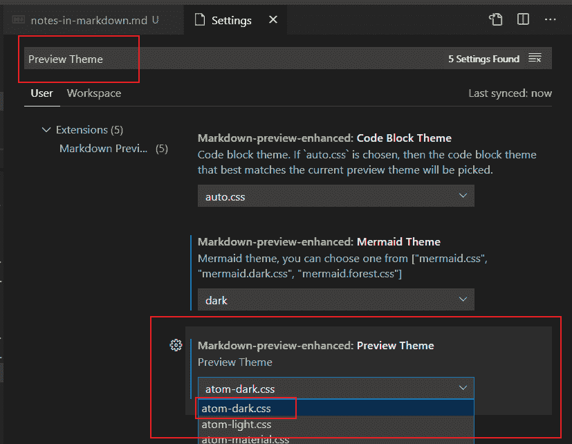

## 6. Markdown 语法

**纯粹的 Markdown 语法其实非常简单，70 行的语法介绍就可以写完。**


````
# 一级标题

## 二级标题

### 三级标题

每写完一个段落要隔一行空行。

就像这样，隔了一行空行。

---

分割线

**重点加粗**

*斜体*

~~删除线~~

---

列表：

* 无序列表
  * 嵌套无序列表
  * 嵌套无序列表
* 无序列表
* 无序列表

1. 有序列表 1
   1. 嵌套有序列表 1
   2. 嵌套有序列表 2
2. 有序列表 2
3. 有序列表 3

---

引用文本：

> 引用别人说的话
> 就这样写
> By. OrangeX4

---

这是 `行内代码` 语法。

代码块语法：

```python
print("Hello, World!")
```

请将 `'` 替换成反引号。

---

[超链接名称](链接地址)

---

表格：

| 表头 | 表头 |
| ---- | ---- |
| 内容 | 内容 |
| 内容 | 内容 |

---

注释：
````

> **快捷键：**

> 选中文本之后，按下 `Ctrl + B` 可以给选中文本加粗。

> 同理 `Ctrl + I` 可以让选中文本变为斜体。

### 6.1 列表

列表是记笔记时非常基本的元素，在 Markdown 中，可以用很方便的格式书写列表：

```
* 无序列表
  * 嵌套无序列表
  * 嵌套无序列表
* 无序列表
* 无序列表

1. 有序列表 1
   1. 嵌套有序列表 1
   2. 嵌套有序列表 2
2. 有序列表 2
3. 有序列表 3
```

Markdown Preview Enhanced 拓展功能：

```
任务列表：

- [x] 已经完成的事 1
- [x] 已经完成的事 2
- [x] 已经完成的事 3
- [ ] 仍未完成的事 4
- [ ] 仍未完成的事 5
```

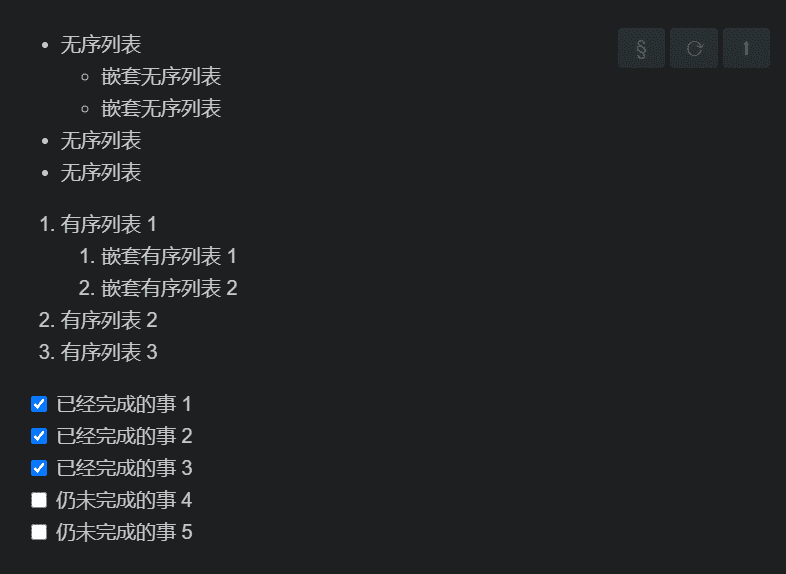

> **快捷键：**

> 要进行缩进（书写嵌套列表），你可以使用 `VS Code` 的快捷键 `Ctrl + [` 和 `Ctrl + ]`。

> 这个快捷键可以将代码向左或向右进行缩进！

### 6.2 引用和代码

````
引用文本：

> 引用别人说的话
> 就这样写
> By. OrangeX4

这是 `行内代码` 语法。

代码块语法：

```python
print("Hello, World!")
```

注意要将 `'` 替换成反引号。
````

Markdown Preview Enhanced 拓展功能：

````
代码行数的显示：

```javascript {.line-numbers}
function add(x, y) {
  return x + y
}
```

注意要将 `'` 替换成反引号。
````

### 6.3 超链接和图片

可以用下面的语法插入超链接和图片：


```
[超链接名称](链接地址)
例如，可以使用网址和图床：

[OrangeX's Blog]

![OrangeX's Avatar]

也可以在本地用相对地址：

[Other](other.md)
```

### 6.4 剪贴板图片插入

> **在使用之前，要做一点小调整：**

> 按下 `Ctrl + ,` 打开设置窗口，输入 `Paste Image Path` 并搜索，将框内的文本改成 `${currentFileDir}/images`。

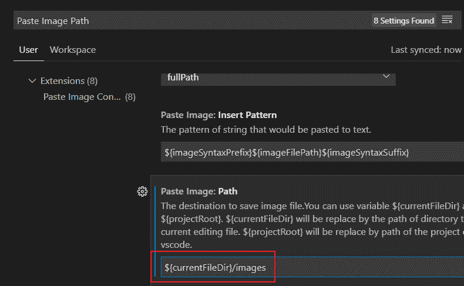

注意标题是 `Paste Image: Path`，不要弄错了！

设置好之后，就可以使用剪贴板粘贴功能了！

> 按下快捷键 `Ctrl + Alt + V`，

> 就能把图片自动保存到当前目录下，并以正确的格式粘贴到当前的 Markdown 文件中。

### 6.5 表格

可以很方便地在做笔记的时候加入表格：

```
表格：

| 表头 | 表头 |
| ---- | ---- |
| 内容 | 内容 |
| 内容 | 内容 |
```

Markdown Preview Enhanced 拓展功能：

```
拓展语法：

| 表头 | 表头 |
| ---- | ---- |
| 内容 | 内容 |
| >    | 内容 |

| 表头 | 表头 |
| ---- | ---- |
| 内容 | 内容 |
| ^    | 内容 |
```


> **快捷键：**

> 自动表格对齐：`Shift + Alt + F`

### 6.6 注释

> **注释不会被渲染出来。**

> 可以随手做点草稿，如果还想保留着，但是不显示，就可以按下快捷键 `Ctrl + \` 将当前行注释 / 反注释。

```
注释：

<!-- 你看不见我 -->

<!-- 多行注释
就这样 -->
```

有一点很重要的就是，`VS Code` 会在每次修改代码之后，重新渲染一遍

> 如果有很多很多的数学公式，渲染会很慢，这时候有两个建议：

+   分成多个文件，避免单文件过大！

+   将你暂时不看的部分注释掉，加快渲染速度！

## 7. 数学公式支持

Markdown 的数学公式吸纳了大部分的 `LaTeX` 语法，可以以一种简单的方式在 `VS Code` 中书写数学公式

```
行内公式：

单位圆 $x^2+y^2=1$

公式块：

$$
\begin{cases}
x=\rho\cos\theta \\
y=\rho\sin\theta \\
\end{cases}
$$
```

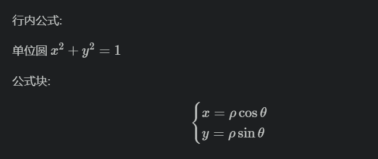

**`VS Code`** 有着非常便捷好用的自动补全功能，只需要简单地打出你想打的内容的几个字母（乱序也行）。

> 再使用 `↑ ↓` 进行选择，最后按下回车就可以打出你想要的内容。再使用 `HyperSnips` 插件，就能够写得飞快。

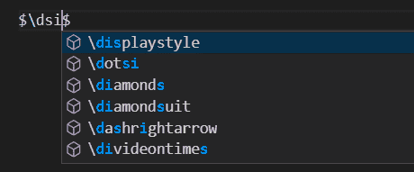

**还有，不要在公式内使用中文，除非是** `\text{中文}`**（但是也不推荐）**

### 7.1 上标和下标

```
上标 $x^2 + y^{12} = 1$

上标 $x_1 + y_{12} = 1$
```

`HyperSnips` 自动扩展：


### 7.1上标和下标

```
xsr  =>  x^{2}

xtp  =>  x^{...}

x1  =>  x_1

xii  =>  x_i

xsb  =>  x_{...}
```

### 7.2分式

```
较小的行内行分数 $\frac{1}{2}$

展示型的分式 $\displaystyle\frac{x+1}{x-1}$
```

其中 `\displaystyle` 用于将行内展示转为块状展示.

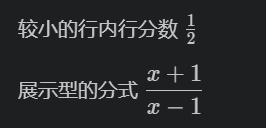

HyperSnips 自动扩展：

```
1/  =>  \frac{1}{...}

(1 + 2)/  =>  \frac{(1+2)}{...}

//  =>  \frac{...}{...}
```

### 7.3根式

```
开平方 $\sqrt{2}$

开 $n$ 次方 $\sqrt[n]{2}$
```

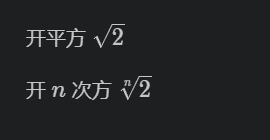

HyperSnips 自动扩展：

```
hsq  =>  \sqrt{...}
```

### 7.4空格

数学公式中的 空格和换行 都会在编译时 被忽略，想要实现「空格」的效果，需要用特别的命令。

```
紧贴 $a\!b$

没有空格 $ab$

小空格 $a\,b$

中等空格 $a\;b$

大空格 $a\ b$

quad 空格 $a\quad b$

两个 quad 空格 $a\qquad b$
```

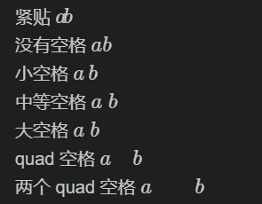

### 7.5累加, 累乘和积分

```
累加 $\sum_{k=1}^n\frac{1}{k}  \quad  \displaystyle\sum_{k=1}^n\frac{1}{k}$

累乘 $\prod_{k=1}^n\frac{1}{k}  \quad  \displaystyle\prod_{k=1}^n\frac{1}{k}$

积分 $\displaystyle \int_0^1x{\rm d}x  \quad  \iint_{D_{xy}}  \quad  \iiint_{\Omega_{xyz}}$
```

HyperSnips 自动扩展：

```
sum  =>  \sum_{...}

prod  =>  \prod_{<n=1>}^{<\infty>} ...

int  =>  \int

dint  =>  \int_{<-\infty>}^{<\infty>} ... \mathrm{d}x
```

Tips：按下 `Tab` 键可以跳转光标。

### 7.6括号修饰

**用 `\left` 和 `\right` 可以让括号适配内部大小**

```
圆括号 $\displaystyle \left(\sum_{k=1}^{n}\frac{1}{k} \right)^2$

方括号 $\displaystyle \left[\sum_{k=1}^{n}\frac{1}{k} \right]^2$

花括号 $\displaystyle \left\{\sum_{k=1}^{n}\frac{1}{k} \right\}^2$

尖括号 $\displaystyle \left\langle\sum_{k=1}^{n}\frac{1}{k} \right\rangle^2$
```


HyperSnips 自动扩展：

```
@(  =>  \left( ... \right)

@[  =>  \left[ ... \right]

@{  =>  \left\{ ... \right\}

@<  =>  \left< ... \right>

set  =>  \{ ... \}
```

### 7.7多行算式对齐

```
居中:

$$
\begin{aligned}
y &=(x+5)^2-(x+1)^2 \\
&=(x^2+10x+25)-(x^2+2x+1) \\
&=8x+24 \\
\end{aligned}
$$

左对齐:

$
\begin{aligned}
y &=(x+5)^2-(x+1)^2 \\
&=(x^2+10x+25)-(x^2+2x+1) \\
&=8x+24 \\
\end{aligned}
$
```

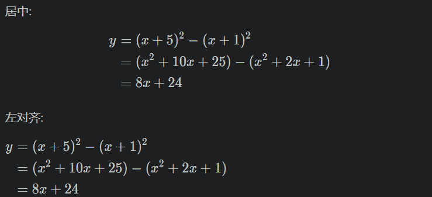

HyperSnips 自动扩展：

```
ali  =>
\begin{aligned}
... \\
\end{aligned}
```

如果安装了 `Better Markdown & Latex Shortcuts` 插件。

> 还可以按下 `Shift + Ctrl + Alt + C` 可以将行公式转为 `aligned` 环境。

### 7.8方程组

```
$$
\begin{cases}
k_{11}x_1+k_{12}x_2+\cdots+k_{1n}x_n=b_1 \\
k_{21}x_1+k_{22}x_2+\cdots+k_{2n}x_n=b_2 \\
\cdots \\
k_{n1}x_1+k_{n2}x_2+\cdots+k_{nn}x_n=b_n \\
\end{cases}
$$
```


HyperSnips 自动扩展：

```
case  =>
\begin{cases}
... \\
\end{cases}
```

### 7.9矩阵

```
矩阵:

$$
\begin{pmatrix}
1 & 1 & \cdots & 1 \\
1 & 1 & \cdots & 1 \\
\vdots & \vdots & \ddots & \vdots \\
1 & 1 & \cdots & 1 \\
\end{pmatrix}

\quad

\begin{bmatrix}
1 & 1 & \cdots & 1 \\
1 & 1 & \cdots & 1 \\
\vdots & \vdots & \ddots & \vdots \\
1 & 1 & \cdots & 1 \\
\end{bmatrix}
$$ 

行列式: 

$$
\begin{vmatrix}
1 & 1 & \cdots & 1 \\
1 & 1 & \cdots & 1 \\
\vdots & \vdots & \ddots & \vdots \\
1 & 1 & \cdots & 1 \\
\end{vmatrix}
$$
```

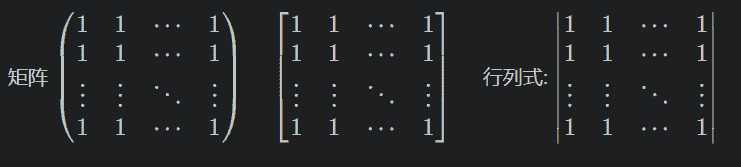

HyperSnips 自动扩展：

```
bmat2  =>  \begin{bmatrix} ... & ... \\ ... & ... \\\end{bmatrix}

vec2  =>  \begin{pmatrix} ... \\ ... \\\end{pmatrix}
```

tips：按下 `Tab` 键可以切换到下一个位置。

## 8.特殊字符

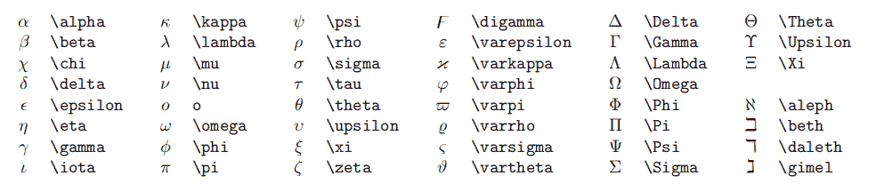

```
alpha  =>  \alpha

Sigma  =>  \Sigma
```

### 8.1公式编号与引用

```
$$
x+2 \tag{1.2}
$$

$$
\begin{equation}
x^n+y^n=z^n
\end{equation}
$$

由公式 $(1.2)$ 可得到结论
```

### 8.2零碎的重要语法

```
点乘 $\cdot$, 叉乘 $\times$, 异或 $\otimes$, 
直和 $\oplus$, 加减 $\pm$, 复合 $\circ$.
小于等于 $\leq$, 大于等于 $\geq$, 不等 $\neq$, 
恒等 $\equiv$, 约等 $\approx$, 等价 $\cong$, 
相似 $\sim$, 相似等于 $\simeq$, 点等 $\doteq$.
逻辑与 $\land$, 逻辑或 $\lor$, 逻辑非 $\lnot$, 
蕴涵 $\to$, 等价 $\leftrightarrow$.
因为 $\because$, 所以 $\therefore$, 存在 $\exist$, 任意 $\forall$.
左小箭头 $\leftarrow$, 右小箭头 $\rightarrow$, 
左大箭头, 右大箭头, 右长箭头 $\xrightarrow[fgh]{abcde}$.
属于 $\in$, 包含于 $\subset$, 真包含于 $\subseteq$, 交 $\cap$, 并 $\cup$, 空集 $\empty$
短向量 $\vec{x}`, 长向量 $\overrightarrow{AB}`, 
上横线 $\overline{p}`.
无限 $\infty`, 极限 $\lim`, 微分 ${\rm d}`, 偏导 $\partial`, 
点求导 $\dot{y}`, 点二阶导 $\ddot{y}`, 变化量 $\Delta`, 梯度 $\nabla`.
横省略 $\cdots`, 竖省略 $\vdots`, 斜省略 $\ddots`.
常见函数 $\sin$, $\cos`, $\tan`, $\arcsin`, 
$\arccos`, $\arctan`, $\ln`, $\log`, $\exp`.
```

HyperSnips 自动扩展：

```
**  =>  \cdot
xx  =>  \times
otimes  =>  \otimes
<=  =>  \le
!=  =>  \neq
==  =>  \equiv
~~  =>  \thickapprox
sim  =>  \sim
land  =>  \land
lor  =>  \lor
bec  =>  \because
thr  =>  \therefore
EE  =>  \exists
AA  =>  \forall
inn  =>  \in
sse  =>  \subseteq
sqs  =>  \sqsubseteq
cap  =>  \cap
cup  =>  \cup
empty  =>  \empty
oo  =>  \infty
lim  =>  \lim_{<n> \to <\infty>}
dd  =>  \mathrm{d}
part  =>  \frac{\partial <V>}{\partial <x>}
Delta  =>  \Delta
nabla  =>  \nabla
...  =>  \cdots
sin  =>  \sin
```

还有特别重要的数集、向量、矩阵符号：

```
RR  =>  \mathbb{R}
NN  =>   \mathbb{N}
txt  =>  \text{...}
xbar  =>  \bar{x}
xhat  =>  \hat{x}
xhvec  =>  \vec{x}
xhdot  =>  \dot{x}
Xbb  =>  \mathbb{X}
Xbs  =>  \boldsymbol{X}
Xbm  =>  \bm{X}
Xbf  =>  \mathbf{X}
Xsf  =>  \mathsf{X}
Xcal  =>  \mathcal{X}
Xfrak  =>  \mathfrak{X}
Xrm  =>  \mathrm{X}
```

## 9.输出为 PDF

在右侧预览栏邮件菜单, 选择 在浏览器中打开.

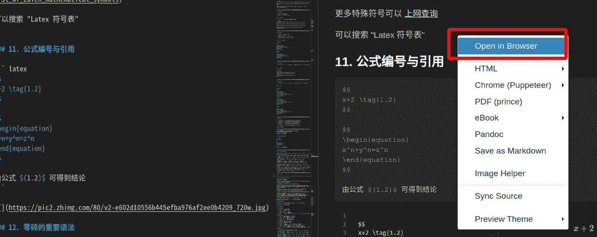

**在浏览器中右键选择 打印.**

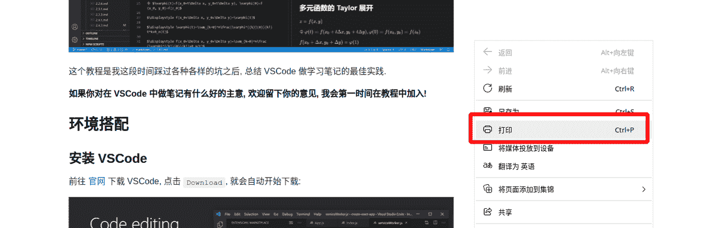

就能够 输出为 PDF 了.
