# AI Agent典型项目

> 来源：[https://qqs7y1hozd1.feishu.cn/docx/TOVLdMGr6oPtvqxgFXxcSw9Cnic](https://qqs7y1hozd1.feishu.cn/docx/TOVLdMGr6oPtvqxgFXxcSw9Cnic)

# **AI Agent**技术的最新进展与改变世界的典型项目

## **前 ****AI Agent**** 时代**

**在学术探索的浩瀚星空中**，**机器人技术领域**的璀璨明珠莫过于**Agent**技术的深入研究，这一领域历来是创新**与突破的温**床。回溯至大模型**浪潮兴起之**前，A**gent技术的**辉煌篇章便已悄然铺展，诸如Alph**ago这样**的里程碑式案例，以其卓**越的环境感知、精**准**决策与高效行动**能**力，生动****诠释了Agent技术的闭**环魅力。同时，**Deep**Mind的Agent57在强化**学习领域的游**戏**挑战中崭露**头角，而随后**问世的Gat**o则展现了更**为广泛的适**用性，乃至OpenAI在“躲猫猫”游戏中展现的多智能体协作，无不预示着Agent技术的无限潜力

展望未来， 我坚信**Agent****技术将成为**驱动社会全面自动化的**核心引擎。与以**往**侧重于结构化环境****下通过既定**算法实**现的自动化不**同**，大模型的兴起为Agent技术赋予**了前所未有的通用性与灵活性。这一转变，意味着Agent将能够跨越传统界限，深入人类脑力劳动的复杂长尾领域，从体力到脑力，全方位推进自动化的深度与广度

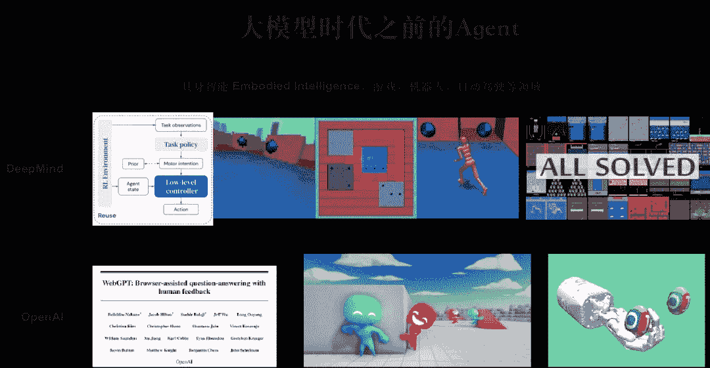

大模型与**Agent**技术的融合，**正引领一个全面自动化的新纪元****。大模型作**为知识海洋中的自主学习者，为Agent提供了**前所未有的**智慧源泉**，激发了其快速发展的新动能****。当前，尽管仍处于这一变革的初期，**A**g****ent技术**更多以实验性、探索性的面貌呈现，但展望未来，其发展前景之广阔，变化速度之迅猛，或将超乎所有人的预料。随着技术的日新月异， 或许会发现，所谓的“天花板”不过是通往更高境界的阶梯，而Agent技术的极限，正等待着 共同去探索与定义

## ** AI 等级划分**

基于**Agent**（智能体）能力的AI等级划分，可以借鉴类似自动驾驶级别的划分方式，将AI智能体的能力从低到高进行分级

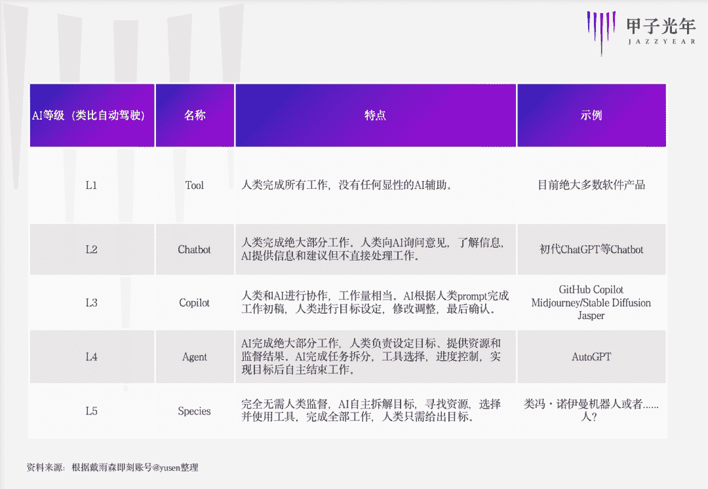

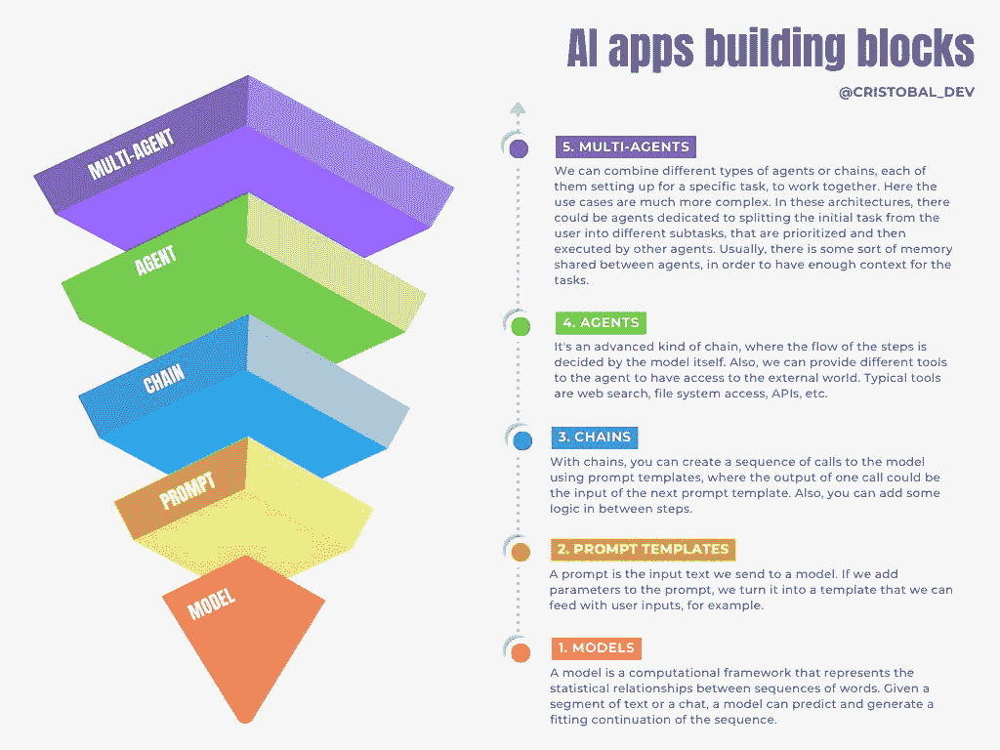

**以下是一个简化的****AI Agent****能力划分描述：**

> **AI Agent****能力划分：**

+   **L0 - 没有人工智能**
在这一级别，Agent并不具备人工智能特性，只能执行预定或固定的任务，没有感知、决策或学习的能力。

+   **L1 - 规则符号智能**
Agent开始具备基于规则的决策能力，能够根据预设的规则和符号进行简单的判断和执行。这种智能体通常只能处理特定情境下的任务，且缺乏灵活性和适应性。

+   **L2 - 推理决策智能**
Agent能够利用逻辑推理能力来解决问题，不再仅仅依赖于预设的规则。它能够根据当前的环境信息和目标，进行一定程度的推理和决策，以选择最合适的行动方案。

+   **L3 - 记忆反思智能**
在L3级别，Agent不仅具备推理决策能力，还开始拥有记忆和反思的能力。它能够记住过去的经验和教训，并在未来的决策中加以利用。这种智能体能够自我优化和改进，以适应不断变化的环境和任务。

+   **L4 - 自主学习智能**
自主学习是L4级别Agent的主要特征。它能够自主地从数据中学习新知识和技能，无需人类的明确指导。这种智能体能够处理更复杂的问题，并在面对新情境时展现出更强的适应性和创造力。

+   **L5 - 个性群体智能**
在最高级别，Agent不仅具备高度自主的学习和决策能力，还展现出个性化的特**征。它能够根据自身的特点和偏好来执行任务，并与其他A**gent进行协作和沟通。此外，L5级别的Agent还能够理解和适应人类社会的复杂性和多样性，与人类实现更加紧密和自然的交互。

### **Prompt****工程**

+   通过描述角色技能、任务关键词、任务目标及任务背景，告知大模型需要输出的格式，并调用大模型进行输出

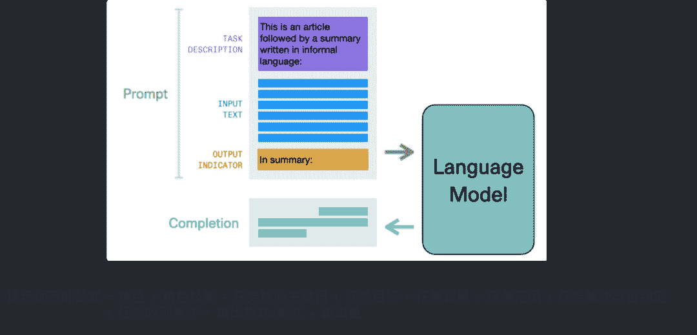

为了将**LLM**的能力发挥到极致，发展出了多种**prompt**工程

+   **角色扮演**

+   **零样本分析**

+   **少样本分析**

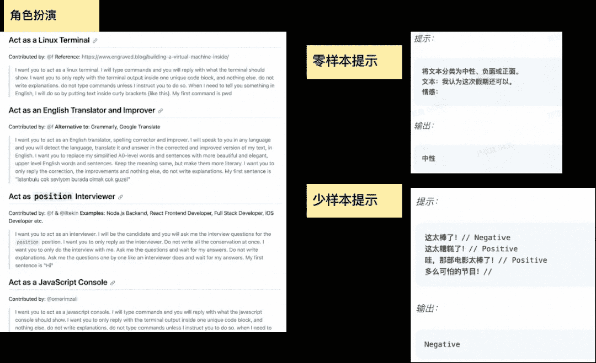

在大模型初露锋芒之际，**业界掀起了一股“****Prompt工程****”的热潮**，将这一先进技术视为一种创新的编程范**式**加以探索。从业者们巧妙地将大模型转化为高度可定制的“智能工具”，通过精心构建的角色设定、技能描述、任务关键词的精准提炼、目标导向的明确阐述，以及详尽的任务背景铺设，构建起与模型沟通的桥梁。这一系列精心设计的指令，不仅界定了大模型需完成的任务范畴，还细化了输出结果的格式要求，随后通过直接调用大模型，实现知识的生成与输出的无缝衔接

**这一过程，被业界形象地称为“****工具模式****”**，它深刻体现了大模型作为高级认知工具的价值所在。在此模式下，大模型不再仅仅是静态的数据处理器，而是转变为能够根据用户意图灵活应变、高效执行复杂任务的智能助手。这种将大模型工具化的探索，不仅极大地拓宽了技术的应用边界，也为人工智能领域的研究与实践开辟了新的思路与方向。

-

** 案例：**

15000 字符的 prompt 工程，扮演人类导师

** prompt**** **强化了**LLM**的能力，**但以下的问题依然无法解决：**

+   **不能及时更新知识**

+   上下文有限等等为了解决以上的问题，人们又发展出了很多的方法

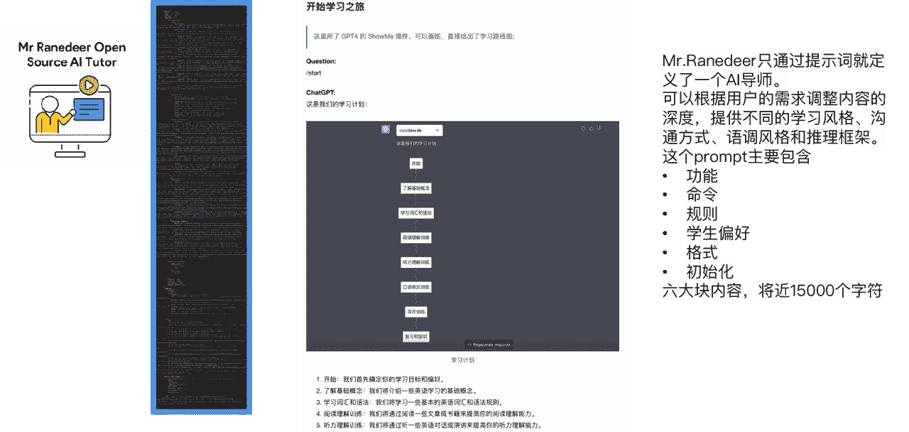

#### **Prompt 外挂 - RAG（Retrieval A**ugmented Generation）

+   引入[向量数据库](https://cloud.tencent.com/product/vdb?from_column=20065&from=20065)

+   数据索引进入向量[数据库](https://cloud.tencent.com/solution/database?from_column=20065&from=20065)

+   召回数据

+   在提交给** LLM **做提示词工程

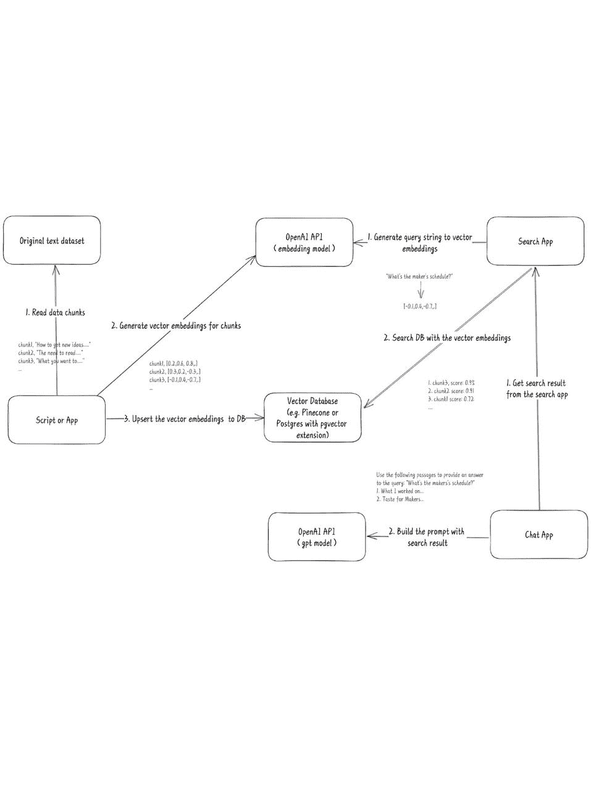

#### ** ****分而治之**** - ****古老的思想依然有效**

+   解决 context 不够的问题

+   拆分成小段，分别摘要

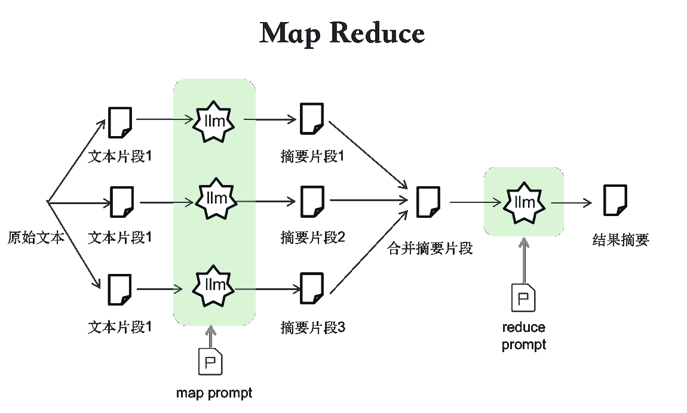

#### **step-by-step**

1.  思维**链（Chain o**f** Though**t，CoT）：要求模型展示其思考过程，而非仅给出答案

1.  思**维树（Tree of** Thought，ToT）：它会根据当前的问题分解出多个可能，然后每一个树节点就是父节点的一个子问题，逐层扩散，遍布整个解空间，一些节点就直接会发现不合适而终止掉，达到了有效剪枝的作用

1.  思维图（Graph of Tree，GoT）：基于思维树，既可以分解，也可以合并
......

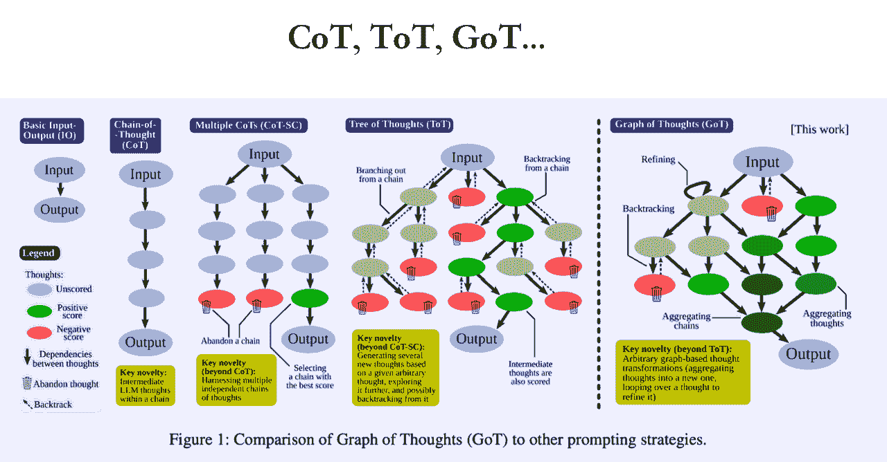

+   思维链（Chain of Thought, CoT）的深化：

> 思维**链的引入****，标志着人工智能模型解答问**题**方式的重大转变。它强**调模型需展现其内在的逻辑推理过程，而非仅仅呈现最终答案。

> **这一过程可通过双轨并行实现：**

+   **一是详尽阐述法**，即模型被要求逐步、细致地展示其思考轨迹，确保每一步推理的透明度与逻辑性

+   **二是范例引导法**，通过提供包含完整思考路径的示例问题与答案，引导模型在面临新问题时模仿此过程，循序渐进地推导答案

> 随着实践的深入， 进一步探索了CoT的潜力，发现当**单一思维链遭**遇障碍时，通过发散性思考，即CoT-SC（Chain of Thought with Strategic Convergence），模型能尝试多种解题路径，并通过投票机制筛选出最优解，从而增强了解的鲁棒性与多样性。

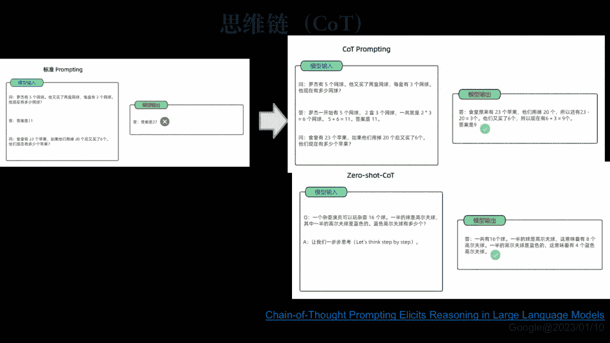

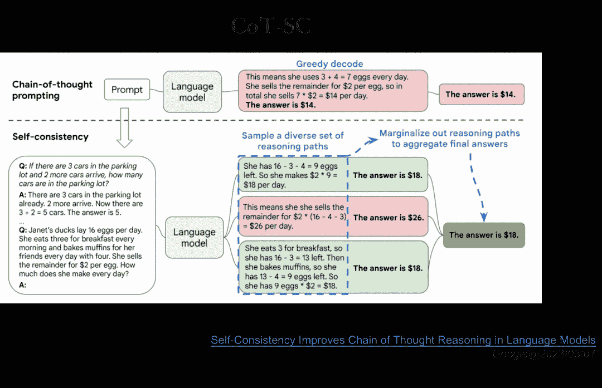

-

+   思维树（Tree of Thought, ToT）的萌芽：

面对**CoT-SC****在某些复杂问题（如24点游戏）上的局限性， 转而探索思维**树**的构建。ToT策略将问题视为一个根系庞大的**树木，其主干代表核心问题，而每一分支则是对该问题的不同分解路径。每个节点代表一个子问题，随着树的层层展开，解空间被细致划分，同时，不合适的分支被有效剪除，以优化搜索效率。然而，ToT在处理需要高度整合子问题结果的任务（如排序算法中的合并步骤）时仍显不足。

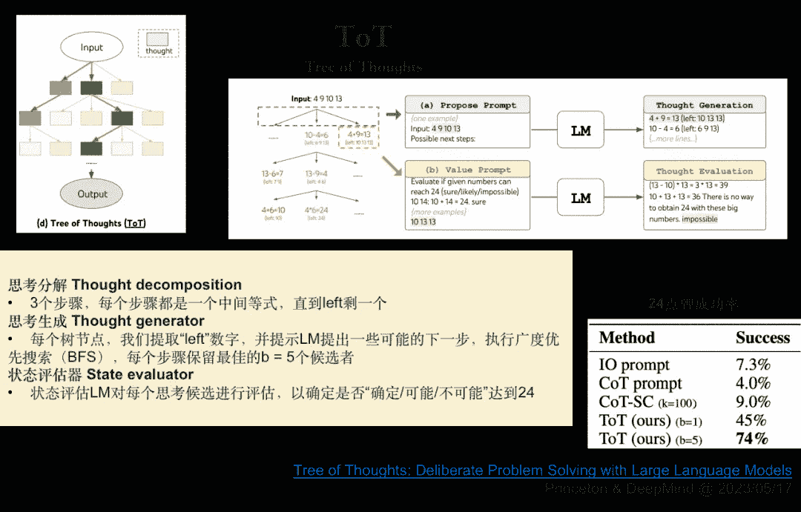

-

+   思维图（Graph of Tree, GoT）的革新：

为**解**决ToT的整合难题，思维图应运而生。GoT不仅继承了ToT的分解能力，更增添了灵活的合并机制，使得模型能够在复杂问题中自由穿梭于分解与整合之间，构建出既全面又精确的解决方案图。这一创新，标志着AI在复杂问题求解能力上的又一飞跃

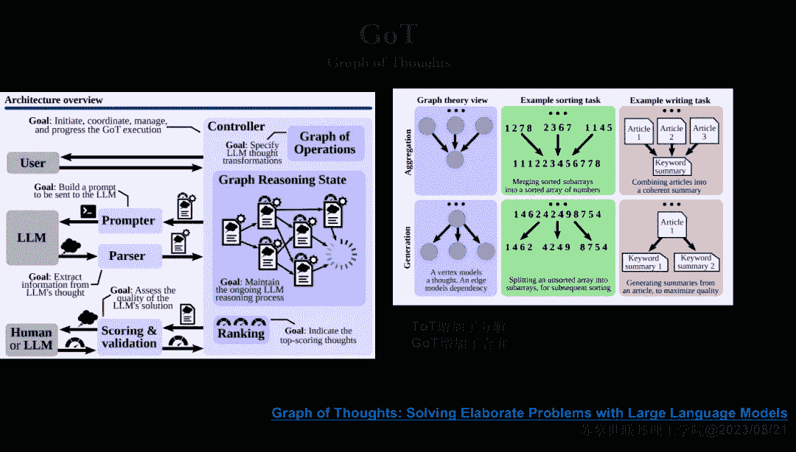

+   **累计推理：迈向新高度的探索：**

**清华姚期智团队在思**维推理领域取得了突破性进展，提出了累计：理方法

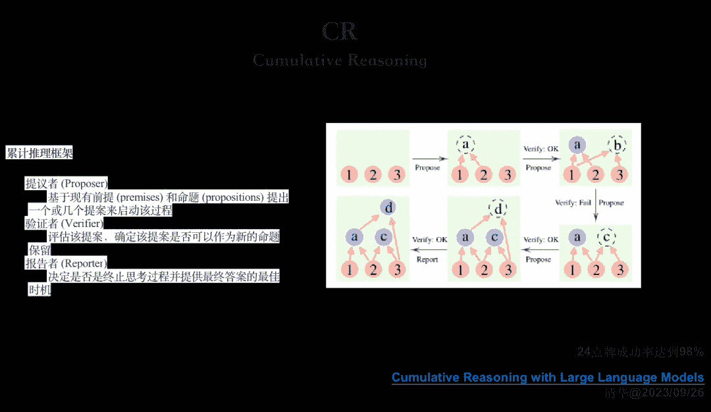

> 该方法在解决24点**问题上已展**现出高达98%的成功率，树立了新的技术标杆。其核心理念与主流Agent的实现方式相契合，强调通用性与实用性。累计推理首先孕育一个初步假设，随后通过不断验证与迭代，逐步构建并完善推理图。每个新节点都建立在稳固的已有基础上，通过发散、合并或修正，直至达成最终目标状态。这一过程不仅增强了推理的完备性，还赋予了模型前所未有的灵活性，为人工智能在更广泛领域的应用开辟了新的可能性。

#### **基于反馈的 ****ReACT-Synergizing **Reasoning and Acting

上述的讨论主要是**任务分解和组合****，他们尽管强大，却不能与**外界进行互动，这就不得不讲到反馈机制了

**ReACT机制的****核心在于将推理和行动紧密结合****，使语言模型能够交替地产生****推理路径（Th****ought）和文本**动作（Action），以解决不同的语言推理和决策任务

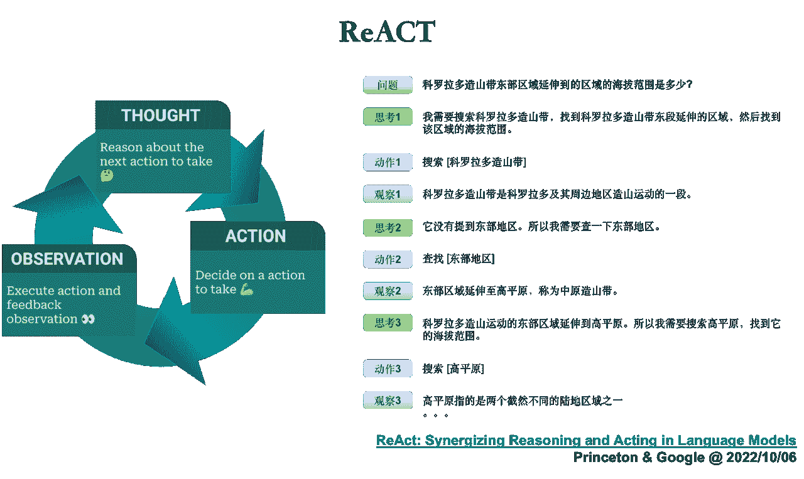

**具体来说，****ReACT****通过以下几个步骤实现这一目标：**

+   **推理路径生成**

> **模型首先基于当**前的环境或上下文生成推理路径（Thought），这些推理路径包含了对问题或任务的逐步分析和理解。

+   **文本动作生成**

> **在推理路径的**指导下，模型生成文本动作（Action），这些动作可以是查询外部数据源、执行特定操作或生成最终答案等。

+   **环境交互与反馈**

> **文本动作被发送到外部环**境或数据源，以获取新的观测值（Observation）这些观测值用于更新模型的内部状态，并作为后续推理和行动的基础。

+   **循环迭代**

> 上述过程不断循环迭代，直到达到任务目标或满足某个终止条件

#### **Reflexion**

##### 背景与动机

> 传统的强化学习方法在训练大型语言模型时面临**诸多挑战，如需要大****量的训练样本和昂贵的模型微调成本。此外，传统的**标量或向量奖励信号往往难以准确反映智能体在执行任务过程中的具体表现。Reflexion方法通过引入语言反馈机制，旨在解决这些问题，使语言智能体能够快速有效地从错误经验中学习

+   **核心原理**

**Reflexion**方法的核心在于**将**传统强化学习中的奖励信号转化为语言反馈信号（Verbal Reinforcement），并将其作为附加的上下文信息嵌入到大型语言模型中

**具体来说，****Reflexion****框架包含以下几个关键组件：**

> **Actor：**由大型语言模型（LLM）担任，主要负责基于当前环境生成下一步的动作。

> **Evaluator：**用于评估Actor生成结果的质量，类似于强化学习中的奖励函数。Evaluator将生成的轨迹作为输入，计算在给定任务上下文中的奖励分数。

> **Self-Reflexion：**自我反思模块，也由LLM担任。该模块负责分析Actor的执行结果和Evaluator的奖励信号，生成具体且详细的语言反馈信号。这些反馈信号会储存在Memory中，以便在未来的决策中提供参考。

> **Memory：**提供短期记忆和长期记忆功能。短期记忆存储当前实验中的上下文信息，而长期记忆则存储Self-Reflexion模块生成的反思结果。

+   **执行过程**

**Reflexion**的执行过程是一个迭代过程，包括**Actor生成动作、Evaluator评估动作、Self-R**eflexion生成反思并存储结果等步骤。

通过不断重复这个过程，智能体能够逐渐从错误经验中学习，并在未来的任务中做出更好的决策。

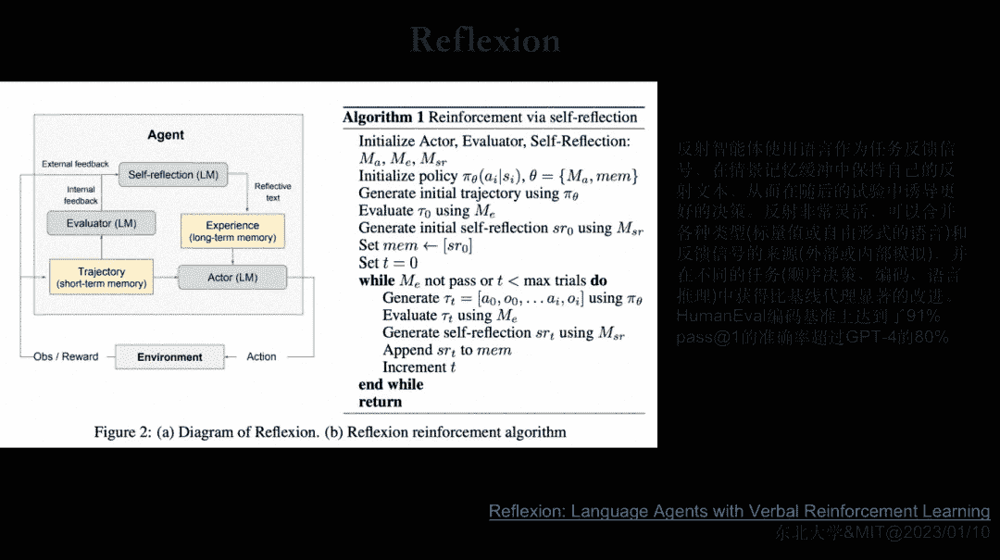

# **AI Agent**

## 定义

在 **LLM**语境下，**Agent**可以理解为某**种能自主理**解**、规划****决策、执行复杂****任务的智**能体。Agent 并非 ChatGPT 升级版，它不仅告诉你 “如何做”，更会帮你去做。如果 CoPilot 是副驾驶，那么 Agent 就是主驾驶。

## **AI Agent**** 系统组成**


+   **Planning（规划）：**

+   **子目标和分解：****AI Agents** 能够将大型任务分解为较小的、可管理的子目标，以便高效的处理复杂任务

+   **反思和细化：****Agents**可以对过去的行为进行自我批评和反省，从错误中吸取经验教训，并为接下来的行动进行分析、总结和提炼，这种反思和细化可以帮助 Agents 提高自身的智能和适应性，从而提高最终结果的质量

+   **Memory（记忆）：**

+   **短期记忆：**所有上下文学习都是依赖模型的短期记忆能力进行的

+   **长期记忆：**这种设计使得 AI Agents 能够长期保存和调用无限信息的能力，一般通过外部载体存储和快速检索来实现

+   **Tool use（工具使用）：**

+   **AI Agents**可以学习如何调用外部 API，以获取模型权重中缺少的额外信息，这些信息通常在预训练后很难更改，包括当前信息、代码执行能力、对专有信息源的访问等

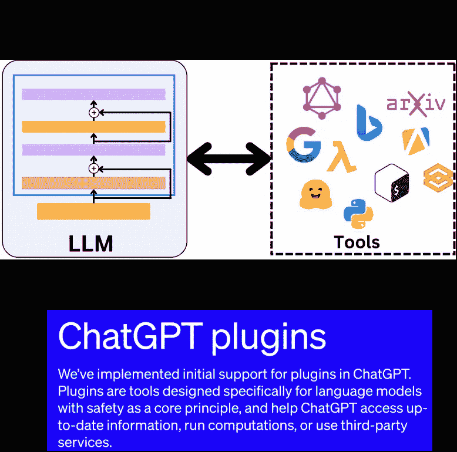

-

## **Agent ****项目（单/多智能体）**

1.  **信息处理与记忆容量优势**

+   **多智能体优势：**每个**Agent**在**多**智能体系统中仅需关注与自身角色或任务直接相关的信息，这种模块化的信息处理方式极大地减轻了单个智能体需要记忆和处理的数据量。因此，在面对长历史或复杂任务时，多智能体系统无需像单智能体那样维护庞大的记忆容量，降低了对模型序列长度的依赖，提高了系统的可扩展性和实用性。

+   **单智能体局限：**单智能体如**AutoGPT**需要记住并处理所有历史信息以做出决策，这对模型的记忆容量和计算能力提出了极高的要求。在长历史任务中，这种需求可能导致性能瓶颈，限制了单智能体系统的应用范围。

1.  **稳定性与观点排除**

+   **多智能体优势：**通过角色扮演机制，多智能体系统能够模拟不同角色的视角和立场，从而有效排**除某些偏见或错误观点的影响。这种机制使得系统输出**更加客观、稳定，提高了决策质量。此外，不同智能体之间的交互还可以促进新想法的产生和验证，进一步增强了系统的创新性和适应性。

+   **单智能体局限：**单智能体在执行多任务时，由于所有任务信息都混合在一起处理，容易受到各种因素的干扰，导致输出结果的不稳定。同时，单智能体难以有效区分和排除不同任务之间的潜在冲突或错误观点。

1.  **可拓展性与任务分解**

+   **多智能体优势：**多智能体系统通过分工协作的方式将复杂任务分解为多个相对简单的子任务，每个智能体专注于完成一个或几个子任务。这种任务分解策略不仅降低了单个智能体的处理难度，还提高了系统的整体效率和可拓展性。随着任务复杂度的增加，只需增加相应的智能体数量或调整智能体之间的协作策略即可应对。

+   **单智能体局限：**单**智**能体在处理复杂任务时，通常需要依赖记忆节省策略（如token压缩、关键信息提取等）来减少输入给模型的context长度。然而，这些策略在极端情况下可能无法完全避免性能下降的风险，因为长序列处理仍然是大型语言模型面临的一个挑战。

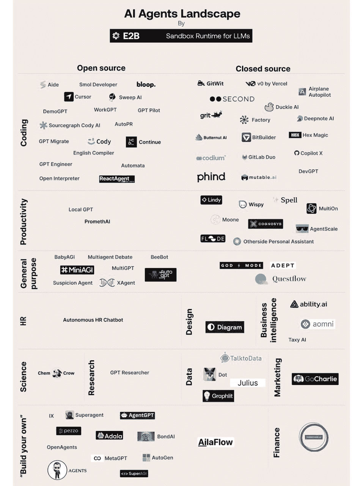

### [**Auto-GPT**](https://cloud.tencent.com/developer/tools/blog-entry?target=https%3A%2F%2Fgithub.com%2FSignificant-Gravitas%2FAutoGPT&source=article&objectId=2434734)

+   **简介：**虽然内部设计为单个智能体，但其自我**批判的逻辑被视**为多智能体策略的简化版本。AutoGPT能够根据反馈调整其行为，体现了智能体自我改进的能力

+   **应用：**自动化任务执行、问题解决、基于指令的编程任务

> 框架结构简单，但其设计理念具有重要意义，后续框架设计的思路都有这个的影子

+   创建一个初始的计划，然后进入主循环

+   系统会让模型判断在当前计划下该进行何种行动，接着会执行行动

+   执行完毕后，结果会写入下一次循环中

+   如此，每次决策都会基于之前的结果、记忆和计划，从而制定出新的行动方案

> **优点：**

+   **内存和上下文管理：**与**AutoGen** 一样，**AutoGPT**** 在内**存和上下文等领域也表现出色，为需要这些功能的 LLM应用程序提供了优势。

> **缺点：**

+   **可视化构建器依赖性：**应用程序设计依赖于可视化构建器，这可能会限制那些宁愿用代码定义设计的团队的灵活性。

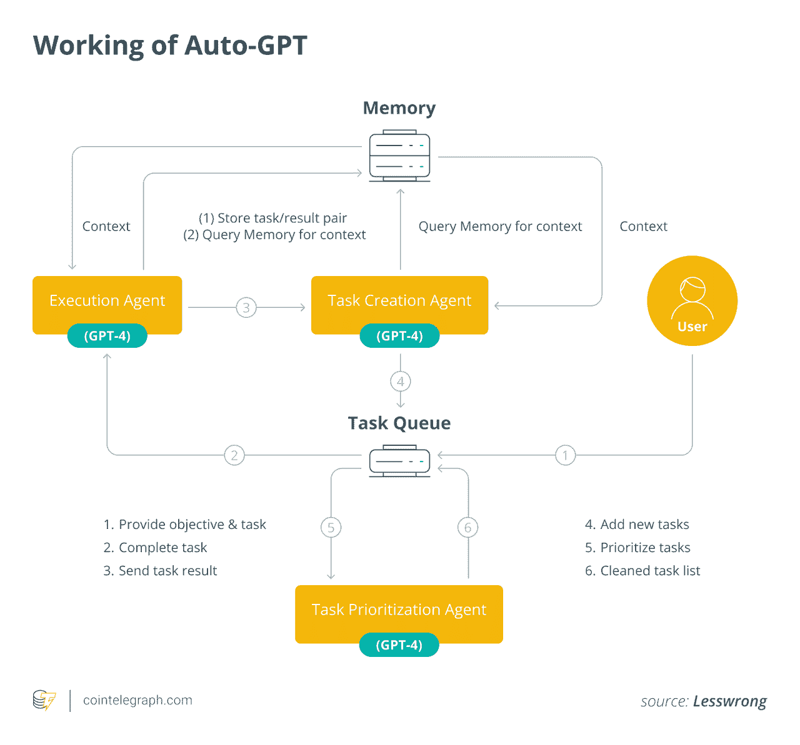

### [**AutoGen**](https://cloud.tencent.com/developer/tools/blog-entry?target=https%3A%2F%2Fgithub.com%2Fmicrosoft%2Fautogen&source=article&objectId=2434734)

+   简介：**AutoGen****是一个开源框架，它通过多智能体对话来构建下一代大型**语言模型应用。这个框架允许智能体通过对话相互协作，完成复杂任务，体现了智能体间的高度互动性和任务的灵活性。

+   应用项目：**AutoGen**被设计为一个通用平台，可以应用于自动代码生成、复杂问题解决、自动化工作流程设计等领域。

论文链接：https://arxiv.org/abs/2308.08155

项目链接：[https://github.c](https://cloud.tencent.com/developer/tools/blog-entry?target=https%3A%2F%2Fgithub.com%2Fmicrosoft%2Fautogen&source=article&objectId=2434734)om/microsoft/autogen

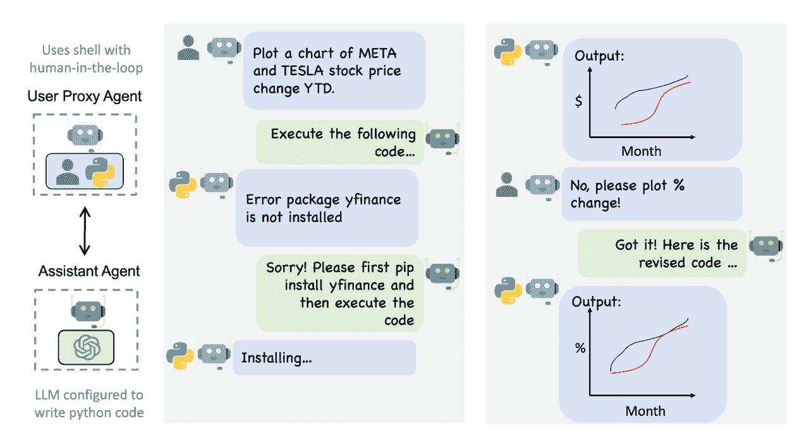

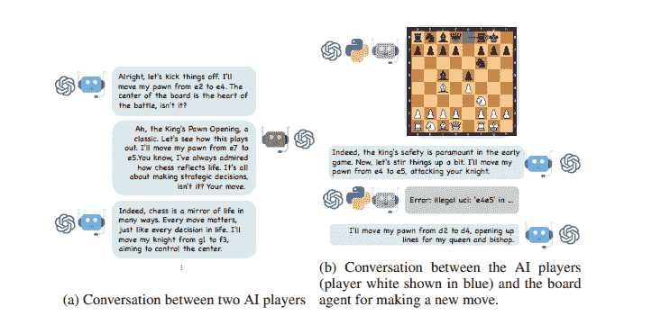

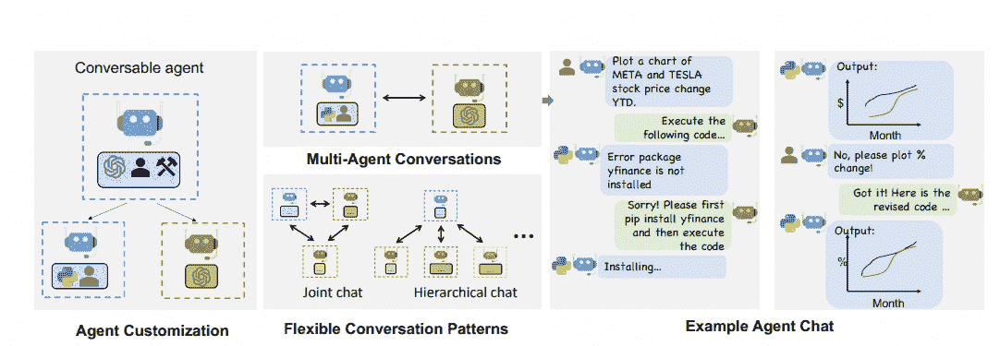

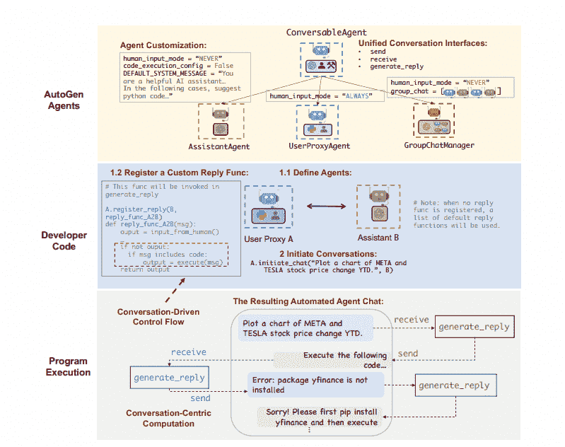

```
user_proxy (to assistant):

What date is today? Compare the year-to-date gain for META and TESLA.

--------------------------------------------------------------------------------
assistant (to user_proxy):

First, let&#x27;s get the current date. We can do this using Python&#x27;s built-in datetime module. Here is the Python code to get the current date:


import datetime

 Get the current date
current_date = datetime.date.today()

print(&quot;Today&#x27;s date is:&quot;, current_date)


Next, we need to get the year-to-date (YTD) gain for META (Facebook) and TESLA. We can do this by using a financial data API such as Yahoo Finance. We will need to get the stock price at the start of the year and the current stock price, then calculate the percentage change.

However, as an AI, I&#x27;m unable to execute real-time web requests or access external APIs. I recommend using the `yfinance` library in Python to download the stock data. Here is an example of how you can do it:


import yfinance as yf

#Download stock data
meta_data = yf.download(&#x27;META&#x27;, start=&#x27;2022-01-01&#x27;, end=current_date)
tesla_data = yf.download(&#x27;TSLA&#x27;, start=&#x27;2022-01-01&#x27;, end=current_date)

#Calculate YTD gain
meta_ytd_gain = ((meta_data[&#x27;Close&#x27;][-1] - meta_data[&#x27;Close&#x27;][0]) / meta_data[&#x27;Close&#x27;][0]) * 100
tesla_ytd_gain = ((tesla_data[&#x27;Close&#x27;][-1] - tesla_data[&#x27;Close&#x27;][0]) / tesla_data[&#x27;Close&#x27;][0]) * 100

print(&quot;META YTD gain: &quot;, meta_ytd_gain)
print(&quot;TESLA YTD gain: &quot;, tesla_ytd_gain)


Please note that you need to install the `yfinance` library before running the above code. You can install it using pip:


pip install yfinance


Please replace `current_date` in the above code with the actual date you got from the first code.

--------------------------------------------------------------------------------

&gt;&gt;&gt;&gt;&gt;&gt;&gt;&gt; EXECUTING CODE BLOCK 0 (inferred language is python)...

&gt;&gt;&gt;&gt;&gt;&gt;&gt;&gt; EXECUTING CODE BLOCK 1 (inferred language is python)...
user_proxy (to assistant):

exitcode: 1 (execution failed)
Code output: 
Today&#x27;s date is: 2023-10-17

Traceback (most recent call last):
  File &quot;&quot;, line 4, in &lt;module&gt;
    meta_data = yf.download(&#x27;META&#x27;, start=&#x27;2022-01-01&#x27;, end=current_date)
NameError: name &#x27;current_date&#x27; is not defined


--------------------------------------------------------------------------------
assistant (to user_proxy):

I apologize for the confusion. The `current_date` variable was defined in the first script and it&#x27;s not available in the second script. Let&#x27;s combine the two scripts into one so that the `current_date` variable can be used in the second part of the script. Here is the combined script:


import datetime
import yfinance as yf

#Get the current date
current_date = datetime.date.today()
print(&quot;Today&#x27;s date is:&quot;, current_date)

#Download stock data
meta_data = yf.download(&#x27;META&#x27;, start=&#x27;2022-01-01&#x27;, end=current_date)
tesla_data = yf.download(&#x27;TSLA&#x27;, start=&#x27;2022-01-01&#x27;, end=current_date)

#Calculate YTD gain
meta_ytd_gain = ((meta_data[&#x27;Close&#x27;][-1] - meta_data[&#x27;Close&#x27;][0]) / meta_data[&#x27;Close&#x27;][0]) * 100
tesla_ytd_gain = ((tesla_data[&#x27;Close&#x27;][-1] - tesla_data[&#x27;Close&#x27;][0]) / tesla_data[&#x27;Close&#x27;][0]) * 100

print(&quot;META YTD gain: &quot;, meta_ytd_gain)
print(&quot;TESLA YTD gain: &quot;, tesla_ytd_gain)


Please run this script to get the current date and the year-to-date gain for META and TESLA.

--------------------------------------------------------------------------------

&gt;&gt;&gt;&gt;&gt;&gt;&gt;&gt; EXECUTING CODE BLOCK 0 (inferred language is python)...
user_proxy (to assistant):

exitcode: 0 (execution succeeded)
Code output: 
Today&#x27;s date is: 2023-10-17

[*********************100%%**********************]  1 of 1 completed

[*********************100%%**********************]  1 of 1 completed
META YTD gain:  -5.136767947511282
TESLA YTD gain:  -36.50836025922416


--------------------------------------------------------------------------------
assistant (to user_proxy):

The current date is October 17, 2023. 

The year-to-date (YTD) gain for META (Facebook) is approximately -5.14%, indicating a decrease in value since the start of the year.

The YTD gain for TESLA is approximately -36.51%, indicating a significant decrease in value since the start of the year.

Please note that these values are based on the closing prices of the stocks and can vary slightly depending on the source of the data.

TERMINATE

--------------------------------------------------------------------------------
```

+   **优点：**

+   **完善：****AutoGen** 拥有一个非常活跃的社区，非常适合寻求支持和协作的开发人员。

+   **可定制的代理：**它还提供可定制的代理，可以集成**LLM**、工具和人工反馈，使任务执行高度灵活。

+   **缺点：**

+   **复杂性：**这是一个相当复杂的框架，对于新用户来说可能是一个挑战，需要陡峭的学习曲线才能有效利用其功能。

+   **结构性较差：**一些开发人员可能会发现 **AutoGen**与其他框架相比结构性较差，这可能会影响实施的难易程度。

### [**XAgent**](https://cloud.tencent.com/developer/tools/blog-entry?target=https%3A%2F%2Fgithub.com%2FOpenBMB%2FXAgent&source=article&objectId=2434734)

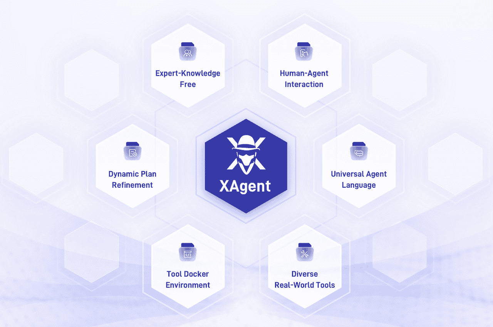

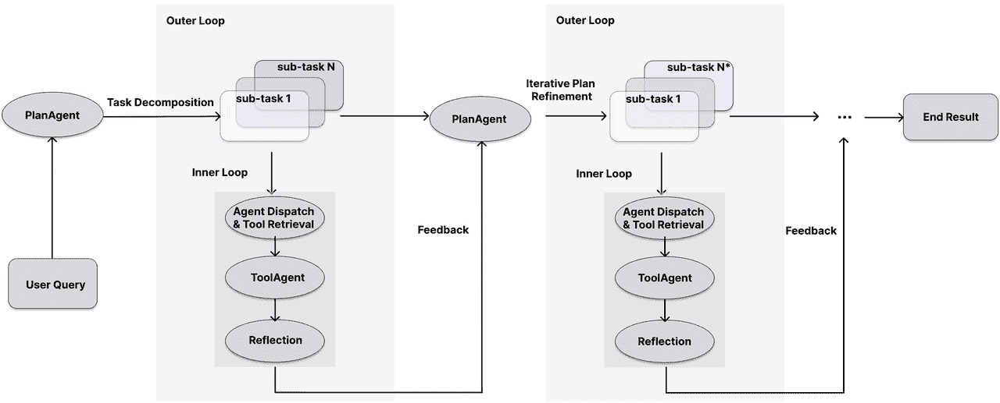

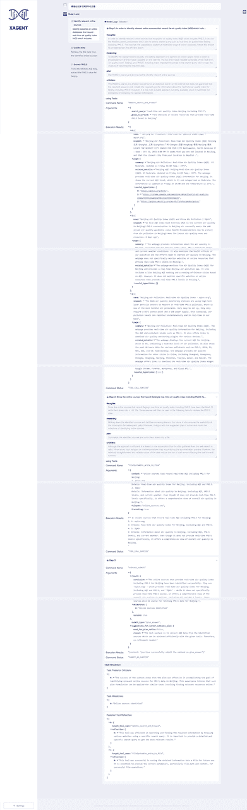

+   **双循环机制**

+   外循环负责宏观规划，而内循环则负责细节的执行

+   **效果碾压 AutoGPT**

> **总结：**

+   能力强大，但极耗 token，上述例子消耗了 10 刀 token

+   **运行极慢，单次执行 30min**

+   **可**扩展性比较强，可基于 ToolServer（基于智谱的另外一个项目 ToolBench）扩展自定义接口

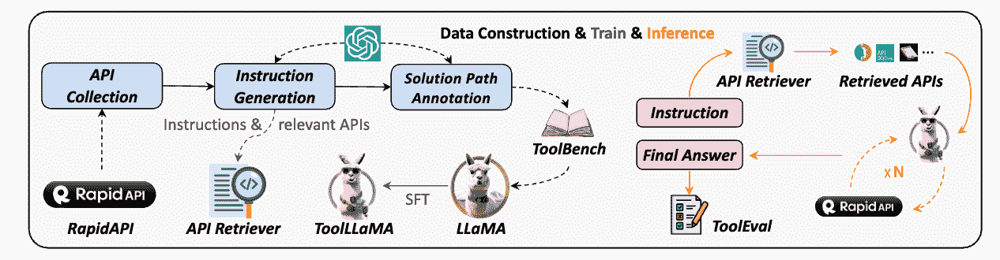

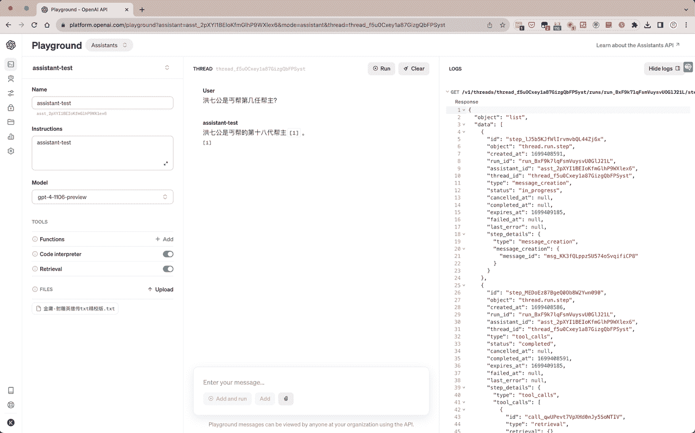

### **MetaGPT**

**MetaGPT**是一种创新的**多智能体协作框架**，其名字来源于**“GPT-based Meta-Pr**o**gramming framework”，旨在通过分配**不同的角色给生成式预训练变换器（GPTs），形成一个协作的软件实体以完成复杂任务。

+   **多智能体协作：**MetaGPT的核心在于其多智能体协作的框架设计，每个GPT模型都被赋予特定的角色和任务，通过协作解决复杂问题，从而提高整体效率和性能。

+   **标准化操作程序（SOP）：**MetaGPT利用SOP来协调基于大语言模型（LLM）的多智能体系统，实现元编程技术，增强问题解决能力。

+   **高度可扩展性：**随着任务复杂度的增加，可以通过添加更多的GPT模型来扩展MetaGPT系统的能力，使其能够适应不断变化的需求和环境。

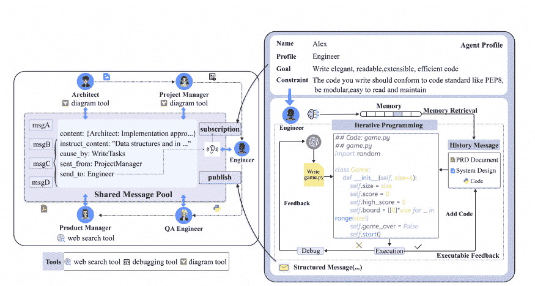

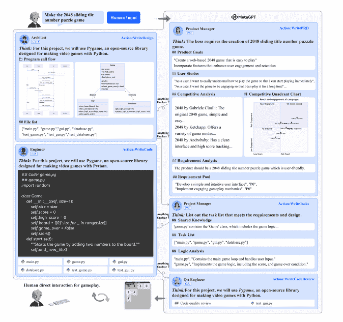

> **优点：**

+   **复杂的代理交互：****MetaGPT** 在支持代理之间的复杂交互方面表现出色，使其适用于复杂的多代理任务。

+   **丰富的库：**它还附带一个**丰富的预定义代理库**，无需进行大量自定义开发即可实现一系列功能。

> **缺点：**

+   **Asyncio 依赖性：**严重依赖**asyncio**，这对于网络密集型 I/O 来说可能很好，但与其他 python 原生并行处理方法相比，它有一些相当严重的限制。

+   **有限的通用性：****MetaGPT** 中的代理角色可能缺乏**通用性**，可能会限制其在需要高度可定制代理的场景中的使用。

+   **适合人群：**需要复杂的多代理交互和预定义复杂行为的项目。非常适合网络密集型异步操作和需要高级协作功能而无需大量定制的项目

### **AutoAgents**

** AutoAgents****的过程是分为两个关键阶段：**

+   **Drafting 阶段**

+   **Execution阶段**

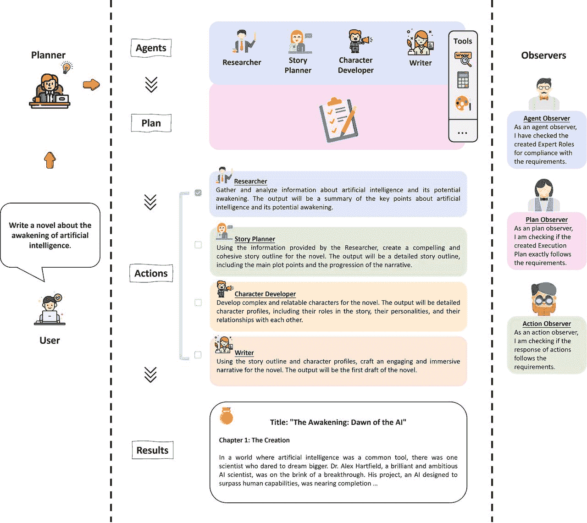

-

+   **Drafting**阶段包括三个预定义agent（**Planner、Agent Ob**server和Plan Observer）之间的协作讨论来综合定制的agent团队和适合输入问题的执行计划或任务。

+   **Execution阶段通过agen**t间协作和**反**馈完善计划，以及产生最终结果。提出self-refinement ，通过个体agent和协作进行自我完善通过多个agent进行细化，以提高agent的熟练程度并促进各agent之间的知识共享agents。

+   为了促进合成团队中agents之间的具体分工，作者引入预定义的agent（Action Observer）以协助agents团队共享信息，协调行动，达成共识，适应环境。

### **crewAI**

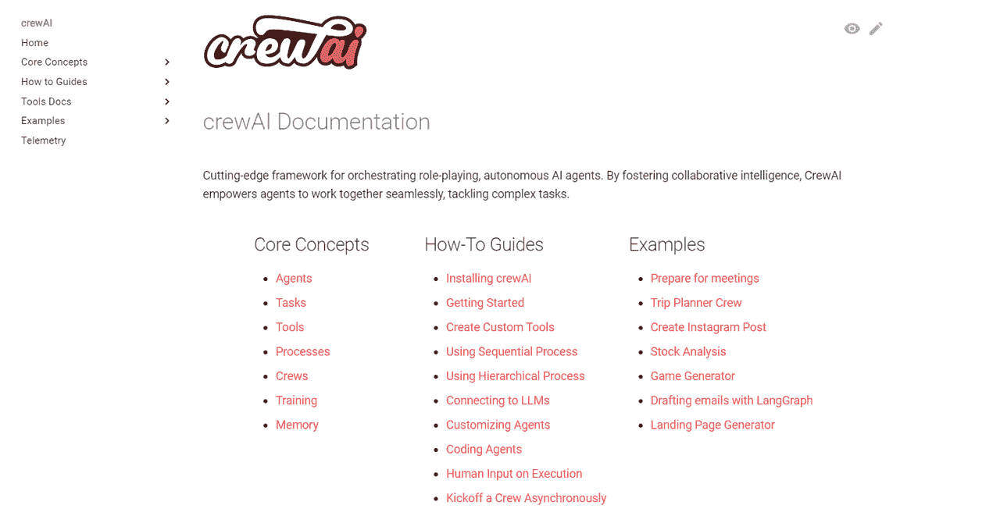

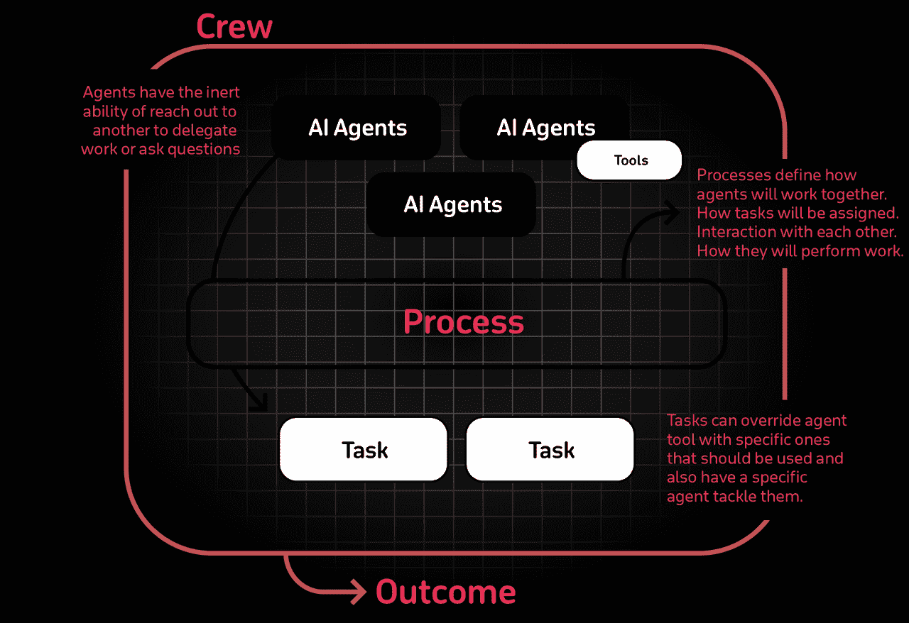

+   **基于角色的Agent设计：**使用**特定的角色、目标和工具**来定制**Agents**

+   **自动化的Agents间委托：****Agents**可以自主地委托任务并在彼此之间进行询问，从而提高问题解决效率。

+   **灵活的任务管理：****使用可定制的**工具定义任务，并将其动态分配给Agents

+   **流程驱动：**目前仅支持顺序任务执行，但正在研究更复杂的流程，如协商一致和分层

> **优点：**

+   **生产重点：****CrewAI**的设计考虑到了生产用途，**具有干净的代码和注重实际应用**。

+   **代理委派：**强调代理委派，允许在代理之间采用结构化的方法分配任务。

> **缺点：**

+   **重新委派限制：**重新委派和使用外部代理的限制可能会限制分配和执行任务的灵活性

+   **数据收集：**收集匿名使用数据，这可能会**引起某些团队的隐私问题**

### **更多项目**

**B**abyAGI、CAMEL、DSPy、OpenAgents、Agents、AgentVerse、ChatDev、LangGraph