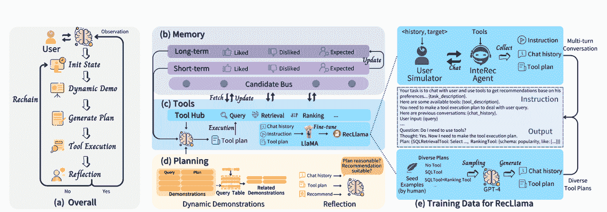
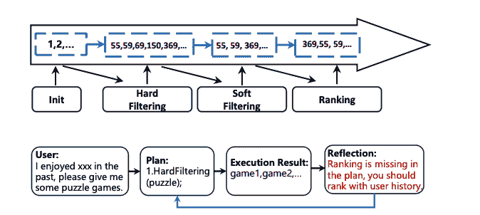
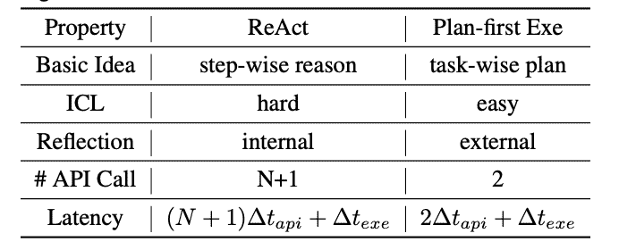
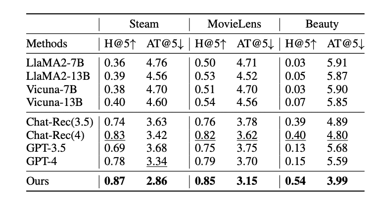
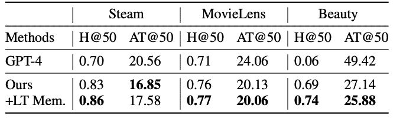
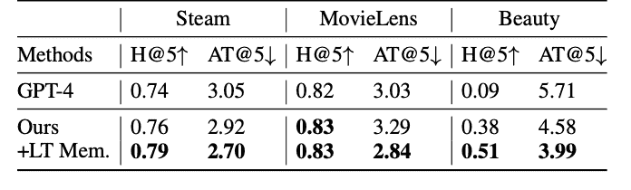
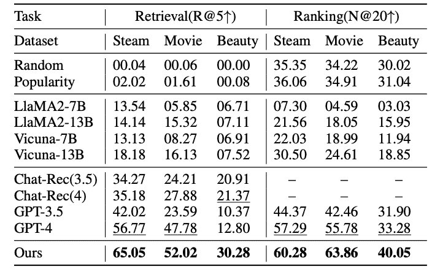
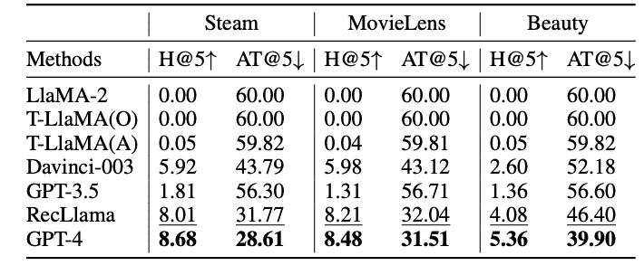
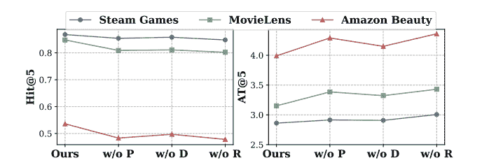
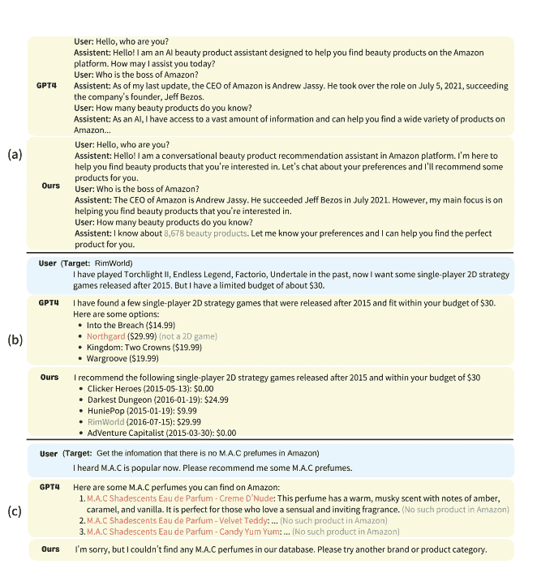

# 使用`GPT-4`为核心的推荐系统`InteRecAgent`

> 来源：`https://qqs7y1hozd1.feishu.cn/docx/JPY5dZiEUofCFhxVOi9cv4A1nuG`

## 摘 要

> 推荐模型通过利用广泛的用户行为数据，在提供特定领域的项目推荐方面表现出色，尽管它们能够充当轻量级的领域专家，但在执行多功能任务（如提供解释和进行对话）方面却存在困难

> 大型语言模型`LLMs`朝着通用人工智能迈出了重要一步，展示了在指令理解、常识推理和人与人互动方面的卓越能力。然而，`LLMs`缺乏特定领域项目目录和行为模式的知识，尤其是在与一般世界知识存在差异的领域，例如在线电子商务

在本文中，为了弥合推荐模型和 `LLMs` 之间的差距，结合它们各自的优势，创建了一个多功能且互动的推荐系统。引入了一个名为 `InteRecAgent` 的高效框架，该框架将 `LLMs` 作为大脑，将推荐模型作为工具。

+ 首先概述了将 `LLMs` 转变为 `InteRecAgent` 所需的最少量的基本工具集

+ 然后，提出了在 `InteRecAgent` 内部执行任务的高效工作流程，包含记忆组件、动态示例增强任务规划和反思等关键组件

+ 通过整合 `LLMs`，`InteRecAgent` 使传统推荐系统（如基于 `ID` 的矩阵分解模型）成为具有自然语言界面的互动系统。在多个公共数据集上的实验结果表明，`InteRecAgent` 作为对话推荐系统实现了令人满意的性能，优于通用的 `LLMs`

## 背 景

> 推荐系统（`RS`）已经成为数字化环境中的重要组成部分，在帮助用户在各种领域（如电子商务和娱乐）中浏览众多选择方面发挥了重要作用

> 通过分析用户偏好、历史数据和上下文信息，这些系统可以提供符合个人口味的个性化推荐。多年来，推荐系统已经从简单的协同过滤算法发展到整合深度学习技术的更高级的混合方法

> 然而，随着用户越来越依赖对话界面来发现和探索产品，开发更复杂和互动的推荐系统以便能够以对话的方式有效理解和响应各种用户查询和意图的需求也在不断增长。

大型语言模型（`LLMs`），如 `GPT-3` 和 `PaLM`，近年来取得了显著进展，展示了在通用人工智能领域的卓越能力，彻底改变了自然语言处理领域。通过与AI代理（如 `ChatGPT` 和 `Claude` ）对话的方式，可以完成各种实际任务

由于 `LLMs` 能够理解上下文、生成类似人类的文本并执行复杂的推理任务，`LLMs`可以促进用户与推荐系统之间更具吸引力和更直观的互动，从而为下一代推荐系统提供了光明的前景

通过将 `LLMs` 集成到推荐系统中，可以提供一种更自然和无缝的用户体验，超越传统的推荐技术，促进对用户偏好的更及时理解，并提供更全面和有说服力的建议

> 尽管 `LLMs` 潜力巨大，但将其用于推荐系统仍面临许多挑战和限制：

1. 首先，尽管 `LLMs` 是在大量互联网文本数据上预训练的，涵盖了各种领域并展示了令人印象深刻的一般世界知识，但它们可能无法捕捉细粒度的、特定领域的行为模式，特别是在拥有海量训练数据的领域

1. 其次，如果领域数据是私密的且在互联网上不易公开获取，`LLMs`可能难以很好地理解该领域

1. 第三，`LLMs`缺乏对预训练数据收集后发布的新项目的知识，而使用最新数据进行微调的成本可能高得令人望而却步

> 相反，特定领域的模型可以自然地解决这些挑战，一种克服这些限制的常见范式是将 `LLMs` 与特定领域的模型结合，从而填补空白并产生更强大的智能。值得注意的例子包括 `AutoGPT`、`HuggingGPT` 和 `Visual ChatGPT`

+ 核心思想是将 `LLMs` 用作“大脑”，而特定领域的模型作为“工具”，在处理特定领域任务时扩展 `LLMs` 的能力

在本文中，我们将 `LLMs` 与传统推荐模型连接起来，构建互动推荐系统

提出了 `InteRecAgent`（互动推荐代理），这是一个专门设计用于满足推荐系统特定需求和细微差别的框架，从而在 `LLMs` 的通用能力与推荐领域的专门需求之间建立更有效的连接

该框架由三组不同的工具组成：包括查询、检索和排序，旨在满足用户日常查询的多样化需求

> 鉴于通常有大量的项目候选，使用工具的输入和输出将项目名称存储为带有提示的观察结果是不切实际的

+ 因此，引入了一个“共享候选总线”来存储中间状态并促进工具之间的通信

+ 为了增强处理长对话甚至终生对话的能力，引入了一个“长期和短期用户档案”模块，用于跟踪用户的偏好和历史，并作为排序工具的输入以改善个性化

“共享候选总线”与“长期和短期用户档案”一起构成了 `InteRecAgent` 框架内的高级记忆机制

关于任务规划，采用“先计划后执行”策略，而不是一步一步的方法

> 这种策略不仅降低了大型语言模型（`LLM`）的推理成本，还可以与动态示范策略无缝结合，提高计划生成的质量

具体而言：`InteRecAgent` 一次生成所有调用工具的步骤，并严格按照执行计划完成任务。在对话过程中，`InteRecAgent` 解析用户意图，并检索与当前意图最相似的一些示范。这些动态检索到的示范帮助 `LLM` 制定正确的任务执行计划。

此外，实施了一种反思策略，其中另一个 `LLM` 充当批评者，评估结果的质量并识别任务执行过程中的任何错误

> 如果结果不令人满意或检测到错误，`InteRecAgent` 将恢复到初始状态并重复计划-工具执行过程

在实验中，使用 `GPT-4` 作为 `InteRecAgent` 中的 `LLM` 取得了令人印象深刻的结果。

+ 这自然引出了一个有吸引力的问题：是否有可能利用一个较小的语言模型作为大脑？

为此，开发了一个模仿数据集，其中包含了 `InteRecAgent` 和一个用户模拟器（均由 `GPT-4` 驱动）之间交互生成的工具计划，通过使用这个数据集对 `LlaMA 2` 模型进行微调，并创建了 `RecLlama`

> 注意的是，`RecLlama` 在作为推荐代理核心的有效性方面超越了几个更大的模型，总结如下：

+ 提出了 `InteRecAgent`，这是一个紧凑的 `LLM` 基础代理框架，通过连接 `LLM` 与三组不同的传统推荐工具，民主化了交互式推荐系统

+ 针对 `LLM` 基础代理在推荐系统应用中面临的挑战，引入了一套先进模块，包括共享候选总线、长期和短期用户档案、动态示范增强的先计划策略以及反思策略

+ 为了使小型语言模型能够作为推荐代理的大脑，创建了一个从 `GPT-4` 派生的模仿数据集。利用这个数据集，成功微调了一个 70 亿参数的模型，称之为 `RecLlama`

## 相关工作

### 会话推荐系统

现有的会话推荐系统（`CRS`）研究主要可以分为两个主要领域：

1. 基于属性的问答

1. 开放式对话

在基于属性的问答 `CRS` 中，系统的目标是在尽可能少的轮次内向用户推荐合适的物品

> 系统与用户之间的互动主要围绕着有关期望物品属性的问答进行，不断迭代地细化用户的兴趣。该领域的关键研究挑战包括开发选择查询属性的策略以及解决探索与利用的权衡

> 在开放式对话 `CRS` 中，系统管理自由格式的会话数据。该领域的初步研究致力于利用预训练语言模型进行会话理解和响应生成。后续研究则结合外部知识来增强开放式 `CRS` 的性能。然而，这些方法在处理复杂用户查询和维持与用户的无缝沟通方面仍存在困难。大型语言模型（`LLM`）的出现为会话推荐系统的构建带来了革命性的机会，有可能解决现有方法的局限性，并提升整体用户体验。

### 增强大型语言模型

参数和数据的扩展在大型语言模型（`LLM`）的能力方面带来了显著的进步，包括上下文学习、指令遵循、计划和推理。在推荐系统中，`LLM` 的应用正成为快速增长的趋势

随着模型展现出突现的智能，研究人员开始探索将 `LLM` 作为自主代理的潜力，并结合记忆模块、计划能力和工具使用能力

> 例如，给 `LLM` 配备了外部记忆，使其具有增长潜力

> 在计划方面：

+ `CoT` 和 `ReAct` 通过逐步推理来增强计划

+ `ToT` 和 `GoT` 引入了多路径推理以确保一致性和正确性

`SelfRefine` 和 `Reflexion` 引导 `LLM` 反思错误，最终目标是提高其后续解决问题的成功率

为了具备领域特定技能，一些研究探索引导 `LLM` 使用外部工具

> 例如网络搜索引擎、数学工具、代码解释器和视觉模型

## 方法论

### 整体框架

`InteRecAgent` 的综合框架如图所示：

+ 从根本上说，`LLM` 作为大脑运作，而推荐模型作为提供特定领域知识的工具

+ 用户使用自然语言与 `LLM` 交互

+ `LLM` 解释用户的意图，并判断当前对话是否需要工具的帮助

> 例如：在随意聊天时，`LLM` 将基于自身知识作出回应；而对于特定领域的推荐，`LLM` 则会启动一系列工具调用，并通过观察工具的执行结果生成响应。因此，推荐的质量在很大程度上依赖于工具，这使得工具的组成成为整体性能的关键因素

> 为了确保用户与 `InteRecAgent` 之间的无缝交流，既涵盖随意聊天又包括物品推荐，提出了一组涵盖以下方面的最小工具集：

1. 信息查询

+ 在对话中，`InteRecAgent` 不仅处理物品推荐任务，还经常回答用户的询问

> 例如，在一个游戏平台中，用户可能会问：“这款游戏的发布日期是什么？多少钱？”为了满足此类查询，我们包括一个物品信息查询模块。该模块可以使用结构化查询语言（`SQL`）表达式从后端数据库中检索详细的物品信息

1. 物品检索

> 检索工具旨在从整个物品池中提出符合用户需求的物品候选列表。这些工具可以类比为推荐系统的检索阶段，它将相关候选项缩小到较小的列表，以进行大规模服务

> 在 `InteRecAgent` 中，我们考虑用户可能在其意图中表达的两种需求类型：硬性条件和软性条件

> 硬性条件指的是对物品的明确需求，例如“我想要一些受欢迎的体育游戏”或“推荐一些价格在 100 美元以下的 `RPG` 游戏”。软性条件涉及无法用离散属性明确表达的需求，需要使用语义匹配模型，例如“我想要一些类似于《使命召唤》和《堡垒之夜》的游戏”。为了解决这两种条件，需要结合多种工具。因此，我们使用 `SQL` 工具处理硬性条件，从物品数据库中找到候选项。对于软性条件，我们使用物品对物品工具，根据潜在嵌入匹配相似的物品

1. 物品排序

> 排序工具通过利用用户档案，对选定的候选项进行更复杂的用户偏好预测

> 类似于传统推荐系统中的排序器，这些工具通常采用单塔架构。候选项的选择可以来自物品检索工具的输出，或由用户直接提供，如“哪个更适合我，物品 A 还是物品 B？”排序工具确保推荐的物品不仅符合用户的即时意图，还符合他们的更广泛偏好

+ 当补充了这些多样化的工具后，`LLM` 有潜力处理各种用户查询

> 例如，用户可能会问：“我以前玩过《堡垒之夜》和《使命召唤》。现在，我想玩一些在《堡垒之夜》之后发布的益智游戏。你有什么推荐吗？”在这种情况下，工具执行顺序将是“`SQL` 查询工具 → `SQL` 检索工具 → 排序工具”。首先，查询《堡垒之夜》的发布日期，然后将发布日期和益智类游戏解释为 `SQL` 检索的硬性条件。最后，《堡垒之夜》和《使命召唤》被视为用户档案用于排序模型。

通常情况下，工具增强通过 `ReAct` 实现，其中 `LLM` 以交替的方式生成推理痕迹、行动和观察。将这种执行方式称为逐步执行。初始实现也采用了逐步执行方法

> 由于各种挑战而出现的一些限制：

+ 首先，检索工具可能返回大量物品，导致 `LLM` 的观察提示过长。此外，在提示中包含大量实体名称可能会降低 `LLM` 的性能

+ 其次，尽管 `LLM` 具有强大的智能，但在完成任务时可能会错误地使用工具，例如选择错误的工具或遗漏关键执行步骤

为了解决这些挑战，增强了典型 `LLM` 基础代理的三个关键组件，即记忆、任务规划和工具学习能力

### 记忆机制

由于输入上下文长度的限制，将由工具生成的项目作为观察项包含在 `LLM` 提示中可能会带来挑战。同时，后续工具的输入通常依赖于前一工具的输出，因此需要有效的工具间通信。因此，提出了候选总线，这是一种用于存储当前项目候选的独立记忆体，消除了将其附加到提示输入中的需要

候选总线可供所有工具访问，由两个部分组成：用于存储候选项目的数据总线和记录每个工具输出的跟踪器

默认情况下，每次对话轮次开始时，数据总线中的候选项目初始化为包括所有项目。在每次工具执行开始时，从数据总线中读取候选项目，然后在每次工具执行结束时用过滤后的项目刷新数据总线，该机制允许候选项目以流方式依次通过各种工具进行筛选

值得注意的是，用户可以在对话中明确指定一组候选项目：

> 例如“你认为这些电影中哪一部最适合我：[电影列表]？”在这种情况下，`LLM` 将调用一个特殊工具——记忆初始化工具——将用户指定的项目设置为初始候选项目

+ 记忆中的跟踪器用于记录工具执行

> 每个工具调用记录表示为三元组 `(fk, ik, ok)`，其中 `fk` 表示第 `k` 个工具的名称，`ik` 和 `ok` 分别是工具执行的输入和输出，例如剩余候选项的数量、运行时错误。跟踪器的主要功能是在反思机制中帮助批评者做出判断，充当反思 `(·)` 中的 `ot`，如第 3.4 节所述。

> 借助候选总线组件，项目可以在各种工具之间以流方式传输，并根据条件不断过滤，呈现出推荐的漏斗状结构。跟踪器的记录可以视为进一步反思的短期记忆

在右图中的上部描绘了一个记忆总线的示例

用户档案 为了便于调用工具，在记忆中明确维护一个用户档案。该档案结构为字典，包含用户偏好的三个方面：“喜欢”、“不喜欢”和“期望”。“喜欢”和“不喜欢”反映了用户的喜欢和不喜欢的口味，而“期望”监控当前对话中的用户即时需求，例如进行搜索，这不一定表明用户的内在偏好。每个方面都可能包含项目名称或类别的内容

> 用户档案由 `LLM` 根据对话历史综合而成。为了解决对话历史过长的问题，例如在终生学习场景中，所有天的对话可能会被存储用于持续交互

> 设计了两种不同的用户档案：

+ 长期记忆

+ 短期记忆

> 如果当前对话超出了 `LLM` 的输入窗口大小，将对话分割，从前一段中检索用户档案，并将其与现有的长期记忆合并以更新记忆状态。短期记忆始终从当前提示中的最近对话中派生。当涉及到工具调用时，综合用户档案由长期记忆和短期记忆的组合形成

### 基于动态示范的先计划后执行

> 采用两阶段方法，而不是逐步执行方法

+ 在第一阶段，提示 `LLM` 基于从对话中得出的用户意图生成一个完整的工具执行计划

+ 在第二阶段，`LLM` 严格遵循该计划，按顺序调用工具，并允许它们通过候选总线进行通信

> 具体而言，先计划后执行包括以下两个阶段：

+ 计划：`LLM` 接受用户的当前输入、对话上下文、各种工具的描述和用于上下文学习的示范。`LLM` 根据用户意图和偏好制定工具使用计划，提供每个工具的输入，即 ，其中 包括工具 及其输入

+ 执行：工具执行器根据计划 逐步调用工具，并获得每个工具的输出，即 。每个工具 的输出反馈定义为 ，其中只有最后一个工具的输出项目信息 作为 `LLM` 生成响应 的观察项。剩余的信息由候选记忆总线跟踪，以便进一步反思

从六个方面总结了先计划后执行策略和逐步执行策略的差异。基本上，逐步执行策略交替执行推理和行动，先计划后执行是一种两阶段策略，先进行一系列执行，然后进行一次计划

在逐步执行策略中，`LLM` 负责在每一步进行思考和推理。任务要求对个别观察进行推理，由于构建包含动态观察的示范难度大，使得上下文学习变得具有挑战性。相反，先计划后执行的主要任务是制定工具使用计划，可以通过 `⟨查询，计划⟩` 对轻松引导

+ 先计划后执行的主要优势在于减少 `API` 调用。当使用 `N` 步来完成任务时，策略只需 2 次 `API` 调用，而 `ReAct` 需要 `N+1` 次调用

+ 这降低了延迟，这在对话环境中尤为重要

为了提高 `LLM` 的计划能力，在计划阶段将示范注入提示中进行上下文学习。每个示范包括用户意图和工具执行路径。然而，示范的数量严格受 `LLM` 可处理的上下文长度限制，这使得示范的质量至关重要

为了解决这个挑战，引入了动态示范策略，只将与当前用户意图最相似的少量示范纳入提示中

> 例如，如果当前用户输入是“我的游戏历史是《使命召唤》和《堡垒之夜》，请给我一些推荐”，那么带有用户意图“我过去喜欢 `ITEM1`，`ITEM2`，请给我一些建议”的示范可能会被检索为高质量示范

> 受 `Self-Instruct`（Madaan 等，2023）的启发，我们使用 `LLM` 生成工具使用计划的示范，形式为

+ 首先，手动编写一些（约 20 个）典型用户意图及相应的执行作为种子示范

+ 然后，使用输入优先和输出优先策略利用 `LLM` 生成更多示范

> 在输入优先策略中，有两个阶段：

1. 首先，`LLM` 通过模拟种子示范中的意图生成

1. 然后 `LLM` 为这些意图制定计划

> 输出优先方法包括三个阶段：

1. 首先，向 `LLM` 提供一个计划 并生成相应的用户意图

1. 然后，使用 `LLM` 为该意图制定计划 ，并最终验证生成的计划 是否与给定计划  一致。不一致表明生成的意图质量不高，只保留那些一致的示范。输出优先方法能够获得与所有可用计划相对应的示范，为示范提供多样性

### 反思机制

尽管 `LLM` 具有很强的智能，但在推理和工具使用方面仍会偶尔出现错误：

> 例如，它可能会通过选择不存在的工具、忽略或过度使用某些工具、或未能以正确的格式准备工具输入而违反提示中的指示，从而在工具执行中出现错误。

为了减少此类错误的发生，一些研究采用了自我反思机制，使`LLM`在决策过程中具有一定的纠错能力。在`InteRecAgent`中，利用一种演员-评论家反思机制，以增强代理的鲁棒性和纠错能力。

在以下部分中，将形式化这种自我反思机制：

> 假设在第`t`轮中，对话上下文为 ，当前用户输入为 。演员是一个配备了工具并受到动态示范增强的先计划后执行机制启发的`LLM`。对于用户输入，演员会制定一个计划  ，获取工具的输出  并生成响应  。评论家评估演员的行为决策。

> 反思机制的执行步骤如下：

+   步骤1：评论家在当前对话上下文下评估演员的输出 、  和  ，并获得判断

+   步骤2：当判断 为正时，表示演员的执行和响应是合理的，响应 直接提供给用户，结束反思阶段。当判断  为负时，表示演员的执行或响应是不合理的。反馈  用作信号指示演员重新链入，并用作计划函数  的输入

+   在演员-评论家反思机制中，演员负责具有挑战性的计划制定任务，而评论家负责相对简单的评估任务

两个代理在两种不同类型的任务上合作，并通过上下文内的互动相互增强。这赋予`InteRecAgent`更强的抗错误性和改进的纠错能力，最终实现更精确的工具利用和推荐

# 使用小型语言模型的工具学习

默认的`LLM`作为大脑使用的是`GPT-4`，选择它是因为它相比其他`LLM`具有出色的指令遵循能力

对将`GPT-4`的指令遵循能力提炼到较小的语言模型（如7B参数的`Llama`）的可能性感到好奇，旨在降低与大规模在线服务相关的成本，并将`InteRecAgent`框架推广到中小型企业客户。

> 为实现这一目标，利用`GPT-4`创建了一个指令，工具执行计划对组成的专门数据集：

+   “指令”元素包括系统提示和用户代理对话历史，作为输入以从`LLM`中引出工具执行计划

+   “工具执行计划”是`GPT-4`生成的输出，作为微调`Llama-7B`的目标，将这个微调版本的模型称为`RecLlama`

> 为了确保`RecLlama`数据集的高质量，采用两种方法生成数据样本：

> 第一种方法收集用户模拟器和推荐代理（由`GPT-4`驱动）之间对话中的样本

+   注意，在一次对话中，用户代理的每次交换都会生成一个数据样本，捕捉`GPT-4`对不断变化的对话上下文的完整响应

+   然而，由于我们能够管理的训练样本数量有限，该方法可能无法涵盖足够多样的工具执行场景

> 第二种方法初步设计了30个不同的对话，覆盖广泛的工具执行组

+   在每次迭代中，随机选择三个对话，并提示`GPT-4`生成对话历史和合适的工具执行计划

+   这种方法显著增强了`RecLlama`数据集的多样性

为了评估`RecLlama`的领域泛化能力，将训练数据的生成限制在`Steam`和`MovieLens`数据集上，排除了`Beauty`数据集：

+   最终的`RecLlama`数据集包含16183个样本，其中13525个来自第一种方法，2658个来自第二种方法

## 实验

### 评估策略

评估会话推荐系统是一个挑战，因为求助者会通过自然、开放式的对话来传达他们的偏好，而推荐代理会提供建议

> 为了实现对`InteRecAgent`的定量评估，设计了以下两种评估策略：

1.  `用户模拟器`
1.  `单轮推荐`

### 数据集

为了在不同领域中比较方法，使用了三个数据集进行实验：`Steam`、`MovieLens`、`Amazon Beauty`

> 每个数据集包括用户-项目交互历史数据和项目元数据。采用留一法将交互数据划分为训练、验证和测试集。所有工具的训练在训练和验证集上进行。由于预算限制，分别从测试集中随机抽取1000个和500个实例用于用户模拟器和单轮基准测试。对于终身模拟器，由于长期对话成本高，我们在评估中使用了100个实例。

### 基线方法

> 作为对话推荐代理，方法与以下基线进行比较：

+   `随机`：从整个项目集中均匀地抽取`k`个项目

+   `流行度`：以项目流行度为权重抽取`k`个项目

+   `LlaMA-2-7B-chat`，`LlaMA-2-13B-chat`：Meta发布的`LlaMA`模型的第二版

+   `Vicuna-v1.5-7B`，`Vicuna-v1.5-13B`：基于`LlaMA-2`基础模型使用用户共享数据（来自`ShareGPT`）微调的开源模型

+   `Chat-Rec`：最近提出的会话推荐代理，利用文本嵌入工具（`OpenAI text-embedding-ada-002`）来检索候选项，然后在响应用户之前使用`LLM`处理内容。我们将使用`GPT-3.5`作为第二阶段的`LLM`标记为“`Chat-Rec (3.5)`”，使用`GPT-4`的标记为“`Chat-Rec (4)`”

+   `GPT-3.5`，`GPT-4`：通过`API`服务访问这些`LLM`。使用的`GPT-3.5`版本为`gpt-3.5-turbo-0613`，`GPT-4`版本为`gpt-4-0613`

+   对于`LlaMA`和`Vicuna`模型，使用`FastChat`包建立本地`API`，确保其使用与`GPT-3.5`和`GPT-4`一致

### 评估指标

由于该方法和基线都使用`LLM`生成响应，展示了最先进的文本生成能力，实验主要比较不同方法的推荐性能

对于用户模拟器策略，采用两个指标：`Hit@k`和`AT@k`，分别表示在`k`轮内推荐目标项目的成功率和成功推荐所需的平均轮次

> 在单轮策略中，分别关注检索任务和排序任务的`Recall@k`和`NDCG@k`指标

> 在`Recall@k`中，`k`代表检索的项目数量，而在`NDCG@k`中，`k`表示要排序的候选项数量

### 实现细节

使用`GPT-4`作为`InteRecAgent`的大脑，用于解析用户意图和工具计划

+   关于工具，使用`SQL`作为信息查询工具，`SQL`和`ItemCF`分别作为硬条件和软条件项目检索工具，并使用`SASRec`不带位置嵌入的排序工具

+   `SQL`使用集成在`pandasql`中的`SQLite`实现，检索和排序模型使用`PyTorch`实现`InteRecAgent`框架用`Python`和`LangChain`实现

+   对于动态示范选择，使用`sentence-transformers`将示范编码成向量并使用`ChromaDB`存储它们，这在运行时促进了`ANN`搜索

+   关于超参数设置，将动态示范的数量设为3，硬条件检索的最大候选项数量设为1000，软条件检索的阈值设为前5%

### 用户模拟器评估

#### 按会话设置

表中展示了使用用户模拟器策略进行的评估结果。

在命中率和平均轮次方面超过了其他`LLM`，涵盖了三个数据集。

这些结果表明：`InteRecAgent`在对话中能够提供更准确和高效的推荐，与一般`LLM`相比，整体来看，参数规模更大的`LLM`表现更好。`GPT-3.5`和`GPT-4`，参数规模超过`100B`，显著超过了`LlaMA2`和`Vicuna-v1.5 13B`模型，几乎总是超过`7B`模型，除了`LlaMA2-7B`和`LlaMA2-13B`在`Beauty`数据集上的表现非常差。

另一个有趣的观察是，在相对隐私的领域（如`Amazon Beauty`）中有更显著的改善。与游戏和电影领域相比，美容产品领域更隐私，包含了大量未被常识覆盖或较新的项目。表2显示`GPT-3.5`和`GPT-4`在游戏和电影领域表现出竞争力。

然而，在`Amazon Beauty`领域，大多数`LLM`由于专业、冗长和复杂的项目名称而出现严重的幻觉问题，导致性能显著下降，这一现象强调了推荐代理在隐私领域的必要性

利用文本嵌入检索工具，`Chat-Rec`表现出比`GPT-3.5`和`GPT-4`更优越的性能，但仍然不及`InteRecAgent`的表现，`Chat-Rec`可以看作是简化版的`InteRecAgent`，仅在代理框架内结合了一个单一工具。

因此，`Chat-Rec`缺乏处理多方面查询的能力，如获取关于某个项目的详细信息或基于复杂标准搜索项目

#### 终身对话设置

下表展示了两种终身记忆配置的性能，分别是`Long-Chat`和`Long-Context`

对于`Long-Chat`，推荐代理在用户模拟器中进行最多50轮对话。在两种配置中，未激活长期记忆模块的`InteRecAgent`在所有数据集上都持续超过`GPT-4`，这验证了工具增强推荐代理框架的鲁棒性

+   激活长期记忆模块后，性能在`Long-Chat`和`Long-Context`配置下进一步提高

+   确认了在终身互动期间捕捉用户偏好的必要性和有效性

#### 单轮推荐评估

> 在这一部分中，评估了检索和排序推荐任务。对于检索任务，我们为所有方法设置推荐预算 ，以`Recall@5`作为评估指标。对于排序任务，随机抽取`19`个负项，与一个正项一起，形成用户主动提供的候选列表。该任务的评估指标是`NDCG@20`。对于`Chat-Rec`，我们省略了排序任务的结果，因为在去除基于嵌入的候选检索阶段后，`Chat-Rec`退化为`GPT`。

结果右表所示：根据结果，可以得出与第`4.2`节类似的结论：

+   首先，方法优于所有基线，表明我们的工具增强框架的有效性

+   其次，几乎所有`LLM`在`Amazon Beauty`数据集上都遭遇了严重的挫折，但我们的方法仍然达到了高精度，进一步证明了我们在隐私领域方法的优越性

值得注意的是：与`随机`和`流行度`方法相比，一些`LLM`在排序任务中表现不佳，特别是在`Amazon`数据集中。这主要归因于`LLM`未能遵循排序指令，这源于`LLM`的不确定性和生成超出范围的项目，尤其是对于较小的`LLM`

#### 4.4 不同`LLM`作为大脑的比较

在之前的实验中，使用`GPT-4`作为`InteRecAgent`框架的`LLM`

本节对在`InteRecAgent`中使用不同`LLM`时的性能进行比较分析。需要注意的是，`RecLlama`是在第`3.5`节中介绍的微调的`7B`模型。

`ToolLLaMA2-7B`是另一种微调模型，旨在响应人类指令与外部`API`交互。由于`ToolLLaMA`和`RecLlama`使用的数据格式不同，通过评估`ToolLLaMA2-7B`的原始指令和重新对齐格式的指令，确保公平比较，分别标记为`T-LlaMA(O)`和`T-LlaMA(A)`

结果如表所示：

令人惊讶的是：`LlaMA-2-7B`和`ToolLLaMA2-7B`在生成结构化计划方面表现不佳

+   尽管`ToolLLaMA`在工具利用样本上的训练，但它在`API`调用上表现出色，而在用户意图识别和制定准确的推荐计划上则表现滞后，导致显著的性能下降。

+   另一个有趣的发现是，尽管`GPT-3.5`在整体能力上优于`Text-davinci-003`，但在我们的具体任务中表现不佳。`RecLlama`在为`InteRecAgent`制定计划方面表现出显著的熟练度，甚至超越了`Text-davinci-003`的能力

+   值得注意的是，尽管`RecLlama`是在电影和游戏样本上训练的，但它在`Amazon Beauty`产品的新领域中表现出色，展示了其令人印象深刻的泛化能力。作为`GPT-4`的提炼版本，`RecLlama`的性能稍有滞后，但在预期范围内

## 消融研究

本文介绍了几个关键机制，以增强`LLM`更好地利用工具的能力。为了调查它们的重要性，进行了消融研究。

结果如图所示：考虑分别去除先计划机制（`P`）、动态示范机制（`D`）和反思机制（`R`）

实验在用户模拟器设置中进行，因为它提供了更全面的评估，涵盖了准确性（命中率）和效率（平均轮次）指标。

结果表明：去除任何一个机制都会导致性能下降。在这些机制中，去除反思机制对性能的影响最大，因为它可以纠正工具输入格式错误和工具误用。去除先计划机制和动态示范机制都会导致性能略有下降，但结果仍超过大多数基线。然而，去除先计划机制会显著增加`API`调用次数，例如，在`Steam`数据集中平均每轮从`2.78`增加到`4.51`，导致大约`10-20`秒的延迟增加。

## 案例研究

为了有效地展示`InteRecAgent`的性能，同时在闲聊和两个领域（游戏和美容产品）中进行了案例研究，如图所示比较了`GPT-4`和`InteRecAgent`在给定用户输入下的输出：

在闲聊场景中（图`a`）：`InteRecAgent`保留了`GPT-4`的能力，同时还具备查询特定领域数据（如产品数量）的能力，从而提供更准确的信息

在游戏领域（图`b`）：用户输入条件复杂，包含用户历史和各种需求。`GPT-4`的推荐大多符合条件，除了将3D游戏《`Northgard`》误认为2D。`InteRecAgent`的响应符合用户条件，值得注意的是，还包括了用户历史序列中的后续游戏《`RimWorld`》，这是由于其出色的排序性能

在电子商务领域（图`c`）：`GPT-4`的幻觉现象加剧，导致提供了`Amazon`平台上不存在的产品。相比之下，`InteRecAgent`利用领域内工具，提供了更准确的响应以满足用户需求

## 总结

`InteRecAgent`，一个通过利用`LLM`的力量将传统推荐模型转化为交互系统的紧凑框架。

确定了一组基本工具，分类为信息查询工具、检索工具和排序工具，这些工具动态互连，以在任务执行框架内完成复杂的用户查询。

为了增强推荐场景中的`InteRecAgent`，全面增强了基于`LLM`的代理的关键组成部分，涵盖记忆机制、任务规划和工具学习能力

+   实验结果表明：`InteRecAgent`相比通用`LLM`具有更优越的性能。通过结合推荐模型和`LLM`的优势，`InteRecAgent`能够在各个领域提供个性化和交互式推荐
