# Agent典型落地：大厂Agent应用实践

> 来源：[https://qqs7y1hozd1.feishu.cn/docx/CpmtdEjUwoM4sDxa0sccfgKHnEd](https://qqs7y1hozd1.feishu.cn/docx/CpmtdEjUwoM4sDxa0sccfgKHnEd)

**一**个精简的Agent决策流程：感知（Perception）→ 规划（Planning）→ 行动（Action）

> **感知（Perception）**是指Agent从环境中收集信息并从中提取相关知识的能力。

> **规划（Planning）**是指Agent为了某一目标而作出的决策过程。

> **行动（Action）**是指基于环境和规划做出的动作。

Agent通过感知从环境中收集信息并提取相关知识。然后通过规划为了达到某个目标做出决策。最后，通过行动基于环境和规划做出具体的动作。

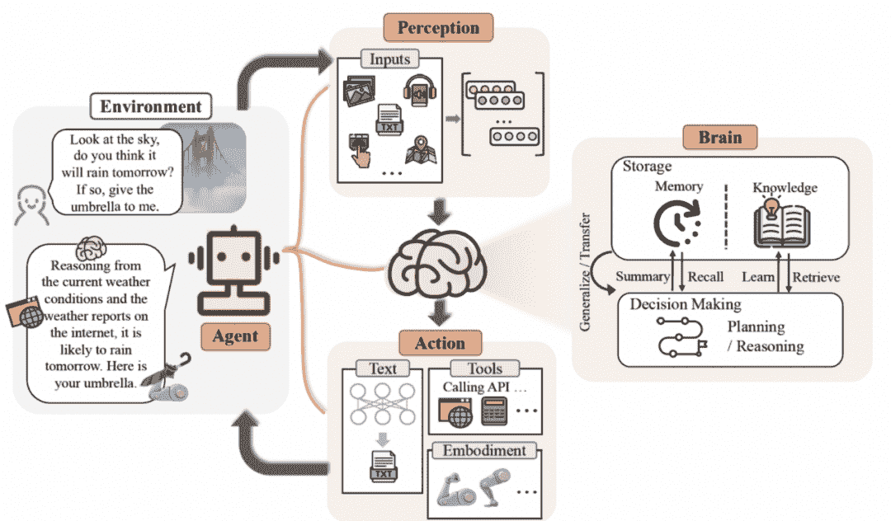

借用网上的一个案例来解释agent的执行：

> 当一个人问Agent是否会下雨时，感知模块将指令转换为LLM可以理解的表示。

> 然后，大脑模块开始根据当前天气和互联网上的天气预报进行推理。

> 最后，动作模块做出响应，将伞交给人类。

> 通过重复上述过程，智能体可以不断地获得反馈并与环境进行交互。

**在以LLM驱动的Agent系统中，LLM扮演着A**gent的大脑角色，并辅以几个关键组件：

> **规划：****LLM能够进行全面的规划，不**仅仅是简单的任务拆分。它可以评估不同的路径和策略，制定最佳的行动计划，以实现用户给出的目标。

> **记忆：**可以利用LLM具有的记忆功能，**存储和检索过去的信息和经验。**这使得它能够在处理用户查询时，利用之前学到的知识和经验，提供更准确和个性化的答案。

> **工具使用：**LLM通过理解工具的描述，来学习使用各种工具和资源，并灵活运用它们来支持任务的完成，在构建Agent的时候可以让Agent感知自己可以使用什么工具。工具的实现可以是利用搜索引擎、数据库、调用API等，获取和整理相关信息，以满足用户的需求。

## 业务场景下智能体探索

> 了解了Agent的概念后，结合手猫在做的智能助手相关探索，PD希望把Agent技术与智能助手业务结合起来做用户侧的创新。PD希望在手猫APP中可以提供一个交互页面，可以使用LLM智能体的自然语言理解能力、思维规划能力、工具使用等能力，直接理解用户输入的需求，然后通过Agent规划能力，决策出实现用户述求的行动路径，并调用智能体对应的工具实现用户需求，最后把结果展示在页面上，解决用户述求。

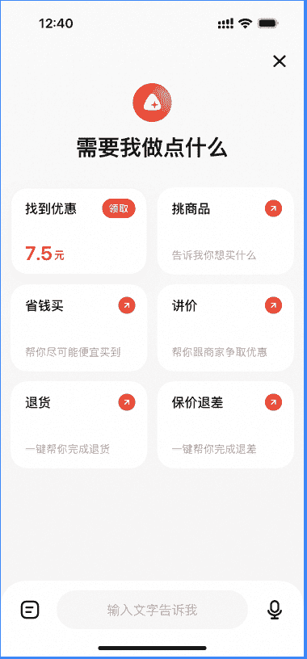

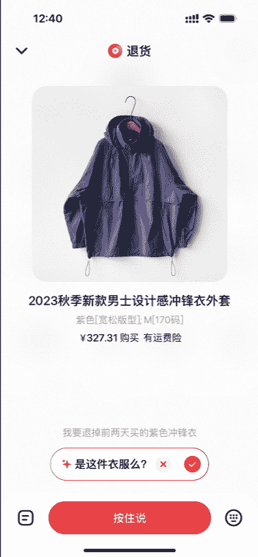

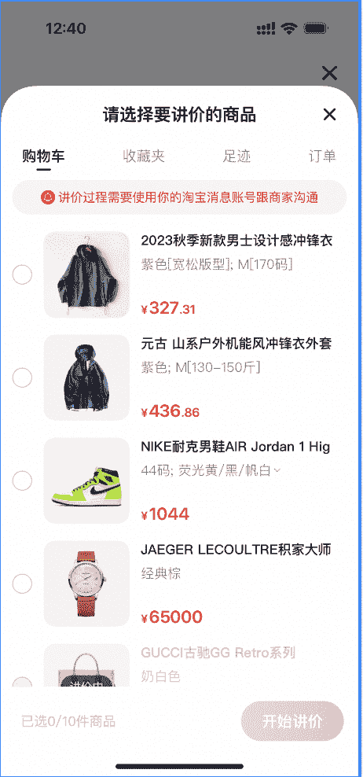

结合工程侧实现方案，串联整个链路大致做了以下几件事情：

> 搭建端到LLM直接信息传输链路，完成工程侧业务管理能力建设。

> 搭建用户会话管理、多场景识别、链路分发机制。

> 完成Agent模版到工具协议串联，把工具抽象化、按照协议“喂”给tpp Agent模版工程，完成Agent的使用工具的动态构建和在线灵活管理。

> 完成Agent工具抽象模版化建设以及工具描述的步步调优，提升Agent整体链路规划准确性。

> 完成工具&LLM输出到端展示的视图层转换，页面流式协议引入，提升端上输出稳定性。

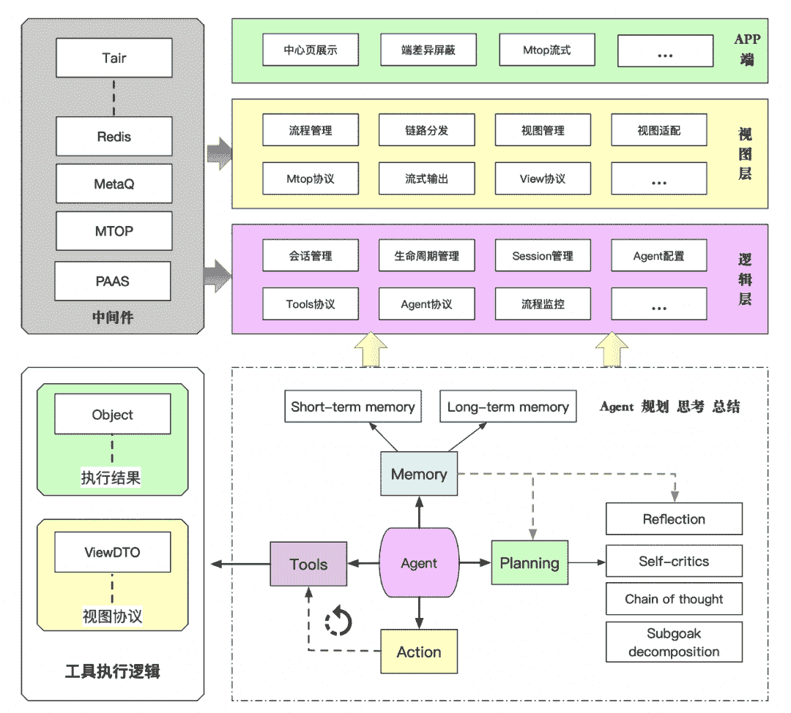

##### ▐  端展示方案

A**gent方案中，LLM有理解工具描**述、区分工具使用场景的能力，可以按照工具的约定，将指定的参数结构化的输入到接口内部，总结下来LLM能力解决了人类非结构化语言到工具结构化输入的问题。但是现在手猫APP端页面的展示，都需要转化为非常复杂的结构化数据结构才行，经过测试LLM输出复杂结构化展示数据的稳定性非常的差，面对复杂的页面展示逻辑，至少现在无法达到面向C端用户放开的标准。因为业务产品是无法容忍对线上用户透出内容的不确定性，所以解决LLM非结构化输出到端上结构化数据转化问题，才能解决APP展示端的问题，也是大模型项目能够面向C端用户顺利上线的前题。

**为了解决LLM输出非结构化数据到端上展示的问题，根**据工具实现功能的特性和页面交互特征不同，把工具分类抽象和分别建模（具体可见4-工具类型与定义），根据工具类型与端上约定特定协议，同时把工具的返回做区分，工具返回定义了Object（给LLM消费的内容）和 ViewDTO（app端消费数据结构）两个数据结构，在Agent侧做数据解析，把Object内容输入给LLM做下次ReAct推演，同时把ViewDTO输出到端上展示。在定义工具的展示协议，也抽象化定义了工具异常、模型中断、用户选择等交互模式，实现整体的用户交互方案，详见下左图。

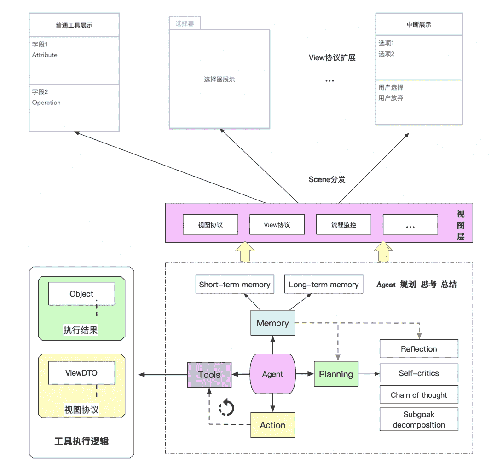

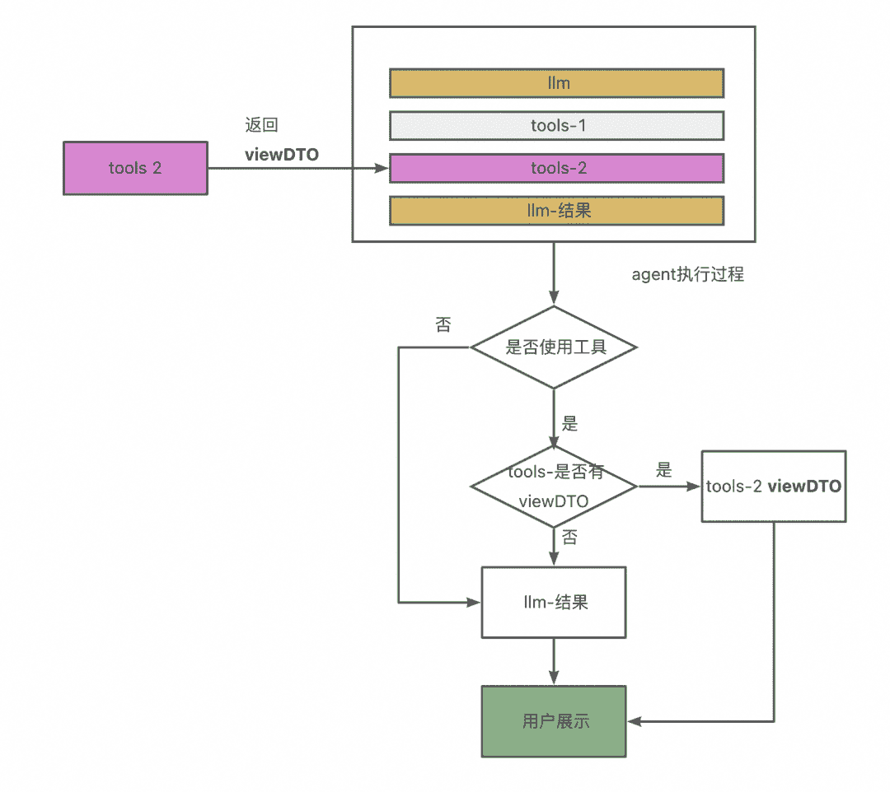

工程侧会在视图层，做页面工具数据的解析和转化，具体逻辑大致如上右图所示。

> 首先会在视图层会根据agent执行输出内容，判断整体Agent思维和执行流程是否使用工具，

> 如果没有使用工具，会直接返回大模型的输出结果返回到C端做文案展示。

> 如果流程使用工具，会解析整个思维链中最后一个工具的返回结果，判断是否有给端上的展示数据结构viewDTO，

> 如果有返回viewDTO，使用viewDTO内容展示。

> 如果工具没有返回viewDTO，直接使用模型返回文案。

经过上述的逻辑解析，可以覆盖每一个既定场景的端上交互，然后再根据用户下一步的输入或者选择，继续新的一轮交互。

## Agent抽象&管理

业务**P**D做AI技术结合业务场景的尝试时，需要经常做技术可行性尝试，例如需要测试Agent智能体的推理过程是否合理，是否能按照自己的思维路径落地，推理一致性问题等。在基建没有完成之前，资源有限的情况下，如果通过写脚本支持业务反复验证测试、参数调整等，技术成本比较高。体会到AI项目与传统项目落地的差异后，意识到后续不同场景的迭代都会经历这样的过程，提供给产技一个类似大学“实验室”的地方，让他们做自己各种各样的验证，是AI项目落地过程中必不可少的一环，于是就有了搭建Agent实验室的想法，提供给产技做业务探索和提效工具，提高业务迭代效率。

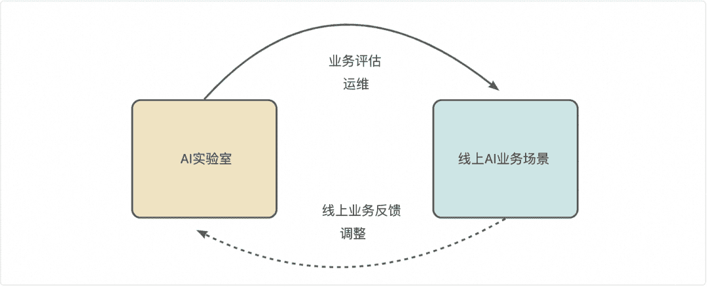

##### ▐  Agent101实验室

**基于**自己对AI技术的理解，做数据建模、类型抽象，搭建了自己的AI运维实验室，并不断地完善和补充功能，让AI“实验室”应用到产技日常开发和业务迭代中去，AI实验室设计思路如下图。

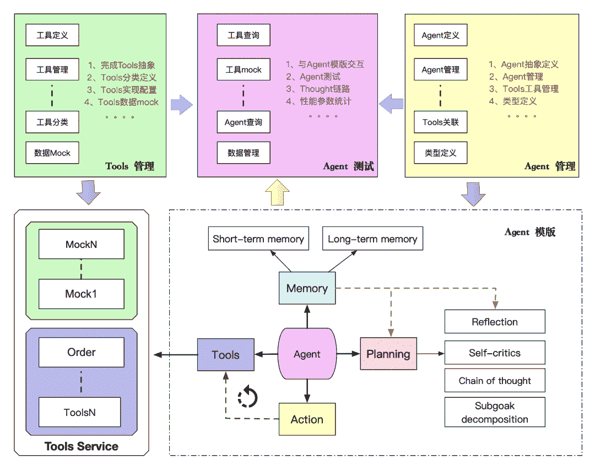

搭建Agent实验室，是为了提供给产技快速构建Agent，验证业务想法的测试场地，提供可以组合现有的已有工具，搭属于自己的私有Agent模版的平台，让业务技术快速试错。

Agent实验平台提供能力如下：

> **提供Agent抽象、管理和测试，每个人**都能基于现在的工具快速搭建自己的智能体，做业务场景验证和工具串联验证。类似于提供一个注入"tool"工具，构建"Agent" Spring bean的方式，可以在页面做Agent调用和能力验证。

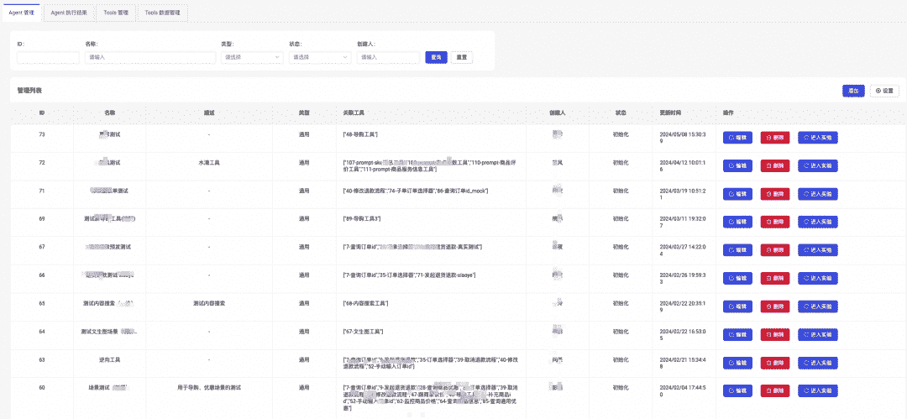

+   **提供工具定义抽象，工具描述管理、工具类型抽象，让工具管理可视化，实现**工具的可视化配置,根据工具功能抽象通用工具、中断器、选择器等工具类型。详见下图。

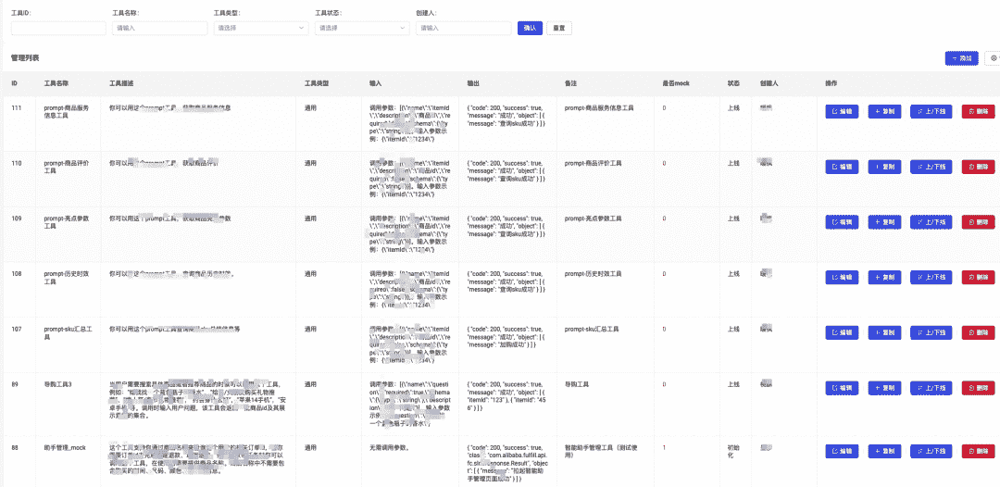

+   **提供**工具接口数据mock等能力，通过Agent测试链路中mock工具返回，实现在没有工具功能实现的前提下，能验证LLM智能ReAct流程对工具的理解和判断，评测Agent是否能达到业务预期，降低业务试错成本。

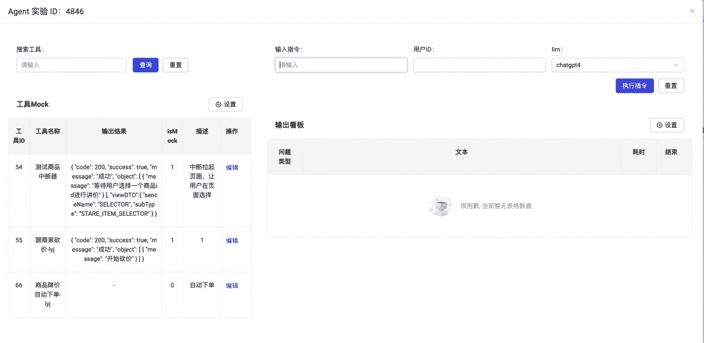

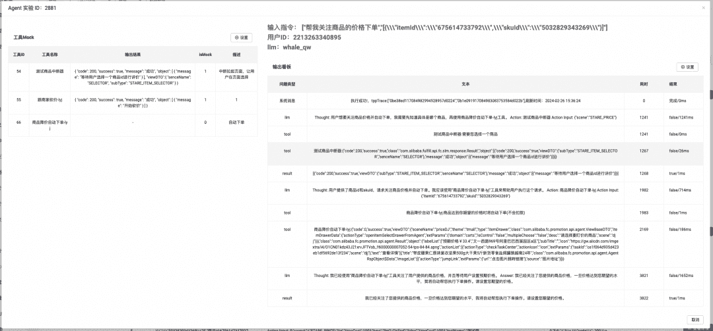

## 工具类型和定义

##### ▐  工具分类

**Agent可以通过学习调用外部API来获取模型权重中所缺少的额外信息，这些信息包括当前信息、代**码执行能力和访问专有信息源等。这对于预训练后难以修改的模型权重来说是非常重要的。

> 掌握使用工具是人类最独特和重要的特质之一。通过创造、修改和利用外部工具来突破身体和认知的限制。同样地，也可以为语言模型（LLM）提供外部工具来显著提升其能力，LLM可以利用搜索引擎、数据库、API等工具，获取和整理相关信息，以满足用户的需求。

> **在工具的使用过程中，有必要对工**具的类型进行归类使用，确认工具边界后，开发者在定义和使用工具过程中，能更好的根据业务提供更好工具。目前FC部门内部工具的分类，是根据不同工作的作用来划分。目前平台支撑的工具类型有以下分类。

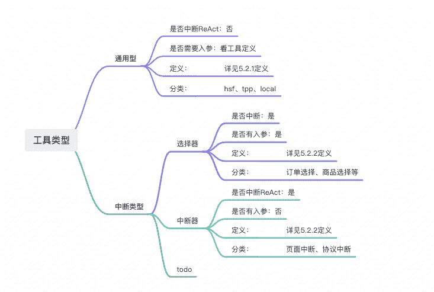

##### ▐  工具类型定义

工具的类型是以工具的使用特性为标准抽象的，一类工具的定义，会与底层Agent模版工程做协议，Agent模版工程会区分不同的类型，做不同的动作。例如通用工具，Agent会使用通用工具模版，按照工具提供的描述拼接给LLM，LLM规划使用工具时候，Agent模版工程会按照通用工具的协议，执行配置接口/方法的调用，按照返回协议，解析工具返回，给到Agent做Observations：

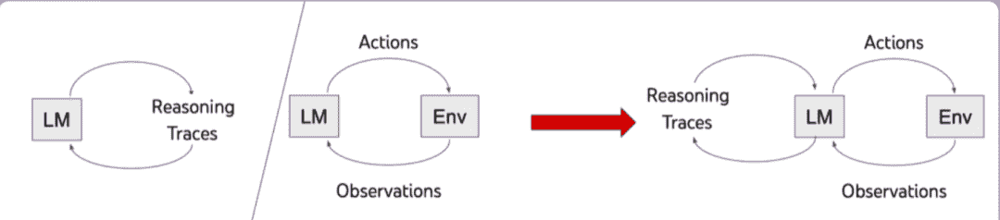

**中断的定义：**

中断是指Agent在做规划和调用工具时候的一种行为。Agent执行用户指令的时候，遇到不能继续执行的情况，可以先中止流程的继续执行，需要外部输入或者反馈后，继续后续推理流程的动作。

**例如用户需要执行一个订单退款操作**，但是在订单查询的时候，查到了多个订单，这个时候需要先中断退款的操作，反馈给用户，让用户选择其中的一个订单继续执行。

**通用类型**

> **是否中断：**否

> **执行：**Agent执行到通用类型工具的时候，不会中断推理-执行的流程。

> **通用型工具定义：**LLM判断需要调用工执行，系统需要执行一段工程化指令来获取答案，并且不会中断ReAct流程的时候，可以使用通用型工具。通用型工具目前支持外调服务（tpp/hsf）来获取答案，也支持调用本地方法来获取结果。

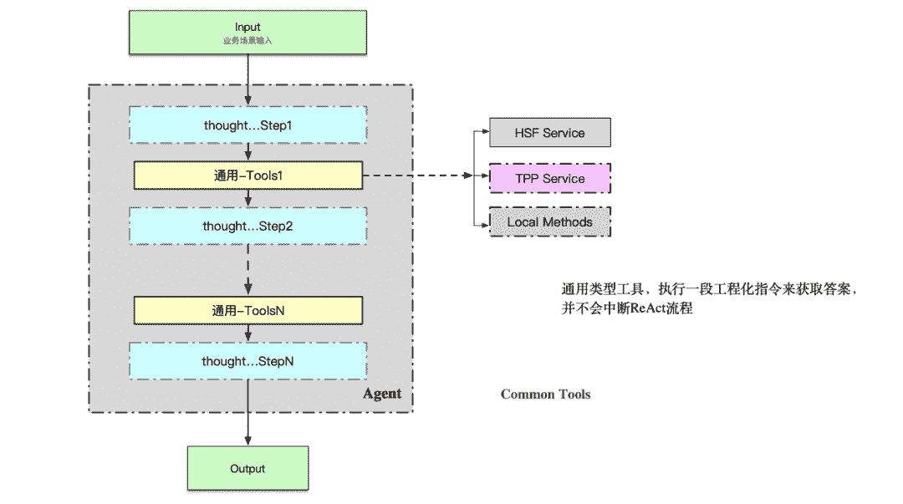

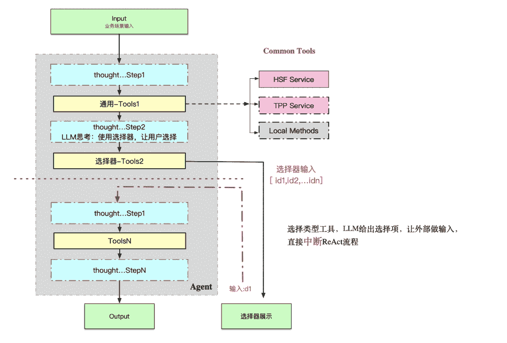

**使用场景：**业务场景中，需要借助外部工具查询信息、执行操作、逻辑处理等，都可以抽象成通用工具给LLM使用。例如外调订单接口，查询用户的历史订单；外调商家接口，查询商家信息等等。

**支持类型：**

> **HSF ：**工程以hsf方式，提供外调服务执行查询、写、等业务定制操作。

> **TPP ：**工程TPP形式，提供外调服务执行查询、写、等业务定制操作。

> **LOCAL：**工程本地方法、JAR包形式，提供定制业务操作。

> **其他：**待扩展类型

**中断类型**

**执行这个类型的工具，会中断ReAct推理过程，等待**外部反应或者用户输入，才能继续推理流程。

**选择器**

> **是否中断：**是

> **执行：**Agent执行到选择器类型工具的时候，会中断推理-执行的流程。

> **选择器定义：**工具实现一个集合的输入，让用户做一次选择。

> **使用场景：**在业务实现的过程中，往往会遇见需要用户再次决策的场景，例如让用户选择目标商品集合的一个继续操作，这个时候就需要使用选择器。

**支持类型：**

> **订单选择器：**如果LLM判断使用一个工具只需要一个订单，而上一个工具查询出多个订单的时候，可以使用订单选择器，让用户确认一个订单，继续继续使用工具做后续流程。

> **商品选择器：**如果LLM判断使用一个工具只需要一个商品，而上一个工具查询出多个商品的时候，可以使用商品选择器，让用户确认一个商品，继续继续使用工具做后续流程。

**使**用选择器的时候，需要注意前台做样式的适配和定制，目前支持的订单选择器和商品选择器，需要APP端适配展示卡片。

**中断器**

> **是否中断：**是

> **执行：**Agent执行到中断器类型工具的时候，会中断推理-执行的流程。

> **中断定义：**工具实现一个自定义输出，输出可以是一个页面地址或者一个协议地址，让用户做反馈。

> **使用场景：**在业务实现的过程中，会遇见需要用户补充信息的场景，例如盯降级的场景，如果用户没有给出需要盯降价的商品，【盯降价】的工具就无法继续执行，这个时候可以使用中断器，中断流程后，返回盯降价的商品选择页面让用户补充信息，用户盯价商品后，LLM使用【盯降价】工具创建盯价任务。

**支持类型：**

> **业务中断器：**使用中断器，中断流程，返回页面动作，让用户反馈信息。

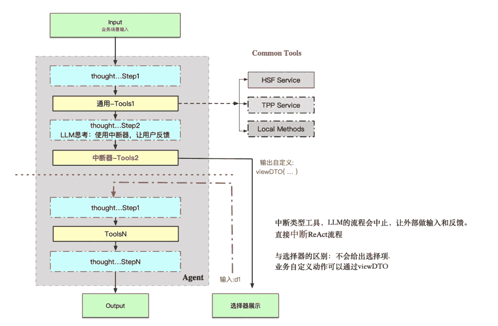

**使用中断器时候，需要注意中断以后跟端上协议，中断器要配合APP**端上动作，才能起到让用户补充信息的作用。

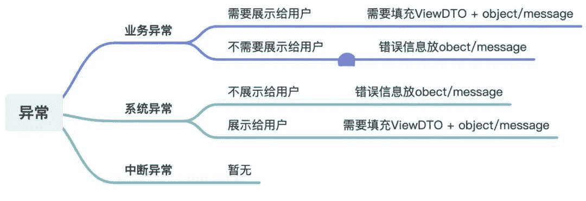

##### ▐  工具异常定义

正常一个工程接口的返回示例如下：

```
{
    &quot;code&quot;:200,
    &quot;success&quot;:true,
    &quot;pageDTO&quot;:null,
    &quot;message&quot;:null,
    &quot;class&quot;:&quot;com.alibaba.test.api.response.Result&quot;,
    &quot;object&quot;:[
        {
            &quot;itemId&quot;:665788007683,
        }
    ],
    &quot;viewDTO&quot;:{
            &quot;sceneName&quot;:&quot;showOrder&quot;,
        }
}
```

Agent模版工程解析工具异常路径如下：

> 会优先取object字段，如果object字段不为空，直接输出给LLM，做下次ReAct。

> **如果object为空，会取mess**age字段输出给LLM做下次ReAct，不会再判断message是否为空。

> 目前tools返回异常不会中断ReAct流程，无论是系统异常还是业务异常。

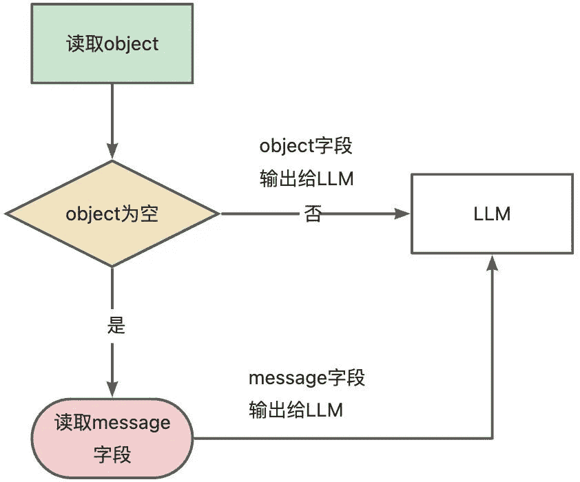

##### 举例1：

如果系统发生异常，直接使用以下方式返回tools结果

```
return Result.buildFail(-1, &quot;系统异常&quot;);
 
 
{
    &quot;code&quot;:-1,
    &quot;success&quot;:false,
    &quot;message&quot;:&quot;系统异常&quot;,
    &quot;class&quot;:&quot;com.alibaba.test.api.response.Result&quot;,
    &quot;object&quot;:null
}
```

这个时候因为object里没有值，给到LLM的就是：“系统异常”

##### 举例2：

如果业务查询异常，返回了空list，使用以下方式返回tools结果

```
List&lt;Obejct&gt; list = null;
return Result.buildSuccess(list);
 
 
{
    &quot;code&quot;:200,
    &quot;success&quot;:true,
    &quot;class&quot;:&quot;com.alibaba.test.api.response.Result&quot;,
    &quot;object&quot;:[]
}
```

这个时候因为object里有值，给到LLM的就是："[]"

##### 举例3：

如果业务正常

```
{
    &quot;code&quot;:200,
    &quot;success&quot;:true,
    &quot;pageDTO&quot;:null,
    &quot;message&quot;:null,
    &quot;class&quot;:&quot;com.alibaba.test.api.response.Result&quot;,
    &quot;object&quot;:[
        {
            &quot;itemId&quot;:665788007683,
        }
    ],
    &quot;viewDTO&quot;:{
            &quot;sceneName&quot;:&quot;showOrder&quot;,
        }
}
```

这个时候因为object里有值，给到LLM的就是："[{"itemId":665788007683} ]"，viewDTO不会给到LLM消费,只是页面展示用。

**异常页面展示输出**

如果异常想提示给用户，需要把异常按照特定格式设置到ViewDTO中，这样页面才能按照协议展示。最简单的在胶囊展示提示如下，"sceneName":"showError" 这个写是：

```
{
    &quot;code&quot;:-1,
    &quot;success&quot;:false,
    &quot;pageDTO&quot;:null,
    &quot;message&quot;:&quot;没有权限&quot;,
    &quot;class&quot;:&quot;com.alibaba.test.api.response.Result&quot;,
    &quot;object&quot;:null,
    &quot;viewDTO&quot;:{
            &quot;sceneName&quot;:&quot;showError&quot;,
            &quot;showTips&quot;:&quot;抱歉，你暂时没有权限&quot;,
        }
}
```

## Tools工具定义粒度

##### ▐  粒度的概念

**工具定义粒度就是工具实现功能范围的大**小，工具实现的功能越多，工具的粒度越大；工具实现的工具越小，工具的粒度越小。例如要实现一个订单退款场景，如果工具定义的粒度大，可以一个工具就实现订单查询+订单退款操作；如果工具定义的粒度小，可以分订单查询工具，订单退款工具。

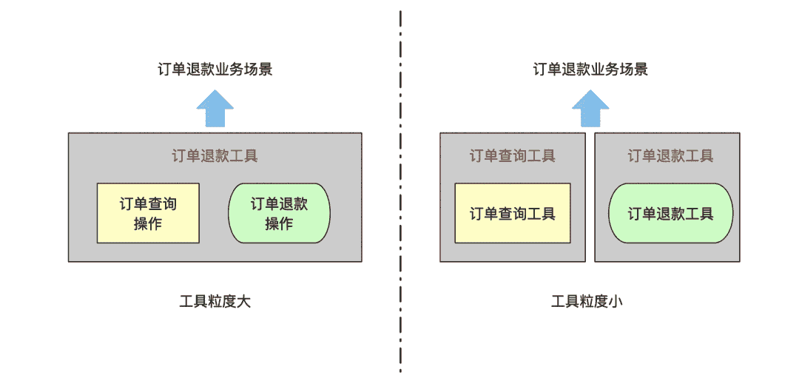

##### ▐  工具粒度大小的优劣

工具定义粒度的大小，会影响到很多因素。Agent是ReAct(Thought-Action-Observation)的模式，工具使用的多，就意味着多轮的ReAct，会让执行链路变得更长，消耗更多的RT.

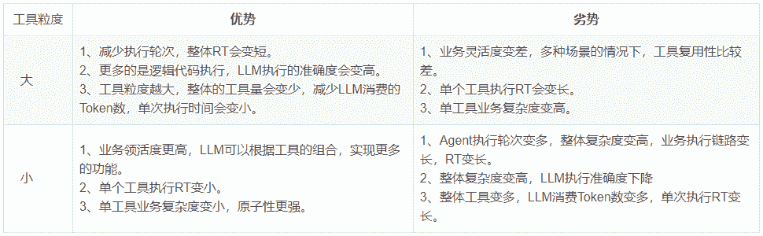

##### ▐  工具实现安全的思考

开发者在实现LLM调用的工具时候，一定要注意接口的安全策略，应用工具的调用者是LLM**，使用过程**会比一般的程序开发者更加“开放”，无法预知LLM使用工具的前置条件，所以在工具实现的时候，要更加谨慎和保守，前置校验也需要更规范。建议如下：

> **参数透传：**安全级别比较高的参数，一定要使用系统层透传，不要让LLM设定传入参数，防止LLM“臆造”、“篡改”，例如用户id，设备id等参数，影响代码稳定性和数据安全。

> **代码防腐层：**建议设计代码防腐层，用来隔离LLM传入参数和下游调用参数。

> **参数合法性校验：**对于比较关键的参数，一定要校验合法性，例如订单号一定是数字，位数在10位以上等，防止LLM“臆造”的参数对下游系统造成影响。

> **数据状态校验：**对应执行类工具（存在写操作的实现），执行前一定要对数据状态进行校验，防止非法操作存在。

> **接口幂等：**LLM在ReAct流程中可能会重复执行接口，对于幂等要求比较高的操作，设计时候要考虑接口幂等性。

> **多阶段事务：**对于业务比较复杂的场景，尽量保证事务操作在一个工具内实现，防止跨工具事务的工具实现。

---

## 问题&总结

项目上线和迭代的过程中，遇见的问题也特别多，大致总结如下：

+   面向C端的AI创新，对于结果的正确率要求很高，经过对底层模型针对场景的语料的需求和评测，正确率提示至80+%，但是对于面向C端全面开发还有很长的路要走。

+   大模型解决了用户输入的自然语言到底层工具结构化输入的转化，但是大模型直接输出到端上的结构化展示错误率比较高，直接透出给用户风险比较大，目前只能依赖工具的结构化输出做页面展示，缺点是失去输出内容展示的灵活性。

+   随着智能体中工具的数量增加，智能体对工具的理解和组合会变得不稳定，影响特定场景的正确率，固定Agent和多Agent方案应该是未来的方向，但是要解决Agent智能体分发的问题。

+   LLM对工具的返回复杂度有要求，不能返回太复杂的对象，入参也不能过于复杂，否则成功率会降低。