# X宝agent应用，及LLM based Agent探索

> 来源：[https://qqs7y1hozd1.feishu.cn/docx/ODEjd8GBxodsrhxkgVbc7FpYnqd](https://qqs7y1hozd1.feishu.cn/docx/ODEjd8GBxodsrhxkgVbc7FpYnqd)

## 一、基于LLM大模型Agent的适用范围和限制

本文讨论知识库问答和个人助手两个应用场景，如知识库无法有效处理多模态信息和大型文档，个人助手则受限于工具参数的复杂性和令牌长度。

在基于Agent 的方案，目前有很多的开源框架，如:

+   `langchain`：一个基于大模型应用开发框架，能够让应用的开发者基于大模型的推理结合存储、工具、索引、提示词等模块完成个人助理、任务、问答类的应用开发。

+   `autogen`：微软开源的agent 框架。如果把`langchain` 看做是和人交互的agent, 那`autogen`就是agent 和agent 交互协作共同完成一个目标的多agent 的任务框架。

+   `metagpt`：官方介绍是 `MetaGPT`是一款强大的开源软件，它利用多智能体框架（产品设计、技术设计和程序员）来处理你的需求。

通用的大模型的工作姿势，是提示词  => `LLM` => `LLM`基于提示词给出问答。

提示词Prompt 的一般格式：

```
PREFIX = &quot;&quot;&quot;Answer the following questions as best you can. You have access to the following tools:&quot;&quot;&quot;
FORMAT_INSTRUCTIONS = &quot;&quot;&quot;Use the following format:
 
 
Question: the input question you must answer
Thought: you should always think about what to do
Action: the action to take, should be one of [{tool_names}]
Action Input: the input to the action
Observation: the result of the action
... (this Thought/Action/Action Input/Observation can repeat N times)
Thought: I now know the final answer
Final Answer: the final answer to the original input question&quot;&quot;&quot;
SUFFIX = &quot;&quot;&quot;Begin!
 
 
Question: {input}
Thought:{agent_scratchpad}&quot;&quot;&quot;
```

简单来说，就是告诉大模型按照特定格式回答问题，可以使用的工具，参数格式等等。

重点是要求大模型按照特定的范式工作，输出结果。

上文是chat 场景下`MRKL` 模型的Promopt 。

有兴趣的可以看看背后的论文`MRKL`。

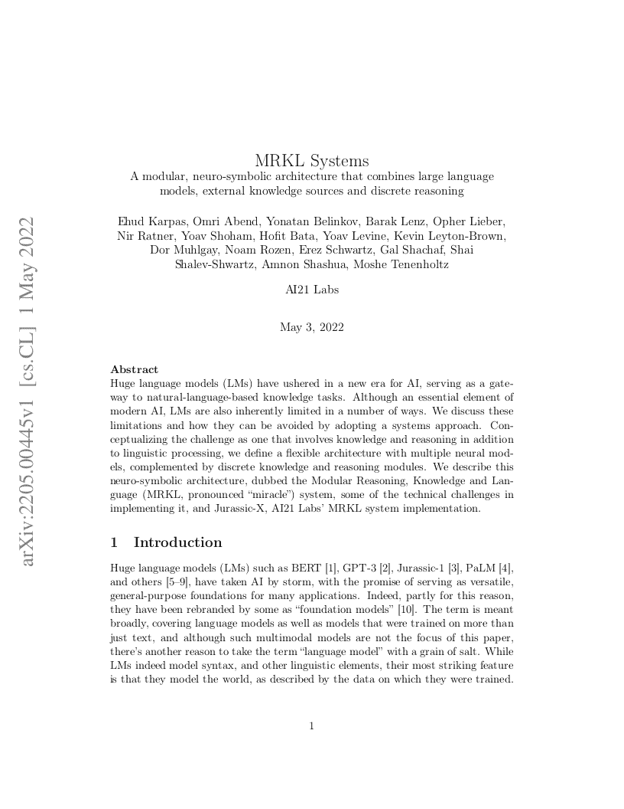

[MRKL Systems.pdf](https://internal-api-drive-stream.feishu.cn/space/api/box/stream/download/all/JGqgbUQxYo1ZWHxuyk7caCELnLr)

在实际的运行过程中，参数会被填充到对应的数据，例如`tool` 会被替换成工具的信息，`input` 的信息，包括历史的会话信息等，如下图所示：

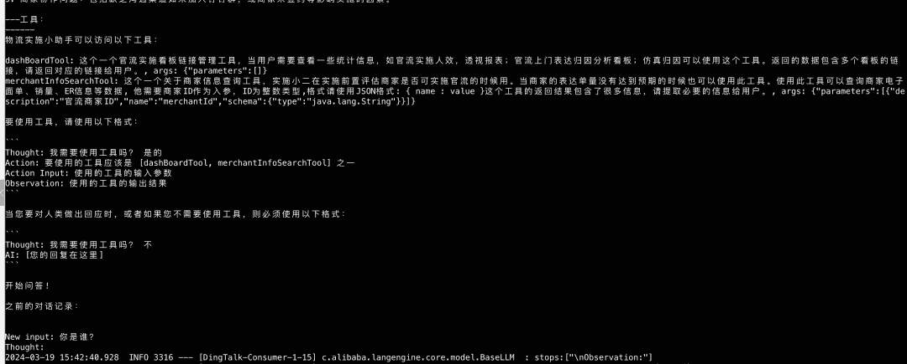

这地方有两个问题：

> 第一个问题，历史对话信息，`LLM` 没有，所以`agent` 等框架一般都有`memory` 的能力，每次调用大模型都需要把历史的对话信息拿出来，放到prompt 中；

> 第二个问题一次调用的tokens 有限，这个问题其实很致命。如果遇到知识库相关的tokens 非常的多场景，怎么解决尼？总不能每次把知识库的信息都全量带过去吧，解决方案一般有两种，第一种就是每次只把相关的信息带过去，也就是下面通用的知识库方案。还有一个种是提前微调，`fine-tuning` 的模式来做，利用先验知识解决专家问题。

### 1.知识库的效果

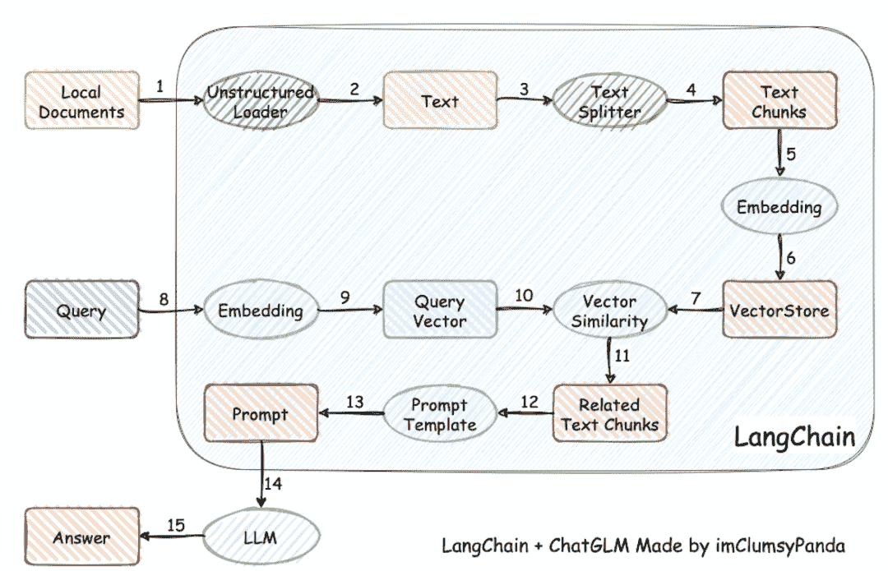

上面这个图，估计很多同学都看过，大家把PDF、语雀文档、WORD 之类的文档，进行分割、`embedding`、存到向量数据库中，在问答环节，拉取相关的块，再构建prompt 给到大模型，再让他输出对应的问答。

本质解决两个问题，tokens 数量限制的问题；提炼精准问题的能力。

+   `Text Splitter` ：文本分割器是一种将大段文本拆分成较小块或片段的算法或方法。其目标是创建可单独处理的可管理的片段，这在处理大型文档或数据集时通常是必要的。

+   `Embedding`: 简单来说就是向量化，不同维度的数据，最终都需要通过归一化、自关联。当然，这个做的最好的就是`chatgpt` 的 `text-embedding-ada-002` 了。

+   `vectorstore`: 向量数据库，就是存储刚刚嵌入后的向量了，一般的向量数据库都可以了，如`holo`, `redis` 等，支持计算欧式距离、向量内积等。

原理很简单，集团内部现在知识库的机器人接入没有几千，估计也有几百了，在一些基础问题上，它还能回答的差不多，但是在复杂问题上，还没有看到一个非常厉害的知识库机器人出现。

### 2.知识库的困境

> 第一个问题是大家进行向量化的知识库文档里面其实很多时候是包含很多图片，在表达语义能力方面，图片往往包含的语义更多，图片处理的时候可能就变成一个链接了，更有甚者，包含视频，又该如何处理，所以文档处理不能简单的做NLP处理，还得支持多模态，目前还没有看到这样的能力出现。

下图中，其实就是一个示例。

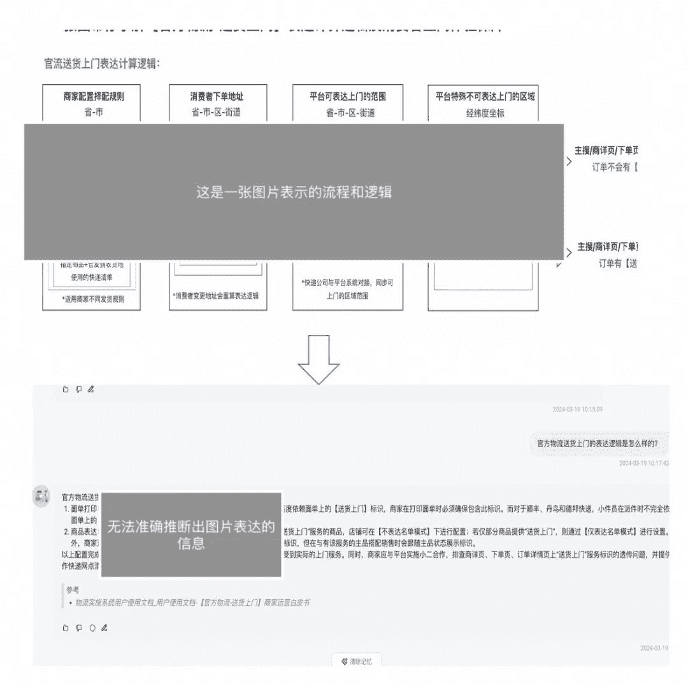

> 第二个影响结果的就是文档的大小，如果知识库过于庞大，在分割完成后，召回的数据也会过多，必然存在舍弃导致的信息不全。不过这种情况可以通过尝试多路调用，再整合的思路解决。

> 另外使用的姿势也有相关性，如果问题没有区分度，返回的结果也存在泛化的问题。知识库能力有个特点，就是你提供给我的知识一定是要准确有用的，因为作为使用方，如果你一会给我的有用，一会给我的是错误的，作为用户我就不会用了，我不是专家，我没有办法判断结果的正确性。这个和专家助手是不一样的心智。

### 3.个人助手的效果

个人助手的基本逻辑就是，输入后，组装参数，告诉大模型目标以及工具描述，让大模型告诉我们是否应该使用工具，以及使用哪个工具。

这个过程中，大模型还会帮我们构建工具参数（前提是工具要描述清楚参数的类型），`langchain` 根据工具和参数调用。

拿到结果后，再次调用大模型。这是一个基本的`ReAct` 的思路。

具体可以参考论文: `ReAct`

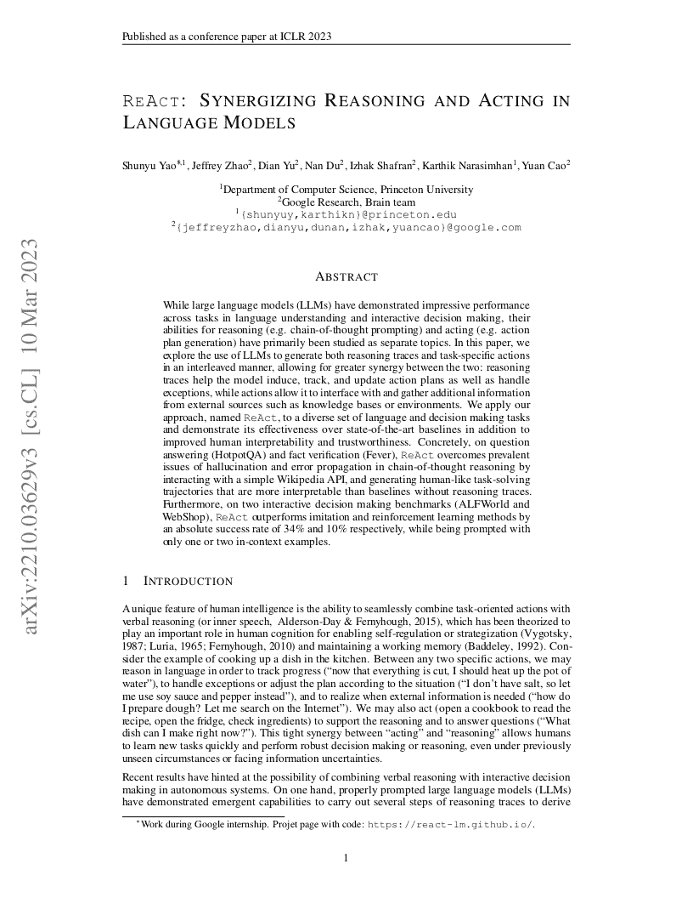

[REACT：SYNERGIZING REASONING AND ACTING IN.pdf](https://internal-api-drive-stream.feishu.cn/space/api/box/stream/download/all/Zs2AbjZUSo8s3LxZvF5clyE9n3f)

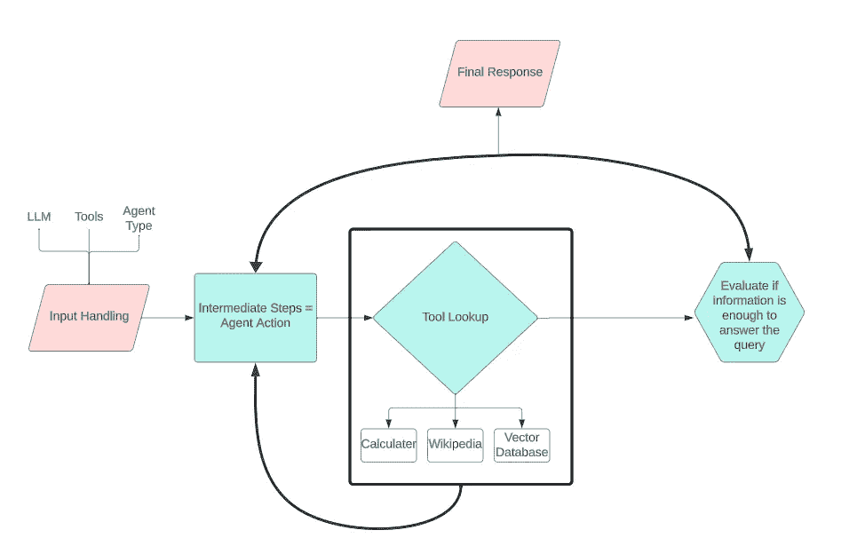

> 其实按照这个思路，如果写好Prompt, 再把工具的描述写清楚，你会发现这个还是的确能够产生一些价值的，至少在辅助工具助手上，他还是可以做到不错的效果的。例如查个白名单、订单信息、等等吧。

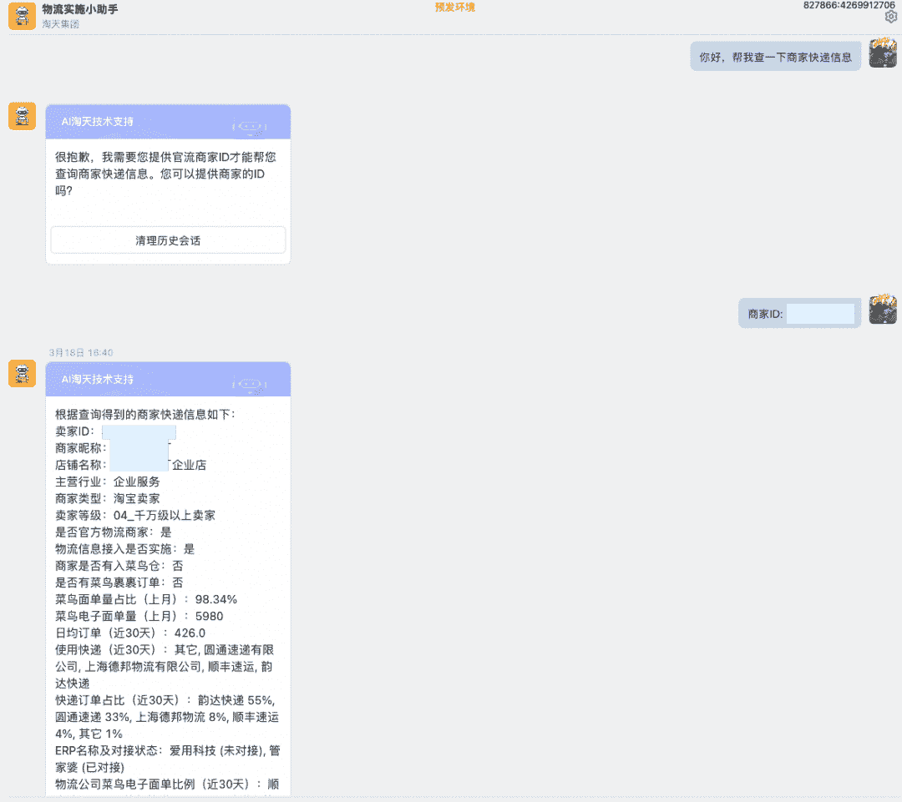

### 4.个人助手困境

+   他的一个明显的困境就是工具的参数不能太复杂，由于是大模型推荐的结果得出的参数，即使是最新的`gpt` 在参数映射这一块，都容易出现问题，哪怕是个`String` 类型的数组，都容易出现格式不一致的问题。所以工具的入参要足够简单，不然那个转化和校验就痛苦死了。

+   由于每次调用都是带着全量的`History`, 所以如果背景知识过多，一样会存在tokens 过长的问题。就像你想让一个让帮你做客服的事情，首先他得了解足够多的先验知识，由于没有做微调，所以每次都是带着全量的信息过去，模型处理的也慢。

所以最终的最终，想要好的效果，还是需要准备好足够清晰的业务领域知识(多模态的)，做`Fine-Tuning`。

### 5.Fine-Tuning 的困境

在说NLP 领域的的`fine-tuning` 之前，可以先说说文生图领域的`fine-tuning`。

目前文生图领域有个非常火的网站叫C站. 他上面全是基于`LORA`的思路(可参考论文`LORA`)做微调模型。

基本拿`SD` 的基础模型，再加上微调模型和`Promot` 很容易就能生成对应风格的图片。

可参考论文`LORA`。

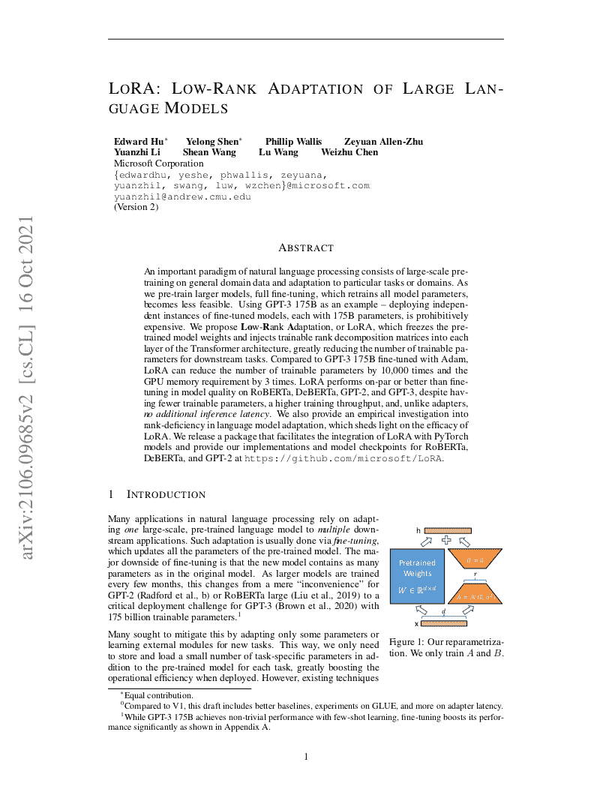

[LORA：LOW-RANK ADAPTATION OF LARGE LAN.pdf](https://internal-api-drive-stream.feishu.cn/space/api/box/stream/download/all/BBaubVajooQjd3xzsK4cpSeGnTf)

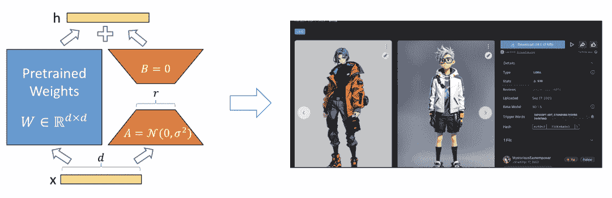

+   等到开源的基础大模型的推理能力达到`chatgpt4` 的水平，为了解决各个专业领域问题(你也可以叫风格、领域知识、上下文背景)，微调会成为一个标准操作流程。但是能不能形成一个类似C站的氛围还不好说，毕竟图片的风格是通用的，大家可以相互借鉴，而专业背景各个产品各有不同。

+   基于`LLM`的能力，在精确计算领域还是很难落到很好的效果，典型的如复杂工具的调用。但是在专家助手的领域能够获得很好的效果，典型的如代码生成的`Copilot`。虽然生成的代码不能保证一行都不需要修改，但是它能实现80%的有效代码，基于自己的专家知识修改有问题的20%, 那也是巨大的省力呀。

## 二、X宝直播间智能化升级：基于LLM的学习与分析

### 1.最初 - 人海战术，学习PK

业务侧最直接的想法是发动人海战术，通过人工的方式去观看各个直播间，提炼其中的优点，进行互动分享：

运营TL提出的要求：

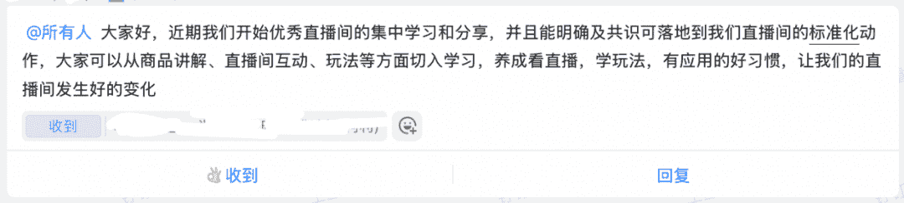

运营小二人工学习的范本：

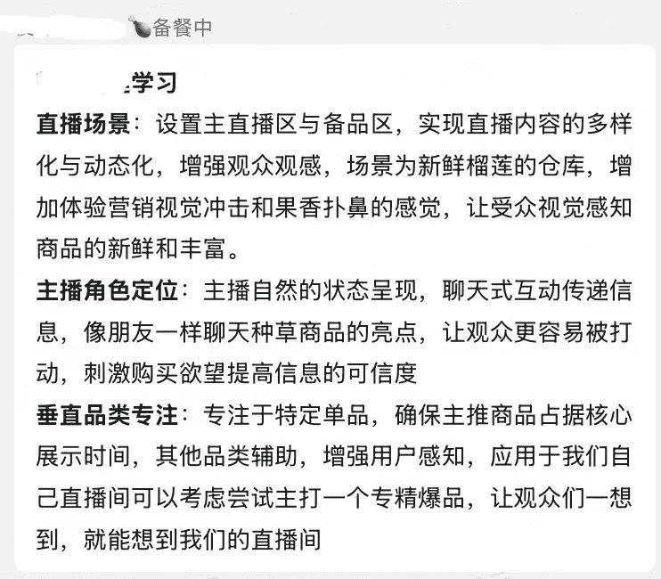

> 效果不错。但是人工学习需要大量的人力保障，就会导致运营基本每天都花费大量的时间在看直播间，学习直播间了，没有更多的时间去做真正的“运营”的事情了。熟悉`LLM`的小伙伴就会发现，这些运营总结的内容怎么看上去那么像`LLM`总结的？或者说，基于`LLM`生成的总结是不是可以达到类似的效果？

既然现在各个文本网站都提供了类似于速看的功能，也自然而然的想到，是不是可以用`LLM`对标杆直播间进行学习总结，把运营解放出来，让运营回到真正的“运营”的事情上。

#### 1）方案

整体方案分为三步：

1.  通过`ffmpeg`将`m3u8`类型的直播回放视频音频下载到本地

1.  通过集团内部的听悟工具将音频转化成文本

1.  通过文本大模型抽取文本中的亮点，并进行多个直播间横向对比。通过图片大模型抽取布景中的亮点，并进行多个直播间横向对比。

##### Step1：基于`FFMPEG`下载视频 & 音频

为什么想到用`FFMPEG`呢？来自于G-T：

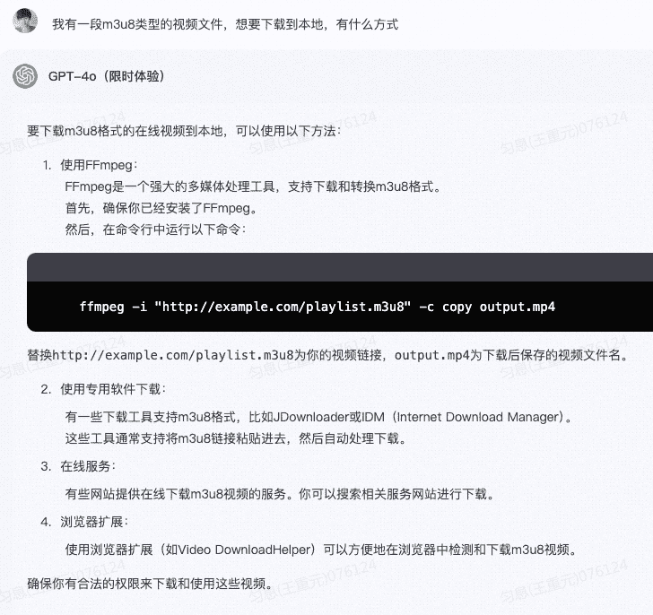

##### Step2：将音频转换成文本

> 傻瓜式上传`MP3`文件即可，等待一会就能够转化成解析好的台本了。

之后可以再以`srt`、`docx`、`pdf`等文件格式导出：

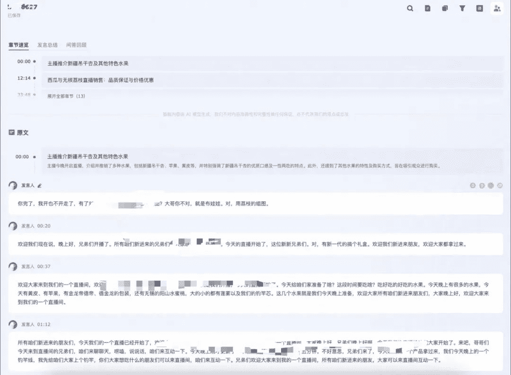

##### Step3：基于大模型对文本进行概要总结

`PROMPT`、`LLM`输出的总结内容Demo如下：

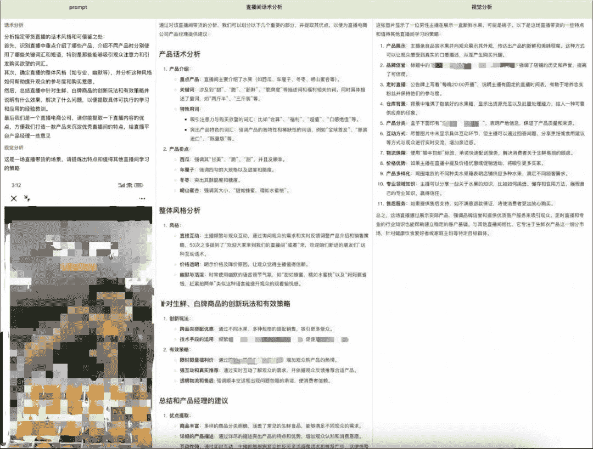

#### 2）难点

##### 视频截断

由于录播的时长有时候会很长，实操过程中经常会遇到视频音频过大、过长导致无法上传的情况。这种时候一般有两种解决方案：

方案一：通过`ffmpeg`对音频码率进行压缩。

在不影响效果的情况下压缩文件大小(最终使用方案)：

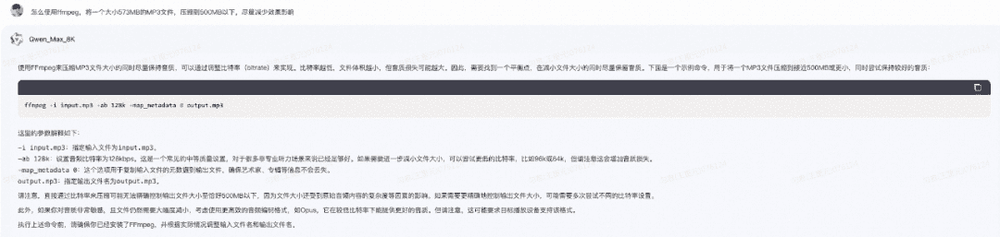

方案二：使用一些开源的视频剪辑软件，对视频进行剪辑，拆分成多个片段进行上传。

##### Prompt调优

> 要达到好的总结效果，一段好的Prompt至关重要。Prompt调优虽然有一些原则，但整体上还是一件偏玄学的事情，需要多次尝试。

以下是经过多次尝试后的Prompt：

调优后的Prompt：

```
话术分析
分析指定带货直播的话术风格和可借鉴之处：
首先，识别直播中重点介绍了哪些产品，以及介绍不同商品时的核心卖点和具体介绍内容，如商品规格、价格优惠、食用方式、购买场景、挑选知识、售后保障等
识别直播中是否是否介绍了较为不常见、消费者比较陌生的产品，以及介绍此类产品时突出的核心卖点和具体介绍内容
其次，确定直播的整体风格（如专业、幽默等），并分析这种风格如何帮助提升观众的参与度和购买意愿。
然后，总结直播中针对生鲜、白牌商品的创新玩法和有效策略并说明有什么效果，解决了什么问题，以便提取具体可执行的学习和应用的经验教训。
最后我们是一个直播电商公司，请你能提取一下直播内容的优点，方便我们打造一款产品来沉淀优秀直播间的特点，给直播平台产品经理一些意见
 
 
视觉分析
分析直播间布景，如产品展示方式、主播互动方式、直播间主题、直播间强化的心智、直播间所模仿打造的场景等
分析直播间的氛围，如直播间展示的利益点
 
 
评论分析
分析如下直播间用户实时反馈的内容，给出分析报告：
首先，过滤掉无意义的内容。理解用户反馈的含义，按照类别进行归类，并按照反馈频次从高到低排序。针对用户需求类的需要详细列出来并分析
然后，分析用户反馈的内容，给到直播运营和主播相应的可行性建议
```

在进行Prompt调优过程中，有几个经验可以分享(很多技巧在其他文章中也有分享，这里更偏向的实践经验)：

1.  Step By Step拆解：这一步确实至关重要，让大模型能够按照期望的格式与思路输出；

1.  简明扼要具体：具体并且简明扼要的描述能够让模型更快的抓住重点，输出的内容也能更贴合想要的主题；

1.  给出可以参考的示例：给出参考示例后，确实能够让模型回答的不那么天马行空。但是相应的也会导致模型被约束只会讲提到的参考的点，并且会产生一些和原有文本不符合的幻觉；

1.  角色带入：实践后发现，明确输出对象的角色(产品经理、直播运营、主播)后的效果比不明确输出对象要好很多。也尝试了让大模型假设自己的角色，效果没那么好，可能是类似于“数据分析师”这样的角色对于大模型来说过于抽象；

1.  人工优质文本示例：这个也做了尝试，但是效果不如不给运营的文本示例，所以被剪枝掉了。并且会导致模型回答上产生比较大的幻觉，比如回答的内容和人工优质文本一致，和当前给的输入台本无关。

模型选择上，实践尝试了各个大语言模型，实际效果上确实还是`G-T-4o`效果最好。

##### 评论分析

基于前述的思路，也做了评论分析的功能。同样是抓取到直播间的用户评论，构建合适的Prompt提示词丢给大模型分析。这里不做赘述了。

### 2.上线后效果

> 基本链路搭建完成后，同样也配套搭建了工程的链路，确保运营配置好想要学习的直播间后，能够由`LLM`输出学习总结，产品做简单审核加工后，每天自动在群里输出。

示例效果如下：

#### 1）话术学习示例输出


通过对该直播间带货的分析，可以划分以下几个重要的部分，并提取其优点，以便为直播电商公司产品经理提供建议：

## 产品话术分析

### 产品介绍

#### 重点产品
直播间主要介绍了水果（如西瓜、车厘子、冬枣、崂山蜜杏等）。

#### 关键词
涉及到“甜”、“脆”、“新鲜”、“脆爽度”等描述词和福利相关的词。同时具体描述了量词，如“两斤半”、“三斤装”等。

#### 特殊用词

- 吸引注意力与购买欲望的词汇：比如“合算”、“福利”、“超值”、“口感绝佳”等。
- 突出产品特色的词汇：强调产品的独特性和稀缺性的词语，例如“全球首发”、“原装进口”、“限量版”等。

### 产品卖点

#### 西瓜
强调其“甘美”、“脆”、“甜”，并且发顺丰。

#### 车厘子
强调四勾的大规格以及甜度和脆度。

#### 冬枣
突出其酥脆度和糖度。

#### 崂山蜜杏
强调其大小、“甜如蜂蜜，糯如水蜜桃”。

## 整体风格分析

### 风格

#### 直接互动
主播频繁与观众互动，通过询问观众的需求和实时反馈调整产品介绍和销售策略，50次之多提到了“欢迎大家来到我们的直播间”或者“来，欢迎咱们新进的朋友们”这种互动话术。

#### 价格透明
明示价格及降价原因，让观众觉得主播值得信赖。

#### 幽默与活泼
时常使用幽默的语言调节气氛，如“甜如蜂蜜，糯如水蜜桃”以及“妈妈要省钱，赶紧拍两单”类似这种语言能提升观众的观看愉悦感。

## 针对生鲜、白牌商品的创新玩法和有效策略

### 创新玩法

#### 跨品类搭配优惠
通过不同水果、多种规格的搭配销售，吸引更多受众。

#### 技术手段的运用
频繁使用*****等技术手段，促使******。

### 有效策略

#### 限时限量福利价
通过*****，增加观众购产品的热情。

#### 互动和真实推荐
通过实时互动了解观众的需求，并依据观众反馈推荐合适产品。

#### 透明物流和售后
强调顺丰空运和出现问题包赔的承诺，使消费者信赖。

## 总结和产品经理的建议

### 优点提取

#### 商品丰富
多样的商品分类明确，涵盖了常见的生鲜食品，能够满足不同观众的需求。

#### 详细的产品描述
通过详尽的描述突出产品的特点和优势，增加观众认知和消费意愿。

#### 互动性强
通过实时互动，主播能够根据观众的反应灵活调整话术和推荐产品，这使得整个直播过程更加生动有趣。

#### 优惠刺激消费
通过福利、优惠和限时限量的模式刺激观众的购买欲。

### 产品经理建议

#### 增强互动功能
提供主播与观众之间的多种互动工具，如互动游戏、投票等，增加观众的参与感。

#### 自动化优惠提示
增加优惠券和福利的自动推送功能，使观众在观看过程中更方便发现和使用。

#### 多角度商品展示
利用多摄像头展示和虚拟现实技术，让观众能够从多个角度查看商品，了解商品的真实情况。

#### 智能推荐系统
根据观众的购物习惯和偏好，智能推荐相关产品和套餐，提升购物体验。

#### 引入其他测试工具
通过使用糖度测量等专业工具，证明主播所言非虚，提高信任感。

通过上述分析、总结和建议，直播电商公司的产品经理能够更好地了解当前直播带货的有效策略，并在此基础上改进现有产品，提升直播带货的成功率。

## 2）布局学习示例输出

这张图片显示了一位男性主播在展示一盒新鲜水果，可能是桃子。以下是这场直播带货的一些特点和值得其他直播间学习的策略：

### 产品展示
主播亲自品尝水果并向观众展示其外观，传达出产品的新鲜和美味程度。这种方式可以让观众感受到真实的口感描述，从而产生购买兴趣。

### 品牌信誉
标题中的“**********”强调了店铺的历史和声誉，提高了可信度。

### 定时直播
公告牌上写着“每晚20:00开播”，说明主播有固定的直播时间表，有助于培养忠实粉丝并保持他们的参与度。

### 仓库背景
背景中堆满了包装好的水果箱，显示出货源充足以及批量处理能力，给人一种可靠供应商的印象。

### 产品分类
盒子下面印有“********”，表明产地信息，保证了产品质量和来源。

### 互动方式
尽管图片中未显示具体互动环节，但主播可以通过回答问题、分享烹饪或食用建议等方式与观众进行实时交流，增加亲近感。

### 物流保障
使用“顺丰包邮”标签，承诺快速配送服务，解决消费者关于生鲜易损的顾虑。

### 价格优势
如果主播在直播中提及价格优惠或促销活动，将吸引更多买家。

### 产品多样化
周围堆放的不同种类水果箱表明店铺供应多种水果，满足不同顾客需求。

### 专业领域知识
主播可以分享一些关于水果的知识，比如如何挑选、储存和食用方法，展现自己的专业知识，赢得信任。

### 售后服务
如果提供售后支持，如不满意退款保证，将使消费者更加放心购买。

总之，这场直播通过展示实际产品、强调品牌信誉和提供优质客户服务来吸引观众。定时直播和专业的行业知识也能帮助建立稳定的客户基础。与其他直播间相比，它专注于生鲜农产品这一细分市场，针对健康饮食爱好者或家庭主妇等特定目标群体。

## 3）评论分析示例输出

### 分析报告

#### 一、分类和排序

经过滤无意义内容和分类后，用户反馈内容如下所示。以下内容按照频次从高到低进行排序：

##### 用户需求类

###### 价格和发货咨询

###### 频次高的内容：
- 12盒蓝莓多少钱啊？
- 19号苹果开优惠价了吗
- 龙宫果有优惠价吗？
- 香印青提还可以开不？

###### 分析：
用户对某些产品的价格信息和特殊活动优惠非常关心。建议主播在直播时明确提到各类产品的新价格信息和折扣。

###### 产品质量和存储

###### 频次高的内容：
- 阳光玫瑰今天收到了，太好吃了。又脆，甜而不腻
- 苹果开了吗？
- 进行配送时是否坚持冷链运输？
- 杨梅有虫吗

###### 分析：
用户对产品质量、口感和保存方式同样认真关注。在直播中进行详细介绍，强调产品的保鲜、送货方式（冷链等）以及产品检测（如无虫保障）。

###### 产品推荐和比较

###### 频次高的内容：
- 试管苹果推荐一下，乐琪还是红玫瑰？
- 龙宫果和其他品牌相比有什么优势？

###### 分析：
用户希望得到更加准确的推荐和产品对比。主播可以在直播中针对不同需求的用户进行产品特点、优劣的详细对比。

###### 产品库存和购买链接

###### 频次高的内容：
- 蓝莓开价了吗？
- 甘美的西瓜和站神的有不一样吗？

###### 分析：
用户需要及时了解库存情况和购物链接。建议在直播中实时更新库存动态，并明确表示商品的链接和如何下单。

###### 促销活动和特殊优惠

###### 频次高的内容：
- 今天便宜了？
- 今天西瓜有优惠吗

###### 分析：
用户热衷于参加促销和得到特殊优惠。主播应在直播中预告和强调正在进行的促销活动。

##### 用户满意度类

###### 产品好评

###### 频次高的内容：
- 好吃，好货也不好抢到。
- 超给力

###### 分析：
正面的反馈说明用户对产品质量和购买体验满意。建议主播在直播中展示用户的好评和反馈，建立信任。

###### 用户互动

###### 频次高的内容：
- [–哈哈哈]、[–鼓掌]等表情。
- 许多用户直接留言互动，比如太好了、开价看看。

###### 分析：
活跃的互动氛围增进了用户与主播的链接。主播应继续保持良好的互动，鼓励用户参与评论和提问。

##### 用户投诉类
无明显投诉内容。

#### 二、可行性建议

目标：提升用户满意度、增加销售转化率

##### 直播运营建议

###### 价格透明和重点活动推广
提前发布优惠信息和各类产品的价格。考虑设置直播专享价，提醒用户关注。
针对用户热烈讨论的品类（如蓝莓、杨梅等）在直播中增加详细介绍和试吃环节。

###### 库存和预告管理
确保库存数据实时更新，避免用户因缺货失望离开。
提前预告新产品上架和优惠活动时间，客户能提前计划购买。

###### 质量保证与售后服务
强调产品的质量检测报告及认证，增强用户信任。
提供详细的保存方法和售后保障，增加用户安全感。

###### 赠品和折扣券吸引
根据购买金额设置阶梯式赠品或折扣券，达到刺激用户消费的效果。
对复购客户给予特别关注，提供专享优惠或小礼品。

##### 主播建议

###### 增强互动
针对用户的提问和关注进行实时解答和讨论。通过提问互动提升整体观看体验。
使用正面反馈和表情符号来鼓励并夸奖用户积极参与互动。

###### 打破信息不对称
对没有讲过或新上线的产品进行详细介绍，附上产品的独特卖点和质量保证。
利用实物展示、切开品尝等方式凸显质量，消除用户担忧。

###### 用户故事分享
通过分享用户好评和故事案例来打动客户，引发共情和信任。

通过以上策略，预期可以更好地满足用户需求，提升用户满意度，增加直播间的销售转化率。
