# LLM Agent金融领域智能体：FinMem & FinAgent

> 来源：[https://qqs7y1hozd1.feishu.cn/docx/WVTldZHmwoSLerx44Q4c5t23nN1](https://qqs7y1hozd1.feishu.cn/docx/WVTldZHmwoSLerx44Q4c5t23nN1)

> 本文介绍金融领域大模型智能体，并梳理金融LLM的相关资源。金融领域的大模型智能体当前集中在个股交易决策这个相对简单的场景，不需要考虑多资产组合的复杂场景。交易决策被简化成市场上各个信息，包括技术面，消息面，基本面等等在不同市场情况下，对资产价格变动正负面影响的综合判断。

## **FinMEM**

> FinMeM是使用文本模态信息，通过差异化召回不同时效性，重要性，相关性的不同金融市场信息，通过微调让模型学习个股交易决策型Agent

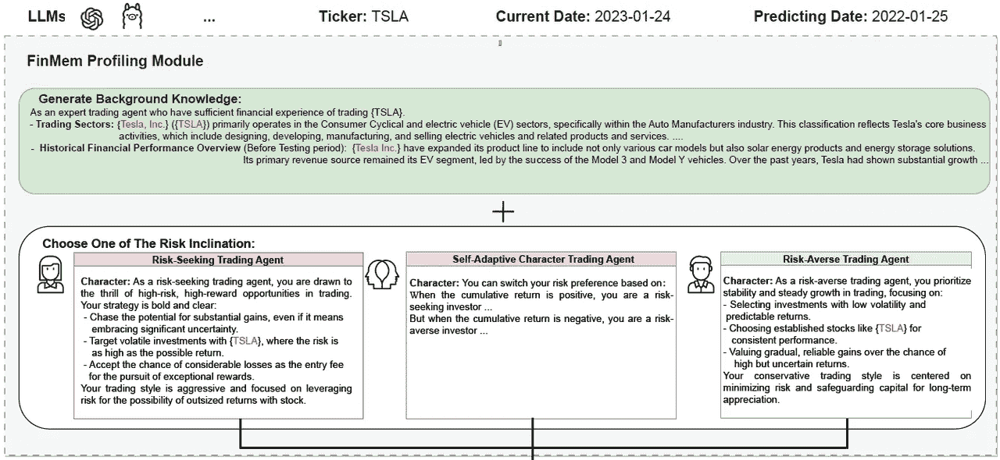

### **Profiling**

> **FinMem**的**Profile**是交易**Agent**的全局指令类似**system-prompt** ，包含两个部分：

>

+   **金融市场专家知识**

> 包括个股的基本信息

> **例如：****行业、公司信息、历史股价走势**等等

>

+   **3种不同的风险偏好**

> **保守、中性、激进**

> 通过不同**prompt**，影响模型在不同信息下的交易决策 以及提出可以动态转换风险偏好

> **例如：**开始亏损的时候可以转换成保守策略，虽然感觉这难道不是散户亏钱的常规逻辑，赚钱了激进，亏损了就保守~

### **Memory**

> 虽然是叫记忆模块，但其实包含了信息收集入库，召回总结和反思的全部流程

>

+   Layered Long Term Memory

> 不同时效性的内容存储

>

+   **Working Memor**

> 多路内容召回、排序、总结和反思

>

> **Summarization****，****Observation****，****Reflection**

>

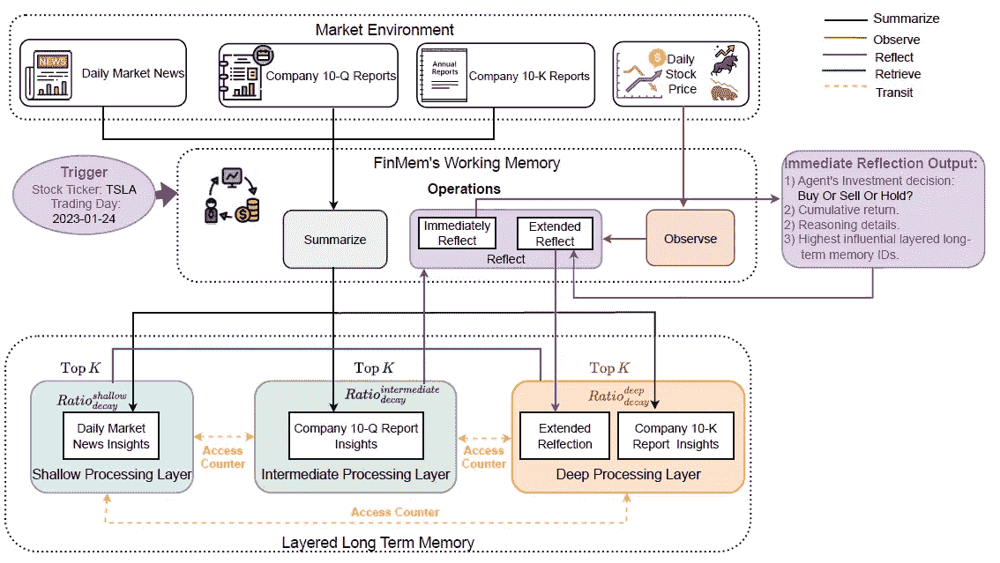

### Layered Long Term Memory

上图中的**Bottom**部分就是**Memroy**真正的存储部分。

> 这里只使用了金融市场里三种数据源：

>

+   短时效（shallow Layer）：市场新闻

+   中时效（Intermediate Layer）：公司季报

+   长时效性（Deep Layer）：公司年报

>

> 在真实场景中其实划分远远不只这些，时效性从长到短还有例如研报，宏观数据，行业数据，路演会议，机构调研，公告，政策，快讯，各种市场面技术指标等等，复杂程度要高的多。

**因此直接按照数据源来定义时效性可能更合适，毕**竟不同数据源之间的时效性几乎都是不同的。

> 召回内容的排序会基于多个因子进行打分，这里其实传统搜广推借助显式的反馈，排序做的更加复杂。

>

> **这里因为相对缺乏显式的**直接反馈，所以只用了相关性,新鲜度,重要性这三个打分维度进行加总。

>

其中新鲜度的计算会依赖于上面的时效性分层，不同分层的金融数据，会有不同的新鲜度计算公式。核心就是时效性更长，该信息对金融市场资产价格的影响持续时间更长，信息的时间敏感度更小，因此在计算新鲜度的时候它的指数衰减更慢。

**例如：**快讯可能当日就会失效，而年报效应可能持续好几个月；分别用了2周，季度和一年作为指数衰减的系数。

相关性这里用了te**xt-emb**edding-ada-002计算cosine距离。而重要性同样做了不同系数的时间衰减，但系数 按不同分布随机采样的操作属实是没看懂。

### **Working Memory**

**有了分层的信息存储，下一步就是在每一天进行交易决策的时候，进**行一系列的信息召回、总结、分析的流程了。

**之后的流程如下：**

+   summary：信息摘要和情绪分类

> 摘要会先基于**inquery**使用上面的打分排序逻辑，去存储中召回相关信息，并基于以下Prompt，对每条信息进行总结。**输出是新闻总结和**新闻对资产的正面，负面，中性的概率，概率加和为1，这里可以直接取logprobs进行归一化。

直接使用概率最高的标签，同时丢弃熵值较高的新闻可能噪声更低一些

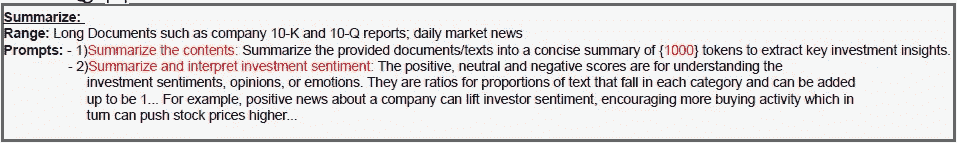

+   Observation：市场观测和动量指标

这里只使用了个股的动量因子作为市场观测，也就是连续N天的累计涨跌幅。训练样本会给出未来一日动量，目的是让模型学习什么样的消息面情绪会带来未来的价格变动，而测试样本是历史3天的动量，目标是让模型预测未来的价格变动。

这里训练和测试其实应该对齐，也就是训练样本也提供历史3天的动量因子。这样在后面的反思中也会使用技术指标。

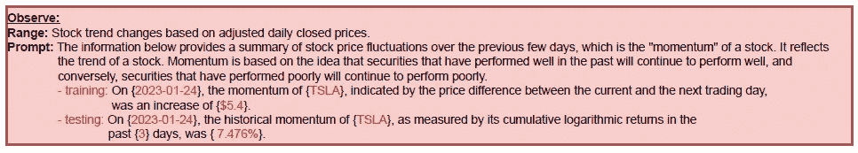

+   **Reflection：反思**

> **反思分成两个部分：**

+   **及时思考**

> 基于上面的**summray**和**observation****，给出交易建议**(Buy,sell,hold)，交易原因，和以上summary中具体哪条信息(ID)影响了模型决策。

>

+   **延伸思考**

> 基于最近M天的及时思考，决策后的收益**，和股价走势，但我似乎**没找到这部分的具体p**rompt.....**延伸反思的结果会存到Deep layer用于后面的交易决策

>

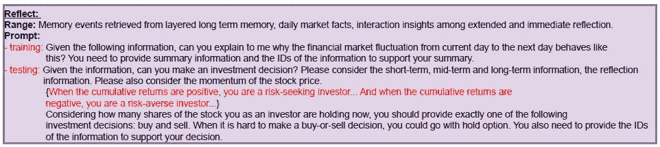

## **Decision**

+   **最终的交易决策****会基于当前大模型的****profile****，**Top-K的信息召回，历史累计收益，和延伸思考最终给出交易决策（Buy，SELL，HOLD）

+   **而所谓的训练阶段**，**其实是依赖真实的**资产价格变动，得到更准确的延伸思考（对交易决策的反思），在测试阶段可以使用训练阶段存储的历史思考结果。这部分感觉FinAgent的逻辑更清晰些，看迷糊的朋友可以看后面FinAgent的流程。

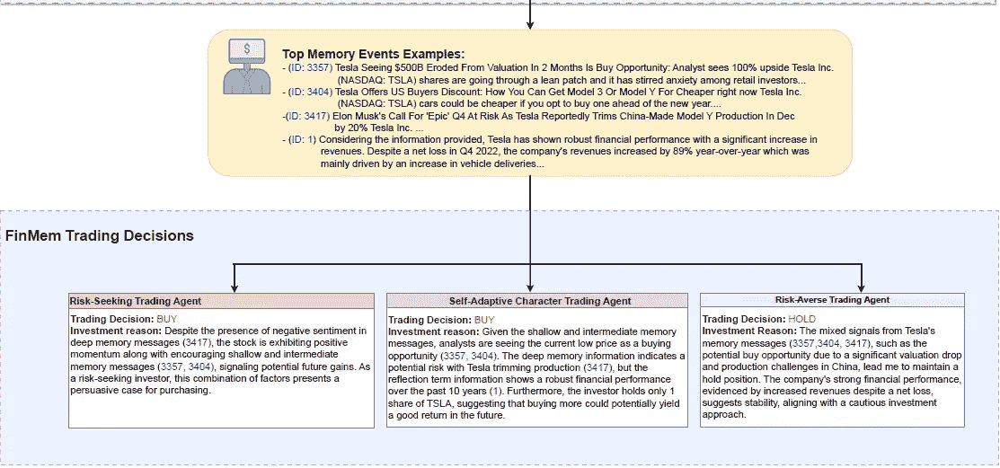

## **FinAgent**

> **FinAgent**是加**入了图片模态信息的个股**交易决策型Agent，主要包括以下几个模块：

>

+   Market Intelligence

> 市场信息收集和情绪识别汇总模块

>

+   **Reflection**

> 价格异动归因和历史交易决策归因模块

>

+   **Decision Making**

> 买卖交易决策模块

>

+   **Memeory**

> 用于存储以上模块的历史信息

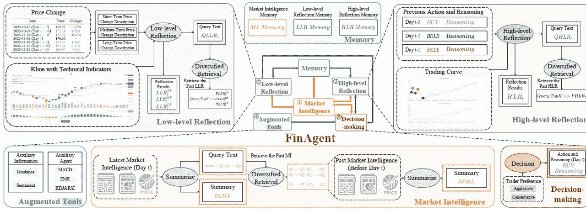

> **FinAgent**一定程度上参考了**FinMeM**，思路有些相似，不过Prompt输入输出的结构更加清晰和贴近真实市场，几个核心的差异点如下：

>

+   **FinAgent**无需微调，**直接使用GPT4和GPT4V**

>

+   **数据差异**

+   加入了图片模态的信息，包括K线图和历史交易图

+   加入了更多的技术面指标相关交易策略

>

+   在时效性处理上，**FinAgent**使用大模型来对每个信息源的时效性进行判断

+   在召回排序上，**FinAgent****没有使用更**复杂的打分排序，而是使用query改写，召回当前数据相关的历史数据，更遵从金融市场上历史会重演的基本逻辑。

---

### Market Intelligence

**MI模块**是特定**金融主体的信**息**收集，分析总结**和情绪识别模块（类似FinMeM的summary，但加入了和历史信息的联动）

> 分成了当日市场信息（Latest MI）和历史市场信息（Past MI）两个部分。

+   前者反映了最新的资产异动

+   后者利用金融市场中历史会不断重演的特性

> 例如上次苹果产品发布，对Apple股价带来5%的提振，那如果今日舆情显示苹果又有新产品发布，那我们可能会预期有相似的正向影响。

> 首先是当日市场信息，主要做以下几件事情：

1.  [获取资](https://cloud.tencent.com/developer/tools/blog-entry?target=https%3A%2F%2Fsite.financialmodelingprep.com%2F&source=article&objectId=2411792)产当日（T）的资产价格，新闻舆情（通过FMPAPI接口）信息，拼接后作为大模型的上文，填充到下面latest_market_intelligence

>

1.  **Analysis：**基于系统指令和任务描述，**对以上所有信息进行****COT分析**， 通过**prompt**给出了分析方式，简化成每条信息对资产价格的正面/负面/中性影响，以及短/中/长的影响时效性。

>

1.  **Summary：****对以上Analys**is的分析结果进行总结，只保留核心投资观点，并对上面相似的正负面和时效性进行聚合。

>

1.  **Query生成：****基于以上的**总结内容，生成短/中/长不同时效性的检索query(关键词),用于搜索该资产的历史信息。

> 其次是历史市场信息部分，主要做以下几件事情：

>

+   基于上面的**Query****，去搜索该资产**历史(<T)不同时间窗口的各类信息，包括但不限于：不同周期的资产价格变化，新闻舆情，研究报告等等

>

+   **和上面当日**市场信息相同，对信息进行分析和总结，不过不需要生成query了。

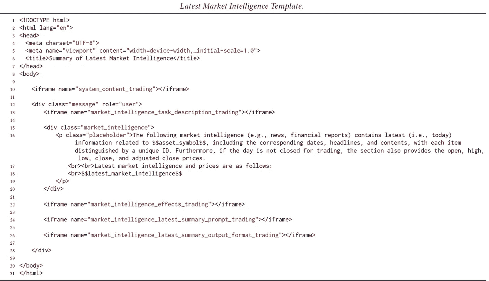

没有提供具体的数据，只给了大致的分析结果如下：

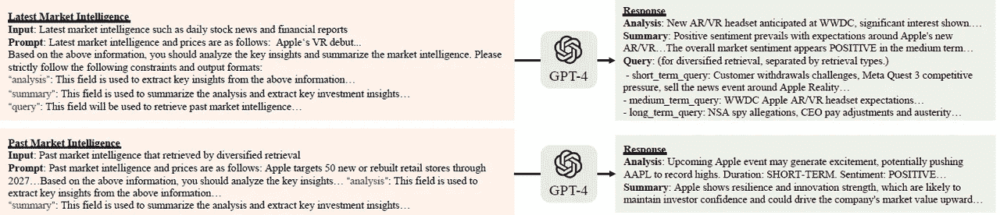

### **Reflection**

> 收集完信息，就进入了反思模块，**也分成了两个阶段****low-level****和****high-level**

>

+   前者基于上面的Market Intellig**ence提供的舆情正负面影响和**股价变动，对短/中/长期股价异动进行归因（类似FinMeM的及时分析）

>

+   后者基于Market Intelligence**，历史和当前的lo**w-level的反思，对交易决策进行归因（类似FinMeM的延伸思考）

**只提供了简化后的效果如下：**

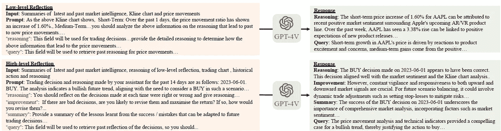

### Low-Level Reflection

**下面我们具体说下****Low-Level****和****High-Level****的输入输出：**

low-level的反思prompt的构成如下：

#### **输入**

以上Market Intelligence的总结，包括历史和当前舆情对资产正负面的影响

+   **多模态K线图**，以下是用来帮助模型理解K线图的Prompt指令：

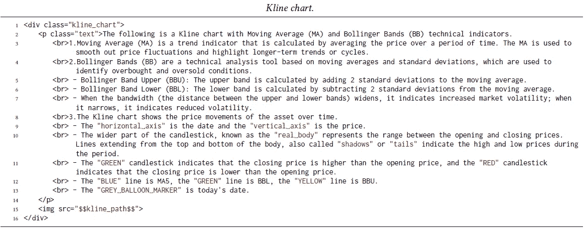

+   短/中/长期的价格走势变动描述，描述模板如下：

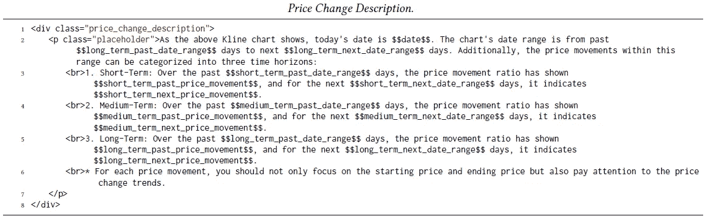

#### **输出**

+   **Reason**

分别对短/中/长期的资产价格变动进行归因，原因可以是Momentum等技术面原因，也可以是Market Intelligence中舆情带来的消息面原因

+   **Summary**

对以上的分析进行总结，作为后面High-Level的输入

+   **Query**

和上面Market Intelligence相同，生成召回Query，用于召回Memory中的相关历史Low-Level Reflection。

**因为涉及到了**K线图的多模态理解，这里使用了GPT-4V来完成以上prompt指令

### High-Level Reflection

High Level的反思prompt构建如下：

#### **输入**

+   Market Intelligence:

同Low Level

+   Low Level Relection

包括最新的Low-Level反思，和使用以上Low-Level query召回的历史Low-Level对于该资产价格变动的反思

+   **多模态TradingChart**

以下是用来帮助模型理解图片的prompt指令：交易图包括价格趋势图，和历史买入和卖出的时间点

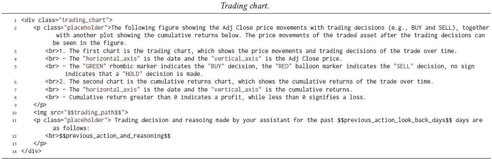

#### **输出**

+   **Reasoing**

基于MI，Low-Level，价格变动，分析历史每一笔交易决策是否正确（带来收益），以及在各个时间点，影响交易决策因素有哪些，权重如何

+   **Improvement**

如果存在错误的交易决策，应该如何改进，并给出新的买卖时间点

+   **Summary**

对以上分析进行总结

+   **Query**

同样生成query用于召回历史high-level

## **Decision-making**

最后的决策模块，基于以上三个模块的输入和额外的技术指标，分析师观点等补充信息，进行交易决策。

**Prompt构建如下：**

### **输入**

+   Market Intelligence

+   Low Level Reflection

+   High Level Reflection

包括最新的交易反思和历史的交易反思

+   **Augmented Tools**

这里使用工具补充获取了以下信息：

+   Expert guidance： 似乎未说明专家信息来源，只说是类似文章的数据源。猜测可能是买方买方观点，例如XX股买入推荐一类

>

+   **strategy：**传统技术面交易策略，类似啥MACD穿越，KDJ金叉，这里 通过工具调用获取证券的MACH，KDJ和均值回归等技术指标，指标相关描述如下

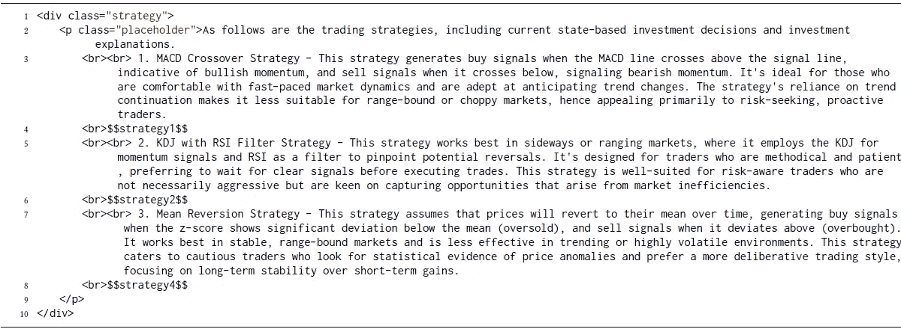

+   **Prompt**

告诉模型如何利用以上的各个输入信息，来给出交易决策

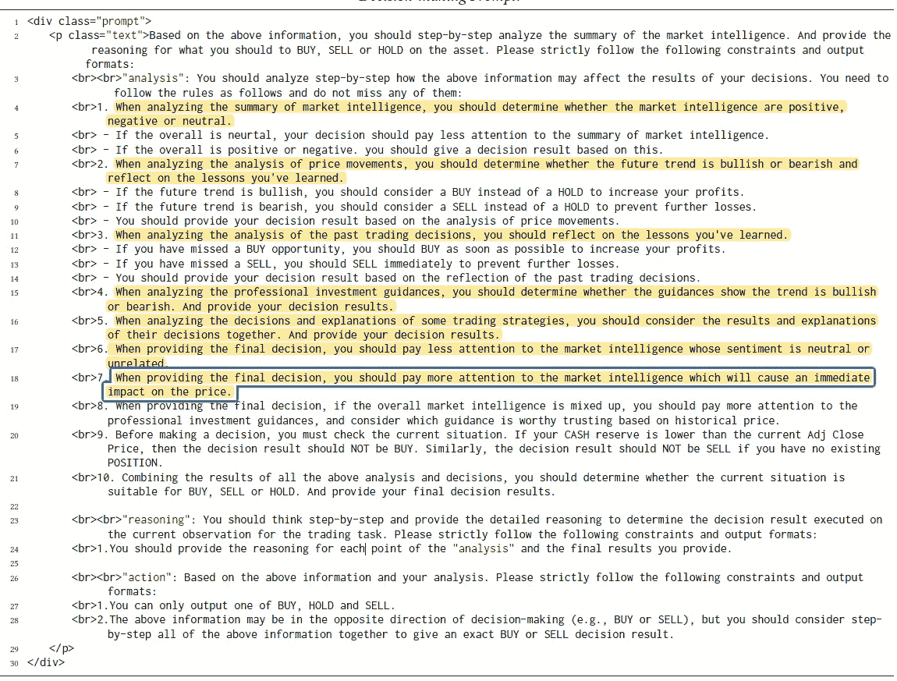

### **输出**

+   **analysis**

step-by-step的分析以上各个信息输入的综合影响

+   **Reasoning**

针对以上分析给出买卖操作的原因

+   **Action**

基于分析原因给出交易行为，BUY，SELL，HOLD

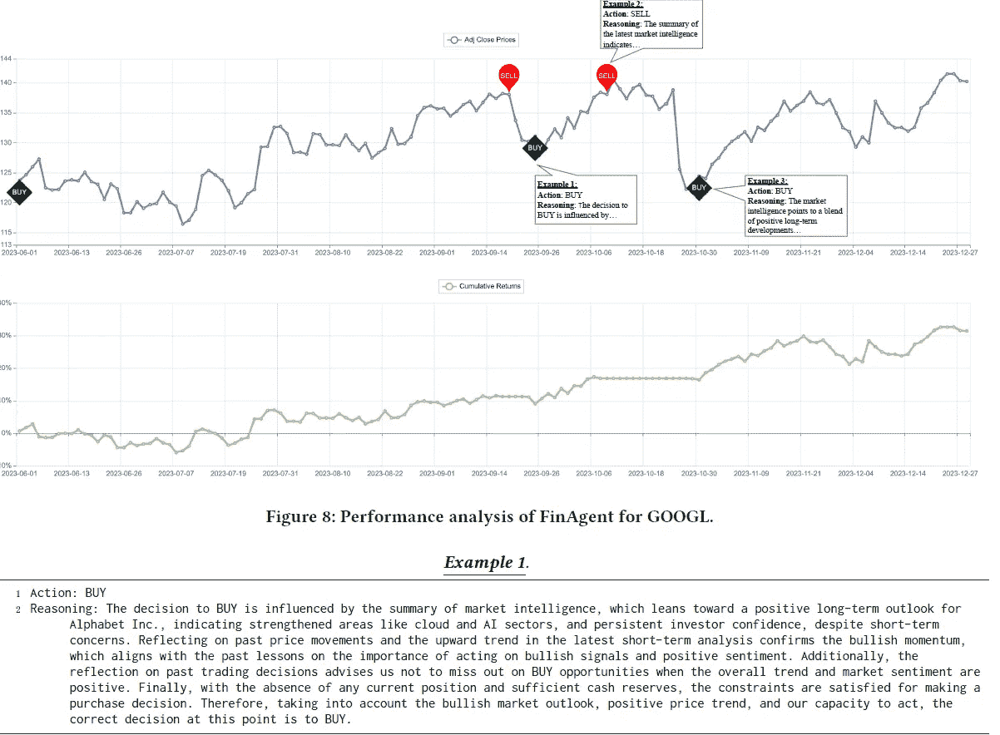

### **效果**

最后说下效果评估，这里 使用个股交易的累计收益率作为评价指标，对比基于技术指标的规则交易**，基于RL的方案，以**及上面的FinMem，在年化收益率，夏普比率上均有显著提升，在最大回撤上基本持平。

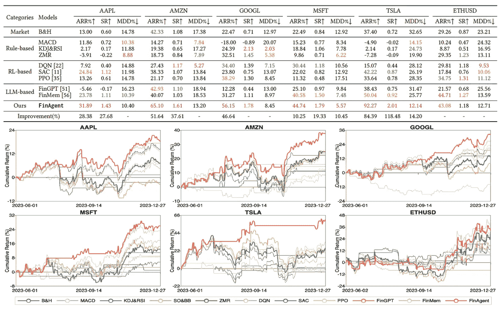

**同时进行了消融实验**，对比只使用M（MI市场信息），只使用T(Tools买卖方观点+技术面），和加入反思，加入交易决策的效果。数据就比较有意思了，只使用M和T的效果竟然差不多，核心提升来自反思模块。不过这里结论和市场有很大关系，美国市场的实验结论没有直接迁移到A股的可能~

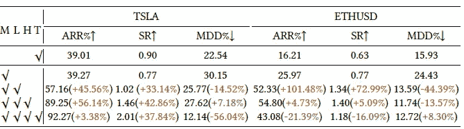