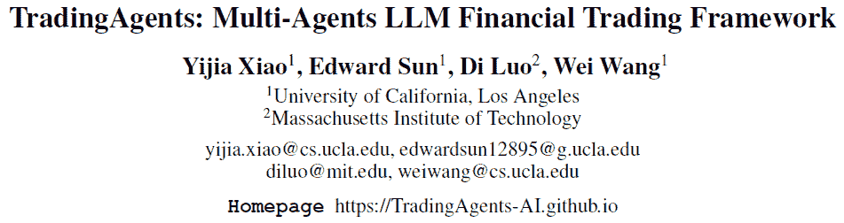
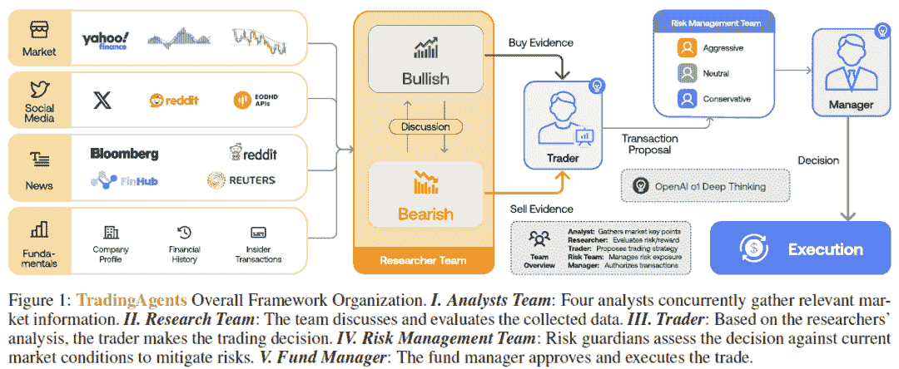
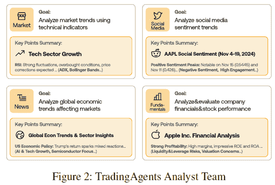
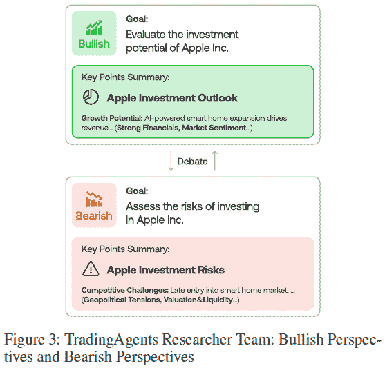
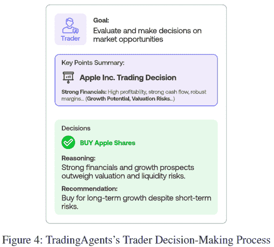
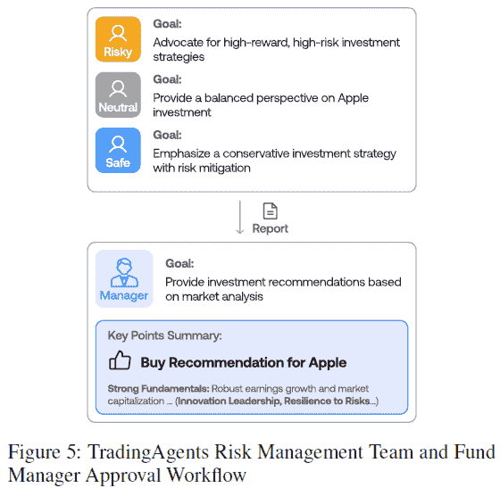
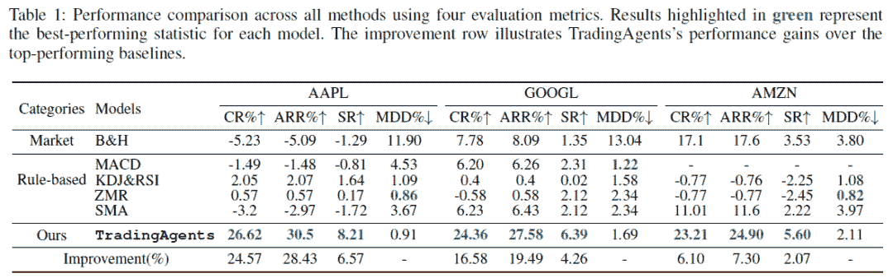
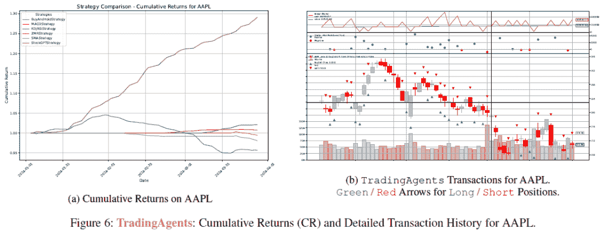
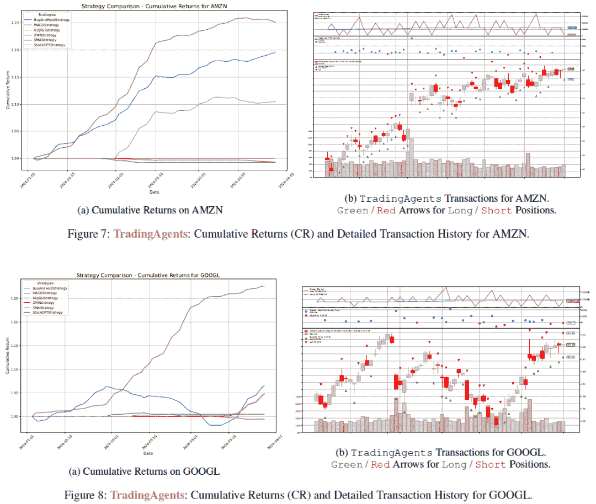

# TradingAgents：基于多智能体的大型语言模型（LLM）金融项目

> 来源：[https://qqs7y1hozd1.feishu.cn/docx/D65rdEvYLoq5GAxIImRckb3Un4d](https://qqs7y1hozd1.feishu.cn/docx/D65rdEvYLoq5GAxIImRckb3Un4d)

> “TradingAgents: Multi-Agents LLM Financial Trading Framework”

现有金融领域的语言代理面临两个主要限制：一是缺乏真实的组织建模，未能模拟真实交易团队的复杂互动；二是沟通接口效率低，依赖自然语言导致信息丢失和上下文混乱。

本文提出的框架通过模拟专业交易团队的多代理决策过程，结合结构化输出与自然语言对话，提升沟通效率和决策灵活性。实验表明，TradingAgents在盈利能力上显著优于现有的基于规则的交易基线，累计回报至少为23.21%，年回报24.90%，超出最佳基线至少6.1%。在AAPL股票上，TradingAgents在市场波动中表现出色，三个月内回报超过26%。

## 摘要

**TradingAgents提出了一种新型**股票交易框架，模拟真实交易公司的协作动态。框架中包含多种角色的LLM驱动代理，如基本面分析师、情绪分析师、技术分析师和不同风险偏好的交易员。

Bull和Bear研究员代理评估市场状况，风险管理团队监控风险敞口，交易员综合辩论和历史数据做出决策。通过模拟动态协作的交易环境，旨在提升交易表现。

> **详**细架构和实验结果显示，该框架在累计收益、夏普比率和最大回撤方面优于基线模型，展示了多代理LLM框架在金融交易中的潜力。

### 简介

自主代理利用大型语言模型（LLMs）在决策中模拟人类流程，特别适用于金融市场，能够处理复杂因素如公司基本面和市场情绪。传统算法交易系统依赖定量模型，难以全面捕捉复杂因素的相互作用，而LLMs在自然语言数据处理上表现优越。

> 现有金融领域的语言代理面临两个主要限制：一是缺乏真实的组织建模，未能模拟真实交易团队的复杂互动；二是沟通接口效率低，依赖自然语言导致信息丢失和上下文混乱。

> 本文提出的框架通过模拟专业交易团队的多代理决策过程，结合结构化输出与自然语言对话，提升沟通效率和决策灵活性。通过历史金融数据实验验证框架的有效性，使用累积收益、夏普比率和最大回撤等评估指标。

### 相关工作

#### LLM用于财务助理

**大型语言模型（LLMs**）在金融领域的应用通过在金融数据上进行微调或训练金融语料库，提升了对金融术语和数据的理解。这种专门化的助手可提供分析支持、洞察和信息检索，但不涉及交易执行。

#### 微调金融LLM

**PIXIU (FinMA)**通过在136K金融指令上微调LLaMA，提升了领域特定性能。FinGPT利用LoRA在约50K金融样本上微调LLaMA和ChatGLM。Instruct-FinGPT在10K金融情感分析指令样本上进行微调。这些模型在金融分类任务中超越了基础版本及其他开源LLM，如BLOOM和OPT，甚至在多个评估中超过BloombergGPT。在生成任务中，它们的表现与GPT-4等通用模型相似或稍逊，显示出高质量领域特定数据集的需求。

#### 从零开始训练金融LLM

针对金融领域的LLM（如BloombergGPT、XuanYuan 2.0、Fin-T5）通过结合公共数据和金融特定数据进行预训练，提升了领域适应性。BloombergGPT在通用和金融文本上训练，使用Bloomberg专有数据提高了金融基准测试的表现。这些模型在市场情感分类和摘要等任务上优于通用模型（如BLOOM176B和T5），但不及更大闭源模型（如GPT-3和PaLM）。金融特定LLM通过微调或从头训练在领域特定任务上显著提升，强调了领域适应的重要性和高质量金融数据集的潜力。

#### LLM用于交易

LLMs作为交易代理，通过分析新闻、财务报告和股价做出交易决策。提出的架构包括：新闻驱动、推理驱动和强化学习驱动的代理。

#### 新闻驱动代理

新闻驱动架构将股票新闻和宏观经济更新整合进LLM提示中，以预测股价走势。研究表明，基于情感评分的简单多空策略在闭源模型（如GPT-3.5、GPT-4）和开源LLM（如Qwen、Baichuan）中有效。针对金融领域的微调LLM（如FinGPT、OPT）显示出更好的性能。先进方法涉及对新闻数据的总结及其与股价关系的推理。

#### 推理驱动代理

反思驱动的代理（如FinMem和FinAgent）通过分层记忆和多模态数据总结输入，提升决策质量，结合技术指标，表现优越，减少幻觉现象。辩论驱动的代理（如TradingGPT）通过不同角色的代理间辩论，增强推理和事实有效性，提高情感分类和交易决策的稳健性。

#### 强化学习驱动代理

强化学习方法通过回测奖励来调整LLM输出与预期行为的对齐。SEP（Koa et al. 2024）利用强化学习结合记忆和反思，基于市场历史优化LLM预测。经典强化学习方法在交易框架中应用，将LLM生成的嵌入与股票特征结合，使用如PPO（Ding et al. 2023; Schulman et al. 2017）等算法进行训练。

#### LLM用于Alpha因子挖掘

QuantAgent（Wang et al. 2023）利用LLM生成alpha因子，采用内外循环架构：内循环中，写作代理生成脚本，评判代理提供反馈；外循环中，代码在真实市场测试，交易结果优化评判代理。AlphaGPT（Wang et al. 2023）提出人机协作的alpha挖掘框架，架构类似。研究表明，LLM驱动的alpha挖掘系统在自动化和加速交易策略开发方面具有潜力。

#### TradingAgents：角色

明确**分**配LLM代理角色和目标，有助于将复杂目标分解为可管理的子任务，金融交易是复杂性的典型例子。交易公司依赖专家团队分析大量数据（财务指标、价格波动、交易量等），以识别趋势和预测市场。TradingAgents定义了七个代理角色：基本面分析师、情绪分析师、新闻分析师、技术分析师、研究员、交易员和风险经理。每个代理都有特定的名称、角色、目标和约束，配备相应的工具和技能，例如情绪分析师使用网络搜索和情绪评分算法，技术分析师执行代码和分析交易模式。

### 分析师团队

分析团队由专门的代理组成，负责收集和分析市场数据，以支持交易决策。基本面分析代理：评估公司基本面，分析财务报表和内部交易，识别被低估或高估的股票。

> **情绪分析代理：**处理社交媒体和情绪评分，预测投资者行为对股价的短期影响。

> **新闻分析代理：**分析新闻和宏观经济指标，识别可能影响市场动态的事件。

> **技术分析代理：**计算技术指标（如MACD和RSI），分析价格模式和交易量，预测未来价格走势。分析团队综合多方数据，为研究团队提供全面的市场分析基础。

### 研究员团队

研究团队负责评估分析团队提供的信息，采用多轮辩论方式。牛市研究员强调投资机会、增长潜力和市场利好，支持投资决策。

熊市研究员关注风险和市场信号，提供警示，质疑投资策略的可行性。通过辩论，研究团队力求达成市场状况的平衡理解，帮助交易代理做出明智决策。

### 交易代理

Trader Agents 根据分**析团队和研究团队的综合分析执行交易决策。主要任**务包括评估分析师和研究员的建议、决定交易时机和规模、下达买卖订单、调整投资组合。需在动态市场中平衡潜在收益与风险，做出精准的战略决策。

### 风险管理团队

风险管理团队监控和控制市场风险，确保交易活动符合风险参数和监管要求。主要职责包括：

1.  评估市场波动性、流动性和对手方风险。

1.  实施风险缓解策略，如设置止损单和多元化投资。

1.  向交易代理提供风险反馈，建议调整交易策略。

1.  确保整体投资组合符合公司的风险承受能力和投资目标。

**通**过监督和指导，维护公司的财务稳定，保护资产，确保可持续的长期表现。所有交易代理遵循ReAct框架，促进推理与行动的协同，确保动态决策过程。

### TradingAgents：工作流

**通信协议**

> 现有的基于LLM的代理框架主要通过自然语言进行通信，但在复杂的长期任务中效果不足。纯自然语言交流可能导致信息遗忘或扭曲，类似于“电话游戏”。受MetaGPT等框架启发，提出了一种结构化通信协议来规范代理交互。该模型明确每个代理的状态，确保只提取必要信息，处理后返回完整报告。这种方法简化了步骤，降低了信息失真风险，使交互在复杂任务中保持高效。

**Agent交互类型**

> TradingAgents代理通过结构化文档和图表进行沟通，避免冗长对话导致信息稀释和数据丢失。分析团队撰写简明分析报告，包含关键指标、见解和建议。交易员基于分析报告生成决策信号，并附上详细的决策理由和证据，供风险管理团队使用。研究团队通过自然语言对话进行辩论，形成多元观点，辩论结果记录为结构化条目。风险管理团队从不同风险视角调整交易计划，进行自然语言讨论，结果由主持代理记录。基金经理根据风险管理团队的讨论更新交易决策和报告状态。

**LLMs**

> 根据任务复杂性和速度需求，选择不同的语言模型（LLMs）以发挥其优势。快速模型（如gpt-4o-mini和gpt-4o）适合快速、低深度任务（如摘要、数据检索、表格转文本）。深度模型（如o1-preview）擅长推理密集型任务（如决策、证据报告、数据分析），支持多轮推理，提供深入见解。优先选择可靠且可扩展的模型，以确保在不同市场条件下的最佳表现。分析节点使用深度模型以确保分析的稳健性，快速模型用于API和工具的数据检索。研究人员和交易者利用深度模型生成有价值的见解，支持明智决策。该框架实现了效率与推理深度的平衡，适用于有效的交易策略。TradingAgents可无GPU部署，仅依赖API信用，支持未来模型的无缝替换，具备高度可扩展性和灵活性。

## 实验

**交易数据**

数据集涵盖多种资产和模式，包含苹果、英伟达、微软、Meta、谷歌等股票。包含历史股价（2024年1月1日至3月29日），包括开盘、最高、最低、收盘、成交量和调整后收盘价。收集来自彭博社、雅虎、EODHD、FinnHub和Reddit的每日新闻，涉及公司动态、全球事件、宏观经济趋势和政府更新。包括社交媒体帖子及情感分析，来源于Reddit、X/Twitter等平台。提供内幕情感和交易信息，基于公开信息和公司备案。包含公司财务报表和收益报告。提供公司简介和财务历史信息。计算60种标准技术分析指标，如MACD、RSI、布林带等。

**仿真设置**

模拟交易环境时间：2024年6月19日至11月19日。TradingAgents支持即插即用策略，便于与基准比较。交易决策基于每个交易日的数据，避免未来数据使用（消除前瞻性偏差）。生成买入、卖出或持有信号并执行。交易后计算分析指标，进入下一个交易日。

###### 比较TradingAgents框架与多个基准策略：

买入持有：均匀投资于所有选定股票并持有。

+   MACD：基于MACD线与信号线交叉点生成买卖信号的趋势跟随策略。

+   KDJ与RSI：结合KDJ和RSI指标识别超买超卖条件的动量策略。

+   ZMR：基于价格偏离零参考线的均值回归交易策略。

+   SMA：基于短期与长期移动平均线交叉生成交易信号的趋势跟随策略。

###### 评估指标

+   累积收益（CR）：计算模拟期内的总回报，公式为CR = ((V_end - V_start) / V_start) × 100%。

+   年化收益（AR）：将累积收益标准化为年收益，公式为AR = ((CR / N)^(1/N) - 1) × 100%。

+   夏普比率（SR）：衡量风险调整后的收益，公式为SR = (R̄ - R_f) / σ。

+   最大回撤（MDD）：测量投资组合价值的最大峰值到谷值的下降幅度。

### 结果和分析

**表现对比**

TradingAgents在盈利能力上显著优于现有的基于规则的交易基线，累计回报至少为23.21%，年回报24.90%，超出最佳基线至少6.1%。在AAPL股票上，TradingAgents在市场波动中表现出色，三个月内回报超过26%。

Sharpe Ratio显示TradingAgents在风险调整回报方面表现卓越，AAPL、GOOGL和AMZN的Sharpe Ratio至少为5.60，超出次优模型至少2.07点，表明其在多样市场条件下的适应性和稳健性。

**尽管基于规则的基线在控制风险方面表现较好，但TradingAgents在高**回报和相对低最大回撤（不超过2）之间取得了良好平衡，展示了其有效的风险控制机制。

当前深度学习交易方法的复杂性导致决策难以解释，而基于LLM的交易框架通过自然语言沟通决策，提供了更高的可解释性。TradingAgents的交易日志展示了其决策过程，增强了透明度和可调节性。

## 分析

> 整合多个专业LLM代理和促进代理辩论显著提升交易表现。框架高效整合多元数据源和专家分析，帮助交易代理做出符合风险偏好的明智决策。反思代理和专门的风险管理团队在优化策略和降低风险中至关重要。实现卓越的收益捕获，同时保持强大的风险管理指标，平衡收益最大化与风险最小化。多代理LLM框架的自然语言操作确保高可解释性，优于传统和深度学习方法。

## 总结

**TradingAgents是一个基于LLM的**股票交易框架，模拟多代理的交易公司环境。通过多代理互动和辩论，提升交易决策的合理性和风险管理。集成不同角色和风险配置的代理，显著改善交易结果和风险管理。实验表明，TradingAgents在累计回报、夏普比率等关键指标上优于传统交易策略。未来计划在实时交易环境中部署框架，扩展代理角色并增强实时数据处理能力。

项目主页：https://tradingagents-ai.github.io/

论文地址：https://arxiv.org/pdf/2412.20138

Github地址：[h](https://github.com/TradingAgents-AI/TradingAgents-AI.github.io)ttps://github.com/TradingAgents-AI/TradingAgents-AI.github.io