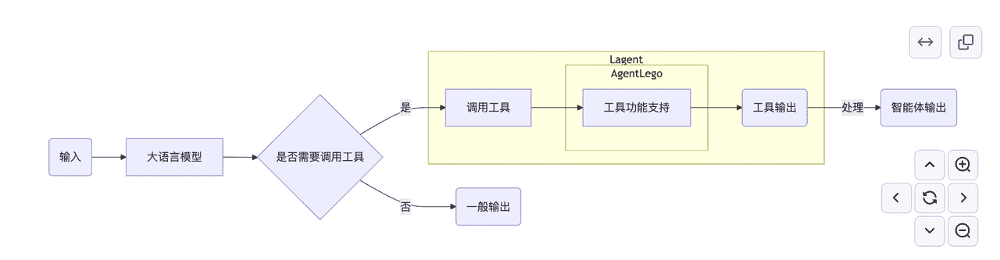
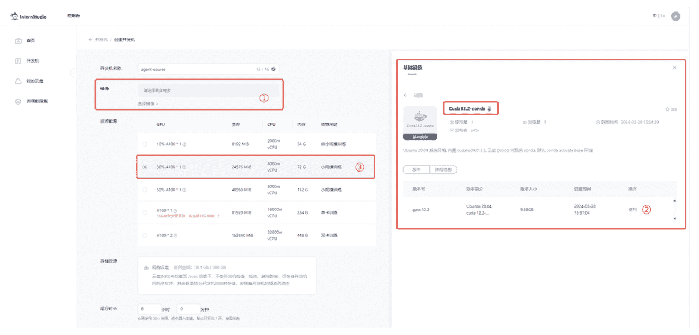
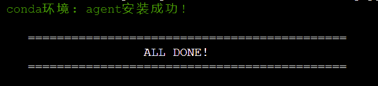

# Lagent & AgentLego

> 来源：[https://qqs7y1hozd1.feishu.cn/docx/Vq50ddpndoeZqtx4aBlcnk2VnIh](https://qqs7y1hozd1.feishu.cn/docx/Vq50ddpndoeZqtx4aBlcnk2VnIh)

# **1.1 Lagent 是什么**

Lagent 是一个轻量级开源智能体框架，旨在让用户可以高效地构建基于大语言模型的智能体。同时它也提供了一些典型工具以增强大语言模型的能力。

Lagent 目前已经支持了包括 AutoGPT、ReAct 等在内的多个经典智能体范式，也支持了如下工具：

+   Arxiv 搜索

+   Bing 地图

+   Google 学术搜索

+   Google 搜索

+   交互式 IPython 解释器

+   IPython 解释器

+   PPT

+   Python 解释器

# 1.2 AgentLego 是什么

AgentLego 是一个提供了多种开源工具 API 的多模态工具包，旨在像是乐高积木一样，让用户可以快速简便地拓展自定义工具，从而组装出自己的智能体。通过 AgentLego 算法库，不仅可以直接使用多种工具，也可以利用这些工具，在相关智能体框架（如 Lagent，Transformers Agent 等）的帮助下，快速构建可以增强大语言模型能力的智能体。

AgentLego 目前提供了如下工具：

| #### 通用能力 | #### 语音相关 | #### 图像处理 | #### AIGC |
| --- | --- | --- | --- |
| +   **计算器** | +   **文本 -&gt; 音频（TTS）** | +   **描述输入图像** | +   **文生图** |

+   **分割一切**

+   **分割给定目标**

+   **根据边缘+描述生成**

+   **根据深度图+描述生成**

+   **根据姿态+描述生成**

+   **根据涂鸦+描述生成**

+   **音频生成图像**

+   **热成像生成图像**

+   **音频+图像生成图像**

+   **音频+文本生成图像**

# **1.3 两者的关系**

经过上面的介绍，我们可以发现，Lagent 是一个智能体框架，而 AgentLego 与大模型智能体并不直接相关，而是作为工具包，在相关智能体的功能支持模块发挥作用。

两者之间的关系可以用下图来表示：



# **1.4 环境配置**

## 1.4.1 创建开发机和 conda 环境

在创建开发机界面选择镜像为 Cuda12.2-conda，并选择 GPU 为30% A100



进入**开发机**后，为了方便使用，我们需要配置一个环境以同时满足 Lagent 和 AgentLego 运行时所需依赖。在开始配置环境前，我们先创建一个用于存放 Agent 相关文件的目录，可以执行如下命令：

```
mkdir -p /root/agent
```

接下来，我们开始配置 conda 环境，可以输入如下指令：

```
studio-conda -t agent -o pytorch-2.1.2
```

显示下图就是初始化环境成功了



非 InterStudio 开发机环境配置

## 1.4.2 安装 Lagent 和 AgentLego

Lagent 和 AgentLego 都提供了两种安装方法，一种是通过 pip 直接进行安装，另一种则是从源码进行安装。为了方便使用 Lagent 的 Web Demo 以及 AgentLego 的 WebUI，我们选择直接从源码进行安装。 此处附上源码安装的相关帮助文档：

+   Lagent：[h](https://lagent.readthedocs.io/zh-cn/latest/get_started/install.html)ttps://lagent.readthedocs.io/zh-cn/latest/get_started/install.html

+   AgentLego：[h](https://agentlego.readthedocs.io/zh-cn/latest/get_started.html)ttps://agentlego.readthedocs.io/zh-cn/latest/get_started.html

可以执行如下命令进行安装：

```
cd /root/agent
conda activate agent
git clone https://gitee.com/internlm/lagent.git
cd lagent &amp;&amp; git checkout 581d9fb &amp;&amp; pip install -e . &amp;&amp; cd ..
git clone https://gitee.com/internlm/agentlego.git
cd agentlego &amp;&amp; git checkout 7769e0d &amp;&amp; pip install -e . &amp;&amp; cd ..
```

## **1.4.3 安装其他依赖**

在这一步中，我们将会安装其他将要用到的依赖库，如 LMDeploy，可以执行如下命令：

```
conda activate agent
pip install lmdeploy==0.3.0
```

## 1.4.4 准备 Tutorial

由于后续的 Demo 需要用到 tutorial 已经写好的脚本，因此我们需要将 tutorial 通过 git clone 的方法准备好，以备后续使用：

```
cd /root/agent
git clone -b camp2 https://gitee.com/internlm/Tutorial.git
```

# 2.**Lagent：轻量级智能体框架**

在这一部分中，我们将带大家体验 Lagent 的 Web Demo，使用 Lagent 自定义工具，并体验自定义工具的效果。

详细文档可以访问：[Lagent：轻量级智能体框架](https://qqs7y1hozd1.feishu.cn/wiki/InOZwgOAXim3Bukm2LLcVcVdnBc)

# 3.AgentLego：组装智能体“乐高”

在这一部分中，我们将带大家直接使用 AgentLego 工具，体验 AgentLego 的 WebUI，以及基于 AgentLego 自定义工具并体验自定义工具的效果。

详细文档可以访问：[AgentLego：组装智能体“乐高”](https://qqs7y1hozd1.feishu.cn/wiki/Bka8wYVTfig17RkirzDc2s8unEg)

#  4.**Agent 工具能力微调**

在这一部分中，我们将介绍 OpenAI Function Calling 的相关内容，以及带大家使用 XTuner 来实现 Agent 工具能力的微调。

详细文档可以访问：[Agent 工具能力微调](https://qqs7y1hozd1.feishu.cn/wiki/ASGPwu8Rxif5o4kPwqucfRX8nue)