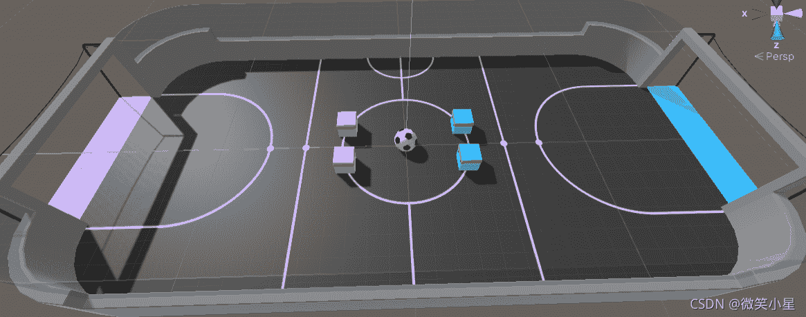
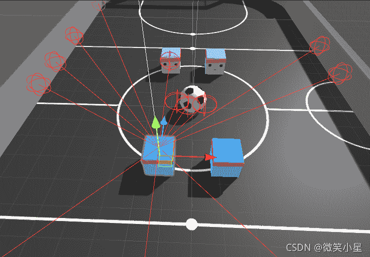
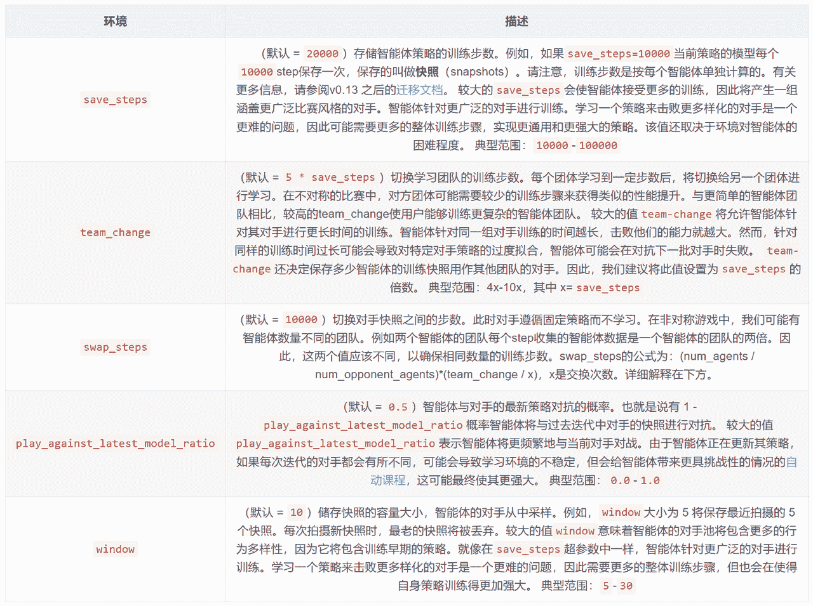
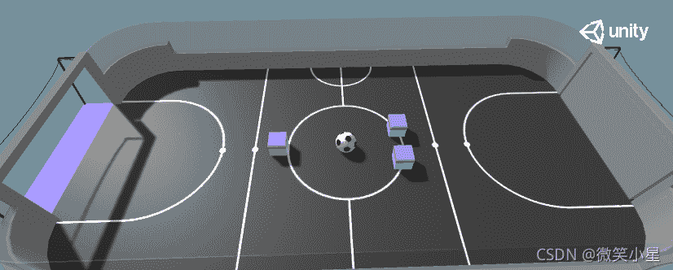
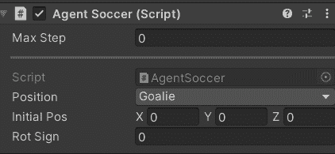

# ML-Agents案例之双人足球

> 来源：[https://qqs7y1hozd1.feishu.cn/docx/EVm3dIdeKoZiKhxxU1ZcwEy3nTc](https://qqs7y1hozd1.feishu.cn/docx/EVm3dIdeKoZiKhxxU1ZcwEy3nTc)

## 对称环境博弈

### 环境说明



这是一场对称性的2对2的足球比赛，双方人员配置一致，目标是在防止球进入己方球门的同时，把球送进对方的球门。

奖励设置：当把球踢到对方的球门时，分数+1，但是还要减去和花费时间成正比的惩罚。当球踢进己方球门时，分数-1。

#### 输入维度



可以看到，每个智能体身上都有14根射线传感器，前面120读角均匀分布11根，后面均匀分布3根，探测的标签有球，己方球门，对方球门，己方队友，对手，墙壁。关于射线传感器`Ray Perception Sensor 3D`，请参考ML-Agents案例之推箱子游戏。

#### 输出维度

三个离散输出，分别控制：前后移动，左右移动，旋转。

+ 代码分析

+ 环境控制

环境控制器，挂载在空物体上：

```
using System.Collections.Generic;
using Unity.MLAgents;
using UnityEngine;

public class SoccerEnvController : MonoBehaviour
{
    // 存储单个智能体关键信息的类
    [System.Serializable]
    public class PlayerInfo
    {
        public AgentSoccer Agent;
        [HideInInspector]
        public Vector3 StartingPos;
        [HideInInspector]
        public Quaternion StartingRot;
        [HideInInspector]
        public Rigidbody Rb;
    }


    /// 每一个episode的最大步数
    /// Max Academy steps before this platform resets
    [Tooltip("Max Environment Steps")] public int MaxEnvironmentSteps = 25000;

    public GameObject ball;
    [HideInInspector]
    public Rigidbody ballRb;
    Vector3 m_BallStartingPos;

    // 关于多个智能体信息的列表
    public List<PlayerInfo> AgentsList = new List<PlayerInfo>();

    private SoccerSettings m_SoccerSettings;

        // 两个多智能体组，代表两个队
    private SimpleMultiAgentGroup m_BlueAgentGroup;
    private SimpleMultiAgentGroup m_PurpleAgentGroup;

    private int m_ResetTimer;
        // 初始化环境
    void Start()
    {
        // 寻找一个唯一的脚本，其中只包含了两种智能体的材质，是否随机队伍，移动速度的变量
        m_SoccerSettings = FindObjectOfType<SoccerSettings>();
        // 实例化
        m_BlueAgentGroup = new SimpleMultiAgentGroup();
        m_PurpleAgentGroup = new SimpleMultiAgentGroup();
        ballRb = ball.GetComponent<Rigidbody>();
        m_BallStartingPos = new Vector3(ball.transform.position.x, ball.transform.position.y, ball.transform.position.z);
        // 组队，构成两组多智能体
        foreach (var item in AgentsList)
        {
            item.StartingPos = item.Agent.transform.position;
            item.StartingRot = item.Agent.transform.rotation;
            item.Rb = item.Agent.GetComponent<Rigidbody>();
            if (item.Agent.team == Team.Blue)
            {
                m_BlueAgentGroup.RegisterAgent(item.Agent);
            }
            else
            {
                m_PurpleAgentGroup.RegisterAgent(item.Agent);
            }
        }
        // 重置场景
        ResetScene();
    }

    void FixedUpdate()
    {
        // 达到时间后停止训练，进入下一个episode，重置场景
        m_ResetTimer += 1;
        if (m_ResetTimer >= MaxEnvironmentSteps && MaxEnvironmentSteps > 0)
        {
            m_BlueAgentGroup.GroupEpisodeInterrupted();
            m_PurpleAgentGroup.GroupEpisodeInterrupted();
            ResetScene();
        }
    }

        // 重置球的位置
    public void ResetBall()
    {
        var randomPosX = Random.Range(-2.5f, 2.5f);
        var randomPosZ = Random.Range(-2.5f, 2.5f);

        ball.transform.position = m_BallStartingPos + new Vector3(randomPosX, 0f, randomPosZ);
        ballRb.velocity = Vector3.zero;
        ballRb.angularVelocity = Vector3.zero;

    }
        // 进球后的处理，包括处理加减分，开启新的episode，重置环境
    public void GoalTouched(Team scoredTeam)
    {
        if (scoredTeam == Team.Blue)
        {
            m_BlueAgentGroup.AddGroupReward(1 - (float)m_ResetTimer / MaxEnvironmentSteps);
            m_PurpleAgentGroup.AddGroupReward(-1);
        }
        else
        {
            m_PurpleAgentGroup.AddGroupReward(1 - (float)m_ResetTimer / MaxEnvironmentSteps);
            m_BlueAgentGroup.AddGroupReward(-1);
        }
        m_PurpleAgentGroup.EndGroupEpisode();
        m_BlueAgentGroup.EndGroupEpisode();
        ResetScene();

    }

        // 重置整个场景，带一定随机
    public void ResetScene()
    {
        m_ResetTimer = 0;

        //Reset Agents
        foreach (var item in AgentsList)
        {
            var randomPosX = Random.Range(-5f, 5f);
            var newStartPos = item.Agent.initialPos + new Vector3(randomPosX, 0f, 0f);
            var rot = item.Agent.rotSign * Random.Range(80.0f, 100.0f);
            var newRot = Quaternion.Euler(0, rot, 0);
            item.Agent.transform.SetPositionAndRotation(newStartPos, newRot);

            item.Rb.velocity = Vector3.zero;
            item.Rb.angularVelocity = Vector3.zero;
        }

        //Reset Ball
        ResetBall();
    }
}
```

#### 智能体控制

`AgentSoccer.cs`文件：

这里有两个枚举变量，分别代表所处的队和所处位置：

```
public enum Team
{
    Blue = 0,
    Purple = 1
}
```

```
public enum Position
{
    Striker,     // 前锋
    Goalie,      // 守门员
    Generic      // 通用
}
```

初始化：

```
public override void Initialize()
{
    // 确定最大训练步数
    SoccerEnvController envController = GetComponentInParent<SoccerEnvController>();
    if (envController != null)
    {
        m_Existential = 1f / envController.MaxEnvironmentSteps;
    }
    else
    {
        m_Existential = 1f / MaxStep;
    }
        // 获取BehaviorParameters组件中的队伍ID，初始化对应属性
    m_BehaviorParameters = gameObject.GetComponent<BehaviorParameters>();
    if (m_BehaviorParameters.TeamId == (int)Team.Blue)
    {
        // d
        team = Team.Blue;
        // 计算初始位置
        initialPos = new Vector3(transform.position.x - 5f, .5f, transform.position.z);
        // 用来计算旋转
        rotSign = 1f;
    }
    else
    {
        team = Team.Purple;
        initialPos = new Vector3(transform.position.x + 5f, .5f, transform.position.z);
        rotSign = -1f;
    }
    // 守门员给一个较高的横向速度
    if (position == Position.Goalie)
    {
        m_LateralSpeed = 1.0f;
        m_ForwardSpeed = 1.0f;
    }
    // 前锋横向速度较低，但拥有较高的前进速度
    else if (position == Position.Striker)
    {
        m_LateralSpeed = 0.3f;
        m_ForwardSpeed = 1.3f;
    }
    // 通用速度
    else
    {
        m_LateralSpeed = 0.3f;
        m_ForwardSpeed = 1.0f;
    }
    m_SoccerSettings = FindObjectOfType<SoccerSettings>();
    agentRb = GetComponent<Rigidbody>();
    agentRb.maxAngularVelocity = 500;
        // 获取配置文件参数
    m_ResetParams = Academy.Instance.EnvironmentParameters;
}
```

输出动作：

```
// 接收神经网络输出，驱动智能体
public override void OnActionReceived(ActionBuffers actionBuffers)
{
        // 前锋有时间惩罚，如果是守门员是时间奖励，这样就能训练出不同的逻辑
    if (position == Position.Goalie)
    {
        // Existential bonus for Goalies.
        AddReward(m_Existential);
    }
    else if (position == Position.Striker)
    {
        // Existential penalty for Strikers
        AddReward(-m_Existential);
    }
    // 封装了移动的逻辑
    MoveAgent(actionBuffers.DiscreteActions);
}

public void MoveAgent(ActionSegment<int> act)
{
    var dirToGo = Vector3.zero;
    var rotateDir = Vector3.zero;

    m_KickPower = 0f;
        // 接收三个输出
    var forwardAxis = act[0];
    var rightAxis = act[1];
    var rotateAxis = act[2];
        // 下面把三个输出分别赋给前后移动，左右移动，旋转
    switch (forwardAxis)
    {
        case 1:
            dirToGo = transform.forward * m_ForwardSpeed;
            // 只有向前移动时才有踢力
            m_KickPower = 1f;
            break;
        case 2:
            dirToGo = transform.forward * -m_ForwardSpeed;
            break;
    }
    switch (rightAxis)
    {
        case 1:
            dirToGo = transform.right * m_LateralSpeed;
            break;
        case 2:
            dirToGo = transform.right * -m_LateralSpeed;
            break;
    }
    switch (rotateAxis)
    {
        case 1:
            rotateDir = transform.up * -1f;
            break;
        case 2:
            rotateDir = transform.up * 1f;
            break;
    }
        // 执行动作
    transform.Rotate(rotateDir, Time.deltaTime * 100f);
    agentRb.AddForce(dirToGo * m_SoccerSettings.agentRunSpeed,
                     ForceMode.VelocityChange);
}
```

每个episode开始时的处理：


## 碰撞处理：

```
public override void OnEpisodeBegin()
{
    m_BallTouch = m_ResetParams.GetWithDefault("ball_touch", 0);
}
```

```
void OnCollisionEnter(Collision c)
{
    // 计算踢力
    var force = k_Power * m_KickPower;
    if (position == Position.Goalie)
    {
        force = k_Power;
    }
    // 和球碰撞会获得奖励
    if (c.gameObject.CompareTag("ball"))
    {
        AddReward(.2f * m_BallTouch);
        // 计算自身到接触点的向量，然后标准化
        var dir = c.contacts[0].point - transform.position;
        dir = dir.normalized;
        // 给球添加力
        c.gameObject.GetComponent<Rigidbody>().AddForce(dir * force);
    }
}
```

### `SoccerBallContraller.cs`

```
using UnityEngine;

public class SoccerBallController : MonoBehaviour
{
    public GameObject area;
    [HideInInspector]
    public SoccerEnvController envController;
    public string purpleGoalTag; //will be used to check if collided with purple goal
    public string blueGoalTag; //will be used to check if collided with blue goal

    void Start()
    {
        envController = area.GetComponent<SoccerEnvController>();
    }
    // 碰撞检测，是否和球门产生碰撞，碰撞了就调用环境控制器的方法
    void OnCollisionEnter(Collision col)
    {
        if (col.gameObject.CompareTag(purpleGoalTag)) //ball touched purple goal
        {
            envController.GoalTouched(Team.Blue);
        }
        if (col.gameObject.CompareTag(blueGoalTag)) //ball touched blue goal
        {
            envController.GoalTouched(Team.Purple);
        }
    }
}
```

## 配置文件

### 配置如下：

```
behaviors:
  SoccerTwos:
    trainer_type: poca
    hyperparameters:
      batch_size: 2048
      buffer_size: 20480
      learning_rate: 0.0003
      beta: 0.005
      epsilon: 0.2
      lambd: 0.95
      num_epoch: 3
      learning_rate_schedule: constant
    network_settings:
      normalize: false
      hidden_units: 512
      num_layers: 2
      vis_encode_type: simple
    reward_signals:
      extrinsic:
        gamma: 0.99
        strength: 1.0
    keep_checkpoints: 5
    max_steps: 50000000
    time_horizon: 1000
    summary_freq: 10000
    self_play:
      save_steps: 50000
      team_change: 200000
      swap_steps: 2000
      window: 10
      play_against_latest_model_ratio: 0.5
      initial_elo: 1200.0
```

可以看到，`poca` 除了可以和 `ppo` 具有相同的配置参数外，此处还展示了一个新功能，那就是 `Self Play`。

```
    self_play:
      save_steps: 50000
      team_change: 200000
      swap_steps: 2000
      window: 10
      play_against_latest_model_ratio: 0.5
      initial_elo: 1200.0
```

### Self Play

`Self Play` 是计算机的“左右互搏术”，通过自己随机的一个个智能体相互战斗，共同进步，从而共同实现策略的优化。

`Self Play` 为强化学习面临的常见问题增加了额外的混杂因素。一般在技能水平、最终策略通用性、学习的稳定性之间进行权衡。和低多样性对手进行训练比和高多样性对手进行训练会使学习过程更稳定。在此背景下，本指南讨论了可以调整的 `self play` 超参数。

如果环境包含多个分成多个团队的智能体，您可以通过为每个行为提供以下配置来使用 `Self Play`：



### ELO 机制

`ELO` 等级分制度是衡量选手水平的评分方法，在训练智能体的过程中，各个智能体团队通过相互博弈共同进步，会使得 `ELO` 分数持续升高。一般来说，初始分为 1200，赢了奖励一定分数，输了会扣除一定分数。详细规则请查看链接：

ELO 算法的原理及应用

ELO 评分算法

### 交换步骤的注意事项

例如，在 2v1 场景中，如果我们希望在 `team-change=200000` 步期间交换发生 `x=4` 次，则一个智能体的团队的 `swap_steps` 为：

`swap_steps = (1 / 2) * (200000 / 4) = 25000`

两个智能体的团队的 `swap_steps` 为：

`swap_steps = (2 / 1) * (200000 / 4) = 100000`

注意，在团队规模相同的情况下，第一项等于 1，`swap_steps` 可以通过将总步数除以所需的交换次数来计算。

较大的 `swap_steps` 值意味着智能体将在更长的训练迭代次数中与相同的固定对手对战。使训练环境更稳定，但让智能体面临针对该特定对手过度拟合其行为的风险。

## 非对称环境博弈

### 环境说明



如图所示，在非对称的环境博弈中，守门员只有一人，任务是防守两个前锋的进攻，把球保持在球门之外，而两个前锋的任务就是把球踢进球门。

在对称性的环境博弈中，模型都是可以相互通用的，例如在上面 2V2 的例子中，四个球员都是共享一个网络模型，就能实现对抗。

而在 1 个守门员对 2 个前锋的环境中，两者的逻辑必然存在巨大的不同，因此，我们需要给双方设定不同的网络进行训练。

代码依然采用的是我们在对称性环境所用的代码，守门员和前锋的不同之处在于给其设定了不同的 `Position` 参数，如图：



`Position` 是个公有变量，守门员设定为 `Goalie`，前锋设定为 `Striker`。这样我们回头查看初始化函数 `Initialize()` 的代码，就会发现守门员和前锋所拥有的前向移动速度和侧向移动速度是不同的。守门员横向速度高，而前锋前向速度高。

### 配置文件

```
behaviors:
  Goalie:
    trainer_type: poca
    hyperparameters:
      batch_size: 2048
      buffer_size: 20480
      learning_rate: 0.0003
      beta: 0.005
      epsilon: 0.2
      lambd: 0.95
      num_epoch: 3
      learning_rate_schedule: constant
    network_settings:
      normalize: false
      hidden_units: 512
      num_layers: 2
      vis_encode_type: simple
    reward_signals:
      extrinsic:
        gamma: 0.99
        strength: 1.0
    keep_checkpoints: 5
    max_steps: 30000000
    time_horizon: 1000
    summary_freq: 10000
    self_play:
      save_steps: 50000
      team_change: 200000
      swap_steps: 1000
      window: 10
      play_against_latest_model_ratio: 0.5
      initial_elo: 1200.0
  Striker:
    trainer_type: poca
    hyperparameters:
      batch_size: 2048
      buffer_size: 20480
      learning_rate: 0.0003
      beta: 0.005
      epsilon: 0.2
      lambd: 0.95
      num_epoch: 3
      learning_rate_schedule: constant
    network_settings:
      normalize: false
      hidden_units: 512
      num_layers: 2
      vis_encode_type: simple
    reward_signals:
      extrinsic:
        gamma: 0.99
        strength: 1.0
    keep_checkpoints: 5
    max_steps: 30000000
    time_horizon: 1000
    summary_freq: 10000
    self_play:
      save_steps: 50000
      team_change: 200000
      swap_steps: 4000
      window: 10
      play_against_latest_model_ratio: 0.5
      initial_elo: 1200.0
```

可以看到，于 2v2 的对称性环境博弈相比，这个环境需要的模型多了一个（`Behavior Name` 分别为 `Goalie` 和 `Striker`），因此需要配置的量也多了一倍。两个网络参数唯一的不同就在于 `Self Play` 中的 `swap_steps`。具体原因可以查看上面的 `Self Play` 章节。

在非对称性的环境中，双方都会随机出许多团队进行相互对抗，并且相互学习共同进步。每个团队不仅与不同的对手战斗，还会与对手以前的模型进行战斗，最终能训练出一个适应性、通用性较强的智能体团队。

## 后记

本文针对 `ML-Agents` 的足球案例进行了讲解，包括对称环境的 2V2 双人足球，还有非对称性的 1 守门员 VS 2 前锋。主要的知识点是 `Self Play`。也就是如何保存不同的模型让其相互对决，来实现整体的进化。

在对称环境中，我们在每个智能体团队中的智能体需要达成任务一致的情况下，我们只需要一个模型，就能完成所有智能体的训练。

而在非对称环境中，我们则需要给团队双方不同的模型，进行训练，如果队内智能体需要完成的任务有差异，队内不同智能体的模型可能也会有所不同。
