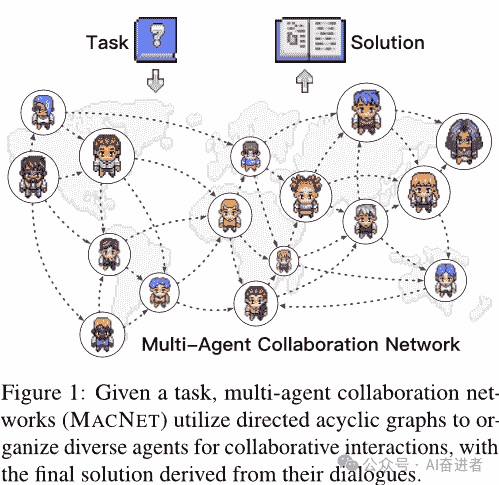
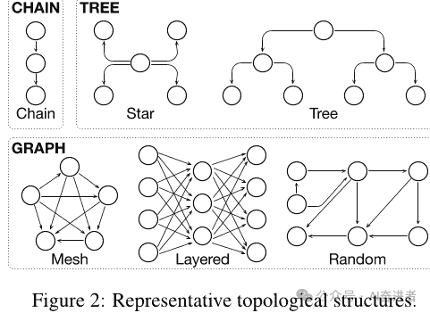
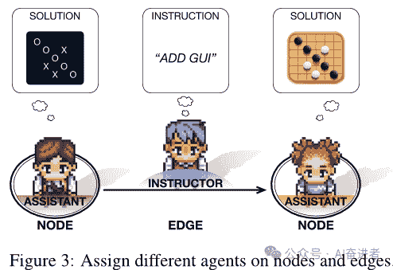
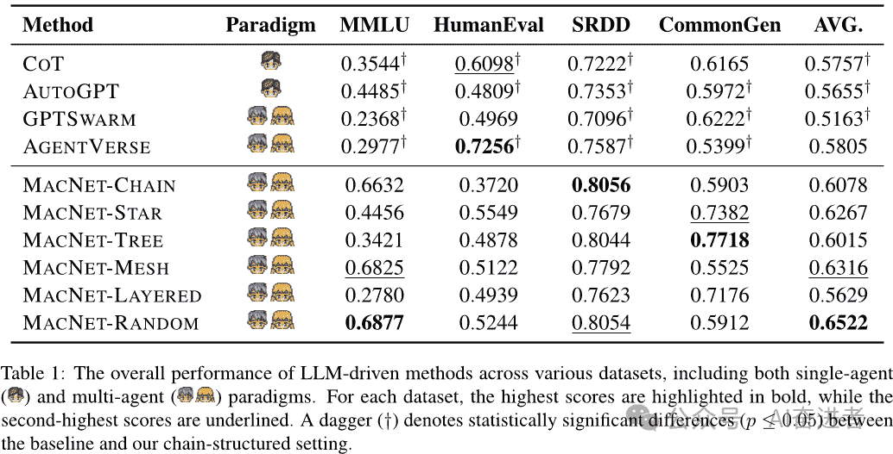
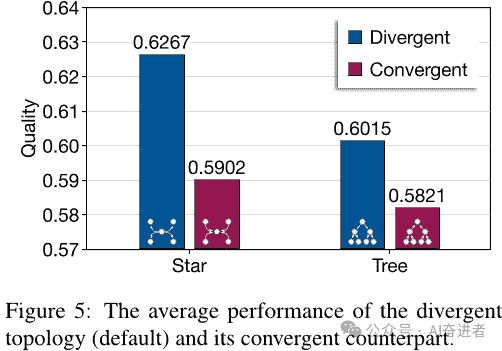
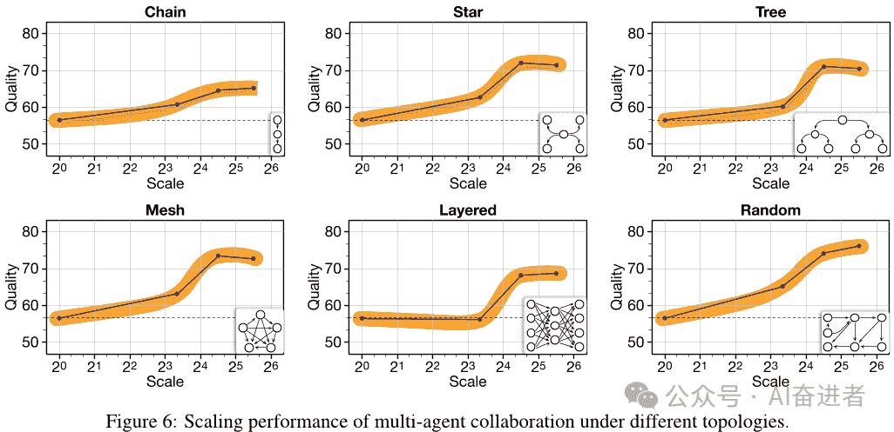

# Scaling LLM-based Multi-Agent

> 来源：[https://qqs7y1hozd1.feishu.cn/docx/Ybd3dHqCUogQzuxAjdccYjNonpu](https://qqs7y1hozd1.feishu.cn/docx/Ybd3dHqCUogQzuxAjdccYjNonpu)

# Scaling LLM-based Multi-Agent Collaboration浅析（MACNET）

## 概要

受神经规模法则的启发，一个自然的问题出现了：在多智能体合作中增加代理是否表现出涌现能力，存在scaling law？研究协作规模法则是准确估计多智能体系统中计算资源与性能趋势之间关系的关键。这种理解有助于优化资源利用并最小化不必要的浪费，最终实现更具扩展性、实用性和资源效率的代理系统。然而，有效的多智能体合作超越了通过多数表决从不同智能体汇总响应的简单方法；相反，它构成了一个有机集成的系统，需要面向任务的交互和深思熟虑的决策。

如图 1 所示，我们设想多个代理作为由专门化代理组成的良好组织团队，研究它们之间相互依赖的交互推理和集体智能，以自主解决复杂问题。为了实现这一目标，我们设计了适当的拓扑结构和有效的交互机制，使其既与静态组织结构一致，又与动态推理过程相适应。

为了确保通用性，我们设计了拓扑结构为有向无环图，其中每条边由一个发出定向命令的监督导师管理，每个节点都有一个提供定制解决方案的执行助手支持。这种机制有效地促进了代理之间的分工，并无缝地将静态拓扑与专用代理相结合，形成了多代理协作网络（MACNET）。

为了方便代理进行交互推理，通过拓扑排序来协调交互序列，确保网络中信息有序传输。在这种安排下，每个交互轮次都涉及两个相邻的代理细化之前的解决方案，只有经过提炼的解决方案，而不是整个对话，才会被传播到下一个邻居。这种机制战略性地避免了全局广播，并显著降低了在过度扩展上下文中的风险，使跨几乎任何大规模网络的协作成为可能。

我们在多个异构下游场景中对三种常见拓扑（链、树和图）进行了全面的定量评估，共分为六种变体。广泛的实验表明，MACNET 在所有基线之上表现始终最好，即使在完全连接的密集网络中也能实现有效的代理协作，支持超过一千个代理之间的合作。值得注意的是，我们观察到了小世界合作现象，即具有类似小世界属性的拓扑结构表现出优越的表现。此外，我们确定了一条协作增长法则，揭示了随着规模增加，归一化的解决方案质量遵循逻辑增长模式。与此同时，与以往神经涌现实例相比，我们可以观察到协作出现的时间提前了很多。希望我们的发现能为资源预测和优化提供有价值的见解，以提高 LLM 系统的效率和可扩展性。

## Agent

由于能够无缝集成大量知识，经过海量数据集训练且能够操纵数十亿个参数的语言模型（LLMs）已成为自然语言处理的关键。这一突破背后的核心是神经规模法则，它认为损失随着模型大小、数据集大小以及用于训练的计算量呈幂律增长。该原则强调了扩大语言模型可以带来新兴能力——当模型变大时性能会突然跳跃式提升。

尽管如此，LLMs 在封闭推理方面存在固有的局限性，这促使后续研究有效地为 LLM 配备了先进的能力，例如角色扮演、工具使用、长上下文记忆以及程序计划。通过这一过程，通用语言模型被转换为多才多艺、高度自主的Agent。沿着这条路线，多智能体合作已经出现，成为集成不同智能体专业性的有效范式。一个直接的合作策略是多数表决，其中个体保持独立；然而，更有效的多智能体合作应该形成一个促进相互依赖互动和深思熟虑决策的综合系统。

基于此，开创性研究将智能体的功能划分为两个截然不同的角色：Instructors指导者，提供方向性指令；Assistants 助手，做出定制化的响应。这些智能体进行指示性和反应性的陈述来培养一种交互链，并在对话中协作达成最终解决方案。这种模式促进了面向任务的交互流程的良好协调，显著减少了对人工干预的需求，同时展示了有希望的质量。

多智能体协作网络MACNet Multi-Agent Collaboration Network

我们的目标是建立一个多智能体协作的可扩展框架，包括两个关键组件：多智能体协作网络（MACNET）的设计和协同推理。

### 1、网络构建

为了建立一个 既高效又可扩展的多代理协作组织结构，我们将拓扑建模为有向无环图（DAG），以组织协作代理之间的交互。

由于列举所有可能拓扑结构的不切实际性，我们的研究重点放在了三种常见的拓扑类型上——链、树和图，并进一步细分为六种结构，如图 2 所示。

> 链式拓扑类似于瀑布模型，沿著代理人线性地组织交互作用。树形拓扑允许代理人分叉并以独立的方向进行交互；进一步分类为“更宽”的星型和“更深”的树状结构。图结构支持任意交互依赖关系，节点具有多个子代和父代，形成发散或收敛的交互作用；进一步分类为完全连接的网状结构、MLP 形状的分层结构以及不规则随机结构。这些代表性的拓扑结构在复杂网络中被广泛研究以及在 LLM 代理推理中得到了充分的研究，这确保了对理解多智能体系统最重要的和最实用的结构进行了全面的检查。

在基于 LLM 的代理生态系统中，由监督指导者发出方向性指令，执行助手提供定制解决方案可以有效地促进劳动，刺激功能行为的分工，并促进任务有效解决。为了在图3中整合这一策略，我们战略性地为每条边分配一个教师，为每个节点分配一个助手。这种设计使代理能够专注于其功能，推动任务导向的语言交互，并促进整个网络中的高效信息传输。此外，“定向”的边缘性质使得代理交互得以协调，而“无环”的配置防止了信息传播死锁。

### 2、互动推理

深入挖掘，拓扑排序方法有条不紊地展开代理交互为一个交互序列，概述多代理协作过程中的控制流。同时，在此过程中数据流与由边缘连接的原始依赖关系保持一致，确保交互信息流与拓扑中概述的固有依赖关系对齐。

### 3、内存控制

在多代理协作系统中，不受约束的情境信息交换可能导致情境过长，最终限制可扩展性。为了解决这个问题，我们采用了一种启发式机制来利用短期和长期记忆管理上下文可见性。短期记忆捕获每个双代理人交互期间的内部交互工作内存，确保基于上下文的决策。长期记忆通过仅传输对话中得出的最终解决方案而不是整个对话历史记录来维护跨交互的上下文连续性。这种方法确保祖先代理的上下文仍然是马尔可夫性的，解决方案仅从相邻代理传播，而不是来自所有以前的对话。因此，它降低了上下文过载的风险，同时保留了上下文连续性，从而使得在几乎任何大规模网络上实现可扩展的多代理协作成为可能。

**实验效果**

**不同拓扑结构之间的性能如何？**

为了理解拓扑性质，我们通过改变MAC-NET的拓扑结构进行了大量的实验。表1的结果表明不同的拓扑结构在不同的任务中表现出不同程度的有效性。例如，链状拓扑更适合软件开发，而网状拓扑在逻辑选择方面表现更好。没有一种拓扑能够始终在所有任务中提供最佳结果。具体来说，由于每个MAC-NET中的边都会触发代理交互，因此图的密度自然会反映代理之间的交互密度。经验上，在粗粒度拓扑类型中，较高的交互密度与较高的性能相关。这种性能差异可以归因于较高的图密度通常与较高的聚类系数相关联。这种聚类系数的增加导致更多的相邻节点对，从而降低了平均最短路径长度；因此，长距离解决方案被隐藏的可能性相应降低。出于这个原因，我们也发现不规则随机结构优于规则网格结构。这一优势可归因于随机连接的边缘，这在社交网络中类似于潜在地通过直接捷径链接“不认识”的代理，使它们成为彼此的“熟人”，并隐式地减少平均最短路径长度，从而类似于小世界特性。与此同时，与显示最高交互密度的网格拓扑不同，随机拓扑在减少安排深度和提高推理效率之间取得了最佳平衡，使其在实践中成为一个更合适的折衷方案。

此外，人们观察到，在相同的密度下，“更宽”的星形拓扑结构通常比“更深”的树状结构表现得更好。这主要是因为我们的解决方案传播机制，它会抑制整个网络中过度长的上下文推理过程的传播。因此，更深的拓扑可能会导致代理忽略更远的语境，可能导致回滚——解决方案还原为早期或相似版本。这个原则也适用于图形结构，在其中网状拓扑结构相比分层结构使代理能够通过直接边进行直接推理，从而隐式地减少网络深度并提高性能。

除了结构观点外，一些拓扑表现出固有的不对称性——颠倒边的结果是完全不平等的——这激发了我们探索反向拓扑。如图 5 所示，仅仅改变对称拓扑的方向会导致显著的表现下降。通常，发散结构（具有比父节点更多的子节点）在性能上显著优于收敛结构。直观地说，解决方案可以顺利地发散，让每个agent从不同的视角同时提出解决方案；相反，在单一点处合并多个代理的解决方案提出了更大的挑战，说明将不同视角整合为一个连贯策略的复杂性。

**协同增长定律是否存在？**

神经尺度定律促进了涌现性能力，其中大量神经元之间的协同作用导致性能的持续改善。为了研究协作尺度定律-预测agent scale与表现的潜在关系，考虑相关的时间和经济成本，我们对不同的拓扑结构进行了扩展，通过指数级增加节点数量（从1个回退到单代理方法）到50个（在网格设置中相当于1,275个代理）。如图6所示，我们的结果证实了小世界合作现象，即高密度网络可以实现最佳效果。此外，还可以观察到一种反向降解现象，某些配置导致整体质量降低约2.27%至6.24%。

随着拓扑的变化，多智能系统最初产生的解决方案的质量迅速提高，在达到饱和点（或略微下降）之前，近似为sigmoid形函数。

重要的是要强调，这只是基于尺度的平均描述；更精确的多代理系统应该考虑其他因素（例如基础模型、用户配置文件和工具空间）。值得注意的是，Neural Scaling Law神经缩放法则通常需要在大约 10^18 到 10^24 的尺度范围内将神经元数量增加一百万倍才能揭示显著趋势。相比之下，在MACNET中大多数拓扑表现出性能饱和度约在24到25个数量级。这种协同出现比神经出现更快，并且可以在较小的尺度上观察到。其根本原因是神经元协调，依赖于从零开始的训练，通过矩阵操作在潜在空间中，需要大量的规模来包含丰富的世界知识并发展学习能力。相比之下，基于预训练语言模型的隐式知识的代理协调利用了通过语言交互对文本信息的理解和提炼，通常绕过了神经协调所需的大量扩展。结合这两种不同层次的扩展机制有望产生更高质量的结果。

## 结论

通过引入MACNET，它利用DAG来构建代理的合作拓扑结构，并通过拓扑排序对其交互推理进行优化，从对话中推导出解决方案。大量的实验表明MACNET 在所有基线模型中始终表现最佳，使代理能够在各种拓扑结构上实现有效的协作。值得注意的是，我们观察到了小世界合作现象，即具有类似小世界属性的拓扑结构表现出更好的性能。此外，我们还发现了一个合作增长法则，显示随着规模的扩大，归一化的解决方案质量遵循逻辑增长模式。与此同时，与以前的神经涌现实例相比，我们可以观察到合作涌现显著提前发生。希望我们的发现能为资源预测和优化提供有价值的见解，以提高 LLM 系统的效率和可扩展性。