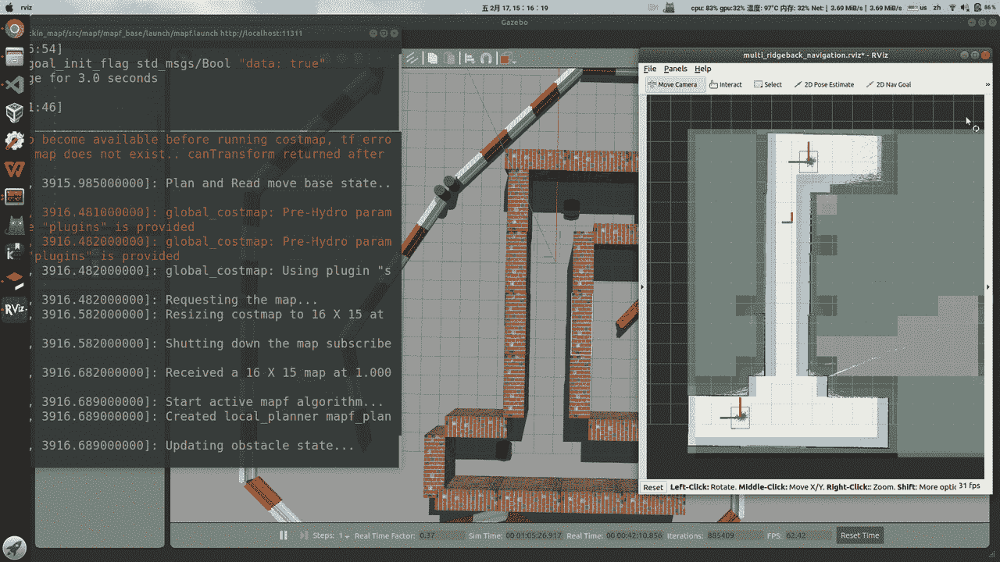
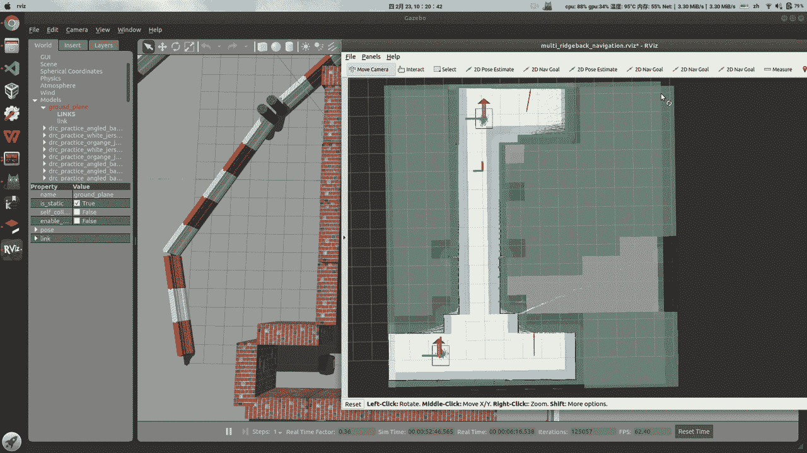
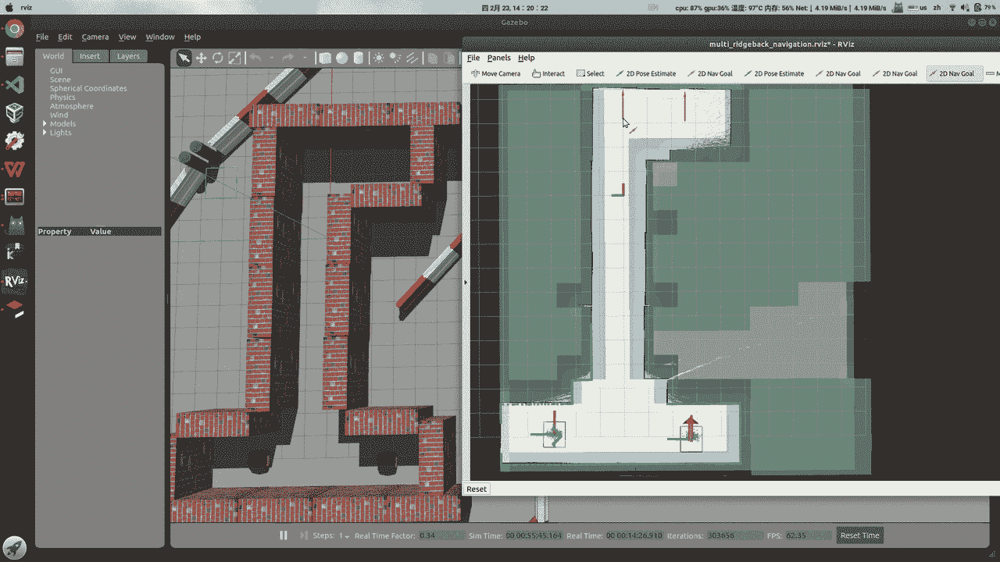
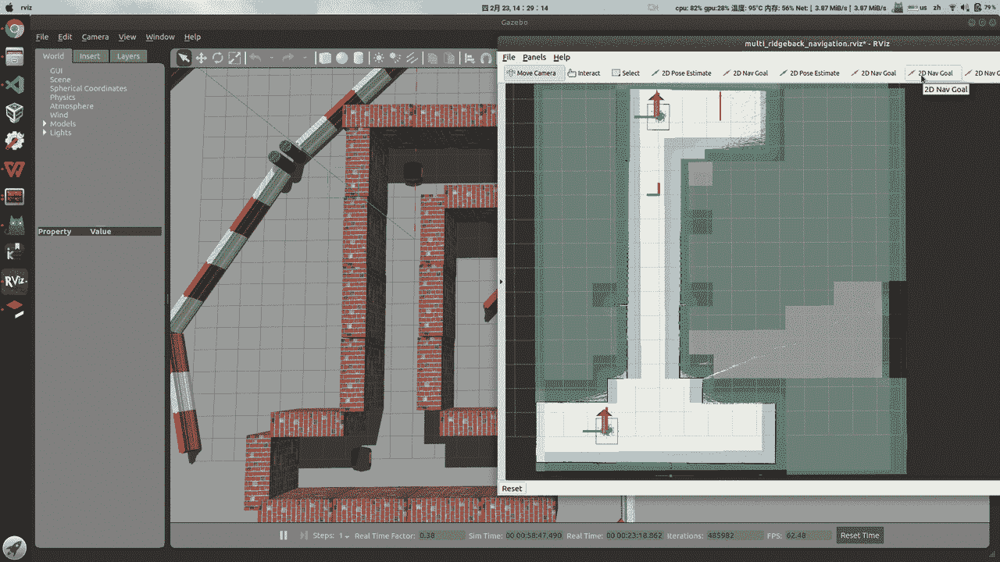
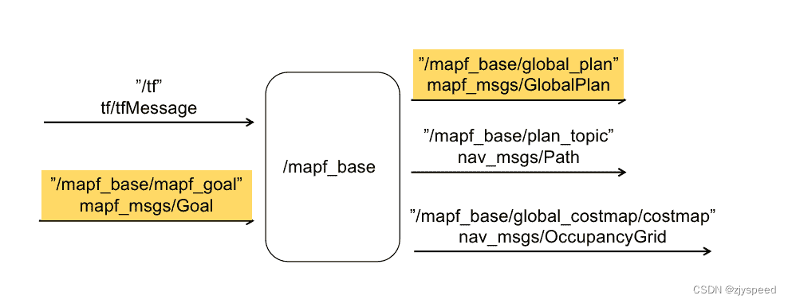
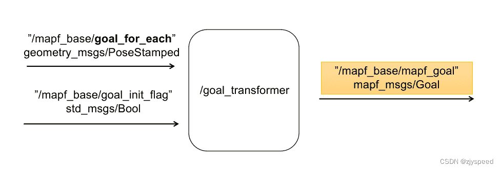
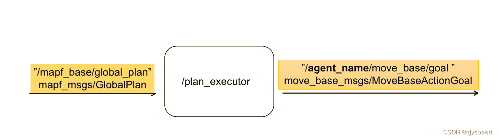
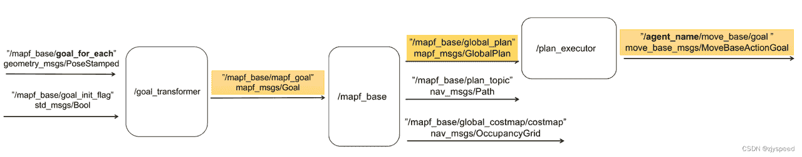
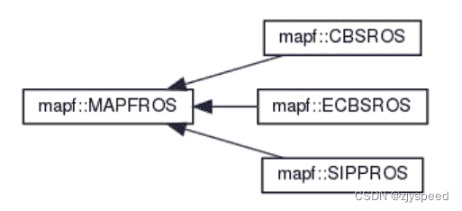

# Multi-Agent Path Finding, MAPF

> 来源：[https://qqs7y1hozd1.feishu.cn/docx/V69GdXaAsozZTfxrplncaJIcnfg](https://qqs7y1hozd1.feishu.cn/docx/V69GdXaAsozZTfxrplncaJIcnfg)

> **本**项目将多机路径规划算法(Multi-Agent Path Finding, MAPF)源码转换为ros实现。



**👉G**[**IF预览**](https://i-blog.csdnimg.cn/blog_migrate/9214ad06e26f10a6c847db370bd6bbaf.gif#pic_center)

本项目已经实现的多机规划方法有：

+   Conflict-Based Search (CBS)

+   **Enhanced Conflict**-Based Search (ECBS)

+   **P**rioritized Planning using SIPP (样例代码, swap情况的判断还未实现)

+   **Example**

+   Conflict-Based Search (CBS)

## 多智能体路径规划

CBS 是一组方法．算法的思想主要将多机规划分为两层，底层执行带有约束的单机规划，例如用传统 A* 算法，顶层遍历底层的规划路径，解决路径之间的冲突并施加约束。

CBS 算法给出 MAPF 问题的全局最优结果．

### Enhanced Conflict-Based Search (ECBS)

ECBS 基于 CBS, 在给定次优条件下给出比 CBS 更快的次优结果．



👉G[IF动图预览](https://i-blog.csdnimg.cn/blog_migrate/1cc43ec51869de2527b213328c631e09.gif#pic_center)

### Prioritized Planning using SIPP

SIPP 算法不属于 CBS 类算法，这个算法提出了一个安全间隔(safe intervals)的概念，将时空A*(space-time A*)和CBS类多机路径规划算法的时间维度显著压缩.

实际上，SIPP 是一个考虑动态障碍物轨迹的单机规划算法. 通过将多机系统中的机器人按优先级排列，先进行规划的机器人的轨迹在后进行规划的机器人 SIPP 算法中会被当作动态障碍物轨迹来处理.

源码的作者没有写 swap 情况的处理办法，后续有空研究一下，看看能不能补全．

#### No swap (Success)



👉G[IF动图预览](https://i-blog.csdnimg.cn/blog_migrate/9cd6c6046c96025369bf397121f3e254.gif#pic_center)

#### **Swap (Failure)**



👉G[IF动图预览](https://i-blog.csdnimg.cn/blog_migrate/921dc4c8189d7f0bfb6befbc41056c2f.gif#pic_center)

### Build

参照普通ros包编译方式:

```
catkin_make
```

### Launch

建议先看看下方的 **代码架构** 部分, 再来看看 launch.

### example launch

```
&lt;launch&gt;

  &lt;!-- 1. 加载低分辨率地图 --&gt;
  &lt;arg name=&quot;map&quot; default=&quot;mymap_low_resolution.yaml&quot; /&gt;
  &lt;group ns=&quot;mapf_base&quot;&gt;
    &lt;node name=&quot;map_server&quot; pkg=&quot;map_server&quot; type=&quot;map_server&quot; args=&quot;$(find ros_package_name)/maps/$(arg map)&quot; /&gt;
  &lt;/group&gt;

  &lt;!-- 2. launch mapf_base node --&gt;
  &lt;node pkg=&quot;mapf_base&quot; type=&quot;mapf_base&quot; name=&quot;mapf_base&quot; output=&quot;screen&quot; respawn=&quot;true&quot;&gt;
    &lt;rosparam file=&quot;$(find mapf_base)/params/costmap_params.yaml&quot; command=&quot;load&quot; ns=&quot;global_costmap&quot; /&gt;
    &lt;rosparam file=&quot;$(find mapf_base)/params/mapf_params.yaml&quot; command=&quot;load&quot; /&gt;

    &lt;!-- 规划器名称参数; possible values: {
    mapf_planner/CBSROS, 
    mapf_planner/ECBSROS,
    mapf_planner/SIPPROS
    } --&gt;
    &lt;param name=&quot;mapf_planner&quot; value=&quot;mapf_planner/SIPPROS&quot; /&gt;
    &lt;!-- &lt;rosparam file=&quot;$(find mapf_base)/params/ecbs_params.yaml&quot; command=&quot;load&quot; /&gt; --&gt;
  &lt;/node&gt;

  &lt;!-- 3. launch goal_transformer and plan_executor --&gt;
  &lt;group ns=&quot;mapf_base&quot;&gt;
    &lt;node pkg=&quot;mapf_base&quot; type=&quot;goal_transformer&quot; name=&quot;goal_transformer&quot; output=&quot;screen&quot;&gt; &lt;/node&gt;
    &lt;node pkg=&quot;mapf_base&quot; type=&quot;plan_executor&quot; name=&quot;plan_executor&quot; output=&quot;screen&quot;&gt; &lt;/node&gt;
  &lt;/group&gt;

&lt;/launch&gt;
```

有三个参数文件需要配置: mapf_params.yaml, costmap_params , ecbs_params.yaml(ecbs planner).

#### **Notes:**

强烈建议采用低分辨率地图用于 mapf 多机规划，高分辨率地图用于单机器人局部规划．

**原因如下:**

CBS 和 ECBS 都是时空搜索算法, 如果地图维数过大，搜索非常耗时．MAPF 的最优解法是 NP-Complete 问题.

由于 mapf 规划的路径是有时间步的，为了保证机器人不发生碰撞，每个时间步之间的最小距离必须大于机器人的直径。

### **代码架构：**

#### Nodes

##### 1 mapf_base

###### 1.1 节点结构

mapf_base 节点参照 ros navigation 包中 move_base 的功能，作为 mapf 算法的中央控制器，调度核心算法运行。

Notes: mapf_base节点只生成 global plan，不下发速度控制命令。 可以按照 plan 的每个 time step 发送给move_base，按照时间步执行控制命令。



###### 1.2 订阅话题

/mapf_base/mapf_goal [mapf_msgs/Goal] mapf格式的 goal 信息，包括系统中所有机器人的目标位置

/tf [tf/tfMessage] 得到 map 到每个机器人的 base_link 的 tf 变换

###### 1.3 发布话题

/mapf_base/parameter: plan_topic [nav_msgs/Path] | 不含时间步的 path, 在 rviz 上可视化使用

/mapf_base/global_plan [mapf_msgs/GlobalPlan] | 全局规划，是每个机器人的单独规划的集合，每个单独规划都包含时间步

/mapf_base/global_costmap/costmap [nav_msgs/OccupancyGrid] | 用于 mapf 的 costmap

###### 1.4 节点参数

~mapf_planner: (string, default: “mapf_planner/CBSROS”) | mapf规划器名称

~agent_num: (int, default: 2) | 多机系统机器人数量

~global_frame_id: map (string, default: map) | 地图和 /tf 的全局 frame

~planner_time_tolerance: 5.0 (double, default: DBL_MAX) | mapf 算法非常耗时，设置时间阈值，超时则算法退出

~goal_tolerance: 1.0 (double, default: 1.0) | mapf 算法到目标点的允差阈值，一旦机器人与目标点距离小于阈值，mapf 算法将停止规划，最好设成与用于 mapf 的地图分辨率相同

~base_frame_id: (string, default: “base_link”) | 每个机器人的 base_link frame_id, example:

**base_frame_id:**

agent_0: rb_0/base_link

agent_1: rb_1/base_link

~plan_topic: (string, default: “plan”) | 在 rviz 上可视化的不含时间步的 path 会发布在这个话题上, example:

**plan_topic:**

agent_0: rb_0/plan

agent_1: rb_1/plan

以下两个节点用于mapf算法的测试．你也可以编写自己的节点，只需要处理好 mapf_base 节点的输入输出．

##### 2 goal_transformer

###### 2.1 节点结构

goal_transformer 节点用于将每个节点的目标信息整合为 mapf 格式的目标信息发布



###### 2.2 订阅话题

parameter: goal_topic [geometry_msgs/PoseStamped] | 订阅每个机器人的目标信息

/mapf_base/goal_init_flag [std_msgs/Bool] | 值如果为 true, 将接收到的每个 goal　信息整合为 mapf 格式的 goal发布

###### 2.3 发布话题

/mapf_base/mapf_goal [mapf_msgs/Goal] | 发布 mapf 格式的 goal 给 mapf_base 节点处理

###### 2.4 节点参数

~goal_topic: (string, default: “rb_0/goal”) | 本节点将从这个话题接收每个机器人的 goal, example:

goal_topic:

agent_0: rb_0/goal

agent_1: rb_1/goal

##### 3 plan_executor

###### 3.1 节点结构

plan_executor 节点根据 mapf_base 生成的 plan，按照时间步顺序发送给 move_base 执行局部规划



###### 3.2 订阅话题

/mapf_base/global_plan [mapf_msgs/GlobalPlan] | mapf_base 发布的全局规划

###### 3.3 发布话题

/agent_name/move_base/goal [move_base_msgs/MoveBaseActionGoal] | 发给每个机器人的 move_base

###### 3.4 节点参数

~agent_name: (string, default: “rb_0”) | 机器人名称 (话题 “(arg agent_name)/move_base/goal” 将被发给 move_base), example:

agent_name:

agent_0: rb_0

agent_1: rb_1

##### 4 全局节点结构



#### ROS 插件结构

