# 12‑Factor Agents

> 来源：[https://qqs7y1hozd1.feishu.cn/docx/SmG1dl5jZo9D4VxvuGicDv6InQd](https://qqs7y1hozd1.feishu.cn/docx/SmG1dl5jZo9D4VxvuGicDv6InQd)

## Agent流程12个核心原则

### 第1原则：自然语言转工具调用

**核心思想**：将自然语言转换为结构化工具调用，这是智能体最基础但也是最重要的能力。

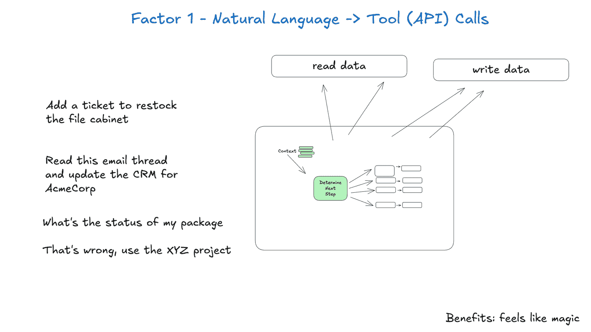

**例如**：

用户输入："能为赞助二月份AI聚会的Terri创建一个750美元的付款链接吗？"

智能体输出：

```
{
  &quot;function&quot;:{
    &quot;name&quot;:&quot;create_payment_link&quot;,
    &quot;parameters&quot;:{
      &quot;amount&quot;:750,
      &quot;customer&quot;:&quot;cust_128934ddasf9&quot;,
      &quot;product&quot;:&quot;prod_8675309&quot;,
      &quot;price&quot;:&quot;prc_09874329fds&quot;,
      &quot;quantity&quot;:1,
      &quot;memo&quot;:&quot;二月份AI聚会赞助费用&quot;
    }
}
}
```

**技术实现**：

```
# LLM将自然语言转换为结构化对象
nextStep = await llm.determineNextStep(
  &quot;为赞助二月份AI聚会的Jeff创建750美元付款链接&quot;
)

# 基于结构化输出处理
if nextStep.function == &#x27;create_payment_link&#x27;:
    stripe.paymentlinks.create(nextStep.parameters)
    return
elif nextStep.function == &#x27;something_else&#x27;:
    pass
else:
    # 模型调用了未知函数
    pass
```

这个原则看似简单，实际上是整个智能**体架构的基础。它的深**层价值在于创建了一个语言与行动之间的桥梁。

> 传统的软件需要用户学习特定的操作界面和命令，而这个原则让用户可以用自然语言描述意图，由智能体理解并转换为工具调用。

更重要的是，这种转换不是简单的关键词匹配，而是基于语义理解的结构化输出。

LLM能够理解上下文，推断出用户没有明确说出的信息（比如从"Terri"推断出对应的customer_id），这是传统自然语言处理技术难以达到的。

这个原则的技术难点在于如何确保输出的结构化数据既准确又完整。在实际应用中，我们需要精心设计提示词来引导LLM输出符合预期格式的JSON，同时处理各种边界情况和异常输入。

### 第2原则：完全掌控你的提示词

**核心思想**：不要把提示词工程交给开发框架，例如Agent框架CrewAI，提示词是你与LLM的主要接口，必须完全掌控。

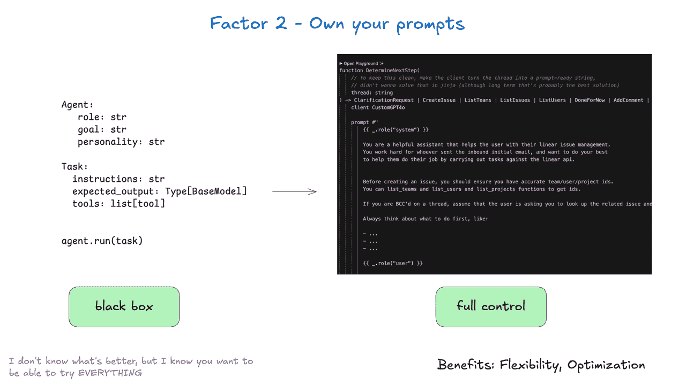

**示例**（框架黑盒模式）：

```
agent = Agent(
  role=&quot;部署助手&quot;,
  goal=&quot;安全管理部署&quot;,
  personality=&quot;谨慎细致&quot;,
  tools=[tool1, tool2, tool3]
)
```

这种方式让你无法精确控制传给LLM的具体指令。

**推荐做法**（完全掌控）：

```
function DetermineNextStep(thread: string) -&gt; DoneForNow | ListGitTags | DeployBackend {
  prompt = &quot;&quot;&quot;
    你是一个管理前后端系统部署的助手。
    你致力于遵循最佳实践，确保安全成功的部署。
    
    在部署任何系统前，你应该检查：
    - 部署环境（测试vs生产）
    - 正确的标签/版本
    - 当前系统状态
    
    对于敏感部署，使用request_approval获取人工确认。
    
    优先考虑以下步骤：
    - 检查当前部署状态
    - 验证部署标签存在
    - 如需要则请求审批
    - 先部署到测试环境再到生产环境
    - 监控部署进度
    
    当前情况：
    {thread}
    
    下一步应该做什么？
  &quot;&quot;&quot;
}
```

**这个原则体**现了开发智能体的一个矛盾点：效率与控制。

技术框架能让我们快速上手，但当我们需要精准调优时，框架的封装使得我们无法触达底层。

提示词是我们与LLM沟通的唯一语言，它直接决定了输出的质量。

当我们把这个核心控制权交给框架时，我们就失去了对最关键部分的控制。

更深层的洞察是：**每个业务场景都有其独特性**。通用的提示词模板无法涵盖所有的业务细节、异常情况和特殊需求。只有完全掌控提示词，你才能：

1.  **精确调优**：根据实际反馈精确调整每一个词汇

1.  **业务适配**：加入特定的业务规则和约束

1.  **性能优化**：优化API调用次数，提高响应速度

1.  **安全控制**：确保智能体不会越界执行越界操作

这个原则的本质是要求开发者把提示词当作代码来管理——版本控制、测试、文档化、代码审查。

### 第3原则：完全掌控你的会话上下文

**核心思想**：不必使用标准消息格式传递上下文，要针对你的场景优化上下文结构。

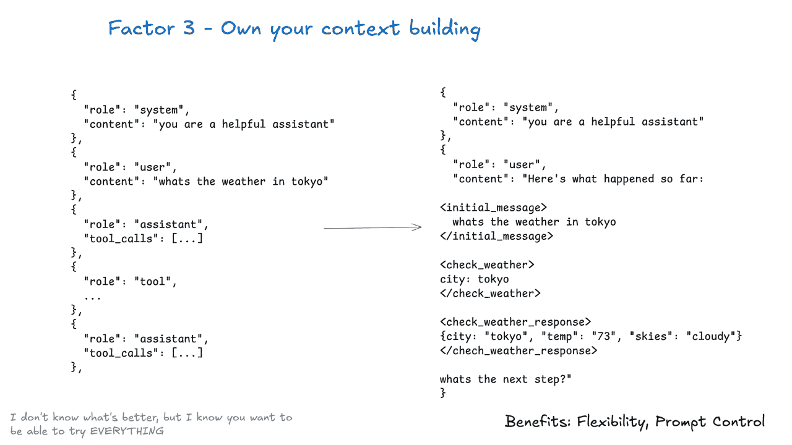

**传统标准格式**：

```
[
  {
    &quot;role&quot;:&quot;system&quot;,
    &quot;content&quot;:&quot;你是一个有用的助手...&quot;
  },
  {
    &quot;role&quot;:&quot;user&quot;, 
    &quot;content&quot;:&quot;能部署后端吗？&quot;
  },
  {
    &quot;role&quot;:&quot;assistant&quot;,
    &quot;content&quot;:null,
    &quot;tool_calls&quot;: [{&quot;id&quot;:&quot;1&quot;, &quot;name&quot;:&quot;list_git_tags&quot;, &quot;arguments&quot;:&quot;{}&quot;}]
  },
  {
    &quot;role&quot;:&quot;tool&quot;,
    &quot;name&quot;:&quot;list_git_tags&quot;, 
    &quot;content&quot;:&quot;{\&quot;tags\&quot;: [...]}&quot;,
    &quot;tool_call_id&quot;:&quot;1&quot;
  }
]
```

**自定义优化格式**：

```
&lt;slack_message&gt;
    From: @alex
    Channel: #deployments  
    Text: 能部署最新后端到生产环境吗？
&lt;/slack_message&gt;

&lt;list_git_tags&gt;
    intent: &quot;list_git_tags&quot;
&lt;/list_git_tags&gt;

&lt;list_git_tags_result&gt;
    tags:
      - name: &quot;v1.2.3&quot;
        commit: &quot;abc123&quot; 
        date: &quot;2024-03-15T10:00:00Z&quot;
      - name: &quot;v1.2.2&quot;
        commit: &quot;def456&quot;
        date: &quot;2024-03-14T15:30:00Z&quot;
&lt;/list_git_tags_result&gt;
```

**技术实现**：

```
class Thread:
  events: List[Event]

classEvent:
type: str# &quot;list_git_tags&quot;, &quot;deploy_backend&quot;, &quot;error&quot;等
  data: Any# 对应的数据

defevent_to_prompt(event: Event) -&gt; str:
    data = event.data ifisinstance(event.data, str) \
           else stringify_to_yaml(event.data)
    returnf&quot;&lt;{event.type}&gt;\n{data}\n&lt;/{event.type}&gt;&quot;

defthread_to_prompt(thread: Thread) -&gt; str:
    return&#x27;\n\n&#x27;.join(event_to_prompt(event) for event in thread.events)
```

这个原则挑战了我们对API标准化的固有认知。OpenAI等厂商提供的标准消息格式看似是"最佳实践"，但实际上它们是为通用场景设计的方案。

上下文工程的本质是信息架构设计，就像数据库设计一样，不同的业务场景需要不同的信息组织方式，标准格式往往存在以下问题：

1.  **信息冗余**：很多元数据（如role、tool_call_id）对实际推理没有帮助

1.  **结构僵化**：无法灵活表达复杂的业务关系

1.  **API调用浪费**：JSON格式的冗余字符消耗成本高昂的API调用次数

1.  **语义模糊**：标准格式无法传递业务特定的语义信息

通过自定义上下文格式，你获得了几个关键优势：

**信息密度优化**：同样的API调用能传递更多有效信息。比如用XML标签可以清晰表达信息层次，用YAML可以减少冗余字符。

**语义增强**：可以在格式中编码业务逻辑。比如用<error>标签不仅表示这是错误信息，还隐含地告诉LLM需要错误修复。

**注意力引导**：通过结构化的信息布局，引导LLM关注最重要的信息。比如把最新的事件放在最显眼的位置。

更深层的洞察是：**LLM对信息结构非常敏感**。相同的信息用不同方式组织，会得到截然不同的输出质量。这就像人类阅读一样，好的排版和结构能显著提高理解效率。

这个原则的终极目标是：让每一次API调用都承载最大的语义价值。

### 第4原则：工具（函数）调用就是结构化输出

很多人都认为工具调用是一个复杂的过程：LLM 需要理解工具的功能，然后"调用"这个工具，工具执行后返回结果。

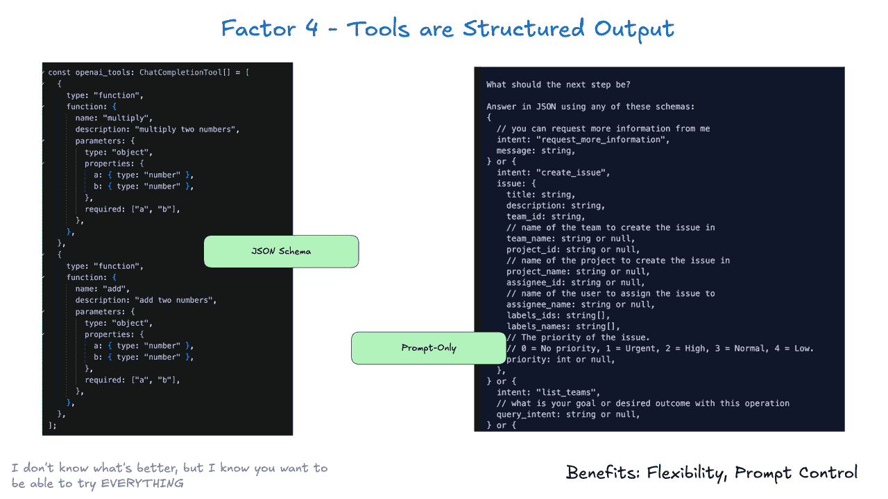

但实际上，**工**具调用的本质就是让 LLM 输出一个结构化的 JSON，然后我们的代码根据这个 JSON 来执行对应的操作。

这就像是：

+   **传统理解**：AI Agent 直接操作工具，就像人拿起锤子敲钉子

+   **实际情况**：AI Agent 只是写了一张"请用锤子敲钉子"的纸条，真正敲钉子的是我们的代码

具体是怎么实现的？

假设我们有两个工具：创建工单和搜索工单。

```
class Issue:
    title: str
    description: str
    team_id: str
    assignee_id: str

classCreateIssue:
    intent: &quot;create_issue&quot;
    issue: Issue

classSearchIssues:
    intent: &quot;search_issues&quot;
    query: str
    what_youre_looking_for: str
```

**传统思路**：定义两个函数 create_issue() 和 search_issues()，让 LLM 选择调用哪个。

**新思路**：让 LLM 输出一个 JSON，我们根据 JSON 的 intent 字段来决定执行什么操作。

```
# LLM 输出的 JSON 可能是这样的：
{
    &quot;intent&quot;: &quot;create_issue&quot;,
    &quot;issue&quot;: {
        &quot;title&quot;: &quot;用户无法登录&quot;,
        &quot;description&quot;: &quot;用户反馈登录页面一直转圈&quot;,
        &quot;team_id&quot;: &quot;tech_support&quot;,
        &quot;assignee_id&quot;: &quot;zhang_san&quot;
    }
}
```

然后我们的代码这样处理：

```
if next_step.intent == &#x27;create_issue&#x27;:
    # 调用真正的工单系统 API
    jira_api.create_issue(next_step.issue)
    return &quot;工单创建成功&quot;
elif next_step.intent == &#x27;search_issues&#x27;:
    # 调用搜索 API
    results = jira_api.search(next_step.query)
    return f&quot;找到 {len(results)} 个相关工单&quot;
else:
    return &quot;无法识别的操作&quot;
```

这样做有什么好处？

1.  **控制权在你手里**
LLM 只负责"决策"，具体"执行"由你的代码控制。这意味着：

+   你可以决定是否真的执行这个操作

+   你可以添加权限检查、参数验证等

+   你可以根据上下文动态调整执行逻辑

1.  **更大的灵活性**
不是每个"工具调用"都要对应一个固定的函数。比如：

+   同样是"发送邮件"，VIP 客户和普通客户可能走不同的发送逻辑

+   同样是"查询数据"，不同的用户角色可能查询不同的数据源

1.  **更容易调试和监控**
因为所有的决策都以 JSON 形式明确表达，你可以：

+   记录每次 LLM 的决策过程

+   分析哪些工具被使用最多

+   快速定位问题出在决策还是执行环节

### 第5原则：统一执行状态和业务状态

**核心思想**：不要分离"执行状态"和"业务状态"，尽可能统一管理。

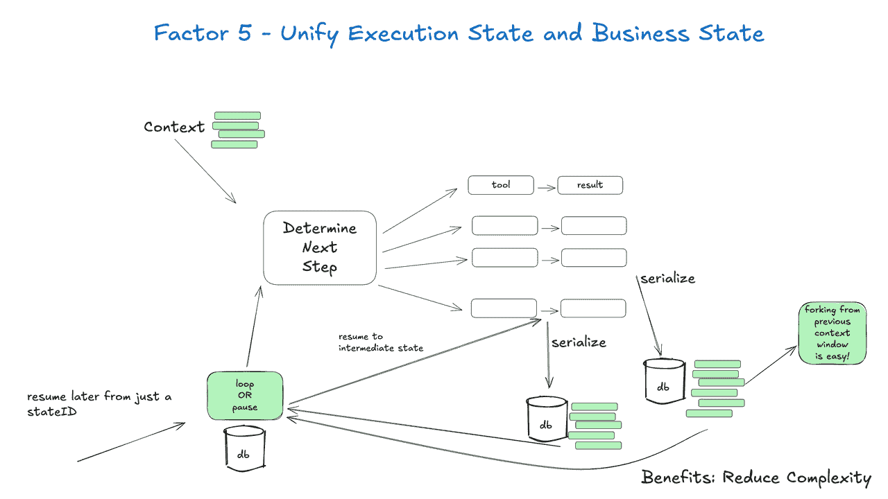

很多基础设施系统习惯把这两种状态分开管理，设计复杂的抽象来跟踪各种状态信息。

**执行状态**：系统当前在做什么

+   当前步骤

+   下一步要做什么

+   等待状态

+   重试次数等

**业务状态**：系统到目前为止发生了什么

+   OpenAI消息列表

+   工具调用记录和结果

+   整个工作流程的历史

实际上，我们可以让智能体从上下文窗口中推断出所有执行状态。因为执行状态往往只是对"已经发生什么事情"的描述。

举个例子，不需要单独维护"当前在等待用户输入订单号"这样的执行状态，AI看到对话中最后一句是"请提供您的订单号"，自然就知道现在在等什么。

如果可能，尽量简化并统一状态管理。

不要为了分离而分离。对于AI Agent来说，让AI从丰富的上下文中推断应该做什么，往往比维护复杂的状态系统更简单、更可靠。

记住：选择最适合你应用场景的方案，而不是盲目遵循传统的状态分离模式。

统一管理的好处：

1.  **简洁性** - 所有状态信息来自同一个地方

1.  **序列化** - 整个对话线程很容易保存和加载

1.  **调试** - 所有历史记录集中查看，问题一目了然

1.  **灵活性** - 添加新功能只需增加新的事件类型

1.  **恢复** - 系统崩溃后可以从任何节点恢复

1.  **分叉** - 可以在任意时间点创建对话分支

1.  **人性化** - 容易转换成可读的文档或者web界面

### 第6原则：API的启动/暂停/恢复

**核心思想**：智能体应该支持启动、暂停、恢复操作。

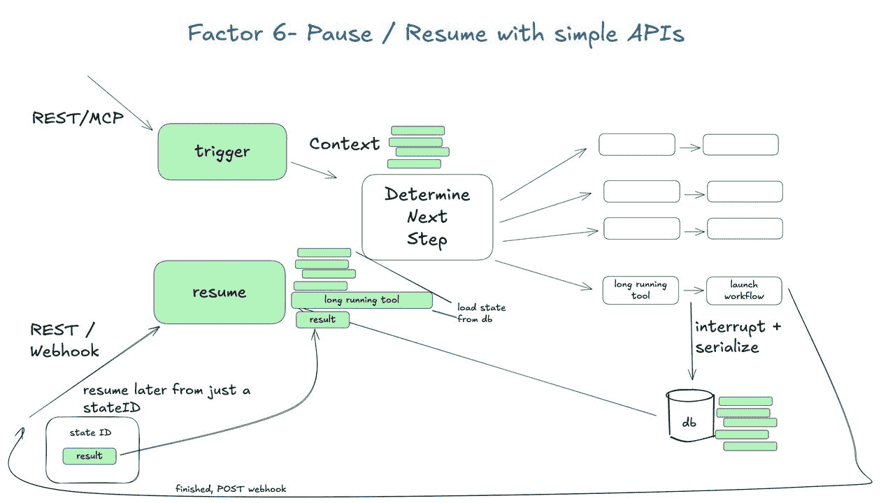

**关键特性**：能够在函数选择和函数执行之间暂停，这对需要人工审核的核心业务操作至关重要。

大多数框架将智能体开发为同步的、一次性执行。一旦执行，就必须运行到完成或失败。这种模式忽略了现实业务场景的复杂性：

1.  **人机协作的异步性**：人类的响应时间是不可预测的，可能是几分钟，也可能是几小时

1.  **外部依赖的不确定性**：很多操作需要等待外部系统的响应

1.  **风险控制的必要性**：核心业务操作需要在执行前暂停进行人工审核

**暂停/恢复机制**：

**细粒度控制**：能够在任意时刻暂停，特别是在"函数选择"和"函数执行"之间暂停，这是风险控制的关键节点。

**资源效率**：长时间等待期间不占用计算资源，系统可以处理其他任务。

**故障恢复**：如果系统在等待期间重启，可以无缝恢复到暂停前的状态。

**多模式交互**：支持同步和异步两种交互模式，适应不同的使用场景。

### 第7原则：用函数调用与人类交互

**在传统的AI** Agent实现中，存在一个关键的决策点：LLM 需要在每次响应时做出选择——返回纯文本内容还是结构化数据？

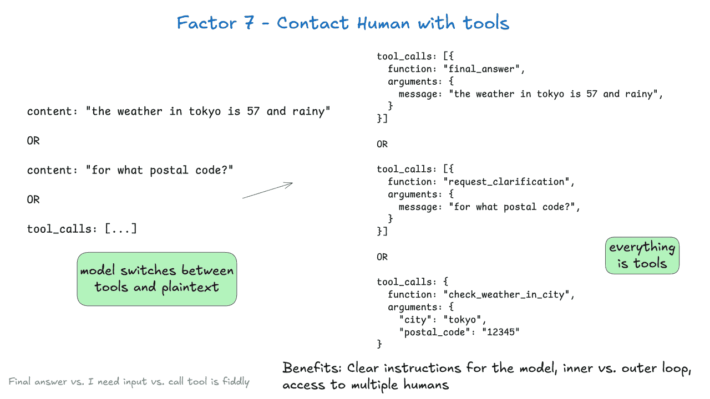

比如当用户问"东京的天气如何"时：

+   如果返回纯文本，第一个token可能是"东"

+   如果调用工具，第一个token是JSON对象的开始标记

这种设计让AI Agent在交互的灵活性上受到很大限制。

**与其让AI Agen**t在纯文本和结构化数据之间纠结，不如让它始终输出JSON格式，然后通过自然语言标记来表达意图。

这就像是给AI Agent制定了一套"内部语言"，让它能够更清晰地表达自己的想法和需求。

这样的好处是：

1.  指令更加清晰

不同类型的人类交互工具让LLM能够给出更具体、更精准的回应。

1.  内外循环灵活切换

**这是最重要的一点**：传统的AI Agent都是被动响应（Human->Agent），而这种设计支持主动发起（Agent->Human）。

想象一下：你的AI Agent可以在每天早上9点主动给你发送昨日数据分析报告，或者在检测到异常时主动联系相关人员。

1.  多人协作支持

通过结构化事件，可以轻松追踪和协调不同人员的输入。比如在审批流程中，AI Agent可以同时联系多个审批人。

1.  多智能体扩展

这套抽象设计可以很容易扩展为Agent->Agent的请求和响应。想象一下多个AI Agent之间的协作场景。

1.  持久性和可靠性

结合状态管理，整个工作流变得持久、可靠且易于监控。即使系统重启，也能从上次的状态继续执行。

### 第8原则：完全掌控你的工作流

**核心思想**：构建适合特定场景的工作流，不同类型的工具调用可能需要不同的工作流程处理。

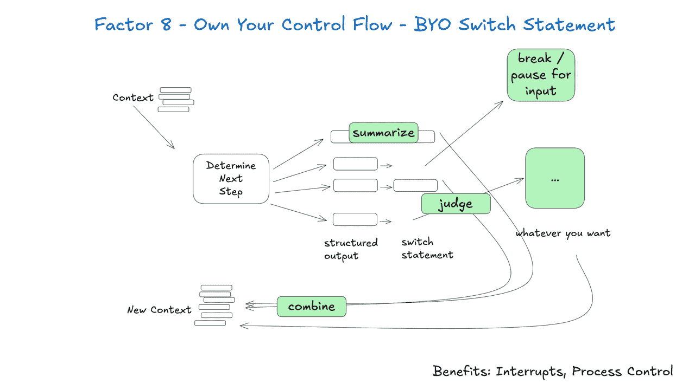

这个原则涉及智能体架构的最核心问题：谁来控制执行流程？

大多数框架选择了"LLM控制一切"的模式，但这种选择隐含着很大的风险和限制。

1.  **LLM并不擅长控制流程**：LLM是为内容生成而设计的，而不是为流程控制。让它同时负责"决定做什么"和"如何控制执行"是发生混乱。

1.  **缺乏业务逻辑的表达能力**：复杂的业务规则（如审批流程、权限控制、异常处理）很难仅通过提示词来精确表达。

1.  **不可预测的执行路径**：当LLM控制流程时，你无法确保系统按照预期的路径执行，这在生产环境中是不可接受的。

**自定义工作流的重要性**：

**精确的业务逻辑表达**：通过代码而不是提示词来表达业务规则，可以实现精确的条件判断、循环、异常处理等复杂逻辑。

**可预测的执行行为**：关键的控制决策由代码实现，确保系统行为的可预测性。

**细粒度的资源控制**：可以精确控制何时消耗计算资源、何时进行网络调用。

**灵活的集成能力**：可以轻松集成现有的业务系统、工作流引擎、监控系统等。

因此智能体系统应该采用**混合控制模式**：

+   LLM负责"智能决策"（what to do）

+   代码或者原先系统负责"流程控制"（how to do it）

这种分离带来了几个重要好处：

**可测试性**：控制流程逻辑可以独立于LLM进行单元测试。

**可调试性**：可以精确追踪执行路径，定位问题根源。

**可扩展性**：可以轻松添加新的控制逻辑，而不需要重新训练或调整LLM。

### 第9原则：将错误存到会话上下文

**核心思想**：利用智能体的"自我修复"能力，让LLM读取错误信息并在后续工具调用中修正问题。

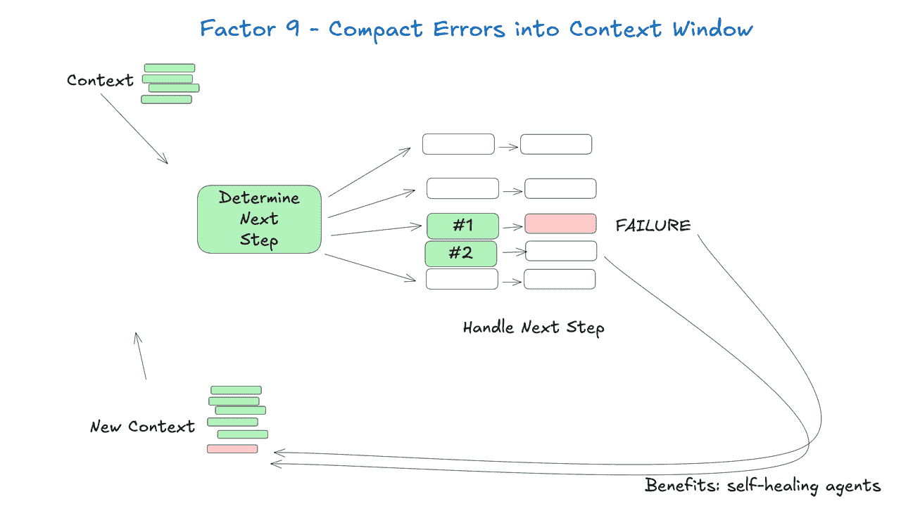

**基础实现**：

```
thread = {&quot;events&quot;: [initial_message]}

whileTrue:
    next_step = await determine_next_step(thread_to_prompt(thread))
    thread[&quot;events&quot;].append({
        &quot;type&quot;: next_step.intent,
        &quot;data&quot;: next_step,
    })
    
    try:
        result = await handle_next_step(thread, next_step)
        thread[&quot;events&quot;].append({
            &quot;type&quot;: next_step.intent + &#x27;_result&#x27;,
            &quot;data&quot;: result,
        })
    except Exception as e:
        # 错误添加到会话上下文，让LLM尝试修复
        thread[&quot;events&quot;].append({
            &quot;type&quot;: &#x27;error&#x27;,
            &quot;data&quot;: format_error(e),
        })
        # 循环重试
```

**错误计数和限制**：

```
consecutive_errors = 0

whileTrue:
    try:
        result = await handle_next_step(thread, next_step)
        thread[&quot;events&quot;].append({
            &quot;type&quot;: next_step.intent + &#x27;_result&#x27;, 
            &quot;data&quot;: result,
        })
        # 成功！重置错误计数
        consecutive_errors = 0
        
    except Exception as e:
        consecutive_errors += 1
        if consecutive_errors &lt; 3:
            # 循环重试
            thread[&quot;events&quot;].append({
                &quot;type&quot;: &#x27;error&#x27;,
                &quot;data&quot;: format_error(e),
            })
        else:
            # 跳出循环，重置上下文，升级给人类等
            break
```

**这个原则展现了AI系统相**对于传统软件的一个独特优势：错误理解和自适应修复能力。

但更重要的是，它揭示了错误处理在AI系统中的全新范式。

**传统错误处理的局限性**：

传统软件中，错误处理主要依赖于：

1.  **预定义的异常类型**：程序员预先考虑可能的错误情况

1.  **静态的处理逻辑**：每种错误对应固定的处理方式

1.  **人工干预**：复杂错误需要人工分析和修复

这种模式在面对LLM系统时显得力不从心，因为LLM可能产生各种意料之外的错误。

**AI错误处理的新范式**：

**语义错误理解**：LLM不仅能识别错误的类型，还能理解错误的语义含义，比如"权限不足"意味着需要更高权限的凭证。

**上下文相关的修复策略**：同样的错误在不同上下文中可能需要不同的修复方法，LLM能够根据具体情况选择合适的策略。

**增量学习能力**：每次错误处理都会增加系统的"经验"，虽然单次会话中LLM不会记住，但可以通过上下文累积来改善处理策略。

**错误处理的分层策略**：

1.  **自动重试层**：LLM尝试理解和修复错误

1.  **上下文重构层**：如果重试失败，重新组织上下文信息

1.  **人工干预层**：如果自动修复失败，升级给人类处理

1.  **系统级回退层**：如果人工干预也无效，回退到安全状态

这种分层策略确保了系统既能充分利用AI的自我修复能力，又不会因为过度依赖而失控。

**最重要的是****：错误不再是系统**的异常状态，而是学习和改进的机会。这种思维转变对于构建真正智能体系统至关重要。

### 第10原则：专业化智能体

**核心思想**：构建小而专注、做好一件事的智能体，而不是试图做所有事情的单体智体手。

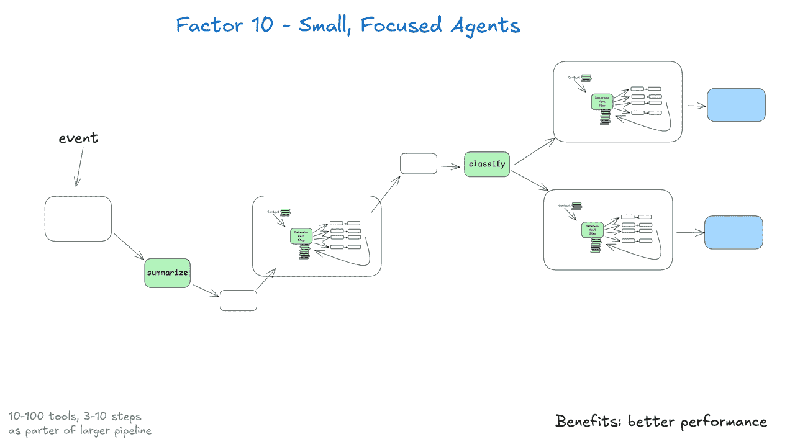

**核心洞察**：任务越大越复杂，需要的步骤就越多，意味着更长的会话上下文，随着上下文增长，LLM更容易迷糊。

**推荐范围**：保持智能体专注于特定领域的3-10个步骤，最多20个步骤，确保会话上下文可管理，LLM性能高。

**这个原则挑战了软件**工程中的一个常见误区：大而全的系统更强大。在传统软件开发中，我们确实倾向于构建功能丰富的大型系统，但在AI智能助手领域，这种思路是有害的。

**认知负荷理论在AI中的应用**：

人**类认知科学研究**表明，人类的工作记忆有限，一次只能处理7±2个信息单元。LLM虽然没有相同的认知限制，但存在类似的注意力分散问题：

1.  **上下文稀释**：信息量越大，每个信息单元获得的"注意力"越少

1.  **目标漂移**：长任务中容易偏离原始目标

1.  **决策疲劳**：连续的决策制定会降低决策质量

**专业化智能体的深层优势**：

**注意力集中**：有限的任务范围让LLM能够集中所有"注意力"在关键决策上。

**专业化优势**：每个智能体可以针对特定领域进行优化，就像人类的专业分工一样。

**故障隔离**：一个智能助手的故障不会影响整个系统的其他部分。

**测试简化**：小智能体的行为空间有限，更容易进行全面测试。

**智能体网络的新架构模式**：

**专业化小智**能体原则实际上指向了一种新的系统架构：智能体网络，而不是单一的超级智能体。

这类似于微服务架构相对于单体应用的优势：

+   **独立部署**：每个智能助手可以独立更新

+   **技术多样性**：不同智能助手可以使用最适合的技术栈

+   **水平扩展**：可以根据需求扩展特定功能的智能体

+   **团队分工**：不同团队可以负责不同的智能体

**

智能不等于复**杂。真正的智能体现在能够精确、可靠地完成特定任务，而不是试图解决所有问题。

### 第11原则：多渠道触发，用户在哪里就在哪里服务

**核心思想**：让用户能够从Slack、邮件、短信等任何渠道触发智能体，智能体也能通过相同渠道响应。

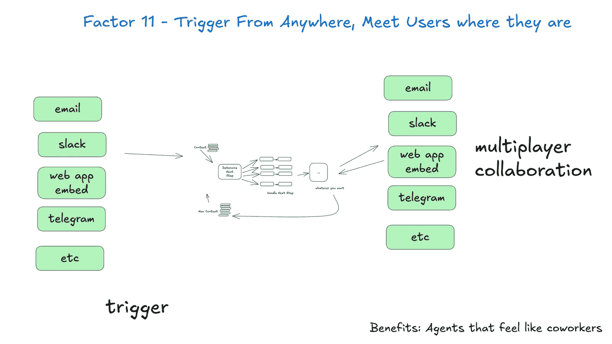

**这个原则解决了AI应用面临的一个**根本性用户体验问题：上下文切换的认知成本。

**用户体验的深层洞察**：

当用户需要使用AI智能体时，传统方式要求他们：

1.  停止当前工作

1.  打开专门的AI智能体

1.  输入请求

1.  等待响应

1.  将结果带回到原工作环境

这种**上下文切换**造成了巨大的认知成本和工作流程中断。

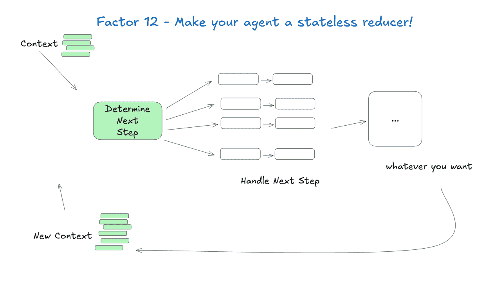

**优势：**

+   • **在用户习惯的地方找到用户**：让AI应用能够像真人一样自然交流，或者至少像靠谱的数字同事一样工作

+   • **AI主动工作模式**：AI不需要人来启动，可以被系统事件、定时任务、故障报警等自动触发。AI可能会工作5分钟、20分钟或90分钟，但遇到重要决策时，会主动联系人类请求帮助、获取反馈或寻求批准

+   • **处理重要任务的能力**：当你能快速让合适的人参与进来时，就可以放心让AI处理重要操作，比如发送对外邮件、更新生产环境数据等。有了清晰的操作规范，你就能追踪AI的行为，对AI处理重大任务更放心

## 总结

这12个原则不是孤立的，而是相互联系的。它们共同指向一个核心理念：在AI的不确定性之上构建确定性的系统。

**核心思想的三个层次**：

1.  **控制权层次**：完全掌控提示词、会话上下文、控制流程等关键组件

1.  **架构层次**：采用专业化智能体、状态统一、可暂停恢复的设计

1.  **交互层次**：支持多渠道、人机协作、主动式的交互模式

不要试图构建万能的AI智能体，而要构建专业的AI同事。每个智能体都应该在特定领域内表现卓越，需要帮助时能够寻求协作。

这些原则，它们不仅解决了我在AI项目中遇到的具体问题，更重要的是，它们提供了一个系统性的思考框架，帮助我们在AI的浪潮中找到可靠的技术立足点。