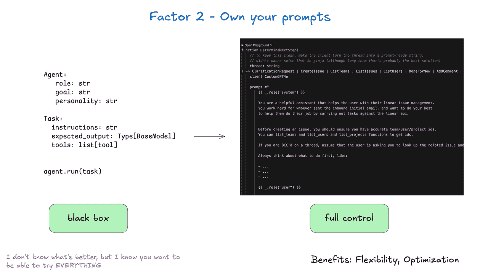

# 02掌控你的 Prompt

> 来源：[https://qqs7y1hozd1.feishu.cn/docx/KfEjdis0coSh9vxhFfycsvZbnPh](https://qqs7y1hozd1.feishu.cn/docx/KfEjdis0coSh9vxhFfycsvZbnPh)

> Prompt 被视为版本化、可测试的基础设施组件而非一时输入，以便随模型变动进行维护。

> **在构建 Agent 时，****应完全控制 LLM 的提示词，****而非外包给黑盒框架。**

> 许多 Agent 框架为简化开发，提供高级抽象，让开发者通过简单参数定义 Agent 行为。这虽有助于快速启动，但难以精细调优，也难精确控制 LLM 输出。



此要素核心是**将提示词视为一等重要的代码**。提示词应像其他代码一样被设计、版本控制、测试和迭代。

通过直接编写和管理提示词，可实现：

> **• 完全控制：**精确指示 Agent 行为，避免黑盒抽象的不确定性。

> **• 测试与评估：**为提示词构建测试和评估体系，确保其在不同场景下表现符合预期。

> **• 快速迭代：**根据实际运行效果快速修改和优化提示词，适应不断变化的需求和模型能力。

> **• 透明度：**清楚了解 Agent 使用的具体指令，便于调试和问题排查。

> **• 高级技巧：**利用 LLM API 支持的非标准用法，如角色扮演、模型行为控制等，实现更复杂或高效的行为。

某些框架采用这种「黑箱」式的工作方式：

```
agent = Agent(
  role=&quot;...&quot;,
  goal=&quot;...&quot;,
  personality=&quot;...&quot;,
  tools=[tool1, tool2, tool3]
)

task = Task(
  instructions=&quot;...&quot;,
  expected_output=OutputModel
)

result = agent.run(task)
```

这种采用顶级提示工程（TOP NOTCH prompt engineering）的「黑箱」方式虽然能快速上手，但往往难以精准调优或逆向推导出模型所需的完美输入标记（tokens）。

```
function DetermineNextStep(thread: string) -&gt; DoneForNow | ListGitTags | DeployBackend | DeployFrontend | RequestMoreInformation {
  prompt #&quot;
    {{ _.role(&quot;system&quot;) }}
    
    You are a helpful assistant that manages deployments for frontend and backend systems.
    You work diligently to ensure safe and successful deployments by following best practices
    and proper deployment procedures.
    
    Before deploying any system, you should check:
    - The deployment environment (staging vs production)
    - The correct tag/version to deploy
    - The current system status
    
    You can use tools like deploy_backend, deploy_frontend, and check_deployment_status
    to manage deployments. For sensitive deployments, use request_approval to get
    human verification.
    
    Always think about what to do first, like:
    - Check current deployment status
    - Verify the deployment tag exists
    - Request approval if needed
    - Deploy to staging before production
    - Monitor deployment progress
    
    {{ _.role(&quot;user&quot;) }}

    {{ thread }}
    
    What should the next step be?
  &quot;#
}
```

（上述示例使用BAML生成提示词，但您可以使用任意提示工程工具，甚至手动编写模板）

```
function DetermineNextStep(thread: string) -&gt; DoneForNow | ListGitTags | DeployBackend | DeployFrontend | RequestMoreInformation {
```

掌握提示词（prompts）自主权的核心优势：

1. 全权掌控

直接编写AI执行所需的具体指令，彻底告别黑箱抽象层

2. 测试验证

像对待常规代码一样，为提示词构建测试用例与评估体系

3. 快速迭代

根据实际运行效果即时调整提示词（如：添加约束条件/调整语气）

4. 完全透明

清晰掌握AI接收的每一条指令内容（避免"模型幻觉"风险）

5. 角色突破

利用支持非标准角色调用的API（如：已废弃的OpenAI非聊天式"completions"接口），探索包括所谓"模型操控"在内的进阶技巧

（注：提示词是应用逻辑与LLM之间的核心交互界面）