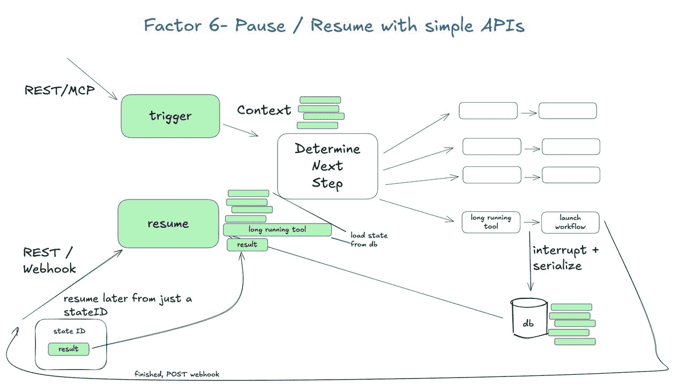

# 06提供启动 / 暂停 / 恢复 API

> 来源：[https://qqs7y1hozd1.feishu.cn/docx/H2pVdTjsOoQuSQxOfS5cgUHlnRd](https://qqs7y1hozd1.feishu.cn/docx/H2pVdTjsOoQuSQxOfS5cgUHlnRd)

通过 API 控制 agent 生命周期，支持在关键决策点进行检查或复盘，适用于复杂或长时任务。

Agent 作为程序，应具备启动、查询、恢复和停止的能力。

> 此要素强调为 Agent 提供简单、直观的 API 接口，方便用户、应用、数据管道或其他 Agent 轻松交互。

**具体而言：**

> **• 轻松启动：**

> Agent 应能通过简单 API 调用启动，无论是通过用户界面、命令行工具还是自动化系统。

>

> **• 灵活暂停：**

> Agent 需执行长时间操作（如等待人工输入、外部系统响应或复杂计算）时，应能暂停。暂停不应阻塞执行流，而应释放资源并等待外部事件。

>

> **• 无缝恢复：**

> 外部触发器（如 Webhooks、消息队列事件）应能让 Agent 从上次暂停处恢复执行，无需与 Agent 编排器深度集成。这使 Agent 能处理异步事件和长时间任务。

**此要素与统一执行状态和业务状态（Factor 5）及**掌控控制流（Factor 8）密切相关。

> 通过将 Agent 执行状态（如当前步骤、等待状态）与业务状态统一，并存储在可序列化上下文中，Agent 可轻松在不同时间点暂停和恢复。

> 这对于构建持久化、可靠 Agent 至关重要，尤其在需人工干预或等待外部事件的复杂工作流中。