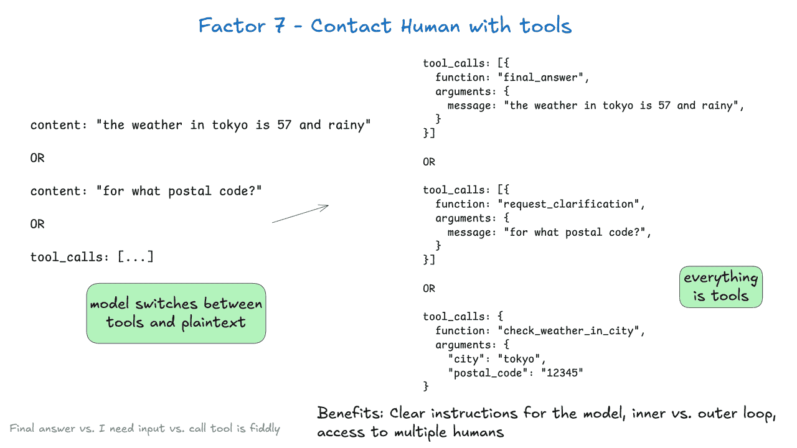
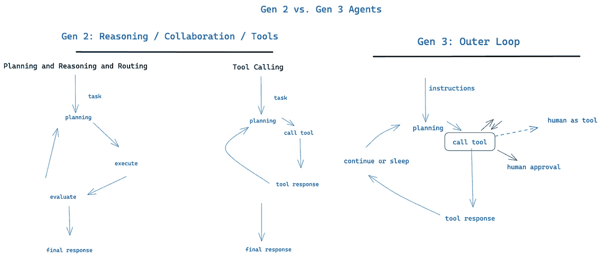

# 07将人类交互视为工具调用

> 来源：[https://qqs7y1hozd1.feishu.cn/docx/T48PdM4dyoQ0iHxpQy7cH9dLnDg](https://qqs7y1hozd1.feishu.cn/docx/T48PdM4dyoQ0iHxpQy7cH9dLnDg)

> 在高风险步骤中自动触发人类反馈工具，而非异常或旁路，使人工干预成为系统一部分。

传统 LLM API 在返回纯文本和结构化数据间存在高风险抉择。

> 此要素提出更可靠方法：LLM 始终输出结构化数据，并通过工具调用明确与人工交互。

> 即使 Agent 需联系人工，也通过特定工具调用（如request_human_input）表达意图，而非直接自然语言提问。此工具调用包含人工输入问题、上下文及可能选项（如紧急程度、响应格式）。

Agent 发出此调用后，执行流可暂停，等待人工响应。



**此方法优势：**

> **清晰指令：**结构化工具调用使 LLM 更精确指示人工介入类型和目的。

> **内外循环分离：**Agent 支持外部循环工作流，由非人工事件触发，关键时主动联系人工寻求帮助、反馈或批准。与传统人工-Agent 交互模式（内部循环）对比。

> **多人工访问：**结构化事件轻松跟踪协调不同人工输入。

> **多 Agent 协作：**简单抽象可扩展支持 Agent 间请求和响应。

> **持久性：**结合启动/暂停/恢复（Factor 6），构建持久、可靠、可内省多人协作工作流。

将人工交互视为特殊工具调用，Agent 控制流更可预测、可管理。Agent 可处理高风险操作，执行前强制人工审批。为构建更智能、协作 Agent 系统奠定基础，使其更好融入人工工作流程。

建议尝试让LLM始终以JSON格式输出，并通过自然语言标记（如request_human_input或done_for_now）明确其意图——相比传统的工具调用（如check_weather_in_city），这种方式可能带来更好的效果。

```

class Options:
  urgency: Literal[&quot;low&quot;, &quot;medium&quot;, &quot;high&quot;]
  format: Literal[&quot;free_text&quot;, &quot;yes_no&quot;, &quot;multiple_choice&quot;]
  choices: List[str]

# Tool definition for human interaction
class RequestHumanInput:
  intent: &quot;request_human_input&quot;
  question: str
  context: str
  options: Options

# Example usage in the agent loop
if nextStep.intent == &#x27;request_human_input&#x27;:
  thread.events.append({
    type: &#x27;human_input_requested&#x27;,
    data: nextStep
  })
  thread_id = await save_state(thread)
  await notify_human(nextStep, thread_id)
  return # Break loop and wait for response to come back with thread ID
else:
  # ... other cases
```

稍后，您可能会收到来自Slack、邮件、短信或其他事件处理系统的Webhook回调。

```

@app.post(&#x27;/webhook&#x27;)
def webhook(req: Request):
  thread_id = req.body.threadId
  thread = await load_state(thread_id)
  thread.events.push({
    type: &#x27;response_from_human&#x27;,
    data: req.body
  })
  # ... simplified for brevity, you likely don&#x27;t want to block the web worker here
  next_step = await determine_next_step(thread_to_prompt(thread))
  thread.events.append(next_step)
  result = await handle_next_step(thread, next_step)
  # todo - loop or break or whatever you want

  return {&quot;status&quot;: &quot;ok&quot;}
```

如果我们采用因子3中提到的XML式结构化上下文管理方案，经过多轮对话后，上下文窗口可能会呈现如下形态：

```

(snipped for brevity)

&lt;slack_message&gt;
    From: @alex
    Channel: #deployments
    Text: Can you deploy backend v1.2.3 to production?
    Thread: []
&lt;/slack_message&gt;

&lt;request_human_input&gt;
    intent: &quot;request_human_input&quot;
    question: &quot;Would you like to proceed with deploying v1.2.3 to production?&quot;
    context: &quot;This is a production deployment that will affect live users.&quot;
    options: {
        urgency: &quot;high&quot;
        format: &quot;yes_no&quot;
    }
&lt;/request_human_input&gt;

&lt;human_response&gt;
    response: &quot;yes please proceed&quot;
    approved: true
    timestamp: &quot;2024-03-15T10:30:00Z&quot;
    user: &quot;alex@company.com&quot;
&lt;/human_response&gt;

&lt;deploy_backend&gt;
    intent: &quot;deploy_backend&quot;
    tag: &quot;v1.2.3&quot;
    environment: &quot;production&quot;
&lt;/deploy_backend&gt;

&lt;deploy_backend_result&gt;
    status: &quot;success&quot;
    message: &quot;Deployment v1.2.3 to production completed successfully.&quot;
    timestamp: &quot;2024-03-15T10:30:00Z&quot;
&lt;/deploy_backend_result&gt;
```

