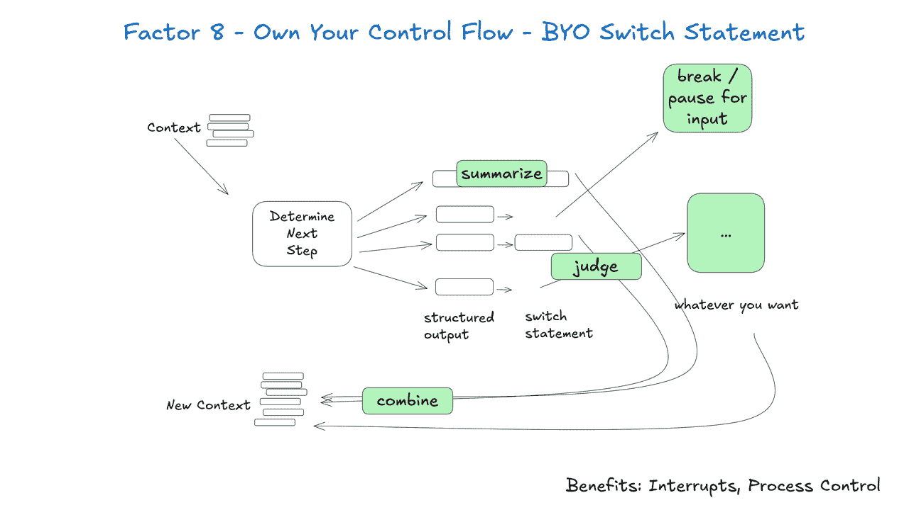

# 08掌控你的控制流

> 来源：[https://qqs7y1hozd1.feishu.cn/docx/VOfQdWw0Zo1dEsxEriMc8nAynJe](https://qqs7y1hozd1.feishu.cn/docx/VOfQdWw0Zo1dEsxEriMc8nAynJe)

> 流程控制由普通代码编排，LLM 仅用作决策引擎；避免让模型自身掌握控制逻辑 。

> 掌控控制流强调开发者应完全控制 Agent 执行流程，而非委托给黑盒框架。

> 据用例需求，构建自定义控制结构，实现更灵活、智能的 Agent 行为。



**掌控控制流可实现高级功能：**

> **中断与恢复：**LLM 请求信息（如request_clarification）或需人工审批（如create_issue）时，可中断 Agent 执行循环，等待外部响应，收到响应后从中断点恢复。

> **同步与异步操作：**根据工具调用性质，决定同步执行并立即反馈结果（如fetch_git_tags），或异步执行并等待外部事件触发恢复。

> **结果摘要与缓存：**对工具调用结果摘要或缓存，优化上下文窗口使用和 LLM 性能。

> **LLM 作为判断者：**LLM 对结构化输出判断或验证。

> **上下文窗口压缩与记忆管理：**实现复杂记忆管理策略，如压缩上下文窗口或选择性移除旧事件。

> **日志、追踪与指标：**集成全面日志、追踪和指标收集，便于监控调试。

> **客户端限速：**客户端层面实现 LLM 调用限速。

> **持久化休眠/暂停/等待事件：**实现 Agent 持久化休眠机制，长时间等待特定事件发生。

此要素核心是，Agent 执行循环非简单线性过程，而是可中断、调整、恢复的动态过程。例如，Agent 需人工输入时，可暂停执行，发送请求，等待人工响应 Webhook。收到响应后，Agent 从中断处继续执行。

以下示例展示了三种可能的控制流模式：

```
def handle_next_step(thread: Thread):

  while True:
    next_step = await determine_next_step(thread_to_prompt(thread))
    
    # inlined for clarity - in reality you could put 
    # this in a method, use exceptions for control flow, or whatever you want
    if next_step.intent == &#x27;request_clarification&#x27;:
      thread.events.append({
        type: &#x27;request_clarification&#x27;,
          data: nextStep,
        })

      await send_message_to_human(next_step)
      await db.save_thread(thread)
      # async step - break the loop, we&#x27;ll get a webhook later
      break
    elif next_step.intent == &#x27;fetch_open_issues&#x27;:
      thread.events.append({
        type: &#x27;fetch_open_issues&#x27;,
        data: next_step,
      })

      issues = await linear_client.issues()

      thread.events.append({
        type: &#x27;fetch_open_issues_result&#x27;,
        data: issues,
      })
      # sync step - pass the new context to the LLM to determine the NEXT next step
      continue
    elif next_step.intent == &#x27;create_issue&#x27;:
      thread.events.append({
        type: &#x27;create_issue&#x27;,
        data: next_step,
      })

      await request_human_approval(next_step)
      await db.save_thread(thread)
      # async step - break the loop, we&#x27;ll get a webhook later
      break
```

1.  请求澄清（request_clarification）

+   模型主动要求获取更多信息

+   控制流：终止当前循环 → 等待人工输入

1.  获取Git标签（fetch_git_tags）

+   模型请求获取Git标签列表

+   控制流：执行标签查询 → 将结果追加至上下文窗口 → 直接返回模型继续处理

1.  后端部署（deploy_backend）

+   模型发起高风险操作请求

+   控制流：终止流程 → 触发人工审批机制