# agent到底需要怎样的memory？

> 来源：[https://qqs7y1hozd1.feishu.cn/docx/HRucdZwhConxE4xIkQqcHpsSnpd](https://qqs7y1hozd1.feishu.cn/docx/HRucdZwhConxE4xIkQqcHpsSnpd)

在大语言模型（LLM）驱动 Agent 技术飞速发展的今天，“持续交互”与“自我进化”已成为衡量 Agent 能力的核心标尺。而要实现这两大目标，“记忆”无疑是突破 LLM 固有局限的关键支撑。

### 1 为什么需要“Agent 记忆”？

**图 1 是一张“地图”，**把 200+ 方法按形态 & 功能 & 动态一次定位：

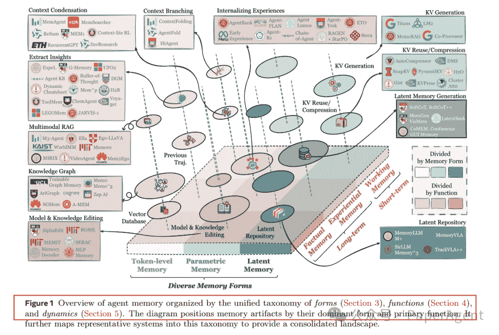

LLM 再强，也怕“**金鱼脑”——上下文**一断就失忆。

把 LLM 包**装成能持续交互、自我进**化的 Agent，必须外挂一块可读写、可增长、可遗忘的记忆体。

> 这一记忆体不仅是信息的“存储容器”，更是 Agent 形成认知、积累经验、优化策略的基础——它让 Agent 能够记住用户需求、沉淀任务经验、适配环境变化，最终实现从“被动响应”到“主动决策”的跨越。

### 2 预备知识：Agent 与记忆的形式化

在深入探讨 Agent 记忆的技术细节前，首先需要厘清 Agent 记忆与相关概念（如 LLM 内置记忆、RAG、上下文工程）的边界与关联。

图 2 用韦恩图厘清 **Agent Memory** vs** LLM Memory **vs **RAG** vs Context Engineering：

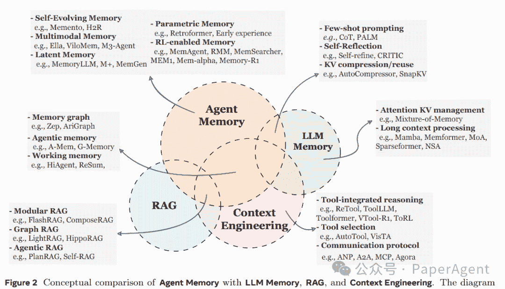

**为了更严谨地分析 Agent 记忆的工作机制，我们可以从形式化建模的角度进行拆解：首先将** Agent 所处的交互场景抽象为“部分可观测马尔可夫博弈（POMDP）”框架。

> 在该框架中，Agent 无法完全获取环境的所有状态信息，只能通过交互感知部分信息，而记忆正是 Agent 弥补“观测不完全性”、降低环境不确定性的核心手段。

先把 Agent 抽象成**部分可观测马尔可夫博弈**，再把记忆定义为**三元组运算符**：

+   **Formation** F：把原始交互 φ_t 提炼成记忆单元

+   **Evolution** E：合并、去重、纠错、遗忘

+   **Retrieval** R：按需查询

### 3 形态篇：记忆到底“长”什么样？

Agent 记忆的“形态”直接决定了其存储效率、检索速度与适配场景，不同形态的记忆对应不同的技术实现路径。

图 3 是把 **Token-level** 再细拆成 1D-Flat / 2D-Planar / 3D-Hierarchical：

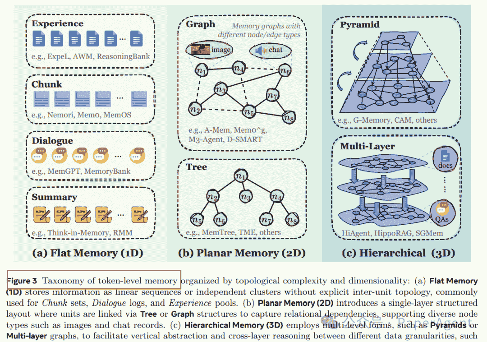

更全面地了解不同记忆形态的技术差异与适用场景，覆盖“多模态适配能力”“核心任务场景”“结构复杂度”“存储/检索效率”等关键维度，为技术选型提供参考

表 1 是 60+ 代表性方法的横向对比（多模态、任务、结构）：

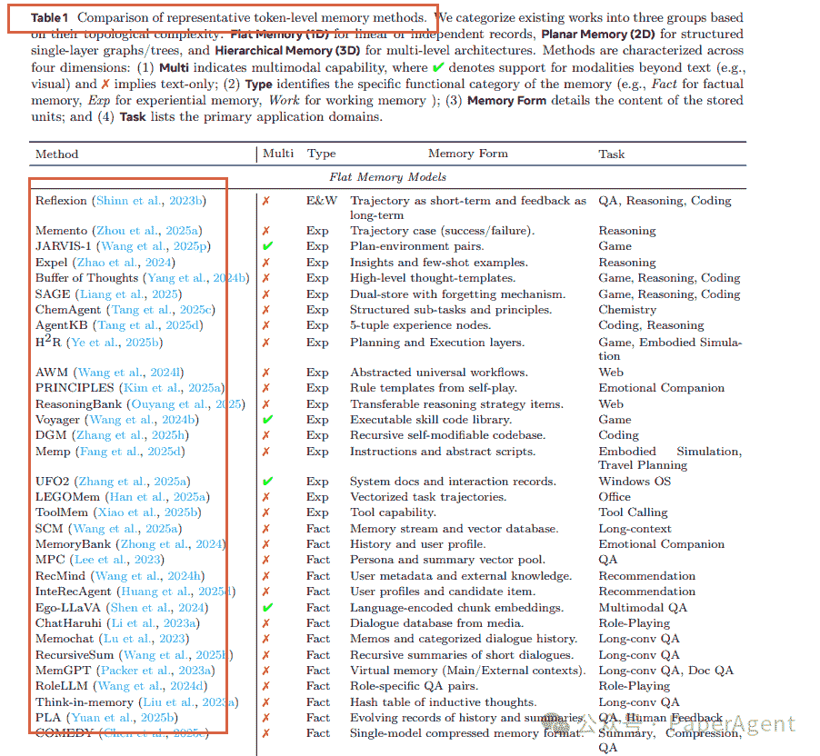

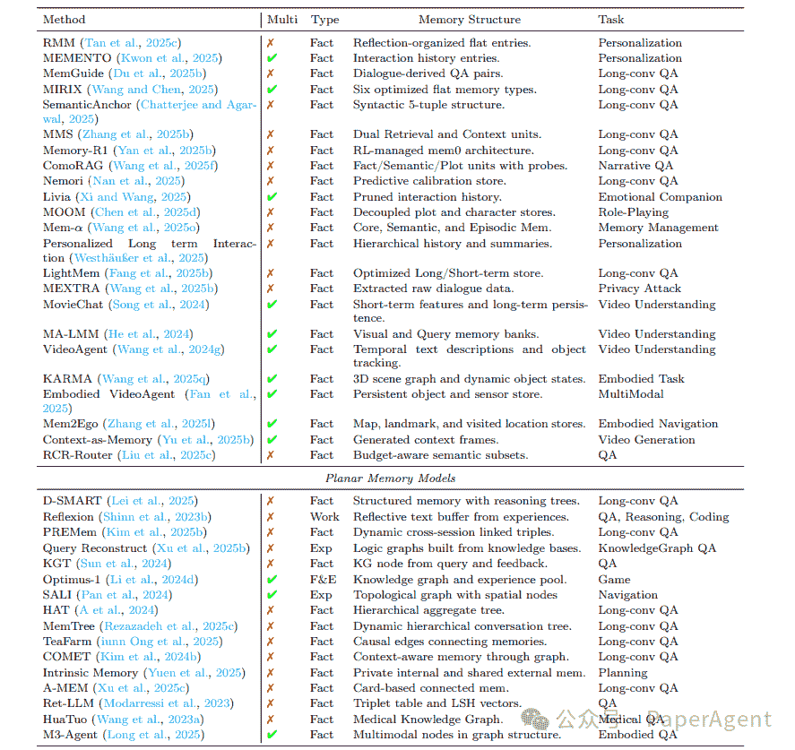

具体来看，三种核心形态的特征与适配场景各有侧重：

> 1D-Flat 形态结构最简单，采用线性存储方式，适配短文本交互、简单任务记忆等场景，优点是检索速度快，缺点是无法体现信息间的关联；

> 2D-Planar 形态通过矩阵式结构构建记忆单元间的二维关联（如“任务-信息”二维映射），适用于中等复杂度的多任务场景，能平衡存储效率与关联表达；

> 3D-Hierarchical 形态则通过“全局记忆-局部记忆-临时记忆”的层级结构，实现信息的分层存储与精准调用，适配复杂长周期任务（如多步骤规划、长期对话），但结构复杂度与实现成本较高。

### 4 功能篇：Agent 到底“用”记忆做什么？

如果说形态是记忆的“骨架”，那么功能就是记忆的“灵魂”。Agent 记忆的核心价值在于通过存储与调用信息，支撑不同场景下的智能决策。

图 6 是**功能-时间**双轴全景：

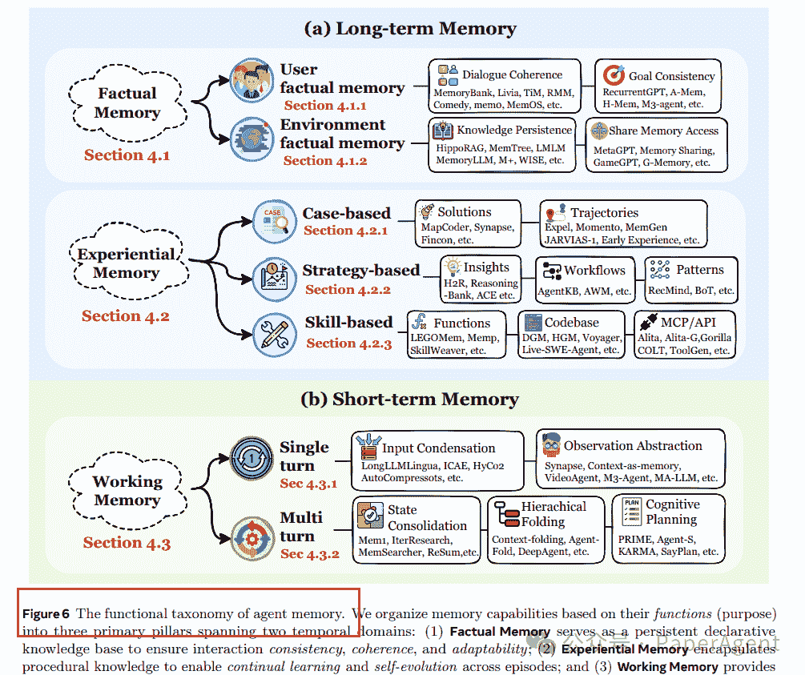

从“为什么记”的核心需求出发，我们可将 Agent 记忆的功能拆解为三大核心职能，三者相互配合，共同支撑 Agent 的持续交互与进化。

三大职能：

1.  **Factual Memory**——“我知道什么”：用户画像、文档状态、世界知识。

1.  Experiential Memory——“我学会什么”：成功/失败轨迹 → 策略 → 可执行技能。

1.  **Working Memory**——“我现在想什么”：单轮压缩、多轮状态折叠、计划缓存。

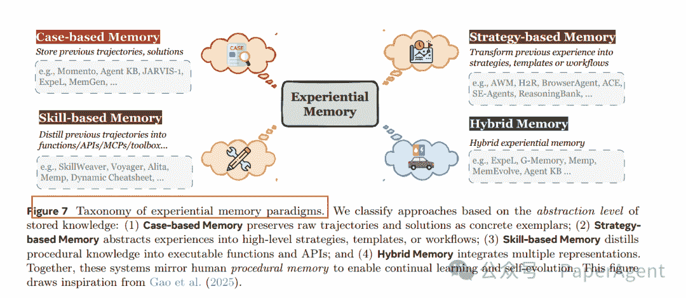

experiential memory范式

为了更直观地对比不同功能记忆的技术方法，汇总了 100+ 种代表性方法的关键信息，包括技术原理、适配场景、优缺点及性能指标，为不同功能需求下的技术选型提供详细参考。

表 4-6 分别对应三大功能的 100+ 方法速查表：

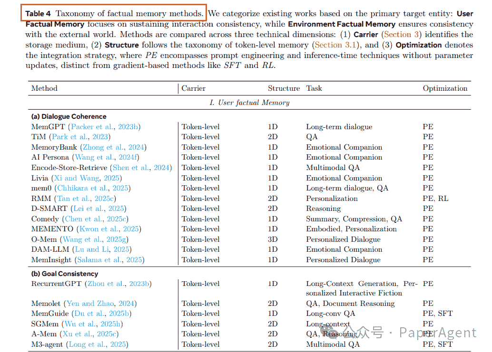

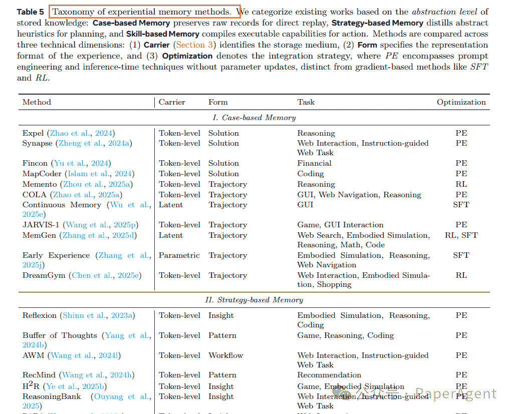

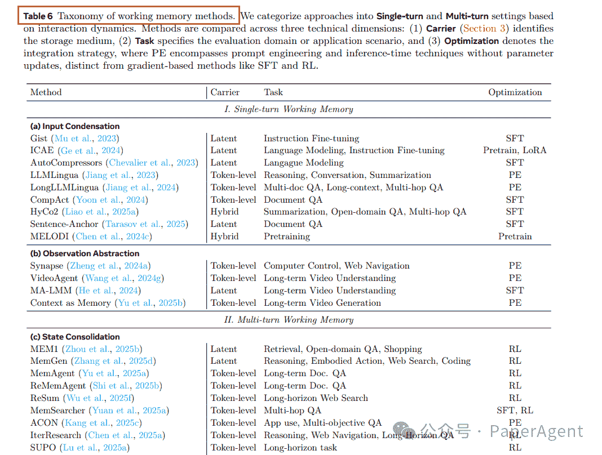

### 5 动力学篇：记忆如何“动”起来？

Agent 记忆并非静态的“信息仓库”，而是一个动态循环的生态系统。完整的记忆生命周期遵循“形成→演化→检索”的闭环流程，各环节通过一系列操作符实现高效衔接。

完整生命周期 = **形成 → 演化 → 检索** 闭环，用一张“地铁图”串起 30+ 操作符：

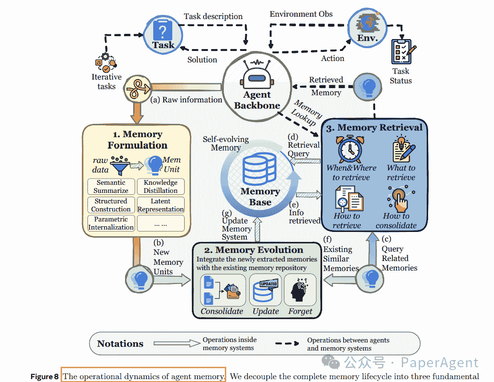

+   **Formation** 五板斧：语义摘要、知识蒸馏、结构化、潜空间编码、参数内化。

+   **Evolution** 三件套：合并（Consolidate）、更新（Update）、遗忘（Forget）。

+   **Retrieval** 四步曲：触发时机 → 查询构造 → 检索策略 → 后处理。

图 9 记忆演化机制蓝图

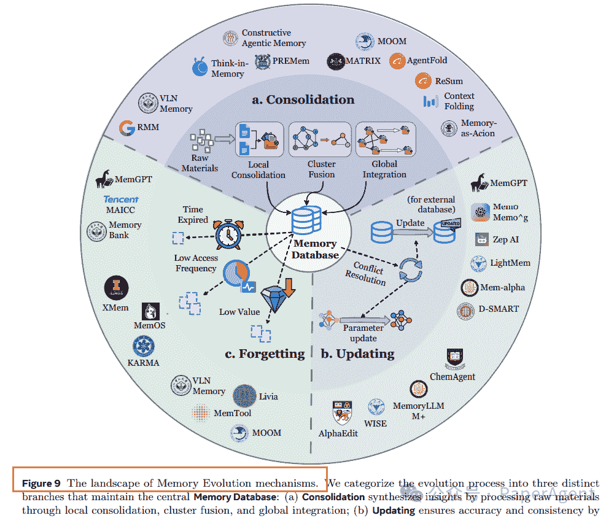

图 10 agentic系统中检索方法

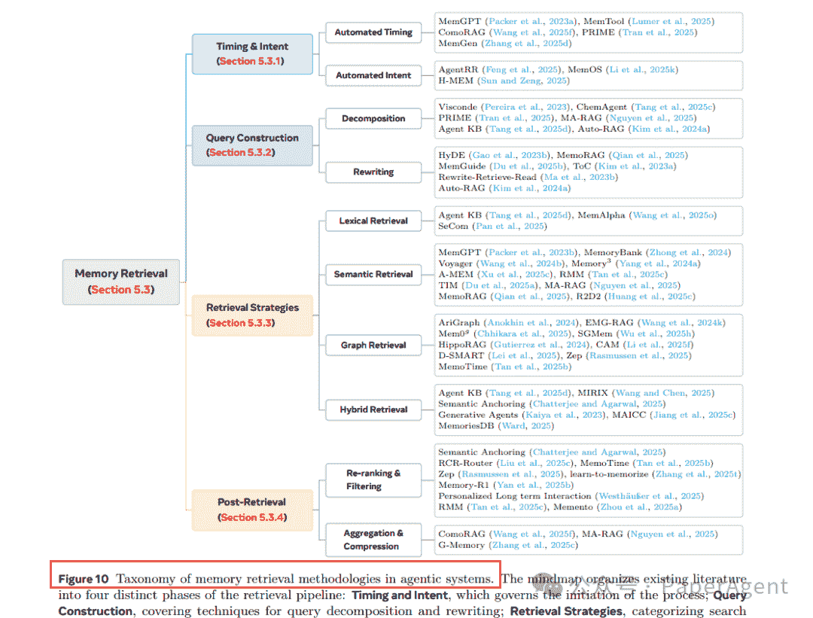

### 6 资源篇：Benchmark & 开源框架速览

精准的评测基准（Benchmark）与成熟的开源框架是推进 Agent 记忆技术落地的核心支撑。

表 8 汇总 30 个记忆/终身学习/自演化评测集：

> 覆盖“记忆保持能力”“终身学习能力”“自演化能力”“多模态记忆适配能力”等核心评测维度，同时标注了各评测集的数据集规模、任务类型、评价指标与适用场景，帮助研究者快速选择适配的评测工具。

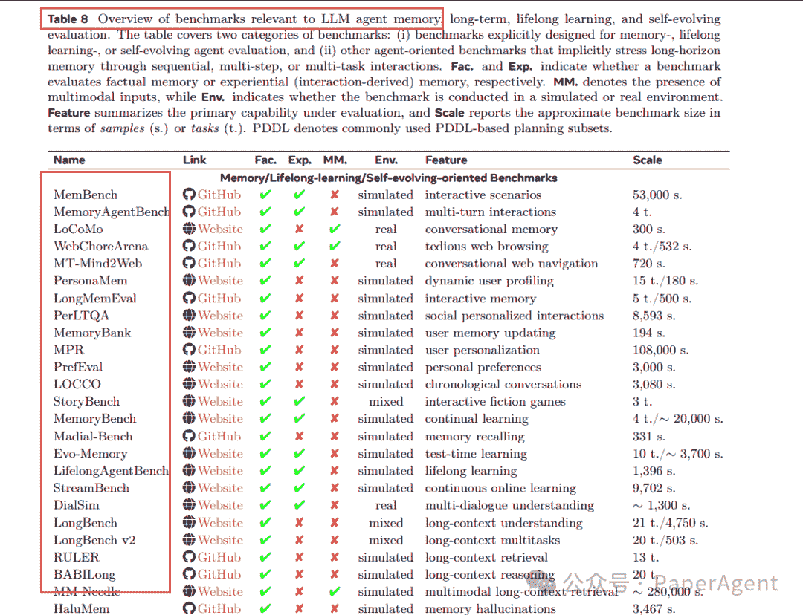

表 9 对比 20+ 开源框架（MemGPT / Mem0 / Zep / MemOS …）：

> 从“核心功能”“记忆形态支持”“多模态适配”“部署难度”“社区活跃度”等关键维度进行横向对比，为开发者的框架选型提供详细参考。

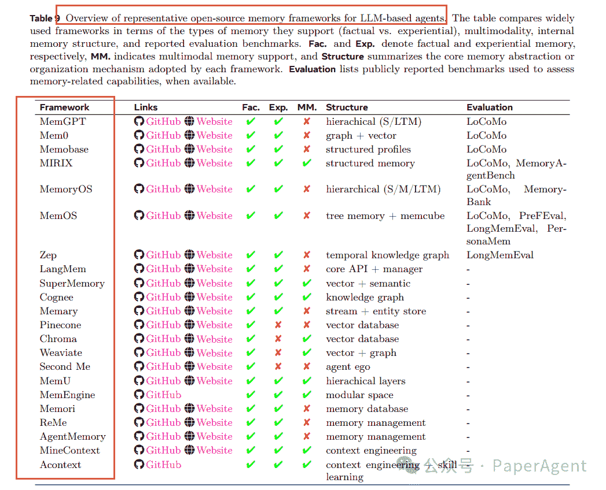

### 7 前沿篇：7 大风向标

1.  **生成式记忆** > 检索式记忆

+   不再“查什么用什么”，而是“缺什么生什么”。

1.  **自动记忆管理**

+   把“写/删/改”做成 Agent 可调用的 Tool，让 LLM 自己管自己。

1.  **RL 全面接管记忆策略**

+   从“人工拍阈值”到“策略网络端到端优化”。

1.  **多模态记忆**

+   视频、音频、传感器流统一进 Embedding 空间。

1.  **多 Agent 共享记忆**

+   角色-权限-隐私三权分立，防止“集体幻觉”。

1.  **世界模型内存**

+   从“缓存帧”到“可查询状态模拟器”。

1.  **可信记忆**

+   差分隐私、可验证遗忘、审计日志、用户级 GDPR 擦除。