# 上下文工程的4个策略和实践技巧

> 来源：[https://qqs7y1hozd1.feishu.cn/docx/W1v4drDp3o6XsExF3yTczxRanSd](https://qqs7y1hozd1.feishu.cn/docx/W1v4drDp3o6XsExF3yTczxRanSd)

本文的核心观点与技术策略深度提炼自 LangChain 官方博客文章 Context Engineering for Agents，方便系统性地了解构建高级AI智能体（Agent）的关键技术。

> **核心问题与价值：**Andrej Karpathy曾将大型语言模型（LLM）比作一种新型操作系统，其中LLM是CPU，而其上下文窗口（Context Window）则是RAM。正如操作系统需要精心管理内存（RAM）一样，我们在构建智能体时也必须高效地管理模型的“工作记忆”——上下文窗口。

> 当智能体执行长时程、多步骤任务时，不断累积的指令、工具调用反馈和知识会迅速填满上下文窗口，导致成本飙升、延迟增加，甚至引发上下文中毒（Context Poisoning）、上下文分心（Context Distraction）等性能退化问题。“上下文工程”（Context Engineering）正是解决这一挑战的艺术与科学，它专注于在智能体运行的每一步，都为其上下文窗口精确填充“恰到好处”的信息。

> 本文将深入剖析**上下文工程的四大核心策略**——写入（Write）、选择（Select）、压缩（Compress）和隔离（Isolate），并结合LangGraph框架展示如何将这些策略付诸实践。

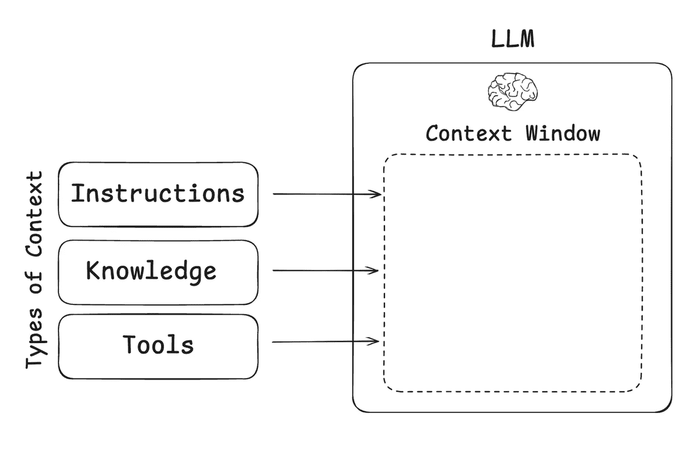

## 为何上下文工程对智能体至关重要

AI智能体的核心工作模式是在LLM调用和工具调用之间进行循环，利用工具的反馈来决定下一步行动。这个过程天然地会产生大量上下文信息。

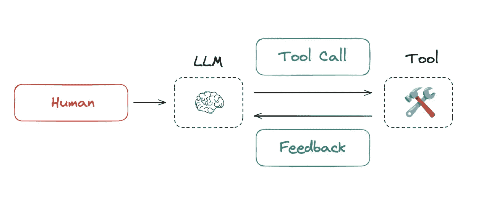

随着任务的进行，来自工具调用的上下文会不断累积，迅速膨胀。这种“上下文溢出”会直接导致多种严重问题：

+   **超出上下文窗口限制：**当Token数量超过模型上限时，程序会崩溃或丢失重要信息。

+   **成本与延迟激增：**更多的Token意味着更高的API调用成本和更长的响应时间。

+   **性能下降：**过长或混乱的上下文会严重影响模型的推理能力。

具体表现为：

+   上下文中毒 (Context Poisoning)：一个错误的幻觉信息进入上下文，并污染后续的推理过程。

+   上下文分心 (Context Distraction)：海量信息淹没了模型的训练知识，使其偏离核心任务。

+   上下文混淆 (Context Confusion)：无关的上下文信息对模型的响应产生了负面影响。

+   上下文冲突 (Context Clash)：上下文中存在相互矛盾的信息，导致模型决策混乱。

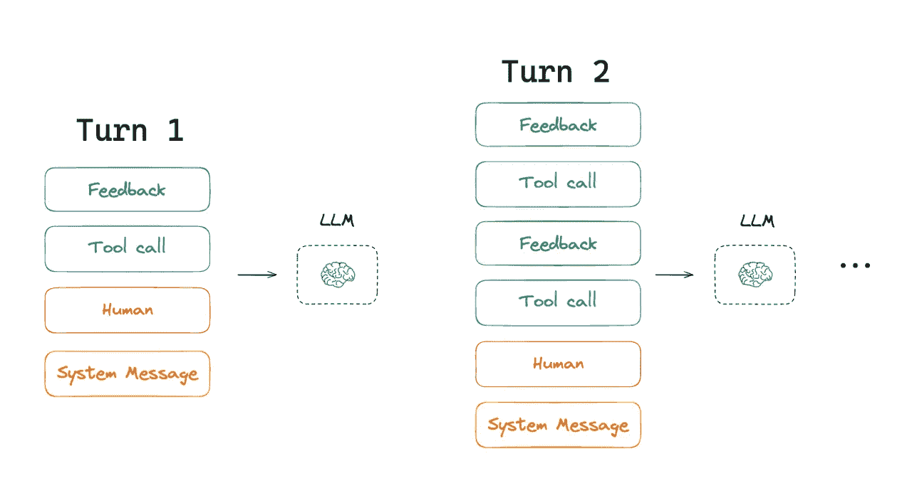

正如AI公司 Cognition 和 Anthropic 所强调的，上下文工程是构建AI智能体工程师的首要工作，也是处理长时程对话智能体所必需的核心管理策略。

## 上下文工程的四大核心策略

**为了有效应对上述挑战**，业界涌现出四大类上下文工程策略：写入（Write）、选择（Select）、压缩（Compress） 和 隔离（Isolate）。

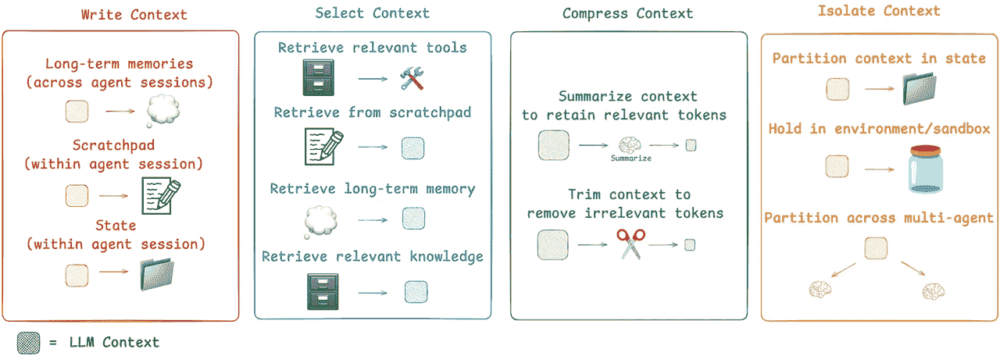

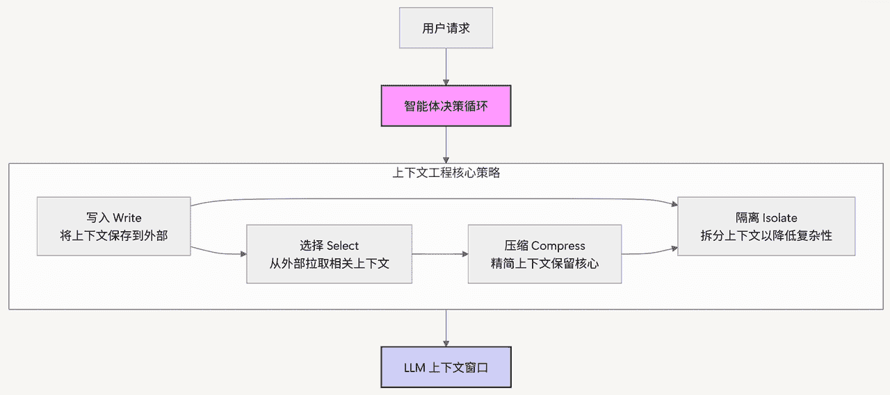

### 策略一：写入上下文 (Write Context)

“写入”是指将信息保存到上下文窗口之外的存储中，以便将来使用。

+   便笺 (Scratchpads)便笺是一种在单次任务会话中供智能体使用的“临时记事本”。它允许智能体在执行任务时记录中间思考、计划或重要发现，而无需将这些信息始终保留在昂贵的上下文窗口中。

+   例如，Anthropic的多智能体研究系统中的LeadResearcher智能体会先将思考好的计划保存到内存中，以防上下文窗口被截断时丢失关键计划。便笺可以通过简单的工具调用（如写入文件）或更新一个持久化的运行时状态对象来实现。

+   记忆 (Memories) 与便笺的“会话内”特性不同，记忆旨在实现跨会话的长期信息持久化。这使得智能体能够从过去的交互中学习和成长。

+   例如，Reflexion模型在每次行动后进行自我反思并生成记忆，而生成式智能体 (Generative Agents)则会定期从过去的反馈中合成新的记忆。如今，像 ChatGPT、Cursor 等主流产品都已经内置了基于用户交互自动生成和管理长期记忆的机制。

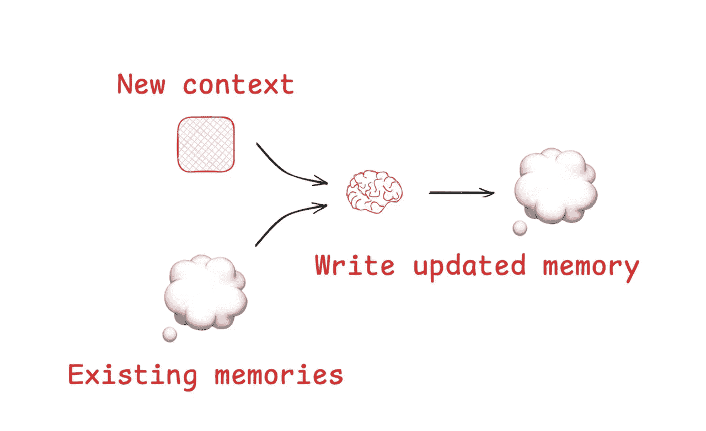

### 策略二：选择上下文 (Select Context)

“选择”是指在需要时，从外部存储中精准地拉取相关信息并注入到当前上下文窗口中。

+   从便笺和记忆中选择 选择机制与写入机制相对应。如果便笺是工具，智能体可以通过调用读取工具来获取信息。如果记忆存储在数据库中，就需要一套高效的检索机制。

记忆可以分为不同类型，以服务于不同目的：

+   情景记忆 (Episodic Memories)：如Few-shot示例，用于展示期望的行为模式。

+   程序记忆 (Procedural Memories)：如操作指令，用于引导智能体的行为。

+   语义记忆 (Semantic Memories)：如事实知识，为任务提供相关背景。

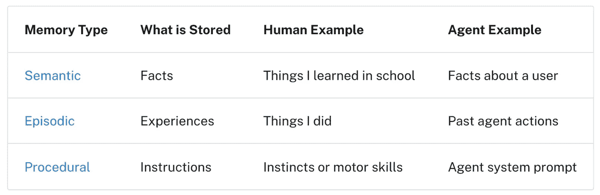

选择的挑战在于确保相关性。简单的实现是始终加载固定的规则文件，如Claude Code使用的CLAUDE.md。而更复杂的系统（如ChatGPT）则使用**嵌入（Embeddings）或知识图谱（Knowledge Graphs）**来索引海量记忆，并进行语义检索。然而，选择并非万无一失。Simon Willison曾分享过一个例子：ChatGPT在生成图片时意外地从记忆中获取并注入了他的地理位置，这凸显了不当选择可能带来的风险。

+   选择工具和知识 (RAG) 当智能体拥有大量工具时，它可能会因**为工具描述重叠而感到困**惑。对工具描述应用RAG（检索增强生成）是一种有效的解决方案，它能根据当前任务动态选择最相关的工具，有研究表明这能将工具选择的准确率提高3倍。

+   对于知识的检索，RAG同样至关重要。

+   例如，Windsurf的代码智能体综合使用了文本搜索（grep）、AST（抽象语法树）解析、知识图谱检索和重排序等多种技术，以在大型代码库中实现可靠的上下文检索。

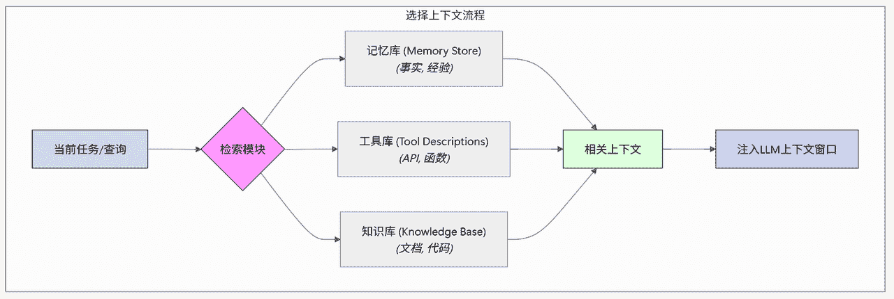

### 策略三：压缩上下文 (Compress Context)

“压缩”是指在保留任务所需核心信息的前提下，尽可能减少上下文中的Token数量。

+   上下文总结 (Context Summarization) 这种方法通常使用一个LLM来提炼和浓缩信息。

+   例如，当Claude Code的上下文窗口使用率超过95%时，它会自动触发“auto-compact”功能，对整个用户-智能体交互轨迹进行总结。

+   **总结可以应用于不同层面：**

+   **对整个对话历史进**行递归或分层总结，或在特定节点对高Token消耗的工具输出（如网页搜索结果）进行后处理。Cognition公司甚至为其智能体专门微调了一个总结模型，用于在智能体之间交接工作时压缩知识，足见其重要性。

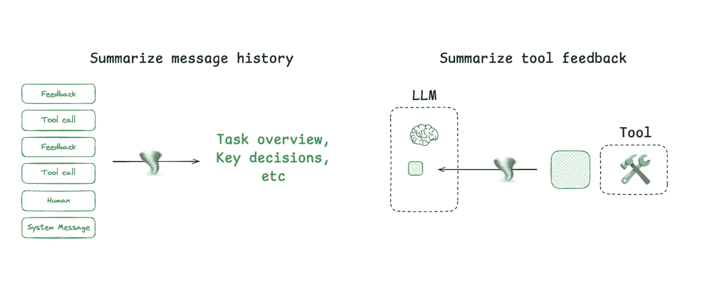

+   上下文裁剪 (Context Trimming) 与使用LLM进行智能总结不同，裁剪通常依赖硬编码的启发式规则来过滤或“修剪”上下文。最常见的方法是简单地移除消息列表中最旧的消息。

+   更高级的方法，如论文中提到的Provence，是训练一个专门用于问答场景的上下文修剪器。

### 策略四：隔离上下文 (Isolate Context)

“隔离”是指将上下文分解到不同的单元中，以降低单个上下文窗口的复杂性并实现关注点分离。

+   多智能体架构 (Multi-agent) 将一个复**杂任务分解给多个专职子智能**体是隔离上下文最流行的方式。每个子智能体都有自己独立的上下文窗口、指令集和工具集，可以并行处理不同子任务。

+   Anthropic的多智能体研究系统证明，这种架构的性能远超单个大型智能体，因为每个子智能体的上下文窗口都可以更专注于一个狭窄的子任务。

+   当然，其挑战在于更高的Token总消耗量和复杂的任务规划与协调。

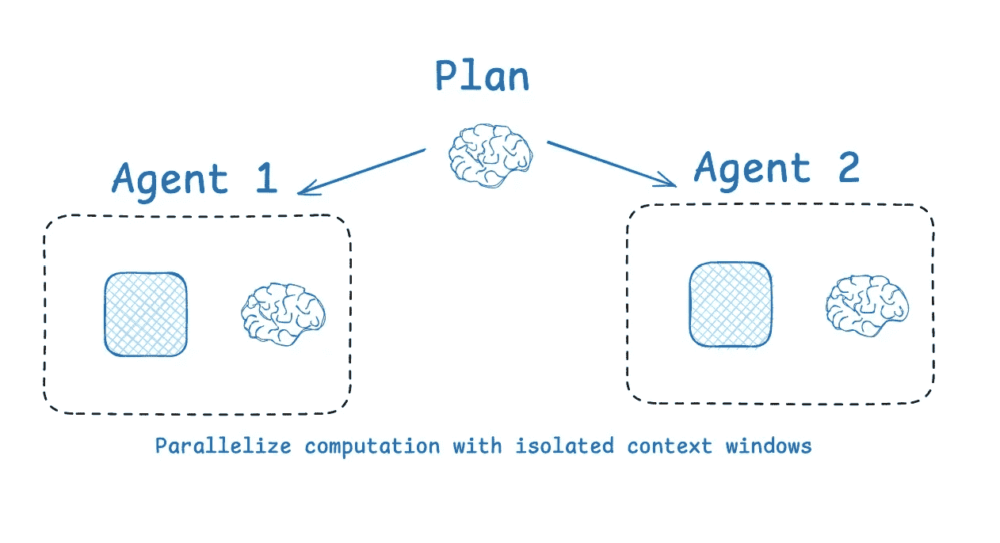

+   使用环境隔离上下文 (Environments) 另一种隔离方法是使用沙箱环境。例如，HuggingFace的CodeAgent并不直接调用工具API，而是生成可执行代码。

+   这些代码在一个隔离的沙箱中运行，只有必要的返回值才会被传回给LLM。这种方式非常适合处理和隔离高Token消耗的对象（如图片、音频文件），只需在沙箱中将其赋值给一个变量，即可在后续步骤中复用，而无需将庞大的数据本身放入LLM的上下文中。

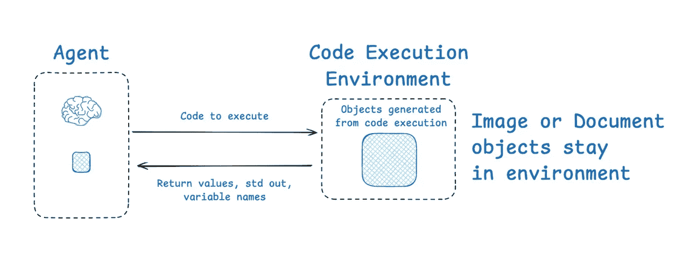

> 利用状态对象隔离 (State) 一个精心设计的运行时状态对象（State Object）本身就是一种强大的隔离机制。通过定义一个包含多个字段的模式（Schema），我们可以将提供给LLM的消息（如messages字段）与其他仅供程序逻辑使用的信息（如工具调用的原始JSON输出）分离开来。

这样，LLM只看到它需要看到的信息，而其他上下文则被安全地隔离在状态对象的其他字段中。

## 使用LangGraph和LangSmith实践上下文工程

理论虽好，实践为王。LangChain生态系统中的LangSmith和LangGraph为实践上述策略提供了强大的支持。

1.  LangSmith：观测与评估：在进行任何优化之前，首先需要度量。LangSmith提供了强大的追踪和可观测性能力，可以清晰地看到智能体每一步的Token消耗，帮助你定位上下文管理的瓶颈。同时，它的评估功能可以量化你的上下文工程策略是否真正提升了智能体性能。

1.  **LangGraph：灵活实现：**LangGraph是一个底层的智能体编排框架，它赋予开发者极大的灵活性来实现各种上下文工程策略。

+   **写入与选择：**LangGraph内置了对短时记忆（检查点）和长时记忆的支持。你可以轻松地将会话状态（便笺）持久化，或集成一个跨会话的记忆库。在图的每个节点中，你可以精确控制从状态对象或记忆库中选择哪些信息提供给LLM。

+   **压缩：**由于LangGraph的流程是自定义的节点图，你可以在任何需要的地方插入一个总结节点或在工具调用节点中添加后处理逻辑来压缩输出。

+   **隔离：**LangGraph以状态对象为核心，天然支持通过Schema隔离上下文。同时，它也支持与沙箱环境（如E2B）集成，并提供了supervisor和swarm等库，极大地简化了多智能体架构的构建。

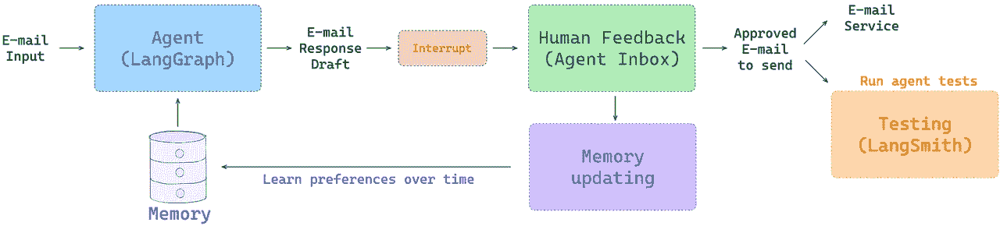