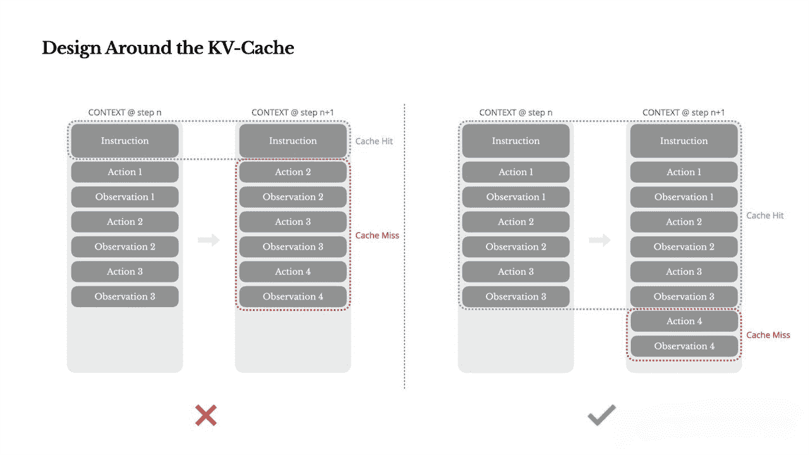
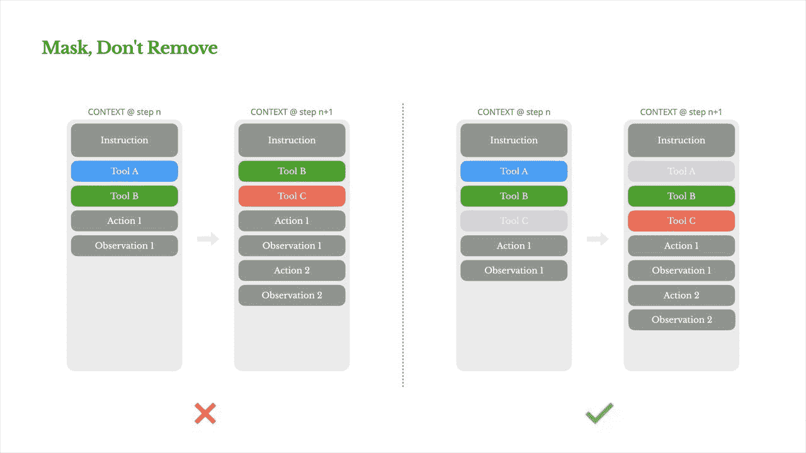
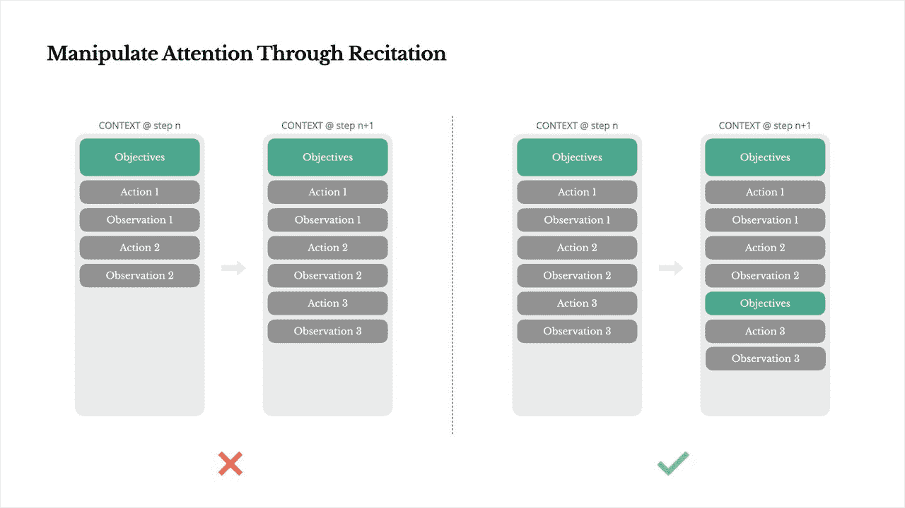
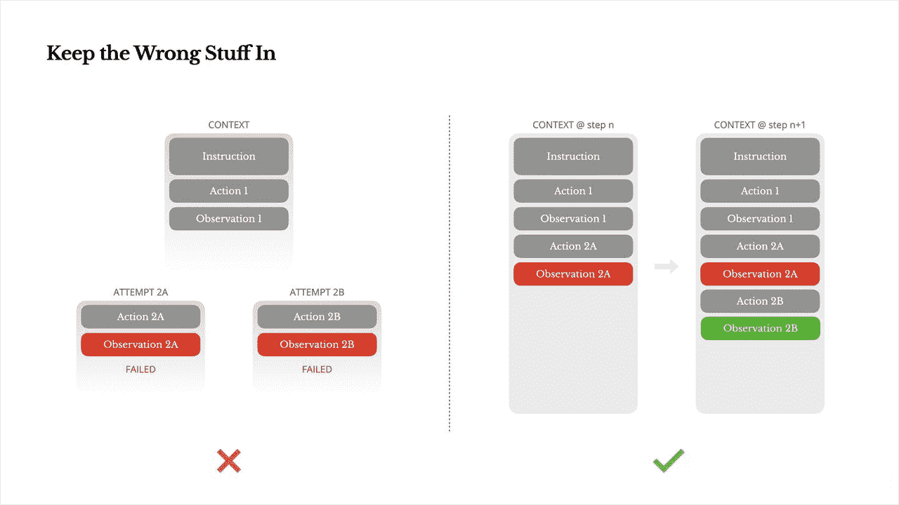
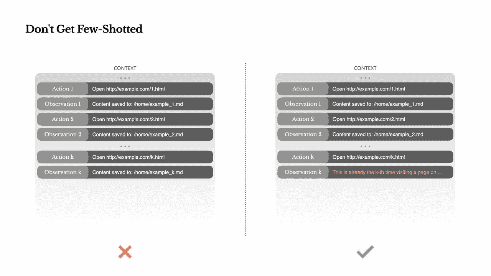

# 上下文工程的6大技巧

> 来源：[https://qqs7y1hozd1.feishu.cn/docx/LXWIdMIKuoewD7xIx1Scq7Gtnye](https://qqs7y1hozd1.feishu.cn/docx/LXWIdMIKuoewD7xIx1Scq7Gtnye)

## 围绕 KV-Cache 做设计

KV-Cache 命中率，是直接决定Agent的延迟和成本的关键指标。

先来看AI Agent的运行方式：

> 用户输入 → 模型按当前上下文挑动作 → 动作在沙箱执行 → 结果写回上下文 → 进入下一次迭代重新按当前上下文挑动作 → ... → 任务完成

可以看出，上下文在每一步都会增长，而输出的Function Call结果通常相对较短，以 Manus 为例，平均输入与输出 token 的比例约为 100:1。

> 从上下文工程的角度看，提升 KV 缓存命中率的关键要点如下：

+   让 prompt 前缀绝对稳定。由于LLM的自回归属性，只要有一个 token 存在变动，就会让缓存从该 token 之后开始失效。一个常见的错误是在系统提示词的开始加入时间戳，尤其是精确到秒级，会直接让缓存命中率归0.

+   上下文只能追加。避免修改之前的动作以及观测结果，确保你的序列化过程是确定性的。很多编程语言和库在序列化 JSON 对象时并不保证键的顺序稳定，这会在悄无声息地破坏掉缓存。

+   需要时明确标记缓存断点。一些模型提供方或推理框架并不支持自动增量前缀缓存，需要手动在上下文中插入缓存断点。注意在设置断点时，要考虑潜缓存可能过期的时间，至少确保断点包含在系统提示词的结尾。

如果是使用vLLM等框架时，请记得打开 prefix caching，并用 session ID 把请求路由到同一worker。

## 利用Mask，而非删除

Agent系统中，能力越多，那么工具就需要越多。

> 尤其是MCP大火，如果允许用户自定义配置工具，会有人塞上百个来历不明的工具到你构建的动作空间里。

显而易见，模型会更容易选错行动，或者采取低效路径，就是工具越多的Agent，可能越笨。

> **一般的做法就是动态加载/卸载工具，类**似RAG一样，但尝试过之后，都是血的教训

+   工具定义通常在上下文最前面，任何增删都会炸掉 KV-Cache。

+   在history里提到的工具一旦消失，模型会困惑甚至幻觉。

结论就是：除非绝对必要，否则避免在迭代中途动态增删工具。

Manus 的解法就是，不动工具定义，利用上下文感知的状态机（state machine）来管理工具，在解码阶段用 logits mask 阻止或强制选择某些动作。

三大调用模式：

+   Auto：模型可调用也可不调用。

+   Required：必须调用，但工具任选。

+   Specified：必须调用指定子集。

通过给 assistant 前缀预填充到不同深度即可实现。我们还把工具名统一前缀化（browser_、shell_），方便按组 mask。

在实践中，大多数模型提供商和推理框架都支持某种形式的响应预填充，以 NousResearch 的 Hermes 格式为例，

+   Auto：模型可以选择是否调用函数，通过仅预填充回复前缀（<|im_start|>assistant）可实现。

+   Required：模型必须调用函数，但具体调用哪个函数不受限制，通过预填充到工具调用标记（<|im_start|>assistant<tool_call>）可实现。

+   Specified：模型必须从特定子集中调用函数，通过预填充到函数名开头（<|im_start|>assistant<tool_call>{"name":「browser_）可实现。

## 将文件系统作为上下文

即使大多数模型上下文长度以及支持到128K，但在真实的智能体场景中任然不够，甚至是一种负担：

+   观测结果可能极其庞大，当与网页、PDF 这类非结构化数据交互时，上下文长度限制很容易就爆表

+   即使模型支持很长上下文，但一般在超过一定长度之后模型性能会有一定的下降

+   长上下文输入即使有前缀缓存，依然很贵。

常见做法是截断或压缩，但不可逆压缩必丢信息，你永远不知道第 10 步会用到哪条观测值。

Manus的做法，是把文件系统视为终极上下文，无限大、持久、可由模型直接操作读写，把文件系统不仅当作存储，更当作外部结构化的记忆。

具体的压缩策略是保证内容可复原，例如，网页内容可暂时从上下文删掉，但保留原有的URL ；文档内容只要在沙盒中的路径可用于，那么内容可以也可以被省略。

让Manus在不永久丢失信息的前提下，缩减上下文长度。

甚至幻想：如果 State Space Model（SSM）能把长期状态外化到文件，而非留在上下文，它们可能成为下一代智能体。

## 通过复述操纵注意力

用过 Manus 的人会注意到它爱创建 todo.md，做完一条勾一条。这不是看起来可爱，而是精心设计的注意力操控机制。

Manus中一个任务一般需要50次工具调用，在50步的长链中，LLM很容易出行跑题现象，偏离原有主题或忘记早期目标。

通过不断重写待办清单，将任务目标不断复述到上下文末尾，相当于用自然语言把目标塞进最近注意力，避免中间遗忘（lost in the middle）。

## 保留错误内容在上下文中

智能体一定会犯错，LLM的幻觉、环境的报错、工具的抽风，这不是BUG，而是现实。在多步任务中，失败不是例外，而是循环的一部分。

常见做法是隐藏这些错误：清理痕迹、重试动作，或者重置模型状态，然后把它交给神奇的“温度”。看起来似乎更安全、更可控。但这会抹掉证据，模型学不到教训。

Manus发现：把错误留在上下文里，模型看到失败动作后，会隐式地更新其内部认知，降低重复犯错的概率。认为错误恢复能力是真正具备智能体行为的最明确的指标之一。

但现在大多数学术研究和公开基准测试中，往往忽略了这一点，只关注了在理想条件下的任务成功率。

## 不要被few-shot误导

少样本提示（Few-shot Prompting）是提升LLM输出的常用手段，但在Agent系统中可能会适得其反。

LLM是出色的模仿者，若上下文里都是大量相似的动作-观测对，模型会倾向遵循这种形式，哪怕者并不是最优解。

例如，当使用 Manus 协助审阅20 份简历时，Agent往往会因为上下文里出现了类似操作，就不断重复，陷入一种循环，最终导致行为漂移、过度泛化，有时产生幻觉。

Manus的做法：增加多样性。在动作和观察中引入少量结构化变化，例如采用不同序列化模板、措辞、在顺序或格式上加入噪音等，打破惯性。

总之，上下文越单一，智能体越脆弱。

