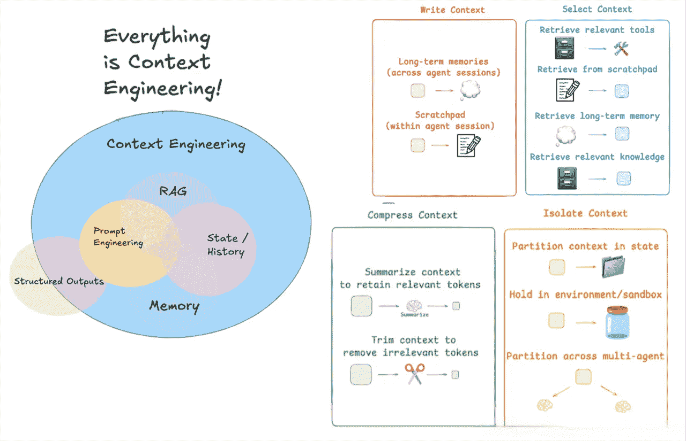
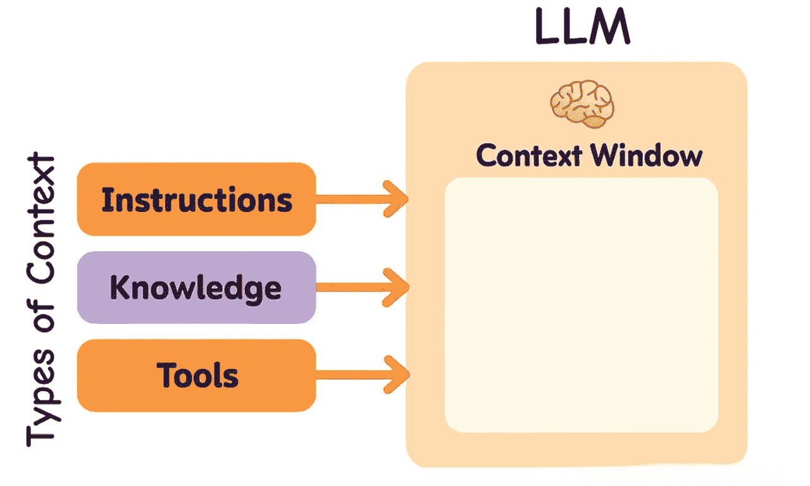
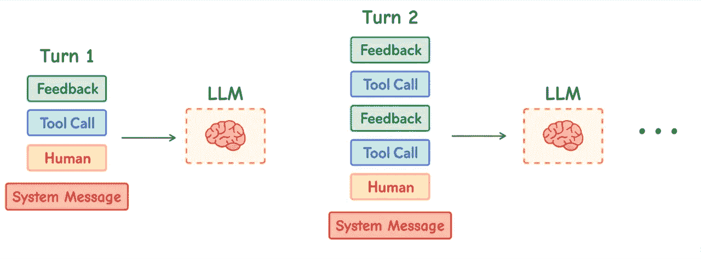
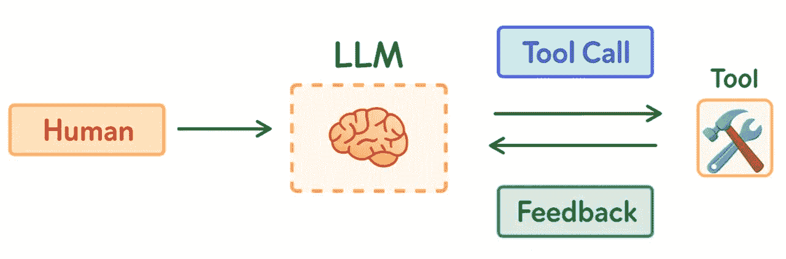
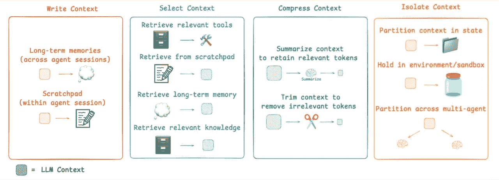
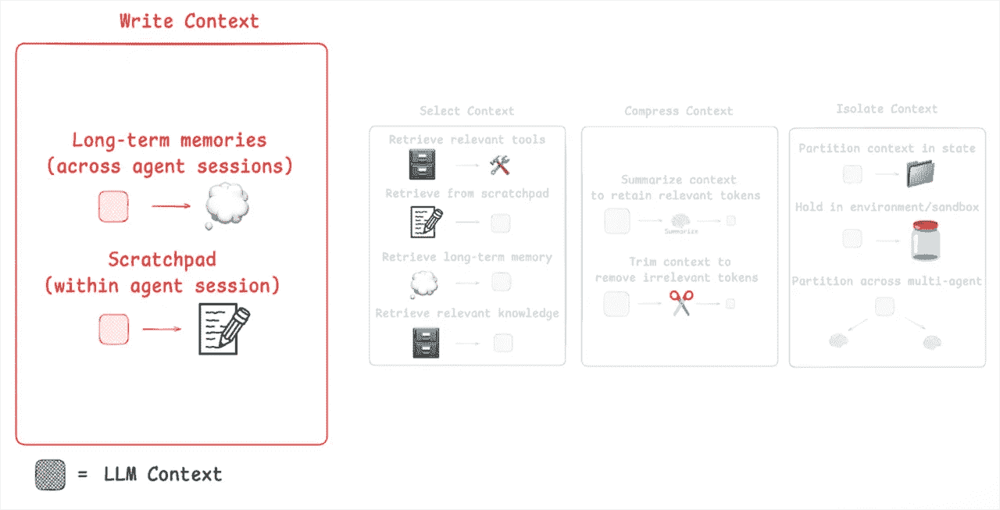
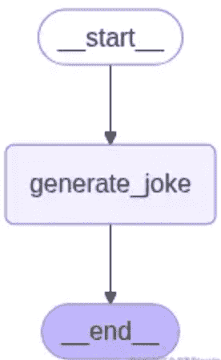
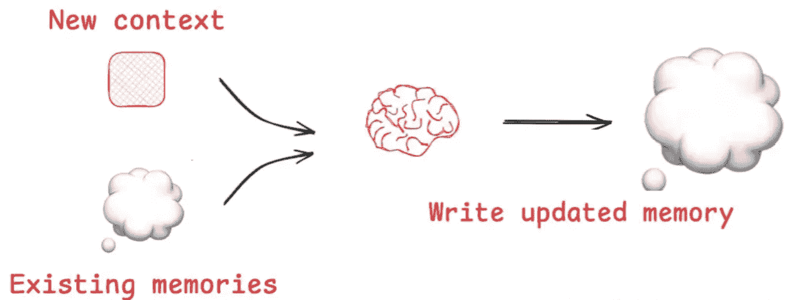
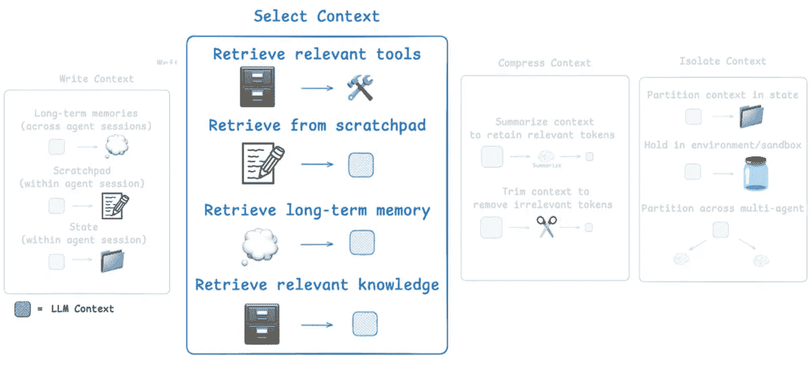

# 基于上下文工程，动手优化 AI Agents

> 来源：[https://qqs7y1hozd1.feishu.cn/docx/HYSBd3EVRo7KH9xjBU7cb11Rnog](https://qqs7y1hozd1.feishu.cn/docx/HYSBd3EVRo7KH9xjBU7cb11Rnog)

> 本文详细介绍如何利用LangChain和LangGraph这两款用于构建AI agents、RAG应用和LLM应用的强大工具，有效实施上下文工程，以改进AI Agents。



上下文工程指的是在给AI分配任务之前，为其创建合适的设置。

**该设置包括：**

> 关于AI应如何行动的指示，例如作为一名有用的经济型旅行指南

+   从数据库、文档或实时来源获取有用信息的权限。

+   记住过往对话，以**避免重复或遗忘**。

+   AI可以使用的工具，例如计算器或搜索功能。

+   关于你的重要细节，例如你的偏好或位置。

## 1.上下文工程？

大型语言模型（LLMs）的运作方式类似于一种新型操作系统。

LLM 相当于中央处理器（CPU），其上下文窗口则类似于随机存取存储器（RAM），充当着它的短期记忆。但和 RAM 一样，上下文窗口容纳不同信息的空间是有限的。



**在构建 LLM 应用时，需要**管理不同类型的上下文。上下文工程涵盖以下主要类型：

+   **指令：**提示词、示例、记忆和工具描述

+   **知识：**事实、存储的信息和记忆

+   **工具：**工具调用产生的反馈和结果

今年，人们对 agents 的兴趣日益浓厚，因为 LLM 在思考和使用工具方面的能力有所提升。Agents 通过将 LLM 与工具结合使用来处理长期任务，并根据工具的反馈选择下一步行动。





> Drew Breunig 解释了过多的上下文会如何影响性能，包括：

+   上下文污染（Context Poisoning）：错误或幻觉信息被添加到上下文中

+   上下文干扰（Context Distraction）：过多的上下文使模型产生困惑

+   上下文混淆（Context Confusion）：额外的、不必要的细节影响答案

+   上下文冲突（Context Clash）：上下文中的部分内容存在信息冲突

Anthropic 在其研究中强调了这一点的必要性：

> Agents 通常会进行**数百轮对话**，因此谨慎管理上下文至关重要。

> agent 上下文工程的常见策略可分为四大类：

+   写入（Write）：创建清晰且有用的上下文

+   选择（Select）：只挑选最相关的信息

+   压缩（Compress）：缩短上下文以节省空间

+   隔离（Isolate）：将不同类型的上下文分开



**LangGrap**h 的设计初衷就是支持所有这些策略。将在 LangGraph 中逐一探讨这些组件，看看它们如何帮助提升 AI agents 的性能。

## 2.使用 LangGraph 的草稿区（Scratchpad）

就像人类会做笔记以记住后续任务的相关内容一样，agents 也可以通过“草稿区”来实现这一点。草稿区将信息存储在上下文窗口之外，以便 agent 在需要时随时访问。



一个很好的例子是 Anthropic 的多 agent 研究工具：

> agent（LeadResearcher）会规划其方法并将其保存到内存中。

> 因为如果上下文窗口超过 200,000 个 tokens，内容就会被截断，所以保存计划可以确保它不会丢失。

> **草稿区可以通过多种方式实现：**

+   作为一种工具调用，用于写入文件。

+   作为运行时状态对象中的一个字段，在会话期间持续存在。

简而言之，草稿区帮助 agents 在会话期间保存重要笔记，以便有效地完成任务。

> 在 LangGraph 中，它支持短期（线程范围内）和长期记忆。

+   短期记忆使用检查点（checkpointing）来保存会话期间的 agent 状态。它的作用类似于草稿区，允许你在 agent 运行时存储信息并在之后检索。

> 状态对象是在图节点之间传递的主要结构。

> 可以**定义其格式**（通常是一个 Python 字典）。它就像一个共享的草稿区，每个节点都可以读取和更新特定的字段。

> 只会在需要时**导入模块**，这样就能以清晰的方式逐步学习。

为了获得更好、更清晰的输出，将使用 Python 的 pprint 模块进行美观打印，并使用 rich 库中的 Console 模块。

**先导入并初始化它们：**

```
# Import necessary libraries
from typing import TypedDict  # For defining the state schema with type hints

from rich.console import Console  # For pretty-printing output
from rich.pretty import pprint  # For pretty-printing Python objects

# Initialize a console for rich, formatted output in the notebook.
console = Console()

```

接下来，将为状态对象创建一个 TypedDict。

```
# Define the schema for the graph&#x27;s state using TypedDict.
# This class acts as a data structure that will be passed between nodes in the graph.
# It ensures that the state has a consistent shape and provides type hints.
class State(TypedDict):
    &quot;&quot;&quot;
    Defines the structure of the state for our joke generator workflow.

    Attributes:
        topic: The input topic for which a joke will be generated.
        joke: The output field where the generated joke will be stored.
    &quot;&quot;&quot;

    topic: str
    joke: str

```

这个状态对象将存储主题以及要求 agent 根据给定主题生成的笑话。

## 3.创建状态图（StateGraph）

定义状态对象后，可以使用StateGraph向其写入上下文。

> StateGraph是LangGraph中用于构建有状态agents或工作流的主要工具。

> **可以将其视为一个有向图：**

+   节点（Nodes）是工作流中的步骤。每个节点接收当前状态作为输入，对其进行更新，然后返回变更内容。

+   边（Edges）连接节点，定义执行流程——可以是线性的、有条件的，甚至是循环的。

**接下来，将：**

> 1.通过选择Anthropic模型来创建一个聊天模型（chat model）。

> 2.在LangGraph工作流中使用该模型。

```
# 导入用于环境管理、显示和LangGraph的必要库
import getpass
import os

from IPython.display import Image, display
from langchain.chat_models import init_chat_model
from langgraph.graph import END, START, StateGraph

# --- 环境和模型设置 ---
# 设置Anthropic API密钥以验证请求
from dotenv import load_dotenv
api_key = os.getenv(&quot;ANTHROPIC_API_KEY&quot;)
if not api_key:
    raise ValueError(&quot;环境中缺少ANTHROPIC_API_KEY&quot;)

# 初始化将在工作流中使用的聊天模型
# 使用特定的Claude模型，设置temperature=0以获得确定性输出
llm = init_chat_model(&quot;anthropic:claude-sonnet-4-20250514&quot;, temperature=0)

```

**已经初始化了****Sonnet****模型。**

> LangChain通过API支持许多开源和闭源模型，因此你可以使用其中任何一种。

现在，需要创建一个使用该Sonnet模型生成响应的函数。

```
# --- 定义工作流节点 ---
def generate_joke(state: State) -&gt; dict[str, str]:
    &quot;&quot;&quot;
    一个基于当前状态中的主题生成笑话的节点函数。

    该函数从状态中读取&#x27;topic&#x27;，使用LLM生成笑话，
    并返回一个字典以更新状态中的&#x27;joke&#x27;字段。

    参数:
        state: 图的当前状态，必须包含&#x27;topic&#x27;。

    返回:
        一个包含&#x27;joke&#x27;键的字典，用于更新状态。
    &quot;&quot;&quot;
    # 从状态中读取主题
    topic = state[&quot;topic&quot;]
    print(f&quot;正在生成关于以下主题的笑话：{topic}&quot;)

    # 调用语言模型生成笑话
    msg = llm.invoke(f&quot;写一个关于{topic}的短笑话&quot;)

    # 返回生成的笑话，以便写回状态
    return {&quot;joke&quot;: msg.content}

```

这个函数仅返回一个包含生成的响应（笑话）的字典。

现在，借助StateGraph，可以轻松构建并编译这个图。接下来就让动手操作。

```
# --- 构建并编译图 ---
# 使用预定义的State schema初始化一个新的StateGraph
workflow = StateGraph(State)

# 将&#x27;generate_joke&#x27;函数添加为图中的一个节点
workflow.add_node(&quot;generate_joke&quot;, generate_joke)

# 定义工作流的执行路径：
# 图从START入口点开始，流向&#x27;generate_joke&#x27;节点。
workflow.add_edge(START, &quot;generate_joke&quot;)
# &#x27;generate_joke&#x27;完成后，图的执行结束。
workflow.add_edge(&quot;generate_joke&quot;, END)

# 将工作流编译为可执行的链
chain = workflow.compile()

# --- 可视化图 ---
# 显示已编译工作流图的可视化表示
display(Image(chain.get_graph().draw_mermaid_png()))

```



现在可以执行这个工作流。

```
# --- 执行工作流 ---
# 使用包含主题的初始状态调用已编译的图。
# `invoke`方法从START节点运行图直至END节点。
joke_generator_state = chain.invoke({&quot;topic&quot;: &quot;cats&quot;})

# --- 显示最终状态 ---
# 打印执行后图的最终状态。
# 这将同时显示输入的&#x27;topic&#x27;和已写入状态的输出&#x27;joke&#x27;。
console.print(&quot;\n[bold blue]笑话生成器状态：[/bold blue]&quot;)
pprint(joke_generator_state)

#### 输出 ####
{
  &#x27;topic&#x27;: &#x27;cats&#x27;,
  &#x27;joke&#x27;: &#x27;猫为什么加入乐队？\n\n因为它想当“喵”克风手（打击乐手）！&#x27;
}

```

它返回的字典本质上是agent的笑话生成状态。以上代码展示了如何向状态写入上下文。

可以了解更多关于检查点（Checkpointing）的内容

> 用于保存和恢复图状态，以及人机协作（Human-in-the-loop）的内容（用于暂停工作流，以在继续之前获取人工输入）。

## 4.LangGraph中的内存写入

> **草稿区****（Scratchpad）****帮助****agents****在单个会话中工作**

+   Reflexion引入了agents在每一轮交互后进行反思并重用自我生成提示的理念。

+   Generative Agents通过总结过往agent的反馈来创建长期记忆。



这些理念现已应用于ChatGPT、Cursor和Windsurf等产品中，它们能从用户交互中自动创建长期记忆。

+   检查点（Checkpointing）

> 会在一个线程（thread）的每一步保存图的状态。一个线程有唯一ID，通常代表一次交互——比如ChatGPT中的一次单独聊天。

>

+   **长期记忆**

> 允许跨线程保留特定上下文。你可以保存单个文件（例如用户资料）或记忆集合。

>

+   **使用BaseStore接口**

> 一种键值存储。你可以在内存中使用它（如下所示），也可以在LangGraph平台部署中使用。

现在，创建一个InMemoryStore，用于本 notebook 中的多个会话。

```
from langgraph.store.memory import InMemoryStore

# --- 初始化长期记忆存储 ---
# 创建InMemoryStore实例，它提供了一个简单的、非持久化的键值存储系统，用于当前会话内。
store = InMemoryStore()

# --- 定义用于组织的命名空间 ---
# 命名空间用于在存储中对相关数据进行逻辑分组。
# 这里，使用元组表示分层命名空间，它可以对应用户ID和应用上下文。
namespace = (&quot;rlm&quot;, &quot;joke_generator&quot;)

# --- 向内存存储写入数据 ---
# 使用`put`方法将键值对保存到指定命名空间中。
# 此操作会持久化上一步生成的笑话，使其可在不同会话或线程中检索。
store.put(
    namespace,  # 要写入的命名空间
    &quot;last_joke&quot;,  # 数据条目的键
    {&quot;joke&quot;: joke_generator_state[&quot;joke&quot;]},  # 要存储的值
)

```

将在接下来的部分讨论如何从命名空间中选择上下文。

> 目前，可以使用search方法查看命名空间中的项目，确认写入成功。

```
# 搜索命名空间以查看所有存储的项目
stored_items = list(store.search(namespace))

# 用rich格式化显示存储的项目
console.print(&quot;\n[bold green]内存中存储的项目：[/bold green]&quot;)
pprint(stored_items)

```

输出：

```
[
  Item(namespace=[&#x27;rlm&#x27;, &#x27;joke_generator&#x27;], key=&#x27;last_joke&#x27;, 
  value={&#x27;joke&#x27;: &#x27;Why did the cat join a band?\n\nBecause it wanted to be the purr-cussionist!&#x27;},
  created_at=&#x27;2025-07-24T02:12:25.936238+00:00&#x27;,
  updated_at=&#x27;2025-07-24T02:12:25.936238+00:00&#x27;, score=None)
]

```

现在，让将所有操作嵌入到LangGraph工作流中。

> **将用两个参数编译工作流：**

+   checkpointer：在一个线程的每一步保存图的状态。

+   store：跨不同线程保留上下文。

#### 初始化存储组件

+   checkpointer = InMemorySaver()

> # 用于线程级状态持久化 memory_store = InMemoryStore()  # 用于跨线程内存存储

>

+   def generate_joke(state: State, store: BaseStore) -> dict[str, str]:

> """具有内存感知的笑话生成。

```
这个增强版本会在生成新笑话前检查内存中是否有现有笑话。

参数:
    state: 包含主题的当前状态
    store: 用于持久化上下文的内存存储
    
返回:
    包含生成的笑话的字典
&quot;&quot;&quot;
# 检查内存中是否有现有笑话
existing_jokes = list(store.search(namespace))
if existing_jokes:
    existing_joke = existing_jokes[0].value
    print(f&quot;现有笑话：{existing_joke}&quot;)
else:
    print(&quot;现有笑话：无现有笑话&quot;)

# 根据主题生成新笑话
msg = llm.invoke(f&quot;写一个关于{state[&#x27;topic&#x27;]}的短笑话&quot;)

# 将新笑话存储到长期记忆中
store.put(namespace, &quot;last_joke&quot;, {&quot;joke&quot;: msg.content})

# 返回要添加到状态中的笑话
return {&quot;joke&quot;: msg.content}

```

#### 构建具有内存功能的工作流

+   workflow = StateGraph(State)

>

#### 添加具有内存感知的笑话生成节点

+   workflow.add_node("generate_joke", generate_joke)

>

#### 连接工作流组件

+   workflow.add_edge(START, "generate_joke") workflow.add_edge("generate_joke", END)

>

#### 结合检查点和内存存储进行编译

+   chain = workflow.compile(checkpointer=checkpointer, store=memory_store)

```
# 以基于线程的配置执行工作流
config = {&quot;configurable&quot;: {&quot;thread_id&quot;: &quot;1&quot;}}
joke_generator_state = chain.invoke({&quot;topic&quot;: &quot;cats&quot;}, config)

# 用rich格式化显示工作流结果
console.print(&quot;\n[bold cyan]工作流结果（线程1）：[/bold cyan]&quot;)
pprint(joke_generator_state)

```

**输出：**

```
现有笑话：无现有笑话

工作流结果（线程1）：
{  &#x27;topic&#x27;: &#x27;cats&#x27;, 
   &#x27;joke&#x27;: &#x27;Why did the cat join a band?\n\nBecause it wanted to be the purr-cussionist!&#x27;}

```

由于这是线程1，AI agent内存中没有现有笑话，这与新线程的预期完全一致。

因为用检查点编译了工作流，现在可以查看图的最新状态。

```
# --- 检索并检查图状态 ---
# 使用`get_state`方法检索`config`中指定线程（此处为线程&quot;1&quot;）的最新状态快照。
# 之所以能做到这一点，是因为用检查点编译了图。
latest_state = chain.get_state(config)

# --- 显示状态快照 ---
# 将检索到的状态打印到控制台。StateSnapshot不仅包含数据（&#x27;topic&#x27;、&#x27;joke&#x27;），还包含执行元数据。
console.print(&quot;\n[bold magenta]最新图状态（线程1）：[/bold magenta]&quot;)
pprint(latest_state)

```

看看输出：

```
### 最新状态的输出 ###
最新图状态：

StateSnapshot(
    values={
        &#x27;topic&#x27;: &#x27;cats&#x27;,
        &#x27;joke&#x27;: &#x27;Why did the cat join a band?\n\nBecause it wanted to be the purr-cussionist!&#x27;
    },
    next=(),
    config={
        &#x27;configurable&#x27;: {
            &#x27;thread_id&#x27;: &#x27;1&#x27;,
            &#x27;checkpoint_ns&#x27;: &#x27;&#x27;,
            &#x27;checkpoint_id&#x27;: &#x27;1f06833a-53a7-65a8-8001-548e412001c4&#x27;
        }
    },
    metadata={&#x27;source&#x27;: &#x27;loop&#x27;, &#x27;step&#x27;: 1, &#x27;parents&#x27;: {}},
    created_at=&#x27;2025-07-24T02:12:27.317802+00:00&#x27;,
    parent_config={
        &#x27;configurable&#x27;: {
            &#x27;thread_id&#x27;: &#x27;1&#x27;,
            &#x27;checkpoint_ns&#x27;: &#x27;&#x27;,
            &#x27;checkpoint_id&#x27;: &#x27;1f06833a-4a50-6108-8000-245cde0c2411&#x27;
        }
    },
    tasks=(),
    interrupts=()
)

```

可以看到，状态现在显示了与agent的最后一次对话——在这个案例中，让它讲一个关于猫的笑话。

让用不同的ID重新运行工作流。

```
# 用不同的线程ID执行工作流
config = {&quot;configurable&quot;: {&quot;thread_id&quot;: &quot;2&quot;}}
joke_generator_state = chain.invoke({&quot;topic&quot;: &quot;cats&quot;}, config)

# 显示跨线程内存持久化的结果
console.print(&quot;\n[bold yellow]工作流结果（线程2）：[/bold yellow]&quot;)
pprint(joke_generator_state)

```

输出：

```
现有笑话：{&#x27;joke&#x27;: &#x27;Why did the cat join a band?\n\nBecause it wanted to be the purr-cussionist!&#x27;}
工作流结果（线程2）：
{&#x27;topic&#x27;: &#x27;cats&#x27;, &#x27;joke&#x27;: &#x27;Why did the cat join a band?\n\nBecause it wanted to be the purr-cussionist!&#x27;}

```

可以看到，第一个线程中的笑话已成功保存到内存中。

## 5.草稿区选择方法

> 如何从草稿区（scratchpad）中选择上下文，取决于其实现方式：

+   如果它是一个工具（tool），agent可以通过工具调用（tool call）直接读取。

+   如果它是agent运行时状态（runtime state）的一部分，那么你（开发者）可以决定在每一步向agent共享状态的哪些部分。这让你能精确控制暴露哪些上下文。



在上一步中，完成了写入LangGraph状态对象。现在，将学习如何从状态中选择上下文，并将其传递到下游节点的LLM调用中。

这种选择性方法让你能**精确控制LLM**在执行过程中看到的上下文。

```
def generate_joke(state: State) -&gt; dict[str, str]:
    &quot;&quot;&quot;生成关于该主题的初始笑话。
    
    参数:
        state: 包含主题的当前状态
        
    返回:
        包含生成的笑话的字典
    &quot;&quot;&quot;
    msg = llm.invoke(f&quot;Write a short joke about {state[&#x27;topic&#x27;]}&quot;)
    return {&quot;joke&quot;: msg.content}


def improve_joke(state: State) -&gt; dict[str, str]:
    &quot;&quot;&quot;通过添加文字游戏来改进现有笑话。
    
    这展示了从状态中选择上下文——从状态中读取现有笑话，
    并使用它生成改进版本。
    
    参数:
        state: 包含原始笑话的当前状态
        
    返回:
        包含改进后笑话的字典
    &quot;&quot;&quot;
    print(f&quot;初始笑话：{state[&#x27;joke&#x27;]}&quot;)
    
    # 从状态中选择笑话并呈现给LLM
    msg = llm.invoke(f&quot;Make this joke funnier by adding wordplay: {state[&#x27;joke&#x27;]}&quot;)
    return {&quot;improved_joke&quot;: msg.content}

```

> 为了让示例稍微复杂一点，现在给agent添加两个工作流：

> 1.生成笑话（Generate Joke）——与之前相同。

> 2.改进笑话（Improve Joke）——接收生成的笑话并将其优化。

这种设置将帮助理解LangGraph中的草稿区选择是如何工作的。现在，让用之前的方法编译这个工作流，并查看图的样子。

```
# 构建包含两个顺序节点的工作流
workflow = StateGraph(State)

# 添加两个笑话生成节点
workflow.add_node(&quot;generate_joke&quot;, generate_joke)
workflow.add_node(&quot;improve_joke&quot;, improve_joke)

# 按顺序连接节点
workflow.add_edge(START, &quot;generate_joke&quot;)
workflow.add_edge(&quot;generate_joke&quot;, &quot;improve_joke&quot;)
workflow.add_edge(&quot;improve_joke&quot;, END)

# 编译工作流
chain = workflow.compile()

# 显示工作流可视化图
display(Image(chain.get_graph().draw_mermaid_png()))

```

当执行这个工作流时，会得到如下结果。

```
# 执行工作流，查看上下文选择的实际效果
joke_generator_state = chain.invoke({&quot;topic&quot;: &quot;cats&quot;})

# 用rich格式化显示最终状态
console.print(&quot;\n[bold blue]工作流最终状态：[/bold blue]&quot;)
pprint(joke_generator_state)

```

**输出：**

```
初始笑话：Why did the cat join a band?

Because it wanted to be the purr-cussionist!
工作流最终状态：
{
  &#x27;topic&#x27;: &#x27;cats&#x27;,
  &#x27;joke&#x27;: &#x27;Why did the cat join a band?\n\nBecause it wanted to be the purr-cussionist!&#x27;}

```

现在已经执行了工作流，可以继续将其用于内存选择步骤了。

## 6.内存选择能力

**如果agents能够保存**记忆，它们还需要为当前任务选择相关的记忆。这在以下方面很有用：

+   情景记忆（Episodic memories）——展示期望行为的少样本示例。

+   程序记忆（Procedural memories）——指导行为的指令。

+   语义记忆（Semantic memories）——提供任务相关上下文的事实或关系。

有些agents**使用狭窄的、预定义的文件**来存储记忆：

+   Claude Code使用CLAUDE.md。

+   Cursor和Windsurf使用“规则”文件来存储指令或示例。

> 当存储大量事实集合（语义记忆）时，选择会变得更困难。

+   ChatGPT有时会检索不相关的记忆，正如Simon Willison所展示的那样——ChatGPT错误地获取了他的位置并将其注入到图像中，使得上下文感觉“不再属于他”。

+   为了改进选择，会使用嵌入（embeddings）或知识图谱（knowledge graphs）进行索引。

向图节点中的InMemoryStore写入了数据。现在，可以使用get方法从其中选择上下文，将相关状态拉入工作流中。

```
from langgraph.store.memory import InMemoryStore

# 初始化内存存储
store = InMemoryStore()

# 定义用于组织记忆的命名空间
namespace = (&quot;rlm&quot;, &quot;joke_generator&quot;)

# 将生成的笑话存储到内存中
store.put(
    namespace,                             # 用于组织的命名空间
    &quot;last_joke&quot;,                          # 键标识符
    {&quot;joke&quot;: joke_generator_state[&quot;joke&quot;]} # 要存储的值
)

# 从内存中选择（检索）笑话
retrieved_joke = store.get(namespace, &quot;last_joke&quot;).value

# 显示检索到的上下文
console.print(&quot;\n[bold green]从内存中检索到的上下文：[/bold green]&quot;)
pprint(retrieved_joke)

```

**输出：**

```
从内存中检索到的上下文：
{&#x27;joke&#x27;: &#x27;Why did the cat join a band?\n\nBecause it wanted to be the purr-cussionist!&#x27;}

```

它成功地从内存中检索到了正确的笑话。

现在，需要编写一个合适的generate_joke函数，该函数能够：

> 1.接收当前状态（用于草稿区上下文）。

> 2.使用内存（如果正在执行笑话改进任务，用于获取过去的笑话）。

接下来让编写代码。

```
# 初始化存储组件
checkpointer = InMemorySaver()
memory_store = InMemoryStore()


def generate_joke(state: State, store: BaseStore) -&gt; dict[str, str]:
    &quot;&quot;&quot;生成具有内存感知上下文选择的笑话。
    
    该函数展示了在生成新内容之前从内存中选择上下文，以确保一致性并避免重复。
    
    参数:
        state: 包含主题的当前状态
        store: 用于持久化上下文的内存存储
        
    返回:
        包含生成的笑话的字典
    &quot;&quot;&quot;
    # 如果存在，从内存中选择之前的笑话
    prior_joke = store.get(namespace, &quot;last_joke&quot;)
    if prior_joke:
        prior_joke_text = prior_joke.value[&quot;joke&quot;]
        print(f&quot;之前的笑话：{prior_joke_text}&quot;)
    else:
        print(&quot;之前的笑话：无！&quot;)

    # 生成一个与之前不同的新笑话
    prompt = (
        f&quot;写一个关于{state[&#x27;topic&#x27;]}的短笑话，&quot;
        f&quot;但要与你之前写过的任何笑话不同：{prior_joke_text if prior_joke else &#x27;无&#x27;}&quot;
    )
    msg = llm.invoke(prompt)

    # 将新笑话存储到内存中，供未来的上下文选择使用
    store.put(namespace, &quot;last_joke&quot;, {&quot;joke&quot;: msg.content})

    return {&quot;joke&quot;: msg.content}

```

**现在，可以像之前一样**简单地执行这个具有内存感知的工作流。

```
# 构建具有内存感知的工作流
workflow = StateGraph(State)
workflow.add_node(&quot;generate_joke&quot;, generate_joke)

# 连接工作流
workflow.add_edge(START, &quot;generate_joke&quot;)
workflow.add_edge(&quot;generate_joke&quot;, END)

# 结合检查点和内存存储进行编译
chain = workflow.compile(checkpointer=checkpointer, store=memory_store)

# 用第一个线程执行工作流
config = {&quot;configurable&quot;: {&quot;thread_id&quot;: &quot;1&quot;}}
joke_generator_state = chain.invoke({&quot;topic&quot;: &quot;cats&quot;}, config)

```

**输出：**

```
之前的笑话：无！

```

未检测到之前的笑话。现在可以打印最新的状态结构。

```
# 获取图的最新状态
latest_state = chain.get_state(config)

console.print(&quot;\n[bold magenta]最新图状态：[/bold magenta]&quot;)
pprint(latest_state)

```

**输出：**

```
#### 最新状态的输出 ####
StateSnapshot(
    values={
        &#x27;topic&#x27;: &#x27;cats&#x27;,
        &#x27;joke&#x27;: &quot;Here&#x27;s a new one:\n\nWhy did the cat join a band?\n\nBecause it wanted to be the purr-cussionist!&quot;
    },
    next=(),
    config={
        &#x27;configurable&#x27;: {
            &#x27;thread_id&#x27;: &#x27;1&#x27;,
            &#x27;checkpoint_ns&#x27;: &#x27;&#x27;,
            &#x27;checkpoint_id&#x27;: &#x27;1f068357-cc8d-68cb-8001-31f64daf7bb6&#x27;
        }
    },
    metadata={&#x27;source&#x27;: &#x27;loop&#x27;, &#x27;step&#x27;: 1, &#x27;parents&#x27;: {}},
    created_at=&#x27;2025-07-24T02:25:38.457825+00:00&#x27;,
    parent_config={
        &#x27;configurable&#x27;: {
            &#x27;thread_id&#x27;: &#x27;1&#x27;,
            &#x27;checkpoint_ns&#x27;: &#x27;&#x27;,
            &#x27;checkpoint_id&#x27;: &#x27;1f068357-c459-6deb-8000-16ce383a5b6b&#x27;
        }
    },
    tasks=(),
    interrupts=()
)

```

从内存中获取之前的笑话，并将其传递给LLM以进行改进。

```
# 用第二个线程执行工作流，以展示内存持久性
config = {&quot;configurable&quot;: {&quot;thread_id&quot;: &quot;2&quot;}}
joke_generator_state = chain.invoke({&quot;topic&quot;: &quot;cats&quot;}, config)

```

**输出：**

```
之前的笑话：Here is a new one:
Why did the cat join a band?
Because it wanted to be the purr-cussionist!

```

它已成功地从内存中获取了正确的笑话，并按预期对其进行了改进。