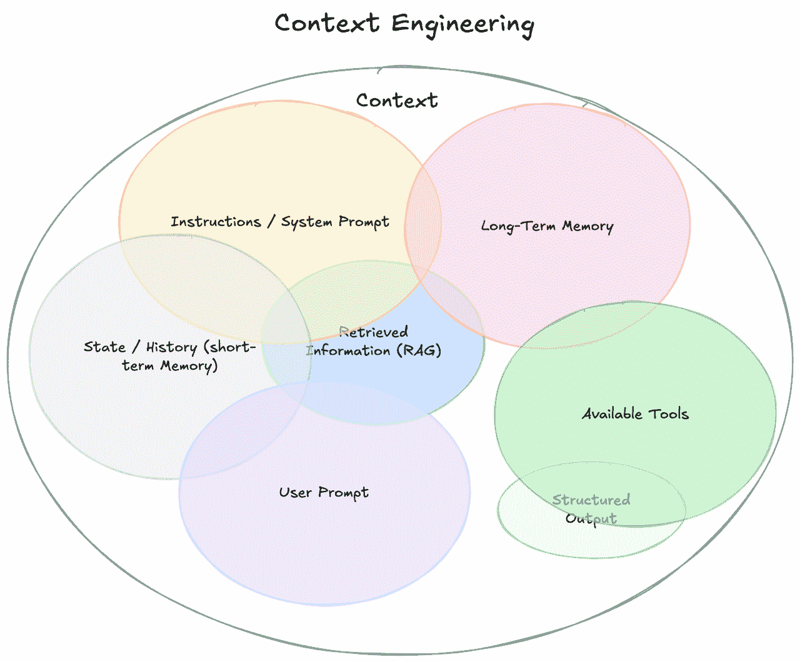

# The New Skill in AI is Not Prompting, It's Context Engineering

> 来源：[https://qqs7y1hozd1.feishu.cn/docx/CIXDdhrJjoObS0xXOzMcrWeZnje](https://qqs7y1hozd1.feishu.cn/docx/CIXDdhrJjoObS0xXOzMcrWeZnje)

# AI领域的新技能不是提示工程，而是上下文工程

上下文工程是一个在AI领域逐渐流行起来的新术语。讨论正从“提示工程”转向一个更广泛、更强大的概念：上下文工程。托比·卢特克将其描述为“为大语言模型（LLM）提供完成任务所需的所有上下文，使其能够合理地解决问题的艺术”，他说得没错。

随着智能体的兴起，我们加载到“有限工作记忆”中的信息变得更加重要。我们发现，决定智能体成败的主要因素是你提供给它的上下文质量。大多数智能体的失败不再是模型的失败，而是上下文的失败。

## 什么是上下文？

要理解上下文工程，我们首先必须扩展“上下文”的定义。它不只是你发送给大语言模型（LLM）的单个提示。可以将其视为模型在生成响应之前所看到的一切。

指令/系统提示：一组初始指令，用于定义模型在对话过程中的行为，可/应包含示例、规则等。

用户提示：用户提出的即时任务或问题。

状态/历史（短期记忆）：当前对话，包括导致此刻的用户和模型的回复。

长期记忆：持久的知识库，通过许多先前的对话收集而来，包含已了解的用户偏好、过往项目的总结，或被告知要记住以供未来使用的事实。

检索信息（RAG）：外部的、最新的知识，来自文档、数据库或 API 的相关信息，用于回答特定问题。

可用工具：它可以调用的所有函数或内置工具的定义（例如，检查库存、发送电子邮件）。

结构化输出：对模型响应格式的定义，例如JSON对象。

重要原因：从廉价演示到神奇产品

构建真正有效的AI智能体的秘诀，与你编写的代码复杂度关系不大，而完全取决于你提供的上下文质量。

构建智能体与其说是关于你编写的代码或使用的框架，不如说是关于你提供的上下文的质量。一个廉价的演示和一个“神奇”的智能体之间的区别就在于此。想象一下，一个AI助手被要求根据一封简单的电子邮件来安排会议：

嘿，只是确认一下你明天是否有空来快速同步一下。

“廉价演示”代理的上下文信息匮乏。它只看到用户的请求，其他一概不知。其代码可能功能完备——它调用大语言模型（LLM）并获取响应——但输出却毫无帮助且机械呆板：

感谢您的消息。明天对我来说没问题。我可以问一下您心里想的是什么时间吗？

“神奇”代理由丰富的上下文驱动。代码的主要任务不是确定如何回应，而是收集大语言模型（LLM）实现其目标所需的信息。在调用大语言模型之前，你会扩展上下文以包含

您的日程信息（显示您的日程已排满）。

您与此人过去的电子邮件（以确定合适的非正式语气）。

您的联系人列表（将他们识别为关键合作伙伴）。

用于发送邀请或发送电子邮件的工具。

然后你就可以生成回复了。

嘿，吉姆！我明天一整天都排满了，一个接一个的。周四上午有空，如果你方便的话？我发了个邀请，要是合适就告诉我。

魔法并不在于更智能的模型或更巧妙的算法。而在于为正确的任务提供正确的上下文。这就是为什么上下文工程至关重要。智能体的失败不只是模型的失败，更是上下文的失败。

## 从提示到上下文工程

什么是上下文工程？虽然“提示工程”专注于在单个文本字符串中精心设计一套完美的指令，但上下文工程的范畴要广泛得多。简单来说：

上下文工程是一门设计和构建动态系统的学科，该系统能够在正确的时间，以正确的格式提供正确的信息和工具，为大语言模型（LLM）提供完成任务所需的一切。

## 上下文工程是

一个系统，而非字符串：上下文不只是一个静态的提示模板。它是在主大语言模型（LLM）调用之前运行的系统的输出。

动态：即时创建，根据当前任务量身定制。对于一个请求，这可能是日历数据，对于另一个请求则可能是电子邮件或网络搜索结果。

关于在正确的时间提供正确的信息和工具：核心任务是确保模型不会遗漏关键细节（“输入垃圾，输出垃圾”）。这意味着仅在必要且有用时提供知识（信息）和能力（工具）。

格式很重要：信息呈现方式很重要。简洁的总结比原始数据堆砌要好。清晰的工具架构比模糊的说明要好。

## 结论

构建强大且可靠的AI智能体，越来越不在于找到神奇的提示词或模型更新，而在于上下文的工程设计，以及在正确的时间以正确的格式提供正确的信息和工具。这是一个跨职能的挑战，涉及理解你的业务用例、定义输出，并组织所有必要的信息，以便大语言模型（LLM）能够“完成任务”。

### 原文：

Context Engineering is new term gaining traction in the AI world. The conversation is shifting from "prompt engineering" to a broader, more powerful concept: Context Engineering. Tobi Lutke describes it as "the art of providing all the context for the task to be plausibly solvable by the LLM.” and he is right.

With the rise of Agents it becomes more important what information we load into the “limited working memory”. We are seeing that the main thing that determines whether an Agents succeeds or fails is the quality of the context you give it. Most agent failures are not model failures anyemore, they are context failures.

## What is the Context?

To understand context engineering, we must first expand our definition of "context." It isn't just the single prompt you send to an LLM. Think of it as everything the model sees before it generates a response.

Instructions / System Prompt: An initial set of instructions that define the behavior of the model during a conversation, can/should include examples, rules ….

User Prompt: Immediate task or question from the user.

State / History (short-term Memory): The current conversation, including user and model responses that have led to this moment.

Long-Term Memory: Persistent knowledge base, gathered across many prior conversations, containing learned user preferences, summaries of past projects, or facts it has been told to remember for future use.

Retrieved Information (RAG): External, up-to-date knowledge, relevant information from documents, databases, or APIs to answer specific questions.

Available Tools: Definitions of all the functions or built-in tools it can call (e.g., check_inventory, send_email).

Structured Output: Definitions on the format of the model's response, e.g. a JSON object.

Why It Matters: From Cheap Demo to Magical Product

The secret to building truly effective AI agents has less to do with the complexity of the code you write, and everything to do with the quality of the context you provide.

Building Agents is less about the code you write or framework you use. The difference between a cheap demo and a “magical” agent is about the quality of the context you provide. Imagine an AI assistant is asked to schedule a meeting based on a simple email:

Hey, just checking if you’re around for a quick sync tomorrow.

The "Cheap Demo" Agent has poor context. It sees only the user's request and nothing else. Its code might be perfectly functional—it calls an LLM and gets a response—but the output is unhelpful and robotic:

Thank you for your message. Tomorrow works for me. May I ask what time you had in mind?

The "Magical" Agent is powered by rich context. The code's primary job isn't to figure out how to respond, but to gather the information the LLM needs to full fill its goal. Before calling the LLM, you would extend the context to include

Your calendar information (which shows you're fully booked).

Your past emails with this person (to determine the appropriate informal tone).

Your contact list (to identify them as a key partner).

Tools for send_invite or send_email.

Then you can generate a response.

Hey Jim! Tomorrow’s packed on my end, back-to-back all day. Thursday AM free if that works for you? Sent an invite, lmk if it works.

The magic isn't in a smarter model or a more clever algorithm. It’s in about providing the right context for the right task. This is why context engineering will matter. Agent failures aren't only model failures; they are context failures.

## From Prompt to Context Engineering

What is context engineering? While "prompt engineering" focuses on crafting the perfect set of instructions in a single text string, context engineering is a far broader. Let's put it simply:

Context Engineering is the discipline of designing and building dynamic systems that provides the right information and tools, in the right format, at the right time, to give a LLM everything it needs to accomplish a task.

## Context Engineering is

A System, Not a String: Context isn't just a static prompt template. It’s the output of a system that runs before the main LLM call.

Dynamic: Created on the fly, tailored to the immediate task. For one request this could be the calendar data for another the emails or a web search.

About the right information, tools at the right time: The core job is to ensure the model isn’t missing crucial details ("Garbage In, Garbage Out"). This means providing both knowledge (information) and capabilities (tools) only when required and helpful.

where the format matters: How you present information matters. A concise summary is better than a raw data dump. A clear tool schema is better than a vague instruction.

## Conclusion

Building powerful and reliable AI Agents is becoming less about finding a magic prompt or model updates. It is about the engineering of context and providing the right information and tools, in the right format, at the right time. It’s a cross-functional challenge that involves understanding your business use case, defining your outputs, and structuring all the necessary information so that an LLM can “accomplish the task."