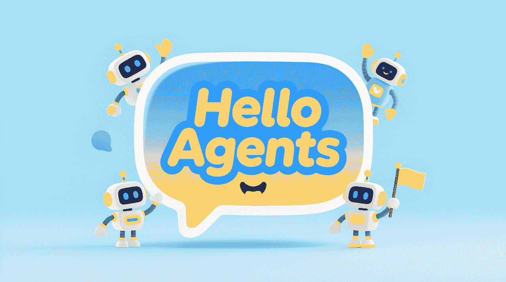

# 基于低代码平台的智能体搭建

> 来源：[https://qqs7y1hozd1.feishu.cn/docx/C345d5OW0oDoxUxeS5OcgZHgnwb](https://qqs7y1hozd1.feishu.cn/docx/C345d5OW0oDoxUxeS5OcgZHgnwb)

# 平台化构建的兴起

随着技术的成熟，我们看到越来越多的能力正在被“平台化”。正如网站的开发从手写 HTML/CSS/JS，演进到了可以使用 WordPress、Wix 等建站平台一样，智能体的构建也迎来了平台化的浪潮。本章将聚焦于如何利用图形化、模块化的低代码平台，来快速、直观地搭建、调试和部署智能体应用，将我们的重心从“实现细节”转向“业务逻辑”。

## 1.为何需要低代码平台

“重复造轮子”对于深入学习至关重要，但在追求工程效率和创新的实战中，我们往往需要站在巨人的肩膀上。尽管我们在封装了可复用的 ReActAgent、PlanAndSolveAgent 等类，但当业务逻辑变得复杂时，纯代码的维护成本和开发周期会急剧上升。低代码平台的出现，正是为了解决这些痛点。

其核心价值主要体现在以下几个方面：

1.  降低技术门槛：低代码平台将复杂的技术细节（如 API 调用、状态管理、并发控制）封装成一个个易于理解的“节点”或“模块”。用户无需精通编程，只需通过拖拽、连接这些节点，就能构建出功能强大的工作流。这使得产品经理、设计师、业务专家等非技术人员也能参与到智能体的设计与创造中来，极大地拓宽了创新的边界。

1.  提升开发效率：对于专业开发者而言，平台同样能带来巨大的效率提升。在项目初期，当需要快速验证一个想法或搭建一个原型 (Prototype) 时，使用低代码平台可以在数小时甚至数分钟内完成原本需要数天编码的工作。开发者可以将精力更多地投入到业务逻辑梳理和提示工程优化上，而非底层的工程实现。

1.  提供更优的可视化与可观测性：相比于在终端中打印日志，图形化的平台天然提供了对智能体运行轨迹的端到端可视化。你可以清晰地看到数据在每一个节点之间如何流动，哪一个环节耗时最长，哪一个工具调用失败。这种直观的调试体验，是纯代码开发难以比拟的。

1.  标准化与最佳实践沉淀：优秀的低代码平台通常会内置许多行业内的最佳实践。例如，它会提供预设的 ReAct 模板、优化的知识库检索引擎、标准化的工具接入规范等。这不仅避免了开发者“踩坑”，也使得团队协作更加顺畅，因为所有人都基于同一套标准和组件进行开发。

简而言之，低代码平台并非要取代代码，而是提供了一种更高层次的抽象。它让我们可以从繁琐的底层实现中解放出来，更专注于智能体“思考”与“行动”的逻辑本身，从而更快、更好地将创意变为现实。

## 2. 低代码平台的选择

### Coze

+   核心定位：由字节跳动推出的 Coze，主打零代码/低代码的 Agent 的构建体验，让不具备编程背景的用户也能轻松创造。

+   特点分析：Coze 拥有极其友好的可视化界面，用户可以像搭建乐高积木一样，通过拖拽插件、配置知识库和设定工作流来创建智能体。其内置了极为丰富的插件库，并支持一键发布到抖音、飞书、🛰️👸号等多个主流平台，极大地简化了分发流程。

+   适用人群：AI 应用的入门用户、产品经理、运营人员，以及希望快速将创意变为可交互产品的个人创作者。

### Dify

+   核心定位：Dify 是一个开源的、功能全面的 LLM 应用开发与运营平台，旨在为开发者提供从原型构建到生产部署的一站式解决方案。

+   特点分析：它融合了后端服务和模型运营的理念，支持 Agent 工作流、RAG Pipeline、数据标注与微调等多种能力。对于追求专业、稳定、可扩展的企业级应用而言，Dify 提供了坚实的基础。

+   适用人群：有一定技术背景的开发者、需要构建可扩展的企业级 AI 应用的团队。

### n8n

+   核心定位：n8n 本质上是一个开源工作流自动化工具，而非纯粹的 LLM 平台。近年来，它积极集成了 AI 能力。

+   特点分析：n8n 的强项在于“连接”。它拥有数百个预置的节点，可以轻松地将各类 SaaS 服务、数据库、API 连接成复杂的自动化业务流程。你可以在这个流程中嵌入 LLM 节点，使其成为整个自动化链路中的一环。虽然在 LLM 功能的专一度上不如前两者，但其通用自动化能力是独一无二的。不过，其学习曲线也相对陡峭。

+   适用人群：需要将 AI 能力深度整合进现有业务流程、实现高度定制化自动化的开发者和企业。

在接下来的小节中，我们将逐一上手体验这些平台，通过实际操作来更直观地感受它们各自的魅力。

在开发效率的背后，是调试与错误处理的相对繁琐。当工作流变得复杂时，一旦出现数据格式错误，开发者可能需要逐个节点检查其输入输出来定位问题，这有时不如在代码中设置断点来得直接。

功能方面，最大的局限性体现在其内置存储的非持久性。我们在案例中使用的 Simple Memory 和 Simple Vector Store 都是基于内存的，这意味着 n8n 服务一旦重启，所有对话历史和知识库都将丢失。这对于生产环境的应用是致命的。因此，在实际部署时，必须将其替换为如 Redis、Pinecone 等外部持久化数据库，这也会增加了额外的配置和维护成本。

此外，在部署运维和团队协作上，n8n 的版本控制和多人协作不如传统代码成熟。虽然可以将工作流导出为 JSON 文件进行管理，但对比其变更远不如 git diff 代码来得清晰，多人同时编辑同一个工作流也容易产生冲突。

最后是关于性能，n8n 完全能满足绝大多数企业自动化和中低频次的 Agent 任务。但对于需要处理超高并发请求的场景，其节点调度机制可能会带来一定的性能开销，相比于纯代码实现的服务可能稍逊一筹。

# 小结

本章系统介绍了基于低代码平台构建智能体应用的理念、方法与实践，标志着我们从"手写代码"向"平台化开发"的重要转变。

在第一节中，我们阐述了低代码平台兴起的背景与价值。相比于第四章中纯代码实现的智能体，低代码平台通过图形化、模块化的方式，显著降低了技术门槛、提升了开发效率，并提供了更优的可视化调试体验。这种"更高层次的抽象"让开发者能够将精力聚焦于业务逻辑和提示工程，而非底层实现细节。

随后，我们深入实践了三个各具特色的代表性平台:

Coze 以其零代码的友好体验和丰富的插件生态脱颖而出。通过"每日AI简报"案例，我们体验了如何通过拖拽式配置快速整合多源信息，并一键发布到多个主流平台。Coze 特别适合非技术背景用户和需要快速验证创意的场景，但其不支持 MCP 和无法导出标准化配置文件的局限性也值得注意。

Dify 作为开源的企业级平台，展现了全栈式开发能力。"超级智能体个人助手"案例涵盖了日常问答、文案优化、多模态生成、数据分析和 MCP 工具集成等多个模块，充分展示了 Dify 在复杂业务场景下的强大编排能力。其丰富的插件市场(8000+)、灵活的部署方式和企业级安全特性，使其成为专业开发者和企业团队的理想选择。然而，相对陡峭的学习曲线和在高并发场景下的性能挑战也需要权衡。

n8n 则以其独特的"连接"能力开辟了另一条路径。通过"智能邮件助手"案例，我们看到了如何将 AI 能力无缝嵌入到复杂的业务自动化流程中。n8n 的 AI Agent 节点将模型、记忆和工具高度整合，配合其数百个预置节点，能够实现高度定制化的自动化方案。其支持私有化部署的特性对注重数据安全的企业尤为重要。但内置存储的非持久性和版本控制的不成熟，在生产环境中需要额外的工程化处理。

通过三个平台的对比实践，我们可以得出以下选型建议:

+   快速原型验证、非技术用户: 优先选择 Coze

+   企业级应用、复杂业务逻辑: 优先选择 Dify

+   深度业务集成、自动化流程: 优先选择 n8n

值得强调的是，低代码平台并非要取代代码开发，而是提供了一种互补的选择。在实际项目中，我们完全可以根据不同阶段的需求灵活切换:用低代码平台快速验证想法，用代码实现精细化控制;用平台处理标准化流程，用代码处理特殊逻辑。这种"混合开发"的思维，才是智能体工程化的最佳实践。

——文章来源 https://github.com/datawhalechina/hello-agents/tree/main