# 在`n8n`上搭建智能体

> 来源：[https://qqs7y1hozd1.feishu.cn/docx/W8FJd8837oslkcxDYwrc84dhnFc](https://qqs7y1hozd1.feishu.cn/docx/W8FJd8837oslkcxDYwrc84dhnFc)

正如我们之前所介绍的，`n8n` 的核心身份是一个通用的工作流自动化平台，而非一个纯粹的 LLM 应用构建工具。理解这一点，是掌握 `n8n` 的关键。在使用 `n8n` 构建智能应用时，我们实际上是在设计一个更宏大的自动化流程，而大语言模型只是这个流程中的一个（或多个）强大的“处理节点”。

# `n8n` 的节点与工作流

`n8n` 的世界由两个最基本的概念构成：节点 (`Node`) 和 工作流 (`Workflow`)。

+   节点 (`Node`)：节点是工作流中执行具体操作的最小单元。你可以把它想象成一个具有特定功能的“积木块”。`n8n` 提供了数百种预置节点，涵盖了从发送邮件、读写数据库、调用 API 到处理文件等各种常见操作。每个节点都有输入和输出，并提供图形化的配置界面。节点大致可以分为两类：

+   触发节点 (`Trigger Node`)：它是整个工作流的起点，负责启动流程。例如，“当收到一封新的 `Gmail` 邮件时”、“每小时定时触发一次”或“当接收到一个 `Webhook` 请求时”。一个工作流必须有且仅有一个触发节点。

+   常规节点 (`Regular Node`)：负责处理具体的数据和逻辑。例如，“读取 `Google Sheets` 表格”、“调用 `OpenAI` 模型”或“在数据库中插入一条记录”。

+   工作流 (`Workflow`)：工作流是由多个节点连接而成的自动化流程图。它定义了数据从触发节点开始，如何一步步地在不同节点之间传递、被处理，并最终完成预设任务的完整路径。数据在节点之间以结构化的 `JSON` 格式进行传递，这使得我们可以精确地控制每一个环节的输入和输出。

`n8n` 的真正威力在于其强大的“连接”能力。它可以将原本孤立的应用程序和服务（如企业内部的 `CRM`、外部的社交媒体平台、你的数据库以及大语言模型）串联起来，实现过去需要复杂编码才能完成的端到端业务流程自动化。在接下来的实战中，我们将亲手体验如何利用这套节点和工作流系统，构建一个集成了 AI 能力的自动化应用。

# 搭建智能邮件助手

关于 `n8n` 的环境配置和最基础的使用，在项目的 `Additional-Chapter` 文件夹下制作了文档，这里就不过多介绍。在上一节中，我们了解了 `n8n` 的基本概念。这个案例将清晰地展示现代 AI `Agent` 与传统自动化工作流的核心区别。传统流程是线性的，而我们即将构建的 `Agent` 将能够接收用户邮件，通过一个核心的 `AI Agent` 节点 进行“思考”，自主理解用户意图，并在多个可用“工具”中进行决策和选择，最终自动生成并发送高度相关的回复。

整个过程模拟了一个更高级的决策逻辑：接收 -> `AI Agent` (思考 -> 决策 -> 工具调用) -> 回复，如图所示。

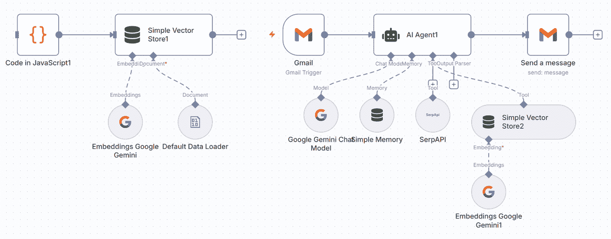

图 一体化智能邮件 `Agent` 架构示意图

与将工具拆分为多个子工作流的传统方法不同，`n8n` 的 `AI Agent` 节点允许我们将组件，例如大语言模型（`LLM`）、记忆（`Memory`）、工具（`Tools`）都整合在一个统一的界面中，极大地简化了构建过程。

整个搭建过程分为两个核心步骤：

1.  准备 `Agent` 的“记忆”：创建一个独立的流程，为 `Agent` 加载私有知识库。

1.  构建 `Agent` 主体：创建接收邮件、思考并回复的主工作流。

## 构建 `Agent` 的私有知识库

为了让 `Agent` 能够回答关于特定领域（比如您的个人信息或项目文档）的问题，我们需要先为它准备一个“外部大脑”，一个向量知识库。

在 `n8n` 中，我们可以使用 `Simple Vector Store` 节点在内存中快速构建一个知识库。这个准备流程通常只需要在更新知识时运行一次。

### (1) 定义知识源

首先，我们使用 `Code` 节点来存放我们的原始知识文本。这是一个简单快捷的方式，实际项目中数据也可以来自文件、数据库等。

+   节点：`Code`

+   内容：将您的知识以 `JSON` 格式写入。

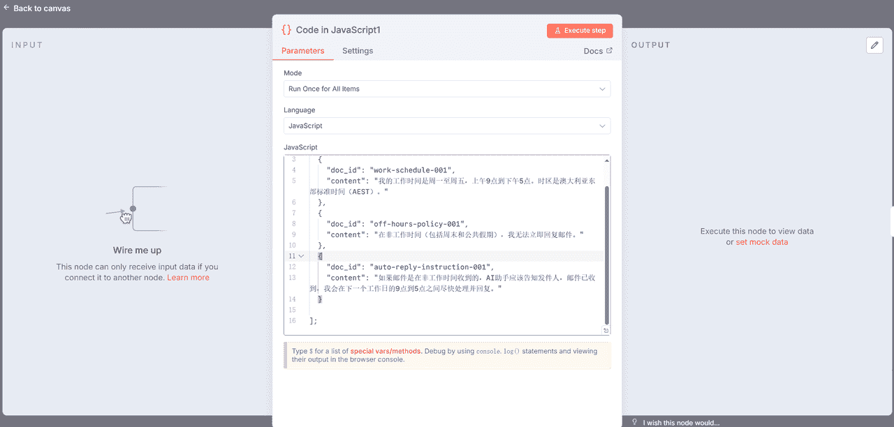

图 在 `Code` 节点中定义知识源

```
return [
  {
    "doc_id": "work-schedule-001",
    "content": "我的工作时间是周一至周五，上午9点到下午5点。时区是澳大利亚东部标准时间（AEST）。"
  },
  {
    "doc_id": "off-hours-policy-001",
    "content": "在非工作时间（包括周末和公共假期），我无法立即回复邮件。"
  },
  {
    "doc_id": "auto-reply-instruction-001",
    "content": "如果邮件是在非工作时间收到的，AI助手应该告知发件人，邮件已收到，我会在下一个工作日的9点到5点之间尽快处理并回复。"
  }
];
```

### (2) 文本向量化 (`Embeddings`)

计算机无法直接理解文本，需要将其转换为向量。我们使用 `Embeddings` 节点来完成这个“翻译”工作。

+   节点：`Embeddings Google Gemini`，选择模型为 `mini-embedding-exp-03-07`。这里使用 Google API 来演示，如果不知道如何获取 Google API 可以参考官方文档。

+   配置：将其连接到 `Code` 节点之后，它会自动将上游传入的文本转换为向量数据。

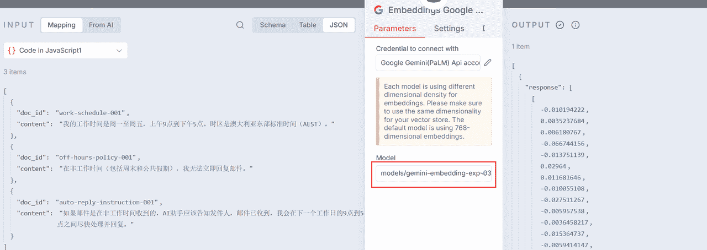

图 对 `Code` 中数据进行向量化

### (3) 存入向量存储

最后，我们将向量化的知识存入内存数据库中，如图所示。

+   节点：`Simple Vector Store`

+   配置:

+   `Operation Mode`: `Insert Documents` (写入模式)。

+   `Memory Key`: 为这个知识库起一个唯一的名字，例如 `my-dailytime`。这个 Key 相当于数据库的“表名”，后续 `Agent` 将通过它来查找信息。

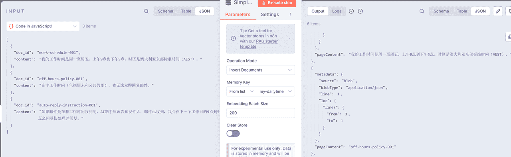

图 对 `Code` 中数据存入向量存储

完成配置后，手动执行一次这个流程。成功后，您的私有知识就加载到 `n8n` 的内存中了，如图所示。

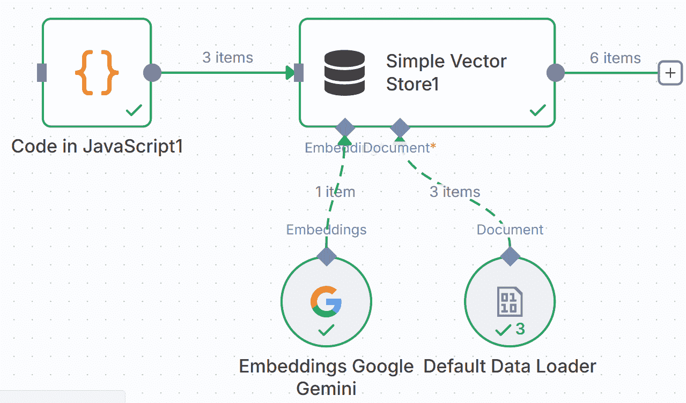

图 完整的知识库加载工作流

## 创建 `Agent` 主工作流

有了工具，我们现在开始构建 `Agent` 的主要流程。它将负责接收邮件、进行思考和决策，并在合适的时机调用我们刚刚创建的工具，最终执行邮件的回复。

### （1）配置 `Gmail` 触发器

新建一个工作流，命名为 `Agent: Customer Support`。使用 `Gmail` 节点作为触发器，将其 `Event` 设置为 `Message Received`，并配置好你的邮箱账号。这样，每当有新邮件进入收件箱时，该工作流就会被自动触发，如图所示。

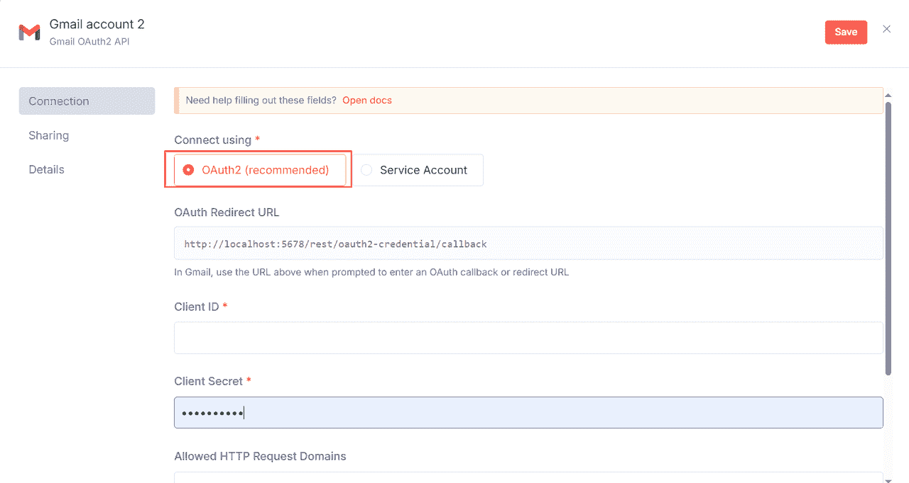

图 新建 `Gmail` 节点图

配置过程可参考 [`n8n` 官方文档](https://docs.n8n.io/integrations/builtin/credentials/google/oauth-single-service/?utm_source=n8n_app&utm_medium=credential_settings&utm_campaign=create_new_credentials_modal#enable-apis)。`Gmail` 的 API 在这里 [配置](https://console.cloud.google.com/apis/library/gmail.googleapis.com?project=apt-entropy-471905-b9)，需 [要创建凭证](https://console.cloud.google.com/auth/audience?project=apt-entropy-471905-b9)，选择 `Web` 应用类型，最后即得到所需的客户端 ID 和客户端密钥。并且需要在已获授权的重定向 URI 将 `n8n` 刚给的 `OAuth Redirect URL` 给添加上。同时，还需要在目标对象的 `Add users` 加上自己的邮箱地址。最终配置完成的页面如图所示。

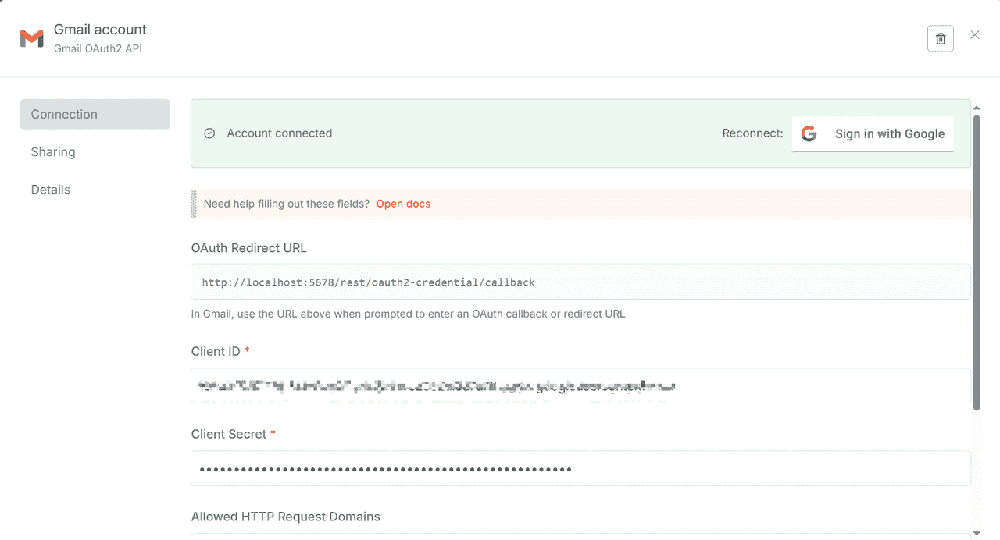

图 `Gmail` 账号加载成功图

现在我们可以点击 `Fetch Test Event` 获取邮件了，如图所示！

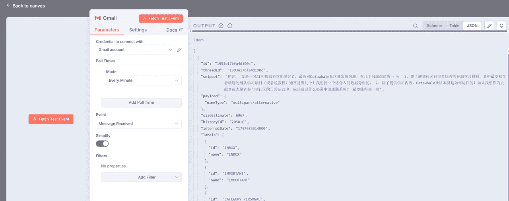

图 获取实时邮件图

### （2）配置 `AI Agent` 节点

这是整个工作流的大脑。从节点菜单中拖出一个 `AI Agent` 节点，并进行如下配置：

+   `Chat Model`: 连接您选择的大语言模型，例如 `Google Gemini Chat Model`。这是 `Agent` 的“思考核心”。

+   `Memory`: 连接一个 `Simple Memory` 节点。这能让 `Agent` 在处理同一邮件线索下的多封往来邮件时，记住之前的对话历史。

+   `Tools`: 我们可以将多个工具连接到这里。在我们的案例中，我们连接两个工具：

1.  `SerpAPI`: 这是我们之前第四章案例中使用过的 API，让 `Agent` 拥有上网搜索公开信息的能力。

1.  `Simple Vector Store`: 让 `Agent` 拥有查询我们第一部分中创建的私有知识库的能力。

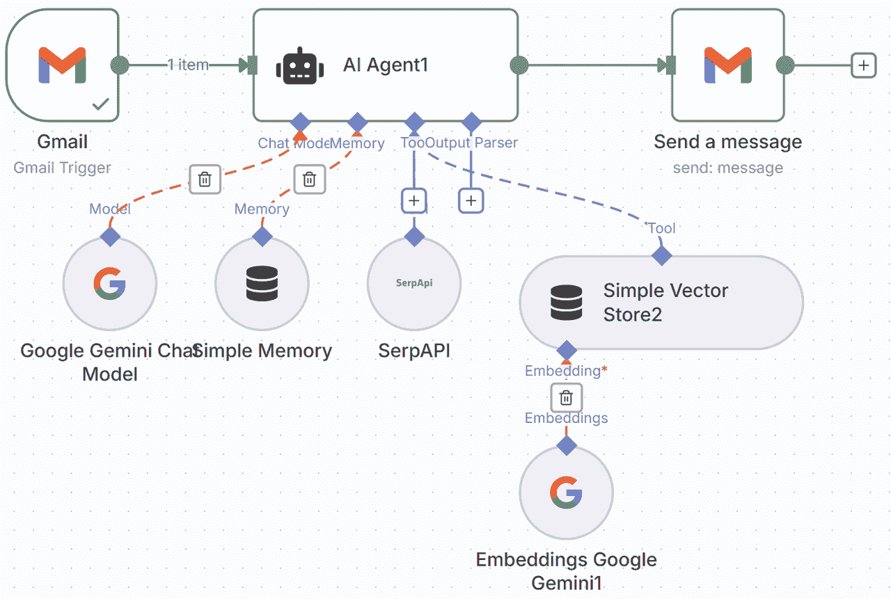

图 `AI Agent` 节点设置图

这是 `Agent` “思考”的第一步。添加一个 `Gemini` 节点（或其他 `LLM` 节点），模式设置为 `Chat`。我们的目标是让它分析邮件内容，判断用户意图。`Prompt` 的设计至关重要，一个清晰的指令能让 `LLM` 更准确地完成任务。我们将邮件正文和主题（`{{ $json.snippet }}{{ $json.Subject }}`）作为变量传入 `Prompt` 中，没有 API 可以到 Google AI Studio 点击 `Get API key` 创建一个可用的。

其中，对于 `AI Agent` 节点，我们需要填的主要是 `User Message` 和 `System Message` 部分，如图所示。

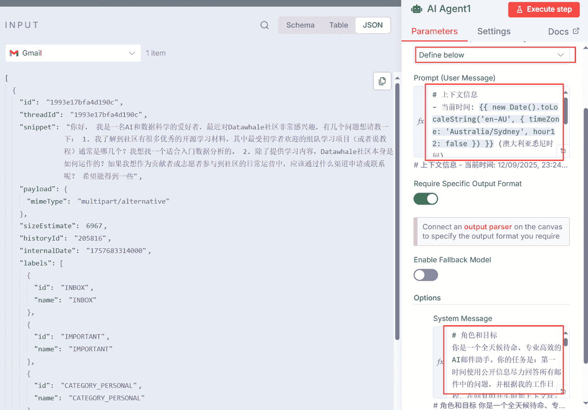

图 `AI Agent` 节点详解图

在这里给出我们案例所使用的 `Prompt`：

```
# Prompt (User Message)
# 上下文信息
- 当前时间: {{ new Date().toLocaleString('en-AU', { timeZone: 'Australia/Sydney', hour12: false }) }} (澳大利亚悉尼时间)
- 发件人: {{ $json.From }}
- 主题: {{ $json.Subject }}
- 邮件正文: {{ $json.snippet }}

# System Message
# 角色和目标
你是一个全天候待命、专业高效的 AI 邮件助手。你的任务是：第一时间使用公开信息尽力回答所有邮件中的问题，并根据我的工作日程，在回复的开头附加上下文状态提醒。

# 上下文信息
- 当前时间: {{ new Date().toLocaleString('en-AU', { timeZone: 'Australia/Sydney', hour12: false }) }} (澳大利亚悉尼时间)
- 邮件信息在输入数据中。

# 可用工具
- `Simple Vector Store2`: 用来查询我准确的工作时间（例如：周一至周五，上午9点到下午5点）。
- `SerpAPI`: [主要信息来源] 优先使用此工具在互联网上搜索，以回答邮件中的具体问题。

# 执行步骤
1. **分析问题**: 首先，仔细阅读邮件内容，提炼出发件人的核心问题。

2. **并行信息搜集**: 同时执行以下两个操作来收集信息：
   a. 使用 `SerpAPI` 工具，上网搜索出发件人问题的答案。
   b. 使用 `Simple Vector Store2` 工具，获取我设定的准确工作时间。

3. **草拟核心回复**: 根据 `SerpAPI` 搜集到的信息，清晰、直接地回答发件人的问题，这部分将作为邮件回复的主体。

4. **添加状态前缀并整合**:
   a. 对比“当前时间”和我从工具中获取的工作时间。
   b. 如果当前是“非工作时间": 创建一段状态提醒前缀。这段前缀必须包含从 `Simple Vector Store2` 获取到的具体工作时间。
      * 前缀示例: "您好，感谢您的来信。您已在我的非工作时间联系我（我的工作时间为：[此处插入查询到的工作时间]）。我会在下一个工作日亲自审阅此邮件。与此同时，这是根据公开信息为您找到的初步答复：<br><br>---<br><br>"
   c. 如果当前是“工作时间": 只需使用简单的问候语即可。
      * 前缀示例: "您好，关于您提出的问题，答复如下：<br><br>---<br><br>"
   d. 将生成的前缀和你草拟的核心回复（第 3 步的结果）拼接在一起，形成最终的邮件正文。

5. **格式化输出**: 你必须将最终生成的邮件内容以一个严格的 `JSON` 格式输出。格式如下，不要添加任何额外的解释或文字：
   {
     "shouldReply": true,
     "subject": "Re: [原始邮件主题]",
     "body": "[这里是拼接好的、完整的邮件回复正文，所有换行必须使用 HTML 的 <br> 标签]"
   }

# 规则和限制
- 永远优先尝试回答: 无论何时，你的首要任务是使用 `SerpAPI` 为用户提供有价值的回复。
- 必须声明状态: 如果在非工作时间回复，必须在邮件开头明确声明，并附上我准确的工作时间。
- 信息来源要准确: 工作时间必须严格以 `Simple Vector Store2` 的结果为准；问题答案主要来源于 `SerpAPI`，不要编造信息。
- 输出格式: 在最终输出的 `JSON` 中，`body` 字段内的所有换行都必须使用 `<br>` 标签，而不是 `\n`。
```

### (3) 配置 `Agent` 的工具

对于 `Simple Vector Store` 工具，我们需要进行关键配置，以确保它能正确“读取”我们之前存入的知识：

+   `Operation Mode`: `Retrieve Documents (As Tool for AI Agent)` (作为工具的读取模式)。

+   `Memory Key`: 必须填写与第一部分完全相同的 Key，即 `my_private_knowledge`。

+   `Embeddings`: 必须使用与第一部分完全相同的 `Embeddings Google Gemini` 模型。

只有 `Memory Key` 和 `Embeddings` 模型完全一致，`Agent` 才能用正确的“钥匙”和“语言”来访问知识库，如图 5.48 所示。

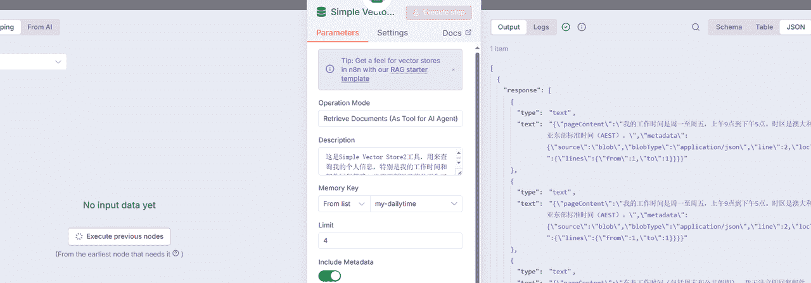

图 `Simple Vector Store` 工具配置

`Description` 参数即 `AI Agent` 调用该工具时，对该工具的描述定义，在这里也给出对应的 `Prompt`：

这是 `Simple Vector Store2` 工具，用来查询我的个人信息，特别是我的工作时间和邮件回复策略。当需要判断当前是否为工作时间，或者需要告知对方我何时会回复邮件时，必须使用此工具。

对于 `Memory` 唯一需要注意的是，这里我们使用每个邮箱的线程名作为唯一标识，能保证存储的唯一性，设置的 Key 为 `{{ $('Gmail').item.json.threadId }}`

### (4) 发送最终回复

最后一步是执行。将 `AI Agent` 节点的输出连接到一个 `Gmail` 节点，`Operation` 设为 `Send`。使用 `n8n` 表达式，将收件人、主题和正文分别关联到 `AI Agent` 输出的 `JSON` 数据中的相应字段，即可实现邮件的自动回复，如图所示。

+   `To`: `{{ $('Gmail').item.json.From }}` (或其他触发器中的发件人字段)

+   `Subject`: `Re:  {{ $('Gmail').item.json.Subject }}`

+   `Message`: `{{ $json.output }}`

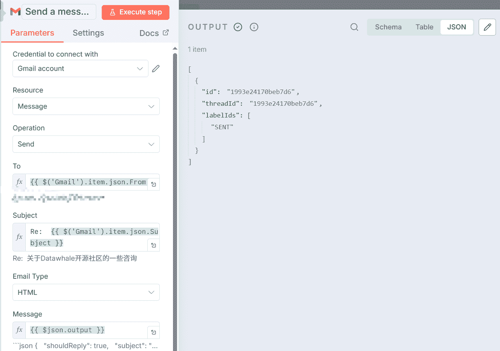

图 最终回复工具图示

并且发送成功的同时，也能在个人邮箱收到真实的返回邮件信息，如图所示。

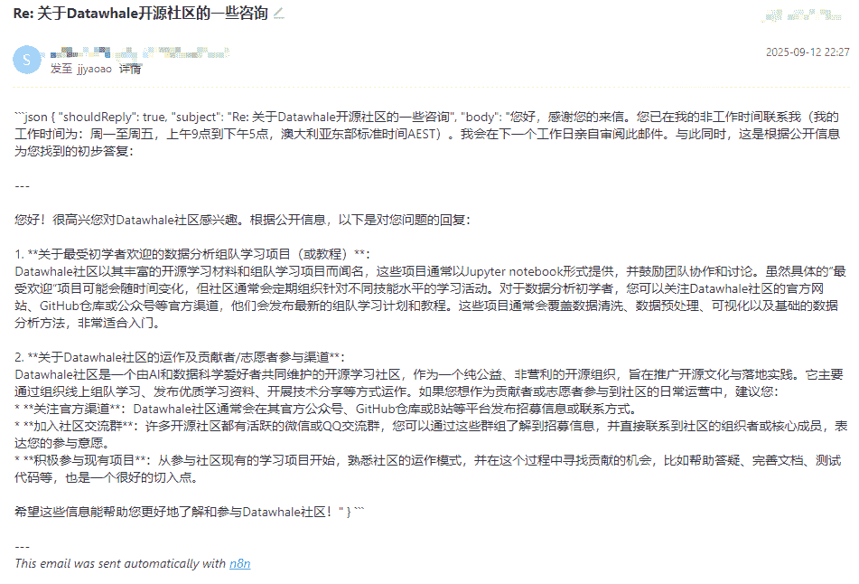

图 个人邮箱返回邮件格式


至此，一个基于 AI Agent 节点的一体化智能客服就构建完成了，你可以发送一封测试邮件来检验它的工作成果。这个架构的扩展性极强。未来，您可以直接向 AI Agent 节点添加更多的工具（如日历、数据库、CRM 等），只需在 Prompt 中教会 Agent 如何使用它们，就能不断赋予您的 Agent 更强大的能力。

# n8n 的优势与局限性分析

通过前面从零到一构建智能邮件助手的实践，我们已经对 n8n 的工作模式有了直观的感受。作为一个强大的低代码自动化平台，n8n 在赋能 Agent 应用开发方面表现出色，但它也并非万能。如表5.1所示，我们将客观地分析其优势与潜在的局限性。

表 5.1 n8n 平台的优势与局限性总结

首先，n8n 最显著的优势在于其开发效率。它将复杂的逻辑抽象为直观的可视化工作流，无论是邮件的接收、AI 的决策，还是工具的调用和最终的回复，整个数据流和处理链路都在画布上一目了然。这种低代码的特性极大地降低了技术门槛，让开发者能够快速搭建和验证 Agent 的核心逻辑，极大地缩短了从想法到原型的距离。

其次，平台的功能强大且高度集成。n8n 拥有丰富的内置节点库，可以轻松连接像 Gmail、Google Gemini 等数百种常见服务。更重要的是，其先进的 AI Agent 节点将模型、记忆和工具管理高度整合，让我们能用一个节点就实现复杂的自主决策，这比传统的多节点手动路由方式要优雅和强大得多。同时，对于内置功能无法覆盖的场景，Code 节点也提供了编写自定义代码的灵活性，保证了功能的上限。

最后，在部署运维层面，n8n 支持私有化部署，并且也是目前相对比较简单且能部署完整版项目的私有化Agent方案，这一点对于注重数据安全和隐私的企业至关重要。我们可以将整个服务部署在自己的服务器上，确保类似内部邮件、客户数据等敏感信息不离开自有环境，这为 Agent 应用的合规性提供了坚实的基础。

当然，每个工具都有其取舍。在享受 n8n 带来便利的同时，我们也必须认识到其局限性。
