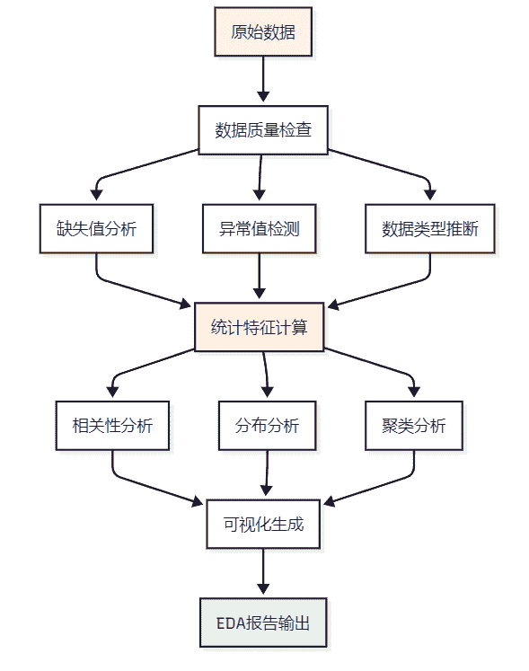
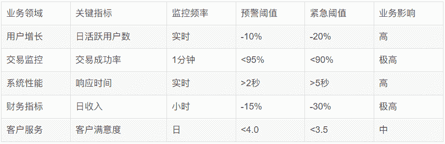
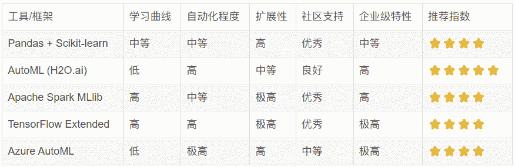

# 基于Agent的数据分析实战项目

> 来源：[https://qqs7y1hozd1.feishu.cn/docx/B2LUdsig8oRxOCxLGPbctEsdnUg](https://qqs7y1hozd1.feishu.cn/docx/B2LUdsig8oRxOCxLGPbctEsdnUg)

## 一、数据分析智能体核心架构

### 1.1 整体架构设计

数据分析智能体的核心架构采用模块化设计，包含数据接入、智能分析、模型管理和输出呈现四个主要层次。


### 1.2 核心模块实现

```
import pandas as pd
import numpy as np
from typing import Dict, List, Any, Optional
from dataclasses import dataclass
import logging
 
@dataclass
class AnalysisTask:
    &quot;&quot;&quot;数据分析任务定义&quot;&quot;&quot;
    task_id: str
    task_type: str  # &#x27;exploration&#x27;, &#x27;modeling&#x27;, &#x27;prediction&#x27;, &#x27;monitoring&#x27;
    data_source: str
    requirements: Dict[str, Any]
    priority: int = 1
 
class DataAnalysisAgent:
    &quot;&quot;&quot;数据分析智能体核心类&quot;&quot;&quot;
    
    def __init__(self, config: Dict[str, Any]):
        self.config = config
        self.logger = logging.getLogger(__name__)
        self.data_processor = DataProcessor()
        self.model_manager = ModelManager()
        self.visualization_engine = VisualizationEngine()
        self.report_generator = ReportGenerator()
        
    async def process_task(self, task: AnalysisTask) -&gt; Dict[str, Any]:
        &quot;&quot;&quot;处理数据分析任务的主要入口&quot;&quot;&quot;
        try:
            # 1. 数据加载和预处理
            data = await self._load_and_preprocess_data(task.data_source)
            
            # 2. 根据任务类型执行相应分析
            if task.task_type == &#x27;exploration&#x27;:
                results = await self._perform_eda(data, task.requirements)
            elif task.task_type == &#x27;modeling&#x27;:
                results = await self._build_model(data, task.requirements)
            elif task.task_type == &#x27;prediction&#x27;:
                results = await self._make_predictions(data, task.requirements)
            elif task.task_type == &#x27;monitoring&#x27;:
                results = await self._monitor_metrics(data, task.requirements)
            else:
                raise ValueError(f&quot;不支持的任务类型: {task.task_type}&quot;)
            
            # 3. 生成报告和洞察
            report = await self._generate_report(results, task)
            
            return {
                &#x27;task_id&#x27;: task.task_id,
                &#x27;status&#x27;: &#x27;completed&#x27;,
                &#x27;results&#x27;: results,
                &#x27;report&#x27;: report,
                &#x27;insights&#x27;: await self._extract_insights(results)
            }
            
        except Exception as e:
            self.logger.error(f&quot;任务处理失败: {str(e)}&quot;)
            return {
                &#x27;task_id&#x27;: task.task_id,
                &#x27;status&#x27;: &#x27;failed&#x27;,
                &#x27;error&#x27;: str(e)
            }
```

## 二、数据探索与可视化自动化

### 2.1 自动化数据探索流程

数据探索是数据分析的第一步，智能体需要能够自动识别数据特征、发现异常值和分布模式。



```
import pandas as pd
import numpy as np
import matplotlib.pyplot as plt
import seaborn as sns
from scipy import stats
from sklearn.preprocessing import StandardScaler
from sklearn.cluster import KMeans
import warnings
warnings.filterwarnings(&#x27;ignore&#x27;)
 
class AutomatedEDA:
    &quot;&quot;&quot;自动化探索性数据分析模块&quot;&quot;&quot;
    
    def __init__(self):
        self.report_data = {}
        
    def analyze_dataset(self, df: pd.DataFrame) -&gt; Dict[str, Any]:
        &quot;&quot;&quot;执行完整的自动化数据探索&quot;&quot;&quot;
        
        # 基础信息分析
        basic_info = self._get_basic_info(df)
        
        # 数据质量分析
        quality_analysis = self._analyze_data_quality(df)
        
        # 统计特征分析
        statistical_analysis = self._perform_statistical_analysis(df)
        
        # 相关性分析
        correlation_analysis = self._analyze_correlations(df)
        
        # 异常值检测
        outlier_analysis = self._detect_outliers(df)
        
        # 生成可视化
        visualizations = self._generate_visualizations(df)
        
        return {
            &#x27;basic_info&#x27;: basic_info,
            &#x27;quality_analysis&#x27;: quality_analysis,
            &#x27;statistical_analysis&#x27;: statistical_analysis,
            &#x27;correlation_analysis&#x27;: correlation_analysis,
            &#x27;outlier_analysis&#x27;: outlier_analysis,
            &#x27;visualizations&#x27;: visualizations
        }
    
    def _analyze_data_quality(self, df: pd.DataFrame) -&gt; Dict[str, Any]:
        &quot;&quot;&quot;数据质量分析&quot;&quot;&quot;
        quality_metrics = {}
        
        # 缺失值分析
        missing_analysis = {}
        for col in df.columns:
            missing_count = df[col].isnull().sum()
            missing_percentage = (missing_count / len(df)) * 100
            missing_analysis[col] = {
                &#x27;missing_count&#x27;: missing_count,
                &#x27;missing_percentage&#x27;: round(missing_percentage, 2)
            }
        
        # 重复值分析
        duplicate_count = df.duplicated().sum()
        duplicate_percentage = (duplicate_count / len(df)) * 100
        
        # 数据类型一致性检查
        type_consistency = self._check_type_consistency(df)
        
        quality_metrics = {
            &#x27;missing_analysis&#x27;: missing_analysis,
            &#x27;duplicate_count&#x27;: duplicate_count,
            &#x27;duplicate_percentage&#x27;: round(duplicate_percentage, 2),
            &#x27;type_consistency&#x27;: type_consistency
        }
        
        return quality_metrics
    
    def _detect_outliers(self, df: pd.DataFrame) -&gt; Dict[str, Any]:
        &quot;&quot;&quot;异常值检测&quot;&quot;&quot;
        outlier_results = {}
        numeric_columns = df.select_dtypes(include=[np.number]).columns
        
        for col in numeric_columns:
            # IQR方法检测异常值
            Q1 = df[col].quantile(0.25)
            Q3 = df[col].quantile(0.75)
            IQR = Q3 - Q1
            lower_bound = Q1 - 1.5 * IQR
            upper_bound = Q3 + 1.5 * IQR
            
            outliers = df[(df[col] &lt; lower_bound) | (df[col] &gt; upper_bound)]
            
            # Z-score方法
            z_scores = np.abs(stats.zscore(df[col].dropna()))
            z_outliers = len(z_scores[z_scores &gt; 3])
            
            outlier_results[col] = {
                &#x27;iqr_outliers&#x27;: len(outliers),
                &#x27;z_score_outliers&#x27;: z_outliers,
                &#x27;outlier_percentage&#x27;: round((len(outliers) / len(df)) * 100, 2)
            }
        
        return outlier_results
```

### 2.2 智能可视化生成

智能体需要根据数据特征自动选择最合适的可视化方法。

```
import matplotlib.pyplot as plt
import seaborn as sns
import plotly.express as px
import plotly.graph_objects as go
from plotly.subplots import make_subplots
 
class IntelligentVisualization:
    &quot;&quot;&quot;智能可视化生成器&quot;&quot;&quot;
    
    def __init__(self):
        plt.style.use(&#x27;seaborn-v0_8&#x27;)
        sns.set_palette(&quot;husl&quot;)
        
    def auto_visualize(self, df: pd.DataFrame, target_column: str = None) -&gt; Dict[str, str]:
        &quot;&quot;&quot;根据数据特征自动生成可视化&quot;&quot;&quot;
        visualizations = {}
        
        # 数值变量分布图
        numeric_cols = df.select_dtypes(include=[np.number]).columns
        if len(numeric_cols) &gt; 0:
            visualizations[&#x27;distributions&#x27;] = self._create_distribution_plots(df, numeric_cols)
        
        # 分类变量分析
        categorical_cols = df.select_dtypes(include=[&#x27;object&#x27;, &#x27;category&#x27;]).columns
        if len(categorical_cols) &gt; 0:
            visualizations[&#x27;categorical&#x27;] = self._create_categorical_plots(df, categorical_cols)
        
        # 相关性热力图
        if len(numeric_cols) &gt; 1:
            visualizations[&#x27;correlation&#x27;] = self._create_correlation_heatmap(df, numeric_cols)
        
        # 目标变量分析（如果指定）
        if target_column and target_column in df.columns:
            visualizations[&#x27;target_analysis&#x27;] = self._analyze_target_variable(df, target_column)
        
        return visualizations
    
    def _create_distribution_plots(self, df: pd.DataFrame, numeric_cols: List[str]) -&gt; str:
        &quot;&quot;&quot;创建数值变量分布图&quot;&quot;&quot;
        n_cols = min(3, len(numeric_cols))
        n_rows = (len(numeric_cols) + n_cols - 1) // n_cols
        
        fig, axes = plt.subplots(n_rows, n_cols, figsize=(15, 5*n_rows))
        if n_rows == 1:
            axes = [axes] if n_cols == 1 else axes
        else:
            axes = axes.flatten()
        
        for i, col in enumerate(numeric_cols[:len(axes)]):
            # 直方图和核密度估计
            axes[i].hist(df[col].dropna(), bins=30, alpha=0.7, density=True, color=&#x27;skyblue&#x27;)
            df[col].dropna().plot.density(ax=axes[i], color=&#x27;red&#x27;, linewidth=2)
            axes[i].set_title(f&#x27;{col} 分布&#x27;, fontsize=12, fontweight=&#x27;bold&#x27;)
            axes[i].set_ylabel(&#x27;密度&#x27;)
            axes[i].grid(True, alpha=0.3)
        
        # 隐藏多余的子图
        for i in range(len(numeric_cols), len(axes)):
            axes[i].set_visible(False)
        
        plt.tight_layout()
        plot_path = &#x27;distributions.png&#x27;
        plt.savefig(plot_path, dpi=300, bbox_inches=&#x27;tight&#x27;)
        plt.close()
        
        return plot_path
    
    def _create_correlation_heatmap(self, df: pd.DataFrame, numeric_cols: List[str]) -&gt; str:
        &quot;&quot;&quot;创建相关性热力图&quot;&quot;&quot;
        correlation_matrix = df[numeric_cols].corr()
        
        plt.figure(figsize=(12, 10))
        mask = np.triu(np.ones_like(correlation_matrix, dtype=bool))
        
        sns.heatmap(correlation_matrix, 
                   mask=mask,
                   annot=True, 
                   cmap=&#x27;RdYlBu_r&#x27;, 
                   center=0,
                   square=True,
                   fmt=&#x27;.2f&#x27;,
                   cbar_kws={&quot;shrink&quot;: .8})
        
        plt.title(&#x27;变量相关性热力图&#x27;, fontsize=16, fontweight=&#x27;bold&#x27;, pad=20)
        plt.tight_layout()
        
        plot_path = &#x27;correlation_heatmap.png&#x27;
        plt.savefig(plot_path, dpi=300, bbox_inches=&#x27;tight&#x27;)
        plt.close()
        
        return plot_path
```

## 三、统计分析与机器学习建模

### 3.1 自动化建模流程

机器学习建模是数据分析智能体的核心能力，需要实现从特征工程到模型选择的全自动化流程。


```
from sklearn.model_selection import train_test_split, GridSearchCV, cross_val_score
from sklearn.ensemble import RandomForestRegressor, RandomForestClassifier, GradientBoostingRegressor
from sklearn.linear_model import LinearRegression, LogisticRegression
from sklearn.svm import SVR, SVC
from sklearn.metrics import mean_squared_error, r2_score, accuracy_score, classification_report
from sklearn.preprocessing import StandardScaler, LabelEncoder
import xgboost as xgb
import lightgbm as lgb
 
class AutoMLModeling:
    &quot;&quot;&quot;自动化机器学习建模模块&quot;&quot;&quot;
    
    def __init__(self):
        self.models = {}
        self.best_model = None
        self.scaler = StandardScaler()
        self.label_encoders = {}
        
    def auto_build_model(self, df: pd.DataFrame, target_column: str, 
                        problem_type: str = &#x27;auto&#x27;) -&gt; Dict[str, Any]:
        &quot;&quot;&quot;自动构建机器学习模型&quot;&quot;&quot;
        
        # 数据预处理
        X, y = self._prepare_features(df, target_column)
        
        # 自动判断问题类型
        if problem_type == &#x27;auto&#x27;:
            problem_type = self._detect_problem_type(y)
        
        # 数据分割
        X_train, X_test, y_train, y_test = train_test_split(
            X, y, test_size=0.2, random_state=42, stratify=y if problem_type == &#x27;classification&#x27; else None
        )
        
        # 特征缩放
        X_train_scaled = self.scaler.fit_transform(X_train)
        X_test_scaled = self.scaler.transform(X_test)
        
        # 模型训练和评估
        if problem_type == &#x27;regression&#x27;:
            results = self._train_regression_models(X_train_scaled, X_test_scaled, y_train, y_test)
        else:
            results = self._train_classification_models(X_train_scaled, X_test_scaled, y_train, y_test)
        
        # 特征重要性分析
        feature_importance = self._analyze_feature_importance(X.columns)
        
        return {
            &#x27;problem_type&#x27;: problem_type,
            &#x27;model_results&#x27;: results,
            &#x27;best_model&#x27;: self.best_model,
            &#x27;feature_importance&#x27;: feature_importance,
            &#x27;model_metrics&#x27;: self._get_detailed_metrics(y_test, problem_type)
        }
    
    def _train_regression_models(self, X_train: np.ndarray, X_test: np.ndarray, 
                               y_train: np.ndarray, y_test: np.ndarray) -&gt; Dict[str, Any]:
        &quot;&quot;&quot;训练回归模型&quot;&quot;&quot;
        models = {
            &#x27;Linear Regression&#x27;: LinearRegression(),
            &#x27;Random Forest&#x27;: RandomForestRegressor(n_estimators=100, random_state=42),
            &#x27;Gradient Boosting&#x27;: GradientBoostingRegressor(n_estimators=100, random_state=42),
            &#x27;XGBoost&#x27;: xgb.XGBRegressor(n_estimators=100, random_state=42),
            &#x27;LightGBM&#x27;: lgb.LGBMRegressor(n_estimators=100, random_state=42, verbose=-1)
        }
        
        results = {}
        best_score = -np.inf
        
        for name, model in models.items():
            # 训练模型
            model.fit(X_train, y_train)
            
            # 预测
            y_pred = model.predict(X_test)
            
            # 评估指标
            mse = mean_squared_error(y_test, y_pred)
            rmse = np.sqrt(mse)
            r2 = r2_score(y_test, y_pred)
            
            # 交叉验证
            cv_scores = cross_val_score(model, X_train, y_train, cv=5, scoring=&#x27;r2&#x27;)
            
            results[name] = {
                &#x27;model&#x27;: model,
                &#x27;mse&#x27;: mse,
                &#x27;rmse&#x27;: rmse,
                &#x27;r2_score&#x27;: r2,
                &#x27;cv_mean&#x27;: cv_scores.mean(),
                &#x27;cv_std&#x27;: cv_scores.std()
            }
            
            # 更新最佳模型
            if r2 &gt; best_score:
                best_score = r2
                self.best_model = model
        
        return results
    
    def _analyze_feature_importance(self, feature_names: List[str]) -&gt; Dict[str, float]:
        &quot;&quot;&quot;分析特征重要性&quot;&quot;&quot;
        if hasattr(self.best_model, &#x27;feature_importances_&#x27;):
            importances = self.best_model.feature_importances_
            feature_importance = dict(zip(feature_names, importances))
            # 按重要性排序
            return dict(sorted(feature_importance.items(), key=lambda x: x[1], reverse=True))
        else:
            return {}
    
    def hyperparameter_optimization(self, X: np.ndarray, y: np.ndarray, 
                                  model_type: str) -&gt; Dict[str, Any]:
        &quot;&quot;&quot;超参数优化&quot;&quot;&quot;
        param_grids = {
            &#x27;random_forest&#x27;: {
                &#x27;n_estimators&#x27;: [50, 100, 200],
                &#x27;max_depth&#x27;: [None, 10, 20, 30],
                &#x27;min_samples_split&#x27;: [2, 5, 10],
                &#x27;min_samples_leaf&#x27;: [1, 2, 4]
            },
            &#x27;xgboost&#x27;: {
                &#x27;n_estimators&#x27;: [50, 100, 200],
                &#x27;max_depth&#x27;: [3, 6, 9],
                &#x27;learning_rate&#x27;: [0.01, 0.1, 0.2],
                &#x27;subsample&#x27;: [0.8, 0.9, 1.0]
            }
        }
        
        if model_type in param_grids:
            if model_type == &#x27;random_forest&#x27;:
                model = RandomForestRegressor(random_state=42)
            elif model_type == &#x27;xgboost&#x27;:
                model = xgb.XGBRegressor(random_state=42)
            
            grid_search = GridSearchCV(
                model, 
                param_grids[model_type], 
                cv=5, 
                scoring=&#x27;r2&#x27;,
                n_jobs=-1
            )
            
            grid_search.fit(X, y)
            
            return {
                &#x27;best_params&#x27;: grid_search.best_params_,
                &#x27;best_score&#x27;: grid_search.best_score_,
                &#x27;best_model&#x27;: grid_search.best_estimator_
            }
        
        return {}
```

### 3.2 模型性能评估体系

建立完善的模型评估体系是确保智能体产出可靠结果的关键。


## 四、报告生成与洞察提取

### 4.1 智能报告生成系统

自动化报告生成是数据分析智能体的重要输出能力，需要将复杂的分析结果转化为易懂的商业洞察。

```
from jinja2 import Template
import matplotlib.pyplot as plt
from datetime import datetime
import json
 
class IntelligentReportGenerator:
    &quot;&quot;&quot;智能报告生成器&quot;&quot;&quot;
    
    def __init__(self):
        self.template_engine = Template
        self.insights = []
        
    def generate_comprehensive_report(self, analysis_results: Dict[str, Any], 
                                    business_context: Dict[str, Any] = None) -&gt; str:
        &quot;&quot;&quot;生成综合分析报告&quot;&quot;&quot;
        
        # 提取关键洞察
        key_insights = self._extract_key_insights(analysis_results)
        
        # 生成执行摘要
        executive_summary = self._generate_executive_summary(key_insights, business_context)
        
        # 创建详细分析章节
        detailed_analysis = self._create_detailed_sections(analysis_results)
        
        # 生成建议和下一步行动
        recommendations = self._generate_recommendations(key_insights, business_context)
        
        # 编译完整报告
        report = self._compile_report({
            &#x27;executive_summary&#x27;: executive_summary,
            &#x27;key_insights&#x27;: key_insights,
            &#x27;detailed_analysis&#x27;: detailed_analysis,
            &#x27;recommendations&#x27;: recommendations,
            &#x27;metadata&#x27;: {
                &#x27;generated_at&#x27;: datetime.now().strftime(&#x27;%Y-%m-%d %H:%M:%S&#x27;),
                &#x27;analysis_type&#x27;: analysis_results.get(&#x27;problem_type&#x27;, &#x27;Unknown&#x27;),
                &#x27;data_points&#x27;: analysis_results.get(&#x27;data_size&#x27;, &#x27;Unknown&#x27;)
            }
        })
        
        return report
    
    def _extract_key_insights(self, results: Dict[str, Any]) -&gt; List[str]:
        &quot;&quot;&quot;提取关键业务洞察&quot;&quot;&quot;
        insights = []
        
        # 数据质量洞察
        if &#x27;quality_analysis&#x27; in results:
            qa = results[&#x27;quality_analysis&#x27;]
            missing_vars = [col for col, info in qa[&#x27;missing_analysis&#x27;].items() 
                          if info[&#x27;missing_percentage&#x27;] &gt; 20]
            if missing_vars:
                insights.append(f&quot;发现{len(missing_vars)}个变量存在超过20%的缺失值，需要关注数据收集质量&quot;)
        
        # 模型性能洞察
        if &#x27;model_results&#x27; in results:
            best_model = max(results[&#x27;model_results&#x27;].items(), 
                           key=lambda x: x[1].get(&#x27;r2_score&#x27;, x[1].get(&#x27;accuracy&#x27;, 0)))
            insights.append(f&quot;最佳模型为{best_model[0]}，性能指标达到{best_model[1].get(&#x27;r2_score&#x27;, best_model[1].get(&#x27;accuracy&#x27;, 0)):.3f}&quot;)
        
        # 特征重要性洞察
        if &#x27;feature_importance&#x27; in results:
            top_features = list(results[&#x27;feature_importance&#x27;].keys())[:3]
            insights.append(f&quot;影响目标变量的前三个关键因素为：{&#x27;, &#x27;.join(top_features)}&quot;)
        
        return insights
    
    def _generate_executive_summary(self, insights: List[str], 
                                  business_context: Dict[str, Any] = None) -&gt; str:
        &quot;&quot;&quot;生成执行摘要&quot;&quot;&quot;
        summary_template = &quot;&quot;&quot;
        ## 执行摘要
        
        本次数据分析围绕{{business_objective}}展开，通过对{{data_description}}的深入分析，
        我们发现了以下关键洞察：
        
        
        - {{insight}}
        
        
        基于这些发现，我们建议采取相应的优化措施，预计可以带来{{expected_impact}}的业务改进。
        &quot;&quot;&quot;
        
        template = Template(summary_template)
        return template.render(
            business_objective=business_context.get(&#x27;objective&#x27;, &#x27;业务目标优化&#x27;) if business_context else &#x27;数据驱动决策&#x27;,
            data_description=business_context.get(&#x27;data_description&#x27;, &#x27;核心业务数据&#x27;) if business_context else &#x27;多维度数据&#x27;,
            key_insights=insights,
            expected_impact=business_context.get(&#x27;expected_impact&#x27;, &#x27;显著&#x27;) if business_context else &#x27;积极&#x27;
        )
```

### 4.2 业务洞察自动提取

```
import numpy as np
from scipy import stats
from typing import List, Dict, Any, Tuple
 
class BusinessInsightExtractor:
    &quot;&quot;&quot;业务洞察自动提取器&quot;&quot;&quot;
    
    def __init__(self):
        self.insight_rules = self._load_insight_rules()
        
    def extract_insights(self, df: pd.DataFrame, analysis_results: Dict[str, Any]) -&gt; List[Dict[str, Any]]:
        &quot;&quot;&quot;自动提取业务洞察&quot;&quot;&quot;
        insights = []
        
        # 趋势分析洞察
        trend_insights = self._analyze_trends(df, analysis_results)
        insights.extend(trend_insights)
        
        # 异常模式洞察
        anomaly_insights = self._detect_anomaly_patterns(df, analysis_results)
        insights.extend(anomaly_insights)
        
        # 相关性洞察
        correlation_insights = self._extract_correlation_insights(df, analysis_results)
        insights.extend(correlation_insights)
        
        # 分群洞察
        segmentation_insights = self._analyze_segmentation(df, analysis_results)
        insights.extend(segmentation_insights)
        
        # 按重要性排序
        insights.sort(key=lambda x: x[&#x27;importance_score&#x27;], reverse=True)
        
        return insights
    
    def _analyze_trends(self, df: pd.DataFrame, results: Dict[str, Any]) -&gt; List[Dict[str, Any]]:
        &quot;&quot;&quot;分析趋势模式&quot;&quot;&quot;
        insights = []
        
        # 检测时间序列趋势
        date_columns = df.select_dtypes(include=[&#x27;datetime64&#x27;]).columns
        numeric_columns = df.select_dtypes(include=[np.number]).columns
        
        for date_col in date_columns:
            for num_col in numeric_columns:
                if len(df) &gt; 10:  # 确保有足够的数据点
                    # 计算趋势斜率
                    x = np.arange(len(df))
                    y = df[num_col].values
                    
                    # 去除缺失值
                    valid_mask = ~np.isnan(y)
                    if np.sum(valid_mask) &gt; 5:
                        slope, intercept, r_value, p_value, std_err = stats.linregress(x[valid_mask], y[valid_mask])
                        
                        if abs(r_value) &gt; 0.5 and p_value &lt; 0.05:
                            trend_direction = &quot;上升&quot; if slope &gt; 0 else &quot;下降&quot;
                            insights.append({
                                &#x27;type&#x27;: &#x27;trend&#x27;,
                                &#x27;title&#x27;: f&#x27;{num_col}呈现明显{trend_direction}趋势&#x27;,
                                &#x27;description&#x27;: f&#x27;{num_col}在时间序列上呈现{trend_direction}趋势，相关系数为{r_value:.3f}，统计显著性p值为{p_value:.3f}&#x27;,
                                &#x27;importance_score&#x27;: abs(r_value) * 0.8,
                                &#x27;actionable&#x27;: True,
                                &#x27;confidence&#x27;: 1 - p_value
                            })
        
        return insights
    
    def _extract_correlation_insights(self, df: pd.DataFrame, results: Dict[str, Any]) -&gt; List[Dict[str, Any]]:
        &quot;&quot;&quot;提取相关性洞察&quot;&quot;&quot;
        insights = []
        
        numeric_df = df.select_dtypes(include=[np.number])
        if len(numeric_df.columns) &gt; 1:
            correlation_matrix = numeric_df.corr()
            
            # 查找强相关关系
            for i in range(len(correlation_matrix.columns)):
                for j in range(i + 1, len(correlation_matrix.columns)):
                    corr_value = correlation_matrix.iloc[i, j]
                    
                    if abs(corr_value) &gt; 0.7:  # 强相关阈值
                        var1 = correlation_matrix.columns[i]
                        var2 = correlation_matrix.columns[j]
                        
                        correlation_type = &quot;正相关&quot; if corr_value &gt; 0 else &quot;负相关&quot;
                        
                        insights.append({
                            &#x27;type&#x27;: &#x27;correlation&#x27;,
                            &#x27;title&#x27;: f&#x27;{var1}与{var2}存在强{correlation_type}&#x27;,
                            &#x27;description&#x27;: f&#x27;{var1}与{var2}之间存在{correlation_type}关系，相关系数为{corr_value:.3f}&#x27;,
                            &#x27;importance_score&#x27;: abs(corr_value) * 0.9,
                            &#x27;actionable&#x27;: True,
                            &#x27;confidence&#x27;: abs(corr_value),
                            &#x27;variables&#x27;: [var1, var2]
                        })
        
        return insights
```

## 五、业务指标监控与预警

### 5.1 实时监控系统架构

业务指标监控与预警是数据分析智能体的重要应用场景，能够帮助企业及时发现业务异常。


```
import pandas as pd
import numpy as np
from datetime import datetime, timedelta
from typing import Dict, List, Any, Optional
import asyncio
from dataclasses import dataclass
from enum import Enum
 
class AlertLevel(Enum):
    &quot;&quot;&quot;告警级别枚举&quot;&quot;&quot;
    INFO = &quot;info&quot;
    WARNING = &quot;warning&quot;
    CRITICAL = &quot;critical&quot;
    EMERGENCY = &quot;emergency&quot;
 
@dataclass
class MetricThreshold:
    &quot;&quot;&quot;指标阈值配置&quot;&quot;&quot;
    metric_name: str
    warning_threshold: float
    critical_threshold: float
    emergency_threshold: float
    direction: str  # &#x27;upper&#x27;, &#x27;lower&#x27;, &#x27;both&#x27;
 
@dataclass
class Alert:
    &quot;&quot;&quot;告警对象&quot;&quot;&quot;
    alert_id: str
    metric_name: str
    current_value: float
    threshold_value: float
    alert_level: AlertLevel
    timestamp: datetime
    message: str
 
class BusinessMetricsMonitor:
    &quot;&quot;&quot;业务指标监控器&quot;&quot;&quot;
    
    def __init__(self, config: Dict[str, Any]):
        self.config = config
        self.thresholds = {}
        self.alert_history = []
        self.metric_buffer = {}
        
    def add_metric_threshold(self, threshold: MetricThreshold):
        &quot;&quot;&quot;添加指标阈值配置&quot;&quot;&quot;
        self.thresholds[threshold.metric_name] = threshold
        
    async def monitor_metrics(self, metrics_data: Dict[str, float]) -&gt; List[Alert]:
        &quot;&quot;&quot;监控业务指标&quot;&quot;&quot;
        alerts = []
        current_time = datetime.now()
        
        for metric_name, current_value in metrics_data.items():
            if metric_name in self.thresholds:
                threshold = self.thresholds[metric_name]
                alert = self._check_threshold(metric_name, current_value, threshold, current_time)
                
                if alert:
                    alerts.append(alert)
                    
            # 更新指标缓冲区用于趋势分析
            self._update_metric_buffer(metric_name, current_value, current_time)
        
        # 趋势异常检测
        trend_alerts = await self._detect_trend_anomalies()
        alerts.extend(trend_alerts)
        
        return alerts
    
    def _check_threshold(self, metric_name: str, current_value: float, 
                        threshold: MetricThreshold, timestamp: datetime) -&gt; Optional[Alert]:
        &quot;&quot;&quot;检查阈值违规&quot;&quot;&quot;
        
        alert_level = None
        threshold_value = None
        
        if threshold.direction in [&#x27;upper&#x27;, &#x27;both&#x27;]:
            if current_value &gt;= threshold.emergency_threshold:
                alert_level = AlertLevel.EMERGENCY
                threshold_value = threshold.emergency_threshold
            elif current_value &gt;= threshold.critical_threshold:
                alert_level = AlertLevel.CRITICAL
                threshold_value = threshold.critical_threshold
            elif current_value &gt;= threshold.warning_threshold:
                alert_level = AlertLevel.WARNING
                threshold_value = threshold.warning_threshold
        
        if threshold.direction in [&#x27;lower&#x27;, &#x27;both&#x27;] and not alert_level:
            if current_value &lt;= threshold.emergency_threshold:
                alert_level = AlertLevel.EMERGENCY
                threshold_value = threshold.emergency_threshold
            elif current_value &lt;= threshold.critical_threshold:
                alert_level = AlertLevel.CRITICAL
                threshold_value = threshold.critical_threshold
            elif current_value &lt;= threshold.warning_threshold:
                alert_level = AlertLevel.WARNING
                threshold_value = threshold.warning_threshold
        
        if alert_level:
            alert_id = f&quot;{metric_name}_{timestamp.strftime(&#x27;%Y%m%d_%H%M%S&#x27;)}&quot;
            message = f&quot;指标 {metric_name} 当前值 {current_value} 超过 {alert_level.value} 阈值 {threshold_value}&quot;
            
            return Alert(
                alert_id=alert_id,
                metric_name=metric_name,
                current_value=current_value,
                threshold_value=threshold_value,
                alert_level=alert_level,
                timestamp=timestamp,
                message=message
            )
        
        return None
    
    async def _detect_trend_anomalies(self) -&gt; List[Alert]:
        &quot;&quot;&quot;检测趋势异常&quot;&quot;&quot;
        alerts = []
        
        for metric_name, buffer in self.metric_buffer.items():
            if len(buffer) &gt;= 10:  # 至少需要10个数据点
                values = [point[&#x27;value&#x27;] for point in buffer[-10:]]
                
                # 计算变化率
                recent_change = (values[-1] - values[0]) / values[0] * 100
                
                # 如果变化率超过50%，触发趋势告警
                if abs(recent_change) &gt; 50:
                    direction = &quot;急剧上升&quot; if recent_change &gt; 0 else &quot;急剧下降&quot;
                    
                    alert = Alert(
                        alert_id=f&quot;trend_{metric_name}_{datetime.now().strftime(&#x27;%Y%m%d_%H%M%S&#x27;)}&quot;,
                        metric_name=metric_name,
                        current_value=values[-1],
                        threshold_value=values[0],
                        alert_level=AlertLevel.WARNING,
                        timestamp=datetime.now(),
                        message=f&quot;指标 {metric_name} 出现{direction}趋势，变化率为{recent_change:.2f}%&quot;
                    )
                    alerts.append(alert)
        
        return alerts
```

### 5.2 关键业务指标监控配置



## 六、技术栈对比与选型

### 6.1 数据分析工具对比



### 6.2 成本效益分析


## 七、数据分析智能体评测体系

### 7.1 综合评测指标

建立科学的评测体系是确保数据分析智能体质量的关键。

```
from typing import Dict, List, Any
import numpy as np
import time
from dataclasses import dataclass
 
@dataclass
class EvaluationMetrics:
    &quot;&quot;&quot;评测指标定义&quot;&quot;&quot;
    accuracy_score: float
    processing_speed: float
    automation_level: float
    usability_score: float
    cost_efficiency: float
    reliability_score: float
 
class AgentEvaluator:
    &quot;&quot;&quot;智能体评测器&quot;&quot;&quot;
    
    def __init__(self):
        self.weight_config = {
            &#x27;accuracy&#x27;: 0.25,
            &#x27;speed&#x27;: 0.20,
            &#x27;automation&#x27;: 0.20,
            &#x27;usability&#x27;: 0.15,
            &#x27;cost_efficiency&#x27;: 0.10,
            &#x27;reliability&#x27;: 0.10
        }
    
    def comprehensive_evaluation(self, agent_results: Dict[str, Any], 
                               benchmark_data: Dict[str, Any]) -&gt; EvaluationMetrics:
        &quot;&quot;&quot;综合评测数据分析智能体&quot;&quot;&quot;
        
        # 准确性评测 (目标: &gt;90%)
        accuracy = self._evaluate_accuracy(agent_results, benchmark_data)
        
        # 处理速度评测 (目标: 秒级响应)
        speed = self._evaluate_processing_speed(agent_results)
        
        # 自动化程度评测 (目标: 减少80%人工干预)
        automation = self._evaluate_automation_level(agent_results)
        
        # 易用性评测 (目标: 用户满意度&gt;4.0)
        usability = self._evaluate_usability(agent_results)
        
        # 成本效益评测
        cost_efficiency = self._evaluate_cost_efficiency(agent_results, benchmark_data)
        
        # 可靠性评测
        reliability = self._evaluate_reliability(agent_results)
        
        return EvaluationMetrics(
            accuracy_score=accuracy,
            processing_speed=speed,
            automation_level=automation,
            usability_score=usability,
            cost_efficiency=cost_efficiency,
            reliability_score=reliability
        )
    
    def _evaluate_accuracy(self, results: Dict[str, Any], benchmark: Dict[str, Any]) -&gt; float:
        &quot;&quot;&quot;评测预测准确性&quot;&quot;&quot;
        if &#x27;model_results&#x27; in results:
            model_metrics = results[&#x27;model_results&#x27;]
            best_model_name = max(model_metrics.keys(), 
                                key=lambda x: model_metrics[x].get(&#x27;r2_score&#x27;, 
                                                                 model_metrics[x].get(&#x27;accuracy&#x27;, 0)))
            
            best_score = model_metrics[best_model_name].get(&#x27;r2_score&#x27;, 
                                                          model_metrics[best_model_name].get(&#x27;accuracy&#x27;, 0))
            
            # 转换为百分制
            return min(best_score * 100, 100)
        
        return 0
    
    def _evaluate_processing_speed(self, results: Dict[str, Any]) -&gt; float:
        &quot;&quot;&quot;评测处理速度&quot;&quot;&quot;
        if &#x27;processing_time&#x27; in results:
            time_seconds = results[&#x27;processing_time&#x27;]
            
            # 速度评分：1秒内满分，超过60秒为0分
            if time_seconds &lt;= 1:
                return 100
            elif time_seconds &lt;= 60:
                return max(0, 100 - (time_seconds - 1) * (100 / 59))
            else:
                return 0
        
        return 50  # 默认中等分数
    
    def calculate_overall_score(self, metrics: EvaluationMetrics) -&gt; float:
        &quot;&quot;&quot;计算综合评分&quot;&quot;&quot;
        overall_score = (
            metrics.accuracy_score * self.weight_config[&#x27;accuracy&#x27;] +
            metrics.processing_speed * self.weight_config[&#x27;speed&#x27;] +
            metrics.automation_level * self.weight_config[&#x27;automation&#x27;] +
            metrics.usability_score * self.weight_config[&#x27;usability&#x27;] +
            metrics.cost_efficiency * self.weight_config[&#x27;cost_efficiency&#x27;] +
            metrics.reliability_score * self.weight_config[&#x27;reliability&#x27;]
        )
        
        return round(overall_score, 2)
```

### 7.2 评测结果展示


## 八、实际应用案例

### 8.1 电商平台销售数据分析

以下是一个完整的电商平台销售数据分析案例，展示智能体的实际应用效果。

```
import pandas as pd
import numpy as np
from data_analysis_agent.core.agent import DataAnalysisAgent, AnalysisTask
 
async def ecommerce_sales_analysis():
    &quot;&quot;&quot;电商销售数据分析案例&quot;&quot;&quot;
    
    # 创建智能体实例
    agent = DataAnalysisAgent({
        &#x27;model_config&#x27;: {
            &#x27;auto_feature_engineering&#x27;: True,
            &#x27;model_selection&#x27;: &#x27;auto&#x27;,
            &#x27;optimization&#x27;: True
        }
    })
    
    # 模拟电商销售数据
    np.random.seed(42)
    dates = pd.date_range(&#x27;2023-01-01&#x27;, &#x27;2023-12-31&#x27;, freq=&#x27;D&#x27;)
    
    ecommerce_data = pd.DataFrame({
        &#x27;date&#x27;: dates,
        &#x27;product_category&#x27;: np.random.choice([&#x27;电子产品&#x27;, &#x27;服装&#x27;, &#x27;家居&#x27;, &#x27;美妆&#x27;], len(dates)),
        &#x27;sales_amount&#x27;: np.random.normal(10000, 3000, len(dates)),
        &#x27;order_count&#x27;: np.random.poisson(50, len(dates)),
        &#x27;customer_count&#x27;: np.random.poisson(40, len(dates)),
        &#x27;marketing_spend&#x27;: np.random.normal(2000, 500, len(dates)),
        &#x27;website_traffic&#x27;: np.random.normal(5000, 1000, len(dates))
    })
    
    # 添加季节性和趋势
    ecommerce_data[&#x27;sales_amount&#x27;] += (
        np.sin(2 * np.pi * np.arange(len(dates)) / 365) * 2000 +  # 年度季节性
        np.arange(len(dates)) * 5  # 增长趋势
    )
    
    # 创建分析任务
    analysis_task = AnalysisTask(
        task_id=&quot;ecommerce_sales_2023&quot;,
        task_type=&quot;exploration&quot;,
        data_source=&quot;ecommerce_data&quot;,
        requirements={
            &#x27;target_variable&#x27;: &#x27;sales_amount&#x27;,
            &#x27;include_forecasting&#x27;: True,
            &#x27;business_context&#x27;: {
                &#x27;objective&#x27;: &#x27;提升销售业绩和营销效率&#x27;,
                &#x27;data_description&#x27;: &#x27;电商平台年度销售数据&#x27;,
                &#x27;expected_impact&#x27;: &#x27;销售额提升15-20%&#x27;
            }
        }
    )
    
    # 执行分析
    results = await agent.process_task(analysis_task)
    
    # 输出关键发现
    print(&quot;=== 电商销售数据分析结果 ===&quot;)
    print(f&quot;分析状态: {results[&#x27;status&#x27;]}&quot;)
    print(f&quot;关键洞察: {results[&#x27;insights&#x27;][:3]}&quot;)  # 显示前3个洞察
    
    return results
 
# 运行案例
if __name__ == &quot;__main__&quot;:
    import asyncio
    results = asyncio.run(ecommerce_sales_analysis())
```

### 九、权威参考资源

### 9.1 技术文档参考

Scikit-learn官方文档: scikit-learn: machine learning in Python — scikit-learn 1.7.1 documentation

Pandas数据处理文档: pandas documentation — pandas 2.3.1 documentation

AutoML综述: AutoML | Home

Apache Spark MLlib: MLlib | Apache Spark

### 9.2 开源项目推荐

H2O AutoML: https://github.com/h2oai/h2o-3

TPOT自动机器学习: https://github.com/EpistasisLab/tpot

MLflow模型管理: https://github.com/mlflow/mlflow

Streamlit可视化: https://github.com/streamlit/streamlit