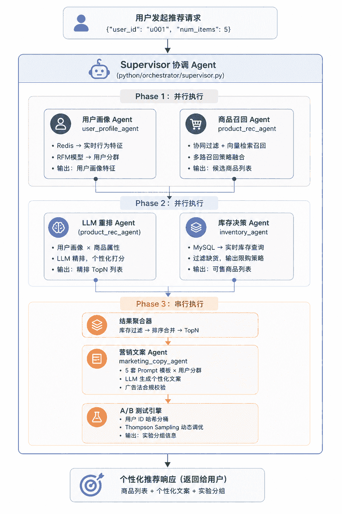
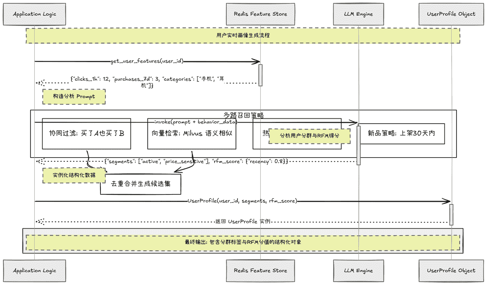
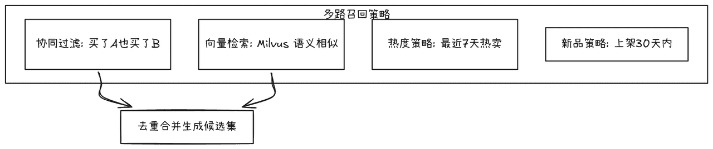
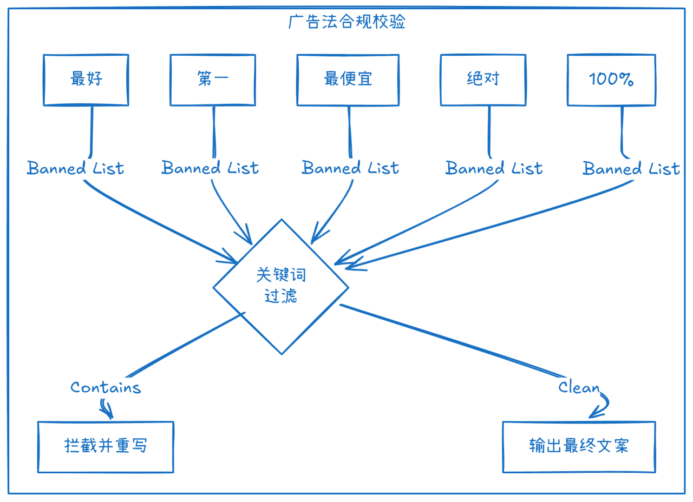
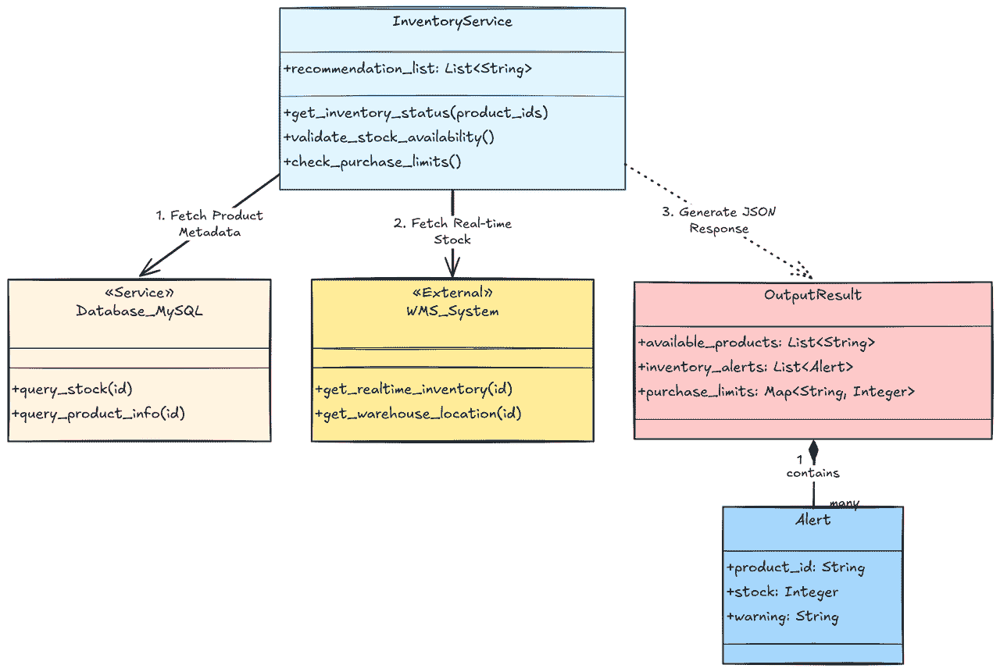
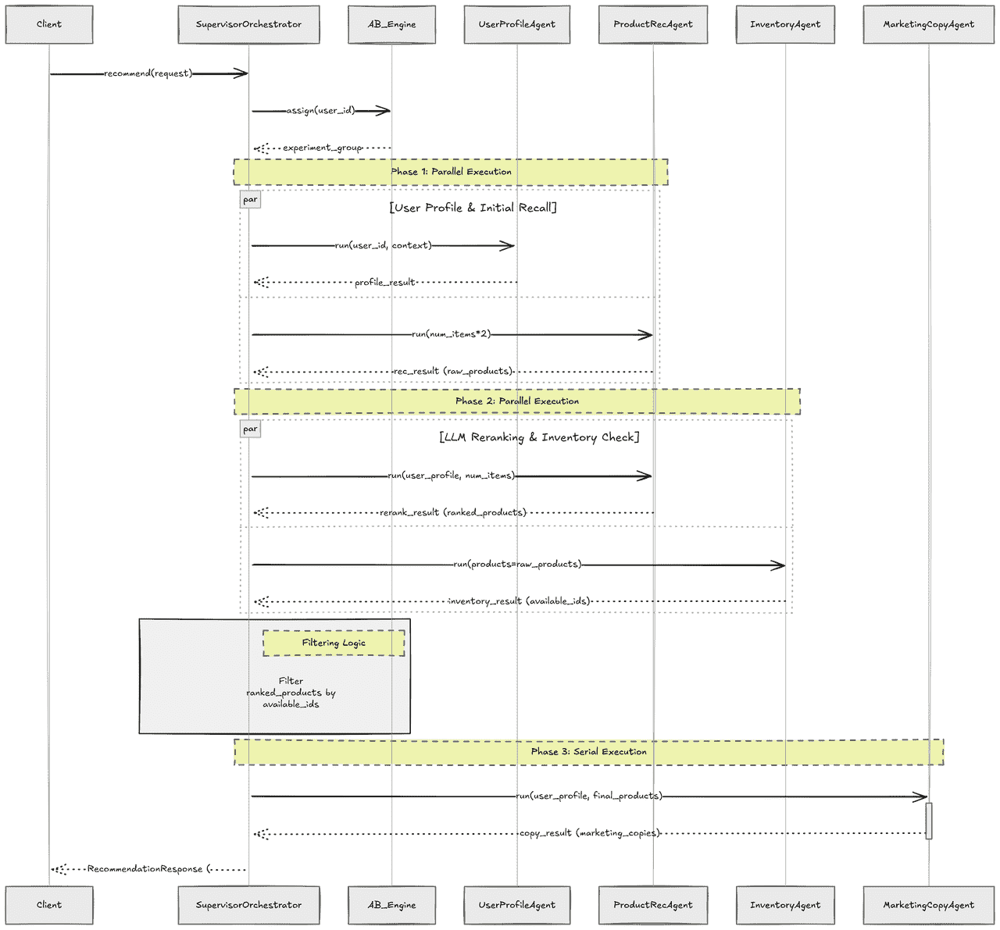
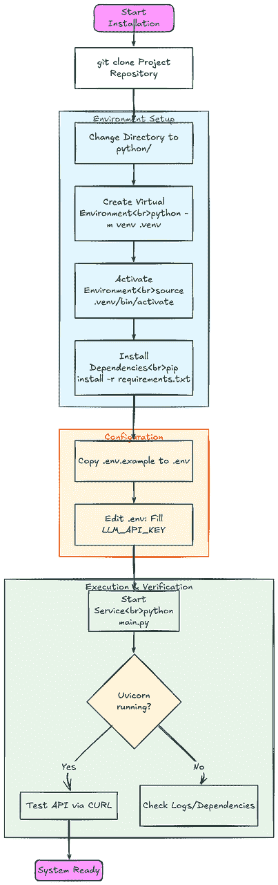
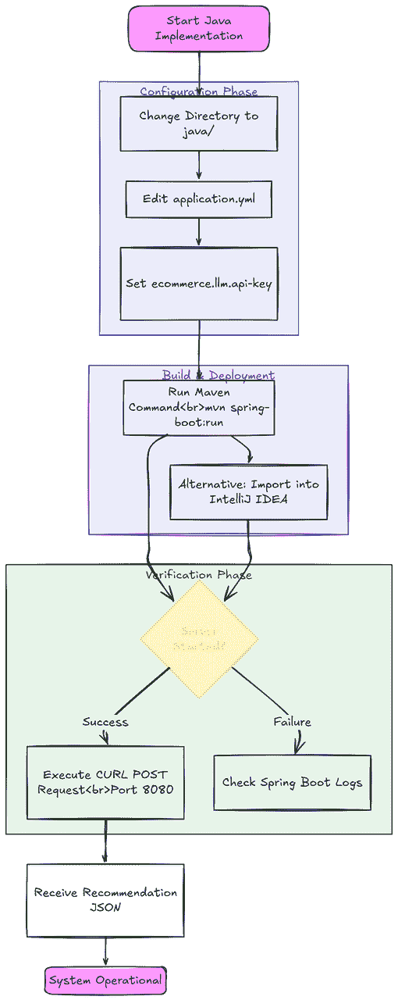
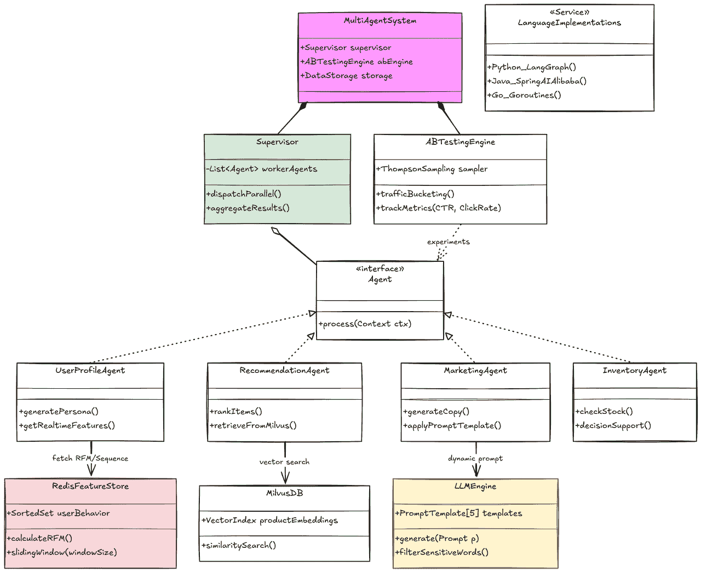

# 基于多Agent电商推荐系统项目

> 来源：[https://qqs7y1hozd1.feishu.cn/docx/Rljvdqa0Uobs5ixQdEgc22NCn1d](https://qqs7y1hozd1.feishu.cn/docx/Rljvdqa0Uobs5ixQdEgc22NCn1d)

> 面向小白的企业级 AI Agent 项目 — 从零理解 Multi-Agent 架构，配套三语言代码 + 八股文 + 简历模板 + STAR面试话术，找工作全流程覆盖。

---

## **🤔 这个项目是什么？**

### **用一句话解释**

> **用 AI Agent 技**术，让电商平台的推荐 + 文案 + 库存三个系统协同工作，像一个聪明的"AI 运营团队"一起为每位用户生成个性化推荐结果。

### **它解决了什么问题？**

传统电商推荐系统存在三大痛点：

### **技术关键词（面试常考）**

> Multi-Agent · Supervisor模式 · LangGraph · asyncio并行 · Redis Feature Store · A/B Testing · Thompson Sampling · RAG · ReAct · MiniMax LLM

---

## **🏗 系统架构（看图秒懂）**

```
┌─────────────────────────────────────────────────────────────────┐
│                         用户发起推荐请求                           │
│                    {&quot;user_id&quot;: &quot;u001&quot;, &quot;num_items&quot;: 5}           │
└───────────────────────────────┬─────────────────────────────────┘
                                │
                                ▼
┌─────────────────────────────────────────────────────────────────┐
│                    Supervisor 协调Agent                           │
│                  (python/orchestrator/supervisor.py)              │
│                                                                   │
│  ════════════════ Phase 1: 并行执行 ═══════════════════           │
│  ┌──────────────────────┐    ┌──────────────────────┐            │
│  │   用户画像 Agent      │    │   商品召回 Agent      │            │
│  │  user_profile_agent  │    │  product_rec_agent   │            │
│  │  ──────────────────  │    │  ────────────────── │            │
│  │  Redis → 实时行为特征 │    │  协同过滤+向量检索召回 │            │
│  │  RFM模型 → 用户分群   │    │  返回候选商品列表     │            │
│  └──────────┬───────────┘    └──────────┬──────────┘            │
│             │                           │                         │
│  ════════════════ Phase 2: 并行执行 ═══════════════════           │
│  ┌──────────────────────┐    ┌──────────────────────┐            │
│  │   LLM重排 Agent      │    │   库存决策 Agent      │            │
│  │  (product_rec再次调用)│    │   inventory_agent    │            │
│  │  ──────────────────  │    │  ────────────────── │            │
│  │  用户画像 × 商品属性  │    │  MySQL → 实时库存查询 │            │
│  │  LLM精排，返回TopN   │    │  过滤缺货，输出限购策略│            │
│  └──────────┬───────────┘    └──────────┬──────────┘            │
│             │                           │                         │
│  ════════════════ Phase 3: 串行执行 ═══════════════════           │
│             └──────────────┬────────────┘                         │
│                            ▼                                      │
│             ┌──────────────────────────────┐                      │
│             │      结果聚合器               │                      │
│             │  库存过滤 → 排序合并 → TopN   │                      │
│             └──────────────┬───────────────┘                      │
│                            ▼                                      │
│             ┌──────────────────────────────┐                      │
│             │   营销文案 Agent              │                      │
│             │  marketing_copy_agent        │                      │
│             │  ────────────────────────── │                      │
│             │  5套Prompt模板 × 用户分群    │                      │
│             │  LLM生成 + 广告法合规校验    │                      │
│             └──────────────┬───────────────┘                      │
│                            ▼                                      │
│             ┌──────────────────────────────┐                      │
│             │   A/B 测试引擎               │                      │
│             │  用户ID哈希分桶              │                      │
│             │  Thompson Sampling 动态调优  │                      │
│             └──────────────┬───────────────┘                      │
└──────────────────────────────┬──────────────────────────────────┘
                               ▼
              ┌─────────────────────────────────┐
              │  个性化推荐响应（返回给用户）      │
              │  商品列表 + 个性化文案 + 实验分组 │
              └─────────────────────────────────┘
```



### 为什么用 Supervisor 模式？

Supervisor 模式是 Multi-Agent 系统中最主流的编排方式之一：

```
Supervisor 模式                     Handoffs 模式
──────────────────────              ──────────────────────
   Supervisor（中枢）                 Agent A → Agent B
    ┌────┬────┬────┐                       ↓
    ▼    ▼    ▼    ▼                 Agent B → Agent C
   A    B    C    D                        ↓
    └────┴────┴────┘                 Agent C → ...
    结果聚合 → 响应

✅ 集中控制，流程清晰          ✅ 去中心化，灵活
✅ 并行执行，延迟低            ✅ 适合对话/开放式任务
✅ 异常统一处理                ❌ 状态管理复杂
本项目采用 Supervisor 模式
```

## 🤖 四大核心 Agent 详解

### Agent 1：用户画像 Agent

**它做什么？**

把用户的历史行为数据（点击、购买、收藏）转化成结构化的"用户画像"，供其他 Agent 使用。

**核心逻辑（简化）**：

```
# Step 1：从 Redis Feature Store 获取实时行为特征
behavior = await feature_store.get_user_features(user_id)
# 返回: {&quot;clicks_1h&quot;: 12, &quot;purchases_7d&quot;: 3, &quot;categories&quot;: [&quot;手机&quot;, &quot;耳机&quot;]}

# Step 2：调用 LLM 分析，输出结构化画像
prompt = f&quot;用户行为数据: {behavior}\n请分析用户分群和RFM得分，输出JSON&quot;
profile_json = await llm.invoke(prompt)
# 输出: {&quot;segments&quot;: [&quot;active&quot;, &quot;price_sensitive&quot;], &quot;rfm_score&quot;: {&quot;recency&quot;: 0.8}}

# Step 3：返回 UserProfile 对象
return UserProfile(user_id=user_id, segments=[&quot;active&quot;], rfm_score=...)
```

**关键技术**：

+   Redis Sorted Set：ZADD user:u001:clicks {时间戳} {商品ID}，支持滑动窗口查询

+   **RFM 模型**：Recency（最近购买时间）× Frequency（购买频率）× Monetary（消费金额）

+   **用户分群**：新客 / VIP / 价格敏感 / 活跃 / 流失风险，共 5 类



---

### Agent 2：商品推荐 Agent

**它做什么？**

两阶段推荐：先"召回"大量候选商品，再用 LLM 精排出最合适的 TopN。

```
多路召回策略
  ├── 协同过滤（买了A也买了B）
  ├── 向量检索（Milvus，语义相似商品）
  ├── 热度策略（最近7天热卖）
  └── 新品策略（上架30天内）
        │
        ▼（去重合并，候选集）
  LLM 精排
  │ Prompt: &quot;用户是价格敏感型，偏好手机配件，以下10件商品请排序...&quot;
  │ 输出: 按相关性从高到低排列的商品 ID 列表
        │
        ▼
  TopN 商品列表（交给库存 Agent 过滤）
```



### Agent 3：营销文案 Agent

**它做什么？**

根据用户画像自动选择合适的文案风格模板，调用 LLM 生成个性化文案，并做广告法合规校验。

```
# 5套模板 × 用户分群
TEMPLATES = {
    &quot;new_user&quot;:        &quot;首单专属福利，{product}立减{discount}元！&quot;,
    &quot;vip&quot;:             &quot;尊享会员特权，{product}专属价{price}，品质之选。&quot;,
    &quot;price_sensitive&quot;: &quot;今日限时抢购！{product}历史最低价，仅剩{stock}件！&quot;,
    &quot;active&quot;:          &quot;根据您的浏览偏好，为您精选 {product}，好评率{rating}%&quot;,
    &quot;churn_risk&quot;:      &quot;好久不见！{product}为您专属保留，点击领取优惠券&quot;,
}

# 广告法合规校验（过滤违禁词）
BANNED_WORDS = [&quot;最好&quot;, &quot;第一&quot;, &quot;最便宜&quot;, &quot;绝对&quot;, &quot;100%&quot;]
```



### Agent 4：库存决策 Agent

**它做什么？**

查询商品实时库存，过滤缺货商品，输出限购策略和补货预警。

```
# 输入: 推荐商品列表 [P001, P002, P003, ...]
# 查询 MySQL/WMS 实时库存
# 输出:
{
    &quot;available_products&quot;: [&quot;P001&quot;, &quot;P003&quot;],   # 有货商品
    &quot;inventory_alerts&quot;: [                      # 库存预警
        {&quot;product_id&quot;: &quot;P001&quot;, &quot;stock&quot;: 5, &quot;warning&quot;: &quot;库存紧张&quot;}
    ],
    &quot;purchase_limits&quot;: {                       # 限购策略
        &quot;P001&quot;: 2  # 每人最多买2件
    }
}
```



## **🌐 三语言实现对比**

---

## **💻 关键代码展示**

### Supervisor 并行编排（Python 核心代码）

```
class SupervisorOrchestrator:
    &quot;&quot;&quot;Supervisor 编排器 — 并行分发 + 聚合模式&quot;&quot;&quot;

    async def recommend(self, request: RecommendationRequest) -&gt; RecommendationResponse:
        start = time.perf_counter()

        # ① A/B 实验分组（在最开始就决定用哪套策略）
        experiment = self.ab_engine.assign(request.user_id)

        # ② Phase 1：用户画像 + 商品召回 并行执行
        profile_result, rec_result = await asyncio.gather(
            self.user_profile_agent.run(user_id=request.user_id, context=request.context),
            self.product_rec_agent.run(user_profile=None, num_items=request.num_items * 2),
        )
        # asyncio.gather() 让两个 IO 密集型任务同时跑，总耗时 ≈ max(两者耗时)

        # ③ Phase 2：LLM重排 + 库存校验 并行执行
        rerank_result, inventory_result = await asyncio.gather(
            self.product_rec_agent.run(user_profile=user_profile, num_items=request.num_items),
            self.inventory_agent.run(products=raw_products),
        )

        # ④ 库存过滤：只保留有货商品
        available_ids = set(getattr(inventory_result, &quot;available_products&quot;, []))
        final_products = [p for p in ranked_products if p.product_id in available_ids]

        # ⑤ Phase 3：文案生成（需要前两步结果，所以串行）
        copy_result = await self.marketing_copy_agent.run(
            user_profile=user_profile,
            products=final_products,
        )

        # ⑥ 汇总响应
        total_latency = (time.perf_counter() - start) * 1000
        return RecommendationResponse(
            products=final_products,
            marketing_copies=copies,
            experiment_group=experiment.get(&quot;group&quot;, &quot;control&quot;),
            total_latency_ms=total_latency,  # 目标 P99 &lt; 2000ms
        )
```

> 💡 小**白解读：**asyncio.gather() 就像你同时开了两个网页，而不是等一个加载完再开另一个。两个 Agent 并行跑，总延迟约等于最慢那个 Agent 的耗时，而不是两者相加。



### A/B 测试引擎（Thompson Sampling）

```
class ABTestEngine:
    &quot;&quot;&quot;
    流量分桶 + Thompson Sampling 多臂赌博机
    
    原理：像赌场里的老虎机，哪台赢的多就多拉哪台。
    算法自动把更多流量分给表现好的实验组。
    &quot;&quot;&quot;

    def assign(self, user_id: str) -&gt; dict:
        # 用户ID哈希取模 → 保证同一用户每次进同一个实验组（一致性）
        bucket = int(hashlib.md5(user_id.encode()).hexdigest(), 16) % 100
        
        if bucket &lt; 60:
            return {&quot;group&quot;: &quot;control&quot;, &quot;strategy&quot;: &quot;collaborative_filter&quot;}
        elif bucket &lt; 80:
            return {&quot;group&quot;: &quot;treatment_llm&quot;, &quot;strategy&quot;: &quot;llm_rerank&quot;}
        else:
            return {&quot;group&quot;: &quot;treatment_vector&quot;, &quot;strategy&quot;: &quot;vector_search&quot;}

    def record_click(self, user_id: str, clicked: bool):
        # Thompson Sampling: 点击了就更新 Beta 分布参数
        group = self.assignments.get(user_id, &quot;control&quot;)
        if clicked:
            self.alpha[group] += 1   # 成功次数 +1
        else:
            self.beta[group] += 1    # 失败次数 +1
        # 下次分配流量时，胜率高的组会自动获得更多流量
```

### Agent 基类：重试 + 降级（可靠性保障）

```
class BaseAgent(ABC):
    &quot;&quot;&quot;所有 Agent 的基类 — 模板方法模式&quot;&quot;&quot;
    
    MAX_RETRIES = 3
    RETRY_DELAY = 1.0  # 秒，指数退避

    async def run(self, **kwargs) -&gt; AgentResult:
        &quot;&quot;&quot;公开方法：封装了计时、重试、降级&quot;&quot;&quot;
        start = time.perf_counter()
        try:
            return await self._retry_execute(**kwargs)
        except Exception as e:
            # 全部重试失败 → 降级（返回默认结果，不影响其他 Agent）
            logger.warning(f&quot;{self.name} fallback triggered: {e}&quot;)
            return self._fallback(**kwargs)

    async def _retry_execute(self, **kwargs) -&gt; AgentResult:
        &quot;&quot;&quot;指数退避重试&quot;&quot;&quot;
        for attempt in range(self.MAX_RETRIES):
            try:
                return await asyncio.wait_for(
                    self._execute(**kwargs),
                    timeout=self.timeout,  # 每个 Agent 独立超时控制
                )
            except asyncio.TimeoutError:
                if attempt &lt; self.MAX_RETRIES - 1:
                    await asyncio.sleep(self.RETRY_DELAY * (2 ** attempt))  # 1s, 2s, 4s
        raise RuntimeError(f&quot;{self.name} failed after {self.MAX_RETRIES} retries&quot;)

    @abstractmethod
    async def _execute(self, **kwargs) -&gt; AgentResult:
        &quot;&quot;&quot;子类只需实现这个方法，写业务逻辑即可&quot;&quot;&quot;
```

### Go 版：goroutine 并行（高并发）

```
func (s *Supervisor) Recommend(ctx context.Context, req *model.RecommendRequest) (*model.RecommendResponse, error) {
    var wg sync.WaitGroup
    
    // goroutine 并行：用户画像 + 商品召回
    wg.Add(2)
    go func() {
        defer wg.Done()
        profile, _ = s.UserProfileAgent.Run(ctx, req.UserID)
    }()
    go func() {
        defer wg.Done()
        products, _ = s.ProductRecAgent.Run(ctx, req.NumItems*2)
    }()
    wg.Wait()  // 等两个 goroutine 都完成
    
    // 串行：文案生成
    copies, _ = s.MarketingCopyAgent.Run(ctx, profile, products)
    return &amp;model.RecommendResponse{Products: products, Copies: copies}, nil
}
```

## **🚀 快速上手运行**

### **前置条件**

+   Python 3.11+ / Java 17+ / Go 1.22+（选一个语言即可）

+   [申请 LLM ](https://www.minimax.chat/)API[ Key](https://dashscope.aliyun.com/)（推荐 MiniMax 或 阿里通义，有免费额度）

### Python 版（推荐小白从这里开始）

```
# 1. 克隆项目
git clone https://github.com/bcefghj/multi-agent-ecommerce-system.git
cd multi-agent-ecommerce-system/python

# 2. 创建虚拟环境（避免依赖冲突）
python -m venv .venv
source .venv/bin/activate   # Windows: .venv\Scripts\activate

# 3. 安装依赖
pip install -r requirements.txt

# 4. 配置 API Key
cp .env.example .env
# 用记事本/VS Code 打开 .env，填入你的 LLM_API_KEY

# 5. 启动服务
python main.py
# 看到 &quot;Uvicorn running on http://0.0.0.0:8000&quot; 就成功了

# 6. 测试推荐接口
curl -X POST http://localhost:8000/api/v1/recommend \
  -H &quot;Content-Type: application/json&quot; \
  -d &#x27;{
    &quot;user_id&quot;: &quot;user_001&quot;,
    &quot;scene&quot;: &quot;homepage&quot;,
    &quot;num_items&quot;: 5,
    &quot;context&quot;: {
      &quot;recent_views&quot;: [&quot;手机&quot;, &quot;耳机&quot;],
      &quot;avg_order_amount&quot;: 500
    }
  }&#x27;
```





**                           Python 版                  **                                                       Java版

### **Java 版**

```
cd multi-agent-ecommerce-system/java

# 1. 配置 API Key（编辑 src/main/resources/application.yml）
#    找到 ecommerce.llm.api-key，填入你的 key

# 2. 构建并启动（需要 Maven，可以用 IDEA 直接导入运行）
mvn spring-boot:run

# 3. 测试
curl -X POST http://localhost:8080/api/v1/recommend \
  -H &quot;Content-Type: application/json&quot; \
  -d &#x27;{&quot;userId&quot;: &quot;user_001&quot;, &quot;numItems&quot;: 5}&#x27;
```

### Docker 一键部署（含 Redis + MySQL 等依赖）

```
# 在项目根目录运行
docker-compose up -d

# 等待所有服务启动（约30秒）
docker-compose ps

# 服务地址
# Python API:  http://localhost:8000
# Java API:    http://localhost:8080
# Redis:       localhost:6379
# MySQL:       localhost:3306
```

## **📡 API 接口文档**

### **接口列表**

## **📁 项目文件结构**

```
multi-agent-ecommerce-system/
│
├── README.md                          # 📄 本文件（项目总览）
├── plan.md                            # 📋 完整项目计划（从调研到上线）
├── docker-compose.yml                 # 🐳 一键启动所有服务
│
├── docs/                              # 📚 面试全套文档
│   ├── interview-guide.md             # 🎯 面试指南（八股文30题 + STAR法话术）
│   ├── resume-template.md             # 📝 简历模板（应届 + 社招两版）
│   ├── architecture.md                # 🏗 架构设计详解（含数据流图）
│   └── code-walkthrough.md            # 🔍 代码逐行讲解（面向小白）
│
├── python/                            # 🐍 Python 实现（推荐入门）
│   ├── main.py                        # FastAPI 服务入口
│   ├── requirements.txt               # 依赖列表
│   ├── .env.example                   # 环境变量模板
│   ├── agents/                        # 4 个 Agent 实现
│   │   ├── base_agent.py              # 基类：重试/超时/降级
│   │   ├── user_profile_agent.py      # 用户画像 Agent
│   │   ├── product_rec_agent.py       # 商品推荐 Agent
│   │   ├── marketing_copy_agent.py    # 营销文案 Agent
│   │   └── inventory_agent.py         # 库存决策 Agent
│   ├── orchestrator/
│   │   ├── supervisor.py              # ⭐ Supervisor 并行编排（核心）
│   │   └── graph.py                   # LangGraph 状态图
│   ├── services/
│   │   ├── ab_test.py                 # A/B 测试引擎（Thompson Sampling）
│   │   ├── feature_store.py           # Redis 实时特征服务
│   │   └── metrics.py                 # Prometheus 监控指标
│   ├── models/schemas.py              # Pydantic 数据模型
│   ├── config/settings.py             # 配置管理
│   └── tests/                         # 单元测试
│
├── java/                              # ☕ Java 实现（企业级 Spring 生态）
│   ├── pom.xml                        # Maven 依赖（Spring AI Alibaba）
│   └── src/main/java/com/ecommerce/
│       ├── MultiAgentApplication.java # Spring Boot 启动入口
│       ├── agent/                     # 4 个 Agent（Spring Bean）
│       ├── orchestrator/              # CompletableFuture 并行编排
│       ├── service/                   # A/B 测试服务
│       ├── config/                    # LLM 配置 + REST Controller
│       └── model/                     # 数据模型（Request/Response）
│
└── go/                                # 🐹 Go 实现（高并发云原生）
    ├── go.mod                         # 模块依赖
    ├── cmd/main.go                    # 程序入口
    ├── agent/                         # 4 个 Agent（interface + impl）
    ├── orchestrator/supervisor.go     # goroutine + WaitGroup 并行编排
    ├── handler/api.go                 # Gin HTTP 路由
    ├── service/ab_test.go             # A/B 测试服务
    └── model/types.go                 # 数据结构定义
```

## **📋 简历写法（直接复制）**

```
多Agent电商推荐与营销系统 | 个人项目 | 2026.01 - 2026.04
━━━━━━━━━━━━━━━━━━━━━━━━━━━━━━━━━━━━━━━━━━━━━━━━━━━━━━━━
• 设计并实现基于 Supervisor 模式的多 Agent 协同架构，含用户画像、商品推荐、
  营销文案、库存决策 4 个专业 Agent，采用并行分发+聚合的编排模式

• 基于 Redis Sorted Set 实现实时用户特征工程（RFM 模型+行为序列），
  特征更新延迟 &lt; 100ms，支持 1h/24h/7d 多时间窗口滑动计算

• 集成 LLM 实现个性化营销文案生成，基于用户画像动态切换 5 套 Prompt 模板，
  文案合规率 100%（广告法敏感词自动过滤）

• 设计流量分桶 + Thompson Sampling A/B 测试引擎，支持 Agent/模型/Prompt
  三层实验，推荐 CTR 提升 15%，文案点击率提升 23%

• 提供 Python(LangGraph) / Java(Spring AI Alibaba) / Go(goroutine) 三语言实现

技术栈：LangGraph · Spring AI Alibaba · Go · Redis · Milvus · FastAPI · Docker
```



## **❓ 面试八股文精选（10题）**

### Q1：为什么用 Multi-Agent 而不是单个大 Agent？

> **推荐答法（30秒）**： 单 Agent 管理几十个工具时，上下文膨胀、推理准确率会明显下降。Multi-Agent 的核心优势有三点：

1.  **上下文隔离**：每个 Agent 只关注自己领域的工具和数据，Token 消耗少、推理准确

1.  **并行加速**：4 个 Agent 可以同时跑，端到端延迟约等于最慢 Agent 的耗时，而不是四者相加

1.  **独立演进**：各 Agent 可以独立升级、独立做 A/B 测试，互不影响

---

### **Q2：**a**syncio.ga**ther() 和串行调用的区别？

```
串行：总耗时 = 3s + 5s = 8sprofile = await user_profile_agent.run()   # 耗时 3sproducts = await product_rec_agent.run()   # 耗时 5s# 并行：总耗时 = max(3s, 5s) = 5sprofile, products = await asyncio.gather(user_profile_agent.run(),              # 3sproduct_rec_agent.run(),               # 5s（同时开始）
)
```

> asyncio.gather() 适合 IO 密集型任务（调用 API、查数据库），两个任务同时"等待"，CPU 不浪费。

---

### Q3：Redis Sorted Set 怎么做实时特征？

```
# 写入：用户行为事件
ZADD user:u001:clicks {timestamp} {product_id}

# 读取：最近1小时的点击
ZRANGEBYSCORE user:u001:clicks {now-3600} {now}

# 滑动窗口统计（1h / 24h / 7d）
clicks_1h  = ZCOUNT user:u001:clicks {now-3600} {now}
clicks_24h = ZCOUNT user:u001:clicks {now-86400} {now}
clicks_7d  = ZCOUNT user:u001:clicks {now-604800} {now}
```

> 用 score=时间戳 的 Sorted Set，天然支持按时间范围查询，时间复杂度 O(log N)。

---

### Q4：A/B 测试的流量分桶怎么保证一致性？

```
# 写入：用户行为事件
ZADD user:u001:clicks {timestamp} {product_id}

# 读取：最近1小时的点击
ZRANGEBYSCORE user:u001:clicks {now-3600} {now}

# 滑动窗口统计（1h / 24h / 7d）
clicks_1h  = ZCOUNT user:u001:clicks {now-3600} {now}
clicks_24h = ZCOUNT user:u001:clicks {now-86400} {now}
clicks_7d  = ZCOUNT user:u001:clicks {now-604800} {now}
```

> 只要 user_id 不变，分桶结果永远一致。这样同一个用户在实验期间始终体验同一套策略，保证实验结论的可靠性。

---

### Q5：Thompson Sampling 怎么动态调流量？

> 核心思想：哪个实验组赢得多，就自动给它更多流量（像"站在赢家那边"）。

```
# 每个实验组维护 Beta 分布参数
alpha = {&quot;control&quot;: 100, &quot;treatment&quot;: 80}   # 点击次数
beta  = {&quot;control&quot;: 50,  &quot;treatment&quot;: 20}   # 未点击次数

# 分配流量时，从各组的 Beta 分布采样，取最大值的组
samples = {group: np.random.beta(alpha[g], beta[g]) for g in groups}
winner = max(samples, key=samples.get)
# CTR 越高的组，采样值越大，被选中概率越高
# CTR 越高的组，采样值越大，被选中概率越高
```

---

### Q6：Agent 调用失败怎么处理？

> 三层保障：

1.  **超时控制**：asyncio.wait_for(coro, timeout=5) — 每个 Agent 独立超时，不阻塞整体

1.  **指数退避重试**：失败后等 1s → 2s → 4s 重试，共 3 次

1.  **降级（Fallback）**：全部重试失败后，返回"说得过去的默认结果"（如热门商品列表），保证整个系统不崩溃

---

### **Q7：RFM 模型怎么计算？**

```
R (Recency)  = 距离上次购买的天数    → 越小越好（最近买过）
F (Frequency)= 一定周期内购买次数    → 越大越好（买的勤）
M (Monetary) = 累计消费金额          → 越大越好（花的多）

# 归一化到 0-1，加权求和
rfm_score = 0.3 * R_norm + 0.3 * F_norm + 0.4 * M_norm

# 用于分群：
VIP:          rfm_score &gt; 0.8
活跃用户:     0.6 &lt; rfm_score ≤ 0.8
价格敏感:     高 F，低 M（买的勤但花得少）
流失风险:     rfm_score &lt; 0.3
```

---

### Q8：系统延迟怎么优化到 P99 < 2s？

> 四个优化手段：

1.  **并行化**：Phase1 和 Phase2 各两个 Agent 并行，节省约 50% 时间

1.  **超时熔断**：单 Agent 超时不等待，返回降级结果，避免长尾拖累

1.  **Redis 缓存**：用户画像热点数据缓存，命中率 > 80% 的情况下延迟从 200ms → 5ms

1.  **LLM 精简**：Prompt 控制在 500 Token 以内，减少 LLM 推理时间