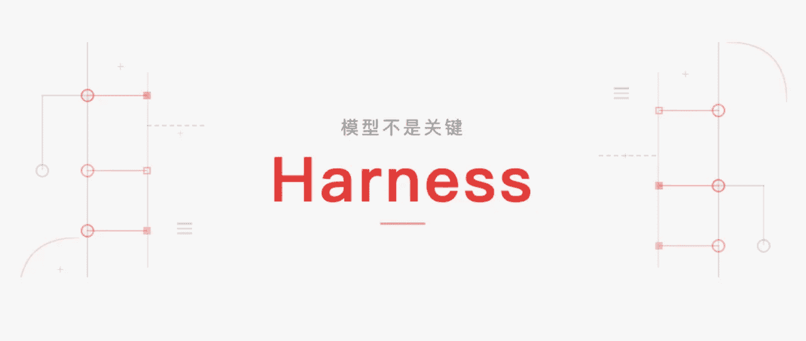
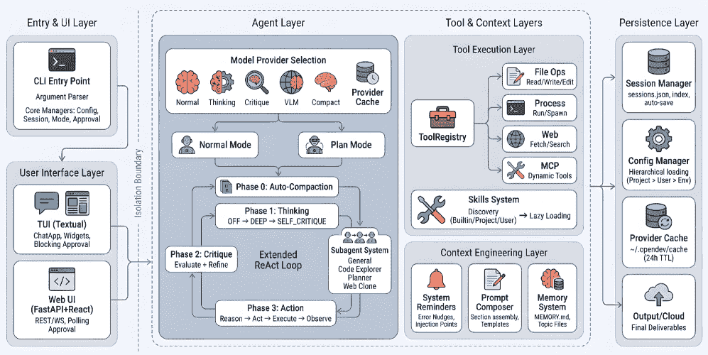
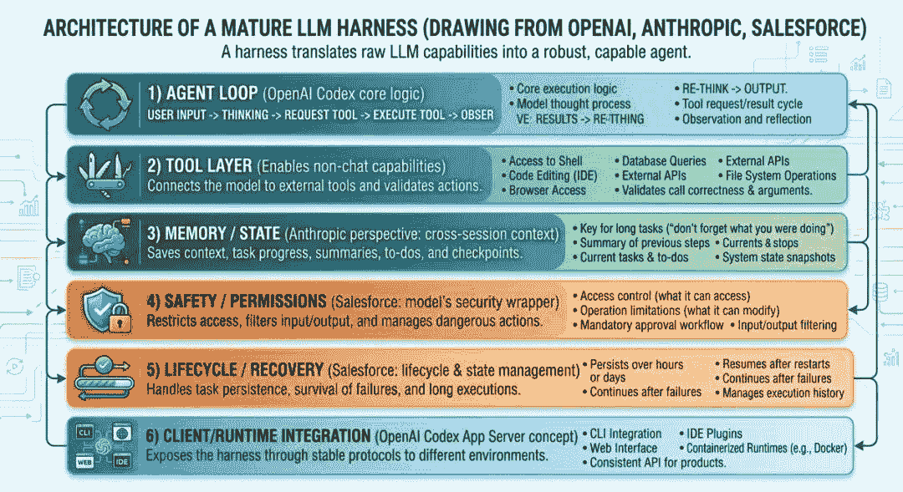
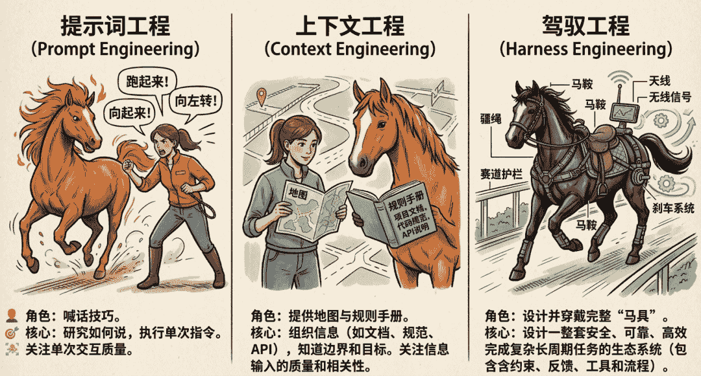

# Harness到底是什么？一篇给你讲透

> 来源：[https://qqs7y1hozd1.feishu.cn/docx/Dxf9dfZTLo3E2exAlMmcPez6nNe](https://qqs7y1hozd1.feishu.cn/docx/Dxf9dfZTLo3E2exAlMmcPez6nNe)

## 一、为什么Harness突然火了

这个词在2025年末到2026年初明显升温。

Anthropic在2025年11月就已经公开讨论“long-running agents”的effective harnesses，核心问题是：agent 做长任务会跨多个上下文窗口，而每次新会话都像“一个新工程师接班”，没有之前发生过什么的记忆。

到2026年2月，Mitchell Hashimoto在自己的文章里直接把一个阶段命名为 “Engineer the Harness”；几天后，OpenAI又发布了 “Harness engineering”，把这个概念进一步推到台前。

也就是说，行业开始意识到：2025年大家比的是模型和prompt；2026年开始，真正拉开差距的是模型外面的系统设计。 这就是harness()变热的根本原因。这个判断能从OpenAI 和Anthropic的工程文章里直接看出来。

## **二、Harness到底是什么**

一个更工程化的定义是：

Harness = 围绕LLM/agent的执行与治理层。

> Salesforce的定义很直白：agent harness是一层operational software layer，负责管理AI的 tools、memory、safety，从而让autonomous task execution更可靠。

OpenAI的表述更偏工程实现：

> 在Codex体系里，harness包含core agent loop + execution logic + client/runtime integration；它不是单次对话，而是一个能驱动工具调用、状态流转、事件流、客户端交互的长期运行系统。

所以，harness不是一个具体模型，也不是一句prompt，更不是某个单独框架。

**它更像这几个东西的合体：**

+   agent runtime

+   tool orchestrator

+   memory/state manager

+   permission/safety wrapper

+   failure recovery system

+   human approval/workflow layer

这些拼在一起，才叫harness。

## **三、和prompt、workflo**w、agent、framework的关系

最容易混淆的是这四个：

### **它不是prompt**

Prompt只是给模型的文字说明。

Harness则负责：什么时候给什么prompt、何时压缩上下文、何时调用工具、失败后怎么恢复、哪些动作需要审批。

### **它不等于agent**

Aent 通常指“会规划、会调用工具、会迭代执行”的智能体行为。

Harness则是agent背后的基础设施。OpenAI把agent loop视为harness的核心逻辑之一，但完整harness还包括更多supporting features和runtime结构。

### **它不等于framework**

框架更像“开发工具箱”；

Harness 更像“真正跑在线上的运行环境”。

Salesforce 明确区分了：framework提供构建agent的库，而harness是现实世界里约束、管理和运行agent的实际runtime system。

### **它也不只是workflow**

Workflow 是流程；

Harness不仅管流程，还管 状态、记忆、权限、恢复、验证、日志、审批、客户端协议。

## 四、一个harness里通常包含什么

结合OpenAI、Anthropic、Salesforce的公开工程文章，一个成熟harness 大致会有这几层：

### **Agent loop**

就是“用户输入 → 模型思考 → 请求工具 → 执行工具 → 观察结果 → 再思考 → 输出”的循环。OpenAI把这称作Codex的核心逻辑。

### **Tool layer**

给模型接上shell、代码编辑、浏览器、数据库、API、文件系统等能力，并校验工具调用是否合法、参数是否正确。没有这层，模型只能聊天。

### **Memory / state**

保存中间状态、任务进度、摘要、待办、检查点。这是解决长任务“做着做着就忘了”的关键。Anthropic讲得很清楚：跨context window工作的agent必须弥补“新会话没有前情记忆”的问题。

### Safety / permissions

限制模型能访问什么、能改什么、什么动作必须审批、怎么过滤输入输出。Salesforce直接把harness描述成model的security wrapper。

### Lifecycle / recovery

任务崩了能不能续跑，重启后能不能接着干，长任务能不能跨小时甚至跨天继续。Salesforce把这叫lifecycle and state management。

### Client/runtime integration

尤其在产品化场景里，harness还要对接CLI()、IDE、Web、后台容器。OpenAI的Codex App Server就是在做这件事：把harness以稳定协议暴露给不同客户端。

五、Harness Engineering又是什么

既然harness是那层运行系统，Harness Engineering 就是专门设计和迭代这层系统的工程实践。

OpenAI在2026年2月把它明确写成主题，核心思想不是“怎么把prompt写得更花”，而是：

+   怎么让仓库对agen 更可读

+   怎么把知识沉淀到repo里

+   怎么通过反馈回路让agent持续纠错

+   怎么控制“熵增”和系统漂移

+   怎么让humans steer, agents execute

所以你可以把Harness Engineering 理解成：从“提示工程”升级到“智能体运行系统工程”。

## Harness Engineering和过去的“Prompt Engineering() / Context Engineering”有什么区别呢？

+   Prompt engineering：教模型这一轮怎么答

+   Context engineering：给模型这一轮喂什么上下文

+   Harness engineering：设计整个系统，让模型在很多轮、很多工具、很长时间里都能稳定完成任务

也就是说，harness关心的是连续执行能力，而不只是单轮输出质量。这个区别在OpenAI对agent loop/app server的描述，以及Anthropic对long-running agents的描述里都提到了。

最后再总结一下： Harness不是新模型，也不是新框架，而是“大模型外面的那层执行与治理系统”。它负责把会推理的LLM变成能长期、稳定、安全完成任务的agent。