# 高效Agents的尽头是，Harness

> 来源：[https://qqs7y1hozd1.feishu.cn/docx/PJ4cdM0qJohClAxrzBFcITLqncc](https://qqs7y1hozd1.feishu.cn/docx/PJ4cdM0qJohClAxrzBFcITLqncc)

玩过**Agent**的同学都有这种体验：前五轮，它像个天才；十五轮后，开始犯蠢；二十轮后，它连自己最开始要干嘛都忘了。

很多同学把**Agent**当成个“**模型+工具**”的简单组合。但**跑长了**就知道**远远不够**。

+   **模型**是CPU：提供原始处理能力

+   **上下文窗口**是RAM：有限的、易失性工作内存

+   **Agent Harness**是操作系统：管理上下文，处理"启动"序列（提示词、钩子），并提供标准驱动（工具处理）

+   **Agent**是应用程序：运行在操作系统之上的特定用户逻辑

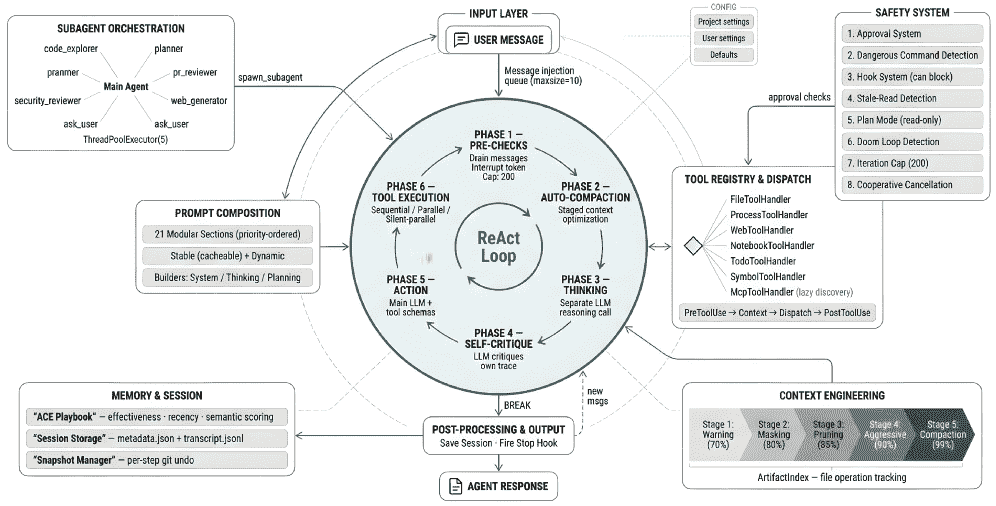

Figure 2: OPENDEV的四层系统架构（Entry & UI → Agent → Tool & Context → Persistence）

## 核心理念：Scaffolding + Harness

传统Agent往往混淆了两个不同的阶段：

+   Scaffolding（脚手架）：在第一个Prompt到达之前完成的工作——组装System Prompt、构建Tool Schema、注册Subagent。这部分应该eager construction（即时构建），确保Agent在运行时已是完全就绪状态。

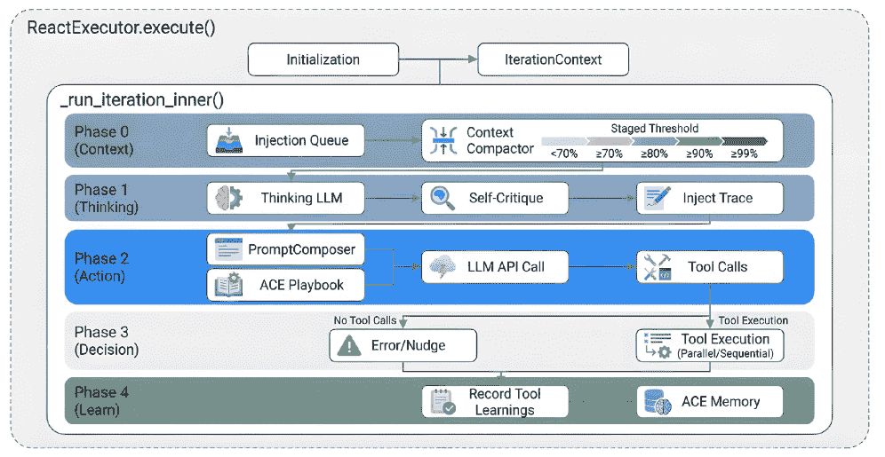

Figure 4: Agent Harness的详细视图，展示了ReAct循环周围的七个支撑子系统

+   Harness（马具/运行时框架）：第一个Prompt之后的所**有工作——工**具调度、上下文管理、安全强制执行、会话持久化。这是Agent的运行时编排层。

> **关键洞察**：将构建期与运行时分离开，意味着你可以独立演化每个部分。新增工具只需修改Registry，而变更压缩策略只需调整Harness。

## 3 Extended ReAct：不只是"思考-行动"

**Agent Harness架构**实现了一个扩展的ReAct循环，包含六个阶段：

1.  Pre-check & Compaction：检查注入队列，执行上下文压缩

1.  **Thinking**：独立的思考阶段（无工具访问），防止过早行动

1.  **Self-Critique**：自批判阶段（仅在HIGH级别启用）

1.  **Action**：主LLM调用，产生工具调用

1.  **Tool Execution**：并行/串行执行工具

1.  **Post-processing**：学习记录、会话保存

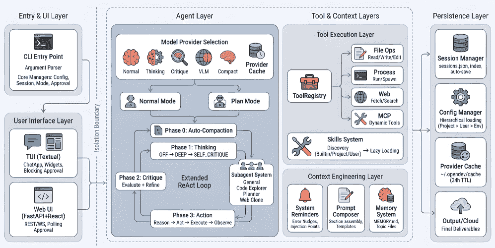

Figure 8: Extended ReAct执行循环的详细视图，展示了从Initialization()到Iteration的完整流程

特别值得注意的是Phase 0的Staged Context Management。系统监控Token使用率，在70%、80%、85%、90%、99%五个阈值采取不同策略：

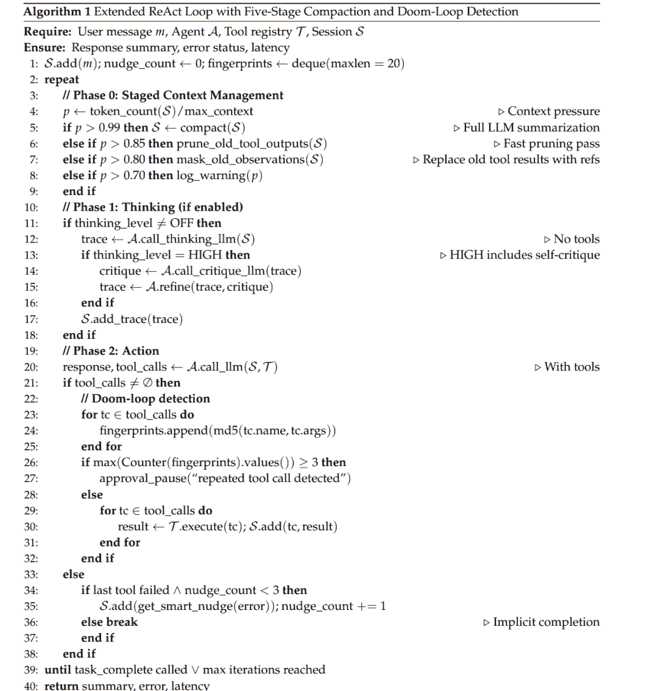

Algorithm 1: Extended ReAct Loop with Five-Stage Compaction and Doom-Loop Detection

## 4 Context Engineering：

在长周期终端会话中，上下文管理不是优化项，而是基础性工程问题。OpenDev提出了Context Engineering Layer，包含四个关键子系统：

### 4.1 动态System Prompt组装

通过Priority-ordered conditional composition，根据运行时环境动态加载Prompt片段。例如，只有在Git仓库中才加载Git工作流指南，只有启用Todo跟踪时才加载任务管理指令。

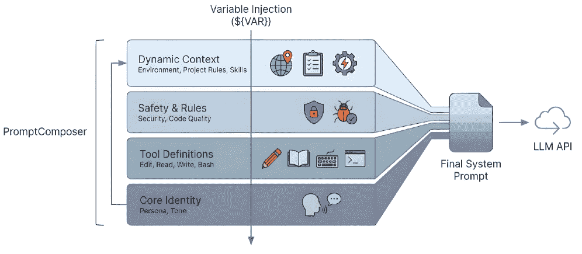

Figure 10: PromptComposer的工作流程：Filter → Sort → Load → Join

### 4.2 自适应上下文压缩（ACC）

不同于简单的"到达阈值就总结"，ACC采用渐进式策略：

+   **Active State**：最近的消息，完整保留

+   **Faded State**：较旧的消息，替换为引用指针

+   **Archived State**：归档到磁盘，完全移出上下文

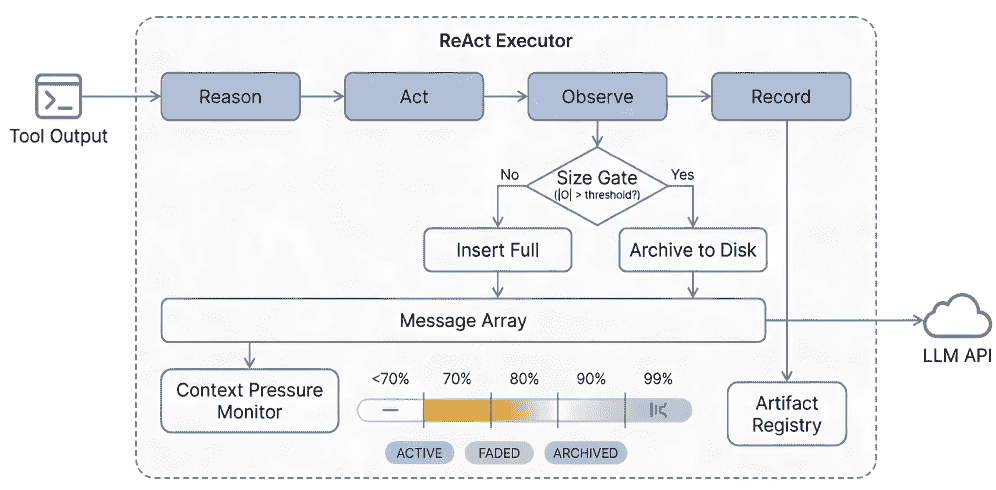

Figure 13: 五级压缩管道（Warning → Masking → Pruning → Aggressive Masking → Full Compaction）

### 4.3 系统提醒（System Reminders）

解**决"指令衰减"问题**：随着会话变长，模型对初始System Prompt的关注度下降。OPENDEV通过事件驱动的即时提醒（Event-driven System Reminders）在关键时刻注入短小的user-role消息：

+   检测到未完成Todo却调用task_complete时

+   连续5次只读操作后（防止探索螺旋）

+   工具调用失败后

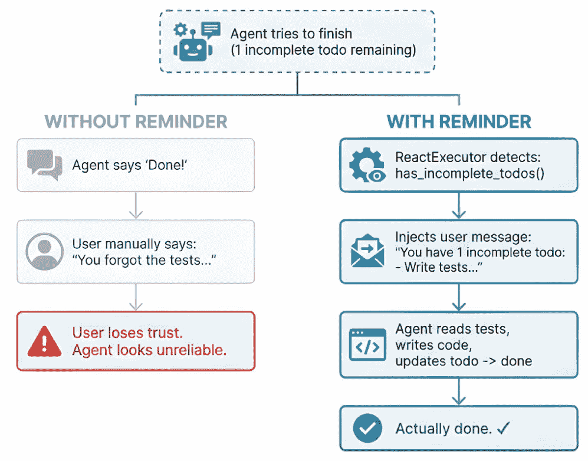

Figure 11: 系统提醒如何防止过早完成任务（左：无提醒导致用户信任丧失；右：有提醒确保任务完成）

### 4.4 双记忆架构（Dual-Memory）

为Thinking模型设计的特殊架构：

+   **Episodic Memory**：LLM生成的长程对话摘要（每5条消息更新一次）

+   **Working Memory**：最近6条消息的原文

这既避免了长上下文超限，又保留了关键细节。

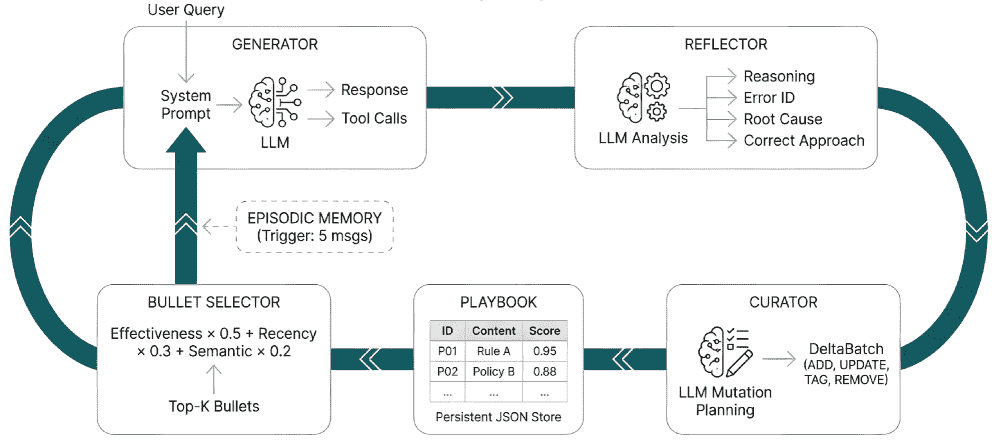

Figure 14: Agentic Context Engineering (ACE) 记忆管道，包含Bullet Selector、Reflector、Curator和Playbook

## 防御纵深：五层安全架构

终端Agent能执行任意Shell命**令，这带来了巨大风**险。OPENDEV采用五层独立的安全机制：

1.  Prompt-Level Guardrails：System Prompt中的安全策略

1.  Schema-Level Tool Restrictions：通过Tool Schema过滤（如Planner Subagent只能看到只读工具）

1.  Runtime Approval System：Manual/Semi-Auto/Auto三级审批

1.  Tool-Level Validation：危险模式检测（rm -rf /等）、陈旧读取检测

1.  **Lifecycle Hooks**：用户自定义的Pre/Post工具钩子

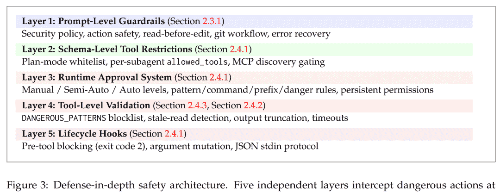

Figure 3: 防御纵深安全架构的五层独立防线

**关键设计**：让危险工具"不可见"而非"被阻止"。当Tool Schema中根本不包含写工具时，LLM甚至不会尝试生成写操作，这比运行时权限检查更 robust。

## 6. 复合AI系统()：多模型路由

OPENDEV采用Compound AI System架构，将不同工作负载路由到不同模型：

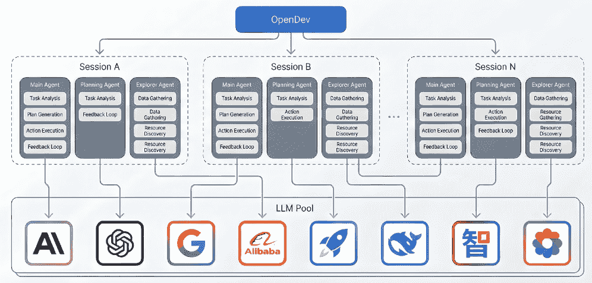

Figure 1: OPENDEV的并发会话架构，每个Session包含多个Subagent，各自绑定到LLM Pool中的不同模型

这种设计实现了**模型无关性**：切换提供商只需改配置，无需改代码。

## 工具系统：延迟发现与高效扩展

### 7.1 MCP（Model Context Protocol）延迟发现

为避免100个外部工具消耗20,000** Token的上下文，OPE**NDEV采用Lazy Discovery：只有在Agent调用search_tools或直接调用某个MCP工具时，该工具的Schema才被加载到上下文中。

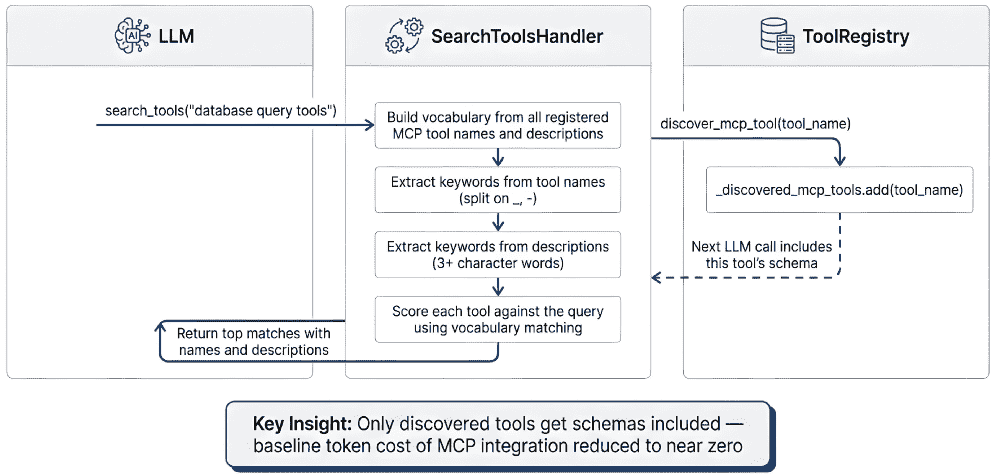

Figure 19: ToolRegistry的延迟发现机制，将MCP集成的基线Token成本降至接近零

### 7.2 9-Pass模糊匹配编辑

LLM生成的代码编辑往往有微小偏差（空格、缩进、转义序列）。edit_file工具实现了9级渐进式匹配链，从精确匹配到上下文感知匹配，大幅降低了"内容未找到"的错误率。

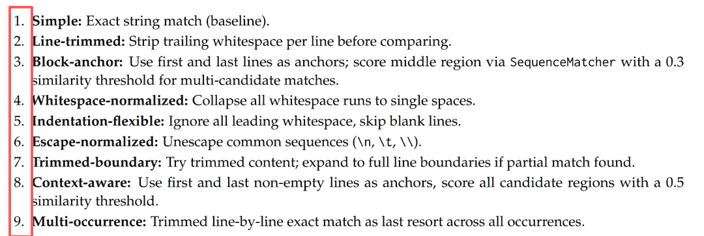

Table D: Edit Tool的九级模糊匹配链

### 7.3 完整工具目录

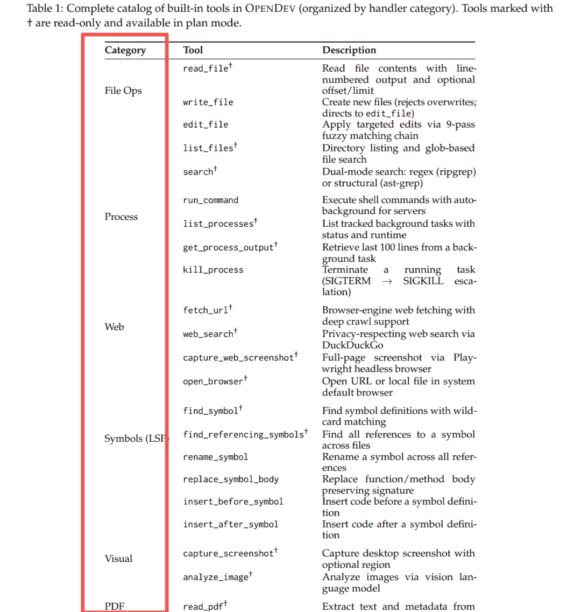

Table 1: OPENDEV内置工具完整目录（按Handler分类）

## 关键经验：五个设计权衡

OpenDev总结了五个跨领域的设计张力：

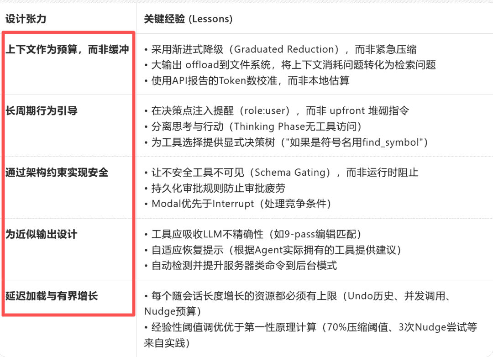

## 最后，Harness作为新的抽象层

OpenDev的贡献不仅是又一个**开源Codin**g Agent，而是提出了Harness这一关键抽象——将Agent的运行时编排从业务逻辑中分离出来。

在终端原生Agent的时代，我们需要的不是更聪明的Prompt，而是更健壮的Scaffolding + Harness架构：

+   **Scaffolding**确保Agent以正确的能力组合启动

+   **Harness**确保Agent在长周期、高风险的终端环境中安全、高效、持续地运行