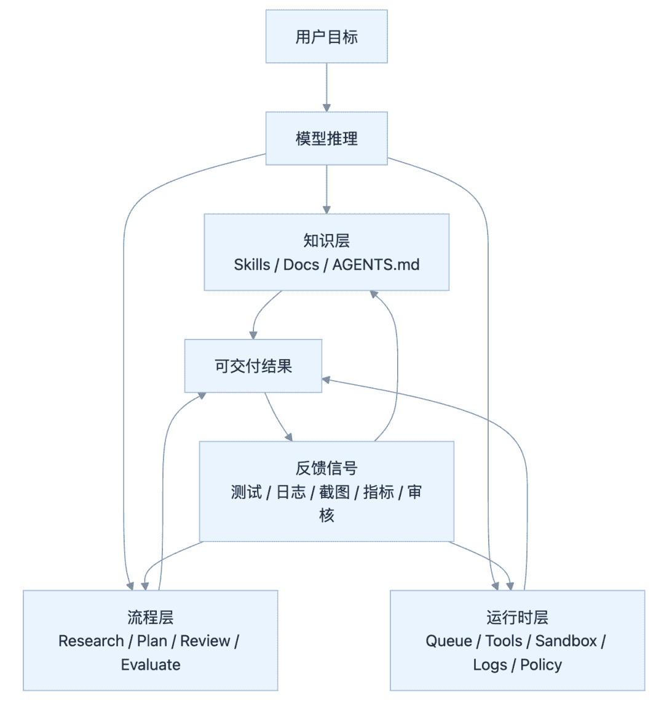
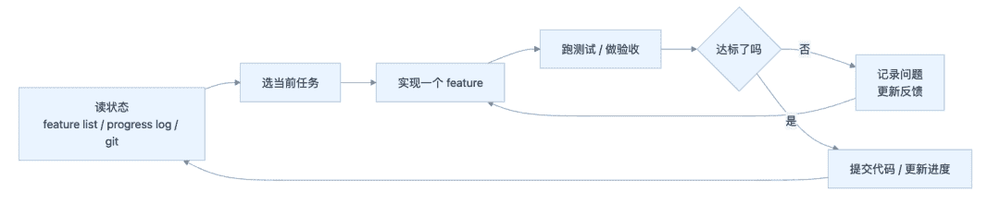
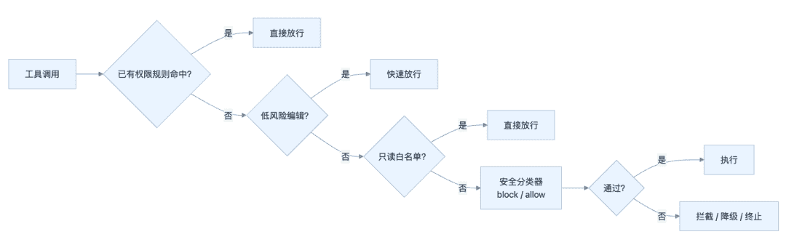

# 模型越来越强，为什么大家却开始重写 Harness

> 来源：[https://qqs7y1hozd1.feishu.cn/docx/LC6odods4oO49YxOgtxcfuaAnsh](https://qqs7y1hozd1.feishu.cn/docx/LC6odods4oO49YxOgtxcfuaAnsh)

**H**arness这个词真正有意思的地方在于，它提醒我们：AI 工程的重心，正在从“让模型更会回答”，转向“让系统更稳地交付结果”。

> 同一个模型，提示词不变，数据不变，只是换一套运行方式，编程成绩就从 42% 跳到 78%。

## 先别把 Harness 当成一层“壳”

很多人第一次听到 Harness，会本能地把它理解成“模型外面那层包装”。

实际大多数时候现在更愿意把 Harness 理解成另一种东西：

它不是给模型套上的外壳，而是把模型接进工程世界的那层控制系统。

先用一张图把这件事放平：

这里面通常包括几类东西：

+   状态怎么保存

+   工具怎么暴露

+   权限怎么约束

+   输出怎么验证

+   上下文怎么管理

+   任务怎么续跑

+   什么叫“真的完成了”

把这几样拆开看，你会发现它们并不花哨，甚至很多都不新鲜。文件系统、测试、日志、浏览器、Lint()、计划文件、审批机制，这些原本就是软件工程里再普通不过的东西。

但一旦主角从人类工程师换成模型，它们突然重新变成了核心。

因为模型最擅长的是生成，最不擅长的是在约束里稳定收敛。

如果把我们最近写过的几篇放在一起看，这个轮廓其实已经很清楚了。

在《[Skills 详解](https://mp.weixin.qq.com/s?__biz=MzAwNjQwNzU2NQ==&mid=2650408639&idx=1&sn=ad325d5fa3dd0e112d62b0e34ea3c48a&scene=21#wechat_redirect)》里，我们拆过 Skill 为什么能跑得稳。它要解决的是提示词漂移、方法失传、工作流无法复用这些问题。本质上，是把原本靠聊天临场发挥的东西，搬进文件系统和版本控制。

在《跟Cloudflare大佬学用 Claude Code》里，我们讲 Boris 那套 Research -> Plan -> 批注 -> Implement 流程。这组方法最值钱的地方，在于它把“架构决策怎么进入执行流程”这件事做成了机制。

在《深度拆解 Clawdbot（OpenClaw）架构与实现》里，我们写过 lane queue、allowlist、JSONL 回放、语义快照。这些都在回答另一类问题：系统怎么保持可控、可回放、可解释。

分开看，它们像三个不同话题。放在一起，其实都在做一件事：把原本靠模型临场发挥的部分，改造成可沉淀、可约束、可验证的系统。

这轮材料反复读下来，还有一个很直观的感受。真正变化快的，往往不是那个最小执行循环，而是循环外面不断加厚的那层工程设施：知识怎么挂进去，状态怎么存下来，权限怎么卡住，验收怎么接回来。也正因为如此，这一轮大家聊 Harness，越来越像在聊系统设计，而不是某个单点技巧。

---

## 为什么它偏偏现在火了

如果把时间往前拨两年，你会发现那时候大家最关心的是 Prompt Engineering()。

核心问题是：怎么把一句话说清楚，让模型按你的意思回答。

后来上下文变长了，任务变复杂了，大家开始聊 Context Engineering。问题也跟着变了，不再是“这一句怎么写”，而是“什么信息应该放进来，什么不该放进来”。

再往后走，就到了今天这个阶段。

Prompt Engineering 和 Context Engineering 当然没有过时。更准确地说，它们被包进了一个更大的问题里。

现在更让人头疼的问题变了：模型能理解需求，但在一个复杂系统里，它能不能把事情从头到尾做稳？

这也是为什么最近围绕 Harness 的材料，明显都带着一种很强的“实战味”。

Mitchell Hashimoto 提出 Engineer the Harness，出发点很具体：每当 Agent 犯了一个错误，就别只盯着这次对话修修补补，把修复方式沉淀进系统，让它下次别再犯。

OpenAI 的 Codex 团队讲得更直接。他们从零开始跑出一个大规模代码库之后，最后得出的重点，落在三件事上：仓库怎么成为统一知识入口，架构边界怎么机械执行，PR 怎么通过 Lint 和测试去卡住错误方向。

Anthropic 的材料也很典**型。里面有一个很朴素的发现，**我一直记得：模型并不擅长评价自己的工作。

这句话看起来平淡，其实分量很重。

因为它把很多人真实碰到的问题说穿了。页面看起来像是做完了，交互其实没通。功能大体对了，边界条件一跑就露馅。代码能过一部分测试，但系统层面已经悄悄偏离了原本的设计。

这些失败的根源都一样：系统没有逼着它验证。

这也解释了最近讨论 Harness 时的一个微妙转向：大家关心的，越来越是“怎么让 Agent 别自信地干错事”。

AI 工程开始从能力问题，转向可靠性问题。

如果把这个变化压得再实一点，我觉得最近几篇我们写过的文章，刚好可以分别落在这条线上。

《跟Cloudflare大佬学用 Claude C**ode》讨论的重点，其实**是“先让 AI 把系统读明白、把方案写出来，再动手写代码”。这对应的是流程层的 Harness。

《[Skills 详解](https://mp.weixin.qq.com/s?__biz=MzAwNjQwNzU2NQ==&mid=2650408639&idx=1&sn=ad325d5fa3dd0e112d62b0e34ea3c48a&scene=21#wechat_redirect)》讨论的重点，是把提示词和方法论从对话框搬到文件系统，对抗提示词漂移。这对应的是

**知识层的 Harness**。

《深度拆解 Clawdbot（OpenClaw）**架构与实现》讨论的重点，是**队列、权限、记忆、回放、浏览器语义快照这些机制怎么互相配合。这对应的是运行时层的 Harness。

也就是说，Harness 对我来说并不是突然冒出来的新对象，更像是最近终于有了一个词，可以把这些原本分散的问题收在一起。

---

## Harness 真正值钱的地方，不是功能多，而是能收敛

如果把这件事说得再具体一点，我觉得现在很多团队补 Harness，本质上是在补三种能力：

+   • 把隐性约束写出来

+   • 把失败信号接回来

+   • 把完成标准钉死

这三样一旦缺了，模型越强，系统有时候反而越难管。

过去看很多 Agent 产品介绍，很容易被带到“功能视角”里。

有多少工具，能不能并发，支不支持子 Agent，能不能接浏览器，能不能连 MCP。

这些当然重要。但如果只按这个角度理解 Harness，很容易越做越重，最后把它做成一个功能清单。

我更认同的一种看法是：Harness 最值钱的地方，在于它让模型更容易收敛到正确的事。

这背后至少有三层含义。

第一层，是把隐性知识显性化。

人类工程师在团队里工作，很多判断其实不写在代码里。哪些模块不能碰，哪些目录是只读的，哪些约定必须复用，哪些测试不过就别谈合并，这些东西往往散落在经验里。

模型没有这些经验。

所以你越希望它长期工作，就越要把这些知识推到文件系统里，推到规则里，推到工具可见性里，推到报错提示里。仓库为什么会被很多团队当成唯一知识源，本质上就是因为它是最容易被版本化、被 review、被机器读取的地方。

第二层，是缩小解空间。

这件事听起来有点反直觉。大家本能上会觉得，给模型更多工具、更多自由、更多上下文，它应该更强。

但很多实战案例恰恰指向相反的方向。

工具太多，它开始犹豫。

上下文太满，它开始退化。

边界太松，它会在错误方向上越跑越远。

更有效的 Harness，往往是把路修得越来越清楚，而不是越来越宽。哪些事可以做，哪些事不该做，做到什么算完成，失败后先看哪里，这些越明确，系统越容易稳定。

第三层，是把“生成”改造成“闭环”。

很多人对 AI 的默认想象，还是输入一个需求，等它吐出一个答案。

但真实工作并不是这样。

真实工作更像一个循环：读上下文，做判断，执行动作，观察结果，修正方向，再继续。

如果没有日志、测试、浏览器、Lint、评审规则这些反馈点，模型的生成能力再强，也很容易停在“看起来差不多”。

所以从工程角度看，Harness 不只是让模型有手有脚，它更像是在给模型装感官和护栏。

Anthropic 关于 long-running agent 的总结里，有一段我觉得特别值得抄走。它把状态放到 feature list、progress log、git 这些外部工件里，避免让 Agent 一口气把整件事做完，然后按固定循环推进：

这套东西看上去不“智能”，但很工程。它把 AI 从“即兴发挥的写代码机器”，往“能在 backlog、commit()、log 里持续推进的人”那边拉了一步。

---

## 会过时的是具体补丁，不是整个问题

讲到这里，很容易把 Harness 说得像一切答案。

我不太想这么写。

一方面，这不符合这轮材料本身透露出来的事实。另一方面，也容易把文章写得太满。

Noam Brown 那一派的提醒，我觉得是有价值的。

很多今天看起来很聪明的脚手架设计，半年后确实可能就没那么必要了。模型一旦变强，一些原本靠工程补上的能力，可能就会被模型自己吸收掉。

Anthropic 的例子就很典型。旧模型阶段，一些为了对抗长任务退化而设计出来的流程，到了新模型阶段，可能就可以拆掉。你昨天还觉得离不开的那层补丁，明天也许就成了多余复杂性。

所以我并不觉得 Harness 会无限膨胀。

但我也不觉得它会消失。

更可能的情况是：具体做法不断被替换，但底层问题一直都在。

比如：

+   • 上下文总得管理

+   • 环境总得约束

+   • 结果总得验证

+   • 失败总得反馈

+   • 知识总得沉淀

这些问题不会随着某一代模型升级就消失。只要你让一个生成模型进入真实系统，它们迟早都会冒出来。

模型变强，变化的更像是“问题出现的位置”。

以前你要花很多力气教它怎么保持上下文一致性。以后也许这件事轻了，但你会开始让它跑更长的任务、接更复杂的系统、承担更高的自主权。那时新的边界和新的反馈机制又会冒出来。

所以如果一定要给这件事下一个更温和的判断，我会这么说：

Harness 不是一套固定答案，它更像一类持续移动的问题。

---

## 如果你真准备动手，先补这五样

写到这里，最实际的问题其实是：那到底该先做什么。

如果你是个人开发者，或者是刚开始让 Agent 真正进入工作流的团队，我会更建议从下面五样开始，而不是一上来就追求复杂编排。

### 先有一个统一知识入口

仓库里该有的东西尽量放进仓库。架构约定、目录说明、关键约束、计划文件，都尽量文件化。

不要把关键知识散在口头习惯、飞书聊天和个人脑子里。

### 指令文件短一点，像目录，不像百科

AGENTS.md、CLAUDE.md 这类文件有用，但别写成一部长篇制度手册。

它更适合告诉模型“去哪看什么”，而不是试图一次性把所有知识塞进去。

### 能靠硬约束解决的，就别只靠 Prompt

架构边界、目录限制、测试要求、Lint 规则，这些如果能自动检查，就不要只写一句“请遵守”。

模型会忘，规则不会。

不少 Coding Agent 的运行时设计也能说明这点。更稳的做法，通常都是把安全做成一条分层流水线，而不是把所有判断都甩给模型：已有授权规则先匹配，低风险编辑走快速通道，只读工具白名单直接放行，剩下的才交给独立分类器。

这背后的思路很值得学：不要只问“模型会不会犯错”，而要先问“错误有没有被系统提前挡住”。

### 给它反馈，不要只给它任务

写完代码之后，它应该能看到测试结果、浏览器表现、日志、错误提示。

没有反馈的 Agent，很容易把“生成了一份看起来像样的输出”误判成“任务已经完成”。

Anthropic 那套 generator / evaluator 分工，本质上也是在补这一点。系统里有一个角色专门负责“验收”，生成和验收分开。

### 别急着上多 Agent

很多问题，单 Agent 加清晰约束就能解决。

多 Agent 当然有价值，但它会把状态同步、职责边界、上下文漂移这些问题一起放大。单线程都没跑稳时，盲目并行通常只会更乱。

这一点跟我们在《小白也能搞懂：OpenClaw多Ag**ent怎么选、怎么搭》里写过的**判断是一致的。前一篇更偏部署实操，本文更偏方法论，但核心其实一样：先把架子搭稳，再谈拆分和并发。

这五样做完，系统未必立刻变得很高级。

但它会先变得靠谱一点。

而在今天这个阶段，我觉得“靠谱一点”比“花哨很多”更重要。

---

## 写在最后

这一轮看下来，我对 Harness 最后的感受，其实挺朴素。

它没有神秘到像一门新学科刚刚诞生，也没有简单到只是“模型外面那层壳”。

它更像是大家终于开始认真承认一件事：要把模型放进真实工作流，难点从来不只在模型本身。

模型把可能性打开，系统再决定这些可能性能不能落成稳定结果。

边界怎么设，反馈怎么回，什么算完成，出了问题从哪里继续，这些事最后都要靠系统来接住。

过去两年，大家在拼谁的模型更强。

接下来一段时间，我更倾向于把差距看成另一件事：

谁更早把模型外面那层系统，当成一门正经工程来做。

这未必是最热闹的话题，但很可能是更难绕开的那个话题。