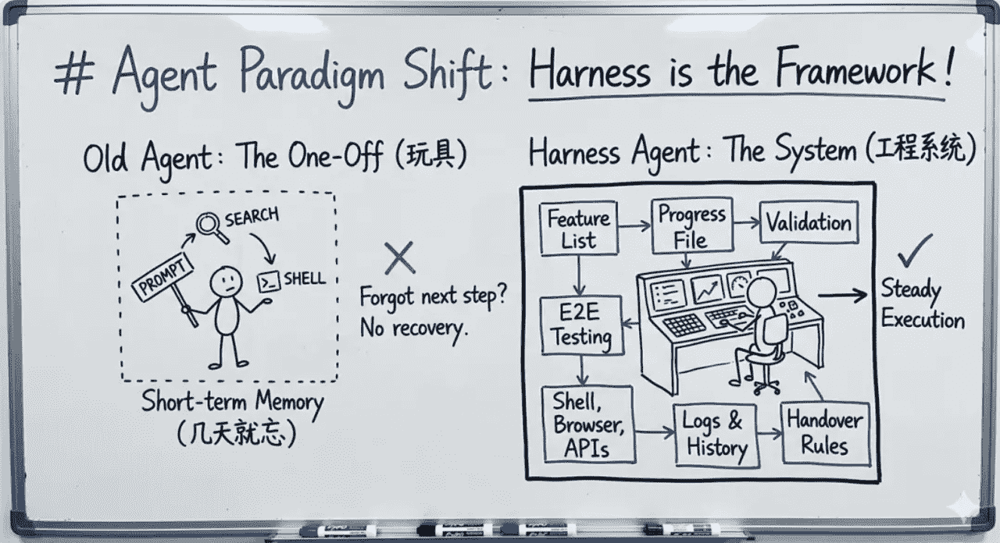
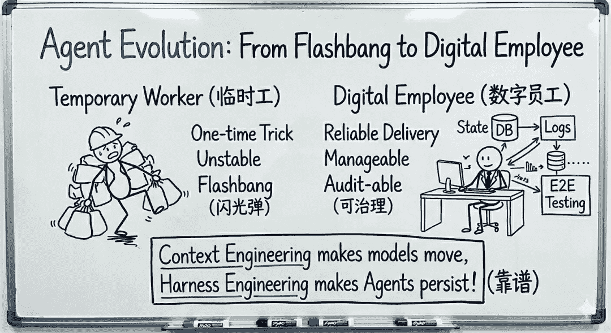

# Harness驱动的Agent

> 来源：[https://qqs7y1hozd1.feishu.cn/docx/QRdldG6DeopspxxqjQfc28dJn8e](https://qqs7y1hozd1.feishu.cn/docx/QRdldG6DeopspxxqjQfc28dJn8e)

## 核心结论

Harness，别光想成是个新模型或者更厉害的提示词，就是把那些：模型+工具+状态+验收+日志+恢复啥的，统统整合起来，让Agent成真·工程系统，而不是“用完丢弃”。

它其实更像是个“后台管家”，帮agent搭了个框架，不是随便给它一根绳子，它能不乱跑就行，而是给它一套规则、一张流程图，告诉它“别光干一阵子，要能接力、能回头看记录、能复盘还能纠错”。

---

## 为什么之前的Agent老坑爹？

[大多数现成Agent形态都差不多是个套路O](https://mp.weixin.qq.com/s?__biz=Mzg4MzAzNTA5Ng==&mid=2247485475&idx=1&sn=4c744dfd0b44d9a2fff4678660d4f94e&scene=21#wechat_redirect)penClaw 技术揭秘：一个真正“能干活”的 Agent，到底是怎么跑起来的？：

+   给模型一个prompt + loop

+   搭配几个外部工具比如搜索啥的

+   观察、思考、行动，每步动作让它试图自动拆任务、执行

之前的坑爹 Agent - 多轮任务断崖

这多半在一两个小时内还能凑合，但一旦遇上慢活儿——多轮不间断，跨天的任务，各种边界条件，立马尴尬：

+   模型“记忆”没法跨session（就像换个新员工啥都得重新讲）

+   做着做着忘任务做哪儿了

+   以为完了实际没验收

+   • 下一趟接着干，半路儿卡壳没人知道为啥

+   • 回滚和审计完全没影

+   • 工具多但没规则限制，“想干啥干啥”，结果乱七八糟

问题不是模型不聪明，是没人真正搭个架子帮它“靠谱干活”。

---

## Harness 到底是啥？

想象一下，你不是只让Agent“死记硬背prompt”，而是给它配个由：

+   • 任务清单（feature list）

+   • 进度文件（progress file）

+   • 自动审核测试（E2E验收）

+   • 环境启动脚本（init.sh）

+   • 代码版本历史（git commit）

+   • 多agent角色分工

组成的“大脑加后勤保障团队”。

它像一个控制舱，确保agent不会随便乱搞乱跑——有边界、有流程、有回滚、有日志。你转身离开，agent也不会崩盘。

---

## Harness由啥模块组成？

Harness 的七个核心模块

+   • 上下文管理和状态存储

+   • 任务脚手架（feature list和完成标准）

+   • 工具调用运行环境（shell、浏览器、API）

+   • 安全审计和审批守门

+   • 自动测试和端到端验收

+   • 失败恢复和审计日志

+   • 多agent分工和任务交接规范

---

## Anthropic 的设计：直击要害

他们把整个体系拆成两个agent角色：

Anthropic 的设计 - 角色接力与真实测试

+   • Initializer Agent：第一棒，把环境架起来，任务列出来，写好进度文件，提交初始代码

+   • **Coding Agent****()**：后面接力，每次只管挑一个没完成的任务，慢慢干，做完再测，更新进度，提交commit

这就避免了“自以为一口气干完所有事”的误判。它们还用json明确任务啥时候算完成，避免Agent自己糊弄，搞出“我差不多完事了”的假象。

再加上“真实世界测试”：不光代码过单元测试，还得跑浏览器里自动化点点点，模拟用户看效果，才能算完，这样才能靠谱。

---

## 这个Harness适合解决啥问题？

老实说，不是所有任务都适合杀入这种严肃工程。但针对长周期、多工具、多节点、多角色，需要治理可审计的项目，这玩意硬核又有必要。

它帮你解决的核心难题是：

+   • **连续性**：多次对话、多session无缝衔接

+   • **完成度幻觉**：避免Agent自我感觉良好，偷偷糊弄过去

+   • **可恢复性**：万一崩了，能查原因，能回来接着干

+   • **可控制性**：权限审批，风险操作提醒，日志完整

---

## 对产品、工程和组织来说，Harness有多重要？

+   • 对产品来说，从“一次性炫技”升级成“靠谱交付”，这个很关键，不然不稳定谁敢用？

+   • 对工程来说，重点不再是捣鼓模型API和prompt，而是设计状态机、审批流程、日志体系这些企业软件的内核

+   • 对组织来说，Agent不是孤胆英雄，是数字员工，你得有管理规范和协作流程，不然它就是个不靠谱的“临时工”

---

## 这范式不完美啊，风险也很明显

+   • 复杂度蹭蹭涨，不小心系统自己就成大金字塔工程，维护烧钱

+   • Agent毕竟还会“自我蒙蔽”，比如误标完成，数据污染

+   • 短平快任务没必要重型Harness，造反不划算

+   • 多agent带来了协调成本和信息同步困扰，不是越多越好

---

## 你到底值不值得搭理Harness？

如果你准备做Agent落地，想不再光搞模型，想真做能稳定交付的系统，这东西你得上心。

它就是帮你解决“可持续执行”和“真实生产环境治理”的缺口。

未来这肯定会是平台竞争的关键层次，谁能提供更稳、能跨会话接续、能快速恢复的agent系统，谁就更牛。

---

## 我咋给它下定义呢？

简单粗暴几句话：

> Agent 的下一阶段，不是盯着它会说啥，而是盯着它能扛多久、多稳。

> Harness就是那个让Agent不再是“闪光弹”，而是企业级“数字员工”的幕后支撑。

闪光弹 vs. 数字员工

或者更创业味儿点说：

> Context engineering 让模型能动，Harness engineering 让Agent能撑住。

---

## 总结

Harness被吹成Agent新范式，是对的。不是因为发明啥超强模型，而是说，它把Agent从“能做点事”升级到了“能持续、可治理、可审计、真正落地”的坚实系统。

这对Agent真正走向广泛应用，是决定性的一步。