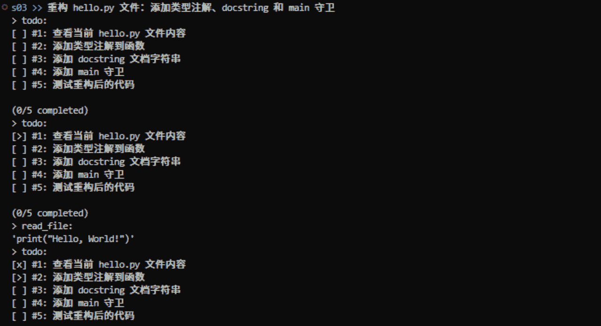

# S03：Todo 清单 — 防止智能体注意力漂移

> 来源：[https://qqs7y1hozd1.feishu.cn/docx/LSysdaVWNoTuX8xvlE6cIzAknyd](https://qqs7y1hozd1.feishu.cn/docx/LSysdaVWNoTuX8xvlE6cIzAknyd)

# TodoWrite (待办写入)

智能体能干活了，但干着干着容易跑偏，在多轮对话之后，智能体容易忘记最初定下的目标，开始即兴发挥、重复做过的事、或者跳步，这就是注意力漂移

这一课的解决办法很直接：**给它加个 Todo 清单**

> 智能体接到任务后，先调用 Todo 工具列出步骤，然后一步一步打勾，规则很简单：同一时间只能有一个任务在"进行中"，强制它老老实实一步步来

还有个兜底：如果连着 3 轮都没更新 Todo，系统会悄悄塞一条提醒进去，这条提醒是 Harness 塞的，用户看不到，智能体看得到



s01 > s02 > [ s03 ] s04 > s05 > s06 | s07 > s08 > s09 > s10 > s11 > s12

> "没有计划的 agent 走哪算哪" -- 先列步骤再动手, 完成率翻倍。

> Harness 层: 规划 -- 让模型不偏航, 但不替它画航线。

## 问题

多步任务中, 模型会丢失进度 -- 重复做过的事、跳步、跑偏。对话越长越严重: 工具结果不断填满上下文, 系统提示的影响力逐渐被稀释。一个 10 步重构可能做完 1-3 步就开始即兴发挥, 因为 4-10 步已经被挤出注意力了。

## 解决方案

```
+--------+      +-------+      +---------+
|  User  | ---&gt; |  LLM  | ---&gt; | Tools   |
| prompt |      |       |      | + todo  |
+--------+      +---+---+      +----+----+
                    ^                |
                    |   tool_result  |
                    +----------------+
                          |
              +-----------+-----------+
              | TodoManager state     |
              | [ ] task A            |
              | [&gt;] task B  &lt;- doing  |
              | [x] task C            |
              +-----------------------+
                          |
              if rounds_since_todo &gt;= 3:
                inject &lt;reminder&gt; into tool_result
```

## 工作原理

1.  TodoManager 存储带状态的项目。同一时间只允许一个 in_progress。

```
class TodoManager:
    def update(self, items: list) -&gt; str:
        validated, in_progress_count = [], 0
        for item in items:
            status = item.get(&quot;status&quot;, &quot;pending&quot;)
            if status == &quot;in_progress&quot;:
                in_progress_count += 1
            validated.append({&quot;id&quot;: item[&quot;id&quot;], &quot;text&quot;: item[&quot;text&quot;],
                              &quot;status&quot;: status})
        if in_progress_count &gt; 1:
            raise ValueError(&quot;Only one task can be in_progress&quot;)
        self.items = validated
        return self.render()
```

1.  todo 工具和其他工具一样加入 dispatch map。

```
TOOL_HANDLERS = {
    # ...base tools...
    &quot;todo&quot;: lambda **kw: TODO.update(kw[&quot;items&quot;]),
}
```

1.  nag reminder: 模型连续 3 轮以上不调用 todo 时注入提醒。

```
if rounds_since_todo &gt;= 3 and messages:
    last = messages[-1]
    if last[&quot;role&quot;] == &quot;user&quot; and isinstance(last.get(&quot;content&quot;), list):
        last[&quot;content&quot;].insert(0, {
            &quot;type&quot;: &quot;text&quot;,
            &quot;text&quot;: &quot;&lt;reminder&gt;Update your todos.&lt;/reminder&gt;&quot;,
        })
```

"同时只能有一个 in_progress" 强制顺序聚焦。nag reminder 制造问责压力 -- 你不更新计划, 系统就追着你问。

## 相对 s02 的变更

## 试一试

```
cd learn-claude-code
python agents/s03_todo_write.py
```

试试这些 prompt (英文 prompt 对 LLM 效果更好, 也可以用中文):

1.  Refactor the file hello.py: add type hints, docstrings, and a main guard

1.  Create a Python package with init.py, utils.py, and tests/test_utils.py

1.  Review all Python files and fix any style issues