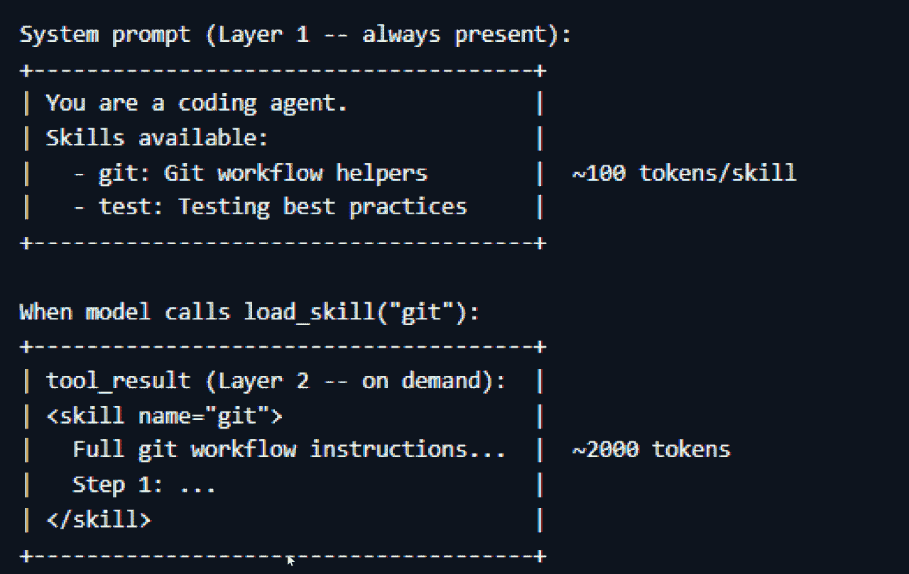

# S05：技能加载 — 按需加载的知识体系

> 来源：[https://qqs7y1hozd1.feishu.cn/docx/YH7GdppmXonqykxMK4QcGOLyntf](https://qqs7y1hozd1.feishu.cn/docx/YH7GdppmXonqykxMK4QcGOLyntf)

# Skills (Skill 加载)

这是一个转折点

在这之前，工具箱、Todo、子 Agent 这些机制都是在一轮对话循环内部的改进，从 S05 开始，Harness 有了自己的文件系统结构，不再只是一段 Python 代码了

假设你想让智能体懂 git 规范、代码审查、PDF 处理等等，全塞到系统提示里的话，十个技能就占 2 万 token，大部分还跟当前任务没关系，纯浪费

于是出现了Skill：

所有的 Skill 以文件夹的形式组织，每个文件夹里有一个 SKILL.md 文件，包含完整的技能说明、步骤、代码示例等

加载分两层：

+   第一层（启动时）：Harness 启动时自动扫描所有 SKILL.md 文件，把技能名称和简短描述注入系统提示，智能体是被告知有哪些技能可用，成本很低，只有几十 token

+   第二层（执行时）：当智能体确定需要某个技能时，调用 load_skill 工具，这时才把完整的 SKILL.md 内容注入上下文，可能有几千 token

核心思想：启动时只给菜单，点菜时才上完整食谱，这样既保证智能体知道自己能做什么，又避免了不相关的知识白白占用上下文



s01 > s02 > s03 > s04 > [ s05 ] s06 | s07 > s08 > s09 > s10 > s11 > s12

> "用到什么知识, 临时加载什么知识" -- 通过 tool_result 注入, 不塞 system prompt。

> Harness 层: 按需知识 -- 模型开口要时才给的领域专长。

## 问题

你希望 Agent 遵循特定领域的工作流: git 约定、测试模式、代码审查清单。全塞进系统提示太浪费 -- 10 个 Skill, 每个 2000 token, 就是 20,000 token, 大部分跟当前任务毫无关系。

## 解决方案

```
System prompt (Layer 1 -- always present):
+--------------------------------------+
| You are a coding agent.              |
| Skills available:                    |
|   - git: Git workflow helpers        |  ~100 tokens/skill
|   - test: Testing best practices     |
+--------------------------------------+

When model calls load_skill(&quot;git&quot;):
+--------------------------------------+
| tool_result (Layer 2 -- on demand):  |
| &lt;skill name=&quot;git&quot;&gt;                   |
|   Full git workflow instructions...  |  ~2000 tokens
|   Step 1: ...                        |
| &lt;/skill&gt;                             |
+--------------------------------------+
```

第一层: 系统提示中放 Skill 名称 (低成本)。第二层: tool_result 中按需放完整内容。

## 工作原理

1.  每个 Skill 是一个目录, 包含 SKILL.md 文件和 YAML frontmatter。

```
skills/
  pdf/
    SKILL.md       # ---\n name: pdf\n description: Process PDF files\n ---\n ...
  code-review/
    SKILL.md       # ---\n name: code-review\n description: Review code\n ---\n ...
```

1.  SkillLoader 递归扫描 SKILL.md 文件, 用目录名作为 Skill 标识。

```
class SkillLoader:
    def __init__(self, skills_dir: Path):
        self.skills = {}
        for f in sorted(skills_dir.rglob(&quot;SKILL.md&quot;)):
            text = f.read_text()
            meta, body = self._parse_frontmatter(text)
            name = meta.get(&quot;name&quot;, f.parent.name)
            self.skills[name] = {&quot;meta&quot;: meta, &quot;body&quot;: body}

    def get_descriptions(self) -&gt; str:
        lines = []
        for name, skill in self.skills.items():
            desc = skill[&quot;meta&quot;].get(&quot;description&quot;, &quot;&quot;)
            lines.append(f&quot;  - {name}: {desc}&quot;)
        return &quot;\n&quot;.join(lines)

    def get_content(self, name: str) -&gt; str:
        skill = self.skills.get(name)
        if not skill:
            return f&quot;Error: Unknown skill &#x27;{name}&#x27;.&quot;
        return f&quot;&lt;skill name=\&quot;{name}\&quot;&gt;\n{skill[&#x27;body&#x27;]}\n&lt;/skill&gt;&quot;
```

1.  第一层写入系统提示。第二层不过是 dispatch map 中的又一个工具。

```
SYSTEM = f&quot;&quot;&quot;You are a coding agent at {WORKDIR}.
Skills available:
{SKILL_LOADER.get_descriptions()}&quot;&quot;&quot;

TOOL_HANDLERS = {
    # ...base tools...
    &quot;load_skill&quot;: lambda **kw: SKILL_LOADER.get_content(kw[&quot;name&quot;]),
}
```

模型知道有哪些 Skill (便宜), 需要时再加载完整内容 (贵)。

## 相对 s04 的变更

## 试一试

```
cd learn-claude-code
python agents/s05_skill_loading.py
```

试试这些 prompt (英文 prompt 对 LLM 效果更好, 也可以用中文):

1.  What skills are available?

1.  Load the agent-builder skill and follow its instructions

1.  I need to do a code review -- load the relevant skill first

1.  Build an MCP server using the mcp-builder skill