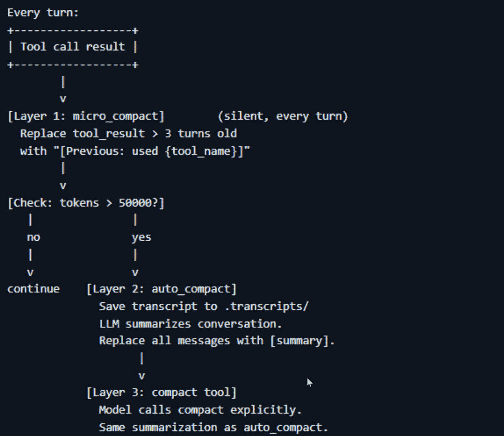

# S06：上下文压缩 — 三层机制保证无限会话

> 来源：[https://qqs7y1hozd1.feishu.cn/docx/NhKRdRB9soqANcxSQn5cSVDSnGc](https://qqs7y1hozd1.feishu.cn/docx/NhKRdRB9soqANcxSQn5cSVDSnGc)

# Context Compact (上下文压缩)

上下文窗口是有限的，读几十个文件、跑几十条命令，轻松突破 token 上限，不压缩，智能体在大项目里根本干不了活

这一课设了三道防线：

**第一道**：每轮自动把 3 轮以前的工具返回内容替换成一个标记，比如 [Previous: used read_file]，最近几轮保持完整，旧的只留个印记

**第二道**：token 总量超过阈值时自动触发，先把完整对话存到磁盘（不会丢），然后让模型做一段摘要，用摘要替换掉所有历史消息，上下文就干净了

**第三道**：智能体自己觉得太乱了，也可以主动调用压缩工具

关键是：**历史信息没有真正丢失**，都存在磁盘上了，只是移出了当前对话



s01 > s02 > s03 > s04 > s05 > [ s06 ] | s07 > s08 > s09 > s10 > s11 > s12

> "上下文总会满, 要有办法腾地方" -- 三层压缩策略, 换来无限会话。

> Harness 层: 压缩 -- 干净的记忆, 无限的会话。

## 问题

上下文窗口是有限的。读一个 1000 行的文件就吃掉 ~4000 token; 读 30 个文件、跑 20 条命令, 轻松突破 100k token。不压缩, Agent 根本没法在大项目里干活。

## 解决方案

三层压缩, 激进程度递增:

```
Every turn:
+------------------+
| Tool call result |
+------------------+
        |
        v
[Layer 1: micro_compact]        (silent, every turn)
  Replace tool_result &gt; 3 turns old
  with &quot;[Previous: used {tool_name}]&quot;
        |
        v
[Check: tokens &gt; 50000?]
   |               |
   no              yes
   |               |
   v               v
continue    [Layer 2: auto_compact]
              Save transcript to .transcripts/
              LLM summarizes conversation.
              Replace all messages with [summary].
                    |
                    v
            [Layer 3: compact tool]
              Model calls compact explicitly.
              Same summarization as auto_compact.
```

## 工作原理

1.  第一层 -- micro_compact: 每次 LLM 调用前, 将旧的 tool result 替换为占位符。

```
def micro_compact(messages: list) -&gt; list:
    tool_results = []
    for i, msg in enumerate(messages):
        if msg[&quot;role&quot;] == &quot;user&quot; and isinstance(msg.get(&quot;content&quot;), list):
            for j, part in enumerate(msg[&quot;content&quot;]):
                if isinstance(part, dict) and part.get(&quot;type&quot;) == &quot;tool_result&quot;:
                    tool_results.append((i, j, part))
    if len(tool_results) &lt;= KEEP_RECENT:
        return messages
    for _, _, part in tool_results[:-KEEP_RECENT]:
        if len(part.get(&quot;content&quot;, &quot;&quot;)) &gt; 100:
            part[&quot;content&quot;] = f&quot;[Previous: used {tool_name}]&quot;
    return messages
```

1.  第二层 -- auto_compact: token 超过阈值时, 保存完整对话到磁盘, 让 LLM 做摘要。

```
def auto_compact(messages: list) -&gt; list:
    # Save transcript for recovery
    transcript_path = TRANSCRIPT_DIR / f&quot;transcript_{int(time.time())}.jsonl&quot;
    with open(transcript_path, &quot;w&quot;) as f:
        for msg in messages:
            f.write(json.dumps(msg, default=str) + &quot;\n&quot;)
    # LLM summarizes
    response = client.messages.create(
        model=MODEL,
        messages=[{&quot;role&quot;: &quot;user&quot;, &quot;content&quot;:
            &quot;Summarize this conversation for continuity...&quot;
            + json.dumps(messages, default=str)[:80000]}],
        max_tokens=2000,
    )
    return [
        {&quot;role&quot;: &quot;user&quot;, &quot;content&quot;: f&quot;[Compressed]\n\n{response.content[0].text}&quot;},
    ]
```

1.  第三层 -- manual compact: compact 工具按需触发同样的摘要机制。

1.  循环整合三层:

```
def agent_loop(messages: list):
    while True:
        micro_compact(messages)                        # Layer 1
        if estimate_tokens(messages) &gt; THRESHOLD:
            messages[:] = auto_compact(messages)       # Layer 2
        response = client.messages.create(...)
        # ... tool execution ...
        if manual_compact:
            messages[:] = auto_compact(messages)       # Layer 3
```

完整历史通过 transcript 保存在磁盘上。信息没有真正丢失, 只是移出了活跃上下文。

## 相对 s05 的变更

## 试一试

```
cd learn-claude-code
python agents/s06_context_compact.py
```

试试这些 prompt (英文 prompt 对 LLM 效果更好, 也可以用中文):

1.  Read every Python file in the agents/ directory one by one (观察 micro-compact 替换旧结果)

1.  Keep reading files until compression triggers automatically

1.  Use the compact tool to manually compress the conversation