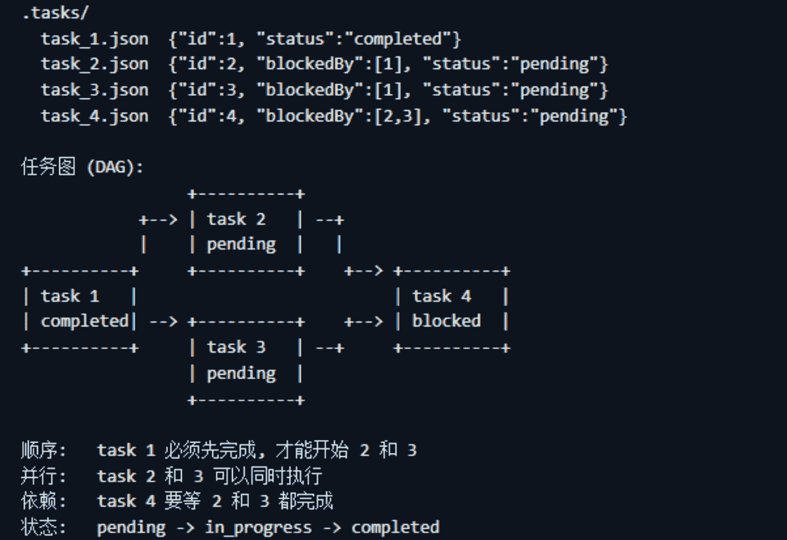
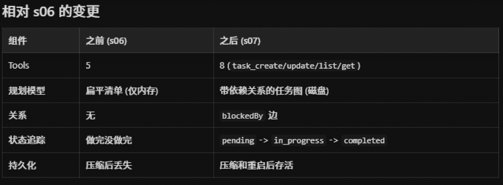
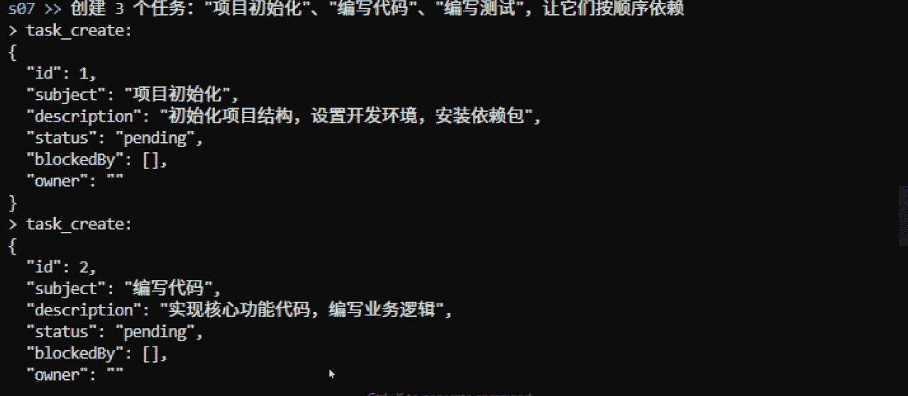
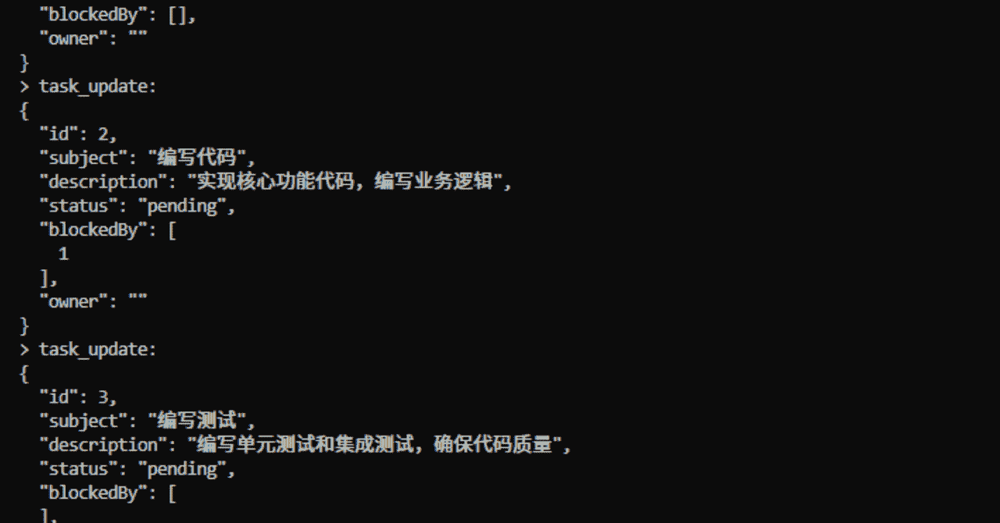
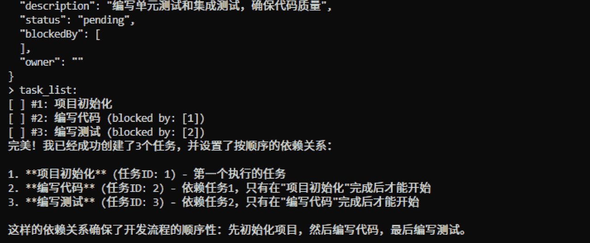
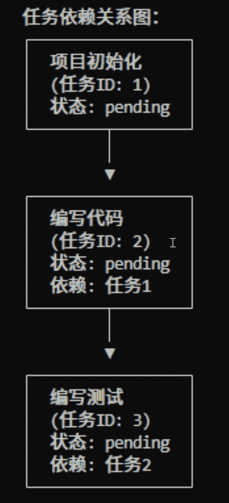
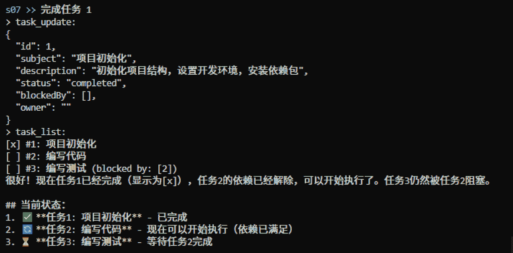

# S07：任务系统 — 不是所有事都能排队做

> 来源：[https://qqs7y1hozd1.feishu.cn/docx/ON3qdjNE1otzrrxwd1Ecvnr8npg](https://qqs7y1hozd1.feishu.cn/docx/ON3qdjNE1otzrrxwd1Ecvnr8npg)

# Task System (任务系统)

在真实世界中，任务之间并不是单纯的线性关系，而更像是一张图，举个例子：任务 A 执行完之后才能执行任务 B；执行完任务 C 和 D 之后，才能执行任务 E，任务之间有依赖关系，不能简单地用线性流程来完成

因**此引入了一套任务系统，**核心**设计是：为每一个任务创建一个**单独的 JSON 文件来管理，每个任务分配唯一的 ID 和三种状态：待做（pending）、正在做（in_progress）、已完成（completed）

当一个任务要执行时，系统会检查它是否有前置依赖，如果没有依赖，就可以直接执行；如果有依赖，就标记为待做，当某个任务完成后，系统会自动去所有其他任务的 blockedBy 列表里查找这个任务的 ID，找到就删掉，如果删掉之后某个任务的 blockedBy 变成空了，那个任务就自动解锁，可以开始执行了



具体实现是在工具箱里一次加了四个工具：任务创建（task_create）、任务更新（task_update）、任务列表获取（task_list）和任务查询（task_get）



举个例子，使用 task_create 工具创建了三个任务：



使用 task_update 工具更新任务依赖，当 blockedBy 列表中有任务 ID 时，代表那个任务是当前任务的前置依赖，必须先完成才能执行当前任务：





任务的依赖关系：



当完成任务一后，任务二才被解锁可以执行：



s01 > s02 > s03 > s04 > s05 > s06 | [ s07 ] s08 > s09 > s10 > s11 > s12

> "大目标要拆成小任务, 排好序, 记在磁盘上" -- 文件持久化的任务图, 为多 agent 协作打基础。

> Harness 层: 持久化任务 -- 比任何一次对话都长命的目标。

## 问题

s03 的 TodoManager 只是内存中的扁平清单: 没有顺序、没有依赖、状态只有做完没做完。真实目标是有结构的 -- 任务 B 依赖任务 A, 任务 C 和 D 可以并行, 任务 E 要等 C 和 D 都完成。

没有显式的关系, Agent 分不清什么能做、什么被卡住、什么能同时跑。而且清单只活在内存里, 上下文压缩 (s06) 一跑就没了。

## 解决方案

把扁平清单升级为持久化到磁盘的任务图。每个任务是一个 JSON 文件, 有状态、前置依赖 (blockedBy)。任务图随时回答三个问题:

+   什么可以做? -- 状态为 pending 且 blockedBy 为空的任务。

+   什么被卡住? -- 等待前置任务完成的任务。

+   什么做完了? -- 状态为 completed 的任务, 完成时自动解锁后续任务。

```
.tasks/
  task_1.json  {&quot;id&quot;:1, &quot;status&quot;:&quot;completed&quot;}
  task_2.json  {&quot;id&quot;:2, &quot;blockedBy&quot;:[1], &quot;status&quot;:&quot;pending&quot;}
  task_3.json  {&quot;id&quot;:3, &quot;blockedBy&quot;:[1], &quot;status&quot;:&quot;pending&quot;}
  task_4.json  {&quot;id&quot;:4, &quot;blockedBy&quot;:[2,3], &quot;status&quot;:&quot;pending&quot;}

任务图 (DAG):
                 +----------+
            +--&gt; | task 2   | --+
            |    | pending  |   |
+----------+     +----------+    +--&gt; +----------+
| task 1   |                          | task 4   |
| completed| --&gt; +----------+    +--&gt; | blocked  |
+----------+     | task 3   | --+     +----------+
                 | pending  |
                 +----------+

顺序:   task 1 必须先完成, 才能开始 2 和 3
并行:   task 2 和 3 可以同时执行
依赖:   task 4 要等 2 和 3 都完成
状态:   pending -&gt; in_progress -&gt; completed
```

这个任务图是 s07 之后所有机制的协调骨架: 后台执行 (s08)、多 agent 团队 (s09+)、worktree 隔离 (s12) 都读写这同一个结构。

## 工作原理

1.  TaskManager: 每个任务一个 JSON 文件, CRUD + 依赖图。

```
class TaskManager:
    def __init__(self, tasks_dir: Path):
        self.dir = tasks_dir
        self.dir.mkdir(exist_ok=True)
        self._next_id = self._max_id() + 1

    def create(self, subject, description=&quot;&quot;):
        task = {&quot;id&quot;: self._next_id, &quot;subject&quot;: subject,
                &quot;status&quot;: &quot;pending&quot;, &quot;blockedBy&quot;: [],
                &quot;owner&quot;: &quot;&quot;}
        self._save(task)
        self._next_id += 1
        return json.dumps(task, indent=2)
```

1.  依赖解除: 完成任务时, 自动将其 ID 从其他任务的 blockedBy 中移除, 解锁后续任务。

```
def _clear_dependency(self, completed_id):
    for f in self.dir.glob(&quot;task_*.json&quot;):
        task = json.loads(f.read_text())
        if completed_id in task.get(&quot;blockedBy&quot;, []):
            task[&quot;blockedBy&quot;].remove(completed_id)
            self._save(task)
```

1.  状态变更 + 依赖关联: update 处理状态转换和依赖边。

```
def update(self, task_id, status=None,
           add_blocked_by=None, remove_blocked_by=None):
    task = self._load(task_id)
    if status:
        task[&quot;status&quot;] = status
        if status == &quot;completed&quot;:
            self._clear_dependency(task_id)
    if add_blocked_by:
        task[&quot;blockedBy&quot;] = list(set(task[&quot;blockedBy&quot;] + add_blocked_by))
    if remove_blocked_by:
        task[&quot;blockedBy&quot;] = [x for x in task[&quot;blockedBy&quot;] if x not in remove_blocked_by]
    self._save(task)
```

1.  四个任务工具加入 dispatch map。

```
TOOL_HANDLERS = {
    # ...base tools...
    &quot;task_create&quot;: lambda **kw: TASKS.create(kw[&quot;subject&quot;]),
    &quot;task_update&quot;: lambda **kw: TASKS.update(kw[&quot;task_id&quot;], kw.get(&quot;status&quot;)),
    &quot;task_list&quot;:   lambda **kw: TASKS.list_all(),
    &quot;task_get&quot;:    lambda **kw: TASKS.get(kw[&quot;task_id&quot;]),
}
```

从 s07 起, 任务图是多步工作的默认选择。s03 的 Todo 仍可用于单次会话内的快速清单。

## 相对 s06 的变更

## 试一试

```
cd learn-claude-code
python agents/s07_task_system.py
```

试试这些 prompt (英文 prompt 对 LLM 效果更好, 也可以用中文):

1.  Create 3 tasks: "Setup project", "Write code", "Write tests". Make them depend on each other in order.

1.  List all tasks and show the dependency graph

1.  Complete task 1 and then list tasks to see task 2 unblocked

1.  Create a task board for refactoring: parse -> transform -> emit -> test, where transform and emit can run in parallel after parse