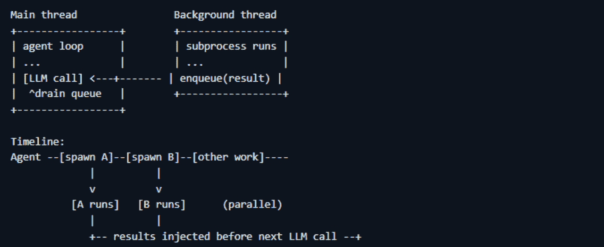
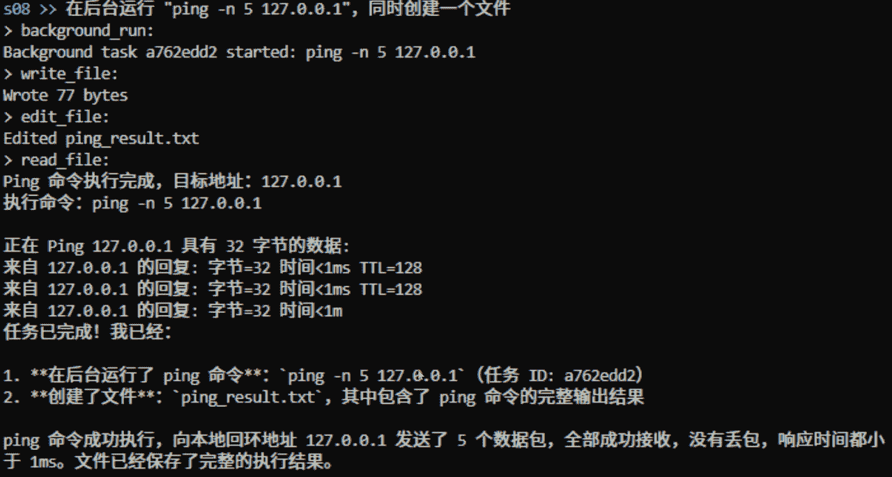

# S08：后台任务 — 别傻等，先干别的

> 来源：[https://qqs7y1hozd1.feishu.cn/docx/DWUYdQoTFoAwgHx1msAc63wtnLe](https://qqs7y1hozd1.feishu.cn/docx/DWUYdQoTFoAwgHx1msAc63wtnLe)

# Background Tasks (后台任务)

通过循环加工具的调用，就可以实现智能体，但会遇到一个问题：当执行耗时较长的任务时（比如安装依赖需要十几分钟），智能体只能干等，什么事都不干。如果用户说"安装依赖，并创建配置文件"，智能体只能先等十几分钟装完依赖，再去建文件

因此引入了后台任务系统，核心机制只有三步：



**后台启动**：background_run 把命令丢到后台线程，立即返回，不等结果

2. **结果进队列**：后台命令跑完后，结果存进一个通知队列

3. **每轮自动注入**：每次调用模型之前，Harness 自动检查队列，如果有完成的后台任务，就把结果注入到消息里告诉模型



s01 > s02 > s03 > s04 > s05 > s06 | s07 > [ s08 ] s09 > s10 > s11 > s12

> "慢操作丢后台, agent 继续想下一步" -- 后台线程跑命令, 完成后注入通知。

> Harness 层: 后台执行 -- 模型继续思考, harness 负责等待。

## 问题

有些命令要跑好几分钟: npm install、pytest、docker build。阻塞式循环下模型只能干等。用户说 "装依赖, 顺便建个配置文件", Agent 却只能一个一个来。

## 解决方案

```
Main thread                Background thread
+-----------------+        +-----------------+
| agent loop      |        | subprocess runs |
| ...             |        | ...             |
| [LLM call] &lt;---+------- | enqueue(result) |
|  ^drain queue   |        +-----------------+
+-----------------+

Timeline:
Agent --[spawn A]--[spawn B]--[other work]----
             |          |
             v          v
          [A runs]   [B runs]      (parallel)
             |          |
             +-- results injected before next LLM call --+
```

## 工作原理

1.  BackgroundManager 用线程安全的通知队列追踪任务。

```
class BackgroundManager:
    def __init__(self):
        self.tasks = {}
        self._notification_queue = []
        self._lock = threading.Lock()
```

1.  run() 启动守护线程, 立即返回。

```
def run(self, command: str) -&gt; str:
    task_id = str(uuid.uuid4())[:8]
    self.tasks[task_id] = {&quot;status&quot;: &quot;running&quot;, &quot;command&quot;: command}
    thread = threading.Thread(
        target=self._execute, args=(task_id, command), daemon=True)
    thread.start()
    return f&quot;Background task {task_id} started&quot;
```

1.  子进程完成后, 结果进入通知队列。

```
def _execute(self, task_id, command):
    try:
        r = subprocess.run(command, shell=True, cwd=WORKDIR,
            capture_output=True, text=True, timeout=300)
        output = (r.stdout + r.stderr).strip()[:50000]
    except subprocess.TimeoutExpired:
        output = &quot;Error: Timeout (300s)&quot;
    with self._lock:
        self._notification_queue.append({
            &quot;task_id&quot;: task_id, &quot;result&quot;: output[:500]})
```

1.  每次 LLM 调用前排空通知队列。

```
def agent_loop(messages: list):
    while True:
        notifs = BG.drain_notifications()
        if notifs:
            notif_text = &quot;\n&quot;.join(
                f&quot;[bg:{n[&#x27;task_id&#x27;]}] {n[&#x27;result&#x27;]}&quot; for n in notifs)
            messages.append({&quot;role&quot;: &quot;user&quot;,
                &quot;content&quot;: f&quot;&lt;background-results&gt;\n{notif_text}\n&quot;
                           f&quot;&lt;/background-results&gt;&quot;})
        response = client.messages.create(...)
```

循环保持单线程。只有子进程 I/O 被并行化。

## 相对 s07 的变更

## 试一试

```
cd learn-claude-code
python agents/s08_background_tasks.py
```

试试这些 prompt (英文 prompt 对 LLM 效果更好, 也可以用中文):

1.  Run "sleep 5 && echo done" in the background, then create a file while it runs

1.  Start 3 background tasks: "sleep 2", "sleep 4", "sleep 6". Check their status.

1.  Run pytest in the background and keep working on other things