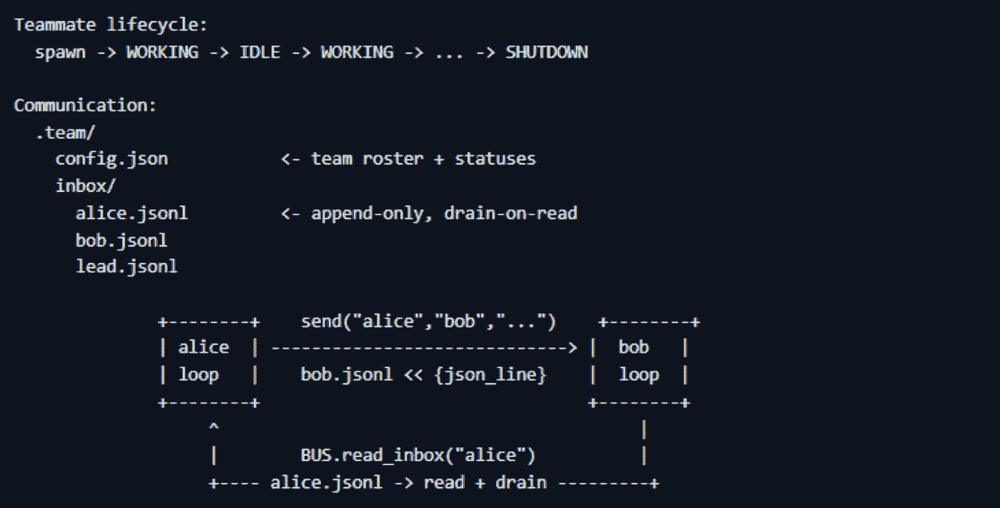
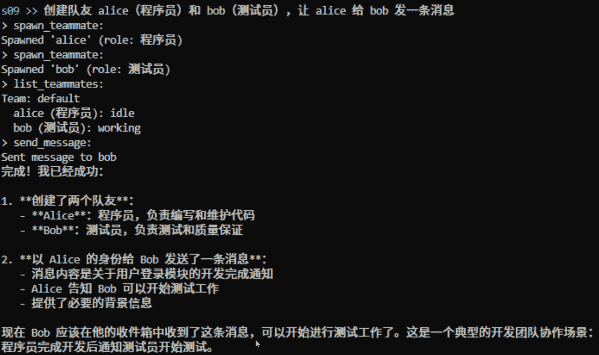

# S09：组建团队 — 一个人忙不过来，招人

> 来源：[https://qqs7y1hozd1.feishu.cn/docx/JGgOdK5PFo3Jf4xuM9jcL48Hnqc](https://qqs7y1hozd1.feishu.cn/docx/JGgOdK5PFo3Jf4xuM9jcL48Hnqc)

# Agent Teams (Agent 团队)

大型任务一个人干不完，需要引入团队的概念，分工协作才能高效完成、减少错误

默认和你对话的 Agent 为领导 Agent，只有领导才能创建队友，不同的队友各自拥有一个独立的线程，在独立的线程中运行着独立的循环。



团队之间需要通信，因此为每个 Agent 单独配置了一个文件夹作为收件箱，在每次调用大模型之前，会将收件箱中的内容注入到对应 Agent 的上下文中，每个 Agent 都可以收发消息



s01 > s02 > s03 > s04 > s05 > s06 | s07 > s08 > [ s09 ] s10 > s11 > s12

> "任务太大一个人干不完, 要能分给队友" -- 持久化队友 + JSONL 邮箱。

> Harness 层: 团队邮箱 -- 多个模型, 通过文件协调。

## 问题

Subagent (s04) 是一次性的: 生成、干活、返回摘要、消亡。没有身份, 没有跨调用的记忆。Background Tasks (s08) 能跑 shell 命令, 但做不了 LLM 引导的决策。

真正的团队协作需要三样东西: (1) 能跨多轮对话存活的持久 Agent, (2) 身份和生命周期管理, (3) Agent 之间的通信通道。

## 解决方案

```
Teammate lifecycle:
  spawn -&gt; WORKING -&gt; IDLE -&gt; WORKING -&gt; ... -&gt; SHUTDOWN

Communication:
  .team/
    config.json           &lt;- team roster + statuses
    inbox/
      alice.jsonl         &lt;- append-only, drain-on-read
      bob.jsonl
      lead.jsonl

              +--------+    send(&quot;alice&quot;,&quot;bob&quot;,&quot;...&quot;)    +--------+
              | alice  | -----------------------------&gt; |  bob   |
              | loop   |    bob.jsonl &lt;&lt; {json_line}    |  loop  |
              +--------+                                +--------+
                   ^                                         |
                   |        BUS.read_inbox(&quot;alice&quot;)          |
                   +---- alice.jsonl -&gt; read + drain ---------+
```

## 工作原理

1.  TeammateManager 通过 config.json 维护团队名册。

```
class TeammateManager:
    def __init__(self, team_dir: Path):
        self.dir = team_dir
        self.dir.mkdir(exist_ok=True)
        self.config_path = self.dir / &quot;config.json&quot;
        self.config = self._load_config()
        self.threads = {}
```

1.  spawn() 创建队友并在线程中启动 agent loop。

```
def spawn(self, name: str, role: str, prompt: str) -&gt; str:
    member = {&quot;name&quot;: name, &quot;role&quot;: role, &quot;status&quot;: &quot;working&quot;}
    self.config[&quot;members&quot;].append(member)
    self._save_config()
    thread = threading.Thread(
        target=self._teammate_loop,
        args=(name, role, prompt), daemon=True)
    thread.start()
    return f&quot;Spawned teammate &#x27;{name}&#x27; (role: {role})&quot;
```

1.  MessageBus: append-only 的 JSONL 收件箱。send() 追加一行; read_inbox() 读取全部并清空。

```
class MessageBus:
    def send(self, sender, to, content, msg_type=&quot;message&quot;, extra=None):
        msg = {&quot;type&quot;: msg_type, &quot;from&quot;: sender,
               &quot;content&quot;: content, &quot;timestamp&quot;: time.time()}
        if extra:
            msg.update(extra)
        with open(self.dir / f&quot;{to}.jsonl&quot;, &quot;a&quot;) as f:
            f.write(json.dumps(msg) + &quot;\n&quot;)

    def read_inbox(self, name):
        path = self.dir / f&quot;{name}.jsonl&quot;
        if not path.exists(): return &quot;[]&quot;
        msgs = [json.loads(l) for l in path.read_text().strip().splitlines() if l]
        path.write_text(&quot;&quot;)  # drain
        return json.dumps(msgs, indent=2)
```

1.  每个队友在每次 LLM 调用前检查收件箱, 将消息注入上下文。

```
def _teammate_loop(self, name, role, prompt):
    messages = [{&quot;role&quot;: &quot;user&quot;, &quot;content&quot;: prompt}]
    for _ in range(50):
        inbox = BUS.read_inbox(name)
        if inbox != &quot;[]&quot;:
            messages.append({&quot;role&quot;: &quot;user&quot;,
                &quot;content&quot;: f&quot;&lt;inbox&gt;{inbox}&lt;/inbox&gt;&quot;})
        response = client.messages.create(...)
        if response.stop_reason != &quot;tool_use&quot;:
            break
        # execute tools, append results...
    self._find_member(name)[&quot;status&quot;] = &quot;idle&quot;
```

## 相对 s08 的变更

## 试一试

```
cd learn-claude-code
python agents/s09_agent_teams.py
```

试试这些 prompt (英文 prompt 对 LLM 效果更好, 也可以用中文):

1.  Spawn alice (coder) and bob (tester). Have alice send bob a message.

1.  Broadcast "status update: phase 1 complete" to all teammates

1.  Check the lead inbox for any messages

1.  输入 /team 查看团队名册和状态

1.  输入 /inbox 手动检查领导的收件箱