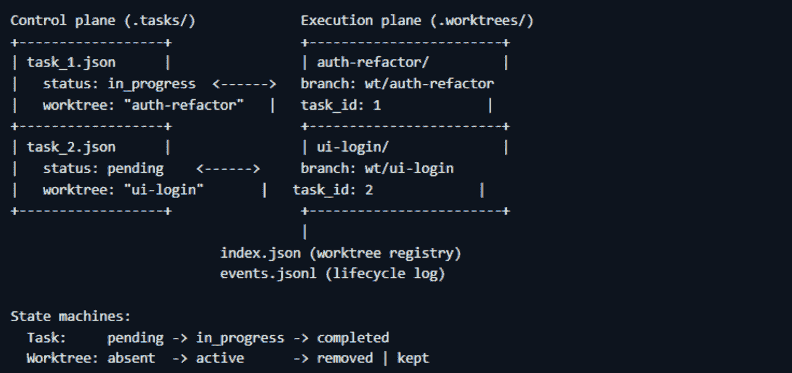
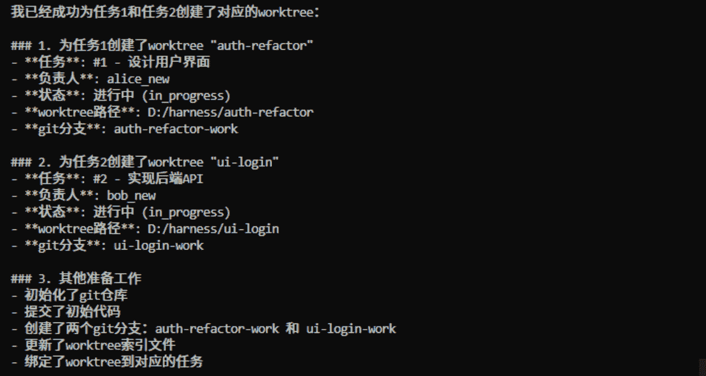

# S12：Worktree 任务隔离 — 各干各的目录，互不干扰

> 来源：[https://qqs7y1hozd1.feishu.cn/docx/SE3mdl4zDoeCxLxnaG2cQuaMnzc](https://qqs7y1hozd1.feishu.cn/docx/SE3mdl4zDoeCxLxnaG2cQuaMnzc)

# Worktree + Task Isolation (Worktree 任务隔离)

多个智能体同时干活时，会有互相干扰的问题，比如智能体 A 在改一个文件的同时，智能体 B 也在改同一个文件，未提交的改动互相污染，也没法干净回滚

解决方案是给每个任务划分独立的工作空间，这些独立工**作目录不是简单地建了个文**件夹，而是用了 git worktree ：每个目录都是一个独立的 git 分支，这意味着：

+   各自的改动在各自的分支上，可以独立提交

+   完成后可以通过 git merge 把成果合回主分支

+   出了问题可以干净地回滚整个分支，不影响别人



每个 worktree 通过任务 ID 和任务系统（S07）绑定在一起 ： 任务管"做什么"，worktree 管"在哪做"，ID 把两者关联起来



s01 > s02 > s03 > s04 > s05 > s06 | s07 > s08 > s09 > s10 > s11 > [ s12 ]

> "各干各的目录, 互不干扰" -- 任务管目标, worktree 管目录, 按 ID 绑定。

> Harness 层: 目录隔离 -- 永不碰撞的并行执行通道。

## 问题

到 s11, Agent 已经能自主认领和完成任务。但所有任务共享一个目录。两个 Agent 同时重构不同模块 -- A 改 config.py, B 也改 config.py, 未提交的改动互相污染, 谁也没法干净回滚。

任务板管 "做什么" 但不管 "在哪做"。解法: 给每个任务一个独立的 git worktree 目录, 用任务 ID 把两边关联起来。

## 解决方案

```
Control plane (.tasks/)             Execution plane (.worktrees/)
+------------------+                +------------------------+
| task_1.json      |                | auth-refactor/         |
|   status: in_progress  &lt;------&gt;   branch: wt/auth-refactor
|   worktree: &quot;auth-refactor&quot;   |   task_id: 1             |
+------------------+                +------------------------+
| task_2.json      |                | ui-login/              |
|   status: pending    &lt;------&gt;     branch: wt/ui-login
|   worktree: &quot;ui-login&quot;       |   task_id: 2             |
+------------------+                +------------------------+
                                    |
                          index.json (worktree registry)
                          events.jsonl (lifecycle log)

State machines:
  Task:     pending -&gt; in_progress -&gt; completed
  Worktree: absent  -&gt; active      -&gt; removed | kept
```

## 工作原理

1.  创建任务。 先把目标持久化。

```
TASKS.create(&quot;Implement auth refactor&quot;)
# -&gt; .tasks/task_1.json  status=pending  worktree=&quot;&quot;
```

1.  创建 worktree 并绑定任务。 传入 task_id 自动将任务推进到 in_progress。

```
WORKTREES.create(&quot;auth-refactor&quot;, task_id=1)
# -&gt; git worktree add -b wt/auth-refactor .worktrees/auth-refactor HEAD
# -&gt; index.json gets new entry, task_1.json gets worktree=&quot;auth-refactor&quot;
```

绑定同时写入两侧状态:

```
def bind_worktree(self, task_id, worktree):
    task = self._load(task_id)
    task[&quot;worktree&quot;] = worktree
    if task[&quot;status&quot;] == &quot;pending&quot;:
        task[&quot;status&quot;] = &quot;in_progress&quot;
    self._save(task)
```

1.  在 worktree 中执行命令。 cwd 指向隔离目录。

```
subprocess.run(command, shell=True, cwd=worktree_path,
               capture_output=True, text=True, timeout=300)
```

1.  收尾。 两种选择:

+   worktree_keep(name) -- 保留目录供后续使用。

+   worktree_remove(name, complete_task=True) -- 删除目录, 完成绑定任务, 发出事件。一个调用搞定拆除 + 完成。

```
def remove(self, name, force=False, complete_task=False):
    self._run_git([&quot;worktree&quot;, &quot;remove&quot;, wt[&quot;path&quot;]])
    if complete_task and wt.get(&quot;task_id&quot;) is not None:
        self.tasks.update(wt[&quot;task_id&quot;], status=&quot;completed&quot;)
        self.tasks.unbind_worktree(wt[&quot;task_id&quot;])
        self.events.emit(&quot;task.completed&quot;, ...)
```

1.  事件流。 每个生命周期步骤写入 .worktrees/events.jsonl:

```
{
  &quot;event&quot;: &quot;worktree.remove.after&quot;,
  &quot;task&quot;: {&quot;id&quot;: 1, &quot;status&quot;: &quot;completed&quot;},
  &quot;worktree&quot;: {&quot;name&quot;: &quot;auth-refactor&quot;, &quot;status&quot;: &quot;removed&quot;},
  &quot;ts&quot;: 1730000000
}
```

事件类型: worktree.create.before/after/failed, worktree.remove.before/after/failed, worktree.keep, task.completed。

崩溃后从 .tasks/ + .worktrees/index.json 重建现场。会话记忆是易失的; 磁盘状态是持久的。

## 相对 s11 的变更

## 试一试

```
cd learn-claude-code
python agents/s12_worktree_task_isolation.py
```

试试这些 prompt (英文 prompt 对 LLM 效果更好, 也可以用中文):

1.  Create tasks for backend auth and frontend login page, then list tasks.

1.  Create worktree "auth-refactor" for task 1, then bind task 2 to a new worktree "ui-login".

1.  Run "git status --short" in worktree "auth-refactor".

1.  Keep worktree "ui-login", then list worktrees and inspect events.

1.  Remove worktree "auth-refactor" with complete_task=true, then list tasks/worktrees/events.