# 学业辅导智能体Agent

> 来源：[https://qqs7y1hozd1.feishu.cn/docx/U1k6de3g3oGHpcxxxCUcpyjynpd](https://qqs7y1hozd1.feishu.cn/docx/U1k6de3g3oGHpcxxxCUcpyjynpd)

# RAG拍照搜题系统技术架构详解

拍照搜题系统采用“三层管道（多模态 OCR → 语义检索 → 答案渲染）、两级检索（倒排 BM25 + 向量 HNSW）并以大语言模型兜底”的整体框架：

**多模态 OCR 层**

> 将题目图片经过超分、去噪、倾斜校正后，分别用 CRNN/SVTR 识别文本、Faster-RCNN + MER 解析公式

**语义检索层**

> 把题干关键词与 BERT/BGE-M3 生成的句向量写入 Havenask 索引，通过倒排和向量双路召回在 P99 < 10 ms 命中逾 3 亿题库；若得分不足，再交由 gBDT/LTR 精排。

**答案渲染层**

> 与 LLM 兜底 95 %以上的题目直接返回数据库内已审核解析；冷门或改编题则走检索增强的大模型

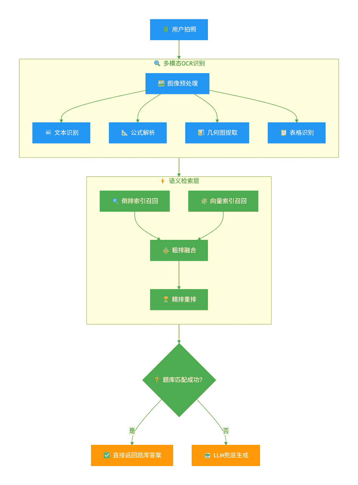

**下面是这个过程：**

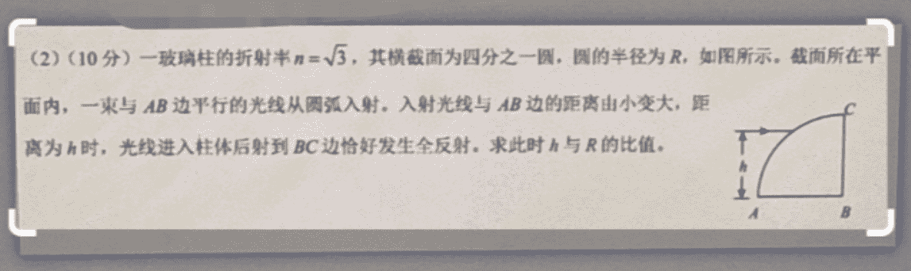

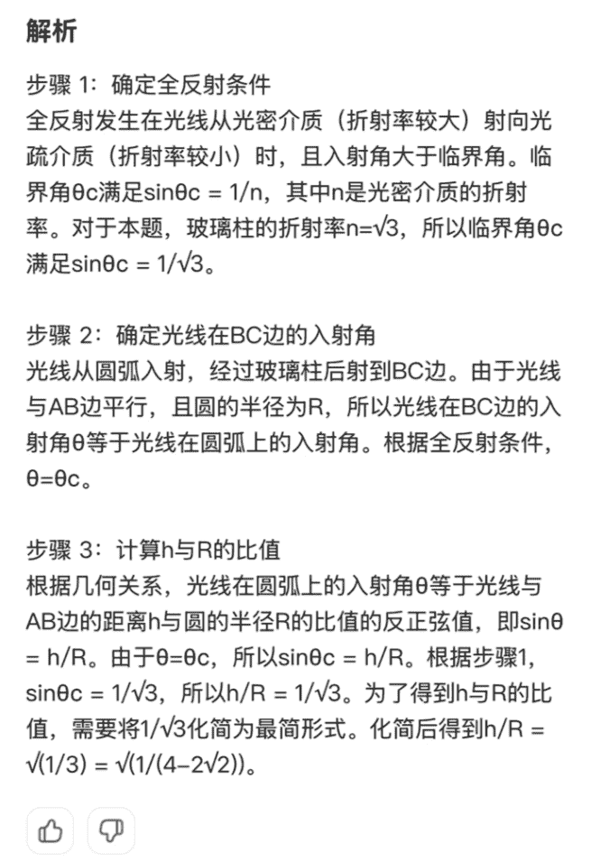

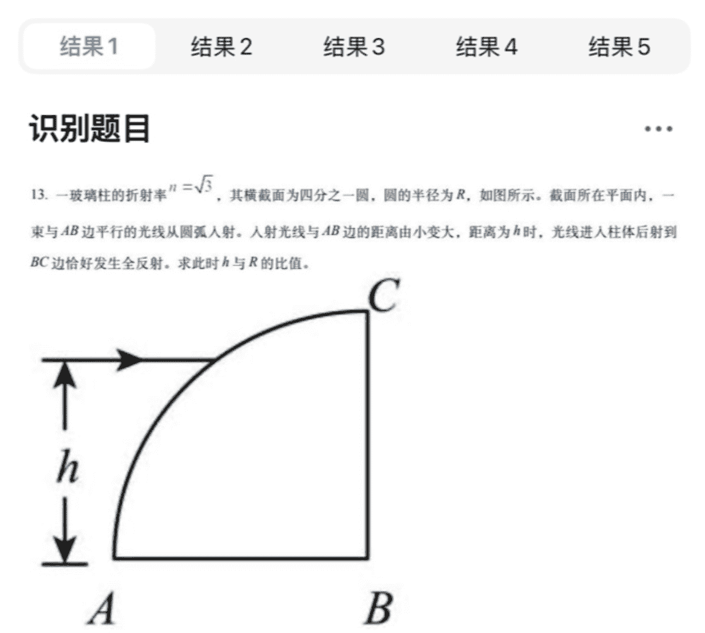

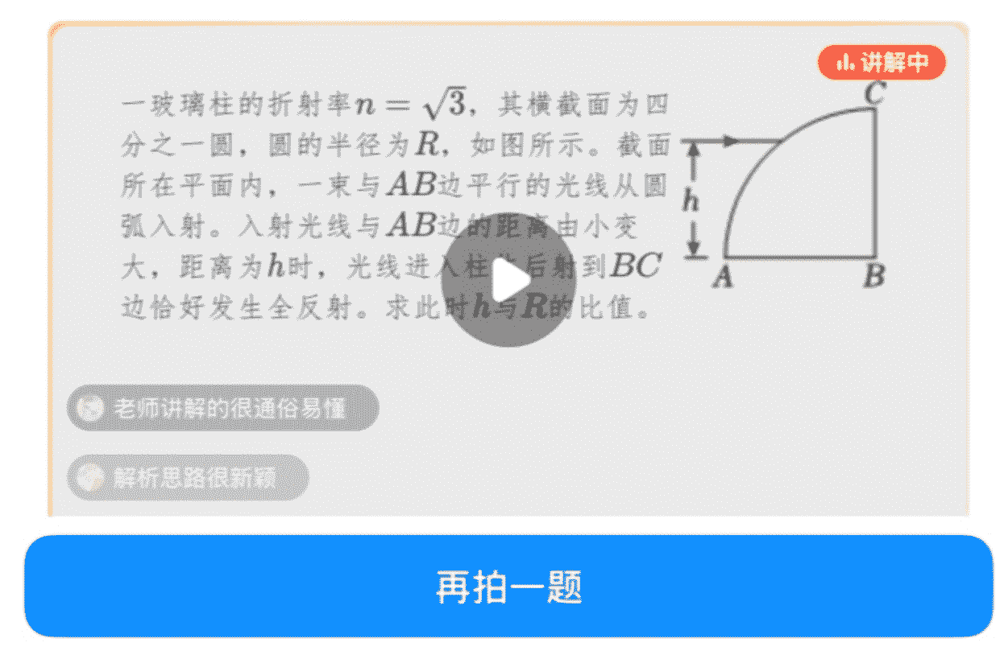

## 一、图像 & 多模态识别层

### 技术架构与处理流程

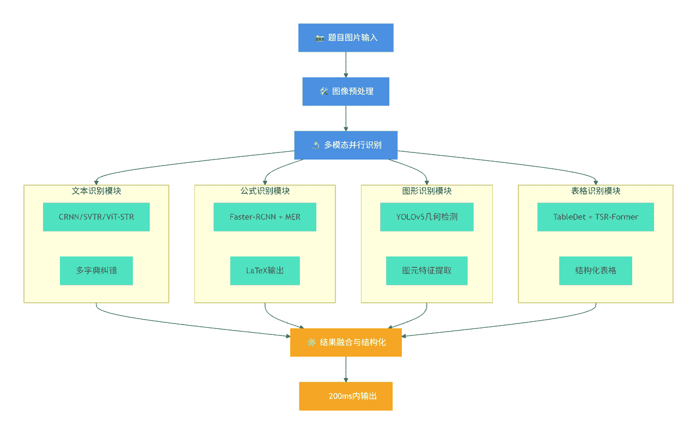

图像识别层承担着将非结构化的题目图片转化为结构化数据的关键任务。

> 这一过程需要处理复杂的版面布局、多样化的内容形式（文本、公式、图形、表格），并在严格的时延约束下完成。

### 关键技术实现

#### ①图像预处理流水线

+   **超分辨率处理：**针对低质量拍摄图像，使用ESPCN、FSRCNN等轻量超分模型提升分辨率

+   **噪声消除：**基于BM3D或深度学习去噪算法，处理光照不均、摩尔纹等问题

+   **倾斜校正：**通过霍夫变换或深度学习检测文本基线，进行仿射变换矫正

#### ②文本识别优化策略

+   针对竖排文本、手写体、中英文混排等复杂场景，构建多字典纠错机制

+   采用动态字典切换策略，根据识别置信度自动选择最优字典

+   集成语言模型后处理，提升连续文本的语义连贯性

#### ③推理加速技术

+   30+模型采用TensorRT FP16量化，实现GPU通道并行推理

+   CPU预处理流水线优化，减少GPU等待时间

+   模型级联剪枝，低置信度样本提前终止后续处理

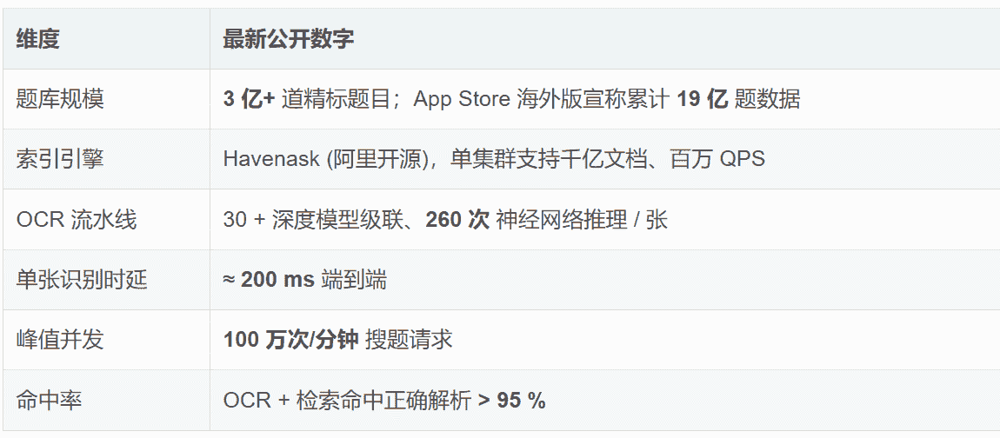

#### ④OCR 主干

超分 + 去噪 + 倾斜校正 预处理，之后文本行进入 CRNN / SVTR / ViT-STR 等开源架构的自研模型；竖排、手写体与英数混排均做多字典纠错。

数学公式区先经 Faster-RCNN 检测，再用 Transformer-based MER（开源 TrOCR 同类思路）输出 LaTeX 串，结构信息可直接入索引。

**几何草图 / 曲线题，**使用轻量 YOLOv5 变体提角点、线段与注记，供后续“图+文”匹配。

表格区域走 TableDet + TSR-Former ，还原网格，再单元格级 OCR。

#### ⑤推理加速

整条流水线共 30 余模型，GPU 集群以 TensorRT FP16 通道并行推理，平均耗时 ≈ 200 ms；预处理仍由 CPU 承担以节省卡数。

## 二、语义检索 & 排序层

### 索引引擎：Havenask

倒排 BM25 + 原生 HNSW 向量索引“双路召回”，查询 P99 延迟 < 10 ms。


[Havenask检索引擎.pdf](https://internal-api-drive-stream.feishu.cn/space/api/box/stream/download/all/Kt9ybuo6doqBhKxMvtfcuPcgnAc)

题干向量由 BERT/Sentence-BERT 系中文模型 细调得到；

近年开始切换到 BGE-M3 稀疏-稠密混合 embedding，提高“文字改编题”召回率。

**Havenask + Fluid 缓存**实现 算存分离，TB 级索引热更无停机。

### 多级排序

**粗排：**倒排得分 + 向量余弦；

**精排：**gBDT/LTR 模型综合学段、教材版本、难度标签，再做重排；

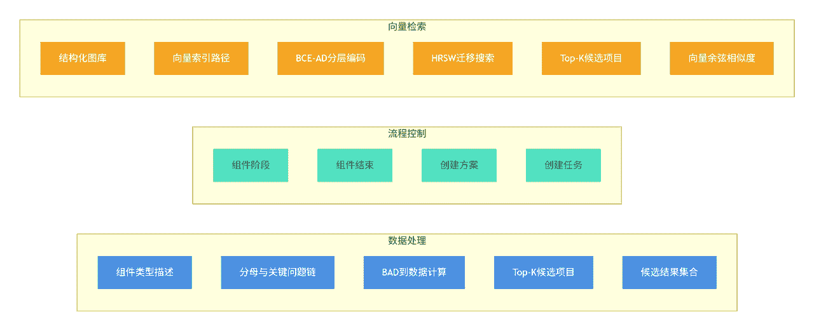

得分低于阈值时调用下一层 LLM 兜底。

## 三、大模型推理 & 兜底生成

### LLM兜底机制

当传统检索无法命中或匹配置信度低于阈值时，系统自动切换到LLM生成模式。

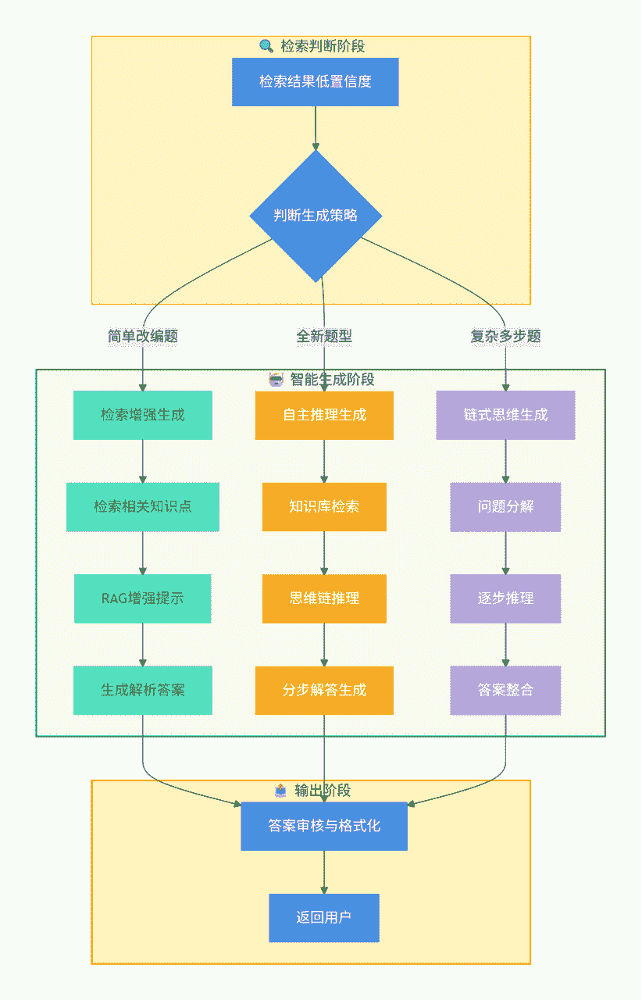

### 模型部署架构

#### 云端大模型集群

+   自研20-30B参数专用模型，针对教育场景深度优化

+   支持千卡并行推理，峰值承载100万次/分钟请求

+   动态负载均衡，保障高并发下的服务稳定性

#### 端侧轻量模型

+   MiniCPM-2B-Int4量化部署，离线环境下提供基础能力

+   端云协同推理，网络不佳时降级到本地处理

+   隐私敏感数据本地处理，避免上传风险

## 四、训练数据与标注策略

### 题库

主索引收录 3 亿+ 标准题，覆盖 K-12 90 % 教材版本；硬件产品宣传口径中的「10 亿+ Top 题」为附加真题/变式汇总。

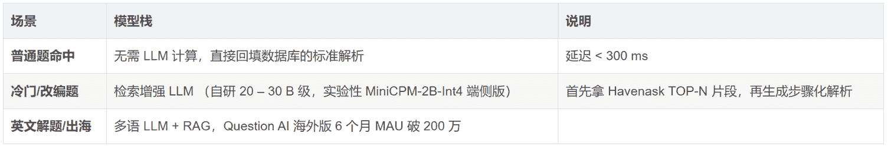

+   覆盖率：全面覆盖K12阶段90%教材版本，包括人教版、北师大版、苏教版等

+   题目类型：选择题、填空题、解答题、证明题等全题型覆盖

+   难度分层：基础题60%、中档题30%、拔高题10%的科学分布

+   时效性：每年更新20%题目，保持与教学大纲同步

### OCR 训练集

来源：学生实时上传、合作教辅 PDF、公开试卷扫描，累计十亿级行级切图；通过半自动标注平台做字符与版面标注。

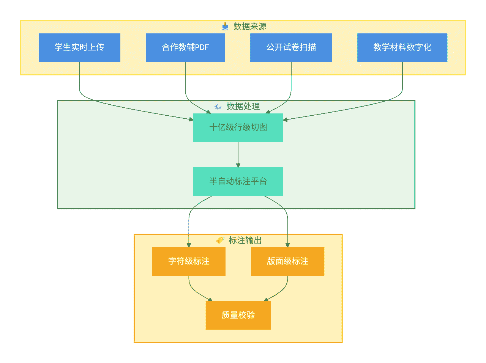

+   字符级精度：字符识别准确率要求>99.5%

+   版面还原度：公式位置、表格结构还原度>98%

+   **多场景覆盖：**

+   印刷体：宋体、楷体、黑体等主流字体

+   手写体：工整手写、连笔手写分级处理

+   拍摄条件：不同光线、角度、分辨率场景

### 公式 & 表格数据

公式使用 MathPix-like 合成 + 人工修订的 LaTeX 对齐数据；表格采取教学用书 PDF 结构树自动抽取 + 单元格校对。

+   来源：教学用书PDF结构树自动抽取

+   校对：单元格级人工校对，确保行列关系准确

+   复杂表格：支持合并单元格、嵌套表格等复杂结构

+   输出格式：HTML表格结构+语义标注

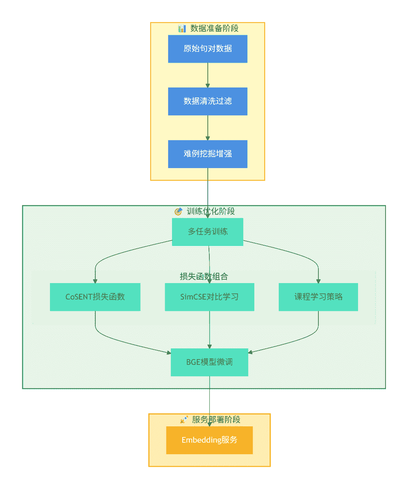

### Embedding Pair 数据

基于历史拍题“同题不同拍”日志构造千万级相似/不相似句对，用 CoSENT 或 SimCSE 损失继续细调 SBERT/BGE。

**正例构造：**

+   同题不同拍：同一题目的不同拍摄版本

+   文字改编题：题干文字改写但核心不变

+   语义相似题：相同知识点、相似解题思路

**负例构造：**

+   易混淆题：表面相似但知识点不同

+   随机采样：完全不相关的题目

+   难度差异：相同知识点但难度悬殊

### 开源组件清单（公开可考证）

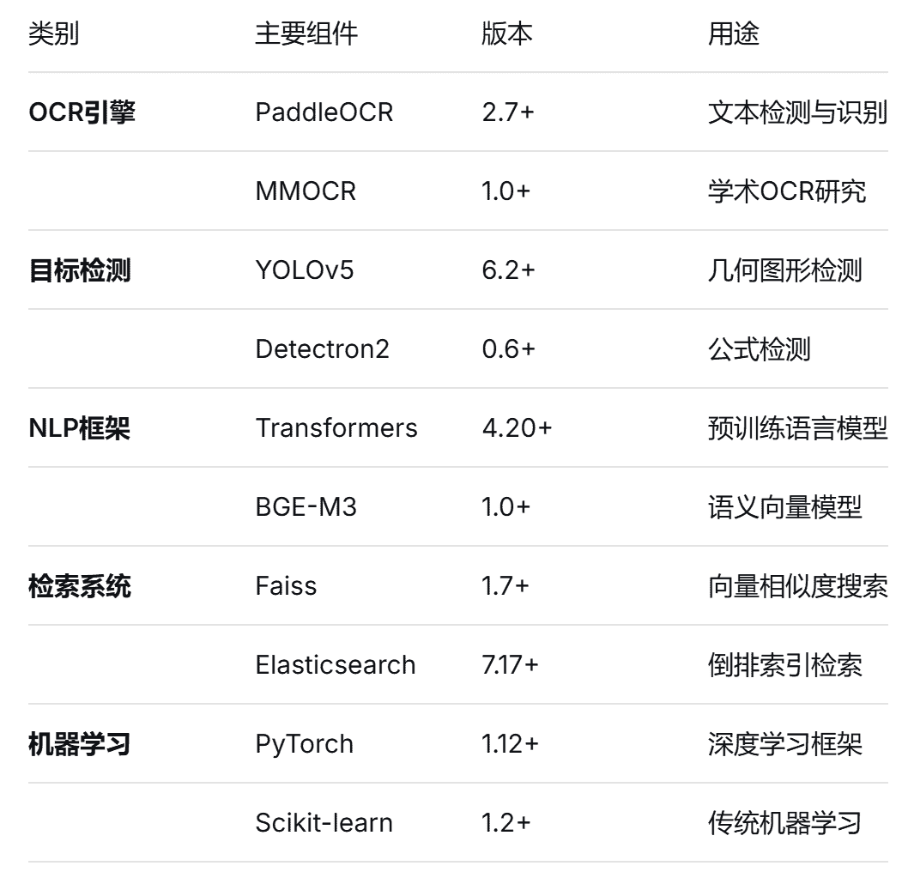

## 五、Dify集成：搭建智能教育助手

### 智能教育助手工作流配置

在Dify中创建一个统一的智能教育助手工作流，通过问题分类器实现解题和作业批改的智能分支：

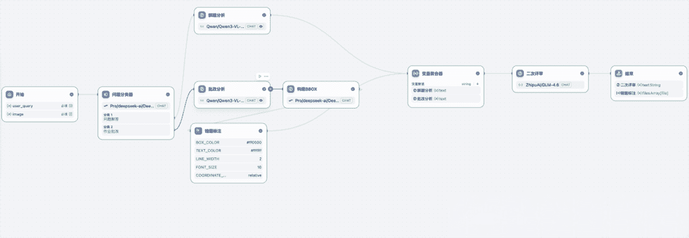

### 拍照解题场景

上传一道题目，AI的分析过程：

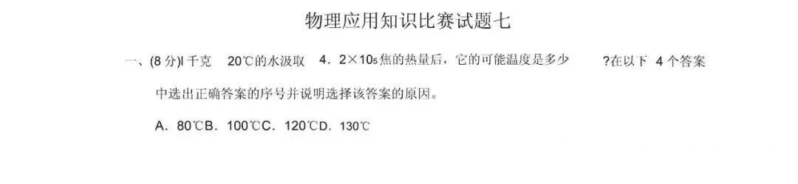

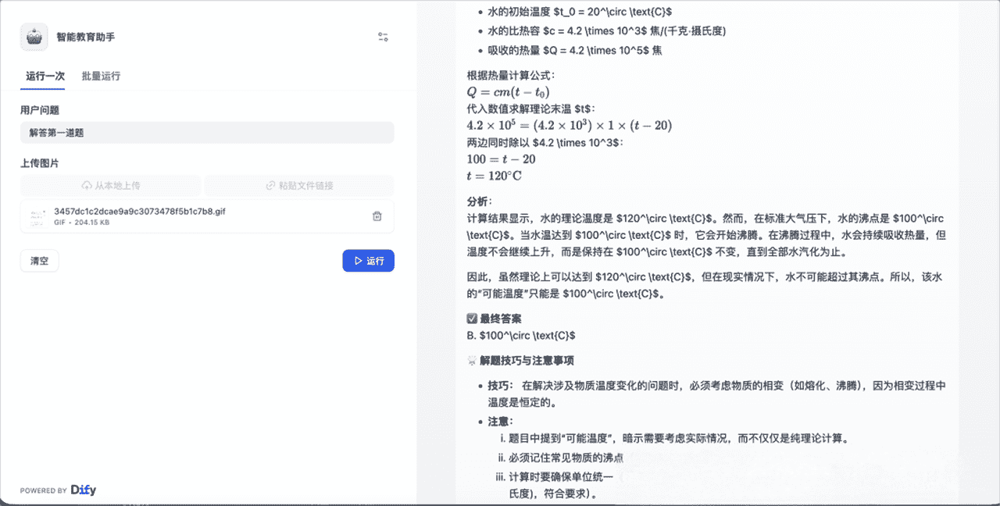

### 作业批改场景

上传学生的数学作业，AI批改过程：

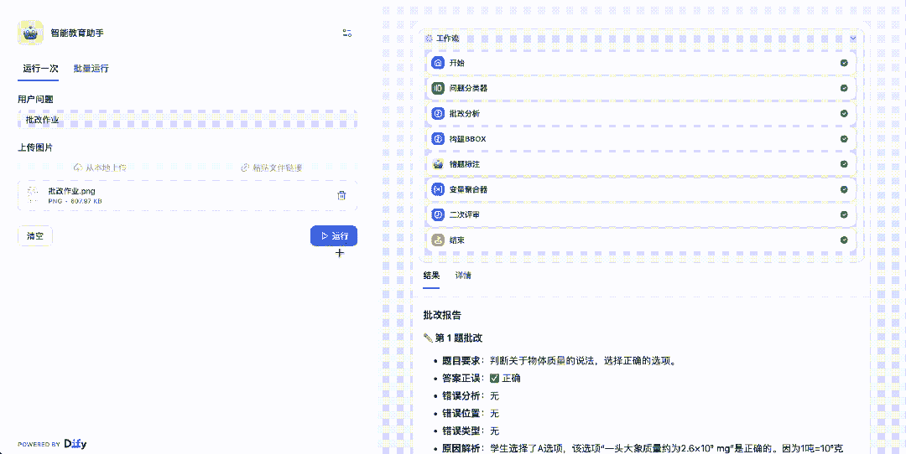

### 异步加载

如组卷网会通过js异步加载导致jsoup第一步抓取的只是一个网站空壳，抓不到想要的数据

可以通过htmlunit技术去模拟浏览器，把js异步加载过程也模拟完成后能获得正确数据

```
        WebClient webClient = new WebClient(BrowserVersion.FIREFOX_52);//选择模拟浏览器型号
       //屏蔽日志信息
        LogFactory.getFactory().setAttribute(&quot;org.apache.commons.logging.Log&quot;,
                &quot;org.apache.commons.logging.impl.NoOpLog&quot;);
        Logger.getLogger(&quot;com.gargoylesoftware&quot;).setLevel(Level.OFF);
       //支持JavaScript
        webClient.getOptions().setJavaScriptEnabled(true);
        webClient.getOptions().setCssEnabled(false);
        webClient.getOptions().setActiveXNative(false);
        webClient.getOptions().setCssEnabled(false);
        webClient.getOptions().setThrowExceptionOnScriptError(false);
        webClient.getOptions().setThrowExceptionOnFailingStatusCode(false);
        webClient.getOptions().setTimeout(10000);
        webClient.waitForBackgroundJavaScript(10000);
        url=
        URL link=new URL(url);
        WebRequest webRequest=new WebRequest(link);
        HtmlPage rootPage = webClient.getPage(webRequest);//获得要抓取的页面

```

### 登陆操作

有些网站一些页面需要登陆操作

可以通过设置hander cookie来跳过登陆，但是cookie部分数据会动态发生改变需要时时注意，

```
    public static Document setHeader(String url) throws IOException {//设置header返回doc
    Map&lt;String, String&gt; header = new HashMap&lt;String, String&gt;();
    Connection conn=Jsoup.connect(url);
    conn.header(&quot;Host&quot;,&quot;www.tiku.cn&quot;);
    conn.header(&quot;Connection&quot;,&quot;keep-alive&quot;);
    conn.header(&quot;User-Agent&quot;,&quot;Mozilla/5.0 (Macintosh; Intel Mac OS X 10.14; rv:66.0) Gecko/20100101 Firefox/66.0&quot;);
    conn.header(&quot;Accept&quot;,&quot;text/html,application/xhtml+xml,application/xml;q=0.9,*/*;q=0.8&quot;);
    conn.header(&quot;Accept-Encoding&quot;,&quot;gzip, deflate&quot;);
    conn.header(&quot;Accept-Language&quot;,&quot;zh-CN,zh;q=0.8,zh-TW;q=0.7,zh-HK;q=0.5,en-US;q=0.3,en;q=0.2&quot;);
    conn.header(&quot;Cookie&quot;,&quot;Hm_lvt_02f32149c7ea90d0cd47ed89025e457c=1555984749,1555986859,1556607888,1557306767; PHPSESSID=5i8v8easa3uhkev2r36uennqai; Hm_lpvt_02f32149c7ea90d0cd47ed89025e457c=1557399030; AD=None; token=6ce06f56f40d000c3bb79b7a65bed7e8; userId=25431; isLogin=1&quot;);//题库网的PHPSESSID会动态改变的得实时更新
    conn.header(&quot;Referer&quot;,);//设置header的参数
    conn.execute();
    return conn.get();
}

```

或者通过htmlunit取模拟登陆

```
        CookieManager cm=webClient.getCookieManager();//得到当前分配得到的cookie
        Set&lt;Cookie&gt; cookies=((CookieManager) cm).getCookies();
        Iterator&lt;Cookie&gt; it=cookies.iterator();
        while(it.hasNext()){
            webClient.getCookieManager().addCookie(it.next());
        }
        rootPage=webClient.getPage(url);
        HtmlForm form=rootPage.getForms().get(0);//获取当前页面的表单
        HtmlInput name=form.getInputByName(&quot;LoginForm[username]&quot;);
        HtmlInput pwd=form.getInputByName(&quot;LoginForm[password]&quot;);
        name.setValueAttribute(&quot;17684721017&quot;);
        pwd.setValueAttribute(&quot;123456&quot;);
        HtmlButton btn= (HtmlButton) rootPage.getByXPath(&quot;/html/body/div/div/form/div/div[3]/button&quot;).get(0);
        rootPage=btn.click();//获得登陆后的页面

```

### ocr调用实现

将图片文件进行转码获得一个处理后的字符串

```
byte[] imgData = FileUtil.readFileByBytes(filePath);//需要自定义两个工具类
String imgStr = Base64Util.encode(imgData);
String params = URLEncoder.encode(&quot;image&quot;, &quot;UTF-8&quot;) + &quot;=&quot; + URLEncoder.encode(imgStr, &quot;UTF-8&quot;);//Base64Util,FileUtil这两个是自定义的工具类将图片文件转码

```

### 搜索引擎的搭建

利用solr框架搭建一个针对题目title的搜索引擎

```
&lt;fieldType name=&quot;text_ik&quot; class=&quot;solr.TextField&quot;&gt;
  &lt;analyzer class=&quot;org.wltea.analyzer.lucene.IKAnalyzer&quot;/&gt; 
&lt;/fieldType&gt;

&lt;field name=&quot;title_ik&quot; type=&quot;text_ik&quot; indexed=&quot;true&quot; stored=&quot;true&quot;/&gt;
&lt;field name=&quot;content_ik&quot; type=&quot;text_ik&quot; indexed=&quot;true&quot; stored=&quot;false&quot; multiValued=&quot;true&quot;/&gt;

```

## 小结

#### 参数层面

拍照搜题公开强调的是“30 + 模型级联、200 ms 延迟、3 亿+ 题库、95 % 准确率、百万 QPS”这一整套系统级指标，而非单一 LLM 的参数规模。

#### 技术路线

采用 开源模型 + 大量自研细调 + Havenask 索引 + GPU 并行 的组合；常见题“检索即答案”，冷门题再调用 LLM 生成。

#### 训练数据

核心是十年沉淀的亿级题库与用户拍题日志，辅以合成公式、表格和标注文本，形成覆盖印刷体、手写体、图形和跨学科的多模态语料。

**这套“识别-检索-生成”三段式架构，也正是能够在国内外多款拍题**产品中保持“秒出+准出”体验的底层关键。